# Палиперидон — парентерально

- Препарат: Ксеплион (суспензия для внутримышечного введения пролонгированного действия;)
- АТХ: N05AX13
- Источник: ГРЛС, инструкция по медицинскому применению, РУ ЛСР-009014/10, файл от 2023-09-26 (https://grls.rosminzdrav.ru/Grls_View_v2.aspx?routingGuid=b318cbc5-1104-40fb-bda5-7d79f7fa79ae)
- Распознано автоматически (OCR): 34 из 34 стр.
- Инструкция к другому РУ того же препарата: ЛСР-009014/10 (национальное РУ, переоформленное по правилам ЕАЭС, решение от 20.09.2023). Текст может быть старше действующего
- Сомнительных строк после OCR: 13 (см. раздел «Проверка распознавания»)

## Общие сведения

ICP-009014/10 от 20.09.2023 СООТВЕТСТВУЕТ ЭКСПЕРТНОМУ ОТЧЕТУ от 18.09.2023 № 18020
(Входящий МЗ №4239717)
ИНСТРУКЦИЯ ПО МЕДИЦИНСКОМУ ПРИМЕНЕНИЮ ЛЕКАРСТВЕННОГО ПРЕПАРАТА
| КСЕПЛИОН (XEPLION)
Регистрационный номер — ЛСР-009014/10 Торговое название препарата — КСЕПЛИОН
Международное непатентованное название — палиперидон

## 3. Лекарственная форма

— суспензия для внутримышечного введения пролонгированного
— суспензия для внутримышечного введения пролонгированного
® действия Состав Каждый предварительно заполненный шприц содержит:
Действующее вещество:
100 мг палиперидона в 1 мл суспензии (эквивалентно 156 мг палиперидона пальмитата).
Вспомогательные вещества:
полисорбат 20 - 12 мг, макрогол 4000 (полиэтиленгликоль 4000) — 30 мг, лимонной кислоты моногидрат — 5 мг, натрия гидрофосфат — 5 мг, натрия дигидрофосфата моногидрат - 2,5 мг, натрия гидроксид — 2,84 мг, вода для инъекций - до 1 мл.
Описание a Белая или почти белая суспензия, свободная ОТ посторонних включений
Фармакотерапевтическая группа — антипсихотическое средство (нейролептик)
Код АТХ — №05АХ13 СООТВЕТСТВУЕТ ЭКСПЕРТНОМУ ОТЧЕТУ
(Входящий МЗ №4239717)° Фармакологические свойства

## 5.1. Фармакодинамика

Механизм действия Палиперидона пальмитат гидролизуется до палиперидона. Последний является центрально-
Механизм действия Палиперидона пальмитат гидролизуется до палиперидона. Последний является центрально-
| действующим активным антагонистом преимущественно серотониновых 5-HT2,- рецепторов, а также дофаминовых П›-рецепторов, адренергических 01- и @2- рецепторов и
Н!-гистаминовых рецепторов. Палиперидон не связывается с холинергическими м-рецепторами и с адренергическими В1- и В2- рецепторами. Фармакологическая активность
(+) и (-) энантиомеров палиперидона количественно и качественно одинакова.
Предполагается, что терапевтическая эффективность препарата при шизофрении и шизоаффективном расстройстве обусловлена комбинированной блокадой D2- и 5-HT2,-
® рецепторов.

## 5.2. Фармакокинетика

Всасывание и распределение
Всасывание и распределение
Из-за исключительно низкой растворимости в воде палиперидона пальмитат после внутримышечного введения медленно растворяется и всасывается в системный кровоток.
| После однократного внутримышечного введения концентрация палиперидона в плазме крови медленно увеличивается, достигая максимума через 13 - 14 дней (медиана) после введения в дельтовидную мышцу и 13-17 дней после введения в ягодичную мыщцу.
Высвобождение вещества обнаруживается уже в 1-й день и сохраняется, по меньшей мере, 126 дней. Характеристики высвобождения активного компонента и схема дозирования препарата Ксеплион обеспечивают длительное поддержание терапевтической концентрации.
Ф После однократного введения дозы 25-150 мг в дельтовидную мышцу максимальная концентрация (Cmax) в среднем на 28 % больше, чем после введения в ягодичную мыщцу. В начале терапии введение препарата в дельтовидную мышцу помогает быстрее достичь терапевтической концентрации палиперидона (150 мгв 1-й день и 100 мг на 8-й день), чем введение в ягодичную мышцу. После многократных инъекций разница в воздействии менее очевидна. Среднее отношение максимальной и равновесной концентраций палиперидона после введения 4 инъекций препарата Ксеплион в дозе 100 мг в ягодичную мышцу равнялось 1,8, а после введения в дельтовидную мышцу - 2,2. При дозах палиперидона 25 — 150 мг площадь под кривой «концентрация - время» (AUC) палиперидона изменялась
СООТВЕТСТВУЕТ ЭКСПЕРТНОМУ ОТЧЕТУ (Входящий МЗ №4239717)
пропорционально дозе, а Cmax при дозах более 50 мг увеличивалась в меньшей степени, чем пропорционально дозе.
Медиана периода полувыведения палиперидона после введения препарата Ксеплион в дозах 25 - 150 мг колебалась в пределах 25 - 49 дней.
После введения препарата (-)-энантиомер палиперидона частично превращается в (+)- энантиомер, и отношение АПС (+)- и (-)-энантиомеров составляет примерно 1,6-1,8.
В популяционном анализе кажущийся объем распределения палиперидона равнялся 391 л;
палиперидон связывается с белками плазмы крови на 74 %.
| Метаболизм и выведение За неделю после однократного перорального приема 1 мг препарата '“С-палиперидона с ie немедленным высвобождением активного компонента с мочой в неизмененном виде выводится 59 % введенной дозы; это указывает на отсутствие существенного метаболизма препарата в печени. Примерно 80 % введенной радиоактивности обнаруживалось в моче и 11% - в кале. Известны 4 пути метаболизма препарата т vivo, но ни один из них не обуславливает метаболизма более чем 6,5% введенной дозы: дезалкилирование, гидроксилирование, дегидрогенизация, отщепление бензизоксазольной группы. Хотя исследования т Vitro позволяют предположить определенную роль изоферментов CYP2D6 и
СУРЗА4 в метаболизме палиперидона, данных о существенной роли этих изоферментов в метаболизме палиперидона in vivo нет. Популяционный фармакокинетический анализ не выявил заметного различия клиренса палиперидона после перорального приема препарата людьми с активным и слабым метаболизмом CYP2D6. Исследования с использованием микросом печени человека т уйго показали, что палиперидон существенно не ингибирует
» метаболизм лекарственных средств изоферментами CYP1A2, CYP2A6, CYP2D6, CYP2El,
| CYP3A4 и CYP3AS.
В исследованиях in vitro палиперидон проявлял свойства субстрата Р-гликопротеина, а в высоких концентрациях - свойства слабого ингибитора Р-гликопротеина. Соответствующих данных in Vivo нет, и клиническая значимость этих сведений неясна.
В целом, концентрация палиперидона в плазме крови в период нагрузки после внутримышечного введения препарата Ксеплион лежала в том же диапазоне, что и после приема палиперидона пролонгированного действия перорально в дозах от 6 до 12 мг.
Использованная схема нагрузки палиперидона обеспечивает поддержание концентрации в
СООТВЕТСТВУЕТ ЭКСПЕРТНОМУ ОТЧЕТУ (Входящий МЗ №4239717)
этом диапазоне даже в конце междозового интервала (8-й и 36-й день). Индивидуальные различия фармакокинетики палиперидона после введения препарата Ксеплион у разных пациентов были меньше, чем после приема палиперидона пролонгированного действия перорально. Из-за различия характера изменения медианы концентрации палиперидона в плазме крови при применении 2 препаратов, следует проявлять осторожность при прямом
| сравнении их фармакокинетики.
Особые категории больных Нарушение функции печени. Палиперидон не подвергается существенному метаболизму в печени. Хотя применение препарата Ксеплион у больных с нарушением функции печени легкой или средней степени тяжести не изучалось, при таких нарушениях функции печени
* коррекции дозы He требуется. В исследовании применения палиперидона перорально у больных с нарушением функции печени средней степени тяжести (класс В по Чайлд - Пью)
концентрация свободного палиперидона в плазме крови была такой же, как у здоровых добровольцев. У больных с нарушением функции печени тяжелой степени применение палиперидона не изучалось.
Нарушение функции почек. Для больных с нарушением функции почек легкой степени тяжести дозу палиперидона следует уменьшить; Ксеплион не рекомендуется применять у больных с нарушением функции почек средней и тяжелой степени. Было изучено распределение палиперидона после однократного приема внутрь таблетки палиперидона пролонгированного действия в дозе 3 мг больными с разной степенью нарушения функций почек. С уменьшением клиренса креатинина (КК) выведение палиперидона ослаблялось: при нарушении функций почек легкой степени тяжести (КК 50 - 80 мл/мин.) - на 32 %, при
» средней степени тяжести (KK 30- 50 мл/мин.) — на 64%, при тяжелой степени (KK 10 - 30 мл/мин.) — на 71 %, в результате чего АО Со.» увеличилась по сравнению со здоровыми добровольцами соответственно в 1,5, 2,6 и 4,8 раза. Исходя из небольшого количества данных о применении препарата Ксеплион у больных с нарушением функции почек легкой степени тяжести и из результатов моделирования фармакокинетики, рекомендуемая нагрузочная доза палиперидона для таких больных составляет 100 мгв 1-й деньи 75 мг через
1 неделю (обе инъекции в дельтовидную мышцу). После этого через 1 месяц вводят
СООТВЕТСТВУЕТ ЭКСПЕРТНОМУ ОТЧЕТУ (Входящий МЗ №4239717) ~ инъекцию в дозе 50 мг в дельтовидную или ягодичную мыщцу, и далее изменяют дозу от 25 мг до 100 мг в зависимости от индивидуальной переносимости и/или эффективности.
Пожилые больные. Возраст сам по себе не является фактором, требующим коррекции дозы.
Однако такая коррекция может потребоваться из-за возрастного уменьшения КК.
Раса. Популяционный фармакокинетический анализ результатов исследования палиперидона для приема внутрь не выявил различия фармакокинетики палиперидона после приема препарата людьми разных рас.
Пол. Клинически значимых различий фармакокинетики палиперидона у мужчин и женщин не найдено.
Влияние курения на фармакокинетику препарата. Согласно исследованиям с ь использованием микросом печени человека in vitro, палиперидон не является субстратом

CYP1A2, поэтому курение не должно влиять на фармакокинетику палиперидона. В соответствии с этими данными in vitro, популяционный фармакокинетический анализ не выявил различия фармакокинетики палиперидона у курящих и некурящих людей.

## 4.1. Показания к применению

Лечение шизофрении и профилактика рецидивов шизофрении у взрослых пациентов.
Лечение шизофрении и профилактика рецидивов шизофрении у взрослых пациентов.
Терапия шизоаффективных расстройств в качестве монотерапии или в составе комбинированной терапии с нормотимиками и антидепрессантами у взрослых пациентов.
У больных, никогда не принимавших палиперидон перорально или рисперидон перорально или парентерально, перед началом лечения препаратом Ксеплион рекомендуется в течение 2
- 7 дней проверить переносимость палиперидона или рисперидона перорально.

| i При необходимости лечения инъекционными препаратами пролонгированного действия у пациентов с психотическими состояниями лёгкой и средней степени тяжести, у которых ранее наблюдался ответ на терапию пероральными формами палиперидона или рисперидона,
СООТВЕТСТВУЕТ ЭКСПЕРТНОМУ ОТЧЕТУ (Входящий МЗ №4239717)

Ксеплион может применяться без предварительной стабилизации пероральными

препаратами данной группы.

## 4.3. Противопоказания

Гиперчувствительность к палиперидону или любому компоненту препарата.

Поскольку палиперидон является активным метаболитом рисперидона, Ксеплион

противопоказан больным с известной гиперчувствительностью к рисперидону.

## 4.3. С осторожностью

Следует с осторожностью применять Ксеплион в следующих случаях (см. более подробную

информацию в разделе «Особые указания»):

® — У больных с сердечно-сосудистыми заболеваниями (например, сердечной

недостаточностью, инфарктом или ишемией миокарда, нарушением сердечной проводимости), нарушениями мозгового кровообращения или состояниями, предрасполагающими к снижению артериального давления (например, обезвоживанием, уменьшением объема циркулирующей крови, применением гипотензивных препаратов).

— У больных, имеющих в анамнезе судороги или другие состояния, при которых может снижаться судорожный порог.

— У больных, которые могут подвергаться воздействиям, повышающим температуру тела, например, сильной физической нагрузке, высокой температуре окружающей среды, воздействию препаратов с активностью м-холинолитиков, а также обезвоживанию.

— У больных, имеющих в анамнезе аритмию или врожденное удлинение интервала ОТ,

® либо принимающих препараты, удлиняющие интервал QT.

— При применении в комбинации с другими лекарственными средствами, действующими на ЦНС, и алкоголем. Палиперидон может ослаблять эффект леводопы и агонистов дофамина.

— У пациентов с деменцией, болезнью Паркинсона или деменцией с тельцами Леви.

— У пациентов с возможными пролактин - зависимыми опухолями.

— У пациентов с нарушением функции печени или почек.
СООТВЕТСТВУЕТ ЭКСПЕРТНОМУ ОТЧЕТУ (Входящий МЗ №4239717”

## 4.6. Применение при беременности и в период грудного вскармливания

Беременность Безопасность применения препарата Ксеплион внутримышечно или палиперидона

| перорально при беременности у людей не установлена. В ретроспективном наблюдательном

когортном исследовании, проведённом с использованием базы данных обращений за медицинской помощью США, сравнивался риск врождённых аномалий у детей, которые родились у женщин, получавших и не получавших антипсихотические препараты в первом триместре беременности. В этом исследовании не проводилось отдельной оценки палиперидона, активного метаболита рисперидона. Риск врождённых аномалий для рисперидона после коррекции по влияющим переменным, доступным в базе данных, был повышен по сравнению с отсутствием применения антипсихотических препаратов

co (относительный риск = 1,26, 95% ДИ от 1,02 до 1,56). Не выявлен биологический механизм, объясняющий эти изменения, а в доклинических исследованиях тератогенных эффектов не наблюдалось. На основании результатов одного наблюдательного исследования не установлена причинно-следственная связь между внутриутробным воздействием рисперидона и врождёнными аномалиями.
При применении высоких доз палиперидона перорально наблюдалось небольшое увеличение смертности плодов у животных. Ксеплион при внутримышечном введении не влиял на течение беременности крыс, но высокие дозы его были токсичны для беременных самок. Дозы палиперидона при приеме внутрь и препарата Ксеплион при внутримышечном введении, которые создают концентрации, превышающие максимальные терапевтические дозы у человека соответственно в 20 - 22 раза ив 6 раз, не влияли на потомство лабораторных животных. Ксеплион можно применять при беременности только в случае, если
® предполагаемая польза для матери превышает потенциальный риск для плода. Влияние

препарата Ксеплион на схватки и роды у людей неизвестно.
В случае если женщина принимала антипсихотические препараты (включая палиперидон) в 3-м триместре беременности, у новорожденных существует риск возникновения экстрапирамидных расстройств и/или синдрома отмены различной степени тяжести. Эти симптомы могут включать ажитацию, гипертонию, гипотонию, тремор, сонливость, респираторные нарушения и нарушение вскармливания.

| СООТВЕТСТВУЕТ ЭКСПЕРТНОМУ ОТЧЕТУ (Входящий МЗ №4239717) ^
Грудное вскармливание | В исследованиях применения палиперидона у животных и рисперидона у людей обнаружено выведение палиперидона с грудным молоком. Поэтому женщины, получающие Ксеплион, не должны кормить детей грудью.

## 4.2. Способ применения и дозы

У больных, никогда не принимавших палиперидон перорально или рисперидон перорально или парентерально, перед началом лечения препаратом Ксеплион рекомендуется в течение 2 - 7 дней проверить переносимость палиперидона или рисперидона перорально.
У больных, никогда не принимавших палиперидон перорально или рисперидон перорально или парентерально, перед началом лечения препаратом Ксеплион рекомендуется в течение 2 - 7 дней проверить переносимость палиперидона или рисперидона перорально.
Шизофрения Рекомендуется начинать лечение препаратом Ксеплион с дозы 150 мг в 1-й день и 100 мг
№ через 1 неделю (обе инъекции в дельтовидную мышцу). Рекомендуется поддерживающая доза 75 мг 1 раз в месяц; эффект может наблюдаться от приема больших или меньших доз в диапазоне 25-150 мг в зависимости от индивидуальной переносимости и/или эффективности. После 2-й начальной дозы последующие поддерживающие инъекции можно проводить в дельтовидную или ягодичную мышцу.
Шизоаффективное расстройство Рекомендуется начинать лечение препаратом Ксеплион с дозы 150 мг в 1-й день и 100 мг через 1 неделю (обе инъекции в дельтовидную мышцу). Рекомендуется поддерживающая доза в диапазоне 25 - 150 мг в зависимости от индивидуальной переносимости и/или эффективности. Применение дозы 25 мг при шизоаффективном расстройстве не изучали.
После 2-й начальной дозы последующие поддерживающие инъекции можно проводить в
* дельтовидную или ягодичную MBILILY.
Поддерживающую дозу можно корректировать ежемесячно. При этом следует учитывать длительное высвобождение активного компонента, т.к. эффект изменения дозы может полностью проявиться только через несколько месяцев.
Пропуск дозы Избегание пропуска 003. 2-ю нагрузочную дозу палиперидона рекомендуется вводить через 1 неделю после 1-й дозы. Если это невозможно, то ее можно ввести на 4 дня раньше или позже. Аналогично, 3-ю и последующие дозы рекомендуется вводить ежемесячно, но если это невозможно, то инъекцию можно сделать в срок до 7 дней раньше или позже.
СООТВЕТСТВУЕТ ЭКСПЕРТНОМУ ОТЧЕТУ (Входящий МЗ №4239717)

Если 2-я инъекция препарата Ксеплион не была сделана вовремя (1 неделя + 4 дня),

| рекомендуется возобновление лечения в зависимости от времени, которое прошло со дня 1й инъекции.
Пропуск 2-й начальной дозы (срок менее 4 недель). Если со дня 1-й инъекции прошло менее 4 недель, пациенту следует ввести 2-ю инъекцию в дозе 100 мг в дельтовидную мышцу как можно скорее. 3-ю инъекцию препарата Ксеплион в дозе 75 мг следует сделать в дельтовидную или ягодичную мышцу через 5 недель после 1-й инъекции (не учитывая время 2-й инъекции). В дальнейшем должен соблюдаться ежемесячный курс инъекций в дозе от 25 мг до 150 мг в дельтовидную или ягодичную мыщцу в зависимости от индивидуальной переносимости и/или эффективности.

® Пропуск 2-й начальной дозы (срок om 4 до 7 недель). Если co дня 1-й инъекции препарата
Ксеплион прошло от 4 до 7 недель, лечение возобновляют введением 2 инъекций в дозировке 100 мг по следующей схеме: 1-ю инъекцию в дельтовидную мышцу делают как можно скорее; через 1 неделю делают 2-ю инъекцию в дельтовидную мышцу, затем продолжают ежемесячный курс инъекций в дельтовидную или ягодичную мышцу в дозе от 25 мг до 150 мг в зависимости от индивидуальной переносимости и/или эффективности.
Пропуск 2-й начальной дозы (более 7 недель). Если с момента 1-й инъекции препарата
Ксеплион прошло более 7 недель, лечение начинают так же, как в случае инициации лечения препаратом Ксеплион.
Пропуск поддерживающей дозы (срок от I месяца до 6 недель). После начала лечения рекомендуется проводить инъекции препарата Ксеплион ежемесячно. Если с момента последней инъекции прошло менее 6 недель, то следует как можно скорее ввести очередную
Ф дозу, равную предыдущей. После этого вводить препарат ежемесячно.

Пропуск поддерживающей дозы (срок от 6 недель до 6 месяцев). Если с момента последней инъекции препарата Ксеплион прошло более 6 недель, рекомендуется следующее:
Для пациентов, стабилизированных дозой от 25 мг до 100 мг:
СООТВЕТСТВУЕТ ЭКСПЕРТНОМУ ОТЧЕТУ (Входящий МЗ №42397177

1) делают инъекцию препарата в дельтовидную мышцу как можно скорее в той дозе, на которой прошла стабилизация состояния пациента до пропуска инъекции;

2) следующую инъекцию в дельтовидную мышцу (такая же доза) делают через неделю на

| 8-й день;

3) далее возобновляют ежемесячный курс инъекций в дельтовидную или ягодичную мышцу в дозе oT 25 мгдо 150 мг в зависимости от индивидуальной переносимости и/или эффективности.

Для пациентов, стабилизированных дозой 150 мг:

1) как можно скорее вводят дозу 100 мг в дельтовидную мышцу;

2) через 1 неделю вводят еще 1 дозу 100 мг (8-й день) в дельтовидную мышцу;

3) далее возобновляют ежемесячный курс инъекций в дельтовидную или ягодичную

$ мышцу в дозе от 25 мгдо 150 мг в зависимости от индивидуальной переносимости и/или эффективности.

Пропуск поддерживающей дозы (срок > 6 месяцев). Если с момента последней инъекции

препарата Ксеплион прошло более 6 месяцев, то лечение начинают заново, как описано выше

для начала лечения.

Способ применения

Ксеплион предназначен только для внутримышечного введения. Ксеплион запрещается

смешивать с любыми другими препаратами или растворителями; его внутримышечное

введение должно осуществляться непосредственно из шприца, в котором он упакован.

Препарат медленно вводят глубоко в мышцу. Инъекции должен проводить только

медицинский работник. Всю дозу вводят за 1 раз; нельзя вводить дозу за несколько инъекций.

и) Нельзя вводить препарат в сосуды или подкожно. Следует избегать случайного попадания в кровеносный сосуд. Для этого перед началом введения препарата поршень шприца оттягивают назад для проверки на предмет попадания иглы в крупный кровеносный сосуд.

В случае, если при этом в шприц поступает кровь, следует извлечь иглу и шприц из мышцы

пациента и утилизировать их.

Рекомендуемый размер иглы для введения препарата Ксеплион в дельтовидную мышцу

определяется массой тела пациента. Для больных с массой тела > 90 кг рекомендуется

длинная игла с серым корпусом из набора. Для больных с массой тела < 90 кг рекомендуется
СООТВЕТСТВУЕТ ЭКСПЕРТНОМУ ОТЧЕТУ (Входящий МЗ №4239717)

короткая игла с голубым корпусом из набора. Следует поочередно вводить препарат в правую и левую дельтовидную мышцу.
Для введения препарата Ксеплион в ягодичную мышцу рекомендуется длинная игла с серым корпусом из набора. Инъекции нужно проводить в верхний наружный квадрант ягодицы.
Следует поочередно вводить препарат в правую и левую ягодичную мыщцу.
Поскольку палиперидон является основным активным метаболитом рисперидона, следует соблюдать осторожность при одновременном применении в течение длительного периода времени препарата Ксеплион и рисперидона или пероральной формы палиперидона. Данные по безопасности одновременного применения препарата Ксеплион и других антипсихотиков ограниченны.
Больные с нарушением функции печени

i} Применение препарата Ксеплион у больных с нарушением функции печени не изучалось.
Исходя из результатов исследования палиперидона для приема внутрь, для больных с нарушением функции печени легкой или средней степени тяжести коррекции дозы не требуется. Применение препарата Ксеплион у больных с нарушением функций печени тяжелой степени не изучалось.
Больные с нарушением функции почек Применение препарата Ксеплион у больных с нарушением функции почек систематически не изучалось. У больных с нарушением функции почек легкой степени тяжести (клиренс креатинина от 50 до 80 мл/мин.) рекомендуется начинать применение препарата Ксеплион с дозы 100 мг 1-й деньи 75 мг через 1 неделю (обе инъекции в дельтовидную мышцу). После этого через 1 месяц вводят инъекцию в дозе 50 мг в дельтовидную или ягодичную мыщцу, и далее изменяют дозу от 25 мг до 100 мг в зависимости от индивидуальной переносимости

cd] и/или эффективности.
Ксеплион не рекомендуется применять у больных с нарушением функции почек средней или тяжелой степени (клиренс креатинина < 50 мл/мин.)
Пожилые больные В целом для пожилых больных с нормальной функцией почек рекомендуется та же доза препарата Ксеплион, что и для более молодых больных с нормальной функцией почек. У пожилых больных функция почек может быть снижена, и на таких больных
СООТВЕТСТВУЕТ ЭКСПЕРТНОМУ ОТЧЕТУ (Входящий МЗ №4239717)

распространяются приведенные выше рекомендации для больных с нарушением функции почек.
Подростки и дети Безопасность и эффективность применения препарата Ксеплион у больных моложе 18 лет не изучалась.
Другие особые категории больных Коррекции дозы препарата Ксеплион в зависимости от пола, расы больных и курения не требуется.
Перевод с других нейролептиков Данные о переводе больных шизофренией или шизоаффективным расстройством с других

* нейролептиков На Ксеплион или о его применении одновременно с другими нейролептиками систематически не собирались. Для пациентов, которые никогда не принимали пероральный палиперидон или пероральный или инъекционный рисперидон, должна быть исследована переносимость с пероральным палиперидоном или пероральным рисперидоном перед началом лечения препаратом Ксеплион.
В начале лечения препаратом Ксеплион ранее применявшиеся перорально нейролептики можно постепенно или сразу отменить. Терапию препаратом Ксеплион следует инициировать, как описано выше в разделе «Способ применения и дозы».
Если пациент получает инъекционные нейролептики пролонгированного действия, лечение препаратом Ксеплион начинают сразу с поддерживающей дозы в момент очередной запланированной инъекции. Следует продолжать лечение препаратом Ксеплион 1 раз в месяц. Начальный режим дозирования для инициации терапии в течение 1-й недели, как

© описано выше в разделе «Способ применения и дозы», не требуется.
Пациенты, которые были стабилизированы различными дозами препарата Инвега®, таблетки пролонгированного действия, покрытые оболочкой
Терапию препаратом Ксеплион следует инициировать с начального режима дозирования, включающего внутримышечные инъекции (1-й и 8-й день соответственно), как описано выше в разделе «Способ применения и дозы».
Равновесные концентрации палиперидона могут достигать схожих значений в течение поддерживающей терапии препаратом Ксеплион 1 раз в месяц согласно следующей схеме:

| М СООТВЕТСТВУЕТ ЭКСПЕРТНОМУ ОТЧЕТУ от 18.09.2023 № 18020
Последняя доза Доза Инвега® Ксеплион 3 мг один раз в день 25-50 мг 1 раз в месяц 6 мг один раз в день 75 мг 1 раз в месяц
| 9 мг один раз в день 100 мг 1 раз в месяц 12 мг один раз в день 150 мг 1 раз в месяц
Пациенты, которые были стабилизированы различными дозами препарата _Рисполепт
Конста®, суспензия для внутримышечного введения пролонгированного действия
Прием препарата Ксеплион следует продолжать с ежемесячными интервалами. Недельный начальный режим дозирования, включающий внутримышечные инъекции (1-й и 8-й день 36 соответственно), как описано в разделе «Способ применения и дозы» выше, не требуется.
Равновесные концентрации активного вещества могут достигать схожих значений в течение поддерживающей терапии препаратом Ксеплион 1 раз в месяц согласно следующей схеме:
Последняя доза Доза Рисполепт Конста® Ксеплион 25 мг каждые 2 недели 50 мг 1 раз в месяц
| 37,5 мг каждые 2 недели 75 мг 1 раз в месяц
| 50 мг каждые 2 недели 100 мг 1 раз в месяц
Отмену предыдущего антипсихотика следует провести в соответствии с инструкцией по
» медицинскому применению. При отмене препарата Ксеплион следует учитывать длительное высвобождение активного компонента. Как и в случае с другими нейролептиками, следует периодически оценивать необходимость продолжения применения средств профилактики развития экстрапирамидных расстройств.

## 4.8. Побочное действие

Резюме профиля безопасности
Резюме профиля безопасности
Наиболее частыми нежелательными реакциями, зарегистрированными в клинических исследованиях, были бессонница, головная боль, тревожность, инфекции верхних дыхательных путей, реакции в месте введения, паркинсонизм, увеличение массы тела, акатизия, возбуждение, седация, сонливость, тошнота, запор, головокружение, скелетноСООТВЕТСТВУЕТ ЭКСПЕРТНОМУ ОТЧЕТУ от 18.09.2023 № 18020. 14
(Входящий МЗ №4239717 мышечная боль, тахикардия, тремор, боль в животе, рвота, диарея, утомляемость и дистония.
Из них дозозависимыми оказались акатизия и седация/сонливость.
Табличный список нежелательных реакций Ниже указаны все нежелательные реакции, зарегистрированные во время лечения палиперидоном, по категориям частоты, оцененные в клинических исследованиях палиперидона пальмитата. Частоту нежелательных реакций классифицировали следующим образом: очень часто (> 1/10), часто (от > 1/100 до < 1/10), нечасто (от > 1/1000 до < 1/100), редко (от > 1/10000 до < 1/1000), очень редко (< 1/10000) и с неизвестной частотой
(невозможно оценить по имеющимся данным).
Класс систем органов * Очень Частые Нечастые Редкие Частота частые неизвестна*
Инфекции и Инфекция верхних | Пневмония, Инфекции инвазии дыхательных бронхит, инфекции | глаза, путей, инфекция дыхательных акародерматит мочевыделительно | путей, синусит, й системы, грипп цистит, инфекции уха, тонзиллит,
OHHXOMHKO3, воспаление подкожной жировой клетчатки, подкожный абсцесс
Нарушения со Уменьшение Нейтропения, Агранулоцитоз стороны крови и количества тромбоцитопен лимфатической лейкоцитов, ия, системы анемия эозинофилия
| Нарушения co Гиперчувствитель- Анафилактичес-
| стороны ность е реакции $ иммунной системы
Эндокринные Гиперпролактине- Нарушение нарушения Mus? секреции антидиуретического гормона, присутствие глюкозы В моче
СООТВЕТСТВУЕТ ЭКСПЕРТНОМУ ОТЧЕТУ от 18.09.2023 № 18020 15
(Входящий МЗ №423971 Нарушения Гипергликемия, Сахарный диабет, | Диабетический | Водная метаболизма и увеличение массы гиперинсулинемия, | кетоацидоз, интоксикация питания тела, снижение повышение гипогликемия, массы тела, аппетита, полидипсия снижение аппетита | анорексия, увеличение уровня триглицеридов в крови, увеличение уровня холестерина в
| рови Психические Бессон- | Возбуждение, Нарушение сна, Кататония, Расстройство расстройства ница® депрессия, мании, снижение спутанность пищевого тревожность либидо, сознания, поведения, нервозность, сомнамбулизм, | связанное со ночные кошмары эмоциональная | сном уплощенность, аноргазмия
Нарушения со Паркинсонизм‘, Поздняя Злокачествен- | Диабетическая стороны нервной акатизия‘, дискинезия, НЫЙ кома 2 системы седация/сонливость, | обморок, нейролептичесдистония‘, психомоторная кий синдром, головокружение, гиперактивность, церебральная дискинезия°, тремор,| постуральное ишемия, головная боль головокружение, отсутствие рассеянность реакции на внимания, раздражители, дизартрия, потеря дисгевзия, сознания, гипестезия, угнетение парестезия сознания, конвульсии`‘, нарушение равновесия, нарушение координации, ремор головы
Нарушения со Нечеткость зрения, | Глаукома, Синдром стороны органа конъюнктивит, нарушение атоничной зрения сухость глаз движения глаз, | радужки закатывание (интраопераци-
»> глаз, онный)
светобоязнь, слезотечение, гиперемия глаз
Нарушения со Головокружение, стороны органа звон в ушах, боль в слуха и ушах лабиринта
СООТВЕТСТВУЕТ ЭКСПЕРТНОМУ ОТЧЕТУ от 18.09.2023 № 18020
(Входящий МЗ №423971; 16 Нарушения со Тахикардия Атриовентрикуляр- | Фибрилляция стороны сердца ная блокада, предсердий, нарушение синусовая проводимости, аритмия увеличение интервала ОТ на электрокардиограмме, синдром постуральной ортостатической тахикардии, брадикардия, отклонение от нормы показателей электрокардиограммы, сердцебиение
Нарушения со Артериальная Артериальная Эмболия Ишемия стороны сосудов гипертензия гипотензия, легочной ортостатическая артерии, гипотензия венозный 6 тромбоз, приливы
Нарушения со Кашель, Одышка, боль в Синдром апноэ | Гипервентилястороны заложенность носа | глоточно- во сне, застой в | ция, дыхательной гортанной области, | легких, аспирационная системы, носовое заложенность пневмонии, органов грудной кровотечение дыхательных дисфония клетки и путей, хрипы, средостения свистящее дыхание
Желудочно- Боль в животе, Дискомфорт в Панкреатит, Кишечная кишечные рвота, тошнота, области живота, обструкция непроходинарушения запор, диарея, гастроэнтерит, кишечника, мость диспепсия, зубная дисфагия, сухость | отек языка, боль во рту, метеоризм недержание кала, каловые камни, хейлит
Нарушения со Повышение уровня | Повышение уровня Желтуха стороны печени трансаминаз гаммаи глутамилтрансфераз желчевыводящи bl, повышение i х путей уровня ферментов печени
Нарушения со Крапивница, зуд, Лекарственная | Синдром стороны кожи и сыпь, алопеция, сыпь, СтивенсаЕ подкожной экзема, сухость гиперкератоз, Джонсона/токклетчатки кожи, эритема, себорейный сический акне дерматит, эпидермальперхоть ный некролиз, ангионевротический отек, изменение
| цвета кожи | | СООТВЕТСТВУЕТ ЭКСПЕРТНОМУ ОТЧЕТУ от 18.09.2023 № 18020
(Входящий МЗ №423971%) 17 Нарушения со Скелетно- Повышение Рабдомиолиз, Нарушение стороны мышечная боль, уровня отек суставов осанки мышечной, боль в спине, креатинфосфокина скелетной и артралгия зы в крови, соединительной мышечные спазмы,
| ткани тугоподвижность суставов, мышечная слабость
Нарушения со Недержание мочи, | Задержка стороны почек и поллакиурия, мочевыведения мочевыводящих дизурия путей
Беременность, Синдром послеродовый отмены период и препарата у перинатальные новорожденсостояния ных (см.
раздел «Применение при № беременности и в период грудного вскармливания»
Нарушения со Аменорея Эректильная Приапизм, стороны дисфункция, дискомфорт в репродуктивной нарушение молочных системы и эякуляции, железах, молочных желез нарушение нагрубание менструального молочных цикла*, желез, гинекомастия, увеличение галакторея, молочных сексуальная желез, дисфункция, боль в | вагинальные молочных железах | выделения
Общие Гипертермия, Отек лица, отек*, Гипотермия, Снижение нарушения и астения, повышение озноб, жажда, | температуры реакции в месте утомляемость, температуры тела, | синдром тела, некроз в
№ введения реакция в месте нарушение отмены месте инъекции походки, боль в препарата, инъекции, язва груди, дискомфорт | абсцесс в месте | в месте в области груди, инъекции, инъекции недомогание, воспаление уплотнение подкожной клетчатки в месте инъекции, киста в месте инъекции, гематома в месте
В инъекции СООТВЕТСТВУЕТ ЭКСПЕРТНОМУ ОТЧЕТУ от 18.09.2023 № 1 8020 ( 18
(Входящий МЗ №1423971/ | Травмы, Падение
| интоксикации и | осложнения | процедур

a Частота нежелательных реакций классифицирована как «неизвестная» по причине того, что они не зарегистрированы в клинических исследованиях палиперидона пальмитата. Они описаны в спонтанных пострегистрационных сообщениях, поэтому их частоту невозможно определить, или зарегистрированы в клинических исследованиях рисперидона (любой лекарственной формы) или палиперидона для приема внутрь и/или описаны в сообщениях об опыте их пострегистрационного применения.

> См. ниже «Гиперпролактинемия».

© См. ниже «Экстрапирамидные симптомы».

4 В плацебо-контролируемых исследованиях сахарный диабет зарегистрирован у 0,32 % пациентов, получавших препарат Ксеплион, по сравнению с 0,39 % в группе плацебо. Общая заболеваемость во всех клинических исследованиях составила 0,65 % у всех пациентов, получавших препарат Ксеплион.

© К бессоннице относятся: трудность засыпания и пробуждения во время сна. К судорогам относятся:
генерализованные судорожные припадки, К отеку относятся: генерализованные отеки, периферические отеки, мягкий отек. К нарушениям менструального цикла относятся: задержка менструаций, нерегулярные менструации, олигоменорея.

в Нежелательные реакции, зарегистрированные при применении рисперидона
Палиперидон является активным метаболитом рисперидона, поэтому профили нежелательных реакций данных препаратов (включая как пероральные, так и инъекционные лекарственные формы) взаимосвязаны.

Описание отдельных нежелательных реакций

Анафилактические реакции

Редкие случаи анафилактических реакций при введении препарата Ксеплион были

зафиксированы в пострегистрационном периоде у пациентов, ранее хорошо переносивших

терапию пероральными формами рисперидона или палиперидона (см. раздел «Особые указания»).
| Реакции в месте введения Наиболее часто сообщавшейся реакцией в месте введения была боль, которая в большинстве случаев была легкой или средней интенсивности. Оценка боли в месте инъекции пациентами, принимавшими участие в исследованиях, с использованием визуальной аналоговой шкалы имела тенденцию снижения частоты и интенсивности с течением времени во всех исследованиях 2 из фазы. Инъекции в дельтовидную мыщцу воспринимались как немного более болезненные по сравнению с инъекциями в ягодичную мышцу. Другие реакции в месте введения в основном были легкой интенсивности и включали уплотнение (часто), зуд
(нечасто) и узелки (редко).
СООТВЕТСТВУЕТ ЭКСПЕРТНОМУ ОТЧЕТУ от 18.09.2023 № 18020
Экстрапирамидные симптомы (ЭС)
ЭС включают следующие термины: паркинсонизм (включает гиперсекрецию слюны, скелетно-мышечную скованность, паркинсонизм, слюнотечение, ригидность по типу
«зубчатого колеса», брадикинезию, гипокинезию, маскоподобное лицо, мышечное напряжение, акинезию, ригидность затылочных мышц, мышечную ригидность, паркинсоническую походку, нарушение глабеллярного рефлекса и паркинсонический тремор покоя); акатизию (включает акатизию, возбужденное состояние, гиперкинезию и синдром беспокойных ног); дискинезию (включает дискинезию, подергивание мышц, хореоатетоз, атетоз и миоклонию); дистонию (включает дистонию, гипертонию, кривошею, непроизвольные мышечные сокращения, миогенную контрактуру, блефароспазм, движение глазного яблока, паралич языка, спазм лица, ларингоспазм, миотонию, опистотонус,
Ф орофарингеальный спазм, плеврототонус, спазм языка и судорожное стискивание челюстей)
и тремор. В данный список включен более широкий спектр симптомов, которые могут иметь не экстрапирамидное происхождение.
Увеличение веса В 13-недельном клиническом исследовании с использованием начальной дозы 150 мг у пациентов с шизофренией было показано, что аномальное увеличение массы тела > 7 % является дозозависимым. Увеличение массы тела отмечалось с частотой 5 % в группе плацебо и с частотой 6, 8 и 13 % при применении препарата Ксеплион в дозе 25 мг, 100 мги 150 мг соответственно.
В течение 33-недельного открытого периода перехода на терапию препаратом Ксеплион или поддерживающей терапии Ксеплионом долгосрочного клинического исследования у 9 пациентов с шизофренией 12% пациентов, получавших лечение Ксеплионом, соответствовали данному критерию (увеличение массы тела на > 7 % от двойной слепой фазы до конечной точки); среднее (стандартное отклонение; СО) изменение массы тела после исходной точки в открытом исследовании составило + 0,7 (4,79) кг.
Гиперпролактинемия В клинических исследованиях у пациентов обоего пола, получавших препарат Ксеплион,
| наблюдали повышение медианы концентрации пролактина в сыворотке крови.
Нежелательные реакции, которые могут свидетельствовать о повышении концентрации пролактина (например, аменорея, галакторея, нарушения менструального цикла и гинекомастия), в целом зарегистрированы у <1 % пациентов.
СООТВЕТСТВУЕТ ЭКСПЕРТНОМУ ОТЧЕТУ от 18.09.2023 № 18020
Класс-эффекты При применении антипсихотиков возможны удлинение интервала ОТ, возникновение желудочковых аритмий (желудочковая фибрилляция, желудочковая тахикардия), внезапная необъяснимая смерть, остановка сердца и тахикардия типа «пируэт».
При применении антипсихотиков сообщается о случаях развития (с неизвестной частотой)
венозной тромбоэмболии, включая случаи легочной эмболии и тромбоза глубоких вен.

## 4.9. Передозировка

Поскольку Ксеплион предназначен для введения медработниками, то вероятность его передозировки пациентами мала.
Поскольку Ксеплион предназначен для введения медработниками, то вероятность его передозировки пациентами мала.
Симптомы » В целом ожидаемые признаки и симптомы соответствуют усилению известного фармакологического действия палиперидона, т.е. сонливость, заторможенность, тахикардия, снижение артериального давления, удлинение интервала ОТ, экстрапирамидные симптомы. Полиморфная желудочковая тахикардия типа «пируэт» и фибрилляция желудочков были отмечены при передозировке перорального палиперидона. В случае острой передозировки следует учитывать возможность получения пациентами нескольких препаратов.
Лечение При оценке потребности в лечении и восстановлении больных следует учитывать длительное высвобождение активного вещества и большой период полувыведения палиперидона.
Специфического антидота для палиперидона не существует. Следует осуществлять общие
$ поддерживающие меры, обеспечить и поддерживать проходимость дыхательных путей, достаточную вентиляцию легких и насыщение крови кислородом. Следует немедленно начать контроль функции сердечно-сосудистой системы, включая постоянный мониторинг
ЭКГ для выявления возможной аритмии. В случае снижения артериального давления крови и циркуляторного коллапса следует предпринимать соответствующие меры, например, внутривенное введение растворов и/или симпатомиметиков. При развитии тяжелых экстрапирамидных симптомов применяют антихолинергические препараты. Следует тщательно контролировать состояние больного до его восстановления.
СООТВЕТСТВУЕТ ЭКСПЕРТНОМУ ОТЧЕТУ (Входящий МЗ №4239717)

## 4.5. Взаимодействие с другими лекарственными средствами

Как и другие антипсихотики, палиперидон может увеличивать интервал QT, поэтому его следует с осторожностью сочетать с другими лекарственными средствами, увеличивающими интервал ОТ, такими как антиаритмические лекарственные средства (в т.ч. хинидин, дизопирамид, прокаинамид, амиодарон, соталол), антигистаминные лекарственные средства, антипсихотические лекарственные средства (хлорпромазин, тиоридазин); антибиотики (в т. 4. гатифлоксацин, моксифлоксацин), некоторые лекарственные средства против малярии
(в т. ч. мефлохин).
Поскольку палиперидона пальмитат гидролизуется до палиперидона, то при оценке возможности лекарственного взаимодействия следует учитывать результаты исследований палиперидона для приема внутрь.
® Способность препарата Ксеплион влиять на другие препараты
Не ожидается, что палиперидон будет проявлять клинически значимое фармакокинетическое взаимодействие с препаратами, метаболизируемыми изоферментами системы цитохрома
Р450. Исследования с использованием микросом печени человека in Vitro показали, что палиперидон существенно не ослабляет метаболизм веществ изоферментами СУР1А2,
CYP2A6, CYP2C8/9/10, CYP2D6, CYP2E1, CYP3A4 и CYP3AS. Поэтому не ожидается, что палиперидон будет клинически значимо уменьшать клиренс препаратов, метаболизируемых этими изоферментами. Также не ожидается, что палиперидон будет проявлять свойства индуктора изоферментов, т.к. в исследованиях т vitro палиперидон не индуцировал активность изоферментов CYPA2, СУРС19 или CYP3A4.
Палиперидон в высоких концентрациях является слабым ингибитором Р-гликопротеина.
№ Однако данных in vivo в этом отношении нет, и клиническая значимость этого явления

неизвестна.
Учитывая действие палиперидона на ЦНС, следует с осторожностью применять Ксеплион в

комбинации с другими лекарственными средствами центрального действия и алкоголем.
Палиперидон может ослаблять эффект леводопы и агонистов дофаминовых рецепторов.
Из-за способности препарата Ксеплион вызывать ортостатическую гипотензию может наблюдаться аддитивное усиление этого эффекта при применении препарата Ксеплион совместно с другими препаратами, обладающими такой способностью.
Следует с осторожностью сочетать палиперидон с лекарственными средствами, снижающими судорожный порог, такими как фенотиазины, бутирофеноны, трициклические
СООТВЕТСТВУЕТ ЭКСПЕРТНОМУ ОТЧЕТУ от 18.09.2023 № 18020 производные, селективные ингибиторы обратного захвата серотонина, трамадол, мефлохин
ИТ. Д.
Одновременный прием перорального палиперидона в дозировке 12 мг 1 раз в день и таблеток натрия дивалпроекса пролонгированного действия (в дозировке 500 — 2000 мг 1 раз в день)
не влияет на фармакокинетику вальпроата.
Фармакокинетическое взаимодействие между препаратом Ксеплион и литием маловероятно.
Способность других препаратов влиять на Ксеплион
Палиперидон не является субстратом изоферментов CYP1A2, CYP2A6, CYP2C9, CYP2C19 и CYP3A5. Это позволяет предположить слабую вероятность взаимодействия с ингибиторами и индукторами этих изоферментов. Хотя исследования т Vitro показывают
№ возможность минимального участия CYP2D6 и CYP3A4 в метаболизме палиперидона, в настоящее время нет данных о том, что эти ферменты могут играть существенную роль в метаболизме палиперидона in vitro или т vivo. Исследования т vitro свидетельствуют о том, что палиперидон является субстратом Р-гликопротеина.
Палиперидон в ограниченной степени метаболизируется изоферментом CYP2D6. В исследовании взаимодействия палиперидона для приема внутрь с активным ингибитором
CYP2D6 пароксетином у здоровых добровольцев не обнаружено клинически значимого изменения фармакокинетики палиперидона.
Прием палиперидона с длительным высвобождением активного компонента (1 раз в день)
перорально одновременно с карбамазепином (200 мг 2 раза в день) приводил к снижению средней Cmax и AUC палиперидона примерно на 37 %. Это снижение в значительной степени обусловлено увеличением почечного клиренса палиперидона на 35 %, вероятно, за счет
® активации почечного Р-гликопротеина карбамазепином. Очень небольшое уменьшение количества препарата, выводимого через почки в неизмененном виде, позволяет предположить, что карбамазепин лишь слабо влияет на метаболизм в печени или биодоступность палиперидона. При начале применения карбамазепина дозу препарата
Ксеплион следует пересмотреть и, при необходимости, увеличить. Наоборот, при отмене карбамазепина дозу препарата Ксеплион следует пересмотреть и, при необходимости, уменьшить.
Палиперидон при физиологическом рН является катионом и в основном выводится в неизмененном виде через почки: половина путем фильтрации, а половина — путем активной
СООТВЕТСТВУЕТ ЭКСПЕРТНОМУ ОТЧЕТУ от 18.09.2023 № 18020 секреции. Одновременное применение триметоприма, который ингибирует систему активного транспорта катионов в почках, не влияло на фармакокинетику палиперидона.
При одновременном назначении перорального палиперидона пролонгированного действия в дозе 12 мг 1 раз в день и таблеток пролонгированного действия натрия дивалпроекса (2 таблетки по 500 мг 1 раз в день) наблюдалось увеличение Cmax и AUC палиперидона на 50
%, вероятно, в результате увеличения абсорбции препарата при пероральном приеме.
Поскольку не наблюдалось значительного влияния на общий клиренс, не ожидается клинически значимого взаимодействия между дивалпроексом натрия, таблетки длительного высводобождения, и препаратом Ксеплион. Следует рассмотреть возможность уменьшения дозы препарата Ксеплион при одновременном назначении с вальпроатом на основании клинической оценки пациента. Исследований взаимодействия с препаратом Ксеплион не и: проводилось.

Фармакокинетическое взаимодействие лития и палиперидона маловероятно.
Применение препарата Ксеплион совместно с рисперидоном или с пероральной формой палиперидона
Поскольку палиперидон является активным метаболитом рисперидона, следует соблюдать осторожность при одновременном применении в течение длительного периода времени препарата Ксеплион и рисперидона или пероральной формы палиперидона. Данные по безопасности одновременного применения препарата Ксеплион и других антипсихотиков ограниченны.
Одновременное применение палиперидона с психостимуляторами (например, метилфенидатом) может привести к появлению экстрапирамидных симптомов при

|

Ф корректировке дозы одного или обоих препаратов.

| Особые указания

Применение препарата Ксеплион при остром психомоторном возбуждении или при тяжелом психотическом состоянии
Ксеплион не следует применять для лечения острого психомоторного возбуждения или тяжелого психотического состояния ‚когда необходим незамедлительный контроль симптомов.
СООТВЕТСТВУЕТ ЭКСПЕРТНОМУ ОТЧЕТУ от 18.09.2023 № 18020

Интервал ОТ

Следует соблюдать осторожность при применении палиперидона у пациентов с известными

сердечно-сосудистыми заболеваниями или с удлинением интервала ОТ в семейном анамнезе,

а также при совместном применении лекарственных средств, которые могут приводить к

удлинению интервала ОТ.

Злокачественный нейролептический синдром

При применении палиперидона зарегистрировано развитие — злокачественного

нейролептического синдрома (ЗНС), характеризуемого повышением температуры тела,

мышечной ригидностью, нестабильностью вегетативной нервной системы, нарушением

сознания и повышением уровня креатинфосфокиназы в сыворотке крови. Кроме того, могут

наблюдаться миоглобинурия (рабдомиолиз) и острая почечная недостаточность. При ф появлении симптомов, позволяющих предположить ЗНС, лечение палиперидоном следует

прекратить.

Поздняя дискинезия/экстрапирамидные симптомы

Применение препаратов, обладающих свойствами антагонистов дофаминовых рецепторов,

ассоциировано с развитием поздней дискинезии, характеризующейся ритмичными,

непроизвольными движениями, главным образом языка и/или лицевых мышц. При

появлении признаков и симптомов поздней дискинезии следует рассмотреть возможность

отмены антипсихотических препаратов, в том числе палиперидона.

Следует соблюдать особую осторожность при совместном применении психостимуляторов

(например, метилфенидата) с палиперидоном, поскольку при корректировке дозы одного или

обоих препаратов могут возникать экстрапирамидные симптомы. Рекомендуется
» постепенная отмена психостимулятора (см. раздел «Взаимодействие с другими

лекарственными средствами»).

Лейкопения, нейтропения, агранулоцитоз

Лейкопения, нейтропения и агранулоцитоз отмечались при применении препарата Ксеплион.

В течение периода пострегистрационного наблюдения очень редко наблюдали развитие

агранулоцитоза (у <1/10000 пациентов). Пациентам с клинически значимым уменьшением

количества лейкоцитов в анамнезе или препарат-зависимой лейкопенией/нейтропенией

рекомендуется проведение полного анализа крови в течение первых месяцев терапии,

| прекращение лечения препаратом Ксеплион должно быть рассмотрено при первом
| СООТВЕТСТВУЕТ ЭКСПЕРТНОМУ ОТЧЕТУ от 18.09.2023 № 18020 клинически значимом уменьшении количества лейкоцитов при отсутствии других возможных причин этого состояния Пациентам с клинически значимой нейтропенией рекомендуется наблюдаться на предмет повышения температуры или возникновения симптомов инфекции и начинать лечение немедленно при возникновении таких симптомов.
Пациенты с тяжелой формой нейтропении (абсолютное количество нейтрофилов менее 1х 10°/л) должны прекратить применение препарата Ксеплион до тех пор, пока количество лейкоцитов не нормализуется.
| Реакции гиперчувствительности В течение пострегистрационного периода у пациентов, ранее хорошо переносивших пероральные формы рисперидона или палиперидона, редко регистрировали анафилактические реакции (см. разделы «Показания к применению» и «Побочное 9 действие»). В случае развития реакций гиперчувствительности необходимо прекратить применение препарата Ксеплион, начать общую поддерживающую терапию в соответствии с клинической необходимостью и наблюдать пациентов до разрешения признаков и симптомов (см. разделы «Противопоказания» и «Побочное действие»).
Гипергликемия и сахарный диабет Во время лечения палиперидоном наблюдалось развитие гипергликемии и сахарного диабета или обострение ранее развившегося сахарного диабета, в том числе в форме диабетической комы и кетоацидоза. Рекомендуется надлежащее клиническое наблюдение таких пациентов в соответствии с действующим руководством по применению антипсихотических препаратов. Необходимо наблюдать пациентов, которые применяют препарат Ксеплион, для
| своевременного выявления симптомов гипергликемии (таких как полидипсия, полиурия,
» полифагия и общая слабость) и регулярно контролировать уровень глюкозы в крови у пациентов с сахарным диабетом.
Увеличение массы тела При лечении препаратом Ксеплион наблюдалось значительное увеличение массы тела.
Необходимо регулярно проводить контроль массы тела пациентов.
Пациенты с пролактинзависимыми опухолями
Исследования культур ткани указывают на то, что рост опухоли молочной железы у человека может стимулироваться пролактином. Несмотря на то, что в клинических и
СООТВЕТСТВУЕТ ЭКСПЕРТНОМУ ОТЧЕТУ от 18.09.2023 № 18020 эпидемиологических исследованиях не была продемонстрирована прямая связь с применением антипсихотиков, рекомендовано соблюдать осторожность у пациентов с подобным медицинским анамнезом. Следует соблюдать осторожность при применении палиперидона у пациентов с опухолями в анамнезе, которые могут быть пролактинзависимыми.
Ортостатическая гипотензия Обладая активностью альфа-адреноблокатора, палиперидон может вызывать у некоторых больных ортостатическую гипотензию.
Основываясь на объединенных данных трех плацебо-контролируемых 6-недельных исследований с фиксированной дозой пероральной формы палиперидона в таблетках с
| пролонгированным высвобождением (3, 6, 9 и 12 мг), ортостатическая гипотензия
$ зарегистрирована у 2,5 % пациентов, принимавших пероральную форму палиперидона, по сравнению с 0,8 % пациентов, получавших плацебо. Ксеплион следует с осторожностью применять у больных с сердечно-сосудистыми заболеваниями (например, сердечной недостаточностью, инфарктом или ишемией миокарда, нарушениями проводимости), нарушениями мозгового кровообращения или состояниями, предрасполагающими к снижению артериального давления (например, обезвоживанием и гиповолемией).
Судороги Ксеплион следует с осторожностью применять у больных, имеющих в анамнезе судороги или другие состояния, при которых может снижаться судорожный порог.
Нарушение функции почек | Концентрация палиперидона в плазме повышена у пациентов с нарушением функции почек.
® У пациентов с нарушением функции почек легкой степени рекомендуется коррекция дозы.
Ксеплион не рекомендуется применять у больных с нарушением функции почек средней или тяжелой степени (клиренс креатинина < 50 мл/мин) (см. разделы «Способ применения и дозы» и «Фармакокинетика»).
Нарушение функции печени Данные о пациентах с печеночной недостаточностью тяжелой степени (класс С по шкале
Чайлд-Пью) отсутствуют. Следует соблюдать осторожность при применении палиперидона у таких пациентов.
СООТВЕТСТВУЕТ ЭКСПЕРТНОМУ ОТЧЕТУ от 18.09.2023 № 18020
Пожилые пациенты с деменцией | Применение препарата Ксеплион у пожилых больных с деменцией не изучалось. Препарат
Ксеплион следует с осторожностью применять у пожилых пациентов с деменцией и факторами риска развития инсульта.
Представленные ниже данные применения рисперидона считаются применимыми и для палиперидона.
Общая смертность Результаты метаанализа 17 контролируемых исследований свидетельствуют о повышении риска смерти у пожилых пациентов с деменцией, получавших атипичные нейролептики, в том числе рисперидон, арипипразол, оланзапин и кветиапин, по сравнению с плацебо.
Смертность в группе рисперидона составила 4 % по сравнению с 3,1 % в группе плацебо.
ss Цереброваскулярные нежелательные реакции
Согласно данным рандомизированных плацебо-контролируемых исследований, частота цереброваскулярных нежелательных реакций повышается в 3 раза у пожилых больных с деменцией, получавших некоторые атипичные нейролептики, в т.ч. рисперидон, арипипразол и оланзапин. Механизм данного явления неизвестен.
Болезнь Паркинсона и деменция с тельцами Леви
Врач должен оценить соотношение риска и пользы применения препарата Ксеплион у пациентов с болезнью Паркинсона или деменцией с тельцами Леви, т.к. у обеих этих категорий пациентов может быть повышен риск развития злокачественного нейролептического синдрома и риск повышенной чувствительности к нейролептикам.
Проявления повышенной чувствительности могут включать спутанность сознания,
№ оглушенность, постуральную нестабильность с частыми . падениями, а также экстрапирамидные симптомы.
Приапизм Имеются данные о способности антипсихотических лекарственных препаратов (в том числе рисперидона), обладающих свойствами альфа-адреноблокаторов, вызывать приапизм.
В течение периода пострегистрационного наблюдения также зарегистрированы случаи развития приапизма во время лечения пероральной формой палиперидона, который является активным метаболитом рисперидона. Пациентов следует предупредить о необходимости
СООТВЕТСТВУЕТ ЭКСПЕРТНОМУ ОТЧЕТУ от 18.09.2023 № 18020

срочно обратиться за медицинской помощью в том случае, когда приапизм не разрешился в течение 4 часов.
Терморегуляция Антипсихотические лекарственные препараты могут нарушать регуляцию температуры тела.
С применением нейролептиков связывают нарушение способности организма снижать температуру тела. Рекомендуется проявлять осторожность при назначении препарата
Ксеплион пациентам, которые могут подвергаться воздействиям, повышающим температуру тела, например интенсивной физической нагрузке, высокой температуре окружающей среды, воздействию препаратов с антихолинергической активностью, а также обезвоживанию.
Венозная тромбоэмболия

| При применении антипсихотических препаратов были отмечены случаи венозной

К тромбоэмболии. Поскольку пациенты, принимающие антипсихотические препараты, часто имеют приобретенные факторы риска развития венозной тромбоэмболии, все возможные факторы риска должны быть выявлены до и во время лечения препаратом Ксеплион, и должны быть предприняты предупреждающие меры.
Противорвотное действие В доклинических исследованиях палиперидона обнаружено противорвотное действие.
Появление этого эффекта у человека может маскировать признаки и симптомы передозировки некоторых лекарственных препаратов или, например, такие состояния, как непроходимость кишечника, синдром Рейе или опухоль головного мозга.
Введение Следует проявлять осторожность во избежание случайного введения препарата Ксепдион в
Ф кровеносный сосуд.

Интраоперационный синдром атоничной радужки (ИСАР)

| ИСАР наблюдался во время проведения оперативного вмешательства по поводу наличия катаракты у пациентов, получающих терапию препаратами, являющимися антагонистами альфа 1а-адренорецепторов, такими как Ксеплион (см. раздел «Побочное действие»).
ИСАР может повышать риск развития осложнений со стороны глаза во время и после проведения операционного вмешательства. Врач, проводящий такую операцию, должен быть заблаговременно проинформирован о том, что пациент принимал или принимает в настоящее время препараты, обладающие активностью антагонистов альфа laСООТВЕТСТВУЕТ ЭКСПЕРТНОМУ ОТЧЕТУ от 18.09.2023 № 18020 адренорецепторов. Потенциальная польза отмены терапии антагонистами альфа 1аадренорецепторов перед оперативным вмешательством по поводу удаления катаракты не установлена и должна оцениваться с учетом рисков, связанных с отменой терапии антипсихотическими препаратами.
Вспомогательные вещества В одной дозе данного лекарственного препарата содержится менее | ммоль (23 мг) натрия, т.е. его количество незначительно.
Влияние на вождение автомобиля и работу с механизмами
Ксеплион может нарушать выполнение действий, требующих концентрации внимания и быстроты психомоторных реакций, и может влиять на зрение. Поэтому больным следует mp рекомендовать не управлять транспортными средствами и движущимися механизмами, пока не будет установлена их индивидуальная чувствительность.

## 6.5. Форма выпуска

Суспензия для внутримышечного введения пролонгированного действия, 25 мг/ 0,25 мл, 50 мг/ 0,50 мл, 75 мг/ 0,75 мл, 100 мг/ 1 мл, 150 мг/ 1,5 мл.
Суспензия для внутримышечного введения пролонгированного действия, 25 мг/ 0,25 мл, 50 мг/ 0,50 мл, 75 мг/ 0,75 мл, 100 мг/ 1 мл, 150 мг/ 1,5 мл.
По 0,25, 0,50, 0,75, 1,00, 1,50 мл препарата в шприце из циклолефинового сополимера с наконечником из бромбутила и уплотнителем из бромбутила с покрытием FluroTec®, снабженном ограничителем обратного хода поршня. В комплект препарата входят 2 иглы для внутримышечных инъекций (в дельтовидную и ягодичную мышцу). Предварительно заполненный шприц с препаратом и 2 иглы в пластиковом поддоне, закрытом полиэтиленовой пленкой, помещают вместе с инструкцией по применению в картонную
№ пачку. На картонных пачках может быть предусмотрен контроль вскрытия.

|

|

| СООТВЕТСТВУЕТ ЭКСПЕРТНОМУ ОТЧЕТУ от 18.09.2023 № 18020 - 30
(Входящий МЗ №4239717 Предварительно заполненный шприц
А — длинная игла с серым корпусом В - короткая игла с голубым корпусом
С — предварительно заполненный шприц | D - корпус иглы
Е — резиновый колпачок Указания по применению
Шприц предназначен только для однократного введения.
* 1. Интенсивно встряхните шприц в течение 10 сек. для получения однородной суспензии.
СООТВЕТСТВУЕТ ЭКСПЕРТНОМУ ОТЧЕТУ от 18.09.2023 № 18020 - 31
(Входящий МЗ №24239717
2. Выберите соответствующую иглу.
| Для введения в ДЕЛЬТОВИДНУЮ мышцу больным массой тела < 90 кг используют короткую иглу (с голубым корпусом), а больным массой тела > 90 кг — длинную иглу (с серым корпусом).
Для введения в ЯГОДИЧНУЮ мышцу используют длинную иглу (с серым корпусом).

3. Держа шприц вертикально, снимите с него резиновый колпачок путем аккуратного вращения по часовой стрелке.

(;
(2

Q | <

S

>

2, Ce:

4. Наполовину откройте упаковку безопасной иглы, возьмитесь за колпачок иглы через упаковку и подсоедините иглу к люеровскому колпачку шприца путем аккуратного вращения по часовой стрелке.

|.
» ЕР qs Cj is > О СООТВЕТСТВУЕТ ЭКСПЕРТНОМУ ОТЧЕТУ от 18.09.2023 № 18020. 3
(Входящий МЗ №24239717
5. Снимите с иглы колпачок, потянув его вдоль иглы. Не вращайте колпачок, т. к. это может ослабить соединение иглы со шприцем.
6. Направьте шприц иглой вверх и выдавите из шприца воздух, слегка надавив на поршень.
= | at [7
7. Введите все содержимое шприца в выбранную мышцу (дельтовидную или ягодичную).
Не вводите препарат в кровеносный сосуд или подкожно.
: 8. После завершения инъекции приведите защиту иглы в рабочее положение большим (рис.
8a) или указательным (рис. 8b) пальцем или надавив шприцем о твердую поверхность
СООТВЕТСТВУЕТ ЭКСПЕРТНОМУ ОТЧЕТУ от 18.09.2023 № 18020
(Входящий МЗ №423971 33 (рис. 8с). Защита иглы должна зафиксироваться со щелчком. Шприц с иглой утилизируйте так, как это полагается.
8a 7 8b 1 и 8с Срок годности 2 года. Не применять после истечения срока годности.
| » Условия хранения При температуре не выше 30 °С. Хранить в недоступном для детей месте.
Условия отпуска из аптек По рецепту.
Производитель Производство, упаковка и выпускающий контроль:
Янссен Фармацевтика НВ СООТВЕТСТВУЕТ ЭКСПЕРТНОМУ ОТЧЕТУ от 18.09.2023 № 18020
(Входящий МЗ №423971 34 Турнхоутсевег 30, Беерсе, 2340, Бельгия или
Силаг АГ Хохштрассе 201, 8200 Шаффхаузен, Швейцария
Держатель регистрационного удостоверения, организация, принимающая претензии
| ООО «Джонсон & Джонсон», Россия, 121614, г. Москва, ул. Крылатская, д. 17, корп. 2
Контактные телефоны:
Тел.: (495) 755-83-57 Факс: (495) 755-83-58
Эксперт по регистрации ЛС fii aco’ Ya Федорова A.B.
й (7, re) x ООО «Джонсон&Джрнсон» И Г уж & а 5 ga” js
Е pone enor) /5 | о ы док Hf | > (ps AS |
| >> ory | : ~ * MOL 9
## Проверка распознавания

Страницы-сканы распознаны автоматически. В 13 строках с дозировками цифры могли распознаться с ошибкой — сверьте с вырезкой из оригинала:

- стр. 2: «Ф После однократного введения дозы 25-150 мг в дельтовидную мышцу максимальная» — низкая уверенность: «25-150» (62)  
  
- стр. 3: «обуславливает метаболизма более чем 6,5% введенной дозы: дезалкилирование,» — низкая уверенность: «6,5%» (70)  
  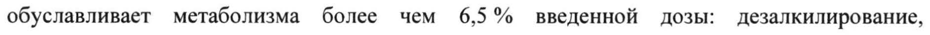
- стр. 4: «нарушении функций почек легкой степени тяжести (КК 50 - 80 мл/мин.) - на 32 %, при» — низкая уверенность: «50» (59)  
  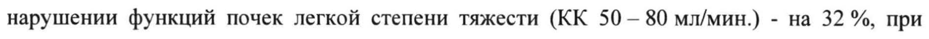
- стр. 8: «Рекомендуется начинать лечение препаратом Ксеплион с дозы 150 мг в 1-й день и 100 мг» — низкая уверенность: «100» (79)  
  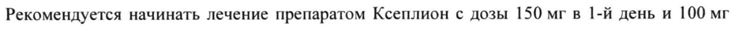
- стр. 8: «диапазоне 25-150 мг в зависимости от индивидуальной переносимости и/или» — низкая уверенность: «25-150» (41)  
  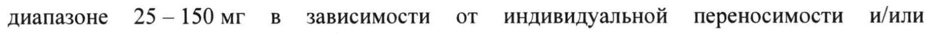
- стр. 8: «Рекомендуется начинать лечение препаратом Ксеплион с дозы 150 мг в 1-й день и 100 мг» — низкая уверенность: «100» (76)  
  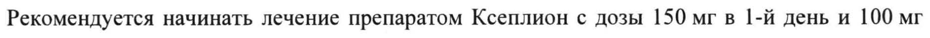
- стр. 8: «доза в диапазоне 25 - 150 мг в зависимости от индивидуальной переносимости и/или» — низкая уверенность: «25» (34)  
  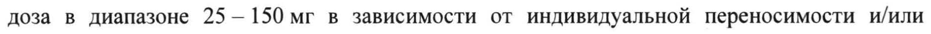
- стр. 13: «| 9 мг один раз в день 100 мг 1 раз в месяц» — повторное чтение: «| 9 мг один раз в день 100 мг 1 раз в месяц»  
  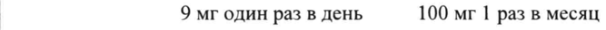
- стр. 13: «| 37,5 мг каждые 2 недели 75 мг 1 раз в месяц» — низкая уверенность: «75» (45)  
  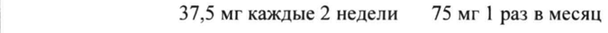
- стр. 17: «(Входящий МЗ №423971%) 17» — низкая уверенность: «№423971%)» (54); повторное чтение: «(Входящий МЗ №4239719 17»  
  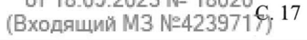
- стр. 18: «получавших препарат Ксеплион, по сравнению с 0,39 % в группе плацебо. Общая заболеваемость во всех» — повторное чтение: «получавших препарат Ксеплион, по сравнению с 0,39 %в группе плацебо. 'Общая заболеваемость во всех»  
  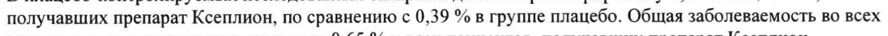
- стр. 19: «9 пациентов с шизофренией 12% пациентов, получавших лечение Ксеплионом,» — низкая уверенность: «9» (53); повторное чтение: «» a Залы. ° Ps me mae _ a “ees ~ ” sane Keenan.»  
  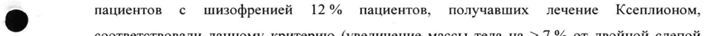
- стр. 26: «$ зарегистрирована у 2,5 % пациентов, принимавших пероральную форму палиперидона, по» — повторное чтение: «№ ^ sspermenpopeeemy 45% neers, праниынвиие парабальитю- форму палиперирова, по»  
  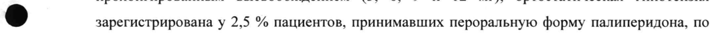
