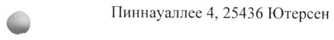
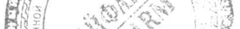

# Панкреатин, полученный из поджелудочной железы свиньи — внутрь

- Препарат: Эрмиталь® (капсулы кишечнорастворимые;)
- АТХ: A09AA02
- Источник: ГРЛС, инструкция по медицинскому применению, РУ ЛСР-002032/08, файл от 2024-11-27 (https://grls.rosminzdrav.ru/Grls_View_v2.aspx?routingGuid=00952b83-69d4-47f2-b8a4-4f5d8d3d8f63)
- Распознано автоматически (OCR): 8 из 8 стр.
- Инструкция к другому РУ того же препарата: ЛСР-002032/08 (национальное РУ, переоформленное по правилам ЕАЭС, решение от 22.11.2024). Текст может быть старше действующего
- Сомнительных строк после OCR: 2 (см. раздел «Проверка распознавания»)

## Общие сведения

ПСР-002032/08 от 04.10.2024 от 02.10.2024 № 21258
(Входящий M3 №4260644)
МИНИСТЕРСТВО ЗДРАВООХРАНЕНИЯ РОССИЙСКОЙ ФЕДЕРАЦИИ
ИНСТРУКЦИЯ ПО МЕДИЦИНСКОМУ ПРИМЕНЕНИЮ ЛЕКАРСТВЕННОГО ПРЕПАРАТА
Эрмиталь* Регистрационный номер: ЛСР-002032/08
Торговое наименование: Эрмиталь*® Международное непатентованное или группировочное наименование: панкреатин

## 3. Лекарственная форма

капсулы кишечнорастворимые
капсулы кишечнорастворимые

## 2. Состав

& Дозировка 10000 ЕД: Одна капсула содержит действующее вещество: панкреатин, полученный из поджелудочной железы свиньи, 97,6 мг, что соответствует липолитической активности 10000 ЕД, амилолитической активности не менее 7500 ЕД, общей протеолитической активности не менее 450 ЕД.

Дозировка 25000 ЕД: Одна капсула, содержит действующее вещество: панкреатин, полученный из поджелудочной железы свиньи, 244 мг, что соответствует липолитической активности 25000 ЕД, амилолитической активности не менее 18750 ЕД, общей протеолитической активности не менее 1125 ЕД.

Дозировка 36000 ЕД: Одна капсула содержит действующее вещество: панкреатин, полученный из поджелудочной железы свиньи, 303,5 мг, что соответствует

- липолитической активности 36000 ЕД, амилолитической активности не менее 22000 ЕД, общей протеолитической активности не менее 1200 ЕД.

Вспомогательные вещества: целлюлоза микрокристаллическая, кросповидон, кремния диоксид коллоидный, магния стеарат; иленочное покрытие микротаблетки:
метакриловой кислоты и этилакрилата сополимер [1:1], триэтилцитрат, тальк, симетикон*;
полирующее вещество: воск горный гликолевый. Крышечка капсулы: желатин, краситель железа оксид красный (Е 172), краситель железа оксид черный (Е 172), титана диоксид
(Е 171), натрия лаурилсульфат; корпус капсулы: желатин, натрия лаурилсульфат.

* В виде эмульсии 30 %, содержит: симетикон, метилцеллюлоза, сорбиновая кислота, вода.
СООТВЕТСТВУЕТ ЭКСПЕРТНОМУ ОТЧЕТУ от 02.10.2024 № 21258

Описание

Дозировка 10000 ЕД:

Твердые желатиновые капсулы размером № 2, крышечка коричневого цвета непрозрачная,

корпус бесцветный прозрачный. Содержимое капсул — круглые двояковыпуклые

микротаблетки, покрытые пленочной оболочкой, бело-серого цвета.

Дозировка 25 000 ЕД:

Твердые желатиновые капсулы размером № 0е|, крышечка коричневого цвета

непрозрачная, корпус бесцветный прозрачный. Содержимое капсул — круглые

двояковыпуклые микротаблетки, покрытые пленочной оболочкой, бело-серого цвета.

Дозировка 36 000 ЕД:

Твердые желатиновые капсулы размером № 00, крышечка коричневого цвета непрозрачная,
© корпус бесцветный прозрачный. Содержимое капсул — круглые двояковыпуклые

микротаблетки, покрытые пленочной оболочкой, бело-серого цвета.

Фармакотерапевтическая группа

Пищеварительное ферментное средство.

Код ATX: А09АА02

Фармакологические свойства

## 5.1. Фармакодинамика

Ферментный препарат, улучшающий процессы переваривания пищи у взрослых и детей, и

тем самым значительно уменьшающий симптомы ферментной недостаточности

поджелудочной железы, включая боль в области живота, метеоризм, изменение частоты и
| консистенции стула. Панкреатические ферменты, входящие в состав препарата, облегчают

расщепление белков, жиров, углеводов, что приводит к их полному всасыванию в тонкой

кишке.

Эрмиталь® содержит стандартный высокоактивный панкреатин, полученный из

поджелудочной железы свиньи в виде микротаблеток, резистентных к воздействию

желудочного сока. Форма выпуска препарата обеспечивает полное высвобождение

резистентных к действию желудочного сока микротаблеток из капсулы в желудке с

последующим мелкодисперсным перемешиванием микротаблеток с кишечным

содержимым и химусом и быстрым выделением ферментов из микротаблеток в

двенадцатиперстной кишке.

Когда микротаблетки достигают тонкой кишки, кишечнорастворимая оболочка быстро

СООТВЕТСТВУЕТ ЭКСПЕРТНОМУ ОТЧЕТУ от 02.10.2024 № 21258 разрушается (при РН > 5,5), происходит высвобождение ферментов с липолитической, амилолитической и протеолитической активностью, что приводит к расщеплению жиров, углеводов и белков. Полученные в результате расщепления вещества затем либо всасываются напрямую, либо подвергаются дальнейшему расщеплению кишечными ферментами.

## 5.2. Фармакокинетика

В исследованиях на животных было продемонстрировано отсутствие всасывания нерасщепленных ферментов, вследствие чего классические фармакокинетические исследования не проводились. Препаратам, содержащим ферменты поджелудочной железы, не требуется всасывания для проявления своих эффектов. Наоборот, терапевтическая активность указанных препаратов в полной мере реализуется в просвете
В исследованиях на животных было продемонстрировано отсутствие всасывания нерасщепленных ферментов, вследствие чего классические фармакокинетические исследования не проводились. Препаратам, содержащим ферменты поджелудочной железы, не требуется всасывания для проявления своих эффектов. Наоборот, терапевтическая активность указанных препаратов в полной мере реализуется в просвете
| желудочно-кишечного тракта (ЖКТ). По своей химической структуре они являются
© белками и, в связи с этим, при прохождении через желудочно-кишечный тракт ферментные препараты расщепляются до тех пор, пока не произойдет всасывание в виде пептидов и аминокислот.

## 4.1. Показания к применению

Заместительная терапия недостаточности экзокринной функции поджелудочной железы у детей и взрослых, обусловленной разнообразными заболеваниями желудочно-кишечного тракта, и наиболее часто встречающейся при:
Заместительная терапия недостаточности экзокринной функции поджелудочной железы у детей и взрослых, обусловленной разнообразными заболеваниями желудочно-кишечного тракта, и наиболее часто встречающейся при:
* муковисцидозе;
. хроническом панкреатите;
. После операции на поджелудочной железе;
& . после гастрэктомии;
. раке поджелудочной железы;
. частичной резекции желудка (например, Бильрот IT);
. обструкции протоков поджелудочной железы или общего желчного протока
(например, вследствие новообразования);
. синдроме Швахмана-Даймонда;
. состоянии после приступа острого панкреатита и возобновлении энтерального или перорального питания.
Для улучшения переваривания пищи у пациентов с нормальной функцией ЖКТ в случаях погрешностей в питании (употребление жирной пищи, переедание, нерегулярное питание ит.д.) (для дозировки 10 000 ЕД).
Во избежание осложнений применять только после консультации с врачом.
СООТВЕТСТВУЕТ ЭКСПЕРТНОМУ ОТЧЕТУ от 02.10.2024 № 21258

## 4.3. Противопоказания

Повышенная чувствительность к активному веществу препарата или к любому вспомогательному веществу.
Повышенная чувствительность к активному веществу препарата или к любому вспомогательному веществу.

## 4.6. Применение при беременности и в период грудного вскармливания

Беременность Клинические данные о лечении беременных женщин препаратами, содержащими ферменты поджелудочной железы, отсутствуют. В ходе исследований на животных не выявлено абсорбции ферментов поджелудочной железы свиного происхождения, поэтому токсического воздействия на репродуктивную функцию и развитие плода не
& предполагается.
Назначать препарат Эрмиталь® беременным женщинам следует с осторожностью, если предполагаемая польза для матери превышает потенциальный риск для плода.
Период грудного вскармливания Исходя из исследований на животных, во время которых не выявлено систематического негативного влияния ферментов поджелудочной железы, не ожидается никакого вредного влияния препарата на грудного ребенка через грудное молоко.
В период грудного вскармливания можно принимать ферменты поджелудочной железы.
При необходимости приема во время беременности или в период грудного вскармливания препарат следует принимать в дозах, достаточных для поддержания адекватного нутритивного статуса.
- Способ применения и дозы

Внутрь.
Дозы препарата подбирают индивидуально в зависимости от тяжести заболевания и состава диеты.
Капсулы следует принимать во время или сразу после каждого приема пищи
(вт. ч. легкой закуски), проглатывать целиком, не разламывать и не разжевывать, запивая достаточным количеством жидкости.
При затрудненном глотании (например, у маленьких детей или пациентов пожилого возраста) капсулы осторожно вскрывают, а содержимое капсул (микротаблетки)
добавляют к мягкой пище, не требующей пережевывания и имеющей кислый вкус
(РН < 5,5), или принимают с жидкостью, также имеющей кислый вкус (рН < 5,5).

ЕН СООТВЕТСТВУЕТ ЭКСПЕРТНОМУ ОТЧЕТУ от 02.10.2024 № 21258
Например, микротаблетки можно добавлять к яблочному пюре, йогурту или фруктовому соку (яблочному, апельсиновому или ананасовому) с рН менее 5,5. Не рекомендуется добавлять содержимое капсул в горячую пищу. Любая смесь микротаблеток с пищей или жидкостью не подлежит хранению, и ее следует принимать сразу же после приготовления.
Размельчение или разжевывание микротаблеток, а также смешивание их с пищей или жидкостью с PH более 5,5 может разрушить их защитную кишечнорастворимую оболочку. Это может привести к раннему высвобождению ферментов в полости рта, снижению эффективности и раздражению слизистых оболочек. Необходимо убедиться, что во рту не осталось микротаблеток.
Важно обеспечить достаточный постоянный прием жидкости пациентом, особенно при
& повышенной потере жидкости. Неадекватное потребление жидкости может приводить к возникновению или усилению запора.
Доза для взрослых и детей при муковисцидозе e Доза зависит от массы тела и должна составлять в начале лечения 1000 липазных единиц/кг на каждый прием пищи для детей младше четырех лет и 500 липазных единиц/кг во время приема пищи для детей старше четырех лет и взрослых.
e Дозу следует определять в зависимости от выраженности симптомов заболевания, результатов контроля за стеатореей и поддержания адекватного нутритивного статуса.
» У болышинства пациентов доза должна оставаться меньше или не превышать 10000 липазных единиц/кг массы тела в сутки или 4000 липазных единиц/г потребленного жира.
Доза при других состояниях, сопровождающихся экзокринной недостаточностью w поджелудочной железы
Дозу следует устанавливать с учетом индивидуальных особенностей пациента, к которым относятся степень недостаточности пищеварения и содержание жира в пище. Доза, которая требуется пациенту вместе с основным приемом пищи, варьируется от 25000 до 80000 ЕД липазы, а во время приема легкой закуски — половина индивидуальной дозы.
Доза для улучшения переваривания пищи у пациентов с нормальной функцией ЖКТ в случаях погрешностей в питании зависит от массы тела и содержания жира в пище, варьирует от 10000 до 20000 ЕД липазы на один прием.
У детей препарат должен применяться в соответствии с назначением врача.
СООТВЕТСТВУЕТ ЭКСПЕРТНОМУ ОТЧЕТУ от 02.10.2024 № 21258
(Входящий M3 №4260644)

## 4.8. Побочное действие

В клинических исследованиях наиболее частыми нежелательными реакциями были нарушения со стороны желудочно-кишечного тракта, которые в основном имели легкую или умеренную степень тяжести.
В клинических исследованиях наиболее частыми нежелательными реакциями были нарушения со стороны желудочно-кишечного тракта, которые в основном имели легкую или умеренную степень тяжести.
В клинических исследованиях были зарегистрированы следующие нежелательные реакции с указанной частотой:
Система Очень часто: | Часто: от Нечасто: от | Частота неизвестна органов 21/10 > 1/100 до > 1/1000 до
<1/10 < 1/100 Нарушения со | боль в | тошнота, рвота, стриктуры стороны области запор, вздутие подвздошной, слепой желудочно- живота* живота, или толстой кишки кишечного диарея* (фиброзирующая тракта колонопатия
- Нарушения со сыпь зуд, крапивница стороны кожи и подкожных тканей
Нарушения со гиперчувствительность стороны (анафилактические
ИММУННОЙ реакции)
системы *Желудочно-кишечные расстройства связаны главным образом с основным заболеванием. Частота возникновения таких нежелательных реакций как боль в области живота и диарея была ниже или схожей с таковой при применении плацебо.
Стриктуры подвздошной, слепой или толстой кишки (фиброзирующая колонопатия)
наблюдались у пациентов с муковисцидозом, получавших высокие дозы препаратов панкреатина (см. раздел «Особые указания»).
Аллергические реакции наблюдались преимущественно со стороны кожных покровов, но отмечались также и другие проявления аллергии. Сообщения о данных побочных эффектах были получены в период постмаркетингового применения и носили спонтанный характер. Для точной оценки частоты случаев имеющихся данных недостаточно.
При применении у детей не было отмечено каких-либо специфических нежелательных реакций. Частота, тип и степень тяжести нежелательных реакций у детей с муковисцидозом были сходны с таковыми у взрослых.

## 4.9. Передозировка

Симптомы: гиперурикозурия и гиперурикемия.
Симптомы: гиперурикозурия и гиперурикемия.
Лечение: отмена препарата, симптоматическая терапия.
СООТВЕТСТВУЕТ ЭКСПЕРТНОМУ ОТЧЕТУ от 02.10.2024 № 21258

## 4.5. Взаимодействие с другими лекарственными средствами

Исследований по взаимодействию не проводилось.

## 4.4. Особые указания

У пациентов с муковисцидозом, получавших высокие дозы препаратов панкреатина, описаны стриктуры подвздошной, слепой и толстой кишки (фиброзирующая колонопатия).
У пациентов с муковисцидозом, получавших высокие дозы препаратов панкреатина, описаны стриктуры подвздошной, слепой и толстой кишки (фиброзирующая колонопатия).
В качестве меры предосторожности, при появлении необычных симптомов или изменений в брюшной полости необходимо медицинское обследование для исключения фиброзирующей колонопатии, особенно у пациентов, которые принимают препарат в дозе более 10000 липазных единиц/кг в сутки.
ad Влияние на способность управлять транспортными средствами, механизмами
Применение препарата не влияет или оказывает незначительное влияние на способность к управлению автомобилем и механизмами.

## 6.5. Форма выпуска

Капсулы кишечнорастворимые 10000 ЕД, 25000 ЕД, 36000 ЕД. По 20, 50 или 100 капсул в стеклянный флакон темного стекла, укупоренный крышкой из полиэтилена низкой плотности, флакон снабжен уплотнительным диском, состоящим из двух частей, скрепленных восковыми точками.
Капсулы кишечнорастворимые 10000 ЕД, 25000 ЕД, 36000 ЕД. По 20, 50 или 100 капсул в стеклянный флакон темного стекла, укупоренный крышкой из полиэтилена низкой плотности, флакон снабжен уплотнительным диском, состоящим из двух частей, скрепленных восковыми точками.
При первом вскрытии диск разделяется на две части. Часть | (пергамин/алюминиевая фольга/восковые точки) остается на горловине флакона, а часть 2 (алюминиевая
- фольга/бумага/картон) остается в крышке.

По 1 флакону в картонную пачку вместе с инструкцией по медицинскому применению лекарственного препарата.

## 6.4. Условия хранения

При температуре не выше 25 °С.
При температуре не выше 25 °С.
Хранить в недоступном для детей месте!

## 6.3. Срок годности

3 года.
3 года.
Не применять по истечении срока годности, указанного на упаковке.

СООТВЕТСТВУЕТ ЭКСПЕРТНОМУ ОТЧЕТУ от 02.10.2024 № 21258

(Входящий МЗ №4260644)
Условия отпуска Отпускают без рецепта.
Производитель/ Выпускающий контроль качества
«Нордмарк Фарма ГмбХ», Германия, Пиннауаллее 4, 25436 Ютерсен
Наименование и адрес юридического лица, на имя которого выдано регистрационное удостоверение
«Нордикс Фарма Фертриб ГмбХ», Германия

7% Пиннауаллее 4, 25436 Ютерсен Организация, принимающая претензии:
АО «Нижфарм», Россия 603105, г. Нижний Новгород, ул. Салганская, д. 7
Тел.: (831) 278-80-88; факс: (831) 430-72-28
E-mail: med@stada.ru lp A SR в

Представитель компании И” ei Дми нев ДВ.

| ИЗ! ty % “Sy. их 1%

oe Rass A Oe "RS

ay | а У
## Проверка распознавания

Страницы-сканы распознаны автоматически. В 2 строках с дозировками цифры могли распознаться с ошибкой — сверьте с вырезкой из оригинала:

- стр. 8: «7% Пиннауаллее 4, 25436 Ютерсен» — низкая уверенность: «7%» (72)  
  
- стр. 8: «| ИЗ! ty % “Sy. их 1%» — низкая уверенность: «1%» (41); повторное чтение: «В ERR Se а»  
  
