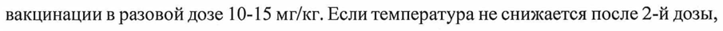
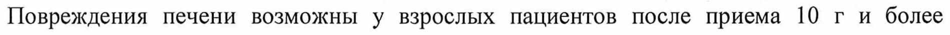
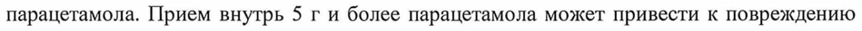
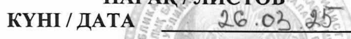
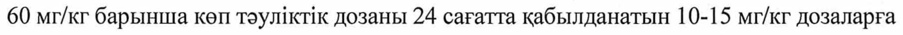

# Парацетамол — внутрь

- Препарат: Детский Панадол (суспензия для приема внутрь)
- АТХ: N02BE01
- Источник: ОХЛП, Единый реестр ЛС ЕАЭС, запись 660fca4630dcf8a501a0c89a, документ от 2025-09-19
- Распознано автоматически (OCR): 26 из 26 стр.
- Сомнительных строк после OCR: 5 (см. раздел «Проверка распознавания»)

## Общие сведения

ОБЩАЯ ХАРАКТЕРИСТИКА ЛЕКАРСТВЕННОГО ПРЕПАРАТА

## 1. Наименование лекарственного препарата

Детский Панадол, 24 мг/мл, суспензия для приема внутрь для детей

## 2. Качественный и количественный состав

Действующее вещество: парацетамол.
1 мл суспензии содержит парацетамол 24 мг.
Вспомогательные вещества, наличие которых надо учитывать в составе лекарственного препарата: мальтитол жидкий, метилпарагидроксибензоат, пропилпарагидроксибензоат, сорбитол жидкий (некристаллизующийся) (см. раздел 4.4).
Полный список вспомогательных веществ см. в пункте 6.1.

## 3. Лекарственная форма

Суспензия для приема внутрь для детей.
От матовой до полупрозрачной суспензия от белого до слегка коричневатого цвета.

## 4. Клинические данные

## 4.1. Показания к применению

- прорезывание зубов
- зубная боль
- боль в горле в качестве жаропонижающего средства
- простудные заболевания
` «Грипп - детские инфекционные заболевания (такие как, ветряная оспа, коклюш, корь, и эпидемический паротит (свинка))
- после вакцинации

## 4.2. Режим дозирования и способ применения

Режим дозирования Предназначен для применения у детей.
Перед употреблением содержимое флакона следует хорошо взболтать (не менее 10 сек.).
СООТВЕТСТВУЕТ ЭКСПЕРТНОМУ ОТЧЕТУ от 28.08.2025 № 21501
(ПОСЛЕДОВАТЕЛЬНОСТЬ 0004)
Дозирующий шприц, вложенный внутрь упаковки, позволяет правильно и рационально дозировать препарат.
Инструкция по использованию мерного шприца:
1. Протолкните ползунок до упора, чтобы шприц был полностью закрыт. Затем прочно вставьте шприц в горлышко флакона.
| = = :
| 2. Переверните флакон вверх дном и осторожно потяните ползунок для набора соответствующей дозы. Правильная доза будет обозначена в том месте, где широкие края ползунка указывают на отметку в «мл» на корпусе шприца.
| / <> [© 2 И
3. Переверните флакон обратно и осторожно вытащите шприц из горлышка флакона вращательными движениями.
6)
После использования препарата:
- накройте флакон крышкой и проверните ее, чтобы прочно закрыть. Затем поверните крышку в обратную сторону, пока не услышите щелчок. Промойте мерный шприц теплой
ВОДОЙ и высушите. Нет необходимости в стерилизации.
Не превышать рекомендованную дозу. Следует применять самую малую дозу препарата, необходимую для достижения эффекта, в самый короткий период лечения.
2-3 месяца Однократно 2,5 мл (при необходимости допустимо
- вес более 4 кг, использовать через 4-6 часов повторно 2,5 мл)
- ребенок доношенный (роды произошли в срок не ранее 37 недель)
Не применять детям младше 2-х месяцев.
Интервал между приемами не менее 4 часов.
Не давать более 2-х доз.
Если требуется дополнительная доза и температура не снижается более 24 часов, необходимо проконсультироваться с врачом, чтобы исключить серьезное инфекционное заболевание.
Детям 2-3 месяцев возможно применение для симптоматического лечения реакции после вакцинации в разовой дозе 10-15 мг/кг. Если температура не снижается после 2-й дозы, следует обратиться к врачу.
Возраст ребенка Разовая доза, мл Частота приема (в течение 24
Не принимать более 4 доз в течение 24 часов.
Максимальную суточную дозу 60 мг/кг следует разделить на дозы по 10-15 мг/кг в течение 24 часов.
Интервал между приемами не менее 4 часов.
Препарат не рекомендуется принимать более 3 дней без назначения и наблюдения врача.
Способ применения СООТВЕТСТВУЕТ ЭКСПЕРТНОМУ ОТЧЕТ;
| (ПОСЛЕДОВАТЕЛЬНОСТЬ 0004)
Предназначен только для приема внутрь.

## 4.3. Противопоказания

- гиперчувствительность к парацетамолу или к любому из вспомогательных веществ, перечисленных в разделе 6.1;

- детский возраст до 2-х месяцев.

## 4.4. Особые указания и меры предосторожности при применении

Содержит парацетамол. Не принимать одновременно с другими парацетамолсодержащими препаратами, т.к. это может привести к передозировке. Передозировка парацетамолом может вызвать печеночную недостаточность, которая может потребовать трансплантацию печени или привести к летальному исходу.

| Хронические заболевания печени увеличивают риск повреждения печени при приеме парацетамола.
Пациентам с диагностированной печеночной или почечной недостаточностью, а также принимающим варфарин или другие препараты для разжижения крови, необходима консультация врача до начала приема препарата.
Не превышать рекомендованную дозу.
Наблюдались случаи нарушения функции печени и печеночная недостаточность у пациентов при наличии состояний, сопровождающихся снижением уровня глутатиона
(например, при голодании, анорексии, низком индексе массы тела, хроническом употреблении алкоголя, сепсисе). Следует соблюдать осторожность пациентам с пониженным уровнем глутатиона поскольку прием парацетамола может увеличить риск

} возникновения метаболического ацидоза (см. также раздел 4.9).
Если симптомы сохраняются, следует проконсультироваться с врачом.
Перед применением препарата детям младше 3-х месяцев, родившимся недоношенными, следует проконсультироваться с врачом.
Вспомогательные вещества Препарат содержит мальтитол жидкий и сорбитол жидкий. Пациентам с редкой наследственной непереносимостью фруктозы не следует применять данное лекарственное средство.
Препарат содержит 150 мг сорбитола в 1 мл суспензии. Сорбитол может оказывать слабое слабительное действие. Сорбитол содержит 2,6 ккал/г.
СООТВЕТСТВУЕТ ЭКСПЕРТНОМУ ОТЧЕТ:
(ПОСЛЕДОВАТЕЛЬНОСТЬ 0004)
Содержащиеся в препарате метилпарагидроксибензоат и пропилпарагидроксибензоат могут вызывать аллергические реакции, в том числе замедленного типа.

## 4.5. Взаимодействие с другими лекарственными препаратами и другие виды взаимодействия

Метоклопрамид и домперидон повышают, а колестирамин снижает скорость всасывания парацетамола.
Препарат при приёме в течение длительного времени усиливает эффект непрямых антикоагулянтов (варфарин и другие кумарины), что увеличивает риск кровотечений;
разовые дозы не оказывают существенного влияния.

## 4.6. Фертильность, беременность и лактация

Препарат предназначен для применения у детей.
Беременность Риск приема парацетамола во время беременности в отношении нарушения развития нервной системы плода на данный момент считается незначительным.
Парацетамол может применяться во время беременности в случае наличия показаний, но, как и прочие лекарственные препараты, его следует применять в минимально эффективной дозе и в течение короткого периода. Так же, как и в случае приема любых лекарственных препаратов во время беременности, перед приемом необходимо проконсультироваться с врачом.
| Лактация Парацетамол выделяется с грудным молоком в незначительных количествах при применении в рекомендованных дозах.
Не противопоказан в период грудного вскармливания.
4.7. Влияние на способность управлять транспортными средствами и работать с механизмами
Детский Панадол не оказывает влияние на способность управлять транспортными средствами и работать с механизмами.

## 4.8. Нежелательные реакции

Частота нежелательных реакций определялась в соответствии с классификацией
Всемирной организации здравоохранения: очень часто (>1/10); часто (21/100, но <1/10);
нечасто (>1/1000, но <1/100); редко (>1/10000, но <1/1000); очень редко (<1/10000), частота неизвестна (на основании имеющихся данных оценить невозможно).
Нарушения со стороны кровеносной и лимфатической системы:
Очень редко:
- тромбоцитопения, агранулоцитоз
Нарушения со стороны иммунной системы:
Очень редко - анафилаксия - кожные реакции гиперчувствительности, такие как кожная сыпь, отек Квинке
(ангионевротический отек)
- синдром Стивенса-Джонсона, токсический эпидермальный некролиз
Нарушения со стороны дыхательной системы и органов средостения:
Очень редко - бронхоспазм (как правило, наблюдается у пациентов с повышенной чувствительностью к ацетилсалициловой кислоте и другим НПВП)
Нарушения со стороны печени и желчевыводящих путей
Очень редко - нарушение функции печени Следует немедленно прекратить прием препарат и обратиться к врачу при возникновении вышеперечиеленных побочных реакций, а также при появлении шелушения на коже, образования язвочек в полости рта, затруднения дыхания, отека губ, языка, горла и лица, гематом, кровотечения или любой другой нежелательной реакции на препарат.
|, Эти симптомы бывают редко.
Сообщение о подозреваемых нежелательных реакциях
Важно сообщать о подозреваемых нежелательных реакциях после регистрации лекарственного препарата с целью обеспечения непрерывного мониторинга соотношения
«польза-риск» лекарственного препарата. Медицинским работникам рекомендуется сообщать о любых подозреваемых нежелательных реакциях лекарственного препарата через национальные системы сообщения о нежелательных реакциях государств — членов
Евразийского экономического союза.
Республика Казахстан РГП на ПХВ «Национальный центр экспертизы лекарственных средств и медицинских от 28.08.2025 № 21501
[ПОСЛЕДОВАТЕЛЬНОСТЬ 0004)
изделий» Комитета медицинского и фармацевтического контроля Министерства здравоохранения Республики Казахстан
Адрес: 010000, г. Астана, район Байконыр, ул. А. Иманова, 13
'Тел.: +7 (7172) 235-135 Эл. почта: farm@dari.kz
Сайт: www.ndda.kz Республика Беларусь Министерство здравоохранения — Республики Беларусь, Республиканское унитарное предприятие «Центр экспертиз и испытаний в здравоохранении»
Адрес: 220037, Минск, Беларусь, Товарищеский nep., 2a.
Тел.: +375-17-242-00-29 Эл. почта: repl@rceth.by
Сайт: www.rceth.by Республика Армения ГНКО "Центр экспертизы лекарств и медицинских технологий" Адрес: 0051, г.
Ереван, пр. Комитаса 49/5 'Тел.: (+374 60) 83-00-73 Эл. почта: vigilance@pharm.am
Сайт: www.pharm.am Кыргызская Республика
Департамент лекарственных средств и медицинских изделий при Министерстве здравоохранения Кыргызской Республики
Адрес: 720044, г. Бишкек, ул. 3-я линия, 25
Тел.: + 996 (312) 21-92-88 Эл. почта: vigilance@pharm.kg
Сайт: www.pharm.kg Российская Федерация Федеральная служба по надзору в сфере здравоохранения (Росздравнадзор)
Адрес: 109012, г. Москва, Славянская площадь, д. 4, стр. 1
Тел.: +7 (800) 550-99-03 СООТВЕТСТВУЕТ ЭКСПЕРТНОМУ ОТЧЕТ;
(ПОСЛЕДОВАТЕЛЬНОСТЬ 0004)

Эл. noura:pharm@roszdravnadzor.gov.ru

Сайт: https://www.roszdravnadzor.gov.ru

## 4.9. Передозировка

Передозировка парацетамолом может вызвать необратимое повреждение печени, что

может привести к трансплантации печени или летальному исходу. Наблюдались случаи

острого панкреатита, обычно, в сочетании с нарушением функции печени и

гепатотоксичностью.

В случае превышения рекомендованной дозы следует немедленно обратиться за

медицинской помощью, даже при хорошем самочувствии, так как существует риск

отсроченного серьезного повреждения печени.

Повреждения печени возможны у взрослых пациентов после приема 10 г и более

парацетамола. Прием внутрь 5 г и более парацетамола может привести к повреждению

печени, если у пациента имеются следующие факторы риска:

- продолжительное лечение карбамазепином, фенобарбиталом, дифенином, примидоном,

рифампицином, препаратами зверобоя продырявленного или другими препаратами,

стимулирующими печеночные ферменты

- хронический алкоголизм

- при наличии состояний, которые сопровождаются снижением уровня глутатиона

(расстройства приема пищи, муковисцидоз, ВИЧ-инфекция, голодание, общее

истощение).

Симптомами острого отравления парацетамолом в первые 24 часа являются тошнота, рвота, боли в желудке, потливость, бледность кожных покровов. Поражение печени

определяется через 12-48 часов после передозировки.

Могут возникать нарушения метаболизма глюкозы и метаболический ацидоз. При

тяжелом отравлении печеночная недостаточность может прогрессировать в

энцефалопатию, кровоизлияния, гипогликемию, отек мозга и летальный исход. Острая

почечная недостаточность с острым некрозом канальцев может проявляться сильной

поясничной болью, гематурией, протеинурией и развиться даже при отсутствии тяжелого

поражения печени. Отмечались также сердечная аритмия и панкреатит.

Лечение: При передозировке необходима незамедлительная медицинская помощь.

Пациента следует немедленно доставить в больницу, даже если отсутствуют ранние
СООТВЕТСТВУЕТ ЭКСПЕРТНОМУ ОТЧЕТ;
(ПОСЛЕДОВАТЕЛЬНОСТЬ 0004)
симптомы передозировки. Симптомы могут ограничиваться тошнотой и рвотой или могут не отражать тяжести передозировки или риска поражения органов. Лечение активированным углем целесообразно в случае, когда чрезмерная доза парацетамола была принята в течение | часа. Концентрацию парацетамола в плазме крови следует определять не ранее чем через 4 часа и даже позже после приема препарата (более раннее определение концентрации не является достоверным).
Лечение М-ацетилцистеином можно проводить в течение 24 часов после приема парацетамола, однако, максимальный эффект от данного антидота возможно получить при его применении в течение 8 часов после приема. Эффективность антидота резко снижается после этого времени. При необходимости М-ацетилцистеин вводят пациенту внутривенно согласно рекомендуемым дозам. При отсутствии рвоты возможно применение метионина перорально как альтернатива при невозможности экстренной транспортировки пациента в больницу.

## 5. Фармакологические свойства

## 5.1. Фармакодинамические свойства

Фармакотерапевтическая группа: Анальгетики. Другие анальгетики и антипиретики.
Анилиды. Парацетамол.
Код ATX: NO2BE01 Механизм действия и фармакодинамические эффекты
Парацетамол является обезболивающим и жаропонижающим средством с центральным и
: периферическим действием. Механизм действия выяснен недостаточно.

Обезболивающий эффект обусловлен ингибированием синтеза простагландина, в основном в ЦНС, периферический эффект менее выражен.

| Блокирует циклооксигеназу в центральной нервной системе, воздействуя на центры боли и терморегуляции. Не оказывает влияния на состояние слизистой желудочно-кишечного тракта и водно-солевой обмен, поскольку не воздействует на синтез простагландинов в периферических тканях.

## 5.2. Фармакокинетические свойства

Абсорбция Парацетамол быстро и почти полностью всасывается из желудочно-кишечного тракта, время достижения максимальной концентрации в плазме 20-30 мин.
СООТВЕТСТВУЕТ ЭКСПЕРТНОМУ ОТЧЕТ!
(ПОСЛЕДОВАТЕЛЬНОСТЬ 0004)
Распределение Присутствует в большинстве жидкостей организма.
В терапевтической концентрации связывание с белками плазмы незначительно, но при увеличении концентрации в плазме уровень связывания с белками также возрастает.
Метаболизм В основном метаболизируется в печени путем конъюгации с глюкуроновой и серной кислотой.
Элиминация Период полувыведения при приеме терапевтической дозы составляет 1-4 часа.
5.3 Данные доклинической безопасности
Данные исследований эмбрио- и фетотоксичности согласно современным стандартам отсутствуют.

## 6. Фармацевтические свойства

6.1. Перечень вспомогательных веществ
Сорбитол жидкий (некристаллизующийся)
Камедь ксантановая Метилпарагидроксибензоат
Пропилпарагидроксибензоат Кислота лимонная безводная |
'Тринатрия цитрата дигидрат pa Глицерин (очищенный глицерин 99,5%)
Ароматизатор клубничный Динатрия эдетат Сукралоза
Мальтитол жидкий Вода очищенная

## 6.2. Несовместимость

Не применимо.

## 6.3. Срок годности (срок хранения)

3 года.
6.4. Особые меры предосторожности при хранении

Хранить при температуре не выше 30 °С.

6.5. Характер и содержание первичной упаковки

По 100 мл препарата во флаконы из темного стекла, укупоренные крышкой из

полипропилена и полиэтилена, с полиэтиленовой вставкой с защитой от вскрытия детьми

и контролем первого вскрытия.

1 флакон вместе с дозирующим шприцем, представляющим собой двухкомпонентный
| литой дозатор для лекарственных препаратов, состоящий из цилиндра (корпуса) шприца

и плунжера (ползунка), изготовленных из полиэтилена и инструкцией по медицинскому

применению на казахском и русском языках помещают в пачку картонную.

6.6. Особые меры предосторожности при уничтожении использованного

лекарственного препарата или отходов, полученных после применения

лекарственного препарата, и другие манипуляции с препаратом

Особые требования отсутствуют.

## 7. Держатель регистрационного удостоверения

Республика Казахстан

ТОО «Haleon Kazakhstan»

г. Алматы, ул. Манаса, 32A

Тел.: 8 (727) 244-69-99

Эл. почта: SafetyReportingEMEA@haleon.com (для сообщений о нежелательных

явлениях), CIS.LOC-PQC@haleon.com (для сообщений о претензиях к качеству препарата)

7.1. Представитель держателя регистрационного удостоверения

Претензии потребителей направлять по адресу:

Республика Казахстан

TOO «Haleon Kazakhstan»

г. Алматы, ул. Манаса, 32A

Тел.: 8 (727) 244-69-99

Эл. почта: SafetyReportingEMEA@haleon.com (для сообщений о нежелательных явлениях),

CIS.LOC-POC@haleon.com (для сообщений о претензиях к качеству
СООТВЕТСТВУЕТ ЭКСПЕРТНОМУ ОТЧЕТУ от 28.08.2025 № 21501
[ПОСЛЕДОВАТЕЛЬНОСТЬ 0004)
препарата)

## 8. Номер регистрационного удостоверения

## 9. Дата первичной регистрации

(ПОДТВЕРЖДЕНИЯ РЕГИСТРАЦИИ,

ПЕРЕРЕГИСТРАЦИИ)

Дата первой регистрации:
10. ДАТА ПЕРЕСМОТРА ТЕКСТА
Общая характеристика лекарственного препарата Детский Панадол доступна на информационном портале Евразийского экономического союза в информационно-

) коммуникационной сети «Интернет» http://eec.eaeunion.org/

)
——— —аАаА,——. СООТВЕТСТВУЕТ ЭКС Ц ЕРТ HO МУ ОТЧЕТУ
ТИТЛГЕН, НОМТРЛЕНГЕН ЖЭНЕ MOPMEH _ _0т28.08.2025 № 21507
| BEKITWITEH / [ПОСЛЕДОВАТЕЛЬНОСТЬ 0004)
| ПРОШИТО, ПРОНУМЕРОВАНО И СКРЕПЛЕНО ПЕЧАТ |
(на _^ SON ПАРАК ЛИСТОВ КУНГ/ ДАТА =--^ 26.02%, 95
СООТВЕТС ТВУЕТ ЭКС ПЕРТНС МУ ОТЧЕТ:
(ПОСЛЕДОВАТЕЛЬНОСТЬ 0004)
ДЭРШИК ПРЕПАРАТТЫН ЖАЛПЫ СИПАТТАМАСЫ
1. ДОРТЛИК ПРЕПАРАТТЫН АТАУЫ
Балалар Панадолы, 24 мг/мл, балаларга ппуге арналган суспензия
2. САПАЛЫК ЖЭНЕ САНДЫК КУРАМЫ
Ocep етуш! зат: парацетамол.
| мл суспензиянын курамында 24 мг парацетамол бар.
Дэрик препараттын курамында болуы ескер1лет!н косымша заттар: суйык мальтитол, метилпарагидроксибензоат, пропилпарагидроксибензоат, суйык сорбитол
(кристалданбайтын) (4.4 бел!мд! караныз).
Косымша заттардын толык тиз1м!н 6.1 тармагынан караныз.
3. ДОРЛК TYPI
Балаларга illlyre арналган суспензия Кунгрттен жартылай мелдф суспензияга дейн актан сэл конырлау туске дейн.
4. КЛИНИКАЛЫК ДЕРЕКТЕР
4.1. Колданылуы ауыруды басатын Oapi ретнде
- Tic жарганда
- Tic ауырганда
- тамак ауырганда ыстык mycipemin Oapi peminoe
- суык тию ауруларында
- тумауда
- балалардын инфекциялык ауруларында (мысалы, желшешекте, кекжетелде, кызылшада жэне эпидемиялык паротитте (шошка-борыкта))
- вакцинациядан кейн
4.2. Дозалау режим! жэне колдану тэс!л1
Дозалау режим!
Балаларга колдануга арналган.
Колданар алдында кутынын шиндегн жаксылап шайкау керек (кем!нде 10 сек.).
Каптама шШне салынган дозалау шприц! препаратты дурыс жэне тимд! дозалауга мумюндик беред1.
Флшеуш! шприцт! пайдалану жен!ндег! нускаулык:
1. Шприц толыгымен жабылу упин сыргытпаны т!релгенше итер!н!з. Содан кейн шприцт! кутынын мойнына мыктап салыныз
Е ==
2. Кутыны тенкерш, тист! дозаны алу упйн сыргытпаны акырын тартыныз. Дурыс доза сыргытпанын KeH жиектер! шприц корпусындагы "мл" белмен керсететн жерде белмленеди.
= | / a> в | | 55 >»
3. Кутыны кайтадан аударыныз жэне шприцл! айналмалы козгалыстармен кутынын мойнынан абайлап шыгарыныз bis)
<> _S= SS Препаратты пайдаланганнан кей1н:
- кутыны какпакпен жабыныз жэне оны мыктап жабу упин бураныз. Содан кейн, шертуд!
естгенше какпакты кер! карай бураныз. Флшеуйп шприцт! жылы сумен шайып, кургатыныз. Стерилизациянын кажетЕ жок.
Усынылган дозадан асырмау керек. Емделудн ен кыска кезен! шинде кажетт! ти!мдуйкке
COOTBETCTE! ET 3 KC ПЕРТНОМУ OTYET:
([ПОСЛЕДОВАТЕЛЬНОСТЬ 0004)
жету упн ен аз дозаны колдану керек.
2-3 ай bip реттк 2,5 мл (кажет болганда 4-6 сагаттан кей!н
- салмагы 4 кг-ден астам, кайталап 2,5 мл пайдалануга болады)
- норесте мерз!м! жетш туган (37 апта толган мерз!мде босану)
Жасы 2 айдан Kiwi балаларда колдануга болмайды.
Кабылдаулар арасындагы аралык 4 сагаттан аз емес.
2 дозадан артык бермеу керек.
Егер косымша доза талап ет!лсе жэне температура 24 сагаттан узак темендемесе курдел!
инфекциялык ауруды болдырмау YH дэргерден кенес алу кажет.
2-3 айлык балаларга Oip реттк 10-15 мг/кг дозасы вакцинациянын кей!н болатын реакциялардын симптоматикалык ем! уш!н колданылуы мумкин. Егер температура 2-ш1 дозадан Kein темендемесе Jopirepre каралу керек.
Баланын жасы bip perrik доза, Кабылдау xuiniri (24 carat
И a 24 carat шинде 4 дозадан артык кабылдауга болмайды.
60 мг/кг барынша кеп тэул1ктк дозаны 24 сагатта кабылданатын 10-15 мг/кг дозаларга белу керек.
Кабылдаулар арасындагы аралык 4 сагаттан кем болмау керек.
Препаратты дэргердин тагайындауынсыз жэне кадагалауынсыз 3 куннен артык колдану усынылмайды.
Колдану Tacisi Тек пике кабылдауга арналган.
СООТВЕТСТВУЕТ ЭКСПЕРТНОМУ ОТЧЕТ;
(ПОСЛЕДОВАТЕЛЬНОСТЬ 0004)
4.3. Колдануга болмайтын жагдайлар
- парацетамолга немесе 6.1-бел1мде т!збеленген косымша заттардын кез келген!не aca жогары сез1мталдык;
- 2 alira дей!нг! балалар.
4.4. Айрыкша нускаулар жэне колданган кездег! кажетт! сактандыру шаралары
Курамында парацетамол бар. Курамында парацетамол бар баска препараттармен Oip мезг!лде колдануга болмайды, ейткен! артык дозалануга экелу! мумк!н. Парацетамолдын артык дозалануы бауыр жетюлжезди\н тудыруы MYMKin, бул бауыр трансплантациясын кажет ету! немесе ол!мге экелу! MYMKIH.
Бауырдын созылмалы аурулары парацетамолды кабылдаган кезде бауырдын закымдану каушн арттырады.
Бауыр немесе буйрек 2xKeTKiNiKci3qiri бар пациенттерге, сондай-ак варфарин немесе канды суйылтатын баска да препараттар кабылдап журген пациенттерге препаратты колданар алдында дэргердн кенес! кажет. |
Усынылкан дозадан асырмау керек.
Глутатион денгейвнн темендеу!мен (мысалы, ашыгуда, анорексияда, дене салмагынын темен индекс нде, алкогольд! созылмалы тутыну кезде, сепсисте) катар журейн жагдайлар болган кезде пациенттерде бауыр функциясынын бузылуы жэне бауыр жетк!лказди! жагдайлары байкалды. Глутатион денгей! темен пациенттерге сак болу керек, ейткен! парацетамолды кабылдау метаболизмдк ацидоздын пайда болу каушн арттыруы MYMKiH (4.9-бел!мд! де караныз).
Егер симптомдар сакталса, opirepMeH кенесу керек.
Препаратты шала туган жасы 3 айдан Kili балаларга колдану алдында дэргерден кенес алу керек.
Косымша заттар Препарат курамында суйык мальтитол жэне суйык сорбитол бар. Сирек кездесетн туа биткен фруктоза кетере алмаушылыгы бар пациенттерге осы дор затты колдануга болмайды.
Препарат курамында 1 мл суспензияда 150 мг сорбитол бар. Сорбитол элез пи жургзет!н эсер ету! MYMKiH. Сорбитол 2,6 ккал/г курайды.
Препарат курамындагы метилпарагидроксибензоат жэне пропилпарагидроксибензоат аллергиялык реакцияларды, онын шинде баяу типт! тудыруы MYMKiH.
4.5. Баска дэр!лйк препараттармен o3apa эрекеттесу! жэне озара эрекеттесудн баска да турлер!
Парацетамолдын CiHY жылдамдыгын метоклопрамид пен домперидон арттырады, ал колестирамин темендетед!.
Узак уакыт бойы кабылдаганда препарат телей емес антикоагулянттардын эсерйн
(варфарин жэне баска кумариндер) кушейтедт, бул кан кетулер каушн арттырады; Oip peTTik дозалар айтарлыктай эсер етпейд1.
4.6. Фертильдик, жуктк жоне лактация
Препарат балаларда колдануга арналкан.
Жукилк Kasipri уакытта шарананын жуйке жуйес! дамуынын бузылуына катысты жуктйк кез!нде парацетамолды кабылдау кауп манызды емес болып саналады.
Парацетамолды жуки кез!нде KepceTinimgep болган жагдайда колданылу мумюн, б1рак баска дэрлйк препараттарды сиякты оны ен аз тиймд! дозада жэне кыска мерз!м шинде колдану керек. Сондай-ак, жуктойк кез1нде кез-келген дэрк препараттарды кабылдау жагдайлардагыдай, кабылдар алдында дэр!гермен кенесу керек.
Лактация Парацетамол усынылган дозаларда колданган кезде емшек CYTIMeH аз мелшерде бел!нед..
Бала eMi3y кезенде колдануга болмайтын жагдайлар жок.

4.7. Келж куралдарын жэне кауштлит зор механизмдерд! баскару каблетне ыкпал ету!
Балалар Панадолы komik куралдарын жургзу жэне механизмдермен жумыс icTey мумкндИне эсер етпейд:.
4.8. Жагымсыз реакциялар
Жагымсыз реакциялардын пайда болу жили! Дуниежуз!л к денсаулык сактау уйымынын жиктемес!не colikec аныкталды: ete жи! (> 1/10), жи! (21/100, б1рак <1/10), жи! емес
(21/1000, 6ipax <1/100), сирек (>1/10000, б1рак <1/1000), ere сирек (<1/10000), Senricis
(колда бар деректер нег1з1нде багалау мумюн емес).
Кан жене лимфа жуйес? тарапынан бузылулар:
Ome сирек:
- тромбоцитопения, агранулоцитоз
Иммундык жуйе тарапынан бузылулар:
Ome сирек - анафилаксия - тер! бертпес, Квинке icinyi (ангионевроздык iciHy) сиякты aca жогары сез1мталдык тер!
реакциялары - Стивенс-Джонсон синдромы, уытты эпидермалык некролиз
Тыныс any жэне кеокрек ортасы азгзалары тарапынан бузылулар:
Ome сирек - бронх туйлу! (эдетте ацетилсалицил кышкылына жэне баска ККСП-га жогары сез1мталдыгы бар пациенттерде байкалады)
Бауыр жене от шыгару жолдары тарапынан бузылулар
Ome сирек - бауыр функциясынын бузылуы Жогарыда аталган реакциялар, сондай-ак тер1де кабыршыктану, ауыз куысынын ойык жаралары, тыныс тарылуы, CpiHHIH, илдн, тамактын жэне беттн iciHyi, гематома, кан кетулер немесе препаратка баска да кез келген жагымсыз реакциялары пайда болганда препаратты токтатып, дереу дэр!герге каралу керек.
Бул симптомдар сирек кездесед!.
Кумэнд! жагымсыз реакциялар туралы хабарлама

( Дэрлк препараттын «пайда-кауш» аракатынасына уздкс!з мониторинг жургзуд!
камтамасыз ету максатында дэр!лк препаратты TipKereHHeH кейн кудкт! жагымсыз реакциялар туралы хабарлау манызды. Медициналык кызметкерлерге Еуразиялык экономикалык одакка муше мемлекеттерд1н жагымсыз реакциялар туралы улттык хабарлау жуйес! аркылы дэрлк препараттын кез келген кудкт! жагымсыз реакциялары туралы хабарлау усынылады.
Казакстан Республикасы Казакстан Республикасы Денсаулык сактау министрли!й Медициналык жэне фармацевтикалык бакылау комитетн «Дориик заттар мен медициналык буйымдарды сараптау улттык орталыгы» ШЖК PMK
Мекенжай: 010000, Астана к., Байконыр ауданы, А. Иманов кеш., 13
Тел.: +7 (7172) 235-135 Эл. пошта: farm@dari.kz
Сайт: www.ndda.kz Беларусь Республикасы Беларусь Республикасынын Денсаулык сактау министрали\, «Денсаулык сактаудагы сараптамалар мен сынактар орталыгы» республикалык унитарлык кэс1порны
Мекенжай: 220037, Минск, Беларусь, Товарищеский туйык кеш., 2a.
Тел.: +375-17-242-00-29

Эл. пошта: repl@rceth.by Сайт: www.rceth.by
Армения Республикасы "Дэр!лер мен медициналык технологияларды сараптау орталыгы" MKEY
Мекенжай: 0051, Ереван к., Комитас данг. 49/4
Тел.: (+374 60) 83-00-73 Эл. почта: vigilance@pharm.am
Сайт: www.pharm.am Кыргыз Республикасы

Кыргыз Республикасы Денсаулык сактау министрлий1 жанындагы Дорийк заттар мен медициналык буйымдар департамент!
Мекенжай: 720044, Бишкек к., 3-я линия кеш., 25
Тел.: + 996 (312) 21-92-88 Эл. пошта: vigilance@pharm.kg
Сайт: www.pharm.kg Ресей Федерациясы Денсаулык сактау саласындагы кадагалау жен!ндег! федералдык кызмет
(Росздравнадзор)
Мекенжай: 109012, Mackey к., Славянский аланы, 4 уй, 1 кур.
Тел.: +7 (800) 550-99-03

Эл. пошта: pharm@roszdravnadzor.gov.ru

Сайт: https://www.roszdravnadzor.gov.ru

4.9. Артык дозалануы

Парацетамолмен артык дозалану бауырдын кайтымсыз закымдануына алып келу!

ыктимал, ол бауырды трансплантациялауга немесе ол1мге экеп соктыруы MYMKiH. Жедел

панкреатит жагдайы, эдетте бауыр функциясы бузылуы жэне гепатоуыттылык дамуымен

катарласкан жагдайлар бакыланды.

Усынылган дозадан асып кеткен жагдайда e3iH жаксы сез1нгеннйн ез1нде, дереу

медициналык кемекке жуг!нген жен, ейткен! кейннен болатын курдел! бауырдын

закымдану кауш бар.

Бауырдын закымдануы ересек пациенттерде 10 г жэне одан да кеп парацетамол

кабылдаганнан кейн мумк!н болады. Егер пациентте келес! кауш факторлары болса, 5 г

немесе одан да кеп парацетамол кабылдау бауырдын закымдалуына экелу! мумк!н:

- карбамазепинмен, фенобарбиталмен, дифенинмен, примидонмен, рифампицинмен,

шИлтер жапыракты шайкурай препараттарымен немесе буйрек ферменттер!н

стимуляциялайтын баска препараттармен узак емдеу

- созылмалы алкоголизм

- глутатион денгейн!н темендеумен Oipre журетн жай-куйлер болганда (тамак ппу

бузылыстары, муковисцидоз, АИТВ-инфекция, ашыгу, жалпы жудеул!К).

Алгашкы 24 сагатта парацетамолмен жедел улану симптомдары журек айнуы, кусу, асказаннын ауыруы, тершендк, тер! жабындарынын бозандануы болып табылады.

Бауырдын закымдануы артык дозаланудан Kein 12-48 сагаттан кей!н аныкталады.

Глюкоза метоболизм1!н бузылулары жэне метаболизмдк ацидоз пайда болуы мумкин.

Ауыр улану кез!нде бауыр жетюалжездит энцефалопатияга, кан кетуге, гипогликемияха,

ми iciHyiHe жэне ел!мге дейн прогрессиялау мумюн. Жедел туткшел! некрозы бар

буйректн жедел жетюлказди! белдн ауырсынумен, гематуриямен жэне

протеинуриямен аныкталады жэне бауырдын ауыр жаракаттары болмаса да дамуы

MYMKiH. Сондай-ак журек аритмиясы жэне панкреатит те байкалды.

Emi: Артык дозаланган кезде жедел медициналык кемек кажет. Пациентт! дереу

ауруханага жетк!зу KepeK, тшт! артык дозаланудын ерте симптомдары жок болса да.
СООТВЕТСТВУЕТ ЭКСПЕРТНОМУ ОТЧЕТ;
(ПОСЛЕДОВАТЕЛЬНОСТЬ 0004)

Симптомдар журек айнуымен жэоне кусумен шектелу! мумк!н немесе артык дозаланудын ауырлыгын немесе агзалардын закымдану каушн керсетпеу! мумюн. Парацетамолдын шамадан тыс дозасы | сагат шинде кабылданган жагдайда белсендпИлген кемфмен

емдеу усынылады. Кан плазмасындагы парацетамол концентрациясын препаратты кабылдаганнан кейн 4 сагаттан ерте емес, тит! кешрек аныктау керек (концентрацияны негурлым ерте аныктау сен1мд! болып табылмайды).
М№-ацетилцистеинмен емдеуд! парацетамолды кабылдаганнан кейн 24 сагат шинде журпзуге болады, алайда осы антидоттын ен жогары эсер! оны кабылдаганнан кейн 8 сагат шинде колданган кезде байкалуы мумюн. Осы уакыттан кейн антидоттын тимд!ли! курт темендейд!. Кажет болса, М-ацетилцистеин пациентке усынылган | дозаларга сэйкес вена imine енг1з1лед!. Kycy болмаган жагдайда, пациентт! ауруханага шугыл тасымалдау мумюндИ! жок кезде балама peTiHye метионинд! пероральд!
колдануга болады.
5. ФАРМАКОЛОГИЯЛЫК КАСИЕТТЕРТ
5.1. Фармакодинамикалык касиеттер1
Фармакотерапиялык тобы: Анальгетиктер. Баска анальгетиктер жэне антипиретиктер.
Анилидтер. Парацетамол.
ATX коды: NO2BE01 Эсер ету механизм! жэне фармакодинамикалык эсерлер
Парацетамол орталыктык жэне шеткер! эсер ететн ауруды басатын жэне ыстык TYCipeTiH

| препарат болып табылады. Эсер ету механизм! эл! жетк!лкс!з аныкталкан.

Ауыруды басатын эсер простагландинн в синтез!н тежеумен шартталган, Heri3ineH ОЖЖда, шеткер! эсер ету! онша айкын емес.
Ауыру жэне жылуды реттеу орталыктарына эсер ете отырып, орталык жуйке жуйе@ндем циклооксигеназаны бегейд!. Асказан-пиек жолынын шырышты кабыгына жоне су-туз алмасуына эсер етпейд1, ейткен! шеткер! т!ндердег! простагландиндер синтез!не эсер етпейд!.
5.2. Фармакокинетикалык касиеттер!
Cinyi Парацетамол асказан-шек жолынан тез жэне толыгымен дерлк cine wi, кан плазмасында барынша KOM концентрациянын жету уакыты 20-30 мин.
Таралуы Организмн!н суйыктыктарынын кеб1нде бар.
Емдк концентрацияда кан плазмасынын акуыздарымен байланысы манызды емес, б1рак кан плазмасында концентрация жогарылаган жагдайда акуыздармен байланысу денгей!
де артады.
Метаболизм Негз!нде глюкурондык жэне KYKIPT кышкылымен конъюгациялау аркылы бауырда метоболизденед1.
Элиминациясы EMik дозаны кабылдау кез!нде жартылай шыкарылу кезен! 1-4 сагатты курайды.
5.3 Клиникага дейни! каушездк деректер!
Замануи стандарттарга сэйкес эмбрио- жэне фетоуыттылыктын зерттеу деректер! жок.
6. ФАРМАЦЕВТИКАЛЫК KACHETTEPI
6.1. Косымша заттардын т1збес!
Суйык сорбитол (кристалданбайтын)
Ксантан шайыры Метилпарагидроксибензоат Пропилпарагидроксибензоат
Сусыз лимон кышкылы Тринатрий цитрат дигидраты
| Глицерин (тазартылган глицерин 99,5%)
Кулпынай хош истендргии Динатрий эдетаты
Сукралоза Суйык мальтитол Тазартылкан су
6.2. Уйлеамаздит
Катысты емес.
6.3. Жарамдылык Mep3imi (сактау Mep3imi)
3 жыл.
6.4. Сактау кезндег! ерекше сактык шаралары
СООТВЕТСТВУЕТ ЭКСПЕРТНОМУ ОТЧЕТ;
(ПОСЛЕДОВАТЕЛЬНОСТЬ 0004)

30 °С-ден аспайтын температурада сактау керек.

6.5. Бастапкы каптаманын сипаты мен мазмуны

100 мл препараттан полипропиленнен жэоне полиэтиленнен жасалган какпакпен

тыгындалган, балалардын ашып алуынан коргайтын жэне алгашкы ашылуын

бакылайтын полиэтилен ендрмес! бар Kapa шыныдан жасалган кутыларда.

| куты полиэтиленнен жасалган шприцтн цилиндр!нен (корпустан) жэне плунжерден

(сыргытпадан) туратын дэр!лк препараттарга арналган ек! компонентт! куйма дозатор

болып табылатын дозалайтын шприцпен жэне медициналык колдану жен!ндег! казак

жэне орыс т!л1ндег! нускаулыкпен б1рге картон корапшага салынады.

6.6. Пайдаланылтан дэрийк препаратты Hemece дормщк — препаратты

колданганнан кейн немесе онымен жумыс icTereH сон алынган калдыктарды

жойган кездег! айрыкша сактык шаралары

Айрыкша талаптар жок.

7. TIPKEY КУЭЛИМНИН УСТАУШЫСЫ

Казакстан Республикасы

«Haleon Kazakhstan» ЖШС

Алматы к., Манас кеш., 32A

Тел.: 8 (727) 244-69-99

Эл. пошта: SafetyReportingEMEA@haleon.com (жагымсыз кубылыстар туралы
| хабарламалар ушин), CIS.LOC-PQOC@haleon.com (препараттын сапасына катысты

наразылыктар туралы хабарламалар ушн)

7.1. Tipkey куэли1н устаушысынын екл!

Тутынушылардын шагымдары мына мекенжайга жолдау керек:

Казакстан Республикасы

«Haleon Kazakhstan» ЖШС

Алматы к., Манас кеш., 32A

Тел.: 8 (727) 244-69-99

Эл. пошта: SafetyReportingEMEA@haleon.com (жагымсыз кубылыстар туралы

хабарламалар упин), CIS.LOC-PQC@haleon.com (препараттын сапасына катысты

наразылыктар туралы хабарламалар ушйн)
8. TIPKEY КУЭЛПТТИТН HOMIPI

9. БАСТАПКЫ 'ИРКЕЛГЕН КУН! (ГРКЕЛГЕРНН, КАЙТА 'ИРКЕЛГЕНН
РАСТАУ)

Ыр!нии тркелген кун!:

10. MOTIHI КАЙТА KAPAJIFAH КУН

Балалар Панадолы дэршйк препаратынын жалпы сипаттамасы Еуразиялык

экономикалык одактын акпараттык порталында «Интернет» — акпараттык-

коммуникациялык жел!е1нде http://eec.eaeunion.org/ колжет!мд!
ии ии ии рр рр ии””ммжЕУИУжяжяжиИУИУЕЕ/////////л/ у//у/у/у/у/ул/ Ар А
Е —— | СООТВЕТСТВУЕТ 3 КСП ЕРТ HO МУ ОТЧЕТУ
ТИТЛГЕН, НОМТРЛЕНГЕН ЖЭНЕ MOPMEH от 28.08.2025 № 21501
БЕКГИЛГЕН / [ПОСЛЕДОВАТЕЛЬНОСТЬ 0004)
ПРОШИТО, ПРОНУМЕРОВАНО И СКРЕПЛЕНО

ПЕЧАТ

Gh Ler eats)

ПАРАК7 JIMCTOB ~ КУН! / ДАТА; 26.0525.
## Проверка распознавания

Страницы-сканы распознаны автоматически. В 5 строках с дозировками цифры могли распознаться с ошибкой — сверьте с вырезкой из оригинала:

- стр. 3: «вакцинации в разовой дозе 10-15 мг/кг. Если температура не снижается после 2-й дозы,» — низкая уверенность: «2-й» (37)  
  
- стр. 8: «Повреждения печени возможны у взрослых пациентов после приема 10 г и более» — повторное чтение: «Повреждения печени возможны у взрослых пациентов после приема 10 ги более»  
  
- стр. 8: «парацетамола. Прием внутрь 5 г и более парацетамола может привести к повреждению» — повторное чтение: «парацетамола. Прием внутрь 5 ги более парацетамола может привести к повреждению»  
  
- стр. 13: «КУНГ/ ДАТА =--^ 26.02%, 95» — низкая уверенность: «26.02%,» (69), «95» (69); повторное чтение: «КУН! / ДАТА. KE ЕТ 0% C22»  
  
- стр. 16: «60 мг/кг барынша кеп тэул1ктк дозаны 24 сагатта кабылданатын 10-15 мг/кг дозаларга» — низкая уверенность: «тэул1ктк» (8)  
  
