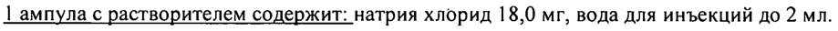
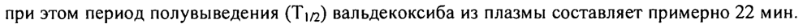
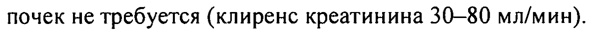
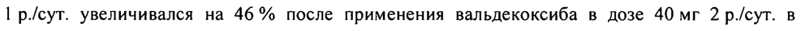
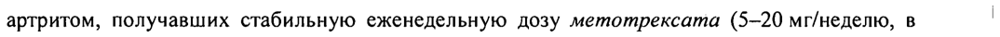

# Парекоксиб — парентерально

- Препарат: Династат® (лиофилизат для приготовления раствора для внутривенного и внутримышечного введения;)
- АТХ: M01AH04
- Источник: ГРЛС, инструкция по медицинскому применению, РУ П N015824/01, файл от 2020-11-16 (https://grls.rosminzdrav.ru/Grls_View_v2.aspx?routingGuid=cdaa404d-50cd-48a7-977f-e02023096825)
- Распознано автоматически (OCR): 18 из 18 стр.
- Инструкция к другому РУ того же препарата: П N015824/01 (исключено из реестра, решение от 13.11.2020). Текст может быть старше действующего
- Сомнительных строк после OCR: 5 (см. раздел «Проверка распознавания»)

## Общие сведения

ТР STE NOTS824/01-11 0116 МИНИСТЕРСТВО ЗДРАВООХРАНЕНИЯ РОССИЙСКОЙ ФЕДЕРАЦИИ
ИНСТРУКЦИЯ по применению лекарственного препарата для медицинского применения
ДИНАСТАТ® Регистрационный номер: П NO15824/01
Торговое название: Ди настат® ® Международное непатентованное название: парекоксиб |

## 3. Лекарственная форма

лиофилизат для приготовления раствора для внутривенного и
лиофилизат для приготовления раствора для внутривенного и

внутримышечного введения

## 2. Состав

1 флакон с лиофилизатом содержит: активное вещество: парекоксиб (в виде парекоксиба

натрия) 40,00 мг (42,36 мг), вспомогательные вещёства: натрия гидрофосфат 2,68 мг,

фосфорная кислота до рН 8,0 - 8,2, натрия гидроксид до РН 8,0 - 8,2.

1 ампула с растворителем содержит: натрия хлорид 18,0 мг, вода для инъекций до 2 мл.

После растворения в 2 мл растворителя конечная концентрация парекоксиба составляет

20 мг/мл. es

Onucanue: _

@ Лиофилизат: рыхлая пористая масса или таблетка белого или почти белого цвета.

Растворитель: прозрачный бесцветный раствор.

Фармакотерапевтическая группа: нестероидный противовоспалительный препарат

(НПВП)

Код ATX: МОТАНО4

ФАРМАКОЛОГИЧЕСКИЕ СВОЙСТВА

## 5.1. Фармакодинамика

После введения препарата Династат® его действующее вещество парекоксиб быстро

гидролизуется с образованием вальдекоксиба. Механизм действия вальдекоксиба связан с

ингибированием синтеза простагландинов с участием циклооксигеназы-2 (ЦОГ-2).
Стр. | из 18

feo: 92155 о УИ TE NO15824/01-T10T 16 ^ Вальдекоксиб действует как избирательный ингибитор ЦОГ-2 в отношении простагландинов как периферического, так и центрального действия; при этом в терапевтических концентрациях он не ингибирует ЦОГ-1, и практически не оказывает влияния на зависящие от ЦОГ-Т физиологические процессы в тканях, особенно в слизистой оболочке желудка и кишечника. Вальдекоксиб не оказывает влияния на агрегацию тромбоцитов и время кровотечения. Вальдекоксиб (40 мг дважды в сутки) не оказывает клинически значимого влияния на сниженную под действием ацетилсалициловой кислоты функцию тромбоцитов и не изменяет фармакодинамических эффектов гепарина на активированное частичное тромбопластиновое время (АЧТВ) и тромбоциты. Благодаря избирательному действию на
ЦОГ-2 и отсутствию влияния на ЦОГ-! частота образования эндоскопически

@ подтвержденных язв и эрозий желудка и двенадцатиперстной кишки при применении препарата Династат® ниже, чем на фоне неселективных НПВП.
Ощутимый обезболивающий эффект появляется через 7-13 минут, клинически значимый — через 23-39 минут и максимальный - в течение 2 часов после однократного введения парекоксиба в дозе 40 мг внутривенно (в/в) или внутримышечно (в/м). Парекоксиб в дозе 40 мг вызывает примерно такой же по выраженности обезболивающий эффект, как и кеторолак в дозе 60 мг в/м или кеторолак в дозе 30 мг в/в. Длительность анальгетического действия после введения одной дозы зависит от дозы препарата и характера боли и составляет от 6 до 12 часов и более.
Применение с целью уменьшения потребления опиоидных анальгетиков
В рекомендованных дозах парекоксиб значительно уменьшает потребление опиоидных
® анальгетиков, а также уменьшает количество нежелательных реакций, связанных с приемом опиоидных анальгетиков (утомляемость, сонливость, спутанность сознания, трудности с концентрацией, головокружение, тошнота, запор, затруднение мочеиспускания, зуд, рвота), при сохранении хорошего анальгезирующего эффекта.

## 5.2. Фармакокинетика

После в/в или в/м введения парекоксиб в результате ферментного гидролиза в печени быстро метаболизируется до вальдекоксиба, являющегося фармакологически активным компонентом.
После в/в или в/м введения парекоксиб в результате ферментного гидролиза в печени быстро метаболизируется до вальдекоксиба, являющегося фармакологически активным компонентом.
Всасывание После в/в введения препарата Династат® в диапазоне доз 20, 50 и 80 мг в сутки изменения таких фармакокинетических показателей вальдекоксиба как площадь под кривой
«концентрация-время» (AUC) и максимальная концентрация (Cmax) носят линейный характер.
em: 92155
7 EEE IT NOIS824/01-T10116
Равновесные концентрации вальдекоксиба в плазме при введении 2 раза в сутки достигаются в течение 4 суток. |
После однократного в/в или в/м введения парекоксиба натрия в дозе 20 мг Сна вальдекоксиба достигается приблизительно через 30 мин и | 4, соответственно. Значения
АЧСи Сна вальдекоксиба сходны после в/в и в/м введения. `^
Распределение Объем распределения вальдекоксиба после в/в введения составляет приблизительно 55 л.
Связь с белками плазмы составляет примерно 98 % при концентрациях, которые достигаются при применении максимальной рекомендованной дозы (80 мг/сутки). Вальдекоксиб, но не парекоксиб, преимущественно накапливается в эритроцитах.
® Метаболизм Парекоксиб быстро и почти полностью превращается в вальдекоксиб и пропионовую кислоту при этом период полувыведения (Т!/2) вальдекоксиба из плазмы составляет примерно 22 мин.
Выведение вальдекоксиба происходит путем интенсивного метаболизма в печени по многим путям, включая метаболизм с участием изоферментов цитохрома Р450: CYP3A4 и CYP2C9, а также путем СУР-независимого глюкуронидирования (примерно 20 %) сульфонамидной составляющей. В плазме обнаруживается гидроксилированный метаболит вальдекоксиба, который проявляет активность в качестве ингибитора ЦОГ-2. На его долю приходится приблизительно 10 % концентрации вальдекоксиба; в связи с тем, что концентрация этого метаболита низка, можно считать, что он не оказывает значимого клинического влияния | после введения терапевтических доз парекоксиба натрия. |
©® Выведение | Вальдекоксиб выводится путем метаболического превращения в печени, и лишь менее 5 % | вальдекоксиба в неизмененном виде выводится через почки. Парекоксиб в неизмененном виде не обнаруживается в моче, а в кале он обнаруживается лишь в следовых количествах.
Примерно 70 % дозы выделяется через почки в форме неактивных метаболитов. ,
Плазматический клиренс (CL,) для вальдекоксиба составляет около 6 л/час. После в/в или в/м введения парекоксиба натрия Т!/2 вальдекоксиба составляет около 8 часов.
Пациенты пожилого возраста Отмечено, что у пациентов пожилого возраста клиренс вальдекоксиба снижен, поэтому концентрация вальдекоксиба в плазме крови примерно на 40 % выше, чем у молодых.
Равновесная концентрация вальдекоксиба в плазме крови, на 16 % выше у женщин пожилого возраста, чем у мужчин пожилого возраста.
| Стр. 3 из 18 Е! 92155 ИГРУ ыы ~~~ TY NOTS824/01-TT0116 4
| | Пациенты с нарушениями функции почек |
У пациентов с нарушениями функции почек различной степени тяжести при введении 20 мг препарата Династат® в/в парекоксиб быстро выводится из плазмы крови. Поскольку для вальдекоксиба почки не играют существенной роли в выведении и, следовательно, состояние их функции не оказывает значимого влияния на фармакокинетику парекоксиба, не | выявляется изменения клиренса вальдекоксиба даже у пациентов с тяжелыми нарушениями функции почек, а также у пациентов, находящихся на гемодиализе.
Препарат не выводится при гемодиализе.
Пациенты с нарушениями функции печени | При поражениях печени средней степени тяжести не отмечается снижения скорости и |
® степени превращения парекоксиба в вальдекоксиб. Поскольку у таких пациентов воздействие вальдекоксиба усиливается более чем в 2 раза (на 130 %) необходимо снижение дозировки
(см. раздел «Способ применения и дозы»).
У пациентов с тяжелым нарушением функции печени парекоксиб не исследовался, поэтому | его применение у таких пациентов не рекомендуется.

## 4.1. Показания к применению

Купирование острой боли.
Купирование острой боли.
Краткосрочное обезболивание для уменьшения послеоперационной боли; для уменьшения потребности в опиоидных анальгетиках.
® Противопоказания Повышенная чувствительность к активному ингредиенту, а также к любому из компонентов, входящих в состав препарата.
Пациенты с аллергическими проявлениями на сульфонамиды (синдром Стивенса-Джонсона, токсический эпидермальный некролиз, злокачественная мультиформная экссудативная эритема). |
Полное или неполное сочетание бронхиальной астмы, рецидивирующего полипоза носа и | околоносовых пазух и непереносимости ацетилсалициловой кислоты или других НПВП, включая другие селективные ингибиторы ЦОГ-2 (в том числе в анамнезе).
Состояние после операции аортокоронарного шунтирования.
Период лактации.
Тяжелая печеночная недостаточность.
ri 902155 О о ИХ | т т м 582401-100П6б —-
Тяжелая почечная недостаточность (клиренс креатинина менее 30 мл/мин).
Прогрессирующие заболевания почек.
Эрозивно-язвенные поражения желудочно-кишечного тракта (ЖКТ) в фазе обострения (в т.ч.
острая пептическая язва или желудочно-кишечное кровотечение).
Воспалительные заболевания кишечника.
Хроническая сердечная недостаточность (класс — [У по классификации NYHA).
| Клинически подтвержденная ишемическая болезнь сердца, заболевания периферических артерий и цереброваскулярные заболевания в выраженной стадии.
Подтвержденная гиперкалиемия.
Беременность.
® Недавно перенесенные цереброваскулярные кровотечения.
Заболевания свертывающей системы крови.
Возраст до 18 лет (опыта применения препарата Династат® у данной категории пациентов нет).

## 4.3. С осторожностью

Задержка жидкости в организме (в том числе состояния, возникающие или ухудшающиеся из-за нее, включая хроническую сердечную недостаточность и артериальную гипертензию, включая пациентов, принимающих диуретики или при риске гиповолемии), дегидратация, эрозивно-язвенные поражения ЖКТ в анамнезе, наличие инфекции Helicobacter pylori, операции на органах ЖКТ, урологические операции, печеночная недостаточность средней
Задержка жидкости в организме (в том числе состояния, возникающие или ухудшающиеся из-за нее, включая хроническую сердечную недостаточность и артериальную гипертензию, включая пациентов, принимающих диуретики или при риске гиповолемии), дегидратация, эрозивно-язвенные поражения ЖКТ в анамнезе, наличие инфекции Helicobacter pylori, операции на органах ЖКТ, урологические операции, печеночная недостаточность средней
® степени тяжести, почечная недостаточность (клиренс креатинина 30-60 мл/мин), дислипидемия/гиперлипидемия, сахарный диабет, курение, пожилой возраст, длительное использование НПВП, частое употребление алкоголя, тяжелые соматические заболевания, цереброваскулярные заболевания, сопутствующая терапия следующими препаратами:
антикоагулянты (например, варфарин), антиагреганты. (например, ацетилсалициловая кислота, клопидогрел), пероральные глюкокортикостероиды (например, преднизолон), селективные ингибиторы обратного захвата серотонина (например, циталопрам, флуоксетин, пароксетин, сертралин).

## 4.6. Применение при беременности и в период грудного вскармливания

Опыта применения препарата Династат® у беременных женщин нет.
ee: 92155 EEE ~ TE NOTS824/01-1TO1T6 — Угнетение синтеза простагландинов может отрицательно влиять на течение беременности.
Возможно повышение риска спонтанных абортов после применения ингибиторов синтеза простагландинов в ранний период беременности.

Применение препарата Династат®, противопоказано во время беременности, поскольку из-за ингибирования синтеза простагландинов, он может вызывать снижение сократительной активности матки, а также преждевременное закрытие Боталлова протока.
Парекоксиб выделяется в грудное молоко в небольших количествах, поэтому, принимая во внимание потенциальный риск развития побочных эффектов от парекоксиба у вскармливаемого ребенка и учитывая важность препарата для матери, стоит оценить продолжать ли грудное вскармливание или начинать терапию препаратом Династат®, прервав
® вскармливание на время лечения.
Не рекомендуется женщинам, планирующим беременность.
В соответствии с механизмом действия, при применении НПВП, включая целекоксиб, у некоторых женщин возможно развитие изменений в яичниках, что может стать причиной осложнений во время беременности. У женщин, которые планируют беременность или проходят обследование по поводу бесплодия, следует рассмотреть вопрос об отмене приема
НПВП, включая парекоксиб.

## 4.2. Способ применения и дозы

Династат® может назначаться внутривенно (в/в) или внутримышечно (в/м) как однократно, так и в виде регулярных повторных инъекций или по мере необходимости. После начала терапии доза должна корректироваться в зависимости от реакции пациента. Опыт
Династат® может назначаться внутривенно (в/в) или внутримышечно (в/м) как однократно, так и в виде регулярных повторных инъекций или по мере необходимости. После начала терапии доза должна корректироваться в зависимости от реакции пациента. Опыт
® применения препарата свыше 3 дней ограничен. Парекоксиб показан только при необходимости парентерального введения препарата и невозможности достичь сходного эффекта с помощью препаратов для приема внутрь. При наличии клинических показаний рекомендуется как можно быстрее переводить пациентов на прием препаратов внутрь.
Поскольку с увеличением дозы и продолжительности применения селективных ингибиторов
ЦОГ-2 риск их побочного действия на сердечно-сосудистую систему возрастает, их применяют как можно более коротким курсом в минимальной эффективной дозе. Однако действие этих препаратов на сердечно-сосудистую систему при использовании их коротким курсом в послеоперационном периоде пока не изучено.
Острая боль: рекомендованная разовая или начальная доза составляет 40 мг в/в или в/м, затем, при необходимости, можно продолжать введение каждые 6-12 часов по 20-40 мг; при
_ Стр. 6 из 18 вн: 92155 о Тр EEE > 1015824011106 этом суточная доза не должна превышать 80 мг. В/в болюсная инъекция может производиться непосредственно в вену или же в трубку установленной заранее системы для в/в инфузий. В/м введение следует производить медленно и глубоко в мышцу.

Для предотвращения или уменьшения послеоперационных болей: рекомендованная доза составляет 40 мг в/в (предпочтительнее) или в/м, которую вводят за 45 — 30 минут до хирургического вмешательства. Для поддержания анальгезии может потребоваться повторное послеоперационное введение препарата.
Для уменьшения потребности в опиоидных анальгетиках: Династат® можно применять в сочетании с опиоидными анальгетиками по схеме, описанной для лечения острой боли. В этом случае суточная потребность в опиоидах снижается на 20-40%. Оптимальный эффект
©® достигается, когда Династат® применяют перед введением опиоидов.
Пациенты пожилого возраста: коррекция дозы, как правило, не требуется. Однако у пожилых пациентов с массой тела менее 50 кг лечение следует начинать с введения 1/2 рекомендованной дозы; при этом максимальная суточная доза не должна превышать 40 мг.
Пациенты с нарушениями функции печени: пациентам с незначительно выраженным нарушением функции печени (класс А по классификации Чайлд-Пью) коррекция дозы обычно не требуется. У пациентов с нарушением функции печени средней тяжести (класс В по классификации Чайлд-Пью) препарат следует применять с осторожностью, введение необходимо начинать с 1/2 рекомендованной дозы, а максимальную суточную дозу следует снизить до 40 мг. Опыт применения препарата Династат® у пациентов с тяжелыми поражениями печени (класс С по классификации Чайлд-Пью) отсутствует, потому
® назначение препарата таким пациентам не рекомендуется.
Пациенты с нарушениями функции почек: у пациентов с состояниями, предрасполагающими к задержке жидкости в организме, парекоксиб следует назначать в наименьшей рекомендованной дозе и тщательно мониторировать функцию почек. На основании фармакокинетики коррекция дозы у пациентов с легким и умеренным нарушением функции почек не требуется (клиренс креатинина 30-80 мл/мин).
Совместное применение с флуконазолом: при совместном применении парекоксиба с флуконазолом, парекоксиб следует назначать в наименьшей рекомендованной дозе.

, Подготовка препарата к введению | Парекоксиб натрия — лиофилизат, не содержащий консервантов. Для восстановления раствора используется 2 мл 0,9 % раствора натрия хлорида для инъекций.

Ор Стр. 7 из 18 FR. 92155 EEE EEE TE NOTS824/01-TT0TT6
Также могут использоваться следующие растворители: 0,9 % стерильный раствор натрия хлорида, 5 % раствор декстрозы (глюкозы) для инъекций, 5 % раствор декстрозы (глюкозы) с 0,45 % натрия хлоридом для инъекций (раствор, приготовленный с использованием указанных растворителей, является изотоническим).
Использование раствора Лактат Рингера для инъекций или 5 % декстрозы (глюкозы) с раствором Лактата Рингера для инъекций для восстановления препарата Династат® не рекомендуется, так как это приводит к выпадению осадка.
Применение в качестве растворителя стерильной воды для инъекций также не рекомендуется, поскольку полученный в результате раствор не будет изотоническим.
Восстановленный раствор следует осмотреть на наличие дополнительных включений или
©® изменения окраски, помутнения.
Приготовленный раствор нельзя охлаждать или замораживать.
После восстановления Династат® можно вводить в трубки системы для в/в инфузий, содержащие следующие растворители: раствор натрия хлорида для инъекций (0,9 %), раствор декстрозы (глюкозы) для инъекций (5 %), раствор Лактат Рингера для инъекций, 5 % раствор декстрозы (глюкозы) с 0,45 % натрия хлоридом.
Введение раствора препарата Династат® в системы для в/в инфузий, содержащие раствор 5 % декстрозы (глюкозы) в Лактате Рингера или другие, не перечисленные здесь препараты, не рекомендуется, поскольку это может вызвать выпадение осадка.
Династат® не следует смешивать с другими препаратами.
Трубки системы для внутривенных инфузий после введения препарата несовместимого с
® парекоксибом перед применением препарата Династат® следует промыть раствором, с которым он совместим.

## 4.8. Побочное действие

Список нежелательных реакций представлен в виде таблицы.
Список нежелательных реакций представлен в виде таблицы.
часто (2 1/100, < 1/10) (2 1/1000, < 1/100) < 1/1000) неизвестна
> 1/10 о [Альвеолярный оетит__[ Фарингит |
О ПО к ОИ ВОВ реакции ( Стр. 8 из 18 be . 92155 и EE IT NO1S824/01-TTO116 ©
| Очень Часто Нечасто Редко (2 1/10 000, Частота 21/10 a Го анорексия
| i Becconnmua [Возбуждение | И лярные нарушения я
Г [Брадиардия [Инфаркт миара | ® Снижение Повышение Ухудшение течения
О ЕЕ о давления гипертензии, постуральная гипотензия пи И —-— И ИИ легочной артерии
Тошнота |Абдоминальная боль, Сухость слизистой Эзофагит, рвота, запор, оболочки полости рта, гастроэзофагеальдиспепсия метеоризм ный рефлюкс, панкреатит, отек околоротовой области, снижение перистальтики кишечника
Кожный зуд, Сыпь Экхимоз, | потоотделения
Г [Больвпозвоночнике [Артралия | р ежи Го недостаточность
Периферические Астения, боль в отеки месте введения, введения о тр. 9 из 1
Fe. 92155 отр. 908 18 ИП М№15824707-ГП0Т16 —
Очень: Часто Нечасто Редко (> 1/10 000, Частота часто (2 1/100, < 1/10) (2 1/1000, < 1/100) < 1/1000) неизвестна 21/10, |
Повышенное содержание азота мочевины в крови, повышение активности креатинфосфокиназы, повышение концентрации креатинина, повышение активности лактатдегидрогеназы (ЛДГ
® Кожные послеоперационные осложнения, патологическое серозное отделяемое из дренажа, установленного после операции, сопровождающейся рассечением грудины
Побочные эффекты, выявленные в постмаркетинговых наблюдениях:
Со стороны почек и мочевыделительной системы: почечная недостаточность.
@ Со стороны кожных покровов: синдром Стивенса-Джонсона, злокачественная мультиформная экссудативная эритема, токсический эпидермальный некролиз.
Со стороны иммунной системы: аллергическая реакция, анафилаксия, отек Квинке.
Со стороны сердечно-сосудистой системы: циркуляторный коллапс, значительное снижение артериального давления.
Со стороны дыхательной системы: одышка.

## 4.9. Передозировка

Клинический опыт передозировки ограничен. Без клинически значимых побочных эффектов применялись однократные дозы до 200 мг парекоксиба в/в. Применение парекоксиба в дозе 50 мг в/в 2 раза в день (100 мг/день) в течение 7 дней также не сопровождалось токсичностью.
Клинический опыт передозировки ограничен. Без клинически значимых побочных эффектов применялись однократные дозы до 200 мг парекоксиба в/в. Применение парекоксиба в дозе 50 мг в/в 2 раза в день (100 мг/день) в течение 7 дней также не сопровождалось токсичностью.
Е. ^ Стр. 10 из 18 Е р - . 92155 ee EE ~~ TY NO1T5824/01-110T16
В случае подозрения на передозировку препаратом Династат® показано симптоматическое лечение. Диализ не будет эффективен для выведения препарата, поскольку парекоксиб характеризуется высокой степенью связывания с белками плазмы.

## 4.5. Взаимодействие с другими лекарственными средствами

Исследования взаимодействия с другими лекарственными средствами проводились как для парекоксиба, так и для активного метаболита (вальдекоксиба).
Парекоксиб активно метаболизируется в печени. В этот процесс вовлечены изоферменты цитохрома P450 — СУРЗА4 и CYP2C9. Также он проходит метаболизм, осуществляющийся независимо от ‘изоферментов цитохрома Р450 (например, глюкуронидация). Одновременное
® применение парекоксиба с ингибиторами изоферментов CYP3A4 и CYP2C9 может приводить к повышению AUC парекоксиба.
Фармакодинамические взаимодействия .
Варфарин и другие антикоагулянты: одновременное применение нестероидных противовоспалительных препаратов (НПВС) с пероральными антикоагулянтами
‘ (варфарином, апиксабаном, дабигатраном, ривароксабаном) может повышать риск кровотечения. Следует контролировать антикоагулянтную активность, особенно в первые несколько дней после начала терапии препаратом Династат®, у. пациентов, получающих варфарин или другие антикоагулянты, так как у таких пациентов повышен риск осложнений, связанных с кровотечениями. Таким образом, у пациентов, принимающих пероральные антикоагулянты, следует проводить тщательный мониторинг протромбинового времени (по
® МНО), особенно в первые несколько дней после начала терапии парекоксибом или изменения дозы парекоксиба (см. раздел «Особые указания»).
Династат® не оказывал эффекта на опосредованное ацетилсалициловой кислотой ингибирование агрегации тромбоцитов или время кровотечения. Клинические исследования указывают на то, что Династат® можно применять с низкими дозами ацетилсалициловой кислоты (< 325 мг). В проведенных исследованиях, как и в случае других НПВС, было показано повышение риска развития желудочно-кишечных язв или других желудочнокишечных осложнений при одновременном применении парекоксиба с низкими дозами ацетилсалициловой кислоты по сравнению с приемом парекоксиба в виде монотерапии (см.
раздел «Фармакодинамика»).
cea G2 1 55 Стр. 11 из 18 ПР 7—1 52401-10 6Одновременное применение парекоксиба и гепарина не влияет на фармакодинамику гепарина
(активированное частичное тромбопластиновое время) по сравнению с монотерапией гепарином.

Ингибиторы ангиотензинпревращающего фермента (АПФ): ингибирование

простагландинов НПВС, включая ингибиторы ЦОГ-2, может снизить эффект ингибиторов

ангиотензин-превращающего фермента (АПФ), антагонистов ангиотензина Il, бета-

блокаторов и диуретиков. Это взаимодействие следует учитывать, если пациенты принимают

парекоксиб одновременно с ингибиторами АПФ, антагонистами рецепторов ангиотензина П,

бета-блокаторами и диуретиками.

У пожилых лиц, пациентов с гиповолемией (включая лиц, получающих диуретики) или
® пациентов с нарушением функции почек одновременное применение НПВС, включая

селективные ингибиторы ЦОГ-2, с ингибиторами АПФ или антагонистами рецепторов

ангиотензина II может привести к ухудшению функции почек, включая острую почечную

недостаточность. Эти эффекты обычно обратимы.

Поэтому при одновременном приеме этих препаратов следует соблюдать осторожность. У

пациентов не должно быть обезвоживания; кроме того, следует проводить клинический |

мониторинг функции почек в начале одновременного применения препаратов и

периодически в дальнейшем.

Циклоспорин или такролимус: предполагается, что одновременное применение НПВС и |

циклоспорина или такролимуса усиливает нефротоксическое действие циклоспорина и

такролимуса в связи с влиянием НПВС на почечные простагландины. При одновременном
® применении парекоксиба с любым из этих лекарственных препаратов следует проводить

мониторинг функции почек.

Опиоидные анальгетики: Династаз® можно применять одновременно с опиоидными

анальгетиками. В клинических исследованиях суточная потребность в опиоидах,

применяемых по мере необходимости, значительно снижается при одновременном

применении парекоксиба.

Фармакокинетические взаимодействия.

Парекоксиб быстро гидролизуется до активного метаболита вальдекоксиба. Исследования

показали, что в организме человека метаболизм вальдекоксиба преимущественно

опосредуется изоферментами СУРЗА4 и CYP2C9.

Флуконазол, кетоконазол: уровень воздействия вальдекоксиба в плазме (AUC и Cmax)

возрастал (62 % и 19% соответственно) при одновременном применении с флуконазолом

. Стр. 12 из 18 i .
$2155 О оиоиоиИЫЫывтстттттытт TE NOTS824/01-TT0TT6
(преимущественно ингибитор CYP2C9), свидетельствуя о TOM, что дозу парекоксиба у пациентов, получающих терапию флуконазолом, следует снизить. .

Уровень воздействия вальдекоксиба в плазме (AUC и Cpax) возрастал (38% и 24% соответственно) при одновременном применении с кетоконазолом (ингибитор CYP3A4), однако коррекция дозы у пациентов, получающих кетоконазол, как правило, не требуется.
Индукторы ферментов: эффект индукции ферментов не изучался. Метаболизм вальдекоксиба может усиливаться при одновременном применении с индукторами ферментов, такими как рифампицин, фенитоин, карбамазепин или дексаметазон.

® Влияние парекоксиба (или его активного метаболита_ вальдекоксиба) на фармакокинетику других лекарственных средств
Терапия вальдекоксибом (40 mr два раза в сутки в течение 7 дней) вызывала 3-кратное увеличение концентрации декстрометорфана в плазме (субстрат CYP2D6). Таким образом, , следует соблюдать осторожность при одновременном применении препарата Династат® и лекарственных средств, которые преимущественно метаболизируются ферментом CYP2D6 и имеют узкий терапевтический диапазон (например, флекаинид, пропафенон, метопролол).
Уровень воздействия омепразола (субстрат CYP2C19) в плазме при применении в дозе 40 мг
| р./сут. увеличивался на 46% после применения вальдекоксиба в дозе 40 мг 2 р./сут. в течение 7 дней, в то время как уровень воздействия вальдекоксиба в плазме не изменялся.
Эти результаты показывают, что хотя вальдекоксиб не метаболизируется CYP2C19, он может

@ быть ингибитором этого изофермента. Таким образом, следует соблюдать осторожность при применении препарата Династат® с лекарственными средствами, которые являются субстратами CYP2C19 (например, фенитоин, диазепам или имипрамин).
В двух исследованиях фармакокинетического взаимодействия у пациентов с ревматоидным артритом, получавших стабильную еженедельную дозу метотрексата (5-20 мг/неделю, в | виде однократной пероральной или внутримышечной дозы), перорально принимаемый вальдекоксиб (10 мг 2 р/сут или 40 мг 2 р/сут) оказывал незначительный эффект или вообще не влиял на равновесные концентрации метотрексата в плазме. Однако следует с осторожностью применять метотрексат одновременно с НПВС, так как применение НПВС может привести к повышению уровня метотрексата в плазме. Следует рассмотреть вопрос о надлежащем мониторинге связанной с метотрексатом токсичности при одновременном | применении парекоксиба и метотрексата. |

. a 92 1 55 Стр. 13 из 18 УРГУ] 70_—727`_—\%01 58240 1-06 ~
Одновременное применение вальдекоксиба и препарата лития вызывало значимое снижение | сывороточного клиренса (25 %) и почечного клиренса (30%) лития, при этом уровень воздействия в сыворотке был на 34 % выше по сравнению с монотерапией препаратом лития.
Концентрацию препарата лития в сыворотке крови следует тщательно контролировать при

| | начале или изменении терапии парекоксибом у пациентов, получающих препарат лития.

Одновременное применение вальдекоксиба с глибенкламидом (субстрат СУРЗА4) не влияло на фармакокинетику (уровень воздействия) или фармакодинамику (уровни глюкозы и инсулина в крови) глибенкламида.
Инъекционные анестетики: одновременное применение парекоксиба 40 мг с пропофолом
(субстрат CYP2C9) или мидазоламом (субстрат CYP3A4) не влияло на фармакокинетику

©® (метаболизм и уровень воздействия) или фармакодинамику (влияние на ЭЭГ, психомоторные тесты и пробуждение после седации) вводимых в/в пропофола или мидазолама. Кроме того, одновременное применение вальдекоксиба не оказывало клинически значимого эффекта на
СУР ЗА4-опосредованный метаболизм пероральной формы мидазолама в печени или кишечнике. В/в введение парекоксиба в дозе 40 мг не оказывало существенного влияния на фармакокинетику в/в вводимых фентанила или альфентанила (субстратов CYP3A4).
Ингаляционные анестетики: официальных исследований взаимодействия не проводилось. В исследованиях с проведением хирургических операций, при которых парекоксиб вводили в предоперационном периоде, каких-либо признаков фармакодинамического взаимодействия у пациентов, получавших парекоксиб и ингаляционные анестетики (закись азота и изофлуран)
не наблюдалось.

## 4.4. Особые указания

Другие способы введения препарата Династат®, кроме внутривенного и внутримышечного
Другие способы введения препарата Династат®, кроме внутривенного и внутримышечного
(например, внутриартикулярное, интратекальное) не изучались и не рекомендованы для данного препарата.
Применение препарата Династат® изучали при проведении хирургических вмешательств в стоматологии, ортопедии, гинекологии (преимущественно гистерэктомия), а также при аортокоронарном шунтировании. Имеется недостаточно опыта применения при других видах хирургических вмешательств с целью обезболивания, например операции на желудочно- | кишечном тракте или урологические операции. Применение препарата Династат® не | изучалось при сердечно-сосудистой реваскуляризации, кроме АКШ (аортокоронарное

| шунтирование).
> = | 92155 Стр. 14 из 18 ИИ < Длительное лечение ингибиторами ЦОГ-2, к которым относится парекоксиб, сопряжено с риском сердечно-сосудистых и тромботических осложнений. Насколько велик риск этого побочного действия при однократном применении препарата, пока не установлено. Не известна также точная продолжительность лечения, при которой риск этого побочного действия увеличивается.

В двух независимых исследованиях на пациентах, перенесших аортокоронарное шунтирование (АКШ), показано, что применение парекоксиба в течение трех и более суток с последующим переходом на прием вальдекоксиба (активный метаболит парекоксиба) внутрь в течение 7-14 суток повышает частоту сердечно-сосудистых и тромботических осложнений
(включая инфаркт миокарда и инсульт) по сравнению с плацебо. Поэтому для уменьшения
® боли в послеоперационный период сразу после операции АКШ парекоксиб противопоказан.
| Как и все НПВП, Династат® может вызвать приступ артериальной гипертензии или усугубить | предшествующую гипертензию, также Династат® способствует увеличению частоты возникновения сердечно-сосудистых осложнений. Поэтому препарат необходимо применять с осторожностью пациентам с артериальной гипертензией, при назначении препарата
Династат® необходимо контролировать артериальное давление в начале терапии и в течение всего курса лечения.
При лечении препаратом Династат® отмечались случаи образования язв (в том числе перфоративных) и кровотечения из верхних отделов ЖКТ. В связи с этим следует соблюдать осторожность при назначении НПВП пациентам с такими заболеваниями ЖКТ как язвы, кровотечения и воспалительные состояния в активной форме и в анамнезе, а также пожилым, пациентам с сердечно-сосудистыми заболеваниями и пациентам, принимающим
® ацетилсалициловую кислоту, глюкокортикостероиды, селективные ингибиторы обратного захвата серотонина. Для снижения риска развития нежелательных явлений со стороны ЖКТ следует использовать минимальную эффективную дозу минимально возможным коротким курсом.
Сообщалось о случаях летальных исходов в связи с развитием синдрома Стивенса-Джонсона и токсического эпидермального некролиза при применении вальдекоксиба и возможность таких реакций не может быть исключена для парекоксиба. Больший риск развития данных осложнений приходится на начало курса терапии, в большинстве случаев, в течение первых двух недель терапии.
В случае появления первых признаков кожной сыпи или других признаков гиперчувствительности, Династат® следует отменить (см. раздел «Побочное действие»). Во
Е. | 92155 Стр. 15 из 18 О ИО IT NOYS824/01-1T0116 |
| , | время постмаркетинговых исследований отмечались серьезные кожные реакции и при
| применении других ингибиторов ЦОГ-2. Частота возникновения таких реакций при применении вальдекоксиба была больше, чем при применении других ингибиторов ЦОГ-2.
На фоне применения вальдекоксиба отмечено развитие реакций гиперчувствительности
(анафилактоидные реакции и ангионевротический отек) у пациентов, принимающих вальдекоксиб, они также не исключены для парекоксиба (см. раздел «Побочное действие»).
Эти реакции отмечались у пациентов, с уже известными аллергические реакциями на сульфонамиды, так и без упоминания о них (см. раздел «Противопоказания».
Отмечались случаи тяжелой гипотензии, наступающей в короткие сроки после приема препарата Династат®. В некоторых из этих случаев не отмечалось каких-либо других
® признаков анафилаксии.
После начала терапии парекоксибом, особенно в течение первых нескольких дней, следует тщательно контролировать противосвертывающую систему крови (Международное
Нормализованное Отношение (МНО)). Были сообщения об увеличении протромбинового времени и после начала терапии или изменении дозы препарата должна контролироваться антикоагулянтная активность плазмы крови. Из-за ингибирования синтеза простагландинов,
У ряда пациентов, принимающих парекоксиб, могут отмечаться задержка жидкости и отеки.
Следует соблюдать осторожность при назначении препарата Династал® пациентам с состояниями, возникшими или ухудшающимися из-за задержки жидкости (пациенты с уже имеющимися отеками, с заболеваниями сердечно-сосудистой системы, артериальной гипертензией, включая пациентов, принимающих диуретики или при риске гиповолемии).
Такие пациенты должны находиться под тщательным наблюдением.
® Следует соблюдать осторожность при назначении терапии парекоксибом пациентам с выраженной дегидратацией. В таких случаях целесообразно сначала провести регидратацию, а затем начинать терапию парекоксибом.
Нет опыта применения препарата у пациентов с тяжелыми нарушениями функции печени
(класс С по классификации Чайлд-Пью). Применение парекоксиба у данной группы пациентов не рекомендуется. Парекоксиб следует применять с осторожностью при лечении пациентов с нарушениями функции печени средней степени тяжести (класс В по классификации Чайлд-Пью) и назначать в наименьшей рекомендованной дозе (см. раздел
«Способ применения и дозы»).
И Стр. 16 из 18 "3: 921585 о TT NOT S824/01- TOTO
Пациенты с симптомами и/или признаками нарушения функции печени (в том числе отклонениями функциональных «печеночных» тестов) должны находиться под тщательным , медицинским наблюдением во время лечения парекоксибом.

При применении препарата Династат® следует тщательно контролировать функцию почек.

Династат® может маскировать лихорадку и другие признаки воспалительной реакции. В

отдельных случаях было описано утяжеления инфекций мягких тканей в связи с

использованием НПВС. Следует тщательно проверять наличие признаков инфекции

послеоперационного шва у хирургических пациентов, получающих Династат®.

Возможность снижения антигипертензивного эффекта за счет ингибирования синтеза

простагландинов должна приниматься во внимание при назначении парекоксиба совместно с
©® ингибиторами АПФ (см. раздел «Взаимодействие с другими лекарственными средствами»).

Следует осуществлять тщательный мониторинг концентрации лития в сыворотке крови после

начала терапии парекоксибом или при изменении режима его дозирования у пациентов,

получающих терапию литием (см. раздел «Взаимодействие с другими лекарственными

средствами»).

Из-за недостаточного воздействия на функцию тромбоцитов, парекоксиб нельзя

рассматривать как замену ацетилсалициловой кислоты, назначаемой для профилактики

сердечно-сосудистых заболеваний (см. раздел «Взаимодействие с другими лекарственными

средствами»).

## 4.7. Влияние на способность управлять транспортными средствами, механизмами

В период лечения возможно возникновение головокружения, сонливости и беспокойства,

поэтому необходимо воздерживаться от занятий потенциально опасными видами
® деятельности, требующими повышенной концентрации внимания и быстроты —

психомоторных реакций.

## 6.5. Форма выпуска

Лиофилизат для приготовления раствора для внутривенного и внутримышечного введения

40 мг.

По 40 mr парекоксиба во флакон прозрачного бесцветного стекла (тип I), укупоренный

резиновой пробкой, обкатанный алюминиевым колпачком с пластиковой крышечкой типа

флип-офф.

По 2 мл растворителя в ампулу из прозрачного бесцветного стекла (тип I).

1 флакон с лиофилизатом и | ампулу с растворителем вместе с инструкцией по применению

| ria 9 2 Стр. 17 из 18 | 155 . О ООО — |
IIE I IIE ESS SS TENOTS824701-1T01T6 ^ ь помещают в картонную пачку; ` 5 флаконов с лиофилизатом в контурную ячейковую упаковку, 5 ампул с растворителем в контурную ячейковую упаковку.
| контурную ячейковую упаковку с лиофилизатом и | контурную ячейковую упаковку с растворителем помещают вместе с инструкцией по применению в картонную пачку;
5 флаконов с лиофилизатом в контурную ячейковую упаковку.
2 контурные ячейковые упаковки с лиофилизатом вместе с инструкцией по применению помещают в картонную пачку.

## 6.4. Условия хранения

| @ Хранить при температуре He выше 25 °С.
| @ Хранить при температуре He выше 25 °С.
Хранить в недоступном для детей месте! |

## 6.3. Срок годности

3 года. Не использовать позже даты, указанной на упаковке.
3 года. Не использовать позже даты, указанной на упаковке.
Условия отпуска из аптек Отпускают по рецепту.
Производитель «Фармация и Апджон Кампани», США 7000 Портейдж Роуд, Каламазу, МИ 49001, США ЕО
® B . ЫЙ ОТЧЕТ ЦЕЙСТВИТЕЛЕН Е Выпускающий контроль качества 0000 НТА Е
«Пфайзер МФГ. Бельгия H.B.», Бельгия Рийксвег 12, 2870 Пюрс, Бельгия
Претензии потребителей предъявлять по адресу ООО «Пфайзер»:
123317 Москва, Пресненская наб., д. 10 БЦ «Башня на Набережной» (Блок С)
Телефон: (495) 287-5000 Факс: (495) 287-5300
VTE р Руководитель отдела регистраций” Xe А.В. Сергеев
$ on
2 ОТДЕЛ ae 5 2 Стр. 18 из 18
= \РЕГИСТРАЦИИ |= 2155 % i © $29 докумен5° д
# Mocnos = a
## Проверка распознавания

Страницы-сканы распознаны автоматически. В 5 строках с дозировками цифры могли распознаться с ошибкой — сверьте с вырезкой из оригинала:

- стр. 1: «1 ампула с растворителем содержит: натрия хлорид 18,0 мг, вода для инъекций до 2 мл.» — низкая уверенность: «1» (79)  
  
- стр. 3: «при этом период полувыведения (Т!/2) вальдекоксиба из плазмы составляет примерно 22 мин.» — низкая уверенность: «(Т!/2)» (64)  
  
- стр. 7: «почек не требуется (клиренс креатинина 30-80 мл/мин).» — низкая уверенность: «30-80» (70)  
  
- стр. 13: «| р./сут. увеличивался на 46% после применения вальдекоксиба в дозе 40 мг 2 р./сут. в» — низкая уверенность: «40» (67)  
  
- стр. 13: «артритом, получавших стабильную еженедельную дозу метотрексата (5-20 мг/неделю, в |» — низкая уверенность: «(5-20» (37)  
  
