# Парикальцитол — внутрь

- Препарат: Земплар® (капсулы;)
- АТХ: H05BX02
- Источник: ГРЛС, инструкция по медицинскому применению, РУ ЛСР-010759/09, файл от 2022-07-11 (https://grls.rosminzdrav.ru/Grls_View_v2.aspx?routingGuid=7450b3d6-a133-429c-bf58-da16d02f6f4b)
- Распознано автоматически (OCR): 21 из 21 стр.
- Инструкция к другому РУ того же препарата: ЛСР-010759/09 (национальное РУ, переоформленное по правилам ЕАЭС, решение от 27.04.2022). Текст может быть старше действующего
- Сомнительных строк после OCR: 12 (см. раздел «Проверка распознавания»)

## Общие сведения

| МИНЗДРАВ РОССИИ ИГР corsyog 130110 | СОГЛАСОВАНО _ 4
МИНИСТЕРСТВО ЗДРАВООХРАНЕНИЯ РОССИЙСКОЙ ФЕДЕРАЦИИ
ИНСТРУКЦИЯ ПО МЕДИЦИНСКОМУ ПРИМЕНЕНИЮ ЛЕКАРСТВЕННОГО ПРЕПАРАТА
Земплар*®

Регистрационный номер

ЛСР-010759/09

Торговое наименование препарата

& Земплар®

Международное непатентованное наименование

Парикальцитол

## 3. Лекарственная форма

Капсулы

## 2. Состав

| капсула препарата Земплар*® содержит

Дозировка I мкг

Действующее вещество: парикальцитол — 1 мкг.

© Вспомогательные вещества: этанол безводный - 0,71 мг, бутилгидрокситолуол — 0,008 мг,

триглицериды среднецепочные — 70,28 мг, желатин - 52,1 мг, глицерол - 23,1 мг, титана

диоксид — 0,555 мг, краситель железа оксид черный - 0,042 мг, вода очищенная — Ss

чернила черные Опакод® WB — следы (этанол, пропиленгликоль, краситель железа оксид

черный, поливинилацетата фталат, вода, изопропанол, макрогол 400, аммония гидроксид

(28 %)).

Дозировка 2 мкг

Действующее вещество: парикальцитол — 2 мкг.

Вспомогательные вещества: этанол безводный - 1,42 мг, бутилгидрокситолуол — 0,016 мг,

триглицериды среднецепочные — 140,56 мг, желатин — 75,34 мг, глицерол — 33,41 мг, титана

диоксид — 0,636 Mr, краситель железа оксид красный - 0,181 мг, краситель железа оксид

желтый — 0,542 мг, вода очищенная - 4.5., чернила черные Опакод® WB — следы (этанол, пропиленгликоль, краситель железа оксид черный, поливинилацетата фталат, вода, изопропанол, макрогол 400, аммония гидроксид (28 %)).

Описание

Овальные мягкие желатиновые капсулы.

Дозировка | мкг: серого цвета с напечатанными символами «ZA».

Дозировка 2 мкг: светло-коричневого цвета с напечатанными символами «ИЕ».

Содержимое капсул — бесцветная или желтоватая жидкость, без видимых частиц.
Фармакотерапевтическая группа

Антипаратиреоидное средство

w

Код ATX

HOSBX02

Фармакологические свойства

## 5.1. Фармакодинамика

Механизм действия

Парикальцитол — это синтетический аналог биологически активного витамина D
(кальцитриола), в структуре которого имеются модификации боковой цепи (D2) и кольца A
(19-нор). В отличие от кальцитриола парикальцитол селективно активирует рецепторы витамина D (ВДР) в паращитовидных железах без активации ВДР в кишечнике и менее

© активно влияет на резорбцию костной ткани. Парикальцитол также активирует кальцийчувствительные рецепторы в паращитовидных железах, вследствие чего уменьшает концентрацию паратиреоидного гормона (ПТГ) путем ингибирования паратиреоидной пролиферации и уменьшения синтеза и секреции ПТГ. Парикальцитол оказывает минимальное воздействие на концентрацию кальция и фосфора, может прямо воздействовать на клетки костной ткани, поддерживая объем костной ткани и улучшая минерализацию костной ткани. Коррекция патологического содержания ПТГ и нормализация гомеостаза кальция и фосфора может предотвращать и(или) лечить заболевания костной ткани, связанные с нарушением ее метаболизма вследствие хронической болезни почек (ХБП).
Клиническая эффективность ХБИ 3 и 4 стадии |
Взрослые Первичная конечная точка эффективности, подразумевавшая, по крайней мере, два последовательных снижения концентрации иПТГ >30% по сравнению с исходным значением иПТГ, была достигнута у 91 % пациентов, получавших парикальцитол в капсулах, иу 13% пациентов в группе плацебо (р < 0,001). Активность сывороточной щелочной фосфатазы костной ткани, как и концентрация остеокальцина в сыворотке крови достоверно снижались (р < 0,001) у пациентов, получавших парикальцитол в капсулах, по сравнению с пациентами в группе плацебо, что связано с коррекцией ускоренного процесса обновления костной ткани вследствие вторичного гиперпаратиреоза. Ухудшения параметров функции почек на основании расчетной скорости клубочковой фильтрации (по формуле MDRD) и повышения концентрации креатинина в сыворотке крови у пациентов, получавших

& парикальцитол в капсулах, по сравнению с пациентами в группе плацебо обнаружено не было. У достоверно большего количества пациентов, получавших парикальцитол в капсулах, было отмечено уменышение содержания белка в моче на основании результатов полуколичественного анализа, по сравнению с пациентами в группе плацебо.
Дети Безопасность и эффективность парикальцитола была оценена в 12-недельном двойном слепом плацебо контролируемом рандомизированном многоцентровом клиническом исследовании с участием пациентов в возрасте от 10 до 16 лет с XBII 3 и 4 стадии (18 пациентов принимали парикальцитол в капсулах и 18 — плацебо). 72% пациентов, принимавших парикальцитол, и 89%, принимавших плацебо, завершили 12-недельное лечение.

© Начальная доза капсул парикальцитола составляла | мкг 3 раза в неделю. Концентрации иПТГ, кальция и фосфора контролировались каждые 2-4 недели с целью поддержания концентраций в пределах целевых диапазонов (иПТГ 35-70 пг/мл у пациентов с ХБИ 3 стадии, иПТГ 70-110 мг/мл у пациентов с ХБП 4 стадии, концентрация кальция менее 10,2 мг/дл, концентрация фосфора менее 5,8 мг/дл). Начиная с 4-й недели лечения, дозу можно было увеличивать на | мкг каждые 4 недели, исходя из данных наблюдения и показателей биохимического анализа крови. Доза могла быть уменьшена на | мкг или оставаться на одном уровне, если пациент уже получал до этого дозу | мкг. Максимальная допустимая доза составляла 3 мкг 3 раза в неделю.
Вслед за 12-недельной слепой фазой исследования 13 пациентов, принимавших в ходе исследования парикальцитол в капсулах, и 16 пациентов, принимавших плацебо, продолжили

лечение парикальцитолом. Несмотря на то, что максимальная допустимая доза составляла 16 мкг 3 раза в неделю, самая высокая доза, которую принимали пациенты, составила 7 мкг 3 раза в неделю.
В целом, у 16/34 (47,1%) пациентов, получавших лечение парикальцитолом, наблюдалось два последовательных снижения концентрации иПТГ по меньшей мере на 30% по сравнению с исходным значением иПТГ (первичная конечная точка эффективности), ау 10/34 (29,4%)
пациентов концентрация иПТГ окончательно достигла значений в пределах целевого диапазона (вторичная конечная точка эффективности).
Во время слепой фазы исследования у 5/18 (27,8%) пациентов в группе парикальцитола и у 0/18 (0%) пациентов в группе плацебо отмечалось два последовательных снижения значения
. иППТ, как минимум, на 30% от исходного уровня (р < 0,05). Аналогично, разница между
- группами в изменении среднего процента от исходного значения до каждого последующего значения являлась статистически значимой (р < 0,05). 6/18 (33,3%) пациентов в группе парикальцитола и 2/18 (11,1%) пациентов в группе плацебо достигли значений в пределах целевого диапазона (р=0,128)._Ни один из других анализов вторичной эффективности не имел статистически значимой разницы между группами.
ХБИ 5 стадии Взрослые Первичная конечная точка эффективности, подразумевавшая, по крайней мере, два последовательных снижения концентрации иПТГ >30% по сравнению с исходным значением иПТГ, была достигнута у 88 % пациентов, получавших парикальцитол в капсулах,
- иу 13 % пациентов в группе плацебо (р < 0,001).

## 5.2. Фармакокинетика

Всасывание Парикальцитол обладает хорошей всасываемостью из желудочно-кишечного тракта. У здоровых добровольцев при приеме парикальцитола перорально в дозе 0,24 мкг/кг абсолютная биодоступность препарата в среднем составляла около 72%, максимальная концентрация в плазме крови (Cmax) — 0,63 нг/мл (1,512 пкмоль/мл), время достижения Cmax — 3 часа, площадь под кривой «концентрация-время» (AUCo-») — 5,25 нг: час/мл (12,6 пкмоль' час/мл). Средняя абсолютная биодоступность парикальцитола у пациентов на гемодиализе (ГД) и перитонеальном диализе (ПД) составляет 79 % и 86 %, соответственно, с верхней границей 95 %-ного доверительного интервала, равной 93 % и 112 % соответственно.
Всасывание Парикальцитол обладает хорошей всасываемостью из желудочно-кишечного тракта. У здоровых добровольцев при приеме парикальцитола перорально в дозе 0,24 мкг/кг абсолютная биодоступность препарата в среднем составляла около 72%, максимальная концентрация в плазме крови (Cmax) — 0,63 нг/мл (1,512 пкмоль/мл), время достижения Cmax — 3 часа, площадь под кривой «концентрация-время» (AUCo-») — 5,25 нг: час/мл (12,6 пкмоль' час/мл). Средняя абсолютная биодоступность парикальцитола у пациентов на гемодиализе (ГД) и перитонеальном диализе (ПД) составляет 79 % и 86 %, соответственно, с верхней границей 95 %-ного доверительного интервала, равной 93 % и 112 % соответственно.
Исследование влияния пищи на абсорбцию парикальцитола у здоровых добровольцев показало, что Cmax и AUCo-«» не меняются при применении парикальцитола с жирной пищей по сравнению с его применением натощак. Таким образом, прием препарата Земплар® может осуществляться вне зависимости от приема пищи.
У здоровых добровольцев Cmax и AUCo-« парикальцитола пропорционально возрастают при его применении в дозах от 0,06 мкг/кг до 0,48 мкг/кг. При многократном применении каждый день или три раза в неделю у здоровых добровольцев равновесная концентрация парикальцитола достигалась в течение семи дней, не изменяясь в течение долгого времени.
Распределение ; Парикальцитол сильно связывается с белками плазмы крови (> 99%). Отношение
- концентрации парикальцитола в клетках крови к концентрации парикальцитола в плазме составляло в среднем 0,54 в диапазоне концентраций от 0,01 до 10 нг/мл (0,024 до 24 пкмоль/мл), что указывает на очень небольшую степень связывания препарата с клетками крови. У здоровых добровольцев после применения препарата Земплар® в дозе 0,24 мкг/кг объем распределения составлял 34 л.
Метаболизм Метаболизм изучался с помощью радиоактивно-меченного парикальцитола. Парикальцитол, после перорального применения в дозе 0,48 мкг/кг, метаболизируется в значительной степени. Только 2 % от принятой дозы выводится через кишечник в неизмененном виде, в моче парикальцитол не обнаруживается. Приблизительно 70 % метаболитов выводится через кишечник и 18 % через почки. Системная экспозиция препарата представлена, в основном,
- парикальцитолом. В плазме определяются два второстепенных метаболита парикальцитола.
Один из них определен как 24(КВ)-гидроксипарикальцитол, в то время как другой не идентифицирован. 24(В)-гидроксипарикальцитол менее активен, чем парикальцитол, в отношении подавления ИТГ. Низкая активность активного метаболита определена в доклинической модели (на крысах).
Данные исследований т УЙтго позволяют предположить, что парикальцитол метаболизируется многочисленными печеночными и внепеченочными изоферментами, включая митохондриальный CYP24, а также СУРЗА4 и ОСТ1А4. Идентифицированные метаболиты включают в себя продукт 24(К)-гидроксилирования, а также продукты 24,26- и 24,28-дигидроксилирования и прямой глюкуронирования.
Выведение Парикальцитол выводится главным образом за счет гепатобилиарной экскреции. У здоровых добровольцев средний период полувыведения парикальцитола составляет от пяти до семи часов при применении препарата Земплар” в дозе от 0,06 мкг/кг до 0,48 мкг/кг.
Особые группы пациентов Возраст Пожилые Фармакокинетика парикальцитола не изучалась у пациентов в возрасте 65 лет и старше.
Дети Значения Cmax, AUC и (р парикальцитола были схожими у детей в возрасте 10-16 лет с ХБП 3 и 4 стадии (см. Таблицу 1).

© Таблица 1. Фармакокинетическая характеристика парикальцитола в капсулах у детей с
ХБИ 3 и 4 стадии Фармакокинетический параметр 3 4

ay

.
Пол Фармакокинетика парикальцитола при однократном применении в дозе от 0,06 мкг/кг до 0,48 мкг/кг не зависит от пола.
Нарушение функции печени Распределение парикальцитола (0,24 мкг/кг) у пациентов с легкими и умеренно выраженными нарушениями функции печени (по классификации Чайлд-Пью) было сравнимо с распределением парикальцитола у здоровых добровольцев.

Фармакокинетика несвязанного парикальцитола была одинаковой у пациентов с легкими и умеренно выраженными нарушениями функции печени. Коррекция дозы у пациентов с легкими и умеренно выраженными нарушениями функции печени не требуется.
Фармакокинетика парикальцитола у пациентов с тяжелым нарушением функции печени не изучалась.

Нарушение функции почек

При многократном применении препарата Земплар® 1 раз в день у пациентов с ХБП 4 стадии,
AUC была несколько ниже, чем после однократного применения препарата Земплар*.
Средний объем распределения парикальцитола у пациентов с XbII 3 стадии после применения 4 мкг препарата Земплар”, и пациентов с ХБП 4 стадии после применения 3 мкг препарата Земплар®, составляет 44-46 л.

& Фармакокинетический профиль при применении парикальцитола (при пероральном применении в капсулах) у пациентов с ХБИ 5 стадии, находящихся на гемодиализе или перитонеальном диализе сопоставим с таковым у пациентов с ХБИ 3 и 4 стадии. Таким образом, специальной коррекции дозы, отличной от описанной в разделе «Способ применения и дозы», не требуется.

Фармакокинетика парикальцитола (при пероральном применении в капсулах) была исследована у пациентов с ХЬИ 3 и 4 (см. Таблицу 2). После применения 4 мкг парикальцитола (при пероральном применении в капсулах), у пациентов с ХБИ 3 стадии средний период полувыведения парикальцитола составлял 17 часов. Средний период полувыведения парикальцитола у пациентов с ХБИ 4 стадии при его применении в дозе 3 мкг
| (при пероральном применении в капсулах) составляет 20 часов. Степень аккумуляции

& парикальцитола соответствовала периоду полувыведения и кратности применения препарата
Земплар®. Проведение гемодиализа не оказывает влияния на скорость выведения парикальцитола.

Таблица 2.Фармакокинетические параметры у пациентов с ХБП разных стадий в сравнении со здоровыми добровольцами
Фармакокине тический lobar ХБИ 3 стадии | ХБП 4 стадии | пациенты на Пациенты на параметр ee перитонеальном диализе
ООВ ПО ВО ООС ОСЗ 25 15 14 14 субъектов в
О ОО ПО О ПО ОИ

## 4.1. Показания к применению

Хроническая болезнь почек 3 и 4 стадии

Препарат Земплар” капсулы показан у взрослых и детей в возрасте от 10 лет для
© профилактики и лечения вторичного гиперпаратиреоза, развивающегося при ХБП 3 и 4

стадии.

Хроническая болезнь почек 5 стадии

Препарат Земплар® капсулы показан у взрослых для профилактики и лечения вторичного

гиперпаратиреоза, развивающегося при ХБИ 5 стадии у пациентов, находящихся на

гемодиализе или перитонеальном диализе.

## 4.3. Противопоказания

" Гиперчувствительность к парикальцитолу или любым вспомогательным веществам препарата Земплар®.

" Симптомы интоксикации витамином О.

© = Гиперкальциемия.

" Совместное применение с фосфатами или производными витамина О.

" Детский возраст до 10 лет при ХБИ 3 и 4 стадии (клинические исследования не проводились).

" Детский возраст до 18 лет при ХБИ 5 стадии.

" Совместное применение с алюминийсодержащими препаратами (например, антацидами, фосфат-связывающими препаратами) на постоянной основе и магнийсодержащими препаратами (например, антацидами).

## 4.3. С осторожностью

Совместное применение с сердечными гликозидами, кетоконазолом и другими мощными ингибиторами СУРЗА4.
Совместное применение с сердечными гликозидами, кетоконазолом и другими мощными ингибиторами СУРЗА4.

## 4.6. Применение при беременности и в период грудного вскармливания

Беременность

Недостаточно данных о применении парикальцитола у беременных женщин.

Данные полученные в исследованиях, проведенных на животных, показывают, что

парикальцитол вызывает репродуктивную токсичность и способен проникать через

гематоплацентарный барьер.

Парикальцитол следует применять при беременности только в случае необходимости и в том

случае, если потенциальная польза для матери оправдывает возможный риск для плода.

Период грудного вскармливания

Данные полученные в исследованиях, проведенных на животных, показывают, что

парикальцитол выделяется с грудным молоком. Сведений о выведении парикальцитола с
- грудным молоком у женщин нет.

При необходимости применения препарата Земплар® грудное вскармливание необходимо

прекратить. Возможно продолжать грудное вскармливание с отказом от приема препарата

Земплар®, при этом необходимо учитывать пользу грудного вскармливания для ребенка и

пользу терапии препаратом Земплар® для матери.

## 4.2. Способ применения и дозы

Внутрь. Препарат Земплар" можно принимать независимо от приема пищи.

Взрослые

ХБИЗ и 4 стадии

Препарат Земплар* рекомендуется принимать | раз в день, ежедневно или 3 раза в неделю. В
©, случае применения препарата Земплар" 3 раза в неделю его необходимо принимать не чаще,

чем | раз в 2 дня. Средние недельные дозы при применении препарата Земплар*® каждый день

и 3 раза в неделю не отличаются. Несмотря на то, что клинический эффект не отличается при

разных режимах дозирования, рекомендуется ежедневное применение препарата Земплар”,

поскольку он способствует большей приверженности пациента к лечению и уменьшает риск

случайного нарушения режима дозирования.

Начальная доза

Начальная доза препарата Земплар® определяется на основании исходной концентрации

HITT.

Исходная концентрация Доза при ежедневном Доза при применении ип тг применении 3 раза в неделю*

Подбор дозы

Доза препарата Земплар® должна быть подобрана индивидуально на основании уровня иПТГ

в плазме или сыворотке крови, с учетом сывороточных концентраций кальция и фосфора.

Ниже предлагается подход к подбору дозы.

© Концентрация Доза препарата Изменение дозы с интервалом иПтТг Земплар® (в 2-4 недели по сравнению с лекарственной При ежедневном При применении увеличился
Увеличить | мкг 2 мкг И ИНН Оставить прежней но < 60 % иПТГ < 60 пг/мл Снизить? 1 мкг 2 мкг
©. (7 пкмоль/л)

' _ принимать не чаще, чем 1 раз в 2 дня.
? если пациент получает препарат Земплар® в минимальной дозе ежедневно или 3 раза в неделю, и у него требуется снижение дозы, то частота применения препарата Земплар® может быть уменьшена.

У пациентов необходимо тщательно контролировать сывороточные концентрации кальция и фосфора после начала применения препарата Земплар®, в период подбора дозы и при совместном применении с мощными ингибиторами изофермента системы цитохрома Р450
ЗА. Если при применении препарата Земплар*® у пациента развивается гиперкальциемия или стабильное повышение произведения кальция и фосфора составляет более чем 55 мг?/дл?

(4,4 ммоль?/л?), то доза кальцийсодержащих фосфатсвязывающих препаратов должна быть снижена, или необходима отмена таких препаратов; при необходимости возможно снижение дозы препарата Земплар® или временная отмена применения препарата Земплар®. В случае временной отмены применения препарата Земплар*®, возобновление его применения следует начинать с более низкой дозы, когда значения сывороточных концентраций кальция и произведения кальция и фосфора находятся в целевом диапазоне.
ХЬИ 5 стадии Препарат Земплар* рекомендуется принимать 3 раза в неделю, но не чаще, чем 1 разв 2 дня.
Начальная доза ‘ Расчет начальной дозы препарата Земплар® осуществляется по следующей формуле:
w Исходный уровень иПТГ в пг/мл Начальная доза (мкг) = —_ или
Исходный уровень иПТГ в пикомоль/л Начальная доза (мкг) = Е
Максимальная рекомендуемая начальная доза составляет 32 мкг.
Подбор дозы Последующие дозы препарата Земплар” должны быть подобраны индивидуально, в зависимости от исходного уровня иПТГ, сывороточных концентраций кальция и фосфора.
© Подбор дозы препарата Земплар" осуществляется по следующей формуле:
Уровень иПТГ впг/ мл по данным последнего измерения
Гитруемая доза(мкг) = —щжШщШШ ИЛИ Уровень иПТГ в пикомоль/ л по данным последнего измерения
Гитруемая доза(мкг) = —ж—д OO —— Сывороточные концентрации кальция и фосфора должны тщательно контролироваться после начала лечения, в период подбора дозы и при совместном применении мощных ингибиторов
P450 ЗА. Если при применении препарата Земплар® у пациента развивается гиперкальциемия
И или стабильное повышение произведения кальция и фосфора, то доза кальцийсодержащих фосфатсвязывающих препаратов должна быть снижена, или необходима отмена таких препаратов; или пациенты могут быть переведены на терапию некальциевыми фосфатсвязывающими препаратами.
Если сывороточная концентрация кальция > 11,0 мг/дл (2,8 ммоль/л) или произведение кальция и фосфора > 70 мг?/дл? (5,6 ммоль/л”), то доза препарата Земплар® должна быть снижена и должна составлять на 2-4 мкг меньше, чем рассчитанная ранее по формуле иПТГ/б0 (или иПТГ/7). Если требуется дополнительная коррекция дозы препарата Земплар*, то при необходимости возможно снижение дозы препарата Земплар® или временная отмена применения препарата Земплар® вплоть до нормализации вышеописанных параметров.
Когда концентрация иПТГ приближается к целевому диапазону (150-300 пг/мл), может

© возникнуть необходимость в неболыпой индивидуальной коррекции дозы препарата
Земплар® для достижения стабильного уровня ПТГ. В случае, если контроль уровня ПТГ и концентрации кальция или фосфора проводится реже, чем 1 раз в неделю, то рекомендуется использование меньшей начальной дозы и меньшее изменение дозы препарата Земплар® при ее подборе.
Средняя доза препарата Земплар® при его использовании три раза в неделю на первой неделе лечения в клинических исследованиях составляла 11,2 мкг. В среднем доза препарата
Земплар”, при его использовании в клинических исследованиях три раза в неделю, составляла 6,3 мкг. Максимальная безопасная разовая доза препарата Земплар® в клинических исследованиях составляла 32 мкг:

© Дети XbII 3 и 4 стадии Начальная доза Рекомендованная начальная доза препарата Земплар® — 1 мкг 3 раза в неделю, но не чаще, чем | разв 2 дня.
Подбор дозы Доза препарата Земплар"” должна подбираться индивидуально на основании уровня иПТГ в плазме или сыворотке крови, с учетом сывороточных концентраций кальция и фосфора для поддержания уровня иПТГ в диапазоне 35-69 пг/мл (ХБП 3 стадии) и 70-110 пг/мл (XBI 4 стадии).

Дозу препарата Земплар” можно увеличивать на | мкг каждые 4 недели. В любой момент каждая принимаемая доза может быть уменьшена на | мкг. Прием препарата может быть прекращен у пациентов, принимающих препарат в дозе | мкг 3 раза в неделю, с последующим возобновлением приема препарата при необходимости.

Особые группы пациентов

Нарушение функции печени

Коррекция дозы у пациентов с легкими и умеренно выраженными нарушениями функции печени не требуется. Фармакокинетика парикальцитола у пациентов с тяжелым нарушением функции печени не изучалась.

Трансплантация почки

© Пациенты после трансплантации почки с ХБП стадии 3 и 4 и вторичным гиперпаратиреозом

не изучались в ходе 3-й фазы клинических исследований. На основании опубликованных литературных данных начальная доза и алгоритм подбора дозы у пациентов после трансплантации почки с ХЬП стадии 3 и 4 и вторичным гиперпаратиреозом подбирается так же, как и у пациентов без трансплантации почки с ХБП стадии 3 u 4 и вторичным гиперпаратиреозом. Концентрации кальция и фосфора в сыворотке крови следует тщательно контролировать после начала применения препарата, во время подбора дозы и при совместном применении препарата Земплар* с сильными ингибиторами цитохрома Р450 ЗА.
Применение у детей

Данные о безопасности и эффективности применения препарата Земплар® капсулы у детей в возрасте до 10 лет с ХБИ 3 и 4 стадии отсутствуют.

© Данные о безопасности и эффективности применения препарата Земплар® капсулы у детей в

возрасте до 18 лет с ХБП 5 стадии отсутствуют.

Применение у пожилых людей

Не было выявлено различий эффективности или безопасности у пациентов в возрасте 6575 лет и у более молодых пациентов, но более высокая чувствительность некоторых пожилых людей к препарату не может быть исключена.

## 4.8. Побочное действие

Взрослые Безопасность парикальцитола была оценена в трех 24-недельных двойных слепых, плацебоконтролируемых, многоцентровых клинических исследованиях с участием 220 взрослых пациентов с XbII 3 и 4 стадии, а также в одном 12-недельном двойном слепом плацебоконтролируемом многоцентровом клиническом исследовании с участием 88 взрослых пациентов с ХЬП 5 стадии. Кроме того, имеется опыт применения препарата Земплар® капсулы в пострегистрационном периоде. Соответствующие результаты были получены при проведении трех дополнительных исследований и двух исследований по применению препарата Земплар® у детей. Наиболее распространенными нежелательными реакциями при применении препарата Земплар® являлись гиперкальциемия и повышение уровня фосфата кальция.
Взрослые Безопасность парикальцитола была оценена в трех 24-недельных двойных слепых, плацебоконтролируемых, многоцентровых клинических исследованиях с участием 220 взрослых пациентов с XbII 3 и 4 стадии, а также в одном 12-недельном двойном слепом плацебоконтролируемом многоцентровом клиническом исследовании с участием 88 взрослых пациентов с ХЬП 5 стадии. Кроме того, имеется опыт применения препарата Земплар® капсулы в пострегистрационном периоде. Соответствующие результаты были получены при проведении трех дополнительных исследований и двух исследований по применению препарата Земплар® у детей. Наиболее распространенными нежелательными реакциями при применении препарата Земплар® являлись гиперкальциемия и повышение уровня фосфата кальция.
В клинических исследованиях ХБП 3, 4 и 5 стадии частота развития гиперкальциемии в
& группе препарата Земплар*® составила 3/167 (2 %) по сравнению с плацебо 0/137 (0 %), a частота повышения произведения фосфора и кальция — 19/167 (11 %) по сравнению с плацебо
(8/137, 6 %).
Побочные реакции, наблюдавшиеся при применении препарата Земплар® капсулы, представлены в Таблице 3 и классифицированы в соответствии с системно-органными классами и частотой развития. Побочные реакции приведены с указанием частоты (очень часто > 1/10; часто > 1/100, но < 1/10; нечасто > 1/1000, но < 1/100; редко > 1/10000, но
< 1/1000; очень редко < 1/10000), частота неизвестна (не может быть установлена на основании имеющихся данных).
Таблица 3. Побочные реакции, наблюдавшиеся в клинических исследованиях и в w пострегистрационном периоде при применении препарата 3emnaap”™ капсулы о | nce ый
Системно-органный класс Побочная реакция возникновения*
Инфекционные и Нечасто Пневмония паразитарные заболевания
ВИН ВИ Неизвестно Ангионевротический отек, отек гортани
Нарушения со стороны Нечасто Гипопаратиреоз эндокринной системы
Нарушения со стороны обмена Часто Гиперкальциемия, гиперфосфатемия веществ и питания
Нечасто Снижение аппетита, гипокальциемия
Нарушения нервной системы Нечасто Головокружение, дисгевзия, головная боль
Нарушения со стороны Нечасто Учащенное сердцебиение
© сердечно-сосудистой системы Желудочно-кишечные Нечасто Дискомфорт в области живота, боли в расстройства верхней части живота, запор, диарея, сухость во рту, гастроэзофагеальная рефлюксная болезнь, тошнота, рвота
Нарушения со стороны кожи и Нечасто Акне, кожный зуд, сыпь, крапивница подкожных тканей
Нарушения со стороны Нечасто Мышечные спазмы, миалгия скелетной мускулатуры и соединительной ткани
| © Нарушения со стороны Нечасто Болезненность молочных желез репродуктивной системы и молочных желёз
Общие расстройства и Нечасто Астения, недомогание, нарушения в месте введения периферические отеки, боли
Отклонения результатов Часто Повышение уровня фосфата кальция лабораторных и
Нечасто Повышение уровня креатинина инструментальных ese крови**, отклонения OT нормы исследований активности «печеночных» ферментов
* Частота нежелательных реакций по данным применения в пострегистрационном периоде не может быть установлена, поэтому была зарегистрирована как неизвестная.
** Данная нежелательная реакция наблюдалась в ходе исследований у пациентов с преддиализной стадией заболевания.
Применение у детей У детей в возрасте 10 лет и старше профиль безопасности аналогичен профилю безопасности, наблюдаемому у взрослых. Нежелательные реакции, наблюдавшиеся у пациентов, получавших препарат Земплар® капсулы: гиперкальциемия (3/34, 9%), гиперфосфатемия
(1/34, 3 %), головная боль (1/34, 3 %) и тошнота (1/34, 3 %).

< Передозировка Передозировка препарата Земплар® может вызвать гиперкальциемию, гиперкальциурию и гиперфосфатемию, а также выраженное снижение секреции ПТГ. Потребление больших количеств кальция и фосфора одновременно с применением препарата Земплар® может привести к сходным нарушениям.
Признаки и симптомы интоксикации витамином О, связанные с гиперкальциемией включают в себя:
Ранние: слабость, головная боль, сонливость, тошнота, рвота, сухость слизистой оболочки рта, запор, боли в мышцах, боли в костях и металлический привкус во рту.
Поздние: анорексия, потеря массы тела, конъюнктивит (кальцинирующий), панкреатит,

© светобоязнь, ринорея, зуд, гипертермия, снижение полового влечения, повышенная концентрация азота мочевины крови, гиперхолестеринемия, повышенная концентрация ACT и AJIT, эктопическая кальцификация, повышение артериального давления, сердечная аритмия, сонливость и редко — психоз. Были зарегистрированы случаи передозировки с летальным исходом.
Лечение Лечение острой случайной передозировки препаратом Земплар® требует неотложной помощи. Если факт передозировки выявлен через сравнительно небольшое время, можно вызвать рвоту или провести промывание желудка, что будет способствовать предотвращению дальнейшего всасывания парикальцитола. Если предполагается, что препарат уже прошел через желудок, то его скорейшему выведению из кишечника может способствовать прием

вазелинового масла. Необходимо контролировать сывороточную концентрацию электролитов
(в особенности кальция), скорость выведения кальция через почки и оценить изменения на
ЭКГ, которые могут быть связаны с гиперкальциемией. Такой мониторинг имеет очень важное значение у пациентов, получающих сердечные гликозиды. Прекращение потребления пищевых добавок, содержащих кальций, и соблюдение диеты с низким содержанием кальция также показаны при случайной передозировке препарата. Так как парикальцитол обладает относительно короткой продолжительностью фармакологического действия, выполнение дальнейших действий, как правило, не требуется. Для лечения тяжелой гиперкальциемии возможно использование таких препаратов, как соли фосфорных кислот и глюкокортикостероиды; также возможно проведение форсированного диуреза.
Парикальцитол существенно не выводится при диализе.

-

## 4.5. Взаимодействие с другими лекарственными средствами

Известно, что кетоконазол является неспецифическим ингибитором нескольких изоферментов цитохрома Р450. Имеющиеся данные, полученные в исследованиях in vivo и т
УЙто, дают основания полагать, что кетоконазол может взаимодействовать с ферментами, которые отвечают за метаболизм парикальцитола и других аналогов витамина О. Следует соблюдать осторожность при одновременном назначении парикальцитола с кетоконазолом.
Влияние многократного приема кетоконазола при назначении в дозе 200 мг два раза в сутки в течение 5 дней на фармакокинетику парикальцитола (в лекарственной форме — капсулы)
изучали у здоровых добровольцев. Cmax парикальцитола практически не изменялась, но
АЧСо-» при назначении кетоконазола увеличивалась приблизительно в два раза. Средний

© период полувыведения парикальцитола при назначении кетоконазола составлял 17,0 часов по сравнению с 9,8 часов, при назначении парикальцитола без кетоконазола. Результаты этого исследования показывают, что после перорального или внутривенного введения парикальцитола максимальная AUCinr парикальцитола в результате лекарственного взаимодействия с кетоконазолом, вероятно, увеличивается не более чем в 2 раза.
Специальных исследований лекарственных взаимодействий не проводилось. Токсичность сердечных гликозидов усиливается при гиперкальциемии (любой этиологии), поэтому следует соблюдать осторожность при одновременном назначении сердечных гликозидов с парикальцитолом.

Не следует назначать препараты, связанные с фосфором или витамином О, одновременно с парикальцитолом вследствие повышенного риска развития гиперкальциемии и увеличения произведения Сах Р.

Высокие дозы кальцийсодержащих препаратов или тиазидных диуретиков могут повысить риск развития гиперкальциемии.

Не следует назначать магнийсодержащие препараты (например, антациды) одновременно с препаратами витамина О, вследствие риска развития гипермагниемии.

Препараты, содержащие алюминий (например, антациды, препараты, связывающие фосфаты)
не следует длительно назначать одновременно с препаратами витамина О, вследствие возможного увеличения концентрации алюминия в крови и токсического действия алюминия на костную ткань.

©, Препараты, которые ухудшают всасывание в кишечнике жирорастворимых витаминов, такие

как колестирамин, могут нарушать всасывание препарата Земплар” (в лекарственной форме
«капсулы»).

Не ожидается влияния парикальцитола на клиренс препаратов, метаболизируемых как ферментами системы цитохрома Р450 (CYP3A, СУР1А2, CYP2A6, CYP2B6. ев.
CYP2C9, CYP2C19, CYP2D6 или CYP2E1), так и на клиренс препаратов, метаболизируемых ферментами CYP2B6, CYP2C9 или СУРЗА.

## 4.4. Особые указания

Гиперкальциемия

Острая передозировка парикальцитолом может привести к возникновению неотложного

a состояния — гиперкальциемии. Чрезмерное подавление секреции ПТГ может привести к

повышению сывороточной концентрации кальция и снижению обменных процессов в костной ткани. Для достижения соответствующих физиологических показателей необходимы контроль за состоянием пациента и индивидуальный подбор дозы препарата Земплар*.
Хроническая гиперкальциемия может привести к генерализованному кальцинозу сосудов и кальцинозу других мягких тканей.

В случае развития клинически значимой гиперкальциемии у пациента, принимающего парикальцитол совместно с кальцийсодержащими фосфатсвязывающими препаратами, доза последних должна быть снижена, или их применение должно быть прекращено.

Токсичность сердечных гликозидов Токсичность сердечных гликозидов усиливается при гиперкальциемии. Сердечные

гликозиды следует применять с осторожностью при совместном применении с парикальцитолом.
Следует проявлять осторожность при совместном применении парикальцитола с кетоконазолом.
Препарат Земплар*, капсулы в качестве вспомогательного вещества содержит этанол (менее 100 мг на одну капсулу (дозировки 1 мкг и 2 мкг). Этанол может быть потенциально опасен для пациентов с заболеваниями печени, алкоголизмом, эпилепсией, беременных женщин и детей.
Лабораторные исследования При начальном подборе дозы или любом ее изменении, следует определять сывороточные концентрации кальция, фосфора, сывороточная или плазменная концентрация иПТГ, по
= крайней мере, каждые 2 недели в течение 3 месяцев после начала лечения препаратом
Земплар® или после изменения дозы препарата Земплар*®, затем каждый месяц в течение 3 месяцев, затем каждые 3 месяца.
У пациентов на преддиализном этапе, парикальцитол, как и другие активаторы рецептора витамина О, может увеличивать концентрацию креатинина в сыворотке крови (и, следовательно, уменьшить расчетную скорость клубочковой фильтрации (рСКФ)) без изменения истинной скорости клубочковой фильтрации (СКФ).
Применение у детей Данные о безопасности и эффективности применения препарата Земплар” капсулы у детей в возрасте до 10 лет с ХБП 3 и 4 стадии отсутствуют.
. Данные о безопасности и эффективности применения препарата Земплар® капсулы у детей в w возрасте до 18 лет с ХБИ 5 стадии отсутствуют.
Применение у пожилых людей Не было выявлено различий эффективности или безопасности у пациентов в возрасте 65 лет и старше.
Влияние на способность к вождению автотранспорта, управление механизмами
Отсутствуют данные по влиянию препарата на способность управления автомобилем и работу с механизмами. Однако, так как возможно возникновение таких побочных явлений, как головокружение, обморок и др., рекомендуется во время терапии препаратом Земплар® воздержаться от управления автомобилем и занятий другими видами деятельности, требующими повышенной концентрации внимания и быстроты психомоторных реакций до тех пор, пока не станет известно, как лекарственный препарат влияет на конкретного пациента.

## 6.5. Форма выпуска

Капсулы 1 мкг, 2 мкг.

7 капсул или 14 капсул в блистере из ПВХ/ИВДХ/люлимерной пленки и алюминиевой фольги; 1, 2 или 4 блистера вместе с инструкцией по применению в картонной пачке.

## 6.4. Условия хранения

Хранить при температуре от 15 °С до 25 °С. Не замораживать.

Хранить в недоступном для детей месте.

© Срок годности

2 года. Не применять по истечении срока годности, указанного на упаковке.

Условия отпуска

По рецепту.

Производитель

Производитель готовой лекарственной формы

Каталент Фарма Солюшиз ЛЛС,

2725 Шерер Драйв, Ст. Петербург, Флорида, 33716-1016, США /

Catalent Pharma Solutions LLC,

| 2725 Scherer Drive, St Petersburg, Florida, 33716-1016, USA

Фасовщик (первичная упаковка)

Эйсика Куинборо Лимитед, Великобритания, Куинборо, Кент ME11 SEL, Великобритания /
Aesica Queenborough Limited, UK, Queenborough, Kent МЕ11 5EL, UK

Упаковщик (вторичная (потребительская) упаковка)/ Выпускающий контроль качества
Эйсика Куинборо Лимитед, Великобритания, Куинборо, Кент ME11 SEL, Великобритания /
Aesica Queenborough Limited, UK, Queenborough, Kent ME11 5EL, UK

ИЛИ

Упаковщик (вторичная (потребительская) упаковка)/ Выпускающий контроль качества
АО «ОРТАТ», Россия

157092, Костромская обл., Сусанинский район, с. Северное, мкр. Харитоново, тел./факс
(4942) 650-806 Владелец регистрационного удостоверения / Организация принимающая претензии от потребителей:
OOO «ЭббВи», Россия 125196, г. Москва, ул. Лесная, д.7,
БЦ «Белые Сады», здание «А»
тел. (495) 258 42 77 факс (495) 258 42 87
Менеджер по регуляторным вопросам IE 2 ООО «ЭббВи» Lf =) Wy : Ps - `Знаменщикова Т.В.
WY и ~ \>\ 77.868 И» |=] CCDS03570919 Xo CF
## Проверка распознавания

Страницы-сканы распознаны автоматически. В 12 строках с дозировками цифры могли распознаться с ошибкой — сверьте с вырезкой из оригинала:

- стр. 1: «Действующее вещество: парикальцитол — 1 мкг.» — низкая уверенность: «1» (74); повторное чтение: «Действующее вещество: парикальцитол — | мкг.»  
  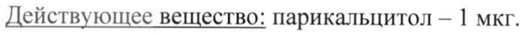
- стр. 2: «желтый — 0,542 мг, вода очищенная - 4.5., чернила черные Опакод® WB — следы (этанол,» — низкая уверенность: «4.5.,» (71)  
  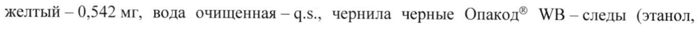
- стр. 3: «иу 13% пациентов в группе плацебо (р < 0,001). Активность сывороточной щелочной» — низкая уверенность: «0,001).» (51)  
  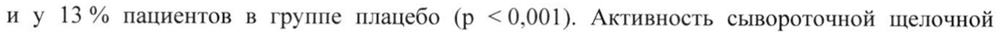
- стр. 3: «© Начальная доза капсул парикальцитола составляла | мкг 3 раза в неделю. Концентрации» — повторное чтение: «© Начальная доза капсул парикальцитола составляла 1 мкг 3 раза в неделю. Концентрации»  
  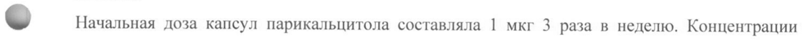
- стр. 4: «исходным значением иПТГ (первичная конечная точка эффективности), ау 10/34 (29,4%)» — низкая уверенность: «(29,4%)» (77)  
  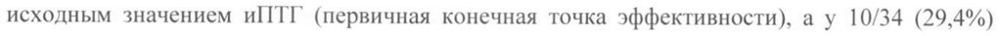
- стр. 4: «- иу 13 % пациентов в группе плацебо (р < 0,001).» — повторное чтение: «= ny 3 Voermormencen eryamesremmnedi ality,»  
  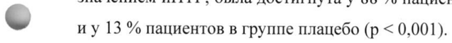
- стр. 5: «; Парикальцитол сильно связывается с белками плазмы крови (> 99%). Отношение» — низкая уверенность: «99%).» (49)  
  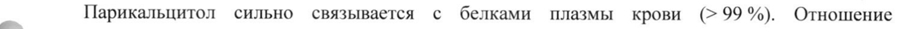
- стр. 7: «исследована у пациентов с ХЬИ 3 и 4 (см. Таблицу 2). После применения 4 мкг» — низкая уверенность: «4» (18)  
  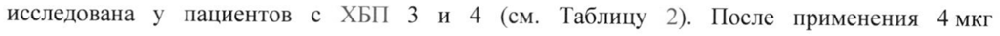
- стр. 10: «Увеличить | мкг 2 мкг» — повторное чтение: «Увеличить | 1 мкг | 2 мкг»  
  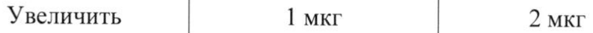
- стр. 10: «' _ принимать не чаще, чем 1 раз в 2 дня.» — повторное чтение: «| _ принимать не чаще, чем | разв 2 дня.»  
  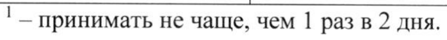
- стр. 12: «лечения в клинических исследованиях составляла 11,2 мкг. В среднем доза препарата» — повторное чтение: «лечения в клинических исследованиях составляла 12 мкг. В среднем доза препарата»  
  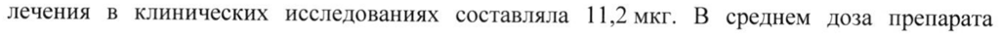
- стр. 14: «& группе препарата Земплар*® составила 3/167 (2 %) по сравнению с плацебо 0/137 (0 %), a» — повторное чтение: «= рана нина Аоки om у z em сравнению © р Ee ;»  
  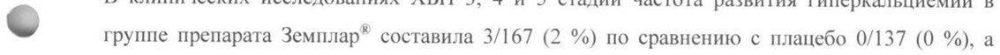
