# Парикальцитол — парентерально

- Препарат: Земплар® (раствор для внутривенного введения)
- АТХ: H05BX02
- Источник: ОХЛП, Единый реестр ЛС ЕАЭС, запись 6846c86330dcf8016b7c82ec, документ от 2024-09-24
- Распознано автоматически (OCR): 16 из 16 стр.
- Сомнительных строк после OCR: 19 (см. раздел «Проверка распознавания»)

## Общие сведения

А i ни СОГЛАСОВАНА ; МИНИСТЕРСТВОМ ЗДРАВООХРАНЕНИЯ |
ЛП-№004387-ГП-ВУ ‘по АОПУБЛИКИ ВЕЛАБУСЬ Я
} ‘риказ Министеретва здравоохранения!
i Via, J wea РТ.
| On ¢ < .
ОБЩАЯ ХАРАКТЕРИСТИКА ЛЕКАРСТВЕННОГО ПРЕПАРАТА” == Е

## 1. Наименование лекарственного препарата

Земплар, 5 мкг/мл, раствор для внутривенного введения

## 2. Качественный и количественный состав

Действующее вещество: парикальцитол | Каждый мл раствора содержит 5 мкг парикальцитола.
Вспомогательные вещества, наличие которых надо учитывать в составе лекарственного препарата: этанол — 20 % (06/06), пропиленгликоль — 30% (06/06) (см. раздел 4.4).
Полный перечень вспомогательных веществ приведен в разделе 6.1.

## 3. Лекарственная форма

Раствор для внутривенного введения.
Прозрачный бесцветный раствор.

## 4. Клинические данные

## 4.1. Показания к применению

Препарат Земплар показан взрослым пациентам в целях профилактики и лечения вторичного гиперпаратиреоза, развивающегося при хронической — почечной недостаточности (ХБП) 5 стадии.

## 4.2. Режим дозирования и способ применения

Режим дозирования Начальная доза Существуют два метода выбора начальной дозы парикальцитола. В клинических исследованиях максимальная безопасная доза достигала 40 мкг.
Подбор начальной дозы по массе тела Рекомендуемую начальную дозу парикальцитола — 0,04-0,1 мкг/кг (2,8—7 мкг) — вводят болюсно не чаще, чем через день во время диализа.
Подбор начальной дозы с учетом исходной концентрации паратиреоидного гомона (ПТГ)
У пациентов с хронической почечной недостаточностью (ХБП) 5 стадии для анализа концентрации биологического активного интактного ПТГ использовали метод второго поколения. Начальную дозу рассчитывали по формуле, приведенной ниже, и вводили внутривенно в виде болюса не чаще, чем через день во время диализа:
nr ‘ исходнаяконцентрация ПТГ т Начальная доза (мкг) = мл
Титрование дозы , Страница | из 16 | СОГЛАСОВАНО |
: у | МИЦИСТЕРСТВОМ ЗДРАВООХРАНЕНИЯ | ПП-№004387-ГП-ВУ Г: 7 РЕСПУБЛИКИ БЕЛАРУСЬ oF, т риказ PHA терства Заравоохранения |
| геспуолики Беларусь 1 Общепринятые целевые концентрации ПТГ у пациентов с терминальной почечной недостаточностью, получающих лечение диализом, превышают верхнюю границу нормы у пациентов без уремии (150-300 пг/мл) не более чем в 1,53 раза. Чтобы добиться этих концентраций, необходимы тщательное мониторирование концентрации ПТГ и индивидуальное титрование дозы.
При любых изменениях дозы необходимо чаще определять сывороточные концентрации кальция (с поправкой на гипоальбуминемию) и фосфора. При повышении скорректированной концентрации кальция (> 11,2 мг/дл) или стойком повышении концентрации фосфора (> 6,5 мг/дл) необходимо снизить дозу препарата, пока эти показатели не нормализуются. При наличии гиперкальциемии или стойкого увеличения произведения Са*Р (более 75) следует снизить дозу препарата или сделать перерыв в лечении, пока не нормализуются указанные параметры. Затем можно возобновить терапию парикальцитолом в меньшей дозе. Если пациент получает кальцийсодержащий препарат, связывающий фосфаты, то целесообразно снизить его дозу, на время отменить препарат или перевести пациента на препарат, не содержащий кальций. По мере уменьшения концентраций ПТГ в ответ на лечение может потребоваться снижение дозы парикальцитола. Таким образом, дозу следует подбирать индивидуально.
Если добиться адекватного ответа не удается, то дозу можно увеличивать на 2—4 мкг каждые 2-4 недели. При уменьшении концентрации ПТГ <150 пг/мл дозу препарата следует снизить.
Рекомендуемая схема титрования дозы представлена в Таблице |.
Таблица 1. Рекомендуемая схема титрования дозы парикальцитола
Концентрация ПТГ Доза парикальцитола Тот же или увеличивается Увеличить на 2—4 мкг
Снизился на < 30% Увеличить на 2—4 мкг Снизился на > 30%, но < 60% Не менять дозу и [би
В 1,5-3 раза выше верхней границы нормы (150-300 пг/мл) Не менять дозу
Как только доза подобрана, необходимо контролировать концентрации кальция и фосфора в сыворотке по крайней мере один раз в месяц.
Контроль концентрации интактного ПТГ рекомендуется проводить не реже одного раза в три месяца. В период титрования дозы парикальцитола может потребоваться более частый лабораторный контроль данных показателей.
Особые группы пациентов Пациенты пожилого возраста (> 65 лет)
Страница 2 из 16 Pree 1П-№004387-ГП-ВУ |—СОГЛАСОВАНО | i МИНИСРЕРСТВОМ ЗДРАВООХРАНЕНИЯ :
i РЕСПУБЛИКИ БЕЛАРУСЬ Приказ Министерства здравоохранения |
| Республики Беларусь j | pt ade колки узел Sve RN SIN изу лвуоиталтназиачи
Существует ограниченный опыт применения препарата у пациентов 65 лети старше в ходе клинических исследований фазы Ш. Не наблюдалось различий в эффективности или безопасности между пациентами данной группы и пациентами молодого возраста.
| Пациенты с нарушением функции печени Концентрации несвязанного парикальцитола у пациентов с легкой и средней степенью печеночной недостаточности схожи с таковыми У здоровых добровольцев. Коррекция дозы препарата у данной группы пациентов не требуется. Опыт применения препарата у пациентов с тяжелой степенью печеночной недостаточности отсутствует.
Дети Безопасность и эффективность препарата у детей не установлены. Данные по применению препарата у детей в возрасте до 5 лет отсутствуют. Применение препарата Земплар у детей противопоказано.
Способ применения Препарат Земплар обычно вводят внутривенно через катетер для гемодиализа. Если у пациента отсутствует гемодиализный катетер, то препарат можно вводить медленно внутривенно в течение не менее 30 секунд, чтобы свести к минимуму боль при инфузии.
Как и другие растворы для парентерального применения флакон с препаратом Земплар перед введением следует осмотреть на предмет наличия посторонних частиц и изменения
‘цвета.
Остатки раствора во флаконе следует уничтожить (см. раздел 6.6.).

## 4.3. Противопоказания

® гипервитаминоз витамина О:
®_ одновременное применение с фосфатами и/или производными витамина О;
| ° одновременное применение с препаратами, содержащими магний;
® одновременное применение с тиазидными диуретиками:
® длительное совместное применение с препаратами алюминия:
® гиперкальциемия;
° гиперчувствительность к парикальцитолу или к любому из вспомогательных веществ, перечисленных в разделе 6.1.: |
° детский возраст до 18 лет (опыт применения у детей ограничен);
® применение при грудном вскармливании.

## 4.4. Особые указания и меры предосторожности при применении

С осторожностью Совместный прием с сердечными гликозидами.
Гиперкальциемия . Страница 3 из 16 i WW «1 25. ЗАК 4Ъ 2% да 4 |
ПП-№00 4387- ГП -ВУ | МИНИСТЕРСТВОМ ЗДРАВООХРАНЕНИЯ :
| РЕСПУБЛИКИ БЕЛАРУСЬ | | Приказ Монистерства дравоохранения | i Республики Беларусь
Острая передозировка парикальцитолом может привести к развитию гиперкальциемии и потребовать неотложной помощи.
В период подбора дозы необходимо регулярно контролировать сывороточные концентрации кальция и фосфора. При развитии клинически значимой гиперкальциемии дозу парикальцитола следует уменьшить или прервать. Когда доза подобрана, сывороточные концентрации кальция и фосфора следует измерять, по крайней мере один раз в месяц. Длительная терапия парикальцитолом может повысить риск развития гиперкальциемии, увеличения значения Ca*P и кальцификации мягких тканей
(метастатический кальциноз).
Хроническая гиперкальциемия может привести к генерализованной кальцификации сосудов и других мягких тканей.
Для достижения соответствующих физиологических показателей необходимы контроль за состоянием пациента и индивидуальный подбор дозы препарата Земплар.
В случае развития клинически значимой гиперкальциемии у пациента, принимающего парикальцитол совместно с кальцийсодержащими фосфат-связывающими препаратами, доза последних должна быть снижена, или применение данного препарата должно быть временно отменено (см. раздел 4.2.). Лечение пациентов с клинически значимой гиперкальциемией включает немедленное снижение дозы или прекращение лечение парикальцитолом, диету с низким содержанием кальция, прекращение приема пищевых добавок с кальцием, повышение двигательной активности пациента, контроль водноэлектролитного баланса, контроль отклонений электрокардиограммы (ЭКГ) (особенно важно у пациентов, принимающих сердечные гликозиды), а также проведение гемодиализа или перитонеального диализа с использованием диализата, не содержащего кальций (по показаниям). Следует тщательно контролировать концентрацию кальция в сыворотке крови до тех пор, пока не наступит нормокальциемия.
Фосфаты или лекарственные препараты, в состав которых входит витамин D
Недопустимо совместное применение фосфатов или лекарственных препаратов, в состав которых входит витамин О, с парикальцитолом.
Сердечные гликозиды Токсичность сердечных гликозидов усиливается при гиперкальциемии. Сердечные гликозиды следует применять с осторожностью при совместном применении с парикальцитолом.
Кетоконазол Следует проявлять осторожность при совместном применении парикальцитола с кетоконазолом.
Адинамическая болезнь костей При снижении концентрации ПТГ ниже нормы возможно развитие адинамической болезни кости — патологического состояния с низким костным обменом.
Вспомогательные вещества Этанол Страница 4 из 16 hn -#00 4 3 8 i = Г П -ВУ МИНИСТЕРСТВОМ 8) РАВООЗРА ВЕНИЯ | i РЕСПУБЛИКИ ВЕЛАРУСЬ }
Приказ Менисторства Здраноохранения | Республики зопарус Е
Препарат Земплар, раствор для внутривенного введения, в качестве вспомогательного......-----.
вещества содержит этанол (20% об/об). 1 мл препарата Земплар содержит около 1,3 г этанола. Этанол может быть потенциально опасен для пациентов с заболеваниями печени, алкоголизмом, эпилепсией, беременных женщин и детей.
Пропиленгликоль Препарат Земплар, раствор для внутривенного введения, в качестве вспомогательного вещества содержит пропиленгликоль (30% 06/06). Доза 40 мкг препарата Земплар, введенная взрослому человеку с массой тела 70 кг, приведет к концентрации пропиленгликоля в крови примерно 36 мг/кг. Пропиленгликоль может оказывать влияние, сходное с приемом алкоголя, в количестве 400 мг/кг массы тела У взрослых. С учетом концентрации пропиленгликоля в крови при применении препарата Земплар Bo терапевтических количествах не предполагается развития симптомов интоксикации.
Лабораторные тесты | При титровании дозы парикальцитола может потребоваться более частое проведение лабораторных исследований. Когда доза подобрана, сывороточные концентрации кальция и фосфора следует измерять не реже одного раза в месяц. Концентрации ПТГ в сыворотке или плазме рекомендуется контролировать каждые 3 месяца (см. раздел 4.2).
Применение у детей Опыт применения парикальцитола для инъекций у детей и подростков в возрасте менее 18 лет ограничен.
Применение у пожилых людей Не было выявлено различий эффективности или безопасности у пациентов старше 65 лет.

## 4.5. Взаимодействие с другими лекарственными препаратами и другие виды взаимодействия

Результаты исследования in vitro свидетельствуют о том, что парикальцитол не оказывает ингибирующее действие на цитохромы CYP1A2, CYP2A6, CYP2B6, CYP2C8, CYP2C9,
CYP2C19, CYP2D6, CYP2E1 или СУРЗА в концентрациях до 50 нмоль/л (21 нг/мл)
(приблизительно в 20 раз выше концентрации при максимальной испытанной дозе). При испытаниях на свежеприготовленных культурах первичных гепатоцитов активность цитохромов CYP2B6, СУР2С9 и СУРЗА возросла менее чем в 2 раза при воздействии парикальцитола в концентрациях до 50 нмоль/л, в TO время как активность положительного контроля увеличилась в 6-19 раз. Таким образом, не предполагается, что парикальцитол оказывает ингибирующее или индуцирующее действие на выведение препаратов, метаболизируемых данными ферментами.
Взаимодействие парикальцитола для инъекций с другими препаратами отдельно не изучалось. Взаимодействие парикальцитола с кетоконазолом изучалось в лекарственной форме «капсулы».
При изучении взаимодействия кетоконазола и парикальцитола в капсулах было показано,
Что кетоконазол вызывает увеличение площади под фармакокинетической кривой
«концентрация — время» от начального момента времени до бесконечности (AUC (0-«))
парикальцитола примерно в два раза. Период полувыведения (ti2) парикальцитола
Страница 5 из 16 ЛП №00 4 3 87 ГП -ВУ | МИНИСТЕРСТВОМ ЗАРАВООХРАНЕНИЯ |
| Приказ Минастеветва злрали охранения |
. Республики Вела УС составлял 17 4 при совместном применении с кетоконазолом по сравнению с 9,8 4, при применении парикальцитола в режиме монотерапии. Парикальцитол частично метаболизируется под действием изофермента СУРЗА, а кетоконазол является мощным ингибитором изофермента СУРЗА, поэтому следует соблюдать осторожность при совместном применении парикальцитола с кетоконазолом и другими мощными ингибиторами изофермента СУРЗА.
Совместное применение фосфатов или лекарственных препаратов, в состав которых входит витамин О, с парикальцитолом противопоказано в связи с повышенным риском гиперкальциемии и повышения значения произведения Са*Р.
Одновременное применение высоких доз препаратов, содержащих кальций, либо тиазидных диуретиков и парикальцитола может увеличивать риск гиперкальциемии.
Совместное применение парикальцитола с тиазидными диуретиками противопоказано.
Совместное применение препаратов, содержащих магний (например, антацидов) с аналогами витамина Р и парикальцитолом противопоказано в связи с возможностью развития гипермагниемии.
Длительное применение препаратов, содержащих алюминий (например, некоторых антацидов и фосфатсвязывающих препаратов), совместно с аналогами витамина D u парикальцитолом противопоказано в связи с возможностью увеличения сывороточной концентрации алюминия и его токсического воздействия на кости.
Гиперкальциемия любой природы усугубляет интоксикацию сердечными гликозидами, поэтому необходимо соблюдать осторожность при их одновременном применении с
| парикальцитолом.

## 4.6. Фертильность, беременность и лактация

Беременность , Установлено, что парикальцитол вызывает минимальное снижение жизнеспособности плода (5%) при применении | раз в сутки у кроликов в дозе, составляющей 0,5 от дозы 0,2 мкг/кг у человека (рассчитанную с учетом площади поверхности тела, мкг/м?), и при применении у крыс в дозе, в 2 раза превышающей дозу 0,24 мкг/кг у человека
(рассчитанную с учетом экспозиции в плазме крови). При максимальной применяемой в испытаниях дозе (20 мкг/кг 3 раза в неделю у крыс, в 13 раз превышающей дозу 0,24 мкг/кг
У человека, рассчитанную с учетом площади поверхности тела), оказывающей токсическое воздействие на организм матери (гиперкальциемия), наблюдалось значительное увеличение смертности новорожденных крыс. Другого влияния на развитие потомства не отмечалось. Парикальцитол не обладал тератогенными эффектами в применяемых в испытаниях дозах.
Недостаточно данных о применении парикальцитола у беременных женщин.
Парикальцитол следует применять при беременности только в том случае, если потенциальная польза для матери оправдывает возможный риск для плода.
Лактация Страница 6 из 16 nn -K00 4 3 8 7 -ГП -ВУ МИНИСТЕРСТВОМ ЗДРАВООХРАНЕНИЯ i
| Приказ Менистерства злравоохрамения .
Фармакодинамические (токсикологические) данные, | полученные на животных, — свидетельствуют о проникновении парикальцитола в грудное молоко. Сведения о выведении парикальцитола с грудным молоком у женщин отсутствуют.
При необходимости применения препарата Земплар грудное вскармливание необходимо прекратить.
4.7. Влияние на способность управлять транспортными средствами и работать с механизмами
Данных по влиянию препарата на способность управления автомобилем и работу с механизмами нет. Однако, так как возможно возникновение таких побочных явлений, как головокружение, обморок и др., рекомендуется во время терапии препаратом Земплар воздержаться от управления автомобилем и занятий другими видами деятельности, требующими повышенной концентрации внимания и быстроты психомоторных реакций.

## 4.8. Нежелательные реакции

Резюме профиля безопасности В клинических исследованиях П-Т\У фазы с контролем плацебо или активным препаратом сравнения примерно 600 пациентов получали препарат Земплар. Общая частота развития побочных реакций составляла 6%.
Самой частой побочной реакцией, связанной с терапией препаратом Земплар, была гиперкальциемия, развившаяся у 4,7% пациентов. Г иперкальциемия зависит от степени избыточного подавления синтеза ПТГ и при надлежащем подборе дозы может быть минимизирована.
Табличное резюме нежелательных реакций Во время клинических исследований парикальцитола были выявлены следующие нежелательные реакции, классифицируемые по частоте как очень частые (> 1/10), частые
(> 1/100, но < 1/10), нечастые (= 1/1 000, но < 1/100), редкие (> 1/10 000, но < 1/1 000) и очень редкие (<1/10 000). При группировке по частоте встречаемости нежелательные реакции приведены в порядке уменьшения их тяжести (Таблица 2).
Таблица 2. Сведения о частоте нежелательных реакций, зарегистрированных в клинических исследованиях парикальцитола
Системно-органный класс Частота Нежелательные реакции
(СОК) развития Пневмония, грипп, инфекция верхних
Инфекции и инвазии Нечасто .
дыхательных путей, назофарингит Доброкачественные, злокачественные и неуточненные Нечасто Рак молочной железы новообразования (включая кисты и полипы)
Нарушения со стороны крови и р . P Нечасто Анемия лимфатической системы
Эндокринные нарушения Нечасто Гипопаратиреоз
Страница 7 из 16 АП -№004387-ГП-ВУ | СОГЛАСОВАНО |
МИНИСТЕРСТВОМ ЗАРАВООХРАНЕНИЯ Приказ Mi INCTANETBA зиразосхраненоя
Системно-органный класс Частота Республики Bompye
Нежелательные реакции (СОК) развития Часто Гиперкальциемия
Нарушения метаболизма и Гипокальциемия, гиперфосфатемия, питания Нечасто снижение аппетита
Психические нарушения 7 Делирий, спутанность сознания,
Нечасто ажитация, бессонница, — нервозность, беспокойство
Часто Дисгевзия, головная боль Нарушения со стороны нервной Острое нарушение мозгового системы Нечасто кровообращения, обморок, миоклонус, головокруженис, гипестезия, парестезия
Нарушения со стороны органа р P P Нечасто Конъюнктивит зрения
Остановка сердца, трепетание Нарушения со стороны сердца | Нечасто . * предсердий, ощущение сердцебиения
Артериальная гипотензия, артериальная Нарушения со стороны сосудов | Нечасто гипертензия
Нарушения со стороны | | дыхательной системы, органов | Нечасто Отек легких, одышка, ортопноэ, кашель грудной клетки и средостения
Желудочно-кишечное кровотечение, Часто диарея, запор
| Желудочно-кишечные Ишемическая болезнь кишечника, нарушения ектальное кровотечение вота
Нечасто р P , р , неприятные ощущения в области живота, сухость во рту
Алопеция, зудящая сыпь, кожный зуд, Нарушения со стороны кожи и
. Нечасто ощущение жжения кожи, образование подкожных тканей .
пузырей Нарушения со стороны , .. Боль в суставах, скованность суставов, мышечной, скелетной и | Нечасто
.. миалгия, подергивание мышц соединительной ткани
Нарушения со стороны РУ . P Эректильная дисфункция, боль в области репродуктивной системы и | Нечасто молочных желез молочных желез
Часто Лихорадка, озноб”, боль в месте введения
Общие нарушения и реакции в Нарушение походки, отек, общая месте введения Нечасто слабость, недомогание, утомляемость, ухудшение состояния
Повышение концентрации Лабораторные и 7 аспартатаминотрансферазы, отклонения ечасто ¥ инструментальные данные лабораторных показателей от нормы, снижение массы тела
Страница 8 из 16 Праказ Vin HACTCUCTBA здразоохранения
Примечание: "= ощущение сердцебиения, желудочно-кишечное кровотечение и-озноб“= нежелательные явления, частота развития которых была выше, чем при применении плацебо (по оценке исследователя, связь с применением препарата отсутствует).
Дополнительные нежелательные реакции, выявленные в ходе клинических исследований
ГУ фазы, других клинических исследований и в пострегистрационный период, представлено в Таблице 3.
Таблица 3. Дополнительные нежелательные реакции, выявленные в ходе клинических исследований ГУ фазы, других клинических исследований и в пострегистрационный период
Системно-органный класс Нежелательные реакции
(СОК)
Инфекции и инвазии Сепсис, вагинальная инфекция
Нарушения со стороны крови и р .. р р Лимфаденопатия лимфатической системы
Нарушения со стороны иммунной | Гиперчувствительность, ангионевротический отек, системы отек гортани
Эндокринные нарушения Гиперпаратиреоз Нарушения метаболизма и питания Гиперкалиемия
Нарушения со стороны нервной Отсутствие реакции на раздражители системы
Нарушения со стороны органа Глаукома, гиперемия зрения
Нарушения со стороны органа Дискомфорт в ухе слуха и лабиринта
Нарушения со стороны cepana Гари Нарушения со стороны дыхательной системы, органов | Свистящее дыхание грудной клетки и средостения
Желудочно-кишечные нарушения Дисфагия, гастрит, тошнота
Нарушения со стороны кожи и .. Гирсутизм, ночная потливость, сыпь, крапивница подкожных тканей
Чувство дискомфорта в груди, боль в грудной
Общие нарушения и реакции в Фор ВИ клетке, отек, плохое самочувствие, кровоподтек в месте введения .
месте инъекции, периферический отек, боль, жажда
Лабораторные и инструментальные | Увеличение времени кровотечения, нерегулярное данные сердцебиение
Сообщение о подозреваемых нежелательных реакциях
Важно сообщать о подозреваемых нежелательных реакциях после регистрации лекарственного препарата с целью обеспечения непрерывного мониторинга соотношения
Страница 9 из 16 _ №-1004387-ГП-ВУ Е | МИНИСТЕРСТВО ЗДРАВООХРАНЕНИЯ ;
«польза — риск» лекарственного препарата. Медицинским работникам "еКОМЕНДуется сообщать о любых подозреваемых нежелательных реакциях лекарственного препарата через национальные системы сообщения о нежелательных реакциях государств — членов
Евразийского экономического союза.
Республика Беларусь Республиканское унитарное предприятие «Центр экспертиз и испытаний в здравоохранении»
220037, г. Минск, Товарищеский пер., 2a Телефон: +375172995514
Факс: +375172995358 Электронная почта: rcp|@rceth.by
Адрес в интернете: www.rceth.by Российская Федерация
Федеральная служба по надзору в сфере здравоохранения (РОСЗДРАВНАДЗОР)
109074, г. Москва, Славянская площадь, д. 4, строение |
Телефон: 8 800 550 99 03 Факс: +74956981573
Электронная почта: pharm@roszdravnadzor.ru
Адрес в интернете: www.roszdravnadzor.ru
Республика Казахстан РГП на ПХВ «Национальный Центр экспертизы лекарственных средств и медицинских изделий» Комитета контроля качества и безопасности товаров и услуг Министерства здравоохранения Республики Казахстан 010000, г. Астана, пр. Мангилик Ел, 20
Тел.: +77172789899 Электронная почта: farm@dari.kz
Адрес в интернете: www.ndda.kz Республика Армения
«Научный Центр экспертизы лекарств и медицинских технологий им. Академика
Э. Габриеляна» АОЗТ 0051, г. Ереван, пр. Комитаса 49/4
Телефон: +37410230896 Факс: +37410232118
Электронная почта: Vi gilance@pharm.am Адрес в интернете: www.pharm.am
Страница 10 из 16 Прик в Мин ва Зло в , ыы ы > mec, we нанесения

## 4.9. Передозировка

Симптомы Случаи передозировки парикальцитола не зарегистрированы.
Передозировка парикальцитола может привести к развитию гиперкальциемии, гиперкальциурии, гиперфосфатемии и избыточному подавлению секреции ПТГ.
Симитоматика передозировки парикальцитола в целом сходна с симитоматикой передозировки витамином D: слабость, головная боль, сонливость, тошнота, рвота, сухость во рту, запор, мышечная боль, боль в костях, металлический привкус во рту, анорексия, боль в животе, неприятные ощущения в эпигастральной области.
Препарат Земплар в качестве вспомогательного вещества содержит пропиленгликоль (30% 0б./0б.). При применении пропиленгликоля в высоких дозах наблюдались единичные случаи угнетения центральной нервной системы, гемолиза и лактацидоза. При применении препарата Земплар в рекомендуемых дозах не предполагается развития данных побочных реакций, так как пропиленгликоль выводится в процессе диализа; однако необходимо
Учитывать риск развития данных побочных реакций в случае передозировки препаратом
Земплар.
Лечение При передозировке парикальцитола следует следить за признаками и симптомами гиперкальциемии (концентрацией кальция в крови). Лечение гиперкальциемии следует начать в случае необходимости.
Парикальцитол мало выводится при гемодиализе. Лечение пациентов с клинически значимой гиперкальциемией включает немедленное снижение дозы или прекращение лечение парикальцитолом, диету с низким содержанием кальция, прекращение приема пищевых добавок с кальцием, повышение двигательной активности пациента, контроль водно-электролитного баланса, контроль отклонений ЭКГ (особенно важно у пациентов, принимающих сердечные гликозиды), ‘а также проведение гемодиализа или перитонеального диализа с использованием диализата, не содержащего кальций (по показаниям).
При нормализации сывороточной концентрации кальция лечение парикальцитолом можно возобновить в меньшей дозе. В случае стойкого или выраженного повышения сывороточной концентрации кальция следует рассмотреть несколько вариантов лечения, в том числе применение фосфатов, глюкокортикостероидов, а также препаратов для стимуляции диуреза.

## 5. Фармакологические свойства

## 5.1. Фармакодинамические свойства

Фармакотерапевтическая группа: средства, регулирующие — обмен кальция;
антипаратиреоидные средства; другие антипаратиреоидные средства.
Код ATX: HOSBX02 Страница 11 из 16 ПП-#004387-ГП-ВУ АН
Механизм действия | ИНН) veh Парикальцитол — это синтетический аналог биологически активного витамина D

, (кальцитриола), в структуре которого имеются модификации боковой цепи (D2) и кольца А
(19-нор). В отличие от кальцитриола парикальцитол селективно активируст рецепторы
‚витамина D (ВДР) в паращитовидных железах без активации ВДР в кишечнике и менее активно влияст на резорбцию костной ткани. Парикальцитол также активирует кальцийчувствительные рецепторы в паращитовидных железах, вследствие чего уменьшает концентрацию ПТГ путем ингибирования паратиреоидной пролиферации и уменьшения синтеза и секреции ПТГ. Парикальцитол оказывает минимальное воздействие на концентрацию кальция и фосфора, может прямо воздействовать на клетки костной ткани, поддерживая объем костной ткани и улучшая минерализацию костной ткани. Коррекция патологического содержания ПТГ и нормализация гомеостаза кальция и фосфора может предотвращать и/или лечить заболевания костной ткани, связанные с нарушением ее метаболизма вследствие XBII.

Фармакодинамические эффекты

Вторичный гиперпаратиреоз характеризуется повышением содержания ПТГ, которое связано с неадекватной концентрацией активного витамина О. Этот витамин синтезируется в коже в виде витамина D3 и поступает в организм с пищей в виде витамина D2 или Оз.
Витамины D2 и D3 последовательно гидроксилируются в печени и почках для связывания и активации рецепторов витамина D (ВДР). Эндогенный активатор ВДР кальцитриол
[1,25(OH)2D3] - это гормон, который активирует рецепторы витамина D в паращитовидных железах, кишечнике, почках и костной ткани (благодаря этому он поддерживает функцию

_ Паращитовидных желез и гомеостаз кальция и фосфора), а также во многих других тканях,

включая предстательную железу, эндотелий и иммунные клетки. Активация рецепторов необходима для нормального образования костной ткани. При заболеваниях почек подавляется активация витамина О, что приводит к увеличению концентрации ПТГ, а впоследствии — к развитию вторичного гиперпаратиреоза и нарушению гомеостаза кальция и фосфора. Снижение концентрации кальцитриола и, как следствие, повышение концентрации ПТГ, которые зачастую предшествуют изменениям плазменных концентраций кальция и фосфора, влияют на скорость обновления костной ткани и могут привести к развитию почечной остеодистрофии. У пациентов с ХБИ снижение концентрации ПТГ оказывает благоприятное влияние на активность костной щелочной фосфатазы, обменные процессы в костной ткани и фиброз костной ткани. Терапия активным витамином D не только снижает концентрацию ПТГ и улучшает обменные процессы в костной ткани, но и позволяет предупредить или устранить другие последствия дефицита витамина О.

## 5.2. Фармакокинетические свойства

В течение 2 часов после введения парикальцитола внутривенно в дозе 0,04—0,24 мкг/кг концентрация парикальцитола быстро снижается; однако в последующем концентрация парикальцитола снижается логарифмически-линейно, со средним ti около 15 часов. При повторном применении парикальцитола признаков кумуляции не отмечается.
Абсорбция Не применимо.
Страница 12 из 16 ПП -№004387-ГП-ВУ МИНИСТЕРСТВОМ sian mal ite a
Распределение !
Парикальцитол активно связывается с белками плазмы (> 99%). У здоровых людей объем распределения в равновесном состоянии (Vss) составляет около 23,8 л. У пациентов с ХБИ 5 стадии, получавших лечение гемодиализом или перитонеальным диализом, объем распределения (Va) парикальцитола в дозе 0,24 мкг/кг составляет в среднем 31-35 л.
Фармакокинетику парикальцитола изучали у пациентов с хронической почечной недостаточностью ХБП 5 стадии, получавших лечение гемодиализом.
Парикальцитол вводится болюсно внутривенно.
Биотрансформация В моче и кале определяются несколько метаболитов парикальцитола. В моче неизмененный парикальцитол не обнаружен. Данные, полученные в исследовании in vitro, дают основание предполагать, что парикальцитол метаболизируется под действием многочисленных печеночных и непеченочных ферментов, включая митохондриальный CYP24, а также
CYP3A4 и ОСТ1А4. Идентифицированные метаболиты включают в себя продукты 24(В)- гидроксилирования (в плазме находятся в низких концентрациях), а также 24,26- и 24,28дигидроксилирования и прямого глюкуронирования. Парикальцитол не оказываст ингибирующего действия на CYP1A2, CYP2A6, CYP2B6, CYP2C8, CYP2C9, CYP2C 19,
CYP2D6, СУР2Е1 или СУРЗА в концентрации до 50 HM (21 нг/мл). При сходных концентрациях парикальцитола активность CYP2B6, СУР2С9 и CYP3A4 увеличивается
| менее чем в 2 раза.
Элиминация Парикальцитол выводится главным образом за счет гепатобилиарной экскреции. У здоровых добровольцев примерно 63% препарата выводится через кишечник и 19% почками. У здоровых добровольцев средний ty/2 парикальцитола составлял 5—7 часов при применении парикальцитола в дозе от 0,04 мкг/кг до 0,16 мкг/кг.
Средние значения показателей фармакокинетики парикальцитола у пациентов с XBII 5 стадии, получавших однократную внутривенную болюсную дозу 0,24 мкг/кг, представлены в Таблице 4.
Таблица 4. Среднее значение + стандартное отклонение фармакокинетических параметров парикальцитола у пациентов с ХБП 5 стадии, получавших однократную внутривенную болтосную дозу 0,24 мкг/кг
ХБИ 5 стадии на ХБИ 5 стадии на перитонеальном гемодиализе (n=14) диализе (п=8)
СС [6808051 «a2 0S AUC (0-») 14,51 = 4,12 16,01 = 5,98
(нг-ч/мл)
Гы | ва | 15103 Рае ——J У | 30875 | 34998 |
* среднее допустимое + псевдостандартное отклонение
| Страница 13 из 16 ЛП-#004987-ГП-ВУ [ MSMCERECEEON РАНО
Приказ Mi: о 4 : АЕ | Дети и | | Фармакокинетика парикальцитола у детей и подростков в возрасте до 18 лет не изучалась.
Лица пожилого возраста Фармакокинетика парикальцитола у людей в возрасте старше 65 лет не изучалась.
Почечная недостаточность Фармакокинетику парикальцитола изучали У пациентов с ХЬШ 5 стадии, получавших лечение гемодиализом или перитонеальным диализом. Гемодиализ не оказывал существенного влияния на выведение парикальцитола. Однако у пациентов с ХБП 5 стадии выявили снижение клиренса и увеличение периода полувыведения по сравнению со здоровыми добровольцами.
Печеночная недостаточность Фармакокинетику парикальцитола (0,24 мкг/кг) сравнивали у пациентов с легким (п=5)и умеренным (п = 5) нарушением функции печени (по шкале Чайлд-Пью) и здоровых добровольцев (п = 10). Фармакокинетика парикальцитола была сходной в данных группах.
Коррекция дозы у пациентов с легким или умеренным нарушением функции печени не требуется. Фармакокинетика парикальцитола у пациентов с тяжелым нарушением функции печени не изучалась.
Пол Фармакокинетика парикальцитола не зависит от пола.

## 6. Фармацевтические свойства

6.1. Перечень вспомогательных веществ
Этанол Пропиленгликоль Вода для инъекций

## 6.2. Несовместимость

В связи с отсутствием исследований совместимости, данный лекарственный препарат не
| следует смешивать с другими лекарственными препаратами.
Пропиленгликоль взаимодействует с гепарином и нейтрализует его действие. Земплар, раствор для внутривенного введения, содержит пропиленгликоль в качестве вспомогательного вещества и должен вводиться через другой порт для инъекций, чем гепарин.

## 6.3. Срок годности (срок хранения)

3 года.
6.4. Особые меры предосторожности при хранении
Хранить при температуре не выше 25 °С.
Страница 14 из 16 | Приказ Миние : ‘ анения

6.5. Характер и содержание первичной упаковки een ыы

| мл во флаконы из бесцветного стекла типа I (Евр.Фарм.), укупоренные резиновой пробкой

и алюминиевым обжимным колпачком с полипропиленовой отрывной крышкой. По 5

флаконов в пластиковом или картонном поддоне, по одному или по два поддона вместе с

листком-вкладышем по применению и информацией для специалистов здравоохранения в

картонной пачке.

6.6. Особые меры предосторожности при уничтожении использованного лекарственного препарата или отходов, полученных после применения лекарственного препарата, и другие манипуляции с препаратом

Как и другие растворы для парентерального применения, флакон с препаратом Земплар

° Перед введением следует осмотреть на предмет наличия посторонних частиц и изменения цвета.

Для однократного введения.

Весь оставшийся лекарственный препарат и отходы следует уничтожить в установленном

порядке.

## 7. Держатель регистрационного удостоверения

Россия Общество с ограниченной ответственностью «Э6бВи» (ООО «366Bm»)
125196, г. Москва, ул. Лесная, д. 7, этаж 4, помещение 1 тел. (495) 258 42 77 pv.russia.cis@abbvie.com
7.1 Представитель держателя регистрационного удостоверения на территории
Сотоза Для претензий на территории России и Армении:
Россия, ООО «ЭббВи» | 125196, г. Москва, ул. Лесная, д.7,
БЦ «Белые Сады», здание «А»
тел. +7 (495) 258 42 77 pv.russia.cis@abbvie.com
На территории республики Казахстан:
Представительство компании «Эббви Биофармасьютикалс ГмбХ» в Республике Казахстан
Адрес: БЦ «Алатау Гранд», ул. Тимирязева, 28в, г. Алматы, 050040,
Страница 15 из 16 ПП-#004987-ГП-ВУ ИИ Телефон: +7 (727) 222-1481 Hpaneas Мишень 9 о, cous
Электронная почта: | | kz_ppd_pv@abbvie.com
Ha территории Республики Беларусь:

Представительство компании «Эббви Биофармасьютикалс ГмбХ» в Республике Беларусь
Адрес: 1-й Загородный переулок 20, 09 этаж, офис 0919
Минск, Республика Беларусь, 220073 Телефон: +375173759832
Электронная почта: PpV.russia.cis.@abbvie.com

## 8. Номер регистрационного удостоверения

## 9. Дата первичной регистрации

(ПОДТВЕРЖДЕНИЯ РЕГИСТРАЦИИ,

ПЕРЕРЕГИСТРАЦИИ)
Дата первой регистрации:
10. — ДАТА ПЕРЕСМОТРА ТЕКСТА Общая характеристика лекарственного препарата Земплар доступна на информационном портале Евразийского экономического союза в информационно-коммуникационной сети
«Интернет» http://eec.eaeunion.org/ Страница 16 из 16
## Проверка распознавания

Страницы-сканы распознаны автоматически. В 19 строках с дозировками цифры могли распознаться с ошибкой — сверьте с вырезкой из оригинала:

- стр. 1: «исследованиях максимальная безопасная доза достигала 40 мкг.» — повторное чтение: «исследованиях максимальная безопасная доза достигала 40 Мас,»  
  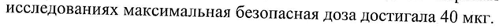
- стр. 1: «Рекомендуемую начальную дозу парикальцитола — 0,04-0,1 мкг/кг (2,8—7 мкг) — вводят» — низкая уверенность: «0,04-0,1» (37); повторное чтение: «бкомендуемую начальную дозу парикальцитола — 0,04-0,1 мкг/кг (2,87 МКГ) — ВВОДЯТ»  
  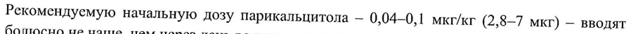
- стр. 2: «пациентов без уремии (150-300 пг/мл) не более чем в 1,53 раза. Чтобы добиться этих» — низкая уверенность: «(150-300» (79), «1,53» (0); повторное чтение: «times (ie уремии ( 190-300 пг/мл) не более eM в 15-3 pasa. Чтобы добиться этих»  
  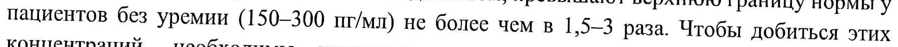
- стр. 2: «скорректированной концентрации кальция (> 11,2 мг/дл) или стойком повышении» — повторное чтение: «скорроктированной ХонценузаНий „кальция (> 11,2 меди UN exotixons повышении»  
  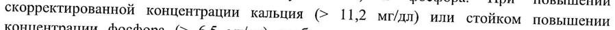
- стр. 2: «концентрации фосфора (> 6,5 мг/дл) необходимо снизить дозу препарата, пока эти» — повторное чтение: «концентрации фосфора | (> 6,5 мидл) Необходимо снизить nosy SCpenaiee. smote: oes»  
  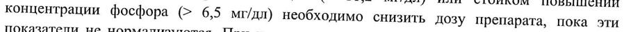
- стр. 2: «Если добиться адекватного ответа не удается, то дозу можно увеличивать на 2—4 мкг» — повторное чтение: «Роли добиться адекватного ответа не удается, то дозу можно  звеличивать на 2-4 мкг»  
  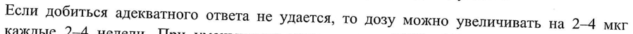
- стр. 2: «Тот же или увеличивается Увеличить на 2—4 мкг» — повторное чтение: «Тот же или увеличивается Vaonnunne Ha vi мкг»  
  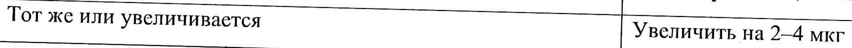
- стр. 4: «i WW «1 25. ЗАК 4Ъ 2% да 4 |» — низкая уверенность: ««1» (69), «25.» (75), «4Ъ» (30), «2%» (49); повторное чтение: «| СОГЛАСОВАНО |»  
  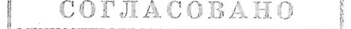
- стр. 5: «вещества содержит этанол (20% об/об). 1 мл препарата Земплар содержит около 1,3 г» — повторное чтение: «вещества содержит этанол 20% abion) 1 мл препарата Эемплар содержит около 13 г»  
  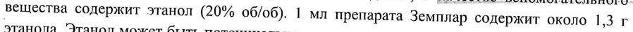
- стр. 5: «введенная взрослому человеку с массой тела 70 кг, приведет к концентрации» — повторное чтение: «взоденная взрослому человеку с массой тела 70 xr, приведет к концентрации»  
  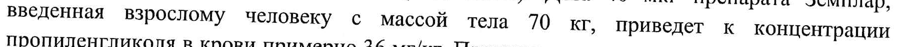
- стр. 5: «пропиленгликоля в крови примерно 36 мг/кг. Пропиленгликоль может оказывать влияние,» — повторное чтение: «пропиленгликоля в крови примерно 36 ми/кт. Пропиленгликоль может оказывать влияние.»  
  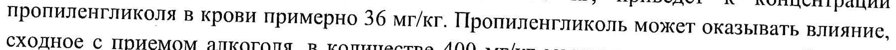
- стр. 5: «CYP2C19, CYP2D6, CYP2E1 или СУРЗА в концентрациях до 50 нмоль/л (21 нг/мл)» — низкая уверенность: «CYP2E1» (76); повторное чтение: «CYP2CI9, CYP2D6, CYP2EL или СУРЗА в концентрациях до 50 имольм (21 ними)»  
  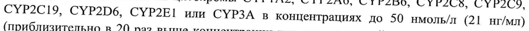
- стр. 5: «цитохромов CYP2B6, СУР2С9 и СУРЗА возросла менее чем в 2 раза при воздействии» — повторное чтение: «НОО ЯН, | CYP2C9 и СУРЗА возросла менее — 2 ‘eee НЫ  оздействии»  
  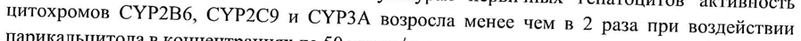
- стр. 6: «плода (5%) при применении | раз в сутки у кроликов в дозе, составляющей 0,5 от дозы 0,2» — повторное чтение: «mone (7%) при применении 1 pas в сутки у кроликов в дозе, составляющей 0,5 ведблы tt 2»  
  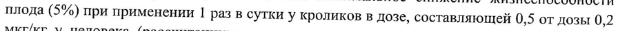
- стр. 6: «применении у крыс в дозе, в 2 раза превышающей дозу 0,24 мкг/кг у человека» — повторное чтение: «применении у ‚крыс в дозе, | в 2 раза превышающей дозу 0,24 мкгйкг у. steitanenen»  
  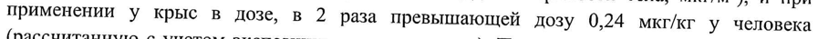
- стр. 6: «испытаниях дозе (20 мкг/кг 3 раза в неделю у крыс, в 13 раз превышающей дозу 0,24 мкг/кг» — повторное чтение: «анкет 3 раза в неделю у крыс, B 13 pas превышающей mony 0.24 аа»  
  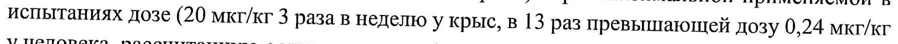
- стр. 13: «распределения (Va) парикальцитола в дозе 0,24 мкг/кг составляет в среднем 31-35 л.» — повторное чтение: «распределения (Va) парикальцитола в дозе 0,24 MKr/Kr составляет в среднем 31-35 л.»  
  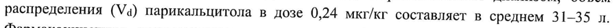
- стр. 13: «CYP2D6, СУР2Е1 или СУРЗА в концентрации до 50 HM (21 нг/мл). При сходных» — повторное чтение: «C¥P2b6, CYP2H1 или CYP3A в концентрации до 50 нм е i whe), Tie ее»  
  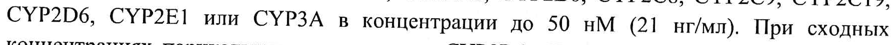
- стр. 14: «Фармакокинетику парикальцитола (0,24 мкг/кг) сравнивали у пациентов с легким (п=5)и» — низкая уверенность: «(п=5)и» (78)  
  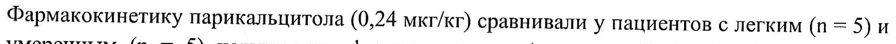
