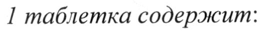

# Пелубипрофен — внутрь

- Препарат: Пелубио® (таблетки;)
- АТХ: M01AX
- Источник: ГРЛС, инструкция по медицинскому применению, РУ ЛП-007713, файл от 2023-09-21 (https://grls.rosminzdrav.ru/Grls_View_v2.aspx?routingGuid=e4451d4b-59f5-4adb-aa96-dcad842c8f5b)
- Распознано автоматически (OCR): 14 из 14 стр.
- Инструкция к другому РУ того же препарата: ЛП-007713 (национальное РУ, переоформленное по правилам ЕАЭС, решение от 14.09.2023). Текст может быть старше действующего
- Сомнительных строк после OCR: 1 (см. раздел «Проверка распознавания»)

## Общие сведения

МИНИСТЕРСТВО ЗДРАВООХРАНЕНИЯ РОССИЙСКОЙ ФЕДЕРАЦИИ
ИНСТРУКЦИЯ ПО МЕДИЦИНСКОМУ ПРИМЕНЕНИЮ ЛЕКАРСТВЕННОГО ПРЕПАРАТА
Пелубио® Регистрационный номер:
Торговое наименование: Пелубио® Международное непатентованное или группировочное наименование: пелубипрофен

## 3. Лекарственная форма

таблетки | = Состав 1 таблетка содержит:
таблетки | = Состав 1 таблетка содержит:
Действующее вещество: пелубипрофен - 30,0 мг
Вспомогательные вещества: лактозы моногидрат — 47,9 мг, гипролоза низкозамещенная - 18,0 мг, кармеллоза кальция — 10,0 мг, гипролоза - 2,1 мг, магния стеарат -1,9 мг, краситель железа оксид желтый — 0,1 мг.
Описание: круглые плоскоцилиндрические таблетки светло-желтого цвета с фаской.
Нанесена гравировка: на одной стороне — «РЕ», на другой стороне — «Р» и 4 волнистых
ЛИНИИ.
> Фармакотерапевтическая группа: нестероидный противовоспалительный препарат
(НПВП)
Код ATX: МО1АХ Фармакологические свойства

## 5.1. Фармакодинамика

Пелубипрофен является нестероидным противовоспалительным препаратом (НПВП), производным арилпропионовой кислоты, которая связана структурно и фармакологически с ибупрофеном. Механизм действия обусловлен неизбирательным ингибированием ферментов - циклооксигеназы 1 (ЦОГ-Г) и циклооксигеназы 2 (ЦОГ-2), приводящим к
Пелубипрофен является нестероидным противовоспалительным препаратом (НПВП), производным арилпропионовой кислоты, которая связана структурно и фармакологически с ибупрофеном. Механизм действия обусловлен неизбирательным ингибированием ферментов - циклооксигеназы 1 (ЦОГ-Г) и циклооксигеназы 2 (ЦОГ-2), приводящим к
| | ингибированию синтеза простагландинов- медиаторов боли, воспаления и гипертермической реакции.
Пелубипрофен оказывает обезболивающее, противовоспалительное и жаропонижающее действие. Анальгезирующее действие наиболее выражено при болях воспалительного характера.

## 5.2. Фармакокинетика

Всасывание После приема внутрь препарат абсорбируется быстро. Прием пищи практически не влияет на параметры фармакокинетики.
Всасывание После приема внутрь препарат абсорбируется быстро. Прием пищи практически не влияет на параметры фармакокинетики.
Максимальная концентрация достигается в течение 2 часов.
Распределение

© Быстрое распределение в печени и почках.
Пелубипрофен и его метаболиты связываются с белками плазмы крови на 93,3-98,9%.
При многократном введении в дозе 60 мг три раза в день в течение 7 дней аккумуляция пелубипрофена и его метаболитов в плазме крови не наблюдалась.
Метаболизм Большая часть действующего вещества метаболизируется с образованием метаболитов
(транс-ОН, цис-ОН формы, ненасыщенная ОН форма и насыщенная кетонная форма).
Основные активные метаболиты (транс-ОН, и ненасыщенная -ОН форма) образуются с высокой скоростью.
Выведение Препарат выводится почками и кишечником. Более 60% выводится почками и через

w кишечник в течение 24 часов. Препарат проникает в грудное молоко, HO его концентрация ниже, чем в плазме крови.

## 4.1. Показания к применению

- Остеоартроз;
- Остеоартроз;
- Ревматоидный артрит;
- Боль в спине.
Препарат предназначен для симптоматической терапии, уменьшения боли и воспаления на момент применения, на прогрессирование заболевания не влияет.

Противопоказания e Гиперчувствительность к пелубипрофену и/или любому вспомогательному веществу в составе препарата;
© непереносимость галактозы, недостаточность лактазы;
® язвенная болезнь в стадии обострения;
© тяжелые нарушения системы гемостаза;
e нарушения функции печени тяжелой степени;
® нарушения функции почек тяжелой степени;
® тяжелая сердечная недостаточность;
® артериальная гипертензия 3 степени и/или 3 стадии;
р » наличие в анамнезе бронхиальной астмы, крапивницы или аллергических реакций
~ после приема аспирина или других НПВП;
e лечение периоперационной боли при аортокоронарном шунтировании;
e детский возраст до 18 лет;
» беременность (см. раздел «Применение при беременности и в период грудного вскармливания»);
® период грудного вскармливания (см. раздел «Применение при беременности и в период грудного вскармливания»);
» одновременный прием с аспирином или другими НПВП (см. раздел «Взаимодействие с другими лекарственными препаратами»).
© С осторожностью Пелубипрофен следует назначать с осторожностью: пациентам с язвенной болезнью (вне обострения); с желудочно-кишечными кровотечениями в анамнезе; с нарушениями со стороны свертывающей системы крови, имеющим риск кровотечений (за исключением тяжелых нарушений системы гемостаза); с нарушениями функции печени легкой и средней степени тяжести; с нарушениями функции почек легкой и средней степени тяжести; с сердечно-сосудистыми заболеваниями и факторами риска сердечно-сосудистых заболеваний; с артериальной гипертензией 1-2 степени, 1-2 стадии; с бронхиальной астмой и другими аллергическими заболеваниями/состояниями (кроме НПВПассоциированных); системной красной волчанкой; с заболеваниями соединительной ткани; с язвенным колитом; с болезнью Крона; пациентам пожилого возраста;
ослабленным пациентам; курящим пациентам; пациентам, употребляющим алкоголь, а также пациентам, принимающим ингибиторы АПФ, фуросемид, тиазидные диуретики, препараты лития, метотрексат, непрямые антикоагулянты, пероральные кортикостероиды
(см. разделы «Взаимодействие с другими лекарственными препаратами» и «Особые указания»).

## 4.6. Применение при беременности и в период грудного вскармливания

Беременность По данным доклинических исследований, НПВП способны вызывать нарушения родовой деятельности, поздние роды, увеличивать перинатальную смертность, а также вызывать развитие персистирующей легочной гипертензии у новорождённых. В исследованиях

© пелубипрофена на лабораторных животных была продемонстрирована его эмбриотоксичность. Исследований пелубипрофена у беременных женщин не проводилось. Применение пелубипрофена во время беременности противопоказано, особенно с 20-ой недели беременности, в связи с риском преждевременного закрытия артериального протока, возможным развитием маловодия и/или патологии почек у новорожденных (неонатальная почечная дисфункция) (см. раздел «Противопоказания»).
Период грудного вскармливания Пелубипрофен проникает в грудное молоко, поэтому его применение в период грудного вскармливания противопоказано. При необходимости применения пелубипрофена в период грудного вскармливания, необходимо решить вопрос о прекращении грудного вскармливания (см. раздел «Противопоказания»).

-

## 4.2. Способ применения и дозы

Внутрь после еды.
Внутрь после еды.
Перед назначением пелубипрофена следует оценить соотношение потенциальных риска и пользы, а также возможность назначения альтернативного лечения. Необходимо использовать минимальную эффективную дозу и минимальную продолжительность лечения, с учетом цели терапии у конкретного пациента.
Рекомендуемый режим дозирования для взрослых: 1 таблетка (30 мг) 3 раза в сутки.
Суточная доза не должна превышать 3 таблеток (90 мг). У всех пациентов, получающих пелубипрофен, необходимо контролировать развитие нежелательных реакций (НР). В особенно тщательном медицинском наблюдении нуждаются пациенты с острыми

воспалительными процессами, болевым синдромом, лихорадкой, пациенты пожилого возраста (см. разделы «Побочное действие» и «Особые указания»).
Пациенты пожилого возраста Для снижения риска развития НР у пациентов пожилого возраста следует использовать минимальную эффективную дозу и минимальную продолжительность лечения. Следует осуществлять тщательное медицинское наблюдение за состоянием пациента.

## 4.8. Побочное действие

Частота НР была определена в соответствии с классификацией Всемирной организации здравоохранения (ВОЗ): очень часто (> 1/10); часто (> 1/100 и < 1/10); нечасто (> 1/1000 и
Частота НР была определена в соответствии с классификацией Всемирной организации здравоохранения (ВОЗ): очень часто (> 1/10); часто (> 1/100 и < 1/10); нечасто (> 1/1000 и
< 1/100); редко (> 1/10000 и < 1/1000); очень редко (< 1/10000); частота неизвестна (не
& может быть установлена На основании имеющихся данных).
Инфекционные и паразитарные заболевания Часто: инфекции верхних дыхательных путей;
Нечасто: вирусные инфекции.
Нарушения со стороны крови и лимфатической системы
Нечасто: лейкоцитоз, повышение концентрации калия в крови;
Частота неизвестна: анемия, удлинение время кровотечения.
Нарушения со стороны иммунной системы Частота неизвестна: анафилактоидные реакции.
Нарушения со стороны нервной системы Часто: головная боль, головокружение;
wo Нечасто: сомноленция, ступор, бессонница, сильное головокружение, парестезия, боль.
Нарушения со стороны органа зрения Нечасто: сухость глаз, мелькание мушек перед глазами.
Нарушения со стороны органа слуха и лабиринтные нарушения
Нечасто: звон в ушах.
Нарушения со стороны сердца Нечасто: боль в груди, синусовая тахикардия, синусовая брадикардия, инфаркт миокарда, ишемия миокарда.
Нарушения со стороны сосудов Нечасто: артериальная гипотензия, артериальная гипертензия;
Частота неизвестна: инсульт.
Нарушения со стороны дыхательной системы, органов грудной клетки и средостения
Нечасто: респираторный дистресс-синдром, кашель, носовое кровотечение, першение в горле;
Нарушения со стороны эндокринной системы
Нечасто: гипергликемия;
Нарушения со стороны желудочно-кишечного тракта
Часто: боль в животе, изжога, диспепсия, тошнота, рвота, диарея;
Нечасто: дискомфорт в эпигастрии, запор, потеря аппетита, вздутие живота, глоссит, стоматит, повышение аппетита;
Частота неизвестна: желудочно-кишечное кровотечение, образование язв, перфорация желудка или кишечника.

& Нарушения со стороны печени и желчевыводящих путей
Нечасто: повышение активности ферментов печени;
Частота неизвестна: желтуха, фульминантный гепатит, некроз печени, печеночная недостаточность.
Нарушения со стороны кожи и подкожных тканей
Нечасто: покраснение кожи, крапивница, ксеродерма, алопеция;
Частота неизвестна: эксфолиативный дерматит, синдром Стивенса-Джонсона, токсический эпидермальный некролиз.
Нарушения со стороны скелетно-мышечной и соединительной ткани
Нечасто: боль в мышцах, боль в спине, артроз, переломы.
Нарушения со стороны почек и мочевыводящих путей

ow Часто: задержка жидкости, отеки, в т.ч. отеки лица;
Нечасто: учащенное мочеиспускание, боль в области мочевыводящих путей, почечный папиллярный некроз, усугубление течения почечной недостаточности.
Нарушения со стороны половых органов и молочной железы
Нечасто: олигурия, вагинит, кровянистые выделения из женских половых органов.
Общие расстройства и нарушения в месте введения
Нечасто: астения, увеличение массы тела, озноб, лихорадка, бледность, снижение веса.
Лабораторные и инструментальные данные Нечасто: повышение концентрации мочевины в плазме крови, алейкемия, гиперхолестеринемия.
Описание отдельных НР:

Почечный папиллярный некроз Длительное применение НПВП может приводить к почечному папиллярному некрозу и другим поражениям почек. Развитие нефротоксичности отмечалось у пациентов, поддержание почечного кровотока у которых обеспечивалось простагландинами.
Назначение НПВП может приводить к дозозависимому снижению синтеза простагландинов, как следствие, к снижению почечного кровотока и декомпенсации почечной недостаточности. В группу риска по развитию такого состояния входят пациенты с нарушением функции почек, сердечной недостаточностью, нарушением функции печени, пациенты, получающие диуретики, ингибиторы АПФ, антагонисты рецепторов ангиотензина П, а также пациенты пожилого возраста. Отмена НПВП обычно сопровождается восстановлением исходного статуса.

© Поражение печени У пациентов, получающих НПВП, возможно повышение активности одного или нескольких печеночных ферментов. Эти лабораторные отклонения могут прогрессировать, оставаться без изменений или иметь приходящий характер, не требуя отмены терапии. Имели место редкие сообщения о случаях развития на фоне НПВП, в том числе пелубипрофена, тяжелых поражений печени, включая желтуху, фульминантный гепатит, некроз печени и печеночную недостаточность (некоторые с летальным исходом).
Пациенты с симптомами и/или признаками нарушений функции печени или с отклонениями от нормы печеночных тестов, нуждаются в тщательном медицинском наблюдении для возможности выявления более серьезных поражений печени на фоне терапии пелубипрофеном. При выявлении клинических симптомов заболевания печени

w или развитии системных реакций (эозинофилия, сыпь и др.) пелубипрофен должен быть отменен.
Анемия Иногда у пациентов, получающих НИВП, в том числе пелубипрофен, может развиваться анемия. У пациентов с симптомами анемии или кровопотери, длительно получающих пелубипрофен, следует определить уровень гемоглобина или гематокрита. НИВП ингибируют агрегацию тромбоцитов и у некоторых пациентов могут удлинять время кровотечения. В отличие от аспирина, их влияние на тромбоциты менее выражено, менее продолжительно и обратимо. Пациенты, получающие пелубипрофен, у которых может быть патология тромбоцитов, приводящая к нарушению свертываемости крови, также как

Я пациенты, получающие антикоагулянты, нуждаются в тщательном медицинском наблюдении.
Анафилактоидные реакции Также, как и в случае с другими НПВП, анафилактоидные реакции на фоне терапии пелубипрофеном отмечались у пациентов, не получавших его ранее. Как правило, этот симптомокомплекс развивается у пациентов с бронхиальной астмой, ринитом, наличием назальных полипов или без них, а также у пациентов с тяжелым, угрожающим жизни бронхоспазмом после приема аспирина или других НПВП в анамнезе. В случае развития анафилактоидной реакции необходимо оказание неотложной медицинской помощи.
Кожные реакции Пелубипрофен вызывает серьезные НР со стороны кожи, такие как эксфолиативный
| дерматит, синдром Стивенса-Джонсона и токсический эпидермальный некролиз, который могут закончиться летальным исходом. Эти серьезные НР могут развиться без предвестников, а также у пациентов без аллергии в анамнезе. Пациенты должны быть проинформированы о симптомах серьезных НР со стороны кожи. Применение препарата следует прекратить при первом появлении кожной сыпи или любого другого проявления гиперчувствительности.

## 4.9. Передозировка

Симптомы Данные о передозировке пелубипрофеном отсутствуют.
Симптомы Данные о передозировке пелубипрофеном отсутствуют.
Лечение w При подозрении на передозировку необходимо обеспечить проведение соответствующей поддерживающей терапии. Предположительно диализ не является эффективным методом выведения пелубипрофена из крови из-за высокой степени связывания препарата с белками плазмы крови.

## 4.5. Взаимодействие с другими лекарственными средствами

Пелубипрофен способен усиливать эффекты других лекарственных препаратов.
Пелубипрофен следует применять с осторожностью вместе с препаратами сульфонилмочевины (толбутамин и др.), антибиотиками из группы хинолонов нового поколения (эноксацин и др.).
Нестероидные противовоспалительные препараты
Следует избегать назначения пелубипрофена с другими НПВП.
Ингибиторы АПФ НПВП могут снижать антигипертензивный эффект ингибиторов АПФ. Это следует принимать во внимание у пациентов, принимающих пелубипрофен вместе с ингибиторами АПФ.
Аспирин Убедительных доказательств того, что одновременное использование аспирина и НИВИ снижает риск серьезных сердечно-сосудистых тромботических событий нет.
Одновременное назначение аспирина и НПВП увеличивает риск серьезных НР со стороны желудочно-кишечного тракта. Таким образом, одновременный прием пелубипрофена и аспирина не рекомендуется.
|S Фуросемид и тиазидные диуретики Клинические исследования показали, что НПВП могут снижать натрийуретическое действие фуросемида и тиазидных диуретиков у некоторых пациентов. Это связано с ингибированием синтеза простагландинов в почках. При назначении НПВП вместе с фуросемидом и тиазидными диуретиками необходим тщательный контроль функции почек.
Препараты лития НПВП вызывают повышение уровня лития в плазме крови и снижение почечного клиренса лития. Этот эффект объясняется подавлением синтеза почечных простагландинов. При назначении НПВП вместе с литием необходим тщательный контроль с целью выявления симптомов интоксикации литием.
w~ Memompexcam

При назначении НПВП вместе с метотрексатом может увеличиваться токсичность последнего. Следует соблюдать осторожность при одновременном назначении НПВП и метотрексата.
Непрямые антикоагулянты Варфарин и НПВП могут оказывать синергетическое действие, провоцируя желудочнокишечное кровотечение. У пациентов, принимающих одновременно лекарственные препараты обеих групп, риск серьезного желудочно-кишечного кровотечения выше, чем их отдельный прием. При назначении пелубипрофена вместе с непрямыми антикоагулянтами следует соблюдать осторожность

Алкоголь Употребление алкоголя на фоне лечения пелубипрофеном ассоциируется с повышенным риском желудочно-кишечного кровотечения.

## 4.4. Особые указания

В связи с тем, что пелубипрофен оказывает противовоспалительное и жаропонижающее действия, его назначение может замаскировать клинические симптомы инфекционных осложнений неинфекционных заболеваний и состояний, сопровождающихся болевым синдромом.
В связи с тем, что пелубипрофен оказывает противовоспалительное и жаропонижающее действия, его назначение может замаскировать клинические симптомы инфекционных осложнений неинфекционных заболеваний и состояний, сопровождающихся болевым синдромом.
Пациенты с воспалением инфекционного генеза, получающие терапию пелубипрофеном,

w должны находиться под тщательным медицинским наблюдением.
Пациентам, длительно получающим НПВП, необходимо периодически контролировать показатели общего и биохимического анализа крови. При наличии клинических признаков и симптомов заболевания печени или почек, развитии системных реакций (эозинофилия, сыпь и др.), развитии отклонений или ухудшении печеночных тестов, пелубипрофен должен быть отменен и рассмотрена возможность назначения альтернативной терапии, не содержащей НИВИ.
У всех пациентов, получающих пелубипрофен, необходимо контролировать развитие НР.
При назначении пелубипрофена в особо тщательном медицинским наблюдении нуждаются пациенты с острыми воспалением, болевым синдромом, лихорадкой;
пациенты пожилого возраста; ослабленные пациенты.

“> Пелубипрофен не может заменить глюкокортикостероиды или использоваться для терапии глюкортикостероидной недостаточности.
В связи с наличием в составе препарата лактозы при назначении препарата необходимо учитывать непереносимость некоторых сахаров у отдельных пациентов (см. раздел
«Противопоказания»).
Сочетание с алкоголем У пациентов, принимающих 3 и более алкогольных единиц в день, пелубипрофен увеличивает риск желудочно-кишечного кровотечения. Таким пациентам следует рекомендовать отказаться от алкоголя и рассмотреть возможность замены пелубипрофена на альтернативный лекарственный препарат, обладающий противовоспалительным и жаропонижающим действием.

Влияние на сердечно-сосудистую систему Пелубипрофен и другие НПВП могут вызывать развитие или ухудшать течение артериальной гипертензии, что может способствовать увеличению частоты НР со стороны сердечно-сосудистой системы. У пациентов с артериальной гипертензией (кроме артериальной гипертензии 3 степени и/или 3 стадии) пелубипрофен должен применяться с осторожностью. С самого начала и на протяжении всего курса терапии пелубипрофеном следует контролировать артериальное давление (см. раздел «С осторожностью»).
У пациентов, принимающих тиазидные или «петлевые» диуретики, эффективность терапии при совместном приеме с НПВП может быть снижена (см. раздел
«Взаимодействие с другими лекарственными препаратами»).
Пелубипрофен может увеличивать риск серьезных, угрожающих жизни сердечноw сосудистых тромботических событий - инфаркта миокарда и инсульта. Риск выше при длительном применении пелубипрофена, а также у пациентов с сердечно-сосудистыми заболеваниями или факторами риска таких заболеваний. Врач и пациент должны сохранять бдительность в отношении развития подобных событий, даже при отсутствии симптомов сердечно-сосудистого заболевания. Пациент должен быть информирован о симптомах тяжелой кардиотоксичности, а также своих действиях при их появлении (см.
разделы «С осторожностью» и «Побочное действие»).
Влияние на желудочно-кишечный тракт Пелубипрофен и другие НПВП увеличивают риск серьезных, угрожающих жизни НР со стороны желудочно-кишечного тракта, включающих кровотечения, язвообразование, перфорацию желудка или кишечника. Эти НР могут развиться в любое время на фоне
& приема препарата, не сопровождаясь симптомами тревоги (см. раздел «Побочное действие»).
К факторам, увеличивающим риск желудочно-кишечного кровотечения на фоне терапии
НПВП, относятся: продолжительный курс терапии НПВП, одновременный прием НПВП с пероральными кортикостероидами или антикоагулянтами, курение, употребление алкоголя, пожилой возраст, ослабленный организм (см. раздел «С осторожностью»).
Особую осторожность следует соблюдать при назначении пелубипрофена пациентам с язвенной болезнью и/или желудочно-кишечным кровотечением в анамнезе, у которых риск развития желудочно-кишечного кровотечения характеризуется 10-кратным увеличением. Большинство сообщений о смертельных случаях связаны с НР со стороны желудочно-кишечного тракта у пациентов пожилого возраста или ослабленных пациентов, поэтому следует соблюдать особую осторожность при назначении пелубипрофена этой группе пациентов (см. раздел «С осторожностью»).
Врач и пациент должны сохранять бдительность в отношении симптомов язвообразования и кровотечения в течение всего периода терапии пелубипрофеном и незамедлительно инициировать дополнительное обследование и лечение при подозрении на их развитие.
Требуется отмена НПВП даже при разрешении серьезного НР со стороны желудочнокишечного тракта. У пациентов из групи высокого риска следует рассмотреть возможность назначения альтернативных вариантов лечения, без НПВП.
Хроническая сердечная недостаточность и отеки
У некоторых пациентов, принимающих НПВП, в том числе пелубипрофен, отмечались задержка жидкости и отеки. Пелубипрофен следует назначать с осторожностью
& пациентам с задержкой жидкости или сердечной недостаточностью. При тяжелой сердечной недостаточности препарат противопоказан (см. раздел «Противопоказания».
Нарушение функции почек тяжелой степени Результаты контролируемых клинических исследований пелубипрофена у пациентов с нарушениями функции почек тяжелой степени отсутствуют. В связи с этим назначение пелубипрофена этим пациентам не рекомендуется (см. раздел «Противопоказания»).
Бронхиальная астма Бронхиальная астма может быть аспирин-зависимой. Использование аспирина у таких пациентов ассоциируется с развитием тяжелого, угрожающего жизни бронхоспазма. В связи с тем, что возможна перекрестной реактивности, включая бронхоспазм, между аспирином и другими НПВП, пелубипрофен не следует назначать пациентам с этой
= формой гиперчувствительности к аспирину. Также его необходимо применять с осторожностью у пациентов с бронхиальной астмой (не НПВП-ассоциированной) в анамнезе (см. разделы «Противопоказания» и «С осторожностью»).

## 4.7. Влияние на способность управлять транспортными средствами, механизмами

В связи с возможностью нарушения зрения, возникновения головокружения, сонливости и других симптомов со стороны центральной нервной системы, пациентам, получающим пелубипрофен, следует соблюдать осторожность при управлении транспортными средствами и выполнении других потенциально опасных видов деятельности, требующих повышенной концентрации внимания и быстроты психомоторных реакций. При развитии перечисленных симптомов следует отказаться от управления транспортными средствами и механизмами.

## 6.5. Форма выпуска

Таблетки, 30 мг.
Таблетки, 30 мг.
По 30 таблеток в банку из полиэтилена высокой плотности белого цвета с навинчивающейся крышкой из полиэтилена низкой плотности с контролем первого вскрытия. В каждую банку помещают пакетик с силикагелем. На банку наклеивают этикетку.
По 1 банке вместе с инструкцией по медицинскому применению помещают в пачку из картона.

| По 10 таблеток в контурную ячейковую упаковку из пленки поливинилхлоридной и фольги алюминиевой.
По 1, 2, 3, 6 или 10 контурных ячейковых упаковок №10 вместе с инструкцией по медицинскому применению помещают в пачку из картона.

## 6.4. Условия хранения

Хранить при температуре не выше 25°С.
Хранить при температуре не выше 25°С.
Хранить в недоступном для детей месте.

## 6.3. Срок годности

3 года.
3 года.

w Не применять по истечении срока годности.
Условия отпуска Отпускают по рецепту.
Производитель При полном цикле производства на Дэвон Фарма Ко. Лтд., Республика Корея указывают:
Дэвон Фарма Ко. Лтд., Республика Корея 24, Джейкондан 1-гил Хангнам-ып, Хвасон-ши, Кёнги-до

При вторичной упаковке и выпускающем контроле качества на ОАО «ФармстандартЛексредства», Россия указывают:
Производитель, фасовщик (первичная упаковка)
Дэвон Фарма Ко. Лтд., Республика Корея 24, Джейкондан 1-гил Хангнам-ып, Хвасон-ши, Кёнги-до
Упаковщик (вторичная (потребительская) упаковка), выпускающий контроль качества
Открытое акционерное общество «Фармстандарт-Лексредства»
(ОАО «Фармстандарт-Лексредства»), Россия
Курская обл., г. Курск, ул. 2-я Агрегатная, д. 1а/18, тел./факс: (4712) 34-03-13, www.pharmstd.ru
Юридическое лицо, на имя которого выдано регистрационное удостоверение
Общество с ограниченной ответственностью «ФармАртис Интернешнл»
(ООО «ФармАртис Интернешнл»)
117485, г. Москва, ул. Обручева, д. 30/1, стр. 2, эт. 5, пом. XXIV, ком. 2, оф. 7
Организация, принимающая претензии потребителей
Общество с ограниченной ответственностью «ФармАртис Интернешнл»
(ООО «ФармАртис Интернешнл»)
117485, г. Москва, ул. Обручева, д. 30/1, стр. 2, эт. 5, пом. XXIV, ком. 2, оф. 7, тел.: +7 495 120-36-17
[rs РА - “А ООО «ФармАртис Интернешнл» (s/ ти 4ECK He\3 П.А. Заславец
\<\ Мю» /Е/
## Проверка распознавания

Страницы-сканы распознаны автоматически. В 1 строках с дозировками цифры могли распознаться с ошибкой — сверьте с вырезкой из оригинала:

- стр. 1: «1 таблетка содержит:» — низкая уверенность: «1» (60)  
  
