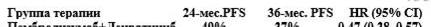
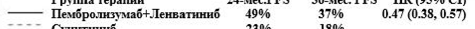
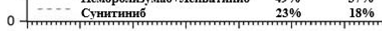
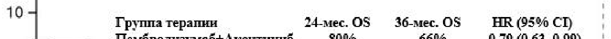
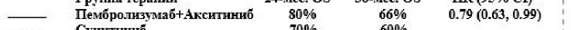

# Пембролизумаб — парентерально

- Препарат: Пемброриа® (концентрат для приготовления раствора для инфузий)
- АТХ: L01XC18
- Источник: ОХЛП, Единый реестр ЛС ЕАЭС, запись 6953a4cd30dcf8a1cb21653f, документ от 2026-10-05
- Распознано автоматически (OCR): 1 из 138 стр.
- Сомнительных строк после OCR: 5 (см. раздел «Проверка распознавания»)

## Общие сведения

SPC.201.1.EAEU.PK2PK137.03.02 ОБЩАЯ ХАРАКТЕРИСТИКА ЛЕКАРСТВЕННОГО ПРЕПАРАТА

## 1. Наименование лекарственного препарата

Пемброриа, 25 мг/мл, концентрат для приготовления раствора для инфузий.

## 2. Качественный и количественный состав

Действующее вещество: пембролизумаб*.
Каждый мл концентрата для приготовления раствора для инфузий содержит 25 мг пембролизумаба.
Каждый флакон содержит 100 мг пембролизумаба.
* Пембролизумаб – это гуманизированное моноклональное антитело, селективно блокирующее взаимодействие между рецептором PD-1 и его лигандами PD-L1 и PD-L2.
Пембролизумаб получен по технологии рекомбинантной ДНК в клеточной линии яичников китайского хомячка (CHO-клетки). Пембролизумаб является иммуноглобулином изотипа
IgG4 каппа с молекулярной массой около 149 кДа.
Полный перечень вспомогательных веществ приведен в разделе 6.1.

## 3. Лекарственная форма

Концентрат для приготовления раствора для инфузий.
Прозрачная или опалесцирующая от бесцветного до светло-коричневого цвета жидкость.

## 4. Клинические данные

## 4.1. Показания к применению

Меланома Препарат Пемброриа показан к применению у взрослых и подростков в возрасте от 12 лет и старше в качестве монотерапии с распространенной (неоперабельной или метастатической)
меланомой.
Препарат Пемброриа показан к применению у взрослых в качестве адъювантной монотерапии после хирургического лечения меланомы III стадии с поражением лимфатических узлов (см.
раздел 5.1).
Немелкоклеточный рак легкого (НМРЛ)
Препарат Пемброриа показан к применению у взрослых в качестве неоадъювантной терапии в режиме комбинированной терапии с химиотерапией на основе препаратов платины с последующим продолжением применения в качестве адъювантной монотерапии с операбельным НМРЛ с высоким риском рецидива (критерии отбора см. в разделе 5.1).
Препарат Пемброриа показан к применению в качестве монотерапии первой линии у взрослых с метастатическим НМРЛ с экспрессией PD-L1 (шкала пропорции опухоли (TPS) ≥ 50 %) при отсутствии мутаций в генах эпидермального фактора роста (EGFR) или киназы анапластической лимфомы (ALK).

SPC.201.1.EAEU.PK2PK137.03.02 Препарат Пемброриа показан к применению в режиме комбинированной терапии с пеметрекседом и химиотерапией на основе препаратов платины в качестве первой линии терапии у взрослых с метастатическим неплоскоклеточным НМРЛ при отсутствии мутаций в генах EGFR и ALK.
Препарат Пемброриа показан к применению в режиме комбинированной терапии с карбоплатином и паклитакселом или альбумин-стабилизированным нанодисперсным паклитакселом (наб-паклитаксел) в качестве первой линии терапии у взрослых с метастатическим плоскоклеточным НМРЛ.
Препарат Пемброриа показан к применению в качестве монотерапии у взрослых с местнораспространенным или метастатическим НМРЛ с экспрессией PD-L1 (TPS ≥ 1 %), ранее получивших как минимум один курс химиотерапии. При наличии мутаций в генах EGFR или ALK пациенты должны получить соответствующую таргетную терапию перед применением препарата Пемброриа.
Злокачественная мезотелиома плевры (ЗМП)
Препарат Пемброриа показан к применению в режиме комбинированной терапии с пеметрекседом и химиотерапией на основе препаратов платины в качестве первой линии терапии у взрослых с неоперабельной неэпителиоидной ЗМП.
Классическая лимфома Ходжкина (кЛХ)
Препарат Пемброриа показан к применению в качестве монотерапии рецидивирующей или рефрактерной кЛХ у взрослых и детей в возрасте от 3 лет и старше при отсутствии эффективности аутологичной трансплантации стволовых клеток (АТСК) или невозможности проведения АТСК, которые прошли как минимум две линии предшествующей терапии.
Уротелиальный рак Препарат Пемброриа показан к применению в режиме комбинированной терапии с энфортумабом ведотином в качестве первой линии терапии неоперабельного или метастатического уротелиального рака у взрослых.
Препарат Пемброриа показан к применению в качестве монотерапии местнораспространенного или метастатического уротелиального рака у взрослых, ранее получивших химиотерапию на основе препаратов платины (см. раздел 5.1).
Препарат Пемброриа показан к применению в качестве монотерапии местнораспространенного или метастатического уротелиального рака с экспрессией PD-L1
(комбинированный показатель позитивности (CPS) ≥ 10) у взрослых, которым химиотерапия, содержащая цисплатин, не может быть проведена (см. раздел 5.1).
Плоскоклеточный рак головы и шеи (ПРГШ)
Препарат Пемброриа показан к применению в качестве неоадъювантной монотерапии с продолжением в качестве адъювантной терапии в режиме комбинированной терапии с лучевой терапией (ЛТ), с сопутствующим применением цисплатина или без, и последующей монотерапии у взрослых с операбельным местнораспространенным ПРГШ с экспрессией PDL1 (CPS ≥ 1).
Препарат Пемброриа показан к применению в качестве первой линии терапии как монотерапия или в сочетании с химиотерапией на основе платины и 5-фторурацила (5-ФУ) у взрослых с метастатическим или неоперабельным рецидивирующим ПРГШ с экспрессией PDL1 (CPS ≥ 1) (см. раздел 5.1).
Препарат Пемброриа показан к применению в качестве монотерапии рецидивирующего или метастатического ПРГШ с экспрессией PD-L1 (TPS ≥ 50 %) у взрослых, или при

SPC.201.1.EAEU.PK2PK137.03.02 прогрессировании на фоне химиотерапии, содержащей препараты платины, или после нее (см.
раздел 5.1).
Почечно-клеточный рак (ПКР)
Препарат Пемброриа показан к применению в режиме комбинированной терапии с акситинибом в качестве первой линии терапии распространенного ПКР у взрослых (см. раздел 5.1).
Препарат Пемброриа показан к применению в режиме комбинированной терапии с ленватинибом в качестве первой линии терапии распространенного ПКР у взрослых (см.
раздел 5.1).
Препарат Пемброриа показан к применению в качестве адъювантной монотерапии у взрослых с ПКР с повышенным риском рецидива после нефрэктомии или после нефрэктомии и резекции метастазов (критерии отбора см. в разделе 5.1).
Злокачественные новообразования с высоким уровнем микросателлитной нестабильности
(MSI-H) или нарушениями системы репарации ДНК (dMMR)
Колоректальный рак (КРР)
Препарат Пемброриа показан к применению в качестве монотерапии КРР с MSI-H или dMMR у взрослых:
− в качестве первой линии терапии метастатического КРР;
− при неоперабельном или метастатическом КРР после предшествующей комбинированной терапии на основе фторпиримидина.
Другие злокачественные новообразования Препарат Пемброриа показан к применению для проведения монотерапии злокачественных новообразований с MSI-H или dMMR у взрослых:
− при распространенном или рецидивирующим раке эндометрия, прогрессирующим на фоне терапии, содержащей препараты платины или после нее, и которым радикальное хирургическое вмешательство или лучевая терапия не могут быть выполнены;
− при неоперабельном или метастатическом раке желудка, тонкой кишки или желчевыводящих путей, получивших как минимум одну линию предшествующей терапии, на фоне проводимой терапии или после нее.
Рак пищевода Препарат Пемброриа показан к применению в сочетании с химиотерапией на основе препаратов платины и фторпиримидина в качестве первой линии терапии взрослых с местнораспространенным неоперабельным или метастатическим раком пищевода с экспрессией PD-L1 (CPS ≥ 10) (см. раздел 5.1).
Тройной негативный рак молочной железы (ТНРМЖ)
Препарат Пемброриа показан к применению в сочетании с химиотерапией в качестве неоадъювантной терапии у взрослых с местнораспространенным ТНРМЖ или ТНРМЖ на ранних стадиях с высоким риском рецидива (см. раздел 5.1) с последующей адъювантной монотерапией после хирургического вмешательства.
Препарат Пемброриа показан к применению в сочетании с химиотерапией при местнорецидивирующем неоперабельном или метастатическом ТНРМЖ с экспрессией PD-L1
(CPS ≥ 10) у взрослых, ранее не получавших химиотерапию (см. раздел 5.1).

SPC.201.1.EAEU.PK2PK137.03.02 Рак эндометрия (РЭ)
Препарат Пемброриа показан к применению в режиме комбинированной терапии с карбоплатином и паклитакселом в качестве первой линии терапии у взрослых с первичнораспространенным или рецидивирующим РЭ, являющихся кандидатами для проведения системной терапии.
Препарат Пемброриа показан к применению в режиме комбинированной терапии с ленватинибом у взрослых с распространенным или рецидивирующим РЭ, прогрессирующим на фоне проведения терапии, содержащей препараты платины, или после нее, которым не показаны радикальное хирургическое вмешательство или лучевая терапия.
Рак шейки матки Препарат Пемброриа показан к применению в сочетании с химиолучевой терапией (наружной дистанционной лучевой терапией с последующей брахитерапией) у взрослых с местнораспространенным раком шейки матки III–IVA стадии по FIGO 2014, которым радикальная терапия ранее не была проведена.
Препарат Пемброриа показан к применению в сочетании с химиотерапией с бевацизумабом или без него у взрослых с персистирующим рецидивирующим или метастатическим раком шейки матки с экспрессией PD-L1 (CPS ≥ 1).
Аденокарцинома желудка или пищеводно-желудочного перехода (ПЖП)
Препарат Пемброриа показан к применению в режиме комбинированной терапии с трастузумабом, фторпиримидином и химиотерапией на основе препаратов платины в качестве первой линии терапии у взрослых с местнораспространенной неоперабельной или метастатической HER2-положительной аденокарциномой желудка или ПЖП с экспрессией
PD-L1 (CPS ≥ 1).
Препарат Пемброриа показан к применению в режиме комбинированной терапии с фторпиримидином и химиотерапией на основе препаратов платины в качестве первой линии терапии у взрослых с местнораспространенной неоперабельной или метастатической HER2отрицательной аденокарциномой желудка или ПЖП с экспрессией PD-L1 (CPS ≥ 1)
(см. раздел 5.1).
Рак желчевыводящих путей (РЖП)
Препарат Пемброриа показан к применению в режиме комбинированной терапии с гемцитабином и цисплатином в качестве первой линии терапии у взрослых с местнораспространенным неоперабельным или метастатическим РЖП.

## 4.2. Режим дозирования и способ применения

Применение препарата Пемброриа следует начинать и проводить под наблюдением врача, имеющего опыт лечения онкологических заболеваний.
Тестирование на PD-L1 Если указано в показаниях к применению, отбор пациентов для лечения препаратом
Пемброриа рекомендуется проводить на основе определения экспрессии PD-L1 клетками опухоли, подтвержденной валидированным тестом (см. разделы 4.1, 4.4, 4.8 и 5.1).

SPC.201.1.EAEU.PK2PK137.03.02 Тестирование на MSI/MMR
Если указано в показаниях к применению, отбор пациентов для лечения препаратом
Пемброриа рекомендуется проводить на основе определения статуса опухоли по MSIH/dMMR, подтвержденного валидированным тестом (см. разделы 4.1 и 5.1).
Режим дозирования Рекомендуемая доза препарата Пемброриа для взрослых составляет либо 200 мг один раз в 3 недели, либо 400 мг один раз в 6 недель, вводимых путем внутривенной инфузии в течение 30 минут.
Рекомендуемая доза препарата Пемброриа в режиме монотерапии для детей с кЛХ в возрасте от 3 лет и старше или пациентов с меланомой в возрасте от 12 лет и старше составляет 2 мг/кг массы тела (мт) (максимум до 200 мг) один раз в 3 недели, вводимых путем внутривенной инфузии в течение 30 минут.
При применении в режиме комбинированной терапии с другими препаратами см. общие характеристики лекарственных препаратов (ОХЛП) для сопутствующих препаратов.
Пациенты должны получать лечение препаратом Пемброриа до прогрессирования заболевания или развития признаков неприемлемой токсичности (и до максимальной продолжительности терапии, если она указана по конкретному показанию). Наблюдались атипичные ответы (т.е. первоначальное преходящее увеличение размера опухоли или появление небольших новых очагов поражения в течение первых нескольких месяцев, с последующим уменьшением размеров опухоли). У клинически стабильных пациентов с первичными признаками прогрессирования заболевания рекомендуется продолжать лечение до тех пор, пока не будет подтверждено прогрессирование заболевания.
При адъювантной терапии меланомы, НМРЛ или ПКР препарат Пемброриа следует применять до рецидива заболевания, развития признаков неприемлемой токсичности или сроком не более одного года.
При неоадъювантной и адъювантной терапии резектабельного НМРЛ пациенты должны получать неоадъювантную терапию препаратом Пемброриа в сочетании с химиотерапией в виде 4 введений по 200 мг один раз в 3 недели или 2 введений по 400 мг один раз в 6 недель или до прогрессирования заболевания, исключающего проведение радикального хирургического вмешательства, либо развития неприемлемой токсичности, а затем адъювантную монотерапию препаратом Пемброриа в виде 13 введений по 200 мг один раз в 3 недели или 7 введений по 400 мг один раз в 6 недель либо до рецидива заболевания или развития неприемлемой токсичности. Пациентам с прогрессированием заболевания, исключающим проведение радикального хирургического вмешательства, или с неприемлемой токсичностью, связанной с применением препарата Пемброриа в качестве неоадъювантной терапии в сочетании с химиотерапией, не следует проводить адъювантную монотерапию препаратом Пемброриа.
При неоадъювантной и адъювантной терапии резектабельного местнораспространенного
ПРГШ пациенты должны получать неоадъювантную монотерапию препаратом Пемброриа в виде 2 введений по 200 мг один раз в 3 недели или 1 введения 400 мг или до прогрессирования заболевания, исключающего проведение радикального хирургического вмешательства, либо до развития неприемлемой токсичности, а затем адъювантную терапию препаратом
Пемброриа в комбинации с лучевой терапией с сопутствующим применением цисплатина или без него в виде 3 введений по 200 мг один раз в 3 недели или 2 введений по 400 мг один раз в 6 недель, либо до рецидива заболевания или развития неприемлемой токсичности с последующей монотерапией препаратом Пемброриа в виде 12 введений по 200 мг один раз в 3 недели или 6 введений по 400 мг один раз в 6 недель или до рецидива заболевания, либо развития неприемлемой токсичности. Пациентам с прогрессированием заболевания,

SPC.201.1.EAEU.PK2PK137.03.02 исключающим проведение радикального хирургического вмешательства, или с неприемлемой токсичностью, связанной с монотерапией препаратом Пемброриа в качестве неоадъювантной терапии, не следует проводить адъювантную терапию препаратом Пемброриа в сочетании с лучевой терапией с сопутствующим применением цисплатина или без.
При неоадъювантной и адъювантной терапии ТНРМЖ пациентки должны получать неоадъювантную терапию препаратом Пемброриа в сочетании с химиотерапией в виде 8 введений препарата Пемброриа по 200 мг один раз в 3 недели или 4 введений по 400 мг один раз в 6 недель или до прогрессирования заболевания, исключающего проведение радикального хирургического вмешательства, либо развития неприемлемой токсичности, а затем адъювантную монотерапию препаратом Пемброриа в виде 9 введений по 200 мг один раз в 3 недели или 5 введений по 400 мг один раз в 6 недель либо до рецидива заболевания или развития неприемлемой токсичности. Пациентам с прогрессированием заболевания, исключающим проведение радикального хирургического вмешательства, или с неприемлемой токсичностью, связанной с применением препарата Пемброриа в качестве неоадъювантной терапии в сочетании с химиотерапией, не следует проводить адъювантную монотерапию препаратом Пемброриа.
При местнораспространенном раке шейки матки пациентки должны получать препарат
Пемброриа одновременно с химиолучевой терапией, а затем препарат Пемброриа в режиме монотерапии. Препарат Пемброриа можно применять в дозе 200 мг один раз в 3 недели или 400 мг один раз в 6 недель до прогрессирования заболевания, развития неприемлемой токсичности или до 24 месяцев.
Временная или полная отмена терапии (см. также раздел 4.4)
Снижение дозы препарата Пемброриа не рекомендуется. Применение препарата Пемброриа следует приостановить или прекратить для лечения нежелательных реакций, как описано в
Таблице 1.
Таблица 1. Рекомендации по изменению лечения препаратом Пемброриа
Иммуноопосредованные нежелательные реакции
Степень тяжести Изменение лечения Пневмонит 2 степень
Приостановить до уменьшения тяжести нежелательных реакций до 0–1* степени 3 или 4 степень, либо рецидив 2 степени
Окончательное прекращение лечения Колит 2 или 3 степень
Приостановить до уменьшения тяжести нежелательных реакций до 0–1* степени 4 степень или рецидив 3 степени
Окончательное прекращение лечения Нефрит 2 степень с уровнем креатинина от
> 1,5 до ≤ 3 раз больше верхней границы нормы (ВГН)
Приостановить до уменьшения тяжести нежелательных реакций до 0–1* степени
≥ 3 степень с уровнем креатинина > 3 раза больше ВГН
Окончательное прекращение лечения Эндокринопатии
Недостаточность надпочечников 2 степени и гипофизит
Приостановить лечение до достижения контроля с помощью заместительной гормональной терапии
Недостаточность надпочечников 3 или 4 степени либо симптоматический гипофизит
Сахарный диабет 1 типа, связанный с гипергликемией ≥ 3 степени (уровень глюкозы > 250 мг/дл или
Приостановить до уменьшения тяжести нежелательных реакций до 0–1* степени
У пациентов с эндокринопатиями 3 или 4 степени, выраженность которых снизилась до 2 степени

SPC.201.1.EAEU.PK2PK137.03.02 > 13,9 ммоль/л) или связанный с кетоацидозом
Гипертиреоз ≥ 3 степени или ниже и которые контролируются заместительной гормональной терапией, при необходимости можно рассмотреть возможность продолжения применения пембролизумаба после постепенного снижения дозы глюкокортикостероида. В остальных случаях лечение следует прекратить.
Гипотиреоз Для лечения гипотиреоза можно использовать заместительную терапию, не прерывая лечения.
Гепатит ПРИМЕЧАНИЕ:
рекомендации по дозированию у пациентов с ПКР и с повышением уровня печеночных ферментов, получающих пембролизумаб в комбинации с акситинибом, см. рекомендации по режиму дозирования после данной таблицы.
2 степень с уровнем аспартатаминотрансферазы (АСТ)
или аланинаминотрансферазы (АЛТ)
в 3–5 раз больше ВГН или с уровнем общего билирубина в 1,5–3 раза больше ВГН
Приостановить до уменьшения тяжести нежелательных реакций до 0–1* степени
≥ 3 степень с уровнем АСТ или АЛТ в > 5 раз больше ВГН или с уровнем общего билирубина в > 3 раза больше ВГН
Окончательное прекращение лечения При наличии метастазов в печени с исходным повышением уровня АСТ или АЛТ 2 степени, гепатита с повышением уровня АСТ или АЛТ на ≥ 50 % и продолжительностью ≥ 1 недели
Окончательное прекращение лечения Кожные реакции
Подозрение на синдром СтивенсаДжонсона (ССД) или токсический эпидермальный некролиз (ТЭН), либо ССД или ТЭН 3 степени
Приостановить до уменьшения тяжести нежелательных реакций до 0–1* степени 4 степень или подтвержденный ССД или ТЭН
Окончательное прекращение лечения Другие иммуноопосредованные нежелательные реакции
В зависимости от степени тяжести и типа реакции (2 или 3 степень)
Приостановить до уменьшения тяжести нежелательных реакций до 0–1* степени
Миокардит 3 или 4 степени Энцефалит 3 или 4 степени
Синдром Гийена-Барре 3 или 4 степени Окончательное прекращение лечения 4 степень или рецидив 3 степени
Окончательное прекращение лечения Инфузионные реакции 3 или 4 степень
Окончательное прекращение лечения Примечание: степени токсичности приведены согласно классификации Национального института онкологии
США (NCI-CTCAE, издание 4).
* Если в течение 12 недель после последнего применения препарата Пемброриа связанная с лечением токсичность не разрешится до 0–1 степени или если дозу глюкокортикостероидов невозможно снизить в течение 12 недель до
≤ 10 мг в сутки преднизона или эквивалентной дозы другого глюкокортикостероида, применение препарата
Пемброриа следует отменить окончательно.
Безопасность возобновления терапии пембролизумабом у пациентов, ранее перенесших иммуноопосредованный миокардит, не известна.
Применение препарата Пемброриа в режиме монотерапии или в составе комбинированной терапии следует отменять окончательно при наличии иммуноопосредованных нежелательных реакций 4 степени или рецидивирующих нежелательных реакций 3 степени, если иное не указано в Таблице 1.

SPC.201.1.EAEU.PK2PK137.03.02 При гематологической токсичности 4 степени, только у пациентов с кЛХ, применение препарата Пемброриа следует приостановить до уменьшения тяжести нежелательных реакций до 0–1 степени.
Препарат Пемброриа в режиме комбинированной терапии с акситинибом при ПКР
Режим дозирования акситиниба у пациентов с ПКР, получающих его в режиме комбинированной терапии с препаратом Пемброриа, см. в ОХЛП для акситиниба. При использовании акситиниба в режиме комбинированной терапии с пембролизумабом можно рассмотреть возможность повышения дозы акситиниба выше начальной дозы 5 мг с интервалом в шесть недель или более (см. раздел 5.1).
При повышении уровня печеночных ферментов у пациентов с ПКР, получающих препарат
Пемброриа в режиме комбинированной терапии с акситинибом:
• Если активность АЛТ или АСТ выше ВГН ≥ 3 раз, но ниже ВГН < 10 раз без концентрации общего билирубина выше ВГН ≥ 2 раз, временно отменить лечение и препаратом
Пемброриа и акситинибом до уменьшения нежелательных реакций до 0–1 степени тяжести. Можно рассмотреть возможность проведения терапии глюкокортикостероидами.
Можно рассмотреть возможность возобновления применения одного препарата или последовательного возобновления применения обоих препаратов после того, как нежелательные реакции разрешатся. При возобновлении применения акситиниба можно рассмотреть возможность снижения дозы в соответствии с ОХЛП акситиниба.
• Если активность АЛТ или АСТ выше ВГН ≥ 10 раз или выше ВГН > 3 раз с концентрацией общего билирубина выше ВГН ≥ 2 раз, следует окончательно прекратить применение препарата Пемброриа и акситиниба, а также рассмотреть возможность проведения терапии глюкокортикостероидами.
Препарат Пемброриа в режиме комбинированной терапии с ленватинибом
При применении в режиме комбинированной терапии с ленватинибом следует приостановить лечение одним или обоими препаратами в соответствующих случаях. Приостановка применения, снижение дозы или прекращение применения ленватиниба следует проводить в соответствии с инструкциями по применению в режиме комбинированной терапии с пембролизумабом, указанными в ОХЛП для ленватиниба. Дозу препарата Пемброриа снижать не рекомендуется.
Пациенты, проходящие лечение препаратом Пемброриа, должны получить памятку для пациента и быть проинформированы о рисках, связанных с применением препарата
Пемброриа (см. также ОХЛП).
Особые группы пациентов Лица пожилого возраста
Коррекция дозы пациентам в возрасте ≥ 65 лет не требуется (см. разделы 4.4 и 5.1).
Пациенты с печеночной недостаточностью Пациентам с печеночной недостаточностью легкой или средней степени тяжести коррекция дозы не требуется. Применение пембролизумаба у пациентов с печеночной недостаточностью тяжелой степени не изучалось (см. разделы 4.4 и 5.2).
Пациенты с почечной недостаточностью Пациентам с почечной недостаточностью легкой или средней степени тяжести коррекция дозы не требуется. Применение пембролизумаба у пациентов с почечной недостаточностью тяжелой степени не изучалось (см. разделы 4.4 и 5.2).

SPC.201.1.EAEU.PK2PK137.03.02 Дети Безопасность и эффективность препарата Пемброриа у детей в возрасте от 0 до 18 лет не установлены, за исключением пациентов детского возраста с меланомой или кЛХ. Доступные данные приведены в разделах 4.8, 5.1 и 5.2.
Способ применения Препарат Пемброриа предназначен для внутривенного введения. Его следует вводить в виде инфузии в течение 30 минут.
Препарат Пемброриа нельзя вводить внутривенно струйно или в виде болюсной инъекции.
При применении препарата Пемброриа в комбинации с внутривенной химиотерапией препарат Пемброриа следует вводить первым.
При применении препарата Пемброриа в составе комбинации с энфортумабом ведотином препарат Пемброриа следует вводить после энфортумаба ведотина, если его применяют в тот же день.
Инструкции по приготовлению лекарственного препарата перед применением см. в разделе 6.6.

## 4.3. Противопоказания

• Гиперчувствительность к пембролизумабу или к любому из вспомогательных веществ, перечисленных в разделе 6.1.

## 4.4. Особые указания и меры предосторожности при применении

Прослеживаемость В целях улучшения прослеживаемости биологических лекарственных препаратов следует регистрировать наименование и серию введенного препарата в медицинской документации.
Оценка статуса PD-L1 При оценке статуса PD-L1 опухоли важно выбрать валидированную и устойчивую методику, чтобы свести к минимуму количество ложноотрицательных или ложноположительных определений.
Иммуноопосредованные нежелательные реакции
У пациентов, получавших пембролизумаб, наблюдались иммуноопосредованные нежелательные реакции, включая тяжелые и случаи с летальным исходом. Большинство иммуноопосредованных нежелательных реакций, возникавших во время лечения пембролизумабом, были обратимы и устранялись при прерывании лечения пембролизумабом, применении глюкокортикостероидов и/или поддерживающей терапии.
Иммуноопосредованные нежелательные реакции также возникали после завершения терапии пембролизумабом. Иммуноопосредованные нежелательные реакции, затрагивающие более одной системы организма, могут возникать одновременно.
При подозрении на развитие иммуноопосредованных нежелательных реакций следует провести надлежащее обследование для подтверждения ее этиологии или исключения прочих причин. В зависимости от степени тяжести нежелательной реакции следует приостановить терапию пембролизумабом и назначить глюкокортикостероиды. После уменьшения степени тяжести реакции до ≤ 1 следует начать постепенное снижение дозы глюкокортикостероида и продолжать его в течение не менее 1 месяца. На основании ограниченных данных клинических исследований у пациентов, у которых иммуноопосредованн нежелательные реакции не

SPC.201.1.EAEU.PK2PK137.03.02 удавалось контролировать с помощью глюкокортикостероидов, можно рассмотреть возможность применения других системных иммунодепрессантов.
Возможно возобновление терапии пембролизумабом в течение 12 недель после последнего применения пембролизумаба, если степень выраженности нежелательной реакции снизилась до ≤ 1 степени и доза глюкокортикостероидного препарата была снижена до ≤ 10 мг в сутки преднизона или другого глюкокортикостероидного препарата в эквивалентной дозе.
Следует полностью отменить пембролизумаб при рецидиве любой иммуноопосредованной нежелательной реакции 3 или 4 степени тяжести, за исключением эндокринопатий, которые контролируются заместительной гормональной терапией (см. разделы 4.2 и 4.8).
У пациентов с уже существующими аутоиммунными заболеваниями (АИЗ) данные наблюдательных исследований указывают на то, что риск иммуноопосредованных нежелательных реакций после терапии ингибиторами иммунных контрольных точек может быть повышенным по сравнению с риском у пациентов без уже существующего АИЗ. Кроме того, обострения основного АИЗ наблюдались часто, но в большинстве случаев они были легкими и поддающимися контролю.
Иммуноопосредованный пневмонит У пациентов, получавших пембролизумаб, регистрировали случаи пневмонита (см. раздел 4.8). Пациенты должны находиться под наблюдением на предмет признаков и симптомов пневмонита. При подозрении на пневмонит следует провести рентгенографическое исследование и исключить другие причины. При явлениях ≥ 2 степени следует применять глюкокортикостероиды (начальная доза 1–2 мг/кг/сут преднизона или эквивалентной дозы другого глюкокортикостероидного препарата с последующим постепенным снижением дозы);
при пневмоните 2 степени следует приостановить применение пембролизумаба, а при пневмоните 3 и 4 степени тяжести или рецидиве пневмонита 2 степени тяжести − окончательно прекратить лечение (см. раздел 4.2).
Иммуноопосредованный колит У пациентов, получавших пембролизумаб, регистрировали колит (см. раздел 4.8). Пациенты должны находиться под наблюдением на предмет признаков и симптомов колита, при этом следует исключить другие причины. При явлениях ≥ 2 степени следует применять глюкокортикостероиды (начальная доза 1–2 мг/кг/сут преднизона или эквивалентной дозы другого глюкокортикостероидного препарата с последующим постепенным снижением дозы);
при колите 2 или 3 степени тяжести следует приостановить применение пембролизумаба, а при колите 4 степени тяжести или рецидивирующем колите 3 степени − окончательно прекратить лечение (см. раздел 4.2). Следует учитывать потенциальный риск перфорации желудочно-кишечного тракта.
Иммуноопосредованный гепатит У пациентов, получавших пембролизумаб, регистрировали гепатит (см. раздел 4.8). Пациенты должны находиться под наблюдением на предмет изменений функции печени (в начале лечения, периодически во время лечения и по показаниям на основании клинической оценки)
и симптомов гепатита, при этом необходимо исключить другие причины. Необходимо применять глюкокортикостероиды (начальная доза 0,5–1 мг/кг/сут (при явлениях 2 степени) и 1–2 мг/кг/сут (при явлениях ≥ 3 степени) преднизона или эквивалентной дозы другого глюкокортикостероидного препарата с последующим постепенным снижением дозы) и, в зависимости от степени тяжести повышения уровня печеночных ферментов, необходимо приостановить или прекратить применение пембролизумаба (см. раздел 4.2).

SPC.201.1.EAEU.PK2PK137.03.02 Иммуноопосредованный нефрит
У пациентов, получавших пембролизумаб, регистрировали нефрит (см. раздел 4.8). Пациенты должны находиться под наблюдением на предмет изменений функции почек и исключения других причин нарушения функции почек.
При явлениях ≥ 2 степени следует применять глюкокортикостероиды (начальная доза 1– 2 мг/кг/сут преднизона или эквивалентной дозы другого глюкокортикостероидного препарата с последующим постепенным снижением дозы) и, исходя из степени тяжести повышения уровня креатинина, следует приостановить применение пембролизумаба при нефрите 2 степени тяжести, а при нефрите 3 или 4 степени тяжести − окончательно отменить препарат
(см. раздел 4.2).
Иммуноопосредованные эндокринопатии При лечении пембролизумабом наблюдались тяжелые эндокринопатии, включая недостаточность надпочечников, гипофизит, сахарный диабет 1 типа, диабетический кетоацидоз, гипотиреоз и гипертиреоз.
При иммуноопосредованных эндокринопатиях может потребоваться длительная заместительная гормональная терапия.
Иммуноопосредованный гипофизит У пациентов, получающих пембролизумаб, регистрировали случаи недостаточности надпочечников (первичной и вторичной). У пациентов, получавших пембролизумаб, также регистрировали гипофизит (см. раздел 4.8). Пациенты должны находиться под наблюдением на предмет признаков и симптомов недостаточности надпочечников
(включая гипопитуитаризм), при этом следует исключить другие причины. Кортикостероиды и другие препараты заместительной гормональной терапии для лечения недостаточности надпочечников следует применять по клиническим показаниям. При недостаточности надпочечников или гипофизите 2 степени тяжести следует приостановить применение пембролизумаба до тех пор, пока состояние не будет контролироваться с помощью заместительной гормональной терапии. При недостаточности надпочечников 3 или 4 степени тяжести либо симптоматическом гипофизите следует приостановить или прекратить применение пембролизумаба. При необходимости можно рассмотреть возможность продолжения применения пембролизумаба после постепенного снижения дозы глюкокортикостероидов (см. раздел 4.2). Необходимо наблюдать за функцией гипофиза и уровнем гормонов, чтобы обеспечить соответствующую заместительную гормональную терапию.
Сахарный диабет 1 типа У пациентов, получавших пембролизумаб, регистрировали сахарный диабет 1 типа, включая диабетический кетоацидоз (см. раздел 4.8). Пациенты должны находиться под наблюдением на предмет гипергликемии или других признаков и симптомов сахарного диабета. При сахарном диабете 1 типа следует применять инсулин, а при сахарном диабете 1 типа, сопровождающемся гипергликемией ≥ 3 степени или кетоацидозом, следует приостановить применение пембролизумаба до достижения контроля метаболизма (см. раздел 4.2).
Нарушения функции щитовидной железы У пациентов, получающих пембролизумаб, регистрировали нарушения функции щитовидной железы, включая гипотиреоз, гипертиреоз и тиреоидит, которые могут возникнуть в люб ой момент во время лечения. Гипотиреоз чаще регистрируется у пациентов с ПРГШ, которые ранее проходили лучевую терапию. Пациенты должны находиться под наблюдением на предмет изменений функции щитовидной железы (в начале лечения, периодически во время

SPC.201.1.EAEU.PK2PK137.03.02 лечения и по показаниям на основании клинической оценки), а также клинических признаков и симптомов нарушения функции щитовидной железы.
Для лечения гипотиреоза можно использовать заместительную терапию, не прерывая лечение пембролизумабом и не применяя глюкокортикостероиды. Для лечения гипертиреоза можно проводить симптоматическую терапию. При гипертиреозе ≥ 3 степени тяжести пембролизумаб следует отменить до снижения выраженности нежелательной реакции до ≤ 1 степени тяжести. Необходимо наблюдать за функцией щитовидной железы и уровнем тиреоидных гормонов, чтобы обеспечить соответствующую заместительную гормональную терапию.
У пациентов с эндокринопатиями 3 или 4 степени тяжести, степень выраженности которых снизилась до 2 степени тяжести или ниже и которые контролируются заместительной гормональной терапией, при необходимости можно рассмотреть возможность продолжения применения пембролизумаба после постепенного снижения дозы глюкокортикостероидов. В остальных случаях лечение следует прекратить (см. разделы 4.2 и 4.8).
Иммуноопосредованные кожные нежелательные реакции
У пациентов, получавших пембролизумаб, регистрировали иммуноопосредованные кожные нежелательные реакции (см. раздел 4.8). Пациенты должны находиться под наблюдением при подозрении на тяжелые кожные реакции, при этом необходимо исключить другие причины. В зависимости от тяжести нежелательной реакции, при кожных реакциях 3 степени тяжести следует приостановить применение пембролизумаба до ослабления реакции до ≤ 1 степени тяжести или окончательно прекратить лечение при кожных реакциях 4 степени тяжести, а также назначить глюкокортикостероиды (см. раздел 4.2).
У пациентов, получающих пембролизумаб, регистрировали случаи синдрома СтивенсаДжонсона (ССД) и токсического эпидермального некролиза (ТЭН) (см. раздел 4.8). При подозрении на ССД или ТЭН следует приостановить применение пембролизумаба и направить пациента в специализированное отделение для обследования и лечения. При подтверждении
ССД или ТЭН пембролизумаб следует отменить окончательно (см. раздел 4.2).
Следует с осторожностью принимать решение о применении пембролизумаба у пациентов с тяжелыми или угрожающими жизни кожными нежелательными реакциями на фоне предшествующего лечения другими иммуностимулирующими противоопухолевыми средствами.
Другие иммуноопосредованные нежелательные реакции
В клинических исследованиях или по результатам пострегистрационного применения зарегистрированы следующие дополнительные клинически значимые иммуноопосредованные нежелательные реакции: увеит, артрит, миозит, миокардит, панкреатит, синдром Гийена-Барре, миастенический синдром, гемолитическая анемия, саркоидоз, энцефалит, миелит, васкулит, склерозирующий холангит, гастрит, неинфекционный цистит, гипопаратиреоз и перикардит (см. разделы 4.2 и 4.8).
В зависимости от степени тяжести и типа нежелательной реакции, при реакциях 2 или 3 степени тяжести следует приостановить терапию пембролизумабом и назначить глюкокортикостероиды.
Применение пембролизумаба можно возобновить в течение 12 недель после последнего применения пембролизумаба, если степень выраженности нежелательной реакции снизилась до ≤ 1 степени тяжести и доза глюкокортикостероидов была снижена до ≤ 10 мг в сутки преднизона или до эквивалентной дозы другого глюкокортикоидного препарата.
Пембролизумаб следует окончательно отменить при рецидиве любой иммуноопосредованной нежелательной реакции 3 и 4 степени тяжести.

SPC.201.1.EAEU.PK2PK137.03.02 При миокардите, энцефалите или синдроме Гийена-Барре 3 или 4 степени тяжести пембролизумаб следует отменить окончательно (см. разделы 4.2 и 4.8).
Связанные с трансплантацией нежелательные реакции
Отторжение трансплантированных солидных органов
У пациентов, получавших ингибиторы PD-1, в условиях пострегистрационного применения регистрировали отторжение трансплантата солидного органа. Лечение пембролизумабом может повышать риск отторжения у реципиентов трансплантата солидного органа. У таких пациентов следует учитывать соотношение пользы от лечения пембролизумабом и риска возможного отторжения органа.
Осложнения аллогенной трансплантации гемопоэтических стволовых клеток (ТГСК)
Аллогенная ТГСК после лечения пембролизумабом
Случаи возникновения «реакции трансплантат против хозяина» (РТПХ) и веноокклюзионной болезни (ВОБ) печени наблюдались у пациентов с кЛХ, перенесших аллогенную ТГСК после предшествующего применения пембролизумаба. До тех пор, пока не появятся дополнительные данные, в каждом конкретном случае следует тщательно оценивать потенциальную пользу ТГСК и возможный повышенный риск осложнений, связанных с трансплантацией (см. раздел 4.8).
Аллогенная ТГСК до начала лечения пембролизумабом
У пациентов с аллогенной ТГСК в анамнезе после лечения пембролизумабом регистрировали случаи острой РТПХ, в том числе с летальным исходом. Пациенты, перенесшие РТПХ после процедуры трансплантации, могут быть подвержены повышенному риску РТПХ после лечения пембролизумабом. У пациентов, имевших в анамнезе аллогенную ТГСК, след ует оценивать соотношение пользы от лечения пембролизумабом и риска возможного развития
РТПХ.
Инфузионные реакции У пациентов, получавших пембролизумаб, регистрировали тяжелые инфузионные реакции, включая реакцию гиперчувствительности и анафилаксию (см. раздел 4.8). При инфузионных реакциях 3 или 4 степени тяжести следует прекратить инфузию и окончательно отменить пембролизумаб (см. раздел 4.2). Пациенты с инфузионной реакцией 1 или 2 степени тяжести могут продолжать получать пембролизумаб под тщательным наблюдением; можно рассмотреть возможность премедикации жаропонижающими и антигистаминными препаратами.
Применение пембролизумаба в сочетании с химиотерапией
Пациенты пожилого возраста Пембролизумаб в сочетании с химиотерапией следует применять с осторожностью у пациентов в возрасте ≥ 75 лет после тщательной оценки соотношения потенциальной пользы и риска в каждом конкретном случае (см. раздел 5.1).
Меры предосторожности при конкретных заболеваниях
Применение пембролизумаба у пациентов с уротелиальным раком, ранее проходивших химиотерапию, содержащую препараты платины
Перед началом лечения пациентов с неблагоприятным прогнозом и (или) агрессивным течением заболевания врачам следует учитывать отсроченное начало действия пембролизумаба. При уротелиальном раке наблюдалось большее количество летальных случаев в течение 2 месяцев при применении пембролизумаба по сравнению с проведением химиотерапии (см. раздел 5.1). Факторами, связанными с преждевременной смертью, были

SPC.201.1.EAEU.PK2PK137.03.02 быстро прогрессирующее заболевание на фоне предшествующей терапии препаратами платины и метастазы в печени.
Применение пембролизумаба у пациентов с уротелиальным раком, которым не подходит химиотерапия, содержащая цисплатин, и у которых опухолевые клетки экспрессируют PDL1 с CPS 10
На основании исходных и прогностических характеристик заболевания популяция участников исследования KEYNOTE-052 включала долю пациентов, которым подходит проведение комбинированной терапии на основе карбоплатина, оценка пользы которой была проведена в сравнительном исследовании (KEYNOTE-361). В исследовании KEYNOTE-361 наблюдалось большее количество летальных случаев в течение 6 месяцев после начала лечения, при этом в дальнейшем проводили оценку пользы в отношении долгосрочной выживаемости при проведении монотерапии пембролизумабом по сравнению с химиотерапией (см. раздел 5.1).
Не удалось выявить конкретный(ые) фактор(ы), связанный(ые) с преждевременной смертью.
Перед началом лечения пациентов с уротелиальным раком, которым подходит комбинированная химиотерапия на основе карбоплатина, врачам следует учитывать отсроченное начало действия пембролизумаба. В исследование KEYNOTE-052 также были включены пациенты, которым подходит монохимиотерапия, по которым нет рандомизированных данных. Кроме того, отсутствуют данные по безопасности и эффективности у более ослабленных пациентов (например, с оценкой 3 балла по шкале
ECOG), которым не подходит химиотерапия. В отсутствие этих данных пембролизумаб следует применять с осторожностью в данной популяции после тщательной оценки соотношения потенциального риска и пользы в каждом конкретном случае.
Применение пембролизумаба для первой линии терапии у пациентов с НМРЛ
Как правило, наблюдаемая частота нежелательных реакций при комбинированной терапии пембролизумабом выше, чем при монотерапии пембролизумабом или только при химиотерапии, что отражает влияние каждого из этих компонентов (см. разделы 4.2 и 4.8).
Данных о прямом сравнении пембролизумаба при его применении в сочетании с химиотерапией и в режиме монотерапии отсутствуют.
Врачам следует оценивать соотношение пользы и риска имеющихся вариантов лечения
(монотерапия пембролизумабом или пембролизумаб в сочетании с химиотерапией), прежде чем начинать терапию у ранее не проходивших лечение пациентов с НМРЛ с экспрессией PDL1 опухолевыми клетками.
В исследовании KEYNOTE-042 наблюдалось большее количество летальных случаев в течение 4 месяцев после начала лечения, при этом в дальнейшем проводили оценку пользы в отношении долгосрочной выживаемости при проведении монотерапии пембролизумабом по сравнению с химиотерапией (см. раздел 5.1).
Применение пембролизумаба для первой линии терапии у пациентов с ПРГШ
Как правило, наблюдаемая частота нежелательных реакций при комбинированной терапии пембролизумабом выше, чем при монотерапии пембролизумабом или только при химиотерапии, что отражает влияние каждого из этих компонентов (см. раздел 4.8).
Врачам следует оценивать соотношение пользы и риска имеющихся вариантов лечения
(монотерапия пембролизумабом или пембролизумаб в сочетании с химиотерапией), прежде чем начинать терапию у ранее не проходивших лечение пациентов с ПРГШ, с экспрессией PDL1 опухолевыми клетками (см. раздел 5.1).

SPC.201.1.EAEU.PK2PK137.03.02 Применение пембролизумаба для лечения пациентов с распространенным или рецидивирующим раком эндометрия с MSI-H или dMMR
Данные о прямом сравнении пембролизумаба при его применении в режиме комбинированной терапии с ленватинибом и в режиме монотерапии отсутствуют. Врачам следует оценивать соотношение пользы и риска имеющихся вариантов лечения (монотерапия пембролизумабом или пембролизумаб в режиме комбинированной терапии с ленватинибом), прежде чем начинать терапию у ранее не проходивших лечение пациентов с распространенным или рецидивирующим раком эндометрия с MSI-H или dMMR.
Применение пембролизумаба для адъювантной терапии у пациентов с меланомой
Наблюдалась тенденция к повышению частоты тяжелых и серьезных нежелательных реакций у пациентов в возрасте ≥ 75 лет. Данные по безопасности применения пембролизумаба в рамках адъювантной терапии меланомы у пациентов в возрасте ≥ 75 лет ограничены.
Применение пембролизумаба в режиме комбинированной терапии с акситинибом для первой линии терапии у пациентов с ПКР
При применении пембролизумаба с акситинибом регистрировалась большая, чем ожидалась, частота повышения уровня АЛТ и АСТ 3 и 4 степени тяжести у пациентов с распространенным
ПКР (см. раздел 4.8). Мониторинг уровня печеночных ферментов следует проводить до начала терапии и периодически на протяжении всего лечения. Может потребоваться более частый мониторинг уровня печеночных ферментов по сравнению с монотерапией этими препаратами.
Необходимо соблюдать руководства по медицинскому применению обоих препаратов (см.
раздел 4.2 и ОХЛП акситиниба).
Применение пембролизумаба для первой линии терапии у пациентов с КРР с MSI-H/dMMR
В исследовании KEYNOTE-177 отношение рисков для событий общей выживаемости было выше при применении пембролизумаба по сравнению с химиотерапией в течение первых 4 месяцев лечения, при этом в дальнейшем проводили оценку пользы в отношении долгосрочной выживаемости при проведении монотерапии пембролизумабом по сравнению с химиотерапией (см. раздел 5.1).
Применение пембролизумаба для первой линии терапии у пациентов с РЖП
Холангит и инфекции желчевыводящих путей нередко возникают у пациентов с РЖП. В исследовании KEYNOTE-966 случаи холангита были зарегистрированы в обеих группах лечения (11,2 % [n = 59] участников в группе применения пембролизумаба плюс химиотерапии и 10,3 % [n = 55] участников в группе применения плацебо плюс химиотерапии). Пациенты с билиарными стентами и дренажами (n = 74) подвергались повышенному риску развития холангита и инфекций желчевыводящих путей в исслед овании
KEYNOTE-966 (39,4 % [n = 13] участников в группе применения пембролизумаба плюс химиотерапии по сравнению с 29,3 % [n = 12] участников в группе применения плацебо плюс химиотерапии).
Пациенты с РЖП (особенно с билиарными стентами) должны находиться под тщательным наблюдением на предмет развития холангита или инфекций желчевыводящих путей до начала лечения, а также регулярно в дальнейшем.
Пациенты, исключавшиеся из клинических исследований
Из клинических исследований исключались пациенты со следующими состояниями: активные метастазы в ЦНС; оценка общего состояния здоровья по шкале ECOG ≥ 2 баллов (за исключением уротелиального рака и ПКР); ВИЧ-инфекция, гепатит В или С (за исключением
РЖП); системное аутоиммунное заболевание в активной форме; интерстициальная болезнь легких;
предшествующий пневмонит, требующий системной терапии глюкокортикостероидами; наличие в анамнезе тяжелой гиперчувствительности к другому

SPC.201.1.EAEU.PK2PK137.03.02 моноклональному антителу; прохождение иммуносупрессивной терапии и наличие в анамнезе тяжелых иммуноопосредованных нежелательных реакций на применение ипилимумаба, определяемых как любая токсичность 4 степени или токсичность 3 степени, требующих лечения глюкокортикостероидами (> 10 мг/сут преднизона или эквивалентной дозы другого глюкокортикостероида) в течение более чем 12 недель.
Пациентов с инфекциями в активной форме не включали в клинические исследования и требовали, чтобы они прошли курс лечения инфекции до начала применения пембролизумаба.
Пациентов с инфекциями в активной форме, возникшими во время лечения пембролизумабом, проходили соответствующую лекарственную терапию. Пациенты с клинически значимыми отклонениями показателей функции почек (креатинин > 1,5 × ВГН) или печени (билирубин
> 1,5 × ВГН, АЛТ, АСТ > 2,5 × ВГН при отсутствии метастазов в печени) не включали в клинические исследования, поэтому информация о применении препарата у пациентов с тяжелым нарушением функции почек и умеренным или тяжелым нарушением функции печени ограничена.
Данные по безопасности и эффективности пембролизумаба у пациентов с меланомой глаза ограничены (см. раздел 5.1).
После тщательной оценки потенциального повышенного риска пембролизумаб можно применять у таких пациентов при соответствующем медицинском ведении.
Памятка для пациента Все лица, назначающие пембролизумаб, должны быть ознакомлены с клиническими рекомендациями. Медицинский работник, назначающий препарат, должен обсудить с пациентом риски, связанные с лечением пембролизумабом, и предоставить памятку для пациента.

## 4.5. Взаимодействие с другими лекарственными препаратами и другие виды взаимодействия

Специальных исследований фармакокинетического взаимодействия пембролизумаба с другими лекарственными препаратами не проводили. Поскольку пембролизумаб выводится из кровотока за счет катаболизма, метаболических лекарственных взаимодействий не ожидается.
Следует избегать применения системных кортикостероидов или иммунодепрессантов до начала терапии пембролизумабом, учитывая их возможное влияние на фармакодинамическую активность и эффективность пембролизумаба. Тем не менее, системные кортикостероиды или другие иммунодепрессанты можно использовать для терапии иммуноопосредованных нежелательных реакций (см. раздел 4.4). При лечении пембролизумабом в сочетании с химиотерапией можно использовать глюкокортикостероиды в качестве премедикации для профилактики рвоты и (или) облегчения нежелательных реакций, связанных с химиотерапией.

## 4.6. Фертильность, беременность и лактация

Женщины с детородным потенциалом Женщины с репродуктивным потенциалом должны использовать эффективные средства контрацепции во время лечения пембролизумабом и в течение как минимум 4 месяцев после последнего применения пембролизумаба.
Беременность Данные о применении пембролизумаба у беременных женщин отсутствуют. Исследований репродуктивной токсичности пембролизумаба у животных не проводили, однако на мышиных моделях беременности было показано, что блокада передачи сигналов PD-L1 нарушает

SPC.201.1.EAEU.PK2PK137.03.02 толерантность матери к плоду и приводит к повышенной частоте гибели плода. Эти результаты указывают на потенциальный риск негативного воздействия на плод, включая повышение частоты выкидышей или мертворождений, при применении пембролизумаба во время беременности. Данный риск основан на механизме действия препарата. Известно, что человеческие иммуноглобулины G4 (IgG4) проникают через плацентарный барьер, так как пембролизумаб является IgG4, потенциально он может передаваться от матери к развивающемуся плоду. Пембролизумаб не следует применять во время беременности , за исключением случаев, когда клиническая польза превышает потенциальный риск для плода.
Лактация Неизвестно, выделяется ли пембролизумаб с молоком у человека. Поскольку известно, что антитела могут выделяться с человеческим молоком, нельзя исключать риск для новорожденных. Учитывая пользу от грудного вскармливания для ребенка и пользу от применения препарата у конкретной женщины, следует принять решение о том, следует ли прекратить кормление грудью или приостановить терапию пембролизумабом.
Фертильность Клинические данные о возможном влиянии пембролизумаба на фертильность отсутствуют.
По результатам 1-месячного и 6-месячного исследований токсичности при многократном введении значимого воздействия препарата на репродуктивные органы у самцов и самок обезьян не наблюдалось.
4.7. Влияние на способность управлять транспортными средствами и работать с механизмами
Пембролизумаб оказывает несущественное влияние на способность управлять транспортными средствами и работать с механизмами. У некоторых пациентов после применения пембролизумаба отмечались головокружение и утомляемость (см. раздел 4.8).

## 4.8. Нежелательные реакции

Резюме профиля безопасности Применение пембролизумаба чаще всего ассоциируется с развитием иммуноопосредованных нежелательных реакций. Большинство из них, включая тяжелые реакции, разрешались после проведения соответствующего лечения или после отмены пембролизумаба (см. далее
«Описание отдельных нежелательных реакций»). На основании всех зарегистрированных нежелательных реакций далее и в Таблице 2 приведена частота нежелательных реакций независимо от оценки исследователем причинно-следственной связи исследователем.
Пембролизумаб в режиме монотерапии (см. раздел 4.2)
Безопасность пембролизумаба в режиме монотерапии оценивали у 7631 пациента с разными типами опухолей и в четырех режимах дозирования (2 мг/кг массы тела один раз в 3 недели, 200 мг один раз в 3 недели или 10 мг/кг массы тела один раз в 2 или 3 недели) в клинических исследованиях. В этой популяции пациентов медиана продолжительности наблюдения составила 8,5 месяца (диапазон: от 1 дня до 39 месяцев), а наиболее частыми нежелательными реакциями при применении пембролизумаба были утомляемость (31 %), диарея (22 %) и тошнота (20 %). Большинство нежелательных реакций, зарегистрированных при применении препарата в режиме монотерапии, были 1 или 2 степени тяжести. Наиболее серьезными нежелательными реакциями были иммуноопосредованные нежелательные реакции и тяжелые инфузионные реакции (см. раздел 4.4). Частота иммуноопосредованных нежелательных реакций составила 37 % для всех степеней и 9 % для 3–5 степеней тяжести для монотерапии пембролизумабом в качестве адъювантной терапии и 25 % для всех степеней тяжести и 6 %

SPC.201.1.EAEU.PK2PK137.03.02 для 3–5 степеней тяжести при метастатическом поражении. Новых иммуноопосредованных нежелательных реакций в условиях адъювантной терапии выявлено не было.
Пембролизумаб в сочетании с химиотерапией, лучевой терапией (ЛТ) или химиолучевой терапией (ХЛТ) (см. раздел 4.2)
Перед началом лечения пембролизумабом в режиме комбинированной терапии с другими препаратами следует ознакомиться с ОХЛП соответствующих препаратов комбинированной терапии.
Безопасность пембролизумаба в сочетании с химиотерапией, ЛТ или ХЛТ оценивали в клинических исследованиях с участием 6695 пациентов с различными типами опухолей, получавших пембролизумаб в режимах дозирования 200 мг, 2 мг/кг массы тела или 10 мг/кг массы тела один раз каждые 3 недели. В этой популяции пациентов наиболее частыми нежелательными реакциями были тошнота (51 %), анемия (50 %), диарея (35 %), утомляемость
(35 %), запор (32 %), рвота (27 %), уменьшение количества нейтрофилов (26 %) и снижение аппетита (26 %). Частота возникновения нежелательных реакций 3−5 степени у пациентов с
НМРЛ составила 69 % при комбинированной терапии с пембролизумабом и 61 % при проведении только химиотерапии, у пациентов с ПРГШ – 80 % при комбинированной терапии с пембролизумабом (химиотерапия или ЛТ с химиотерапией или без) и 79 % при химиотерапии в сочетании с цетуксимабом или ЛТ с химиотерапией или без, у пациентов с раком пищевода – 86 % при комбинированной терапии пембролизумабом и 83 % при проведении только химиотерапии, у пациентов с ТНРМЖ – 80 % при комбинированной терапии пембролизумабом и 77 % при проведении только химиотерапии, у пациентов с раком шейки матки – 77 % при комбинированной терапии пембролизумабом (химиотерапия с бевацизумабом или без или в сочетании с ХЛТ) и 71 % при химиотерапии с бевацизумабом или без него либо только ХЛТ, у пациентов с раком желудка – 74 % при комбинированной терапии пембролизумабом (химиотерапия с трастузумабом или без) и 68 % при химиотерапии с трастузумабом или без, у пациентов с раком желчных путей – 85 % при комбинированной терапии пембролизумабом и 84 % при проведении только химиотерапии, у пациентов с РЭ – 59 % при комбинированной терапии пембролизумабом и 46 % при проведении только химиотерапии, а у пациентов со злокачественной плевральной мезотелиомой – 44 % при комбинированной терапии пембролизумабом и 30 % при проведении только химиотерапии.
Пембролизумаб в режиме комбинированной терапии с ингибитором тирозинкиназы (ИТК)
(см. раздел 4.2)
Перед началом применения пембролизумаба в режиме комбинированной терапии с акситинибом или ленватинибом следует ознакомиться с ОХЛП акситиниба или ленватиниба.
Дополнительную информацию о безопасности ленватиниба при распространенном ПКР и при распространенном РЭ см. в ОХЛП соответствующих препаратов. Дополнительную информацию о безопасности акситиниба при повышении уровня печеночных ферментов см.
также в разделе 4.4.
Безопасность пембролизумаба в режиме комбинированной терапии с акситинибом или ленватинибом при распространенном ПКР и в режиме комбинированной терапии с ленватинибом при распространенном РЭ оценивали в общей сложности у 1456 пациентов с распространенным ПКР или распространенным РЭ, получавших пембролизумаб в дозе 200 мг один раз в 3 недели с акситинибом в дозе 5 мг два раза в сутки или с ленватинибом в дозе 20 мг один раз в сутки в клинических исследованиях, в зависимости от ситуации. В этих группах пациентов наиболее частыми нежелательными реакциями были диарея (58 %), гипертензия
(54 %), гипотиреоз (46 %), утомляемость (41 %), снижение аппетита (40 %), тошнота (40 %), артралгия (30 %), рвота (28 %), снижение массы тела (28 %), дисфония (28 %), боль в животе
(28 %), протеинурия (27 %), синдром ладонно-подошвенной эритродизестезии (26 %), сыпь
(26 %), стоматит (25 %), запор (25 %), боль в костях и мышцах (23 %), головная боль (23 %) и

SPC.201.1.EAEU.PK2PK137.03.02 кашель (21 %). Частота нежелательных реакций 3–5 степени тяжести у пациентов с ПКР составила 80 % при применении пембролизумаба в режиме комбинированной терапии с акситинибом или ленватинибом и 71 % при применении только сунитиниба. У пациентов с РЭ частота нежелательных реакций 3–5 степени тяжести составила 89 % при применении пембролизумаба в режиме комбинированной терапии с ленватинибом и 73 % при проведении только химиотерапии.
Табличное резюме нежелательных реакций Нежелательные реакции, наблюдавшиеся в клинических исследованиях пембролизумаба в виде монотерапии или в сочетании с химиотерапией, ЛТ или ХЛТ либо с другими противоопухолевыми препаратами, а также зарегистрированные при пострегистрационном применении пембролизумаба, приведены в Таблице 2. Нежелательные реакции систематизированы относительно каждого системно-органного класса (СОК) по MedDRA с использованием следующей классификации частоты встречаемости:
очень часто (≥ 1/10);
часто (≥ 1/100, но < 1/10);
нечасто (≥ 1/1 000, но < 1/100);
редко (≥ 1/10 000, но < 1/1 000);
очень редко (< 1/10 000);
частота неизвестна (на основании имеющихся данных оценить невозможно).
В рамках каждой категории частоты встречаемости нежелательные реакции перечислены в порядке убывания степени выраженности.
Известные нежелательные реакции, возникающие при применении пембролизумаба или компонентов комбинированной терапии по отдельности, могут развиваться при применении этих препаратов в режиме комбинированной терапии, даже если данные реакции не были зарегистрированы в клинических исследованиях комбинированной терапии.
Дополнительную информацию по безопасности при применении пембролизумаба в режиме комбинированной терапии см. в ОХЛП для соответствующих компонентов комбинированной терапии.
Таблица 2. Нежелательные реакции у пациентов, проходивших терапию пембролизумабом†
СОК по словарю MedDRA и категория частоты
Монотерапия В сочетании с химиотерапией, лучевой терапией или химиолучевой терапией
В сочетании с акситинибом или ленватинибом
Инфекции и инвазии Очень часто

инфекции мочевыводящих путей Часто пневмония пневмония пневмония
Нарушения со стороны крови и лимфатической системы
Очень часто анемия анемия, нейтропения, тромбоцитопения анемия
Часто тромбоцитопения, нейтропения, лимфопения фебрильная нейтропения, лейкопения, лимфопения нейтропения, тромбоцитопения, лимфопения, лейкопения
Нечасто лейкопения, иммунная тромбоцитопения, эозинофилия гемолитическая анемия*, эозинофилия эозинофилия
Редко гемолитическая анемия*, гемофагоцитарный лимфогистиоцитоз, иммунная тромбоцитопения

SPC.201.1.EAEU.PK2PK137.03.02 СОК по словарю
MedDRA и категория частоты Монотерапия В сочетании с химиотерапией, лучевой терапией или химиолучевой терапией
В сочетании с акситинибом или ленватинибом истинная эритроцитарная аплазия
Нарушения со стороны иммунной системы Часто инфузионная реакция* инфузионная реакция* инфузионная реакция*
Нечасто саркоидоз* Редко саркоидоз Частота неизвестна отторжение трансплантата солидного органа
Эндокринные нарушения Очень часто гипотиреоз* гипотиреоз* гипотиреоз
Часто гипертиреоз недостаточность надпочечников*, гипертиреоз*, тиреоидит* недостаточность надпочечников*, гипертиреоз*, тиреоидит*
Нечасто недостаточность надпочечников*, гипофизит*, тиреоидит* гипофизит* гипофизит*
Редко гипопаратиреоз гипопаратиреоз гипопаратиреоз
Нарушения метаболизма и питания Очень часто снижение аппетита гипокалиемия, снижение аппетита снижение аппетита
Часто гипонатриемия, гипокалиемия, гипокальциемия гипонатриемия, гипокальциемия гипонатриемия, гипокалиемия, гипокальциемия
Нечасто сахарный диабет 1 типа* сахарный диабет 1 типа* сахарный диабет 1 типа*
Психические нарушения Очень часто бессонница
Часто бессонница бессонница Нарушения со стороны нервной системы
Очень часто головная боль периферическая нейропатия, головная боль головная боль, дисгевзия
Часто головокружение, периферическая нейропатия, летаргия, дисгевзия головокружение, дисгевзия головокружение, периферическая нейропатия, летаргия
Нечасто миастенический синдром*, эпилепсия энцефалит*, эпилепсия, летаргия миастенический синдром*, энцефалит*
Редко синдром Гийена-Барре*, энцефалит*, миелит*, неврит зрительного нерва, менингит
(асептический)* миастенический синдром*, синдром Гийена-Барре*, миелит, неврит зрительного нерва, менингит
(асептический)
неврит зрительного нерва Нарушения со стороны органа зрения
Часто сухость глаз сухость глаз сухость глаз
Нечасто увеит* увеит* увеит* Редко Синдром ФогтаКоянаги-Харада
Синдром Фогта-КоянагиХарада Нарушения со стороны сердца
Часто нарушение сердечного ритма‡ (включая фибрилляцию предсердий)
нарушение сердечного ритма‡ (включая фибрилляцию предсердий)
нарушение сердечного ритма‡ (включая фибрилляцию предсердий)
Нечасто миокардит, перикардит*, перикардиальный выпот миокардит*, перикардит*, перикардиальный выпот миокардит, перикардиальный выпот
Нарушения со стороны сосудов Очень часто гипертензия
Часто гипертензия гипертензия

SPC.201.1.EAEU.PK2PK137.03.02 СОК по словарю
MedDRA и категория частоты Монотерапия В сочетании с химиотерапией, лучевой терапией или химиолучевой терапией
В сочетании с акситинибом или ленватинибом
Нечасто

васкулит* васкулит* Редко васкулит*

Нарушения со стороны дыхательной системы, органов грудной клетки и средостения
Очень часто одышка, кашель одышка, кашель одышка, кашель
Часто пневмонит* пневмонит* пневмонит* Нарушения со стороны желудочно-кишечного тракта
Очень часто диарея, боль в животе*, тошнота, рвота, запор диарея, тошнота, рвота, боль в животе*, запор диарея, боль в животе*, тошнота, рвота, запор
Часто колит*, сухость во рту колит*, гастрит*, сухость во рту колит*, панкреатит*, гастрит*, сухость во рту
Нечасто панкреатит*, гастрит*, изъязвление стенки желудочно-кишечного тракта* панкреатит*, изъязвление стенки желудочно-кишечного тракта* изъязвление стенки желудочно-кишечного тракта*
Редко недостаточность деятельности поджелудочной железы, перфорация тонкой кишки, целиакия недостаточность деятельности поджелудочной железы, перфорация тонкой кишки, целиакия перфорация тонкой кишки
Частота неизвестна

недостаточность деятельности поджелудочной железы, целиакия
Нарушения со стороны печени и желчевыводящих путей
Часто гепатит* гепатит* гепатит* Редко холангит склерозирующий холангит склерозирующий*
Нарушения со стороны кожи и подкожных тканей
Очень часто зуд*, сыпь* сыпь*, алопеция, зуд* сыпь*, зуд*
Часто тяжелые кожные реакции*, эритема, дерматит, сухость кожи, витилиго*, экзема, алопеция, акнеформный дерматит тяжелые кожные реакции*, дерматит, эритема, сухость кожи, акнеформный дерматит, экзема тяжелые кожные реакции*, дерматит, сухость кожи, эритема, акнеформный дерматит, алопеция
Нечасто псориаз, лихеноидный кератоз*, папулы, изменение цвета волос псориаз, лихеноидный кератоз*, витилиго*, папулы экзема, лихеноидный кератоз*, псориаз, витилиго*, папулы, изменение цвета волос
Редко синдром Стивенса- Джонсона, узловатая эритема, токсический эпидермальный некролиз синдром Стивенса-Джонсона, узловатая эритема, изменение цвета волос токсический эпидермальный некролиз, синдром СтивенсаДжонсона
Нарушения со стороны мышечной, костной и соединительной ткани
Очень часто скелетно-мышечная боль*, артралгия скелетно-мышечная боль*, артралгия артралгия, скелетномышечная боль*, миозит*, боль в конечности
Часто миозит*, боль в конечности, артрит* миозит*, боль в конечности, артрит* артрит*
Нечасто теносиновит* теносиновит* теносиновит*
Редко синдром Шегрена синдром Шегрена синдром Шегрена
Нарушения со стороны почек и мочевыводящих путей
Часто

острое повреждение почек нефрит* Нечасто нефрит* нефрит*, неинфекционный цистит
Редко неинфекционный цистит неинфекционный цистит

SPC.201.1.EAEU.PK2PK137.03.02 СОК по словарю
MedDRA и категория частоты Монотерапия В сочетании с химиотерапией, лучевой терапией или химиолучевой терапией
В сочетании с акситинибом или ленватинибом
Общие нарушения и реакции в месте введения
Очень часто утомляемость, астения, отек*, пирексия утомляемость, астения, пирексия, отек* утомляемость, астения, отек*, пирексия
Часто гриппоподобное заболевание, озноб гриппоподобное заболевание, озноб гриппоподобное заболевание, озноб
Лабораторные и инструментальные данные Очень часто

повышение уровня АЛТ, повышение уровня АСТ повышение уровня липазы, повышение уровня АЛТ, повышение уровня АСТ, повышение уровня креатинина в крови
Часто повышение уровня АЛТ, повышение уровня АСТ, повышение уровня щелочной фосфатазы в крови, гиперкальциемия, повышение уровня билирубина в крови, повышение уровня креатинина в крови повышение уровня билирубина в крови, повышение уровня щелочной фосфатазы в крови, повышение уровня креатинина в крови, гиперкальциемия повышение уровня амилазы, повышение уровня билирубина в крови, повышение уровня щелочной фосфатазы в крови, гиперкальциемия
Нечасто повышение уровня амилазы повышение уровня амилазы
† Частота нежелательных реакций, представленная в Таблице 2, может быть не полностью обусловлена применением только пембролизумаба, но также может отражать влияние основного заболевания или других лекарственных препаратов, применяемых в составе комбинированной терапии.
‡ На основании стандартного запроса, включающего брадиаритмии и тахиаритмии.
* Следующие термины представляют собой группу связанных событий, которые описывают состояние здоровья, а не одно событие:
• гемолитическая анемия (аутоиммунная гемолитическая анемия и гемолитическая анемия с отрицатель ной прямой пробой Кумбса);
• инфузионная реакция (гиперчувствительность к препарату, анафилактическая реакция, анафилактоидная реакция, гиперчувствительность, инфузионная реакция, связанная с гиперчувствительностью, синдром высвобождения цитокинов и сывороточная болезнь);
• саркоидоз (саркоидоз кожи и саркоидоз легких);
• гипотиреоз (микседема, иммуноопосредованный гипотиреоз и аутоиммунный гипотиреоз);
• недостаточность функции коры надпочечников (болезнь Аддисона, острая недостаточность коры надпочечников, вторичная недостаточность коры надпочечников и первичная недостаточность коры надпочечников);
• тиреоидит (аутоиммунный тиреоидит, скрытый тиреоидит, нарушение функции щитовидной железы, острый тиреоидит и иммуноопосредованный тиреоидит);
• гипертиреоз (Базедова болезнь);
• гипофизит (гипопитуитаризм и лимфоцитарный гипофизит);
• сахарный диабет 1 типа (диабетический кетоацидоз);
• миастенический синдром (миастения гравис, включая обострение);
• энцефалит (аутоиммунный энцефалит и неинфекционный энцефалит);
• синдром Гийена-Барре (аксональная нейропатия и демиелинизирующая полинейропатия);
• миелит (включая поперечный миелит);

SPC.201.1.EAEU.PK2PK137.03.02 • менингит асептический (менингит и менингит неинфекционный);
• увеит (хориоретинит, ирит и иридоциклит);
• миокардит (аутоиммунный миокардит и иммуноопосредованный миокардит);
• перикардит (аутоиммунный перикардит, плевроперикардит и миоперикардит);
• васкулиты (васкулит центральной нервной системы, аортит и гигантоклеточный артериит);
• пневмонит (интерстициальная болезнь легких, организующаяся пневмония, иммуноопосредованный пневмонит, иммуноопосредованное заболевание легких и аутоиммунное заболевание легких);
• боль в животе (дискомфорт в животе, боль в верхней части живота и боль в нижней части живота);
• колит (микроскопический колит, энтероколит, геморрагический энтероколит, аутоиммунный колит и иммуноопосредованный энтероколит);
• гастрит (эрозивный гастрит, геморрагический гастрит и иммуноопосредованный гастрит);
• панкреатит (аутоиммунный панкреатит, острый панкреатит и иммуноопосредованный панкреатит);
• изъязвление желудочно-кишечного тракта (язва желудка и двенадцатиперстной кишки);
• гепатит (аутоиммунный гепатит, иммуноопосредованный гепатит, лекарственное поражение печени и острый гепатит);
• склерозирующий холангит (иммуноопосредованный холангит);
• зуд (крапивница, папулезная крапивница и зуд половых органов);
• сыпь (эритематозная сыпь, фолликулярная сыпь, макулярная сыпь, макуло-папулезная сыпь, папулезная сыпь, зудящая сыпь, везикулярная сыпь и сыпь на половых органах);
• тяжелые кожные реакции (эксфолиативная сыпь, пемфигус и следующие реакции ≥ 3 степени тяжести:
кожный васкулит, буллезный дерматит, эксфолиативный дерматит, эксфолиативный генерализованный дерматит, многоформная эритема, красный плоский лишай, красный плоский лишай полости рта, пемфигоид, зуд, зуд половых органов, сыпь, эритематозная сыпь, макуло-папулезная сыпь, зудящая сыпь, пустулезная сыпь, некроз кожи и токсическая кожная сыпь);
• витилиго (депигментация кожи, гипопигментация кожи и гипопигментация век);
• лихеноидный кератоз (красный плоский лишай и склерозирующий лишай);
• боль в костях и мышцах (мышечно-скелетный дискомфорт, боль в спине, мышечно-скелетная ригидность, боль в груди и кривошея);
• миозит (миалгия, миопатия, некротизирующий миозит, ревматическая полимиалгия и рабдомиолиз);
• артрит (припухлость суставов, полиартрит, суставной выпот, аутоиммунный артрит и иммуноопосредованный артрит);
• теносиновит (тендинит, синовит и боль в сухожилиях);
• нефрит (аутоиммунный нефрит, иммуноопосредованный нефрит, тубулоинтерстициальный нефрит и почечная недостаточность, острая почечная недостаточность или острое повреждение почек с признаками нефрита, нефротический синдром, гломерулонефрит, мембранозный гломерулонефрит и острый гломерулонефрит);
• отек (периферический отек, генерализованный отек, перегрузка жидкостью, задержка жидкости, отек век и губ, отек лица, локализованный отек и периорбитальный отек).
Пембролизумаб в режиме комбинированной терапии с энфортумабом ведотином (см.
раздел 4.2)
Перед началом лечения пембролизумабом в режиме комбинированной терапии с энфортумабом ведотином следует ознакомиться с ОХЛП энфортумаба ведотина.
Безопасность пембролизумаба в режиме комбинированной терапии с энфортумабом ведотином оценивали у 564 пациентов с неоперабельным или метастатическим

SPC.201.1.EAEU.PK2PK137.03.02 уротелиальным раком, получавших пембролизумаб в дозе 200 мг в день 1 и энфортумаб ведотин в дозе 1,25 мг/кг в дни 1 и 8 каждого 21-дневного цикла.
Частота нежелательных реакций при применении пембролизумаба в режиме комбинированной терапии с энфортумабом ведотином в целом была выше, чем при монотерапии пембролизумабом, что отражает влияние энфортумаба ведотина и большую продолжительность лечения при комбинированной терапии.
Нежелательные реакции в целом были схожи с теми, которые наблюдались у пациентов, получавших пембролизумаб или энфортумаб ведотин в режиме монотерапии. Частота макулопапулезной сыпи составила 36 % для явлений всех степеней (10 % для 3–4 степени тяжести), что выше, чем при монотерапии пембролизумабом.
Частота нежелательных явлений в целом была выше у пациентов в возрасте ≥ 65 лет по сравнению с пациентами в возрасте < 65 лет, особенно частота серьезных нежелательных явлений (56,3 % и 35,3 %, соответственно) и явлений ≥ 3 степени тяжести (80,3 % и 64,2 %, соответственно), что похоже на наблюдения при применении химиотерапевтического препарата сравнения.
Описание отдельных нежелательных реакций
Данные для следующих иммуноопосредованных нежелательных реакций были получены от пациентов, получавших пембролизумаб в четырех режимах дозирования (2 мг/кг массы тела один раз каждые 3 недели, 10 мг/кг массы тела один раз каждые 2 или 3 недели, или 200 мг один раз каждые 3 недели) в клинических исследованиях (см. раздел 5.1). Рекомендации по ведению пациентов при этих нежелательных реакциях описаны в разделе 4.4.
Иммуноопосредованные нежелательные реакции (см. раздел 4.4)
Иммуноопосредованный пневмонит Пневмонит развился у 324 (4,2 %) пациентов, включая случаи 2, 3, 4 или 5 степени тяжести у 143 (1,9 %), 81 (1,1 %), 19 (0,2 %) и 9 (0,1 %) пациентов, получавших пембролизумаб, соответственно. Медиана продолжительности времени до возникновения пневмонита составила 3,9 месяца (диапазон: от 2 дней до 27,2 месяца). Медиана продолжительности составила 2,0 месяца (диапазон: от 1 дня до 51,0+ месяца). Пневмонит развивался чаще у пациентов, которые ранее проходили лучевую терапию на область грудной клетки (8,1 %), чем у пациентов, ранее не проходивших лучевую терапию на область грудной клетки (3,9 %).
Пневмонит стал причиной прекращения лечения пембролизумабом у 131 (1,7 %) пациента.
Пневмонит разрешился у 196 пациентов, у 6 – с осложнениями.
У пациентов с НМРЛ пневмонит развился у 230 (6,1 %) пациентов, в том числе 2, 3, 4 или 5 степени тяжести – у 103 (2,7 %), 63 (1,7 %), 17 (0,4 %) и 10 (0,3 %), соответственно. У пациентов с местнораспространенным или метастатическим НМРЛ пневмонит развился у 8,9 %, которые ранее проходили лучевую терапию на область грудной клетки. У пациентов с кЛХ частота пневмонита (все степени) варьировала от 5,2 % до 10,8 % в исследованиях
KEYNOTE-087 (n = 210) и KEYNOTE-204 (n = 148) соответственно.
Иммуноопосредованный колит Колит развился у 158 (2,1 %) пациентов, включая случаи 2, 3 или 4 степени тяжести у 49
(0,6 %), 82 (1,1 %) и 6 (0,1 %) пациентов, получавших пембролизумаб, соответственно.
Медиана продолжительности времени до развития колита составила 4,3 месяца (диапазон: от 2 дней до 24,3 месяца). Медиана продолжительности составила 1,1 месяца (диапазон: от 1 дня до 45,2 месяца). Колит стал причиной прекращения лечения пембролизумабом у 48 (0,6 %)
пациентов. Колит разрешился у 132 пациентов, у 2 – с осложнениями. У пациентов с КРР, получавших пембролизумаб в режиме монотерапии (n = 153), частота возникновения колита

SPC.201.1.EAEU.PK2PK137.03.02 составила 6,5 % (все степени тяжести), из них 2,0 % – 3 степени тяжести и 1,3 % – 4 степени тяжести.
Иммуноопосредованный гепатит Гепатит развился у 80 (1,0 %) пациентов, включая случаи 2, 3 или 4 степени тяжести у 12
(0,2 %), 55 (0,7 %) и 8 (0,1 %) пациентов, получавших пембролизумаб, соответственно.
Медиана продолжительности времени до развития гепатита составила 3,5 месяца (диапазон:
от 8 дней до 26,3 месяца). Медиана продолжительности составила 1,3 месяца (диапазон: от 1 дня до 29,0+ месяца). Гепатит стал причиной прекращения лечения пембролизумабом у 37
(0,5 %) пациентов. Гепатит разрешился у 60 пациентов.
Иммуноопосредованный нефрит Нефрит развился у 37 (0,5 %) пациентов, включая случаи 2, 3 или 4 степени у 11 (0,1 %), 19
(0,2 %) и 2 (< 0,1 %) пациентов, получавших пембролизумаб в режиме монотерапии, соответственно. Медиана продолжительности времени до развития нефрита составила 4,2 месяца (диапазон: от 12 дней до 21,4 месяца). Медиана продолжительности составила 3,3 месяца (диапазон: от 6 дней до 28,2+ месяца). Нефрит стал причиной прекращения лечения пембролизумабом у 17 (0,2 %) пациентов. Нефрит разрешился у 25 пациентов, у 5 – с осложнениями. У пациентов с неплоскоклеточным НМРЛ, получавших пембролизумаб в режиме комбинированной терапии с пеметрекседом и химиотерапией на основе препарата платины (n = 488), частота развития нефрита составила 1,4 % (все степени тяжести), из них 0,8 % – 3 степени тяжести и 0,4 % – 4 степени тяжести.
Иммуноопосредованные эндокринопатии Недостаточность коры надпочечников развилась у 74 (1,0 %) пациентов, включая случаи 2, 3 или 4 степени тяжести у 34 (0,4 %), 31 (0,4 %) и 4 (0,1 %) пациентов, получавших пембролизумаб, соответственно. Медиана продолжительности времени до появления симптомов недостаточности коры надпочечников составила 5,4 месяца (диапазон: от 1 дня до 23,7 месяца). Медиана продолжительности не была достигнута (диапазон: от 3 дней до 40,1+ месяца). Прекращение терапии пембролизумабом в связи с развитием недостаточности коры надпочечников потребовалось 13 (0,2 %) пациентам. Недостаточность коры надпочечников разрешилась у 28 пациентов, у 11 – завершилась с осложнениями.
Гипофизит развился у 52 (0,7 %) пациентов, включая случаи 2, 3 или 4 степени у 23 (0,3 %), 24 (0,3 %) и 1 (< 0,1 %) пациентов, получавших пембролизумаб в качестве монотерапии, соответственно. Медиана продолжительности времени до возникновения гипофизита составила 5,9 месяца (диапазон: от 1 дня до 17,7 месяца). Медиана продолжительности составила 3,6 месяца (диапазон: от 3 дней до 48,1+ месяца). Гипофизит стал причиной прекращения лечения пембролизумабом у 14 (0,2 %) пациентов. Гипофизит разрешился у 23 пациентов, у 8 – завершилась с осложнениями.
Гипертиреоз развился у 394 (5,2 %) пациентов, включая случаи 2 или 3 степени тяжести у 108
(1,4 %) и 9 (0,1 %) пациентов, получавших пембролизумаб, соответственно. Медиана продолжительности времени до возникновения гипертиреоза составила 1,4 месяца (диапазон:
от 1 дня до 23,2 месяца). Медиана продолжительности составила 1,6 месяца (диапазон: от 4 дней до 43,1+ месяца). Гипертиреоз стал причиной прекращения лечения пембролизумабом у 4 (0,1 %) пациентов. Гипертиреоз разрешился у 326 (82,7 %) пациентов, у 11 – с осложнениями. У пациентов с меланомой, НМРЛ и ПКР, проходивших монотерапию пембролизумабом в качестве адъювантной терапии (n = 2060), частота гипертиреоза составила 11,0 %, при этом большинство случаев были 1 или 2 степени тяжести.
Гипотиреоз развился у 939 (12,3 %) пациентов, включая случаи 2 или 3 степени у 687 (9,0 %)
и 8 (0,1—%) пациентов, получавших пембролизумаб, соответственно. Медиана продолжительности времени до возникновения гипотиреоза составила 3,4 месяца (диапазон:

SPC.201.1.EAEU.PK2PK137.03.02 от 1 дней до 25,9 месяца). Медиана продолжительности не была достигнута (диапазон: от 2 дней до 63,0+ месяца). Гипотиреоз стал причиной прекращения лечения пембролизумабом у 6 (0,1 %) пациентов. Гипотиреоз разрешился у 216 (23,0 %) пациентов, у 16 – с осложнениями.
У пациентов с кЛХ (n = 389) частота гипотиреоза составила 17 %, при этом все случаи были 1 или 2 степени тяжести. У пациентов с рецидивирующим или метастатическим ПРГШ, получавших пембролизумаб в качестве монотерапии (n = 909), частота гипотиреоза составила 16,1 % (все степени), из них 0,3 % – 3 степени. У пациентов с рецидивирующим или метастатическим ПРГШ, получавших пембролизумаб в сочетании с химиотерапией на основе препарата платины и 5-ФУ (n = 276), частота гипотиреоза составила 15,2 %, при этом все случаи были степени 1 или 2. У пациентов с операбельным местнораспространенным ПРГШ, получавших пембролизумаб в качестве неоадъювантной терапии и в сочетании с лучевой терапией с сопутствующим применением цисплатина или без него в качестве адъювантной терапии (n = 361), частота гипотиреоза составила 24,7 %, при этом все случаи были 1 или 2 степени. У пациентов, получавших пембролизумаб в режиме комбинированной терапии с акситинибом или ленватинибом (n = 1456), частота гипотиреоза составила 46,2 % (все степени тяжести), из них 0,8 % – 3 или 4 степени тяжести. У пациентов с меланомой, НМРЛ и ПКР, получавших пембролизумаб в режиме монотерапии в качестве адъювантной терапии (n = 2060), частота гипотиреоза составила 18,5 %, при этом большинство случаев были 1 или 2 степени.
Иммуноопосредованные кожные нежелательные реакции
Иммуноопосредованные тяжелые кожные нежелательные реакции развились у 130 (1,7 %)
пациентов, включая случаи 2, 3, 4 или 5 степени тяжести у 11 (0,1 %), 103 (1,3 %), 1 (< 0,1 %)
и 1 (< 0,1 %) пациентов, получавших пембролизумаб, соответственно. Медиана продолжительности времени до возникновения тяжелых кожных реакций составила 2,8 месяца (диапазон: от 2 дней до 25,5 месяца). Медиана продолжительности составила 1,9 месяца (диапазон: от 1 дня до 47,1+ месяца). Тяжелые кожные реакции стали причиной прекращения лечения пембролизумабом у 18 (0,2 %) пациентов. Тяжелые кожные реакции разрешились у 95 пациентов, у 2 – с осложнениями.
Наблюдались редкие случаи ССД и ТЭН, некоторые из которых завершились летальным исходом (см. разделы 4.2 и 4.4).
Осложнения аллогенной ТГСК при кЛХ Из 14 пациентов в исследовании KEYNOTE-013, которым после лечения пембролизумабом была проведена аллогенная ТГСК, у 6 пациентов была зарегистрирована острая РТПХ и у 1 пациента – хроническая РТПХ, при этом ни в одном случае не было летального исхода. У двух пациентов возникла ВОБ печени, при этом в одном случае был летальный исход. У одного пациента после трансплантации развился синдром приживления.
Из 32 пациентов в исследовании KEYNOTE-087, которым после лечения пембролизумабом была проведена аллогенная ТГСК, у 16 пациентов была зарегистрирована острая РТПХ, а у 7
– хроническая РТПХ, при этом в двух случаях был летальный исход. Ни у одного пациента не было зарегистрировано ВОБ печени. Ни у одного из пациентов не развился синдром приживления после трансплантации.
Из 14 пациентов в исследовании KEYNOTE-204, которым после лечения пембролизумабом была проведена аллогенная ТГСК, у 8 пациентов была зарегистрирована острая РТПХ и у 3 пациентов – хроническая РТПХ, при этом ни в одном случае не было летального исхода. Ни у одного пациента не было зарегистрировано ВОБ печени. У одного пациента после трансплантации развился синдром приживления.

SPC.201.1.EAEU.PK2PK137.03.02 Повышение уровня печеночных ферментов при применении пембролизумаба в режиме комбинированной терапии с акситинибом у пациентов с ПКР
В клиническом исследовании у ранее не проходивших лечение пациентов с ПКР, получавших пембролизумаб в режиме комбинированной терапии с акситинибом, наблюдалась более высокая, чем ожидалось, частота повышения уровня АЛТ (20 %) и АСТ (13 %) 3 и 4 степени тяжести. Медиана продолжительности времени до повышения уровня АЛТ составила 2,3 месяца (диапазон: от 7 дней до 19,8 месяца). У пациентов с уровнем АЛТ ≥ 3 раза больше ВГН
(2–4 степени тяжести, n = 116), явление в виде повышения уровня АЛТ разрешилось до 0–1 степени тяжести у 94 %. 59 % пациентов с повышенным уровнем АЛТ получали системные глюкокортикостероиды. Среди пациентов, у которых значения показателей вернулись в нормальным, у 92 (84 %) была возобновлена монотерапия пембролизумабом (3 %) или акситинибом (31 %), а также терапия обоими препаратами (50 %). Среди этих пациентов у 55 % не наблюдалось повторного повышения уровня АЛТ выше ВГН > 3 раза, а у пациентов с повторным повышением уровня АЛТ выше ВГН > 3 раза оно разрешилось. Явлений со стороны печени 5 степени тяжести зарегистрировано не было.
Отклонения лабораторных показателей Среди пациентов, проходивших монотерапию пембролизумабом, доля пациентов с изменением лабораторных показателей по сравнению с исходным уровнем до 3 или 4 степени тяжести была следующей: 9,9 % – снижение количества лимфоцитов, 7,3 % – снижение уровня натрия, 5,7 % – снижение уровня гемоглобина, 4,6 % – повышение уровня глюкозы, 4,5 % – снижение уровня фосфатов, 3,1 % – повышение уровня АЛТ, 2,9 % – повышение уровня АСТ, 2,6 % – повышение уровня щелочной фосфатазы, 2,2 % – снижение уровня калия, 2,1 % – уменьшение количества нейтрофилов, 1,7 % – повышение уровня билирубина, 1,7 % – уменьшение количества тромбоцитов, 1,7 % – повышение уровня калия, 1,6 % – повышение уровня кальция, 1,4 % – снижение уровня альбумина, 1,3 % – снижение уровня кальция, 1,2 %
– повышение уровня креатинина, 0,8 % — снижение количества лейкоцитов, 0,8 % – повышение уровня магния, 0,6 % – снижение уровня глюкозы, 0,2 % – снижение уровня магния и 0,2 % – повышение уровня натрия.
Среди пациентов, получавших пембролизумаб в сочетании с химиотерапией, ЛТ или ХЛТ, доля пациентов с изменением лабораторных показателей по сравнению с исходным уровнем до 3 или 4 степени тяжести была следующей: 36,2 % – снижение количества нейтрофилов, 31,9 % – снижение количества лимфоцитов, 23,7 % – снижение количества лейкоцитов, 20,3 %
– снижение уровня гемоглобина, 11,8 % – снижение количества тромбоцитов, 9,6 % – снижение уровня натрия, 7,8 % – снижение уровня калия, 7,2 % – снижение уровня фосфатов, 5,5 % – повышение уровня глюкозы, 5,2 % – повышение уровня АЛТ, 4,6 % – повышение уровня АСТ, 3,4 % – снижение уровня кальция, 3,0 % – повышение уровня билирубина, 3,0 %
– повышение уровня калия, 2,9 % – повышение уровня креатинина, 2,4 % – повышение уровня щелочной фосфатазы, 2,2 % – снижение уровня альбумина, 1,6 % – повышение уровня кальция, 0,8 % – снижение уровня глюкозы и 0,4 % – повышение уровня натрия.
Среди пациентов, получавших пембролизумаб в режиме комбинированной терапии с акситинибом или ленватинибом, доля пациентов с изменением лабораторных показателей по сравнению с исходным уровнем до 3 или 4 степени тяжести, была следующей: 23,0 % – повышение уровня липазы (не измерялся у пациентов, получавших пембролизумаб и акситиниб), 12,3 % – снижение количества лимфоцитов, 11,4 % – снижение уровня натрия, 11,2 % – повышение уровня амилазы, 11,2 % — повышение уровня триглицеридов, 10,4 % – повышение уровня АЛТ, 8,9 % – повышение уровня АСТ, 7,8 % – повышение уровня глюкозы, 6,8 % – снижение уровня фосфатов, 6,1 % – снижение уровня калия, 5,1 % – повышение уровня калия, 4,5 % – повышение уровня холестерина, 4,4 % – повышение уровня креатинина, 4,2 %
– снижение уровня гемоглобина, 4,0 % – уменьшение количества нейтрофилов, 3,1 % – повышение уровня щелочной фосфатазы, 3,0 % – снижение количества тромбоцитов, 2,8 % –

SPC.201.1.EAEU.PK2PK137.03.02 повышение уровня билирубина, 2,2 % – снижение уровня кальция, 2,2 % – повышение уровня магния, 1,7 % – снижение количества лейкоцитов, 1,5 % – снижение уровня магния, 1,5 % – повышение протромбинового индекса, 1,4 % – снижение уровня глюкозы, 1,2 % – снижение уровня альбумина, 1,0 % – повышение уровня кальция, 0,4 % – повышение уровня натрия и 0,1 % – повышение уровня гемоглобина.
Иммуногенность В клинических исследованиях у пациентов, получавших пембролизумаб в дозе 2 мг/кг в сутки один раз в 3 недели, 200 мг один раз в 3 недели или 10 мг/кг в сутки один раз в 2 или 3 недели в режиме монотерапии, у 36 (1,8 %) из 2034 пациентов, данные о которых подлежали оценке, результаты тестирования на антитела к пембролизумабу были положительными, при этом у 9
(0,4 %) пациентов были выявлены нейтрализующие антитела против пембролизумаба.
Признаков изменения фармакокинетического профиля или профиля безопасности после появления связывающих или нейтрализующих антител против пембролизумаба не наблюдалось.
Дети Безопасность пембролизумаба в режиме монотерапии оценивали у 161 пациента детского возраста в возрасте от 9 месяцев до 17 лет с распространенной меланомой, лимфомой или PDL1-положительными распространенными рецидивирующими или рефрактерными солидными опухолями в дозе 2 мг/кг в сутки один раз каждые 3 недели в исследовании I/II фазы
KEYNOTE-051. Популяция с кЛХ (n = 22) включала пациентов в возрасте от 11 до 17 лет.
Профиль безопасности у пациентов детского возраста был схож с профилем безопасности у взрослых, получавших пембролизумаб. Наиболее частыми нежелательными реакциями
(зарегистрированы не менее чем у 20 % пациентов детского возраста) были пирексия (33 %), рвота (30 %), головная боль (26 %), боль в животе (22 %), анемия (21 %), кашель (21 %) и запор
(20 %). Большинство нежелательных реакций, зарегистрированных при применении препарата в режиме монотерапии, были 1 или 2 степени тяжести.
У семидесяти шести (47,2 %) пациентов наблюдались 1 или более нежелательных реакций 3– 5 степени тяжести, из них у 5 (3,1 %) пациентов 1 или более нежелательных реакций привели к смерти. Частотные показатели рассчитывали на основании всех зарегистрированных нежелательных лекарственных реакций, независимо от оценки исследователем их причинноследственной связи.
Сообщение о подозреваемых нежелательных реакциях
Важно сообщать о подозреваемых нежелательных реакциях после регистрации препарата с целью обеспечения непрерывного мониторинга соотношения «польза – риск» лекарственного препарата. Медицинским работникам рекомендуется сообщать о любых подозреваемых нежелательных реакциях лекарственного препарата через национальные системы сообщения о нежелательных реакциях государств-членов Евразийского экономического союза.
Российская Федерация Федеральная служба по надзору в сфере здравоохранения (Росздравнадзор)
Адрес: 109012, г. Москва, Славянская площадь, д. 4, стр. 1
Телефон: +7 800 550-99-03 Электронная почта: pharm@roszdravnadzor.gov.ru или npr@roszdravnadzor.gov.ru
Сайт: https://www.roszdravnadzor.gov.ru/
Республика Беларусь УП «Центр экспертиз и испытаний в здравоохранении»

SPC.201.1.EAEU.PK2PK137.03.02 Адрес: 220037, г. Минск, Товарищеский пер., 2а
Телефон: +375 (17) 242-00-29 Факс: +375 (17) 242-00-29
Электронная почта: rcpl@rceth.by Сайт: https://www.rceth.by/
Республика Казахстан РГП на ПХВ «Национальный центр экспертизы лекарственных средств и медицинских изделий» Комитета медицинского и фармацевтического контроля Министерства здравоохранения Республики Казахстан»
Адрес: 010000, г. Астана, район Байконыр, ул. А. Иманова, 13 (БЦ «Нурсаулет 2»)
Телефон: +7 (7172) 235-135 Электронная почта: farm@dari.kz
Сайт: http://www.ndda.kz/ Республика Армения
«Центр экспертизы лекарств и медицинских технологий» ГНКО
Адрес: 0051, г. Ереван, пр. Комитаса 49/5
Телефоны: (+374 10) 20-05-05, (+374 96) 22-05-05
Электронная почта: vigilance@pharm.am, info@ampra.am
Сайт: https://pharm.am/ Кыргызская Республика
Департамент лекарственных средств и медицинских изделий при Министерстве здравоохранения Кыргызской Республики
Адрес: 720044, Чуйская область, г. Бишкек, ул. 3-я Линия, 25
Телефоны: 0 (800) 800 26 26, +996 (312) 21 05 08
Электронная почта: dlomt@pharm.kg Сайт: http://pharm.kg

## 4.9. Передозировка

Симптомы Информация о передозировке пембролизумаба отсутствует.
Лечение В случае передозировки необходимо проводить тщательный мониторинг состояния пациентов на наличие признаков и симптомов нежелательных реакций и назначать соответствующее симптоматическое лечение.

SPC.201.1.EAEU.PK2PK137.03.02

## 5. Фармакологические свойства

## 5.1. Фармакодинамические свойства

Фармакотерапевтическая группа: противоопухолевые средства; моноклональные антитела и их конъюгаты с лекарственными средствами;
ингибиторы PD-1/PDL-1 (белок запрограммированной гибели клеток I/его лиганд).
Код АТХ: L01FF02.
Пемброриа является биоаналогом (биоподобным лекарственным препаратом).
Механизм действия Пембролизумаб представляет собой гуманизированное моноклональное антитело, которое связывается с рецептором программируемой клеточной смерти-1 (PD-1) и блокирует его взаимодействие с лигандами PD-L1 и PD-L2. Рецептор PD-1 – негативный регулятор активности Т-клеток, который, как было показано, участвует в контроле Т-клеточного иммунного ответа. Пембролизумаб потенцирует Т-клеточный ответ, в том числе противоопухолевый, за счет блокады связывания рецептора PD-1 с лигандами PD-L1 и PD-L2, которые экспрессируются на антигенпрезентирующих клетках, а также могут экспрессироваться опухолями или другими клетками в микроокружении опухоли.
Антиангиогенный эффект ленватиниба (ингибитора тирозинкиназы, ИТК) в сочетании с иммуностимулирующим эффектом пембролизумаба (антитела к PD-1) приводит к созданию микроокружения опухоли с большей активацией Т-клеток, что помогает преодолеть первичную и приобретенную резистентность к иммунотерапии и может улучшить ответ опухоли по сравнению с ответом на лечение только одним из препаратов. В доклинических исследованиях на моделях у мышей ингибиторы PD-1 в режиме комбинированной терапии с
ИТК демонстрировали большую противоопухолевую активность по сравнению с активностью каждого из препаратов в отдельности.
Клиническая эффективность и безопасность
Применение пембролизумаба в дозах 2 мг/кг массы тела один раз в 3 недели, 10 мг/кг массы тела один раз в 3 недели и 10 мг/кг массы тела один раз в 2 недели оцен ивали в клинических исследованиях у пациентов с меланомой или у ранее проходивших лечение пациентов с
НМРЛ. По результатам моделирования и воспроизведения зависимости экспозиции от дозы препарата для оценки эффективности и безопасности пембролизумаба не было выявлено клинически значимых различий по эффективности и безопасности при применении в дозе 200 мг один раз в 3 недели, в дозе 2 мг/кг массы тела один раз в 3 недели и в дозе 400 мг один раз в 6 недель (см. раздел 4.2).
Меланома KEYNOTE-006: контролируемое исследование у пациентов с меланомой, ранее не проходивших лечение ипилимумабом
Безопасность и эффективность пембролизумаба изучали в исследовании KEYNOTE-006, многоцентровом открытом контролируемом исследовании III фазы у пациентов с распространенной меланомой, ранее не проходивших лечение ипилимумабом. Пациенты были рандомизированы (1:1:1) для получения пембролизумаба в дозе 10 мг/кг массы тела один раз в 2 (n = 279) или 3 недели (n = 277) или ипилимумаба в дозе 3 мг/кг массы тела один раз в 3 недели (n = 278). Предшествующая терапия ингибиторами BRAF для пациентов с меланомой и мутацией BRAF V600E не требовалась.
Пациенты получали пембролизумаб до прогрессирования заболевания или до развития признаков неприемлемой токсичности.

SPC.201.1.EAEU.PK2PK137.03.02 Клинически стабильным пациентам с начальными признаками прогрессирования заболевания разрешалось продолжать лечение до тех пор, пока прогрессирование заболевания не будет подтверждено. Оценку статуса опухоли проводили на неделе 12, затем каждые 6 недель до недели 48, далее каждые 12 недель.
Среди 834 пациентов 60 % были мужского пола, 44 % были старше 65 лет (медиана возраста составила 62 года [диапазон: от 18 до 89 лет]), 98 % были представителями европеоидной расы. 65 % пациентов имели заболевание статуса M1c, 9 % − метастазы в головной мозг в анамнезе, 66 % пациентов не проходили лечение ранее и 34 % прошли одну линию предшествующей терапии. У 31 % пациентов оценка общего состояния здоровья по шкале
ECOG была равна 1, у 69 % – 0, и у 32 % пациентов был повышен уровень ЛДГ. Мутация
BRAF была зарегистрирована у 302 (36 %) пациентов. Среди пациентов с мутацией гена BRAF 139 (46 %) ранее получали ингибиторы BRAF.
Первичными показателями эффективности являлись выживаемость без прогрессирования
(ВБП, оцениваемая по результатам комплексной радиологической и онкологической оценки
(Integrated Radiology and Oncology Assessment, IRO) с использованием критериев оценки ответа солидных опухолей (Response Evaluation Criteria in Solid Tumours, RECIST), версия 1.1)
и общая выживаемость (ОВ). Вторичными показателями эффективности были частота объективного ответа (ЧОО) и длительность ответа. В Таблице 3 приведены основные показатели эффективности у пациентов, ранее не получавших ипилимумаб, по результатам окончательного анализа, проведенного по завершении этапа последующего наблюдения длительностью не менее 21 месяца. Кривые ОВ и ВБП (Каплана-Мейера) по результатам окончательного анализа представлены на рисунках 1 и 2.
Таблица 3. Результаты оценки эффективности в исследовании KEYNOTE-006
Конечная точка Пембролизумаб 10 мг/кг мт один раз в 3 недели n = 277
Пембролизумаб 10 мг/кг мт один раз в 2 недели n = 279
Ипилимумаб 3 мг/кг мт один раз в 3 недели n = 278
ОВ Количество (%) пациентов с явлением 119 (43 %)
122 (44 %)
142 (51 %)
Отношение рисков* (95 % ДИ)
0,68 (0,53, 0,86)
0,68 (0,53, 0,87)
Значение р† < 0,001 < 0,001 Медиана, месяцы (95 % ДИ)
Не достигнута (24, Д/О)
Не достигнута (22, Д/О)
(14, 22)
ВБП Количество (%) пациентов с явлением 183 (66 %)
181 (65 %)
73 % Отношение рисков* (95 % ДИ)
0,61 (0,50, 0,75)
0,61 (0,50, 0,75)
Значение р† < 0,001 < 0,001 Медиана, месяцы (95 % ДИ)
4,1 (2,9, 7,2)
5,6 (3,4, 8,2)
2,8 (2,8, 2,9)
Наилучший объективный ответ ЧОО, % (95 % ДИ)
36 % (30, 42)
37 % (31, 43)
13 % (10, 18)
Полный ответ 13 % 12 % 5 % Частичный ответ 23 % 25 % 8 %
Длительность ответа‡ Медиана, месяцы (диапазон)
Не достигнута (2,0, 22,8+)
Не достигнута (1,8, 22,8+)
Не достигнута (1,1+, 23,8+)
% продолжающих лечение через 18 месяцев 68 %§ 71 %§ 70 %§
* Отношение рисков (пембролизумаб по сравнению с ипилимумабом) с использованием стратифицированной модели пропорциональных рисков Кокса
† С использованием стратифицированного логрангового критерия

SPC.201.1.EAEU.PK2PK137.03.02 ‡ По данным пациентов с наилучшим объективным ответом, подтвержденным полным или частичным ответом
§ С использованием оценки по методу Каплана-Мейера
Д/О − данные отсутствуют Рисунок 1. Кривые общей выживаемости (Каплана-Мейера) по группам лечения в исследовании KEYNOTE-006 (популяция рандомизированных пациентов [Intent to Treat,
ITT])
Рисунок 2. Кривые выживаемости без прогрессирования (Каплана-Мейера) по группам лечения в исследовании KEYNOTE-006 (популяция рандомизированных пациентов [ITT])

SPC.201.1.EAEU.PK2PK137.03.02 KEYNOTE-002: контролируемое исследование у пациентов с меланомой, ранее проходивших лечение ипилимумабом
Безопасность и эффективность пембролизумаба изучали в исследовании KEYNOTE-002, многоцентровом двойном слепом контролируемом исследовании у пациентов с распространенной меланомой, ранее проходивших лечение ипилимумабом, и у пациентов с мутацией BRAF V600, проходивших лечение ингибиторами BRAF или MEK. Пациенты были рандомизированы (1:1:1) для лечения пембролизумабом в дозе 2 (n = 180) или 10 мг/кг массы тела (n = 181) один раз в 3 недели либо для прохождения химиотерапии (n = 179; включая дакарбазин, темозоломид, карбоплатин, паклитаксел или карбоплатин+паклитаксел). В это исследование не включали пациентов с аутоиммунными заболеваниями или проходящих иммуносупрессивную терапию; дополнительными критериями невключения было наличие в анамнезе тяжелых или угрожающих жизни иммуноопосредованных нежелательных реакций после применения ипилимумаба, определяемых как проявления токсичности 4 степени или токсичности 3 степени, требующие лечения глюкокортикостероидами (> 10 мг/сут преднизона или эквивалентной дозы) в течение более 12 недель; продолжающиеся нежелательные реакции
≥ 2 степени после применения ипилимумаба;
перенесенные тяжелые реакции гиперчувствительности к другим моноклональным антителам;
пневмонит или интерстициальное заболевание легких в анамнезе; ВИЧ, гепатит В или гепатит С и оценка общего состояния здоровья по шкале ECOG ≥ 2.
Пациенты получали пембролизумаб до прогрессирования заболевания или до развития признаков неприемлемой токсичности. Клинически стабильным пациентам с начальными признаками прогрессирования заболевания разрешалось продолжать лечение до тех пор, пока прогрессирование заболевания не будет подтверждено. Оценку статуса опухоли проводили на неделе 12, затем каждые 6 недель до недели 48, далее каждые 12 недель. Пациенты, проходившие химиотерапию, у которых после первой плановой независимой оценки наблюдалось прогрессирование заболевания, могли перейти в группу, получавшую пембролизумаб в дозе 2 мг/кг массы тела или 10 мг/кг массы тела один раз в 3 недели в двойном слепом режиме.
Среди 540 пациентов 61 % были мужского пола, 43 % пациентов были старше 65 лет (медиана возраста составила 62 года [диапазон: от 15 до 89 лет]), 98 % были представителями европеоидной расы. 82 % пациентов имели заболевание статуса M1c, 73 % прошли не менее двух, а 32 % − три и более режима системной терапии распространенной меланомы. У 45 % пациентов оценка общего состояния здоровья по шкале ECOG была равна 1, у 40 % наблюдалось повышение уровня ЛДГ, и у 23 % пациентов были выявлены мутации BRAF.
Первичными показателями эффективности были ВБП по результатам IRO с использованием критериев RECIST 1.1, и ОВ. Вторичными показателями эффективности были ЧОО и длительность ответа. В Таблице 4 приведены основные показатели эффективности по результатам окончательного анализа у пациентов, ранее проходивших лечение ипилимумабом.
Кривая ВБП (Каплана-Мейера) представлена на рисунке 3. Было показано преимущество пембролизумаба по сравнению с химиотерапией в отношении ВБП для обеих групп, без различий между группами, получавшими разные дозы пембролизумаба. При окончательном анализе ОВ без поправки на потенциально искажающий эффект перекрестных исследований статистически значимой разницы между пембролизумабом и химиотерапией выявлено не было. Из пациентов, рандомизированных в группу химиотерапии, 55 % перешли в другую группу и получали пембролизумаб.

SPC.201.1.EAEU.PK2PK137.03.02 Таблица 4. Результаты оценки эффективности в исследовании KEYNOTE-002
Конечная точка Пембролизумаб 2 мг/кг мт один раз в 3 недели
Пембролизумаб 10 мг/кг мт один раз в 3 недели
Химиотерапия n = 180 n = 181 n = 179 ВБП
Количество (%) пациентов с явлением 150 (83 %)
144 (80 %)
172 (96 %)
Отношение рисков* (95 % ДИ)
0,58 (0,46, 0,73)
0,47 (0,37, 0,60)
---
Значение р† < 0,001 < 0,001 --- Медиана, месяцы (95 % ДИ)
2,9 (2,8, 3,8)
3,0 (2,8, 5,2)
2,8 (2,6, 2,8)
ОВ Количество (%) пациентов с явлением 123 (68 %)
117 (65 %)
128 (72 %)
Отношение рисков* (95 % ДИ)
0,86 (0,67, 1,10)
0,74 (0,57, 0,96)
---
Значение р† 0,1173 0,0106‡ --- Медиана, месяцы (95 % ДИ)
13,4 (11,0, 16,4)
14,7 (11,3, 19,5)
11,0 (8,9, 13,8)
Наилучший объективный ответ ЧОО, % (95 % ДИ)
22 % (16, 29)
28 % (21, 35)
5 % (2, 9)
Полный ответ 3 % 7 % 0 % Частичный ответ 19 % 20 % 5 %
Длительность ответа§ Медиана, месяцы (диапазон)
22,8 (1,4+, 25,3+)
Не достигнута (1,1+, 28,3+)
6,8 (2,8, 11,3)
% продолжающих лечение через 12 месяцев 73 % ¶ 79 % ¶ 0 % ¶
* Отношение рисков (пембролизумаб по сравнению с химиотерапией) с использованием стратифицированной модели пропорциональных рисков Кокса
† С использованием стратифицированного логрангового критерия
‡ Не является статистически значимым после поправки на множественность
§ По данным пациентов с наилучшим объективным ответом, подтвержденным полным или частичным ответом при окончательном анализе
¶ С использованием оценки по методу Каплана-Мейера

SPC.201.1.EAEU.PK2PK137.03.02 Рисунок 3. Кривые выживаемости без прогрессирования (Каплана-Мейера) по группам лечения в исследовании KEYNOTE-002 (популяция рандомизированных пациентов [ITT])
KEYNOTE-001: открытое исследование у пациентов с меланомой, ранее не проходивших или проходивших лечение ипилимумабом
Безопасность и эффективность применения пембролизумаба у пациентов с распространенной меланомой изучали в неконтролируемом открытом исследовании KEYNOTE-001.
Эффективность оценивали у 276 пациентов из двух когорт, одна из которых включала пациентов, ранее проходивших лечение ипилимумабом (а в случае положительной мутации
BRAF V600 − ингибитором BRAF или MEK), а другая − пациентов, ранее не получавших лечение ипилимумабом. Пациенты были рандомизированы для получения пембролизумаба в дозе 2 мг/кг массы тела один раз в 3 недели или 10 мг/кг массы тела один раз в 3 недели.
Пациенты получали пембролизумаб до прогрессирования заболевания или до развития признаков неприемлемой токсичности. Клинически стабильным пациентам с начальными признаками прогрессирования заболевания разрешалось продолжать лечение до тех пор, пока прогрессирование заболевания не будет подтверждено.
Критерии невключения в исследование были аналогичны применяемым в исследовании
KEYNOTE-002.
Из 89 пациентов, получавших пембролизумаб в дозе 2 мг/кг массы тела, которые ранее проходили лечение ипилимумабом, 53 % были мужского пола, 33 % были в возрасте ≥ 65 лет, а медиана возраста составила 59 лет (диапазон: от 18 до 88 лет). Все пациенты, кроме двух, были представителями европеоидной расы. 84 % пациентов имели заболевание статуса M1c, у 8 % в анамнезе были метастазы в головной мозг. 70 % пациентов прошли не менее двух, а 35 % − три и более режима системной терапии распространенной меланомы. Мутация BRAF была зарегистрирована у 13 % пациентов в популяции исследования. Все пациенты с мутацией гена BRAF ранее проходили лечение ингибиторами BRAF.
Из 51 пациента, получавших пембролизумаб в дозе 2 мг/кг массы тела, которые ранее не проходили лечение ипилимумабом, 63 % были мужского пола, 35 % были в возрасте ≥ 65 лет, а медиана возраста составила 60 лет (диапазон: от 35 до 80 лет). Все пациенты, кроме одного, были представителями европеоидной расы. 63 % пациентов имели заболевание статуса M1c и

SPC.201.1.EAEU.PK2PK137.03.02 у 2 % в анамнезе были метастазы в головной мозг. 45 % пациентов ранее не проходили лечение по поводу меланомы на поздних стадиях. Мутация BRAF была зарегистрирована у 20 (39 %)
пациентов. Среди пациентов с мутацией гена BRAF 10 (50 %) ранее получали ингибиторы
BRAF.
Первичным показателем эффективности была ЧОО, определяемая при независимой оценке с использованием критериев RECIST1.1. Вторичными показателями эффективности являлись частота контроля заболевания (ЧКЗ; включая полный ответ, частичный ответ и стабилизация заболевания), длительность ответа, ВБП и ОВ. Ответ опухоли на лечение оценивали с интервалом 12 недель. В Таблице 5 приведены основные показатели эффективности у пациентов, ранее проходивших или не проходивших лечение ипилимумабом, рандомизированных в группу применения пембролизумаба в дозе 2 мг/кг массы тела, при минимальном сроке последующего наблюдения, составляющем 30 месяцев для всех пациентов.
Таблица 5. Результаты оценки эффективности в исследовании KEYNOTE-001
Конечная точка Пембролизумаб 2 мг/кг мт один раз в 3 недели у пациентов, ранее проходивших лечение ипилимумабом n = 89
Пембролизумаб 2 мг/кг мт один раз в 3 недели у пациентов, ранее не проходивших лечение ипилимумабом n = 51
Наилучший объективный ответ* по результатам IRO†

ЧОО, % (95 % ДИ)
26 % (17, 36)
35 % (22, 50)
Полный ответ 7 % 12 % Частичный ответ 19 % 24 %
Частота контроля заболевания, %‡ 48 % 49 %
Длительность ответа§

Медиана, месяцы (диапазон)
30,5 (2,8+, 30,6+)
27,4 (1,6+, 31,8+)
% продолжающих лечение через 24 месяца¶ 75 % 71 %
ВБП

Медиана, месяцы (95% ДИ)
4,9 (2,8, 8,3)
4,7 (2,8, 13,8)
Частота ВБП за 12 месяцев 34 % 38 % ОВ

Медиана, месяцы (95 % ДИ)
18,9 (11, нет данных)
28,0 (14, нет данных)
Частота ОВ за 24 месяца 44 % 56 % * Включая пациентов без измеримого новообразования на исходном уровне по результатам независимого рентгенологического исследования
† IRO = комплексная радиологическая и онкологическая оценка с использованием критериев RECIST 1.1.
‡ На основании наилучшего ответа — стабилизация заболевания или лучше
§ По данным о количестве пациентов с подтвержденным ответом по результатам независимой оценки, начиная с даты первой регистрации ответа; n = 23 для пациентов, ранее проходивших лечение ипилимумабом; n=18 для пациентов, ранее не проходивших лечение ипилимумабом
¶ С использованием оценки по методу Каплана-Мейера
Результаты, полученные у пациентов, ранее проходивших лечение ипилимумабом (n = 84) и не проходивших лечение ипилимумабом (n = 52), в группе, получавшей пембролизумаб в дозе 10 мг/кг массы тела один раз в 3 недели, были аналогичны результатам пациентов в группе, получавшей пембролизумаб в дозе 2 мг/кг массы тела один раз в 3 недели.
Анализ данных по субпопуляциям Статус мутации BRAF у пациентов с меланомой
В рамках окончательного анализа в исследовании KEYNOTE-002 был проведен анализ подгрупп пациентов с диким типом гена BRAF (n = 414; 77 %) или с мутантным вариантом гена BRAF, получавших ингибиторы BRAF (n = 126; 23 %), как показано в Таблице 6.

SPC.201.1.EAEU.PK2PK137.03.02 Таблица 6. Результаты оценки эффективности в зависимости от наличия мутации гена BRAF в исследовании KEYNOTE-002

Дикий тип гена BRAF Мутация гена BRAF и применение ингибиторов BRAF
Конечная точка Пембролизумаб 2 мг/кг мт один раз в 3 недели
(n = 136)
Химиотерапия (n = 137)
Пембролизумаб 2 мг/кг мт один раз в 3 недели
(n = 44)
Химиотерапия (n = 42)
ВБП, отношение рисков (95 % ДИ)
0,50 (0,39, 0,66)
--- 0,79 (0,50, 1,25)
---
ОВ, отношение рисков (95 % ДИ)
0,78 (0,58, 1,04)
--- 1,07 (0,64, 1,78)
---
ЧОО, % 26 % 6 % 9 % 0 % * Отношение рисков (пембролизумаб по сравнению с химиотерапией) с использованием стратифицированной модели пропорциональных рисков Кокса
В рамках окончательного анализа в исследовании KEYNOTE-006 был проведен анализ подгрупп пациентов с диким типом гена BRAF (n = 525; 63 %); с мутантным вариантом гена
BRAF, не получавших ингибиторы BRAF (n = 163; 20 %), и с мутантным вариантом гена
BRAF, получавших ингибиторы BRAF (n = 139; 17 %), как показано в Таблице 7.
Таблица 7. Результаты оценки эффективности в зависимости от наличия мут ации гена BRAF в исследовании KEYNOTE-006
Дикий тип гена BRAF Мутация гена BRAF, без применения ингибиторов
BRAF Мутация гена BRAF и применение ингибиторов
BRAF Конечная точка Пембролизума б 10 мг/кг мт один раз в 2 или 3 недели
(объединенные данные)
Ипилимума б (n = 170)
Пембролизумаб 10 мг/кг мт один раз в 2 или 3 недел и
(объединенные данные)
Ипилимума б (n = 55)
Пембролизума б 10 мг/кг мт один раз в 2 или 3 недели
(объединенные данные)
Ипилимума б (n = 52)
ВБП, отношени е рисков (95 % ДИ)
0,61 (0,49, 0,76)
--- 0,52 (0,35, 0,78)
--- 0,76 (0,51, 1,14)
---
ОВ, отношени е рисков (95 % ДИ)
0,68 (0,52, 0,88)
--- 0,70 (0,40, 1,22)
--- 0,66 (0,41, 1,04)
---
ЧОО, % 38 % 14 % 41 % 15 % 24 % 10 % * Отношение рисков (пембролизумаб по сравнению с ипилимумабом) с использованием стратифицированной модели пропорциональных рисков Кокса
Статус PD-L1 у пациентов с меланомой В рамках окончательного анализа в ходе исследования KEYNOTE-002 был проведен анализ в подгруппах пациентов с опухолями, экспрессирующими PD-L1-положительными (экспрессия
PD-L1 у ≥ 1 % опухолевых и опухоль-ассоциированных иммунных клеток от всех жизнеспособных опухолевых клеток − показатель по шкале MEL) по сравнению с пациентами с опухолями без экспрессии PD-L1. Экспрессию PD-L1 оценивали ретроспективно методом иммуногистохимического анализа (ИГХ) с использованием антитела 22C3 против PD-L1.
Среди пациентов, у которых можно было определить экспрессию PD-L1 (79 %), у 69 % (n =

SPC.201.1.EAEU.PK2PK137.03.02 294) была выявлена экспрессия PD-L1 и у 31 % (n = 134) экспрессии выявлено не было. В
Таблице 8 обобщены результаты оценки эффективности в зависимости от экспрессии PD-L1.
Таблица 8. Результаты оценки эффективности в зависимости от экспрессии PD-L1 в исследовании KEYNOTE-002
Конечная точка Пембролизумаб 2 мг/кг мт один раз в 3 недели
Химиотерапия Пембролизумаб 2 мг/кг мт один раз в 3 недели
Химиотерапия

С экспрессией PD-L1 Без экспрессии PD-L1
ВБП, отношение рисков (95 % ДИ)
0,55 (0,40, 0,76)
--- 0,81 (0,50, 1,31)
---
ОВ, отношение рисков (95 % ДИ)
0,90 (0,63, 1,28)
--- 1,18 (0,70, 1,99)
---
ЧОО, % 25 % 4 % 10 % 8 % * Отношение рисков (пембролизумаб по сравнению с химиотерапией) с использованием стратифицированной модели пропорциональных рисков Кокса
В рамках окончательного анализа в ходе исследования KEYNOTE-006 был проведен анализ в подгруппах пациентов с опухолями, экспрессирующими PD-L1 (n = 671; 80 %), по сравнению с подгруппой пациентов с опухолями без экспрессии PD-L1 (n = 150; 18 %). Среди пациентов, у которых можно было определить экспрессию PD-L1 (98 %), у 82 % пациентов была выявлена экспрессия PD-L1 и у 18 % экспрессии выявлено не было.
В Таблице 9 обобщены результаты оценки эффективности в зависимости от экспрессии PDL1.
Таблица 9. Результаты оценки эффективности в зависимости от экспрессии PD-L1 в исследовании KEYNOTE-006
Конечная точка Пембролизумаб 10 мг/кг мт один раз в 2 или 3 недели
(объединенные данные)
Ипилимумаб Пембролизумаб 10 мг/кг мт один раз в 2 или 3 недели
(объединенные данные)
Ипилимумаб

С экспрессией PD-L1 Без экспрессии PD-L1
ВБП, отношение рисков (95 % ДИ)
0,53 (0,44, 0,65)
--- 0,87 (0,58, 1,30)
---
ОВ, отношение рисков (95 % ДИ)
0,63 (0,50, 0,80)
--- 0,76 (0,48, 1,19)
---
ЧОО, % 40 % 14 % 24 % 13 % * Отношение рисков (пембролизумаб по сравнению с ипилимумабом) с использованием стратифицированной модели пропорциональных рисков Кокса
Меланома глаза У 20 пациентов с меланомой глаза, включенных в исследование KEYNOTE-001, объективного ответа зарегистрировано не было; стабилизация заболевания была достигнута у 6 пациентов.
Немелкоклеточный рак легкого KEYNOTE-671: контролируемое исследование применения в качестве неоадъювантной и адъювантной терапии у пациентов с операбельным немелкоклеточным раком легкого
(НМРЛ)
В многоцентровом рандомизированном двойном слепом плацебо-контролируемом исследовании KEYNOTE-671 изучали эффективность применения пембролизумаба в сочетании с химиотерапией препаратами платины в качестве неоадъювантной терапии и с продолжением в режиме монотерапии в качестве адъювантной терапии. Основными критериями отбора являлось отсутствие предшествующего лечения и операбельность НМРЛ у пациентов с высоким риском рецидива (стадия II, IIIA или IIIB (N2) стадия согласно руководству AJCC, 8 издание), независимо от экспрессии PD-L1 опухолью по результатам

SPC.201.1.EAEU.PK2PK137.03.02 анализа методом ИГХ с использованием набора реагентов PD-L1 IHC 22C3 pharmDx .
Тестирование на наличие геномных аберраций опухоли или онкогенных драйверов не было обязательным для включения в исследование.
Критерии отбора, определяющие пациентов с высоким риском рецидива, которым показан препарат, из популяции пациентов со II−IIIB (N2) стадией в соответствии критериями системы стадирования, 8 издание: опухоли ≥ 4 см; либо опухоли любого размера и статус N1 или N2;
либо опухоли с инвазией структур грудной клетки (с непосредственной инвазией в париетальную плевру, грудную стенку, диафрагму, диафрагмальный нерв, медиастинальную плевру, париетальный перикард, средостение, сердце, магистральные сосуды, трахею, возвратный гортанный нерв, пищевод, тело позвонка, бифуркацию трахеи); либо опухоли
>4 см, затрагивающие главный бронх; опухоли > 4 см, вызывающие обструктивный ателектаз, распространяющийся до ворот легкого; либо опухоли с отдельным узлом (узлами) в той же доле легкого или другой доле с той же стороны, что и первичный узел.
При наличии показаний перед адъювантной терапией пембролизумабом или плацебо пациенты проходили адъювантную лучевую терапию. Пациенты с аутоиммунными заболеваниями в активной форме, требующими системной терапии в течение 2 лет до лечения в рамках исследования, или с состояниями/заболеваниями, требующими иммуносупрессивной терапии, не допускались к участию в исследовании. Рандомизацию проводили со стратификацией по стадии заболевания (II или III), экспрессии PD-L1 в опухоли (TPS ≥ 50 % или < 50 %), гистологическим характеристикам (плоскоклеточный или неплоскоклеточный) и географическому региону (Восточная Азия или другие регионы).
Пациенты были рандомизированы (1:1) в одну из следующих групп лечения:
•
Группа лечения A: пембролизумаб в качестве неоадъювантной терапии, в дозе 200 мг в день 1 в режиме комбинированной терапии с цисплатином, 75 мг/м2, и либо пеметрексед 500 мг/м2 в день 1, либо гемцитабин 1000 мг/м2 в дни 1 и 8 каждого 21-дневного цикла;
всего до 4 циклов. После хирургической резекции пембролизумаб в дозе 200 мг вводили один раз в 3 недели в течение 13 циклов.
•
Группа лечения В: плацебо в качестве неоадъювантной терапии в день 1 в режиме комбинированной терапии с цисплатином, 75 мг/м2, и либо пеметрексед 500 мг/м2 в день 1, либо гемцитабин 1000 мг/м2 в дни 1 и 8 каждого 21-дневного цикла; всего до 4 циклов.
После хирургической резекции плацебо вводили один раз в 3 недели в течение 13 циклов.
Все препараты вводили путем внутривенной инфузии. Применение пембролизумаба или плацебо продолжали до завершения курса лечения (17 циклов), либо до прогрессирования заболевания, исключающего проведение радикального хирургического вмешательства, рецидива заболевания в фазе адъювантной терапии, прогрессирования заболевания у пациентов, которым не было проведено хирургическое вмешательство или проведена неполная резекция, перешедших в фазу адъювантной терапии, либо развития признаков неприемлемой токсичности.
Оценку статуса опухоли проводили на исходном уровне, на неделях 7 и 13 неоадъювантной терапии, а также в течение 4 недель до начала проведения адъювантной терапии. После начала фазы применения адъювантной терапии оценку статуса опухоли проводили каждые 16 недель до конца 3-го года, а затем каждые 6 месяцев.
Первичными показателями эффективности являлись ОВ и оцениваемая исследователями бессобытийная выживаемость (БСВ). Вторичными показателями эффективности были частота полного патоморфологического ответа (ППО) и частота значимого патоморфологического ответа (ЗПО), оцененные по результатам слепого независимого патоморфологического исследования (blinded independent pathology review, BIPR).

SPC.201.1.EAEU.PK2PK137.03.02 Всего в исследовании KEYNOTE-671 было рандомизировано 797 пациентов: 397 − в группу применения пембролизумаба и 400 − в группу применения плацебо. Исходные характеристики пациентов были следующими: медиана возраста − 64 года (диапазон: от 26 до 83 лет), 45 % пациентов в возрасте 65 лет и старше; 71 % мужского пола; 61 % −представители европеоидной расы, 31 % − представители монголоидной расы, 2 % −представители негроидной расы. У 63 % и 37 % пациентов оценка по шкале ECOG составляла 0 или 1, соответственно; у 30 % − заболевание II стадии и у 70 % − III стадии; у 33 % − TPS ≥ 50 % и 67 % − TPS < 50 %; у 43 % опухоли имели плоскоклеточный гистологический тип и 57 % − неплоскоклеточный; 31 % пациентов были из восточноазиатского региона. У 4 % пациентов были выявлены мутации гена EGFR, у 66 % статус по мутации EGFR был неизвестен. У 3 % пациентов наблюдалась транслокация гена ALK, у 68 % статус по транслокации ALK был неизвестен.
81 % пациентов в группе, получавшей пембролизумаб в сочетании с химиотерапией препаратами платины, было проведено радикальное хирургическое вмешательство, по сравнению с 76% пациентов в группе, проходившей химиотерапию препаратами платины.
В этом исследовании было продемонстрировано статистически значимое преимущество по показателям ОВ, БСВ, частоты ППО и ЗПО у пациентов, рандомизированных для прохождения комбинированной терапии пембролизумабом с химиотерапией препаратами платины с последующим применением только пембролизумаба, по сравнению с пациентами, рандомизированными для прохождения комбинированной терапии плацебо с химиотерапией препаратами платины с последующим применением плацебо. По результатам планового промежуточного анализа при медиане продолжительности наблюдения 21,4 месяца (диапазон:
от 0,4 до 50,6 месяца) ОР БСВ составило 0,58 (95 % ДИ: 0,46, 0,72; p < 0,0001) для пациентов, рандомизированных в группу применения пембролизумаба в сочетании с химиотерапией препаратами платины и последующей монотерапии пембролизумабом, по сравнению с пациентами, рандомизированными для получения плацебо в комбинации с химиотерапией препаратами платины и с последующим применением плацебо. На момент проведения анализа данные по ОВ были неполными.
В Таблице 10 приведены основные показатели эффективности по результатам планового промежуточного анализа при медиане продолжительности последующего наблюдения 29,8 месяца (диапазон: от 0,4 до 62,0 месяца). Кривые ОВ и БСВ (Каплана-Мейера) представлены на рисунках 4 и 5.
Таблица 10. Результаты оценки эффективности в исследовании KEYNOTE-671
Конечная точка Пембролизумаб в сочетании с химиотерапией/ пембролизумаб
Плацебо в сочетании с химиотерапией/ плацебо n = 397 n = 400
ОВ Количество (%) пациентов с явлением 110 (28 %)
144 (36 %)
Медиана, месяцы* (95 % ДИ)
Н/Д (Н/Д, Н/Д)
52,4 (45,7, Н/Д)
Отношение рисков† (95 % ДИ)
0,72 (0,56, 0,93)
Значение p* 0,00517 БСВ Количество (%) пациентов с явлением 174 (44 %)
248 (62 %)
Медиана, месяцы* (95 % ДИ)
47,2 (32,9, Н/Д)
18,3 (14,8, 22,1)
Отношение рисков† (95 % ДИ)
0,59 (0,48, 0,72)
* С использованием оценки по методу Каплана-Мейера
† С использованием регрессионной модели Кокса с лечением в качестве ковариаты, стратификацией по стадиям, статусу по экспрессии PD-L1, гистологическим характеристикам и географическому региону
‡ С использованием стратифицированного логрангового критерия
Н/Д = не достигнуто

SPC.201.1.EAEU.PK2PK137.03.02 Рисунок 4. Кривые общей выживаемости (Каплана-Мейера) по группам лечения в исследовании KEYNOTE-671 (популяция рандомизированных пациентов [ITT])
Пембролизумаб Время в месяцах Кол-во пациентов без оцениваемого события
Пембролизумаб:
Контроль:
Общая выживаемость (%)
Группа терапии Контроль 30 мес. OS HR (95% CI)
p-знач.

SPC.201.1.EAEU.PK2PK137.03.02 Рисунок 5. Кривые бессобытийной выживаемости (Каплана-Мейера) по группам лечения в исследовании KEYNOTE-671 (популяция рандомизированных пациентов [ITT])
В рамках исследования KEYNOTE-671 был проведен апостериорный поисковый анализ в подгруппах пациентов с опухолями, экспрессирующими PD-L1: подгруппа TPS ≥ 50 % (группа применения пембролизумаба [n = 132; 33 %] по сравнению с группой применения плацебо
[n = 134; 34 %]); подгруппа TPS = 1–49 % (группа применения пембролизумаба [n = 127; 32 %] по сравнению с группой применения плацебо [n = 115; 29 %]) и TPS < 1 % (группа применения пембролизумаба [n = 138; 35 %] по сравнению с группой применения плацебо [n = 151; 38 %]).
ОР для БСВ составило 0,48 (95 % ДИ: 0,33, 0,71) у пациентов с TPS ≥ 50 %, 0,52 (95 % ДИ: 0,36, 0,73) у пациентов с TPS = 1–49 % и 0,75 (95 % ДИ: 0,56, 1,01) у пациентов с TPS < 1 %. ОР для
ОВ составило 0,55 (95 % ДИ: 0,33, 0,92) у пациентов с TPS ≥ 50 %, 0,69 (95% ДИ: 0,44, 1,07)
у пациентов с TPS = 1 − 49 % и 0,91 (95 % ДИ: 0,63, 1,32) у пациентов с TPS < 1 %.
KEYNOTE-024: контролируемое исследование у пациентов с НМРЛ, ранее не проходивших лечение
Безопасность и эффективность пембролизумаба изучали в многоцентровом открытом контролируемом исследовании KEYNOTE-024 у пациентов с метастатическим НМЛР, ранее не проходивших лечение. Экспрессию PD-L1 с TPS 50 % подтверждали методом ИГХ по результатам анализа с использованием набора реагентов PD-L1 IHC 22C3 pharmDx .
Пациенты были рандомизированы (1:1) для получения пембролизумаба в дозе 200 мг один раз в 3 недели (n = 154) или химиотерапии препаратами платины по выбору исследователя (n = 151;
Пембролизумаб Время в месяцах Кол-во пациентов без оцениваемого события
Пембролизумаб:
Контроль:
Бессобытийная выживаемость (%)
Группа терапии Контроль 30 мес. OS HR (95% CI)

SPC.201.1.EAEU.PK2PK137.03.02 включая пеметрексед+карбоплатин, пеметрексед+цисплатин, гемцитабин+цисплатин, гемцитабин+карбоплатин или паклитаксел+карбоплатин.
Пациенты с неплоскоклеточным НМРЛ могли проходить поддерживающую терапию пеметрекседом). Пациенты получали пембролизумаб до развития признаков неприемлемой токсичности или до прогрессирования заболевания. Лечение можно было продолжать и после прогрессирования заболевания, если пациент был клинически стабилен и, по мнению исследователя, получал клиническую пользу. Пациенты без прогрессирования заболевания могли проходить лечение в течение 24 месяцев. В исследование не включали пациентов с геномными аберрациями EGFR или ALK, аутоиммунными заболеваниями, требующими системной терапии в течение 2 лет до лечения в рамках исследования, или с заболеваниями/состояниями, требующими иммуносупре ссивной терапии, а также пациенты, получившие более 30 Гр при облучении грудной клетки в течение предыдущих 26 недель.
Оценку статуса опухоли проводили каждые 9 недель. Пациенты, проходившие химиотерапию, у которых наблюдалось прогрессирование заболевания, подтвержденное по результатам независимой оценки, могли перейти на лечение пембролизумабом.
Исходные характеристики 305 пациентов исследования KEYNOTE-024 были следующими:
медиана возраста − 65 лет (54 % пациентов в возрасте 65 лет и старше); 61 % мужского пола;
82 % − представители европеоидной расы, 15 % − представители монголоидной расы; 35 % и 65 % пациентов с оценкой общего состояния здоровья по шкале ECOG 0 и 1 соответственно.
Характеристики заболевания: плоскоклеточный (18 %) и неплоскоклеточный тип (82 %); M1
(99 %); метастазы в головной мозг (9 %).
Первичным показателем эффективности была ВБП по данным BICR с использованием критериев RECIST 1.1. Вторичными показателями эффективности были ОВ и ЧОО (по данным BICR с использованием критериев RECIST 1.1). В Таблице 11 приведены основные показатели эффективности для всей популяции рандомизированных пациентов (ITT). Данные о ВБП и ОЧО представлены по результатам промежуточного анализа при медиане продолжительности последующего наблюдения 11 месяцев. Данные по ОВ представлены по результатам окончательного анализа при медиане продолжительности последующего наблюдения 25 месяцев.
Таблица 11. Результаты оценки эффективности в исследовании KEYNOTE-024
Конечная точка Пембролизумаб 200 мг один раз в 3 недели
Химиотерапия n = 154 n = 151 ВБП Количество (%) пациентов с явлением 73 (47 %)
116 (77 %)
Отношение рисков* (95 % ДИ)
0,50 (0,37, 0,68)
Значение р† < 0,001 Медиана, месяцы (95 % ДИ)
10,3 (6,7, Д/О)
6,0 (4,2, 6,2)
ОВ Количество (%) пациентов с явлением 73 (47 %)
96 (64 %)
Отношение рисков* (95 % ДИ)
0,63 (0,47, 0,86)

Значение р† 0,002 Медиана, месяцы (95 % ДИ)
30,0 (18,3, Д/О)
14,2 (9,8, 19,0)
Частота объективного ответа ЧОО, % (95 % ДИ)
45 % (37, 53)
28 % (21, 36)
Полный ответ 4% 1 % Частичный ответ 41% 27 %
Длительность ответа‡ Медиана, месяцы (диапазон)
Не достигнута (1,9+, 14,5+)
6,3 (2,1+, 12,6+)
% пациентов с длительностью ответа 6 месяцев 88 %§ 59 % ¶

SPC.201.1.EAEU.PK2PK137.03.02 * Отношение рисков (пембролизумаб по сравнению с химиотерапией) с использованием стратифицированной модели пропорциональных рисков Кокса
† С использованием стратифицированного логрангового критерия
‡ По данным пациентов с наилучшим объективным ответом, подтвержденным полным или частичным ответом
§ С использованием оценки по методу Каплана-Мейера; включая данные 43 пациентов с продолжительностью ответа 6 месяцев и более
¶ С использованием оценки по методу Каплана-Мейера; включая данные 16 пациентов с продолжительностью ответа 6 месяцев и более
Д/О − данные отсутствуют Рисунок 6. Кривые выживаемости без прогрессирования (Каплана-Мейера) по группам лечения в исследовании KEYNOTE-024 (популяция рандомизированных пациентов [ITT])

SPC.201.1.EAEU.PK2PK137.03.02 Рисунок 7. Кривые общей выживаемости (Каплана-Мейера) по группам лечения в исследовании KEYNOTE-024 (популяция рандомизированных пациентов [ITT])
Результаты анализа в подгруппах показали тенденцию к снижению преимущества пембролизумаба в отношении выживаемости по сравнению с химиотерапией у небольшого количества пациентов, которые никогда не курили; однако из-за небольшого количества пациентов на основании этих данных нельзя делать окончательных выводов.
KEYNOTE-042: контролируемое исследование у пациентов с НМРЛ, ранее не проходивших лечения
Безопасность и эффективность пембролизумаба изучали в многоцентровом контролируемом исследовании KEYNOTE-042 у пациентов с местнораспространенным или метастатическим
НМЛР, ранее не проходивших лечения Дизайн этого исследования был аналогичен дизайну исследования KEYNOTE-024, за исключением того, что экспрессию PD-L1 с TPS 1 % подтверждали методом ИГХ по результатам анализа с использованием набора реагентов PDL1 IHC 22C3 pharmDx . Пациенты были рандомизированы (1:1) для получения пембролизумаба в дозе 200 мг один раз в 3 недели (n = 637) или химиотерапии препаратами платины по выбору исследователя (n = 637; включая пеметрексед+карбоплатин или паклитаксел+карбоплатин).
Пациенты с неплоскоклеточным НМРЛ могли проходить поддерживающую терапию пеметрекседом). Оценку статуса опухоли проводили каждые 9 недель в течение первых 45 недель, а затем каждые 12 недель.
Среди 1274 пациентов, включенных в исследовании KEYNOTE-042, у 599 (47 %) была выявлена экспрессия PD-L1 с TPS ≥ 50 % по результатам анализа с использованием набора реагентов PD-L1 IHC 22C3 pharmDx . Исходные характеристики 599 пациентов были следующими: медиана возраста − 63 года (45 % в возрасте 65 лет и старше); 69 % мужского пола; 63 % − представители европеоидной расы, 32 % − представители монголоидной расы, 17 % − латиноамериканского происхождения; 31 % и 69 % пациентов с оценкой общего состояния здоровья по шкале ECOG 0 и 1 соответственно. Характеристики заболевания:

SPC.201.1.EAEU.PK2PK137.03.02 плоскоклеточный (37 %) и неплоскоклеточный тип (63 %); IIIA стадия (0,8 %); IIIB стадия
(9 %); IV стадия (90 %); лечение в связи с метастазами в головной мозг (6 %).
Первичным показателем эффективности являлась ОВ. Вторичными показателями эффективности были ВБП и ЧОО (по данным BICR с использованием критериев RECIST 1.1).
В этом исследовании было продемонстрировано статистически значимое улучшение ОВ у пациентов с опухолями, экспрессирующими PD-L1 с TPS ≥ 1 %, рандомизированных для прохождения монотерапии пембролизумабом, по сравнению с проходившими химиотерапию
(ОР 0,82; 95 % ДИ 0,71, 0,93 по результатам окончательного анализа), и у пациентов с опухолями, экспрессирующими PD-L1 с TPS ≥ 50 %, рандомизированных для прохождения монотерапии пембролизумабом по сравнению с химиотерапией. В Таблице 12 приведены основные показатели эффективности для популяции с TPS 50 % по результатам окончательного анализа, проведенного при медиане продолжительности последующего наблюдения 15,4 месяца. Кривые ОВ (Каплана-Мейера) в популяции с TPS ≥ 50 % по результатам окончательного анализа представлены на рисунке 8.
Таблица 12. Результаты оценки эффективности (PD-L1 с TPS 50 %) в исследовании
KEYNOTE-042 Конечная точка Пембролизумаб 200 мг один раз в 3 недели
Химиотерапия n = 299 n = 300 ОВ Количество (%) пациентов с явлением 180 (60 %)
220 (73 %)
Отношение рисков* (95 % ДИ)
0,70 (0,58, 0,86)
Значение р† 0,0003 Медиана, месяцы (95 % ДИ)
20,0 (15,9, 24,2)
12,2 (10,4, 14,6)
ВБП Количество (%) пациентов с явлением 238 (80 %)
250 (83 %)
Отношение рисков* (95 % ДИ)
0,84 (0,70, 1,01)
Медиана, месяцы (95 % ДИ)
6,5 (5,9, 8,5)
6,4 (6,2, 7,2)
Частота объективного ответа ЧОО, % (95% ДИ)
39 % (34, 45)
32% (27, 38)
Полный ответ 1 % 0,3 % Частичный ответ 38 % 32 %
Длительность ответа‡ Медиана, месяцы (диапазон)
22,0 (2,1+, 36,5+)
10,8 (1,8+, 30,4+)
% пациентов с длительностью ответа 18 месяцев 57 % 34 %
* Отношение рисков (пембролизумаб по сравнению с химиотерапией) с использованием стратифицированной модели пропорциональных рисков Кокса
† С использованием стратифицированного логрангового критерия
‡ По данным пациентов с наилучшим объективным ответом, подтвержденным полным или частичным ответом

SPC.201.1.EAEU.PK2PK137.03.02 Рисунок 8. Кривые общей выживаемости (Каплана-Мейера) по группам лечения в исследовании KEYNOTE-042 (у пациентов с опухолями, экспрессирующими PD-L1 с
TPS 50 %, популяция рандомизированных пациентов [ITT])
Результаты апостериорного поискового анализа в подгруппах показали тенденцию к снижению превосходства пембролизумаба над химиотерапией в отношении выживаемости у пациентов, которые никогда не курили, как в первые 4 месяца, так и на протяжении всего периода лечения. Однако в связи с поисковым характером данного анализа подгрупп окончательные выводы не могут быть сделаны.
KEYNOTE-189: контролируемое исследование комбинированной терапии у пациентов с НМРЛ, ранее не проходивших лечение
Эффективность пембролизумаба в режиме комбинированной терапии с пеметрекседом и химиотерапией препаратами платины изучали в многоцентровом рандомизированном двойном слепом исследовании KEYNOTE-189 с применением действующего препарата сравнения. Основными критериями включения в исследование являлись: диагностированный метастатический неплоскоклеточный НМРЛ, отсутствие предшествующей системной терапии метастатического НМРЛ и отсутствие аберраций генов EGFR и ALK. Пациенты с аутоиммунными заболеваниями, требующими системной терапии, в течение 2 лет до лечения в рамках исследования, или с заболеваниями/состояниями, требующими иммуносупрессивной терапии, а также пациенты, получившие более 30 Гр при облучении грудной клетки в течение предыдущих 26 недель, не допускались к участию в исследовании. Пациенты были рандомизированы (2:1) в одну из следующих групп лечения:
• Пембролизумаб 200 мг, пеметрексед 500 мг/м2 и цисплатин 75 мг/м2 или карбоплатин на выбор исследователя, при AUC 5 мг/мл/мин, внутривенно один раз в 3 недели в течение 4 циклов; затем пембролизумаб 200 мг и пеметрексед 500 мг/м2 внутривенно один раз в 3 недели (n = 410)

SPC.201.1.EAEU.PK2PK137.03.02 • Плацебо, пеметрексед 500 мг/м2 и цисплатин 75 мг/м2 или карбоплатин на выбор исследователя, при AUC 5 мг/мл/мин, внутривенно один раз в 3 недели в течение 4 циклов;
затем плацебо и пеметрексед 500 мг/м2 внутривенно один раз в 3 недели (n = 206)
Применение пембролизумаба продолжали до прогрессирования заболевания, определяемого исследователем по критериям RECIST 1.1, до развития признаков неприемлемой токсичности, или не более 24 месяцев. Применение пембролизумаба разрешалось после выявления прогрессирования заболевания, определенного BICR по критериям RECIST, либо при прекращении применения пеметрекседа, если пациент был клинически стабилен и получал клиническую пользу, по мнению исследователя. Для пациентов с полным ответом после 24 месяцев терапии применение пембролизумаб могло быть возобновлено в случае прогрессирования заболевания и продолжено еще на 1 год. Оценку статуса опухоли проводили на неделе 6 и неделе 12, а затем каждые 9 недель. Пациентам, получавшим плацебо в сочетании с химиотерапией, при прогрессировании заболевания, подтвержденном по результатам независимой оценки, предлагали монотерапию пембролизумабом.
Исходные характеристики 616 пациентов в исследовании KEYNOTE-189 были следующими:
медиана возраста − 64 года (49 % в возрасте 65 лет и старше); 59 % мужского пола; 94 % − представители европеоидной расы, 3 % − представители монголоидной расы, 43 % и 56 % пациентов с оценкой общего состояния здоровья по шкале ECOG 0 или 1 соответственно; 31 % пациентов с опухолями без экспрессии PD-L1 (TPS < 1 %); 18 % пациентов с метастазами в головной мозг, ранее проходившие и не проходившие лечение в связи с этим на момент начала исследования.
Первичными показателями эффективности были ОВ и ВБП (по данным BICR с использованием критериев RECIST 1.1). Вторичными показателями эффективности были
ЧОО и длительность ответа по данным BICR с использованием критериев RECIST 1.1. В
Таблице 13 приведены основные показатели эффективности, а на рисунках 9 и 10 показаны кривые ОВ и ВБП (Каплана-Мейера) по результатам окончательного анализа при медиане продолжительности последующего наблюдения 18,8 месяца.

SPC.201.1.EAEU.PK2PK137.03.02 Таблица 13. Результаты оценки эффективности в исследовании KEYNOTE-189
Конечная точка Пембролизумаб + пеметрексед + химиотерапия препаратами платины
Плацебо + пеметрексед + химиотерапия препаратами платины n = 410 n = 206
OВ* Количество (%) пациентов с явлением 258 (63 %)
163 (79 %)
Отношение рисков† (95 % ДИ)
0,56 (0,46, 0,69)
Значение р‡ < 0,00001 Медиана, месяцы (95 % ДИ)
22,0 (19,5, 24,5)
10,6 (8,7, 13,6)
ВБП Количество (%) пациентов с явлением 337 (82 %)
197 (96 %)
Отношение рисков† (95 % ДИ)
0,49 (0,41, 0,59)
Значение р‡ < 0,00001 Медиана, месяцы (95 % ДИ)
9,0 (8,1, 10,4)
4,9 (4,7, 5,5)
Частота объективного ответа ЧОО§, % (95 % ДИ)
48 % (43, 53)
20 % (15, 26)
Полный ответ 1,2 % 0,5 % Частичный ответ 47 % 19 %
Значение р¶ < 0,0001 Длительность ответа

Медиана, месяцы (диапазон)
12,5 (1,1+, 34,9+)
7,1 (2,4, 27,8+)
% пациентов с длительностью ответа 12 месяцев# 53 % 27 %
* 113 пациентов (57 %), прекративших лечение в группе применения плацебо плюс химиотерапии, перешли на монотерапию пембролизумабом или получали ингибитор контрольной точки в качестве последующей терапии.
† С использованием стратифицированной модели пропорциональных рисков Кокса
‡ С использованием стратифицированного логрангового критерия
§ По данным пациентов с наилучшим объективным ответом, подтвержденным полным или частичным ответом
¶ С использованием метода Миеттинена и Нурминена со стратификацией по статусу экспрессии PD-L1, химиотерапии препаратами платины и курения
# С использованием оценки по методу Каплана-Мейера

SPC.201.1.EAEU.PK2PK137.03.02 Рисунок 9. Кривые общей выживаемости (Каплана-Мейера) по группам лечения в исследовании KEYNOTE-189 (популяция рандомизированных пациентов [ITT])
Рисунок 10. Кривые выживаемости без прогрессирования (Каплана-Мейера) по группам лечения в исследовании KEYNOTE-189 (популяция рандомизированных пациентов [ITT])
В исследовании KEYNOTE-189 был проведен анализ данных пациентов с опухолями, экспрессирующими PD-L1 с TPS < 1 % [комбинированная терапия с пембролизумабом:
n = 127 (31 %) по сравнению с химиотерапией: n = 63 (31 %)], TPS 1–49 % [комбинированная терапия с пембролизумабом: n = 128 (31 %) по сравнению с химиотерапией: n = 58 (28 %)] или
≥ 50 % [комбинированная терапия с пембролизумабом: n = 132 (32 %) по сравнению с химиотерапией: n = 70 (34 %)] (см. Таблицу 14).

SPC.201.1.EAEU.PK2PK137.03.02 Таблица 14. Результаты оценки эффективности в зависимости от статуса экспрессии PD-L1 в исследовании KEYNOTE-189*
Конечная точка Комбинированная терапия с пембролизумабом
Химиотерапия Комбинированная терапия с пембролизумабом
Химиотерапия Комбинированная терапия с пембролизумабом
Химиотерапия TPS < 1 % TPS от 1 до 49 % TPS 50 %
ОВ, отношение рисков† (95 % ДИ)
0,51 (0,36, 0,71)
0,66 (0,46, 0,96)
0,59 (0,40, 0,86)
ВБП, отношение рисков† (95 % ДИ)
0,67 (0,49, 0,93)
0,53 (0,38, 0,74)
0,35 (0,25, 0,49)
ЧОО, % 33 % 14 % 50 % 21 % 62 % 26 % * По результатам окончательного анализа
† Отношение рисков (комбинированная терапия с пембролизумабом по сравнению с химиотерапией) с использованием стратифицированной модели пропорциональных рисков Кокса
На момент окончательного анализа в исследование KEYNOTE-189 было включено в общей сложности 57 пациентов с НМРЛ в возрасте ≥ 75 лет (35 в группе комбинированной терапии с пембролизумабом и 22 − в контрольной группе). В этой подгруппе исследования ОР для комбинированной терапии пембролизумабом по сравнению с химиотерапией составило 1,54
[95 % ДИ 0,76, 3,14] для ОВ и 1,12 [95 % ДИ 0,56, 2,22] для ВБП. Данные об эффективности применения пембролизумаба в сочетании с химиотерапией препаратами платины в этой популяции пациентов ограничены.
KEYNOTE-407: контролируемое исследование комбинированной терапии у пациентов с НМРЛ, ранее не проходивших лечения
В рандомизированном двойном слепом многоцентровом плацебо-контролируемом исследовании KEYNOTE-407 изучали эффективность применения пембролизумаба в комбинированной терапии с карбоплатином и паклитакселом или наб-паклитакселом.
Основными критериями включения в это исследование были: метастатический плоскоклеточный НМРЛ, независимо от экспрессии PD-L1, и отсутствие предшествующей системной терапии метастатического заболевания.
Пациенты с аутоиммунными заболеваниями, требующими системной терапии, в течение 2 лет до лечения в рамках исследования, или с заболеваниями/состояниями, требующими иммуносупрессивной терапии, а также пациенты, получившие более 30 Гр при облучении грудной клетки в течение предыдущих 26 недель, не допускались к участию в исследовании.
Рандомизацию проводили со стратификацией по экспрессии PD-L1 (TPS < 1 % [отсутствие экспрессии] по сравнению с TPS ≥ 1 %), выбору исследователем паклитаксела или набпаклитаксела, а также по географическому региону (страны Восточной Азии или другие страны). Пациенты были рандомизированы (1:1) в одну из групп для внутривенного введения следующих препаратов:
• Пембролизумаб 200 мг и карбоплатин при AUC 6 мг/мл/мин в день 1 каждого 21-дневного цикла в течение 4 циклов, паклитаксел 200 мг/м2 в день 1 каждого 21-дневного цикла в течение 4 циклов или наб-паклитаксел 100 мг/м2 в дни 1, 8 и 15 каждого 21-дневного цикла в течение 4 циклов, затем пембролизумаб 200 мг один раз в 3 недели. Пембролизумаб вводили перед химиотерапией в день 1.
• Плацебо и карбоплатин при AUC 6 мг/мл/мин в день 1 каждого 21-дневного цикла в течение 4 циклов, паклитаксел 200 мг/м2 в день 1 каждого 21-дневного цикла в течение 4 циклов или наб-паклитаксел 100 мг/м2 в дни 1, 8 и 15 каждого 21-дневного цикла в течение 4 циклов, затем плацебо один раз в 3 недели.

SPC.201.1.EAEU.PK2PK137.03.02 Применение пембролизумаба или плацебо продолжали до прогрессирования заболевания, определяемого BICR по критериям RECIST 1.1, до развития признаков неприемлемой токсичности, или не более 24 месяцев. Применение пембролизумаба разрешалось после выявления прогрессирования заболевания, определенного по критериям RECIST, если пациент был клинически стабилен и получал клиническую пользу, по мнению исследователя.
Пациентам в группе применения плацебо при прогрессировании заболевания предлагали монотерапию пембролизумабом.
Оценку статуса опухоли проводили каждые 6 недель до недели 18, каждые 9 недель до недели 45 и каждые 12 недель в дальнейшем.
Всего было рандомизировано 559 пациентов. Исходные характеристики пациентов были следующими: медиана возраста − 65 лет (диапазон: от 29 до 88 лет), 55 % пациентов в возрасте 65 лет и старше; 81 % мужского пола; 77 % − представители европеоидной расы, 29 % и 71 % пациентов с оценкой общего состояния здоровья по шкале ECOG 0 и 1 соответственно, и 8 % пациентов, проходивших лечение в связи с метастазами головного мозга. У 35 % пациентов опухоли не экспрессировали PD-L1, TPS < 1 % [отсутствие экспрессии], 19 % пациентов были из восточноазиатского региона, 60 % получали паклитаксел.
Первичными показателями эффективности были ОВ и ВБП (по данным BICR с использованием критериев RECIST 1.1). Вторичными показателями эффективности были
ЧОО и длительность ответа по данным BICR с использованием критериев RECIST 1.1. В
Таблице 15 приведены основные показатели эффективности, а на рисунках 11 и 12 показаны кривые ОВ и ВБП (Каплана-Мейера) по результатам окончательного анализа при медиане продолжительности последующего наблюдения 14,3 месяца.
Таблица 15. Результаты оценки эффективности в исследовании KEYNOTE-407
Конечная точка Пембролизумаб Карбоплатин
Паклитаксел/наб-паклитаксел Плацебо Карбоплатин
Паклитаксел/наб-паклитаксел n = 278 n = 281
OВ* Количество (%) пациентов с явлением 168 (60 %)
197 (70 %)
Медиана, месяцы (95 % ДИ)
17,1 (14,4, 19,9)
11,6 (10,1, 13,7)
Отношение рисков† (95 % ДИ)
0,71 (0,58, 0,88)
Значение р‡ 0,0006 ВБП Количество (%) пациентов с явлением 217 (78 %)
252 (90 %)
Медиана, месяцы (95 % ДИ)
8,0 (6,3, 8,4)
5,1 (4,3, 6,0)
Отношение рисков† (95 % ДИ)
0,57 (0,47, 0,69)
Значение р‡ < 0,0001 Частота объективного ответа
ЧОО, % (95 % ДИ)
63 % (57, 68)
38 % (33, 44)
Полный ответ 2,2 % 3,2 % Частичный ответ 60 % 35 %
Значение р§ < 0,0001 Длительность ответа
Медиана, месяцы (диапазон)
8,8 (1,3+, 28,4+)
4,9 (1,3+, 28,3+)
% пациентов с длительностью ответа ≥ 12 месяцев¶ 38 % 25 %
* 138 пациентов (51 %), прекративших лечение в группе применения плацебо плюс химиотерапии, перешли на монотерапию пембролизумабом или получали ингибитор контрольной точки в качестве последующей терапии.
† С использованием стратифицированной модели пропорциональных рисков Кокса
‡ С использованием стратифицированного логрангового критерия
§ С использованием метода Миеттинена и Нурминена
¶ С использованием оценки по методу Каплана-Мейера

SPC.201.1.EAEU.PK2PK137.03.02 Рисунок 11. Кривые общей выживаемости (Каплана-Мейера) в исследовании KEYNOTE-407
Рисунок 12. Кривые выживаемости без прогрессирования (Каплана-Мейера) в исследовании
KEYNOTE-407 В исследовании KEYNOTE-407 был проведен анализ данных пациентов с опухолями, экспрессирующими PD-L1 с TPS < 1 % [группа применения пембролизумаба плюс химиотерапии: n = 95 (34 %) по сравнению с группой применения плацебо плюс химиотерапии: n = 99 (35 %)], TPS от 1 % до 49 % [группа применения пембролизумаба плюс химиотерапии: n = 103 (37 %) по сравнению с группой применения плацебо плюс

SPC.201.1.EAEU.PK2PK137.03.02 химиотерапии: n = 104 (37 %)] или TPS ≥ 50 % [группа применения пембролизумаба плюс химиотерапии: n = 73 (26 %) по сравнению с группой применения плацебо плюс химиотерапии: n = 73 (26 %)] (см. Таблицу 16).
Таблица 16. Результаты оценки эффективности в зависимости от статуса экспрессии PD-L1 в исследовании KEYNOTE-407*
Конечная точка Комбинированная терапия пембролизумабом
Химиотерапия Комбинированная терапия пембролизумабом
Химиотерапия Комбинированная терапия пембролизумабом
Химиотерапия

TPS < 1 % TPS от 1 до 49 % TPS 50 % ОВ, отношение рисков†
(95 % ДИ)
0,79 (0,56, 1,11)
0,59 (0,42, 0,84)
0,79 (0,52, 1,21)
ВБП, отношение рисков† (95 % ДИ)
0,67 (0,49, 0,91)
0,52 (0,38, 0,71)
0,43 (0,29, 0,63)
ЧОО, % 67 % 41 % 55 % 42 % 64 % 30 % * По результатам окончательного анализа
† Отношение рисков (комбинированная терапия с пембролизумабом по сравнению с химиотерапией) с использованием стратифицированной модели пропорциональных рисков Кокса
На момент окончательного анализа в исследование KEYNOTE-407 было включено в общей сложности 65 пациентов с НМРЛ в возрасте ≥ 75 лет (34 в группе комбинированной терапии с пембролизумабом и 31 − в контрольной группе). В этой подгруппе исследования ОР для комбинированной терапии пембролизумабом по сравнению с химиотерапией составило 0,81
[95 % ДИ 0,43, 1,55] для ОВ и 0,61 [95 % ДИ 0,34, 1,09] для ВБП при ЧОО 62 % и 45 %. Данные об эффективности применения пембролизумаба в сочетании с химиотерапией препаратами платины в этой популяции пациентов ограничены.
KEYNOTE-010: контролируемое исследование в популяции пациентов с НМРЛ, ранее проходивших химиотерапию
Безопасность и эффективность пембролизумаба изучали в многоцентровом открытом контролируемом исследовании KEYNOTE-010 у пациентов с местнораспространенным или метастатическим НМЛР, ранее проходивших химиотерапию препаратами платины.
Экспрессию PD-L1 с TPS 1 % подтверждали методом ИГХ по результатам анализа с использованием набора реагентов PD-L1 IHC 22C3 pharmDx . У пациентов с активирующей мутацией гена EGFR или транслокацией гена ALK до начала терапии пембролизумабом также наблюдалось прогрессирование заболевания на фоне терапии препаратами, одобренными для применения при таких мутациях. Пациенты были рандомизированы (1:1:1) для получения пембролизумаба в дозе 2 (n = 344) или 10 мг/кг массы тела (n = 346) один раз в 3 недели или доцетаксела в дозе 75 мг/м2 один раз в 3 недели (n = 343) до прогрессирования заболевания или до развития признаков неприемлемой токсичности. Пациенты с аутоиммунными заболеваниями или с заболеваниями/состояниями, требующими иммуносупрессивной терапии, а также пациенты, получившие более 30 Гр при облучении грудной клетки в течение предыдущих 26 недель, не допускались к участию в исследовании. Оценку статуса опухоли проводили каждые 9 недель.
Исходные характеристики пациентов этой популяции были следующими: медиана возраста − 63 года (42 % в возрасте 65 лет и старше); 61 % мужского пола; 72 % − представители европеоидной расы, 21 % − представители монголоидной расы, 34 % и 66 % пациентов с оценкой общего состояния здоровья по шкале ECOG 0 или 1 соответственно. Характеристики заболевания: плоскоклеточный (21 %) и неплоскоклеточный тип (70 %); IIIA стадия (2 %);
IIIB стадия (7 %); IV стадия (91 %); стабильные метастазы в головной мозг (15 %) и мутации

SPC.201.1.EAEU.PK2PK137.03.02 гена EGFR (8 %) или ALK (1 %). Предшествующая терапия включала двухкомпонентную терапию препаратами платины (100 %); пациенты прошли одну (69 %) или две и более (29 %)
линии терапии.
Первичными показателями эффективности были общая выживаемость (ОВ) и выживаемость без прогрессирования (ВБП) по данным BICR с использованием критериев RECIST 1.1.
Вторичными показателями эффективности были частота объективного ответа (ЧОО) и длительность ответа. В Таблице 17 приведены основные показатели эффективности для всей популяции (TPS 1 %) и у пациентов с TPS 50 %; на рисунке 13 показаны кривые ОВ
(Каплана-Мейера) (TPS 1 %) по результатам окончательного анализа при медиане последующего наблюдения 42,6 месяца.
Таблица 17. Ответ на лечение пембролизумабом в дозе 2 или 10 мг/кг массы тела один раз в 3 недели в исследовании KEYNOTE-010 у пациентов с НМРЛ, ранее проходивших лечение
Конечная точка Пембролизумаб 2 мг/кг мт один раз в 3 недели
Пембролизумаб 10 мг/кг мт один раз в 3 недели
Доцетаксел 75 мг/м2 один раз в 3 недели TPS 1%
Количество пациентов ОВ Количество (%) пациентов с явлением 284 (83 %)
264 (76 %)
295 (86 %)
Отношение рисков* (95 % ДИ)
0,77 (0,66, 0,91)
0,61 (0,52, 0,73)
---
Значение р† 0,00128 < 0,001 --- Медиана, месяцы (95 % ДИ)
10,4 (9,5, 11,9)
13,2 (11,2, 16,7)
8,4 (7,6, 9,5)
ВБП* Количество (%) пациентов с явлением 305 (89 %)
292 (84 %)
314 (92 %)
Отношение рисков* (95 % ДИ)
0,88 (0,75, 1,04)
0,75 (0,63, 0,89)
---
Значение р† 0,065 < 0,001 --- Медиана, месяцы (95 % ДИ)
3,9 (3,1, 4,1)
4,0 (2,7, 4,5)
4,1 (3,8, 4,5)
Частота объективного ответа‡ ЧОО, % (95 % ДИ)
20 % (16, 25)
21 % (17, 26)
9 % (6, 13)
Полный ответ 2 % 3 % 0 % Частичный ответ 18 % 18 % 9 %
Длительность ответа‡,§ Медиана, месяцы (диапазон)
Не достигнута (2,8, 46,2+)
37,8 (2,0+, 49,3+)
7,1 (1,4+, 16,8)
% продолжающих лечение¶ 42 % 43 % 6 % TPS 50 %
Количество пациентов ОВ Количество (%) пациентов с явлением 97 (70 %)
102 (68 %)
127 (84 %)
Отношение рисков* (95 % ДИ)
0,56 (0,43, 0,74)
0,50 (0,38, 0,65)
---
Значение р† < 0,001 < 0,001 --- Медиана, месяцы (95 % ДИ)
15,8 (10,8, 22,5)
18,7 (12,1, 25,3)
8,2 (6,4, 9,8)
ВБП* Количество (%) пациентов с явлением 107 (77 %)
115 (76 %)
138 (91 %)
Отношение рисков* (95 % ДИ)
0,59 (0,45, 0,77)
0,53 (0,41, 0,70)
---
Значение р† < 0,001 < 0,001 --- Медиана, месяцы (95 % ДИ)
5,3 (4,1, 7,9)
5,2 (4,1, 8,1)
4,2 (3,8, 4,7)
Частота объективного ответа‡ ЧОО, % (95 % ДИ)
32 % (24, 40)
32 % (25, 41)
9 % (5, 14)
Полный ответ 4 % 4 % 0 % Частичный ответ 27 % 28 % 9 %
Длительность ответа‡,§ Медиана, месяцы (диапазон)
Не достигнута (2,8, 44,0+)
37,5 (2,0+, 49,3+)
8,1 (2,6, 16,8)
% продолжающих лечение¶ 55 % 47 % 8 %

SPC.201.1.EAEU.PK2PK137.03.02 * Отношение рисков (пембролизумаб по сравнению с доцетакселом) с использованием стратифицированной модели пропорциональных рисков Кокса
† С использованием стратифицированного логрангового критерия
‡ По данным BICR с использованием критериев RECIST 1.1.
§ По данным пациентов с наилучшим объективным ответом, подтвержденным полным или частичным ответом
¶ В число пациентов с сохраняющимся ответом входят все ответившие на лечение пациенты, которые на момент анализа были живы без прогрессирования заболевания, не проходили новую противоопухолевую терапию и с которыми не была потеряна связь для последующего наблюдения
Рисунок 13. Кривые общей выживаемости (Каплана-Мейера) по группам лечения в исследовании KEYNOTE-010 (у пациентов с опухолями, экспрессирующими PD-L1 с
TPS 1 %, популяция рандомизированных пациентов [ITT])
Результаты оценки эффективности в группах применения пембролизумаба в дозе 2 мг/кг массы тела и 10 мг/кг массы тела были схожими. Результаты оценки эффективности в отношении ОВ по результатам межгруппового сравнения были закономерными независимо от возраста образца опухоли (новый по сравнению с архивным).
Результаты анализа в подгруппах показали тенденцию к снижению преимущества пембролизумаба в отношении выживаемости по сравнению с доцетакселом у пациентов, которые никогда не курили и у пациентов с активирующими мутациями гена EGFR, которые проходили по меньшей мере химиотерапию препаратами платины и ингибитором тирозинкиназы; однако из-за небольшого количества таких пациентов на основании этих данных нельзя делать окончательных выводов.
Эффективность и безопасность пембролизумаба у пациентов с оп ухолями, не экспрессирующими PD-L1, не были установлены.

SPC.201.1.EAEU.PK2PK137.03.02 Злокачественная мезотелиома плевры
KEYNOTE-483: контролируемое исследование комбинированной терапии у пациентов с нелеченой неоперабельной распространенной или метастатической злокачественной мезотелиомой плевры
Эффективность пембролизумаба в режиме комбинированной терапии с пеметрекседом и химиотерапией препаратами платины изучали в многоцентровом рандомизированном открытом исследовании KEYNOTE-483 с применением действующего препарата сравнения.
Основными критериями отбора были неоперабельная распространенная или метастатическая
ЗМП при отсутствии предшествующей системной терапии по поводу распространенного/метастатического заболевания. Пациентов включали в исследование независимо от экспрессии PD-L1. Пациенты с аутоиммунными заболеваниями, требующими системной терапии в течение 3 лет до начала лечения, или с заболеваниями/состояниями, требующими иммуносупрессивной терапии, не допускались к участию в исследовании.
Рандомизация была стратифицирована по гистологическому подтипу (эпителиоидный и неэпителиоидный). Пациенты были рандомизированы (1:1) в одну из следующих групп лечения, все препараты в исследовании вводили путем внутривенной инфузии:
• Пембролизумаб 200 мг с пеметрекседом 500 мг/м2 и цисплатином 75 мг/м2 или карбоплатином при AUC 5–6 мг/мл/мин в первый день каждого 21-дневного цикла до 6 циклов, затем пембролизумаб 200 мг каждые 3 недели (n = 222). Пембролизумаб вводили перед химиотерапией в день 1.
• Пеметрексед 500 мг/м2 и цисплатин 75 мг/м2 или карбоплатин при AUC 5–6 мг/мл/мин в первый день каждого 21-дневного цикла до 6 циклов (n = 218).
Применение пембролизумаба продолжали до прогрессирования заболевания, определяемого исследователем по модифицированным критериям RECIST 1.1 для мезотелиомы (mRECIST), до развития признаков неприемлемой токсичности, или не более 24 месяцев. Оценку статуса опухоли проводили каждые 6 недель в течение первых 18 недель, а затем каждые 12 недель.
В исследовании KEYNOTE-483 исходные характеристики 95 пациентов с неэпителиоидным гистологическим подтипом были следующими: медиана возраста − 71 год (диапазон: от 48 до 85 лет), 76 % пациентов были в возрасте 65 лет и старше; 83 % были мужского пола; 85 % были представителями европеоидной расы, о расовой принадлежности 15 % не сообщалось или информация отсутствовала;
1 % пациентов были испаноязычными или латиноамериканцами, у 44 % и 56 % пациентов оценка общего состояния здоровья по шкале
ECOG составила 0 или 1 соответственно.
Первичным показателем эффективности являлась ОВ. Дополнительные показатели эффективности представляли собой ВБП, ЧОО и длительность ответа по данным BICR с использованием критериев mRECIST. В исследовании продемонстрировано статистически значимое улучшение ОВ [ОР 0,79; 95 % ДИ 0,64, 0,98; значение p = 0,0162] и ВБП [ОР 0,80;
95 % ДИ 0,65, 0,99; p = 0,0194] в общей популяции при окончательном анализе и ЧОО [52 %
(95 % ДИ 45, 59) по сравнению с 29 % (95 % ДИ 23, 35) p < 0,00001] при промежуточном анализе у пациентов, рандомизированных в группу применения пембролизумаба в сочетании с химиотерапией, по сравнению с пациентами, рандомизированными в группу только химиотерапии. В Таблице 18 приведены основные показатели эффективности, а на рисунках 14 и 15 показаны кривые ОВ и ВБП (Каплана-Мейера) по результатам окончательного анализа при медиане последующего наблюдения 9,8 месяца (диапазон: от 0,9 до 60,3 месяца) у пациентов с неэпителиоидной злокачественной мезотелиомой плевры.

SPC.201.1.EAEU.PK2PK137.03.02 Таблица 18: Результаты оценки эффективности у пациентов с неэпителиоидной злокачественной мезотелиомой плевры в исследовании KEYNOTE-483
Конечная точка Пембролизумаб 200 мг один раз в 3 недели
Пеметрексед + химиотерапия препаратами платины
(n = 46)
(n = 49)
ОВ Количество (%) пациентов с явлением 37 (80 %)
44 (90 %)
Отношение рисков* (95 % ДИ)
0,57 (0,36, 0,89)
Медиана, месяцы† (95 % ДИ)
12,3 (8,7, 21,2)
8,2 (5,8, 9,8)
ВБП Количество (%) пациентов с явлением 36 (78 %)
38 (78 %)
Отношение рисков* (95 % ДИ)
0,47 (0,29, 0,77)
Медиана, месяцы† (95 % ДИ)
7,1 (4,5, 9,8)
4,5 (4,0, 6,4)
Частота объективного ответа ЧОО, % (95 % ДИ)‡ 41 % (27, 57)
6 % (1, 17)
Длительность ответа† Медиана, месяцы (диапазон)
11,1 (1,3+, 38,9+)
4,0 (2,4+, 5,2)
* С использованием регрессионной модели Кокса и метода приближения Эфрона с лечением в качестве ковариаты
† с использованием множительной оценки (Каплана-Мейера) цензурированных данных
‡ На основе точного метода для биномиальных данных
Рисунок 14. Кривые общей выживаемости (Каплана-Мейера) у пациентов с неэпителиоидной ЗМП в исследовании KEYNOTE-483
Контроль Время в месяцах Кол-во пациентов без оцениваемого события
Пембролизумаб + Химиотерапия Общая выживаемость (%)
Группа терапии Пембролизумаб + Химиотерапия
HR (95% CI)
Контроль

SPC.201.1.EAEU.PK2PK137.03.02 Рисунок 15. Кривые выживаемости без прогрессирования (Каплана-Мейера) у пациентов с неэпителиоидной ЗМП в исследовании KEYNOTE-483
Классическая лимфома Ходжкина KEYNOTE-204: контролируемое исследование у пациентов с рецидивирующей или рефрактерной классической лимфомой Ходжкина (кЛХ)
в рандомизированном открытом исследовании KEYNOTE-204 с применением действующего препарата сравнения изучали эффективность пембролизумаба у 304 пациентов с рецидивирующей или рефрактерной кЛХ. В исследование не включали пациентов с неинфекционным пневмонитом в активной форме, перенесших аллогенную ТГСК в течение последних 5 лет (или > 5 лет, но с симптомами РТПХ), с аутоиммунным заболеванием в активной форме, состоянием/заболеванием, требующим иммуносупрессивной терапии, или инфекцией в активной форме, требующей системной терапии.
Рандомизация была стратифицирована по статусу предшествующей аутологичной трансплантации стволовых клеток (АТСК) (да или нет) и статусу заболевания после первой линии терапии (первичная рефрактерность, рецидив менее чем через 12 месяцев после завершения лечения, или рецидив через 12 месяцев или более после завершения лечения).
Пациенты были рандомизированы (1:1) в одну из следующих групп лечения:
•
Пембролизумаб в дозе 200 мг, внутривенно, один раз в 3 недели
•
Брентуксимаб ведотин 1,8 мг/кг массы тела, внутривенно, один раз в 3 недели
Пациенты получали пембролизумаб внутривенно в дозе 200 мг один раз в 3 недели до развития признаков неприемлемой токсичности, до документированного прогрессирования заболевания, или не более 35 циклов. В настоящее время данные о длительности ответа после прекращения применения пембролизумаба на 35 цикле ограничены. Ответ на лечение
Контроль Время в месяцах Кол-во пациентов без оцениваемого события
Пембролизумаб + Химиотерапия Выживаемость без прогрессирования (%)
Группа терапии Пембролизумаб + Химиотерапия

HR (95% CI)
Контроль

SPC.201.1.EAEU.PK2PK137.03.02 оценивали каждые 12 недель, первую запланированную оценку после исходного уровня проводили на неделе 12.
Среди 304 пациентов, включенных в исследование KEYNOTE-204, 112 пациентов не ответили на трансплантацию до включения в исследование, и 137 пациентов не ответили на 2 или более линии предшествующей терапии и не подходили для АТСК на момент включения в исследование. Исходные характеристики 249 пациентов были следующими: медиана возраста
− 34 года (11 % в возрасте 65 лет и старше); 56 % мужского пола; 80 % − представители европеоидной расы, 7 % − представители монголоидной расы, 58 % и 41 % пациентов с оценкой общего состояния здоровья по шкале ECOG 0 или 1 соответственно. Примерно 30 % пациентов были рефрактерны к химиотерапии первой линии, и около 45 % перенесли АТСК.
Наиболее представленным гистологическим подтипом кЛХ был нодулярно-склеротический
(~ 81 %), массивное поражение и симптомы поражения В-клеток и костного мозга наблюдались примерно у 21 %, 28 % и 4 % пациентов соответственно.
Первичным показателем эффективности являлась ВБП, а вторичным показателем эффективности − ЧОО, оба показателя определяли по данным BICR в соответствии с пересмотренными в 2007 году критериями Международной рабочей группы (IWG).
Формальную оценку ОВ, дополнительного первичного показателя эффективности, на момент анализа не проводили. В популяции ITT медиана продолжительности последующего наблюдения у 151 пациентов, получавших пембролизумаб, составила 24,9 месяца (диапазон:
от 1,8 до 42,0 месяца). По результатам первоначального анализа ОР для ВБП составило 0,65
(95 % ДИ: 0,48, 0,88) с односторонним p = 0,0027. ЧОО на лечение пембролизумабом составила 66 % по сравнению с 54 % при стандартном лечении, р = 0,0225. В Таблице 19 обобщены результаты оценки эффективности в этой субпопуляции. Результаты оценки эффективности в этой субпопуляции соответствовали результатам в популяции ITT. Кривые
ВБП (Каплана-Мейера) в этой субпопуляции представлены на рисунке 16.
Таблица 19. Результаты оценки эффективности у пациентов с кЛХ, не ответивших на трансплантацию до включения в исследование, и у пациентов, которые не ответили на 2 или более линии предшествующей терапии и не подходили для АТСК на момент включения в исследование KEYNOTE-204
Конечная точка Пембролизумаб 200 мг один раз в 3 недели
Брентуксимаб ведотин 1,8 мг/кг мт один раз в 3 недели n = 124 n = 125
ВБП Количество (%) пациентов с явлением 68 (55 %)
75 (60 %)
Отношение рисков* (95 % ДИ)
0,66 (0,47, 0,92)

Медиана, месяцы (95 % ДИ)
12,6 (8,7, 19,4)
8,2 (5,6, 8,8)
Частота объективного ответа ЧОО‡, % (95 % ДИ)
65 % (56,3, 73,6)
54% (45,3, 63,3)
Полный ответ 27 % 22 % Частичный ответ 39 % 33 %
Стабилизация заболевания 12 % 23 % Длительность ответа
Медиана, месяцы (диапазон)
20,5 (0,0+, 33,2+)
11,2 (0,0+, 33,9+)
Количество (%¶) пациентов с длительностью ответа
≥ 6 месяцев 53 (80,8 %)
28 (61,2 %)
Количество (%¶) пациентов с длительностью ответа
≥ 12 месяцев 37 (61,7 %)
17 (49,0 %)
* С использованием стратифицированной модели пропорциональных рисков Кокса
‡ По данным пациентов с наилучшим общим ответом, подтвержденным полным или частичным ответом
¶ С использованием оценки по методу Каплана-Мейера

SPC.201.1.EAEU.PK2PK137.03.02 Рисунок 16. Кривые выживаемости без прогрессирования (Каплана-Мейера) по группам лечения у пациентов с кЛХ, не ответивших на трансплантацию до включения в исследование, и у пациентов, которые не ответили на 2 или более линии предшествующей терапии и не подходили для АТСК на момент включения в исследование KEYNOTE-204
KEYNOTE-087 и KEYNOTE-013: открытые исследования у пациентов с рецидивирующей или рефрактерной кЛХ
Эффективность пембролизумаба изучали в двух многоцентровых открытых исследованиях,
KEYNOTE-087 и KEYNOTE-013, у 241 пациента с кЛХ. В эти исследования включали пациентов, не ответивших на аутологичную трансплантацию стволовых клеток (АТСК) и брентуксимаб ведотин (БВ), не подходящих для АТСК вследствие невозможности достижения полной или частичной ремиссии в ответ на терапию «спасения» и не ответивших на БВ, или не ответивших на АТСК и не получавших БВ. Пять участников исследования не подходили для АТСК по другим причинам, кроме отсутствия ответа на терапию «спасения». Оба исследования включали пациентов независимо от экспрессии PD-L1. В исследование не включали пациентов с неинфекционным пневмонитом в активной форме, перенесших аллогенную ТГСК в течение последних 5 лет (или > 5 лет, но с симптомами РТПХ), с аутоиммунным заболеванием в активной форме, состоянием/заболеванием, требующим иммуносупрессивной терапии. Пациенты получали пембролизумаб в дозе 200 мг один раз в 3 недели (n = 210; KEYNOTE-087) или 10 мг/кг массы тела каждые 2 недели (n = 31; KEYNOTE013) до развития признаков неприемлемой токсичности или до документированного прогрессирования заболевания.
Исходные характеристики пациентов исследования KEYNOTE-087 были следующими:
медиана возраста − 35 лет (9 % пациентов в возрасте 65 лет и старше); 54 % мужского пола;
88 % − представители европеоидной расы, 49 % и 51 % пациентов с оценкой общего состояния здоровья по шкале ECOG 0 или 1 соответственно. Медианное количество линий предшествующей терапии кЛХ составило 4 (диапазон: от 1 до 12). 81 % пациентов были

SPC.201.1.EAEU.PK2PK137.03.02 рефрактерны как минимум к одной линии предшествующей терапии, в том числе 34 % были рефрактерны к терапии первой линии. 61 % пациентов перенесли АТСК, 38 % не подходили для трансплантации; 17 % ранее не получали брентуксимаб ведотин; 37 % пациентов перенесли лучевую терапию. Гистологические подтипы включали нодулярно-склеротический
(81 %), смешанно-клеточный (11 %), богатый лимфоцитами (4 %) и вариант с лимфоидным истощением (2 %).
Исходные характеристики пациентов исследования KEYNOTE-013 были следующими:
медиана возраста − 32 года (7 % пациентов в возрасте 65 лет и старше); 58 % мужского пола;
94 % − представители европеоидной расы, 45 % и 55 % пациентов с оценкой общего состояния здоровья по шкале ECOG 0 или 1 соответственно. Медиана количества линий предшествующей терапии кЛХ составила 5 (диапазон: от 2 до 15). 81 % пациентов были рефрактерны как минимум к одной линии предшествующей терапии, в том числе 35 % были рефрактерны к терапии первой линии. 74 % пациентов перенесли АТСК, 26 % не подходили для трансплантации; 45 % пациентов перенесли лучевую терапию. Гистологические подтипы включали нодулярно-склеротический (97 %) и смешанно-клеточный (3 %).
Первичные показатели эффективности (ОЧО и ЧПО) определяли по данным BICR в соответствии с критериями IWG 2007. Вторичными показателями эффективности были длительность ответа, ВБП и ОВ. Ответ на лечение в исследованиях KEYNOTE-087 и
KEYNOTE-013 оценивали каждые 12 и 8 недель соответственно; первую запланированную оценку после исходного уровня проводили на неделе 12. Основные результаты оценки эффективности обобщены в Таблице 20.
Таблица 20. Результаты оценки эффективности в исследованиях KEYNOTE-087 и KEYNOTE013

KEYNOTE-087* KEYNOTE-013† Конечная точка
Пембролизумаб 200 мг один раз в 3 недели
Пембролизумаб 10 мг/кг мт один раз в 2 недели n = 210 n = 31
Частота объективного ответа‡

ЧОО, % (95 % ДИ)
71 % (64,8, 77,4)
58 % (39,1, 75,5)
Полная ремиссия 28 % 19 % Частичная ремиссия 44 % 39 %
Длительность ответа‡

Медиана, месяцы (диапазон)
16,6 (0,0+, 62,1+)§ Не достигнуто (0,0+, 45,6+)¶
% пациентов с длительностью ответа 12 месяцев 59 %# 70 %Þ
% пациентов с длительностью ответа 24 месяцев 45 %ß
---
% пациентов с длительностью ответа 60 месяцев 25 %à
---
Время до ответа

Медиана, месяцы (диапазон)
2,8 (2,1, 16,5)§ 2,8 (2,4, 8,6)¶ ОВ

Количество (%) пациентов с явлением 59 (28 %)
6 (19 %)
Частота ОВ за 12 месяцев 96 % 87 % Частота ОВ за 24 месяца 91 % 87 %
Частота ОВ за 60 месяцев 71 % --- * Медиана продолжительности последующего наблюдения составила 62,9 месяца
† Медиана продолжительности последующего наблюдения составила 52,8 месяца
‡ ПО данным BICR по ПЭТ-КТ в соответствии с критериями IWG 2007 г.
§ По данным пациентов (n = 150) с ответом по результатам независимой оценки
¶ По данным пациентов (n = 18) с ответом по результатам независимой оценки
# С использованием оценки по методу Каплана-Мейера; включая данные 62 пациентов с продолжительностью ответа 12 месяцев и более
Þ С использованием оценки по методу Каплана-Мейера; включая данные 7 пациентов с продолжительностью ответа 12 месяцев и более

SPC.201.1.EAEU.PK2PK137.03.02 ß С использованием оценки по методу Каплана-Мейера; включая данные 37 пациентов с продолжительностью ответа 24 месяца и более à
С использованием оценки по методу Каплана-Мейера; включая данные 4 пациентов с продолжительностью ответа 60 месяцев и более
Эффективность у пациентов пожилого возраста
В общей сложности 46 пациентов с кЛХ в возрасте ≥ 65 лет получали пембролизумаб в исследованиях KEYNOTE-087, KEYNOTE-013 и KEYNOTE-204. Данные, полученные у этих пациентов, слишком малочисленны, чтобы делать какие-либо заключения об эффективности препарата в этой популяции.
Уротелиальная карцинома KEYNOTE-A39: контролируемое исследование комбинированной терапии с энфортумабом ведотином в качестве первой линии терапии у пациентов с неоперабельной или метастатической уротелиальной карциномой
Эффективность пембролизумаба в режиме комбинированной терапии с энфортумабом ведотином изучали в открытом многоцентровом рандомизированном исследовании
KEYNOTE-A39 с применением действующего препарата сравнения, в которое было включено 886 пациентов с неоперабельной или метастатической уротелиальной карциномой. В исследование не включали пациентов с аутоиммунными заболеваниями или с заболеваниями/состояниями, требующими иммуносупрессивной терапии, с активными метастазами в ЦНС, существующей сенсорной или моторной нейропатией ≥ 2 степени, неконтролируемым диабетом, (гликозилированный гемоглобин A1C (HbA1c) ≥ 8 % или
HbA1c ≥ 7 % с сопутствующими симптомами диабета), пневмонитом или другими интерстициальными заболеваниями легких. Пациенты, прошедшие неоадъювантную химиотерапию, или пациенты, прошедшие адъювантную химиотерапию после цистэктомии, могли быть включены в это исследование, если рецидив наступал через 12 месяцев после завершения терапии. Пациентов считали неподходящими для терапии цисплатином, при наличии по меньшей мере одного из следующих критериев: скорость клубочковой фильтрации 30–59 мл/мин, общее состояние здоровья по шкале ECOG ≥ 2, потеря слуха ≥ 2 степени или сердечная недостаточность III класса по классификации NYHA.
Пациентам, рандомизированным для получения гемцитабина и препаратов платины, разрешалась поддерживающая иммунотерапия.
Рандомизацию проводили со стратификацией по возможности применения цисплатина
(возможно или невозможно), экспрессии PD-L1 (CPS ≥ 10 или CPS < 10 по результатам анализа с использованием набора реагентов ИГХ PD-L1 22C3 pharmDx ) и по наличию метастазов в печени (наличие или отсутствие). Пациенты были рандомизированы (1:1) в одну из следующих групп лечения, все препараты в исследовании вводили путем внутривенной инфузии:
• Пембролизумаб 200 мг в течение 30 минут в день 1 и энфортумаб ведотин 1,25 мг/кг в дни 1 и 8 каждого 21-дневного цикла;
• Гемцитабин 1000 мг/м2 в дни 1 и 8 и цисплатин 70 мг/м2 или карбоплатин (AUC 4,5 или 5 мг/мл/мин в соответствии с местными рекомендациями) по выбору исследователя в день 1 каждого 21-дневного цикла.
Применение пембролизумаба и энфортумаба ведотина продолжали до прогрессирования заболевания, определяемого по критериям RECIST 1.1, до развития признаков неприемлемой токсичности, или не более 35 циклов пембролизумаба (примерно до 2 лет). Оценку статуса опухоли проводили каждые 9 недель в течение первых 18 месяцев, а затем каждые 12 недель.
У 886 пациентов с уротелиальной карциномой исходные характеристики были следующими:
медиана возраста 69 лет, 77 % мужского пола и 67 % представителей европеоидной расы. У

SPC.201.1.EAEU.PK2PK137.03.02 95 % пациентов заболевание было на стадии M1, и у 5 % − на стадии M0. В 73 % случаев первичная опухоль располагалась в нижних отделах мочевыводящих путей, в 27 % − в верхних. 54% пациентов подходили для лечения цисплатином, у 58 % была выявлена экспрессия PD-L1 с CPS ≥ 10, у 72 % были выявлены висцеральные метастазы, в том числе у 22 % − метастазы в печень. Функция почек была нормальной у 20 % пациентов, и в 37 %, 41
% и 2 % случаев наблюдалась легкая, умеренная или тяжелая почечная недостаточность соответственно. У 97 % пациентов общее состояние здоровья по шкале ECOG было оценено в 0–1 балл, и у 3 % − в 2 балла. В 85 % случаев опухоль представляла собой переходноклеточную карциному (ПКК), в 2 % ПКК имела другой гистологический тип, и в 6 % наблюдалась ПКК с плоскоклеточной дифференцировкой.
32 % пациентов в группе применения гемцитабина и химиотерапии препаратами платины проходили поддерживающую иммунотерапию.
Первичными показателями эффективности были ВБП по оценке исследователем с использованием критериев RECIST 1.1, и ОВ. Вторичными показателями эффективности были ЧОО и длительность ответа по данным BICR в соответствии с критериями RECIST 1.1 и время до появления болевого синдрома.
Исследование продемонстрировало статистически значимое улучшение ОВ, ВБП и ОЧО у пациентов, рандомизированных для получения пембролизумаба в режиме комбинированной терапии с энфортумабом ведотином, по сравнению с пациентами, рандомизированными для получения гемцитабина и химиотерапии препаратами платины.
Медиана продолжительности последующего наблюдения у 442 пациентов, получавших пембролизумаб, составила 17,3 месяца (диапазон: от 0,3 до 37,2 месяца). Основные результаты оценки эффективности обобщены в Таблице 21 и на рисунках 17 и 18.
Таблица 21. Результаты оценки эффективности в исследовании KEYNOTE-A39
Конечная точка Пембролизумаб 200 мг один раз в 3 недели в режиме комбинированной терапии с энфортумабом ведотином
Гемцитабин + химиотерапия препаратами платины с поддерживающей иммунотерапией или без n = 442 n = 444
ОВ Количество (%) пациентов с явлением 133 (30 %)
226 (51 %)
Медиана, месяцы (95 % ДИ)
31,5 (25,4, Н/Д)
16,1 (13,9, 18,3)
Отношение рисков* (95 % ДИ)
0,47 (0,38, 0,58)
Значение р† < 0,00001 ВБП Количество (%) пациентов с явлением 223 (50%)
307 (69 %)
Медиана, месяцы (95 % ДИ)
12,5 (10,4, 16,6)
6,3 (6,2, 6,5)
Отношение рисков* (95 % ДИ)
0,45 (0,38, 0,54)
Значение р† < 0,00001 Частота объективного ответа‡

ЧОО§, % (95 % ДИ)
68 % (63,1, 72,1)
44 % (39,7, 49,2)
Значение р¶ < 0,00001 Длительность ответа

Медиана, месяцы (диапазон)
Н/Д (2,0+, 28,3+)
7,0 (1,5+, 30,9+)
* С использованием стратифицированной регрессионной модели пропорциональных рисков Кокса
† Двустороннее значение p с использованием стратифицированного логрангового критерия
‡ Включены только пациенты с измеримым новообразованием на исходном уровне
§ По данным пациентов с наилучшим общим ответом, подтвержденным полным или частичны м ответом
¶ Двустороннее значение p с использованием критерия Кохрана-Мантеля-Гензеля со стратификацией по экспрессии PD-L1, возможности применения цисплатина и наличия метастазов в печени
Н/Д = не достигнуто

SPC.201.1.EAEU.PK2PK137.03.02 Рисунок 17. Кривые общей выживаемости (Каплана-Мейера) в исследовании KEYNOTEA39
Химиотерапия Пембролизумаб + EV Время в месяцах
Кол-во пациентов без оцениваемого события
Пембролизумаб + EV Общая выживаемость (%)
Группа терапии

6-мес. OS HR (95% CI)
EV - энфортумаб ведотин 12-мес. OS Химиотерапия p-знач

SPC.201.1.EAEU.PK2PK137.03.02 Рисунок 18. Кривые выживаемости без прогрессирования (Каплана-Мейера) в исследовании
KEYNOTE-A39 KEYNOTE-045: контролируемое исследование у пациентов с уротелиальным раком, ранее проходивших химиотерапию препаратами платины
Безопасность и эффективность применения пембролизумаба для лечения местнораспространенной или метастатической уротелиальной карциномы у пациентов с прогрессированием заболевания на фоне или после химиотерапии препаратами платины изучали в многоцентровом открытом рандомизированном (1:1) исследовании KEYNOTE-045.
Для включения в исследование подходили пациенты, проходившие терапию первой линии, включавшую препараты платины, для лечения местнораспространенного/метастатического заболевания или в качестве неоадъювантной/адъювантной терапии, с рецидивом/прогрессированием заболевания через ≤ 12 месяцев после завершения терапии.
Пациенты были рандомизированы (1:1) для получения пембролизумаба 200 мг один раз в 3 недели (n = 270) или химиотерапии (в/в) один раз в 3 недели (n = 272) по любой из следующих схем на выбор исследователя: паклитаксел 175 мг/м2 (n = 84), доцетаксел 75 мг/м2 (n = 84) или винфлунин 320 мг/м2 (n = 87). Пациенты получали пембролизумаб до развития признаков неприемлемой токсичности или до прогрессирования заболевания. Лечение можно было продолжать и после прогрессирования заболевания, если пациент был клинически стабилен и, по мнению исследователя, получал клиническую пользу. Пациенты без п прогрессирования заболевания могли проходить лечение в течение 24 месяцев. В исследование не включали пациентов с аутоиммунными заболеваниями или с заболеваниями/состояниями, требующими иммуносупрессивной терапии, а также пациентов, ранее прошедших более 2 линий системной химиотерапии по поводу метастатической уротелиальной карциномы.
Химиотерапия Пембролизумаб + EV Время в месяцах
Кол-во пациентов без оцениваемого события
Пембролизумаб + EV Выживаемость без прогрессирования (%)
Группа терапии

6-мес. PFS HR (95% CI)
12-мес. PFS Химиотерапия p- знач.
EV - энфортумаб ведотин

SPC.201.1.EAEU.PK2PK137.03.02 У пациентов с оценкой общего состояния здоровья по шкале ECOG, равной 2, уровень гемоглобина должен был составлять ≥ 10 г/дл, не должно было быть метастазов в печени, пациенты должны были получить последнюю дозу последнего предшествующего курса химиотерапии за ≥ 3 месяцев до включения в исследование. Оценку статуса опухоли проводили через 9 недель после первого введения, затем каждые 6 недель в течение первого года и каждые 12 недель впоследствии.
Исходные характеристики 542 рандомизированных пациентов в исследовании KEYNOTE-045 были следующими: медиана возраста − 66 лет (диапазон от 26 до 88 лет), 58 % пациентов в возрасте 65 лет и старше; 74 % мужского пола; 72 % − представители европеоидной расы, 23
% − представители монголоидной расы, 56 % и 1 % пациентов с оценкой общего состояния здоровья по шкале ECOG 1 и 2 соответственно, 96 % пациентов имели заболевание стадии M1 и 4 % − M0. У 87 % пациентов были выявлены висцеральные метастазы, в том числе у 34 % − метастазы в печени.
В 86 % случаев первичная опухоль располагалась в нижних отделах, в 14 % − в верхних. У 15 % пациентов наблюдалось прогрессирование заболевания после предшествующей неоадъювантной или адъювантной химиотерапии препаратами платины. 21 % пациентов ранее получал системную терапию 2 линий для лечения метастатического заболевания. 76 % пациентов ранее проходили цисплатин, 23 % − карбоплатин, у 1 % пациентов применялись другие препараты платины.
Первичными показателями эффективности были ОВ и ВБП по данным BICR с использованием критериев RECIST 1.1. Вторичными показателями эффективности были ЧОО и длительность ответа по данным BICR с использованием критериев RECIST 1.1. В Таблице 22 приведены основные показатели эффективности в популяции ITT по результатам окончательного анализа.
Кривые ОВ (Каплана-Мейера) по результатам окончательного анализа представлены на рисунке 19. Исследование продемонстрировало статистически значимое улучшение ОВ и
ОЧО у пациентов, рандомизированных для получения пембролизумаба, по сравнению с показателями группы химиотерапии. Статистически значимых различий между группами пембролизумаба и химиотерапии в отношении ВБП не наблюдалось.
Таблица 22. Ответ на применение пембролизумаба в дозе 200 мг один раз в 3 недели в исследовании KEYNOTE-045 у пациентов с уротелиальной карциномой, ранее проходивших химиотерапию
Конечная точка Пембролизумаб 200 мг один раз в 3 недели
Химиотерапия n = 270 n = 272 ОВ Количество (%) пациентов с явлением 200 (74 %)
219 (81 %)
Отношение рисков* (95 % ДИ)
0,70 (0,57, 0,85)
Значение р† < 0,001 Медиана, месяцы (95 % ДИ)
10,1 (8,0, 12,3)
7,3 (6,1, 8,1)
ВБП* Количество (%) пациентов с явлением 233 (86 %)
237 (87 %)
Отношение рисков* (95 % ДИ)
0,96 (0,79, 1,16)
Значение р† 0,313 Медиана, месяцы (95 % ДИ)
2,1 (2,0, 2,2)
3,3 (2,4, 3,6)
Частота объективного ответа‡ ЧОО, % (95 % ДИ)
21 % (16, 27)
11 % (8, 15)
Значение р§ < 0,001 Полный ответ 9 % 3 %
Частичный ответ 12 % 8 % Стабилизация заболевания 17 % 34 %
Длительность ответа‡,¶

SPC.201.1.EAEU.PK2PK137.03.02 Конечная точка
Пембролизумаб 200 мг один раз в 3 недели
Химиотерапия n = 270 n = 272 Медиана, месяцы (диапазон)
Не достигнута (1,6+, 30,0+)
4,4 (1,4+, 29,9+)
Количество (%#) пациентов с длительностью ответа 6 месяцев 46 (84 %)
8 (47 %)
Количество (%#) пациентов с длительностью ответа 12 месяцев 35 (68 %)
5 (35 %)
* Отношение рисков (пембролизумаб по сравнению с химиотерапией) с использованием стратифицированной модели пропорциональных рисков Кокса
† С использованием стратифицированного логрангового критерия
‡ По данным BICR с использованием критериев RECIST 1.1.
§ С использованием метода Миеттинена и Нурминена
¶ По данным пациентов с наилучшим объективным ответом, подтвержденным полным или частичным ответом
# С использованием оценки по методу Каплана-Мейера
Рисунок 19. Кривые общей выживаемости (Каплана-Мейера) по группам лечения в исследовании KEYNOTE-045 (популяция рандомизированных пациентов [ITT])
В исследовании KEYNOTE-045 был проведен анализ в подгруппе пациентов с опухолями, экспрессирующими PD-L1 с CPS < 10 [пембролизумаб: n = 186 (69 %) по сравнению с химиотерапией: n = 176 (65 %)] или CPS ≥ 10 [пембролизумаб: n = 74 (27 %) по сравнению с химиотерапией: n = 90 (33 %)] в обеих группах, получавших пембролизумаб или химиотерапию (см. Таблицу 23).

SPC.201.1.EAEU.PK2PK137.03.02 Таблица 23. ОВ в зависимости от экспрессии PD-L1
Экспрессия PD-L1 Пембролизумаб Химиотерапия

ОВ в зависимости от экспрессии PD-L1 Количество (%) пациентов с явлением*
Отношение рисков† (95 % ДИ)
CPS 10 140 (75 %)
144 (82 %)
0,75 (0,59, 0,95)
CPS 10 53 (72 %)
72 (80 %)
0,55 (0,37, 0,81)
* По результатам окончательного анализа †
Отношение рисков (пембролизумаб по сравнению с химиотерапией) с использованием стратифицированной модели пропорциональных рисков Кокса
Исходы, сообщаемые пациентами, оценивали с помощью опросника EORTC QLQ-C30. Время до ухудшения общего состояния здоровья/качества жизни по критериям опросника EORTC
QLQ-C30 было больше у пациентов, получавших пембролизумаб, по сравнению с проходившими химиотерапию, выбранную исследователем (ОР 0,70; 95 % ДИ 0,55–0,90).
Через 15 недель последующего наблюдения у пациентов, получавших пембролизумаб, общее состояние здоровья/ качества жизни оставалось стабильным, тогда как у пациентов, проходивших химиотерапию по выбору исследователя, общее состояние здоровья/ качество жизни снизилось. Эти результаты следует интерпретировать в контексте дизайна открытого исследования и рассматривать с осторожностью.
KEYNOTE-052: открытое исследование у пациентов с уротелиальной карциномой, которым не подходит химиотерапия цисплатином
Безопасность и эффективность пембролизумаба изучали в многоцентровом открытом исследовании KEYNOTE-052 у пациентов с местнораспространенной или метастатической уротелиальной карциномой, которым не подходит химиотерапия цисплатином. Пациенты получали пембролизумаб в дозе 200 мг один раз в 3 недели до развития признаков неприемлемой токсичности или до прогрессирования заболевания. Лечение можно было продолжать и после прогрессирования заболевания, если пациент был клинически стабилен и, по мнению исследователя, получал клиническую пользу. Пациенты без прогрессирования заболевания могли проходить лечение в течение 24 месяцев. В исследование не включали пациентов с аутоиммунными заболеваниями или состояниями/заболеваниями, требующими иммуносупрессивной терапии. Оценку статуса опухоли проводили через 9 недель после первого введения, затем каждые 6 недель в течение первого года и каждые 12 недель впоследствии.
Исходные характеристики 370 пациентов с уротелиальной карциномой, которым не подходит химиотерапия цисплатином, были следующими: медиана возраста 74 года (82 % пациентов в возрасте 65 лет и старше), 77 % мужского пола, 89 % представители европеоидной расы и 7% представители монголоидной расы. У 95 % пациентов заболевание было на стадии M1, у 12 %
− на стадии M0.
У 85 % пациентов были выявлены висцеральные метастазы, в том числе у 21 % − метастазы в печень. Причины, исключающие применение цисплатина: клиренс креатинина < 60 мл/мин на исходном уровне (50% пациентов), оценка общего состояния здоровья по шкале ECOG, равная 2 (32 %), оценка общего состояния здоровья по шкале ECOG равная 2 и клиренс креатинина < 60 мл/мин (9 %), и другие (сердечная недостаточность III класса, периферическая нейропатия 2 степени или выше, потеря слуха 2 степени или выше; 9 % пациентов). 90% пациентов ранее не проходили лечение, 10 % проходили адъювантную или неоадъювантную химиотерапию препаратами платины. В 81 % случаев первичная опухоль располагалась в нижних отделах, в 19 % − в верхних.
Первичным показателем эффективности являлась ЧОО по данным BICR с использованием критериев RECIST 1.1. Вторичными показателями эффективности были длительность ответа,
ВБП и ОВ. В Таблице 24 приведены основные показатели эффективности для популяции

SPC.201.1.EAEU.PK2PK137.03.02 исследования по результатам окончательного анализа при медиане последующего наблюдения 11,4 месяца (диапазон: от 0,1 до 41,2 месяца) для всех пациентов.
Таблица 24. Ответ на применение пембролизумаба в дозе 200 мг один раз в 3 недели в исследовании KEYNOTE-052 у пациентов с уротелиальной карциномой, которым не подходит химиотерапия цисплатином
Конечная точка n = 370 Частота объективного ответа*
ЧОО, % (95 % ДИ)
29 % (24, 34)
Частота контроля заболевания‡ 47 % Полный ответ 9 %
Частичный ответ 20 % Стабилизация заболевания 18 %
Длительность ответа Медиана, месяцы (диапазон)
30,1 (1,4+, 35,9+)
% пациентов с длительностью ответа ≥ 6 месяцев 81 %‡
Время до ответа Медиана, месяцы (диапазон)
2,1 (1,3, 9,0)
ВБП* Медиана, месяцы (95 % ДИ)
2,2 (2,1, 3,4)
Частота ВБП за 6 месяцев 33 % Частота ВБП за 12 месяцев 22 %
ОВ Медиана, месяцы (95 % ДИ)
11,3 (9,7, 13,1)
Частота ОВ за 6 месяцев 67 % Частота ОВ за 12 месяцев 47 %
* По данным BICR с использованием критериев RECIST 1.1.
† На основании наилучшего ответа — стабилизация заболевания или лучше
‡ С использованием оценки по методу Каплана-Мейера; включая данные 84 пациентов с продолжительностью ответа 6 месяцев и более
В исследовании KEYNOTE-052 был проведен анализ данных пациентов с опухолями, экспрессирующими PD-L1 с CPS < 10 (n = 251; 68 %) или ≥ 10 (n = 110; 30 %), определенным по результатам анализа с использованием набора реагентов PD-L1 IHC 22C3 pharmDx
(см.
Таблицу 25).
Таблица 25. ЧОО и ОВ в зависимости от экспрессии PD-L1
Конечная точка CPS < 10 CPS 10 n = 251 n = 110
Частота объективного ответа* ЧОО, % (95 % ДИ)
20 % (16, 26)
47 % (38, 57)
ОВ Медиана, месяцы (95 % ДИ)
10 (8, 12)
19 (12, 29)
Частота ОВ за 12 месяцев 41 % 61 % * По данным BICR с использованием критериев RECIST 1.1.
KEYNOTE-361 − рандомизированное контролируемое открытое клиническое исследование III фазы для сравнения применения пембролизумаба в режиме монотерапии или в сочетании с химиотерапией препаратами платины (цисплатин или карбоплатин с гемцитабином) с химиотерапией в качестве первой линии терапии у пациентов с распространенной или метастатической уротелиальной карциномой. Результаты исследования KEYNOTE-361 не показали статистически значимого улучшения ВБП по данным BICR с использованием критериев RECIST 1.1 (ОР 0,78; 95 % ДИ: 0,65, 0,93; р = 0,0033), и ОВ (ОР 0,86; 95 % ДИ: 0,72, 1,02; р = 0,0407) при применении пембролизумаба в сочетании с химиотерапией по сравнению с применением только химиотерапии. В соответствии с предварительно определенной иерархией анализа формальные сравнения для выявления статистической значимости различий между группами применения пембролизумаба и химиотерапии не проводили.

SPC.201.1.EAEU.PK2PK137.03.02 Основные результаты оценки эффективности монотерапии пембролизумабом у пациентов, для которых в качестве лучшего варианта химиотерапии исследователем был выбран карбоплатин, а не цисплатин, соответствовали результатам исследования KEYNOTE-052. Результаты оценки эффективности у пациентов с опухолями, экспрессирующими PD-L1 с CPS ≥ 10 не отличались от результатов у пациентов популяции, для которой был выбран карбоплатин. См. Таблицу 26 и рисунки 20 и 21.
Таблица 26. Ответ на применение пембролизумаба в дозе 200 мг один раз в 3 недели в исследовании KEYNOTE-361 у пациентов с уротелиальной карциномой, ранее не проходивших химиотерапию, для которых исследователем в качестве лучшего варианта был выбран карбоплатин, а не цисплатин
Конечная точка Пембролизумаб Химиотерапия
Пембролизумаб CPS 10 Химиотерапия CPS 10 n = 170 n = 196 n = 84 n = 89
Частота объективного ответа* ЧОО, % (95 % ДИ)
28 % (21,1, 35,0)
42 % (34,8, 49,1)
30 % (20,3, 40,7)
46 % (35,4, 57,0)
Полный ответ 10% 11 % 12 % 18 % Частичный ответ 18% 31% 18 % 28 %
Длительность ответа*

Медиана, месяцы (диапазон)
Н/Д (3,2, 36,1+)
6,3 (1,8+, 33,8+)
Н/Д (4,2, 36,1+)
8,3 (2,1+, 33,8+)
% пациентов с длительностью ответа ≥12 месяцев† 57 % 30 % 63 % 38 %
ВБП* Медиана, месяцы (95% ДИ)
3,2 (2,2, 5,5)
6,7 (6,2, 8,1)
3,9 (2,2, 6,8)
7,9 (6,1, 9,3)
Частота ВБП за 12 месяцев 25 % 24 % 26 % 31 %
ОВ

Медиана, месяцы (95% ДИ)
14,6 (10,2, 17,9)
12,3 (10,0, 15,5)
15,6 (8,6, 19,7)
13,5 (9,5, 21,0)
Частота ОВ за 12 месяцев 54 % 51 % 57 % 54 %
* По данным BICR с использованием критериев RECIST 1.1.
† С использованием оценки по методу Каплана-Мейера
Н/Д = не достигнуто

SPC.201.1.EAEU.PK2PK137.03.02 Рисунок 21. Кривые общей выживаемости (Каплана-Мейера) по группам лечения в исследовании KEYNOTE-361 (популяция рандомизированных пациентов [ITT], получавших карбоплатин)
Рисунок 22. Кривые общей выживаемости (Каплана-Мейера) по группам лечения в исследовании KEYNOTE-361 (у пациентов с опухолями, экспрессирующими PD-L1 с
CPS 10, популяция рандомизированных пациентов [ITT], получавших карбоплатин)

SPC.201.1.EAEU.PK2PK137.03.02 Плоскоклеточный рак головы и шеи
KEYNOTE-689: контролируемое исследование неоадъювантной и адъювантной терапии у пациентов с резектабельным местнораспространенным ПРГШ
Эффективность пембролизумаба изучали в исследовании
KEYNOTE-689 – рандомизированном многоцентровом открытом исследовании с применением действующего препарата сравнения у 714 пациентов с резектабельным местнораспространенным (III-IVA стадия) ПРГШ. Пациенты с аутоиммунным заболеванием в активной форме, требующим системной терапии в течение двух лет до лечения, или с медицинским состоянием, требующим иммуносупрессивной терапии, не допускались к участию в исследовании.
Рандомизация была стратифицирована по локализации первичной опухоли
(ротоглотка/полость рта или гортань, или гортаноглотка), стадии опухоли согласно руководству AJCC, 8 издание (III или IVA) и по статусу экспрессии PD-L1 опухолевыми клетками (TPS ≥ 50 % или TPS < 50 %).Пациенты были рандомизированы (1:1) в одну из следующих групп лечения:
• Группа лечения A: неоадъювантная терапия пембролизумабом в дозе 200 мг в течение 2 циклов до хирургической резекции. В течение 6 недель после хирургического вмешательства − 3 цикла пембролизумаба 200 мг в сочетании с лучевой терапией + 3 цикла сопутствующего лечения цисплатином 100 мг/м2 один раз в 3 недели у пациентов с патологическими признаками высокого риска после хирургического вмешательства или только лучевая терапия у пациентов без патологических признаков высокого риска после хирургического вмешательства. Затем, до 12 циклов пембролизумаба 200 мг один раз в 3 недели в количестве.
• Группа лечения B: отсутствие неоадъювантной терапии до хирургического вмешательства.
В течение 6 недель после операции — либо лучевая терапия + 3 цикла сопутствующего лечения цисплатином в дозе 100 мг/м² один раз в 3 недели у пациентов с патологическими признаками высокого риска после хирургического вмешательства, либо только лучевая терапия у пациентов без патологических признаков высокого риска после хирургического вмешательства.
Патологические признаки высокого риска определяются на основании наличия края среза с опухолевыми клетками или экстранодального распространения после хирургической резекции.
Лечение пембролизумабом продолжалось до прогрессирования заболевания в соответствии с критериями RECIST 1.1 по данным BICR, до завершения лечения (17 цик лов), прогрессирования заболевания, исключающего проведение радикального хирургического вмешательства, рецидива заболевания в адъювантной фазе, прогрессирования заболевания у пациентов, не подвергшихся хирургическому вмешательству или перенесших неполную резекцию и перешедших в адъювантную фазу, или до развития неприемлемой токсичности.
Оценка статуса опухоли проводилась до хирургического вмешательства на неделе 6 в неоадъювантной фазе. После начала адъювантной фазы оценку статуса опухоли проводили через 12 недель после окончания ЛТ ± лечения цисплатином, а затем один раз в 3 месяца до конца года 3; затем один раз в 6 месяцев до конца года 5. Хирургическое вмешательство было проведено у 89 % пациентов в группе A по сравнению с 88 % в группе B. В группе A 29 % пациентов получали цисплатин в сочетании с лучевой терапией, а 46 % − только лучевую терапию. В группе B 40 % пациентов получали цисплатин в сочетании с лучевой терапией, а 39 % − только лучевую терапию.
У 682 (96 %) из 714 пациентов, участвовавших в исследовании KEYNOTE-689, были опухоли, экспрессирующие PD-L1 с CPS ≥ 1 по результатам анализа с использованием набора реагентов
PD-L1 IHC 22C3 pharmDx™. Исходные характеристики у этих 682 пациентов были

SPC.201.1.EAEU.PK2PK137.03.02 следующими: медиана возраста 60 лет (диапазон: от 22 до 87 лет), 33 % были в возрасте 65 лет и старше; 79 % – мужского пола; 78 % – представители европеоидной расы, 13 % – представители монголоидной расы и 2,5 % – представители негроидной расы; 43 % имели оценку общего состояния здоровья по шкале ECOG 1, а 79 были курильщиками/бывшими курильщиками. У 4 % пациентов были HPV-положительные опухоли, у 26 % − заболевание III стадии, у 74 % − заболевание IVA стадии.
Первичным показателем эффективности была БСВ по данным BICR, определявшаяся как время от рандомизации до первого наступления любого из следующих событий:
прогрессирование заболевания, исключающее радикальное хирургическое вмешательство, локальное или отдаленное прогрессирование заболевания или рецидив, либо смерть по любой причине. Вторичная первичная злокачественная опухоль не считалась событием.
Дополнительными показателями эффективности были ЗПО по данным BIPR, ОВ и ПОО по данным BIPR.
Исследование продемонстрировало статистически значимое улучшение БСВ (ОР 0,73; 95 %
ДИ: 0,58, 0,92; значение p = 0,00411) у пациентов, рандомизированных в группу пембролизумаба в сочетании с лучевой терапией с сопутствующим применением цисплатина или без, по сравнению с пациентами, рандомизированными в группу лучевой терапии с сопутствующим применением цисплатина или без, при первом заранее запланированном промежуточном анализе в общей популяции. ОВ при промежуточном анализе официально не определяли. В Таблице 27 обобщены ключевые результаты оценки эффективности в заранее определенной подгруппе пациентов, у которых опухоли экспрессировали PD-L1 с CPS ≥ 1, при медиане продолжительности последующего наблюдения 27,0 месяцев (диапазон: от 0,5 до 66,5 месяца). На рисунках 23 и 24 показаны кривые Каплана-Мейера для БСВ и ОВ.
Таблица 27: Результаты оценки эффективности в исследовании KEYNOTE-689 у пациентов с опухолями, экспрессирующими PD-L1 (CPS ≥ 1)
Конечная точка Пембролизумаб 200 мг один раз в 3 недели с ЛТ и цисплатином или без n = 347
ЛТ с цисплатином или без n=335 БСВ Количество (%) пациентов с событием 128 (37 %)
156 (47 %)
Медиана, месяцы* (95 % ДИ)
59,7 (37,9, НД)
29,6 (19,5, 41,9)
Отношение рисков† (95 % ДИ)
0,70 (0,55, 0,89)
Значение p ‡ 0,00140 ОВ Количество (%) пациентов с событием 106 (31 %)
128 (38 %)
Медиана, месяцы* (95 % ДИ)
НД (НД, НД)
61,8 (49,2, НД)
Отношение рисков† (95 % ДИ)
0,72 (0,56, 0,94)
* С использованием множительной оценки (Каплана-Мейера) цензурированных данных.
† С использованием регрессионной модели Кокса и метода приближения Эфрона, лечением в качестве ковариаты, стратификацией по локализации первичной опухоли и стадии опухоли.
‡ Одностороннее значение p на основе логрангового критерия со стратификацией по локализации первичной опухоли и стадии опухоли: относительно одностороннего пограничного значения p = 0,0124.
Н/Д = не достигнуто.

SPC.201.1.EAEU.PK2PK137.03.02 Рисунок 23. Кривые бессобытийной выживаемости (Каплана-Мейера) по группам лечения в исследовании KEYNOTE-689 у пациентов с опухолями, экспрессирующими PD-L1
(CPS 10)
Бессобытийная выживаемость (%)
Группа терапии Пембролизумаб Стандарт лечения
Время в месяцах Кол-во пациентов без оцениваемого события
Пембролизумаб Стандарт лечения

SPC.201.1.EAEU.PK2PK137.03.02 Рисунок 24. Кривые общей выживаемости (Каплана-Мейера) по группам лечения в исследовании KEYNOTE-689 у пациентов с опухолями, экспрессирующими PD-L1
(CPS 10)
KEYNOTE-048: контролируемое исследование применения в режиме монотерапии или комбинированной терапии у пациентов с рецидивирующим или метастатическим ПРГШ, ранее не проходивших лечения
Безопасность и эффективность пембролизумаба изучали в исследовании KEYNOTE-048, многоцентровом открытом рандомизированном исследовании с применением действующего препарата сравнения у пациентов с гистологически подтвержденным рецидивирующим или метастатическим ПРГШ полости рта, глотки или гортани, не проходивших ранее системной терапии рецидивирующего или метастатического заболевания и считающихся неизлечимыми при использовании локальной терапии. Пациенты с назофарингеальной карциномой, аутоиммунными заболеваниями в активной форме, требующими системной терапии в течение 2 лет до лечения в рамках исследования, или с состояниями/заболеваниями, требующими иммуносупрессивной терапии, не допускались к участию в исследовании.
Рандомизация была стратифицирована по статусу экспрессии PD-L1 опухолевыми клетками
(TPS ≥ 50 % или < 50 %), статусу по ВПЧ (положительный или отрицательный), а также по оценке общего состояния здоровья по шкале ECOG (0 или 1). Пациенты были рандомизированы (1:1:1) в одну из следующих групп лечения:
Общая выживаемость (%)
Группа терапии Пембролизумаб Стандарт лечения
Время в месяцах Кол-во пациентов без оцениваемого события
Пембролизумаб Стандарт лечения

SPC.201.1.EAEU.PK2PK137.03.02 • Пембролизумаб 200 мг один раз в 3 недели
• Пембролизумаб 200 мг один раз в 3 недели, карбоплатин при AUC 5 мг/мл/мин один раз в 3 недели или цисплатин 100 мг/м2 один раз в 3 недели, и 5-ФУ 1000 мг/м2/сут 4 дня подряд один раз в 3 недели (максимум 6 циклов препаратов платины и 5-ФУ)
• Цетуксимаб в нагрузочной дозе 400 мг/м2, затем 250 мг/м2 один раз в неделю, карбоплатин при AUC 5 мг/мл/мин один раз в 3 недели или цисплатин 100 мг/м2 один раз в 3 недели, и 5-ФУ 1000 мг/м2/сут 4 дня подряд один раз в 3 недели (максимум 6 циклов препаратов платины и 5-ФУ)
Применение пембролизумаба продолжали до прогрессирования заболевания, определяемого исследователем по критериям RECIST 1.1, либо до развития признаков неприемлемой токсичности, или не более 24 месяцев. Применение пембролизумаба разрешалось после выявления прогрессирования заболевания, определенного по критериям RECIST, если пациент был клинически стабилен и, по мнению исследователя, получал клиническую пользу.
Оценку статуса опухоли проводили на неделе 9, затем каждые 6 недель в течение первого года, и затем каждые 9 недель в течение 24 месяцев.
Среди 882 пациентов, включенных в исследование KEYNOTE-048, у 754 (85 %) была выявлена экспрессия PD-L1 с CPS ≥ 1 % по результатам анализа с использованием набора реагентов PD-L1 IHC 22C3 pharmDx . Исходные характеристики 754 пациентов были следующими: медиана возраста − 61 год (диапазон от 20 до 94 лет), 36 % пациентов в возрасте 65 лет и старше); 82 % мужского пола; 74 % − представители европеоидной расы, 19 % − представители монголоидной расы, 61 % с оценкой общего состояния здоровья по шкале
ECOG 1 и 77 % курильщики/бывшие курильщики. Характеристики заболевания были следующими: 21 % ВПЧ-положительных опухолей и 95 % − IV стадии (21 % − IVa стадии, 6 %
− IVb стадии и 69 % − IVc стадии).
Первичными показателями эффективности были ОВ и ВБП по данным BICR с использованием критериев RECIST 1.1. В этом исследовании было продемонстрировано статистически значимое улучшение ОВ у всех пациентов, рандомизированных для получения пембролизумаба в сочетании с химиотерапией, по сравнению с пациентами, рандомизированными для стандартного лечения (ОР 0,72; 95 % ДИ 0,60–0,87), а также у пациентов с опухолями, экспрессирующими PD-L1 с CPS ≥ 1, рандомизированных для прохождения монотерапии пембролизумабом, по сравнению со стандартным лечением. В
Таблицах 28 и 29 приведены основные результаты оценки эффективности пембролизумаба у пациентов с опухолями, экспрессирующими PD-L1 с CPS ≥ 1 в исследовании KEYNOTE-048 по результатам окончательного анализа, проведенного при медиане продолжительности последующего наблюдения 13 месяцев для пембролизумаба в сочетании с химиотерапией и при медиане продолжительностипоследующего наблюдения 11,5 месяцев для монотерапии пембролизумабом. Кривые ОВ (Каплана-Мейера) по результатам окончательного анализа представлены на рисунках 25 и 26.
Таблица 28. Результаты оценки эффективности применения пембролизумаба в сочетании с химиотерапией в исследовании KEYNOTE-048 у пациентов с опухолями, экспрессирующими
PD-L1 (CPS 1)
Конечная точка Пембролизумаб + химиотерапия препаратами платины + 5-ФУ
Стандартная терапия* n = 242 n = 235 ОВ Количество (%) пациентов с явлением 177 (73 %)
213 (91 %)
Медиана, месяцы (95 % ДИ)
13,6 (10,7, 15,5)
10,4 (9,1, 11,7)
Отношение рисков† (95 % ДИ)
0,65 (0,53, 0,80)
Значение р‡ 0,00002

SPC.201.1.EAEU.PK2PK137.03.02 Конечная точка
Пембролизумаб + химиотерапия препаратами платины + 5-ФУ
Стандартная терапия* n = 242 n = 235 ВБП
Количество (%) пациентов с явлением 212 (88 %)
221 (94 %)
Медиана, месяцы (95 % ДИ)
5,1 (4,7, 6,2)
5,0 (4,8, 6,0)
Отношение рисков† (95 % ДИ)
0,84 (0,69, 1,02)
Значение р‡ 0,03697 Частота объективного ответа
ЧОО§, % (95 % ДИ)
36 % (30,3, 42,8)
36 % (29,6, 42,2)
Полный ответ 7 % 3 % Частичный ответ 30 % 33 %
Значение р¶ 0,4586 Длительность ответа Медиана, месяцы (диапазон)
6,7 (1,6+, 39,0+)
4,3 (1,2+, 31,5+)
% пациентов с длительностью ответа 6 месяцев 54 % 34 %
* Цетуксимаб, препараты платины и 5-ФУ †
С использованием стратифицированной модели пропорциональных рисков Кокса
‡ С использованием стратифицированного логрангового критерия
§ Ответ на лечение: наилучший объективный ответ в виде подтвержденного полного или частичного ответа
¶ С использованием метода Миеттинена и Нурминена со стратификацией по оценке общего состояния здоровья по шкале ECOG (0 или 1), статусу ВПЧ (положительный или отрицательный) и статусу PD-L1
(высокоположительный или слабоположительный)
Рисунок 25. Кривые общей выживаемости (Каплана-Мейера) в исследовании KEYNOTE048 у пациентов с опухолями, экспрессирующими PD-L1 (CPS 1) в группе применения пембролизумаб плюс химиотерапии

SPC.201.1.EAEU.PK2PK137.03.02 Таблица 29. Результаты оценки эффективности применения пембролизумаба в режиме монотерапии в исследовании KEYNOTE-048 у пациентов с опухолями, экспрессирующими
PD-L1 (CPS 1)
Конечная точка Пембролизумаб Стандартная терапия* n = 257 n = 255
ОВ Количество (%) пациентов с явлением 197 (77 %)
229 (90 %)
Медиана, месяцы (95 % ДИ)
12,3 (10,8, 14,3)
10,3 (9,0, 11,5)
Отношение рисков† (95 % ДИ)
0,74 (0,61, 0,90)
Значение р‡ 0,00133 ВБП Количество (%) пациентов с явлением 228 (89 %)
237 (93 %)
Медиана, месяцы (95 % ДИ)
3,2 (2,2, 3,4)
5,0 (4,8, 6,0)
Отношение рисков† (95 % ДИ)
1,13 (0,94, 1,36)
Значение р‡ 0,89580 Частота объективного ответа
ЧОО§, % (95 % ДИ)
19,1 % (14,5, 24,4)
35% (29,1, 41,1)
Полный ответ 5 % 3 % Частичный ответ 14 % 32 %
Значение р¶ 1,0000 Длительность ответа Медиана, месяцы (диапазон)
23,4 (1,5+, 43,0+)
4,5 (1,2+, 38,7+)
% пациентов с длительностью ответа 6 месяцев 81 % 36 %
* Цетуксимаб, препараты платины и 5-ФУ †
С использованием стратифицированной модели пропорциональных рисков Кокса
‡ С использованием стратифицированного логрангового критерия
§ Ответ на лечение: наилучший объективный ответ в виде подтвержденного полного или частичного ответа
¶ С использованием метода Миеттинена и Нурминена со стратификацией по оценке общего состояния здоровья по шкале ECOG (0 или 1), статусу ВПЧ (положительный или отрицательный) и статусу экспрессии
PD-L1 (высокоположительный или слабоположительный)
Рисунок 26. Кривые общей выживаемости (Каплана-Мейера) в исследовании KEYNOTE-048 у пациентов с опухолями, экспрессирующими PD-L1 (CPS 1) в группе применения пембролизумаб плюс химиотерапии

SPC.201.1.EAEU.PK2PK137.03.02 В рамках исследования KEYNOTE-048 был проведен анализ в подгруппе пациентов с опухолями, экспрессирующими PD-L1 с CPS ≥ 20 [пембролизумаб плюс химиотерапия: n = 126 (49 %) по сравнению со стандартным лечением: n = 110 (43 %) и монотерапия пембролизумабом: n = 133 (52 %) по сравнению со стандартным лечением: n = 122 (48 %)] (см.
Таблицу 30).
Таблица 30. Результаты оценки эффективности применения пембролизумаба в сочетании с химиотерапией и пембролизумаба в режиме монотерапии в зависимости от экспрессии PD-L1
(CPS 20) в исследовании KEYNOTE-048 Конечная точка
Пембролизумаб + химиотерапия препаратами платины + 5-ФУ
Стандартная терапия* Монотерапия пембролизумабом
Стандартная терапия* n = 126 n = 110 n = 133 n = 122
ОВ

Количество (%) пациентов с явлением 84 (66,7 %)
98 (89,1 %)
94 (70,7 %)
108 (88,5 %)
Медиана, месяцы (95 % ДИ)
14,7 (10,3, 19,3)
11,0 (9,2, 13,0)
14,8 (11,5, 20,6)
10,7 (8,8, 12,8)
Отношение рисков† (95 % ДИ)
0,60 (0,45, 0,82)
0,58 (0,44, 0,78)
Значение р‡ 0,00044 0,00010 Частота ОВ за 6 месяцев
(95 % ДИ)
74,6 (66,0, 81,3)
80,0 (71,2, 86,3)
74,4 (66,1, 81,0)
79,5 (71,2, 85,7)
Частота ОВ за 12 месяцев (95 % ДИ)
57,1 (48,0, 65,2)
46,1 (36,6, 55,1)
56,4 (47,5, 64,3)
44,9 (35,9, 53,4)
Частота ОВ за 24 месяца (95 % ДИ)
35,4 (27,2, 43,8)
19,4 (12,6, 27,3)
35,3 (27,3, 43,4)
19,1 (12,7, 26,6)
ВБП

Количество (%) пациентов с явлением 106 (84,1 %)
104 (94,5 %)
115 (86,5 %)
114 (93,4 %)
Медиана, месяцы (95% ДИ)
5,8 (4,7, 7,6)
5,3 (4,9, 6,3)
3,4 (3,2, 3,8)
5,3 (4,8, 6,3)
Отношение рисков† (95% ДИ)
0,76 (0,58, 1,01)
0,99 (0,76, 1,29)
Значение р‡ 0,02951 0,46791 Частота ВБП за 6 месяцев
(95 % ДИ)
49,4 (40,3, 57,9)
47,2 (37,5, 56,2)
33,0 (25,2, 41,0)
46,6 (37,5, 55,2)
Частота ВБП за 12 месяцев (95 % ДИ)
23,9 (16,7, 31,7)
14,0 (8,2, 21,3)
23,5 (16,6, 31,1)
15,1 (9,3, 22,2)
Частота ВБП за 24 месяца (95 % ДИ)
14,6 (8,9, 21,5)
5,0 (1,9, 10,5)
16,8 (10,9, 23,8)
6,1 (2,7, 11,6)
Частота объективного ответа ЧОО§, % (95 % ДИ)
42,9 (34,1, 52,0)
38,2 (29,1, 47,9)
23,3 (16,4, 31,4)
36,1 (27,6, 45,3)
Длительность ответа

Количество пациентов с ответом Медиана, месяцы
(диапазон)
7,1 (2,1+, 39,0+)
4,2 (1,2+, 31,5+)
22,6 (2,7+, 43,0+)
4,2 (1,2+, 31,5+)
* Цетуксимаб, препараты платины и 5-ФУ †
С использованием стратифицированной модели пропорциональных рисков Кокса
‡ С использованием стратифицированного логрангового критерия
§ Ответ на лечение: наилучший объективный ответ в виде подтвержденного полного или частичного ответа
В рамках исследования KEYNOTE-048 был проведен поисковый анализ в подгруппах пациентов с опухолями, экспрессирующими PD-L1 с CPS от 1 до < 20 [пембролизумаб плюс химиотерапия: n = 116 (45 %) по сравнению со стандартным лечением: n = 125 (49 %) и монотерапия пембролизумабом: n = 124 (48 %) по сравнению со стандартным лечением: n = 133 (52 %)] (см. Таблицу 31).

SPC.201.1.EAEU.PK2PK137.03.02 Таблица 31. Результаты оценки эффективности применения пембролизумаба в сочетании с химиотерапией и пембролизумаба в режиме монотерапии в зависимости от экспрессии PD-L1
(CPS от 1 до < 20) в исследовании KEYNOTE-048
Конечная точка Пембролизумаб + химиотерапия препаратами платины + 5-ФУ
Стандартная терапия* Монотерапия пембролизумабом
Стандартная терапия*

n = 116 n = 125 n = 124 n = 133 ОВ

Количество (%)
пациентов с явлением 93 (80,2 %)
115 (92,0 %)
103 (83,1 %)
121 (91,0 %)
Медиана, месяцы (95 % ДИ)
12,7 (9,4, 15,3)
9,9 (8,6, 11,5)
10,8 (9,0, 12,6)
10,1 (8,7, 12,1)
Отношение рисков† (95 % ДИ)
0,71 (0,54, 0,94)

0,86 (0,66, 1,12)
Частота ОВ за 6 месяцев (95 % ДИ)
76,7 (67,9, 83,4)
77,4 (69,0, 83,8)
67,6 (58,6, 75,1)
78,0 (70,0, 84,2)
Частота ОВ за 12 месяцев (95 % ДИ)
52,6 (43,1, 61,2)
41,1 (32,4, 49,6)
44,0 (35,1, 52,5)
42,4 (33,9, 50,7)
Частота ОВ за 24 месяца (95 % ДИ)
25,9 (18,3, 34,1)
14,5 (9,0, 21,3)
22,0 (15,1, 29,6)
15,9 (10,3, 22,6)
ВБП

Количество (%)
пациентов с явлением 106 (91,4 %)
117 (93,6 %)
113 (91,1 %)
123 (92,5 %)
Медиана, месяцы (95% ДИ)
4,9 (4,2, 5,3)
4,9 (3,7, 6,0)
2,2 (2,1, 2,9)
4,9 (3,8, 6,0)
Отношение рисков† (95% ДИ)
0,93 (0,71, 1,21)

1,25 (0,96, 1,61)
Частота ВБП за 6 месяцев (95 % ДИ)
40,1 (31,0, 49,0)
40,0 (31,2, 48,5)
24,2 (17,1, 32,0)
41,4 (32,8, 49,7)
Частота ВБП за 12 месяцев (95 % ДИ)
15,1 (9,1, 22,4)
11,3 (6,4, 17,7)
17,5 (11,4, 24,7)
12,1 (7,2, 18,5)
Частота ВБП за 24 месяца (95 % ДИ)
8,5 (4,2, 14,7)
5,0 (1,9, 10,1)
8,3 (4,3, 14,1)
6,3 (2,9, 11,5)
Частота объективного ответа

ЧОО‡,% (95 % ДИ)
29,3 (21,2, 38,5)
33,6 (25,4, 42,6)
14,5 (8,8, 22,0)
33,8 (25,9,42,5)
Длительность ответа

Количество пациентов с ответом Медиана, месяцы
(диапазон)
5,6 (1,6+, 25,6+)
4,6 (1,4+, 31,4+)
Н/Д (1,5+, 38,9+)
5,0 (1,4+, 38,7+)
* Цетуксимаб, препараты платины и 5-ФУ †
С использованием стратифицированной модели пропорциональных рисков Кокса
‡ Ответ на лечение: наилучший объективный ответ в виде подтвержденного полного или частичного ответа
Н/Д = не достигнуто KEYNOTE-040: контролируемое исследование у пациентов с ПРГШ, ранее проходивших химиотерапию с использованием препаратов платины
Безопасность и эффективность пембролизумаба изучали в исследовании KEYNOTE-040, многоцентровом открытом рандомизированном контролируемом исследовании у пациентов с гистологически подтвержденным рецидивирующим или метастатическим ПРГШ полости рта, глотки или гортани, с прогрессированием заболевания на фоне или после химиотерапии препаратами платины для лечения рецидивирующего или метастатического ПРГШ, либо проходивших химиотерапию препаратами платины в рамках индукционной, одновременной или адъювантной терапии, которым невозможно было провести локальную терапию с целью излечения. Пациентов стратифицировали по статусу экспрессии PD-L1 (TPS ≥ 50 %), статусу

SPC.201.1.EAEU.PK2PK137.03.02 ВПЧ и оценке общего состояния здоровья по шкале ECOG, а затем рандомизировали (1:1) в группы терапии пембролизумабом в дозе 200 мг один раз в 3 недели (n = 247) или одного из трех стандартных методов лечения (n = 248): метотрексат 40 мг/м2 один раз в неделю (n = 64), доцетаксел 75 мг/м2 один раз в 3 недели (n = 99) или цетуксимаб в нагрузочной дозе 400 мг/м2 и затем в дозе 250 мг/м2 один раз в неделю (n = 71). Лечение можно было продолжать и после прогрессирования заболевания, если пациент был клинически стабилен и, по мнению исследователя, получал клиническую пользу. В это исследование не включали пациентов с карциномой носоглотки, аутоиммунным заболеванием в активной форме, требующим системной терапии в течение лет до лечения в рамках исследования, заболеваниями/состояниями, требующими иммуносупрессивной терапии, а также пациентов, ранее прошедших 3 и более режима системной терапии рецидивирующего и (или)
метастатического ПРГШ. Оценку статуса опухоли проводили на неделе 9, затем каждые 6 недель до недели 52, далее каждые 9 недель в течение 24 месяцев.
Среди 495 пациентов, включенных в исследование KEYNOTE-040, у 129 (26 %) была выявлена экспрессия PD-L1 с TPS ≥ 50 % по результатам анализа с использованием набора реагентов PD-L1 IHC 22C3 pharmDx . Исходные характеристики 129 пациентов были следующими: медиана возраста − 62 года (40 % пациентов в возрасте 65 лет и старше); 81% мужского пола; 78 % − представители европеоидной расы, 11 % − представители монголоидной расы, 2 % − представители негроидной расы; 23 % и 77 % пациентов с оценкой общего состояния здоровья по шкале ECOG 0 и 1 соответственно, у 19 % − ВПЧположительные опухоли. 67 % пациентов имели заболевание стадии M1, большинство − IV стадию заболевания (IV стадия − 32 %, IVa − 14 %, IVb − 4 %, IVc − 44 %). У 16 % пациентов наблюдалось прогрессирование заболевания после неоадъювантной или адъювантной химиотерапии препаратами платины, 84 % пациентов прошли 1–2 курса системной терапии метастатического заболевания.
Первичным показателем эффективности являлась ОВ в популяции ITT. По результатам первоначального анализа ОР для ОВ составило 0,82 (95 % ДИ: 0,67, 1,01) с односторонним p = 0,0316. Медиана ОВ в группе применения пембролизумаба составила 8,4 месяца по сравнению с 7,1 месяца при стандартном лечении. В Таблице 32 приведены основные показатели эффективности для популяции с TPS ≥ 50 %. Кривые ОВ (Каплана-Мейера) в популяции с TPS ≥ 50 % по результатам окончательного анализа представлены на рисунке 27.
Таблица 32. Эффективность применения пембролизумаба в дозе 200 мг один раз в 3 недели в исследовании KEYNOTE-040 у пациентов с ПРГШ с TPS 50 %, ранее проходивших лечение препаратами платины
Конечная точка Пембролизумаб 200 мг один раз в 3 недели
Стандартная терапия* n = 64 n = 65 ОВ Количество (%) пациентов с явлением 41 (64 %)
56 (86 %)
Отношение рисков† (95 % ДИ)
0,53 (0,35, 0,81)
Значение р‡ 0,001 Медиана, месяцы (95 % ДИ)
11,6 (8,3, 19,5)
6,6 (4,8, 9,2)
ВБП§ Количество (%) пациентов с явлением 52 (81%)
58 (89%)
Отношение рисков† (95 % ДИ)
0,58 (0,39, 0,86)
Значение р‡ 0,003 Медиана, месяцы (95 % ДИ)
3,5 (2,1, 6,3)
2,1 (2,0, 2,4)
% через 6 месяцев (95 % ДИ)
40,1 (28,1, 51,9)
17,1 (8,8, 27,7)

SPC.201.1.EAEU.PK2PK137.03.02 Конечная точка
Пембролизумаб 200 мг один раз в 3 недели
Стандартная терапия* n = 64 n = 65 Частота объективного ответа§
ЧОО, % (95% ДИ)
26,6 (16,3, 39,1)
9,2 (3,5, 19,0)
Значение р¶ 0,0009 Полный ответ 5 % 2 % Частичный ответ 22 % 8 %
Стабилизация заболевания 23 % 23 % Длительность ответа§,#
Медиана, месяцы (диапазон)
Не достигнуто (2,7; 13,8+)
6,9 (4,2, 18,8)
Количество (%Þ) пациентов с длительностью ответа ≥ 6 месяцев 9 (66 %)
2 (50 %)
* Метотрексат, доцетаксел или цетуксимаб
† Отношение рисков (пембролизумаб по сравнению со стандартной терапией) с использованием стратифицированной модели пропорциональных рисков Кокса
‡ Одностороннее значение p с использованием логрангового критерия
§ По данным BICR с использованием критериев RECIST 1.1.
¶ С использованием метода Миеттинена и Нурминена
# По данным пациентов с наилучшим объективным ответом, подтвержденным полным или частичным ответом
Þ С использованием оценки по методу Каплана-Мейера
Рисунок 27. Кривые общей выживаемости (Каплана-Мейера) по группам лечения в исследовании KEYNOTE-040 у пациентов с опухолями, экспрессирующими PD-L1
(TPS 50 %)
Почечно-клеточный рак KEYNOTE-426: контролируемое исследование применения в режиме комбинированной терапии с акситинибом у пациентов с ПКР, ранее не проходивших лечение

SPC.201.1.EAEU.PK2PK137.03.02 Эффективность применения пембролизумаба в режиме комбинированной терапии с акситинибом изучали в рандомизированном многоцентровом открытом исследовании
KEYNOTE-426 с применением действующего препарата сравнения у пациентов с распространенным ПКР со светлоклеточным компонентом, независимо от статуса экспрессии
PD-L1 и категории риска по критериям Международного консорциума по изучению метастатического ПКР (IMDC). В исследование не включали пациентов с аутоиммунными заболеваниями или состояниями/заболеваниями, требующими иммуносупрессивной терапии.
Рандомизация была стратифицирована по категориям риска (благоприятный, промежуточный или плохой прогноз) и географическому региону (Северная Америка, Западная Европа, или другие страны мира). Пациенты были рандомизированы (1:1) в одну из следующих групп лечения:
• Пембролизумаб в дозе 200 мг внутривенно один раз в 3 недели в режиме комбинированной терапии с акситинибом в дозе 5 мг один раз в сутки, перорально; Для пациентов, которые переносили прием акситиниба по 5 мг два раза в сутки в течение 2 циклов подряд (т.е. в течение 6 недель) без нежелательных явлений > 2 степени, связанных с применением акситиниба, при хорошем контроле артериального давления (≤ 150/90 мм рт.ст.)
допускалось повышение дозы акситиниба до 7 мг два раза в сутки. Повышение дозы акситиниба до 10 мг два раза в сутки разрешалось при соблюдении тех же критериев.
Чтобы купировать проявления токсичности прием акситиниба можно было прервать либо снизить дозу до 3 мг два раза в сутки, а затем до 2 мг два раза в сутки.
• Сунитиниб 50 мг перорально, один раз в сутки в течение 4 недель, затем прекращение применения препарата на 2 недели.
Применение пембролизумаба и акситиниба продолжали до прогрессирования заболевания по критериям RECIST 1.1, определяемого BICR или подтвержденного исследователем, до развития признаков неприемлемой токсичности, или не более 24 месяцев (пембролизумаб).
Применение пембролизумаба и акситиниба разрешалось после выявления прогрессирования заболевания, если пациент был клинически стабилен и, по мнению исследователя, получал клиническую пользу. Оценку статуса опухоли проводили на исходном уровне, на неделе 12 после рандомизации, каждые 6 недель до недели 54, и затем каждые 12 недель.
Всего было рандомизировано 861 пациент. Исходные характеристики популяции исследования были следующими: медиана возраста 62 года (диапазон: от 26 до 90 лет); 38 % пациентов в возрасте 65 лет и старше; 73 % мужского пола; 79 % представители европеоидной расы и 16 % представителией монголоидной расы; у 80 % общее состояние здоровья по шкале
Карновского (KPS) оценивалось как 90–100 и у 20 % − 70–80; распределение пациентов по категориям риска по критериям IMDC: 31 % с благоприятным прогнозом, 56 % с промежуточным прогнозом и 13 % с плохим.
Первичными показателями эффективности были ОВ и ВБП (по данным BICR с использованием критериев RECIST 1.1). Вторичными показателями эффективности были
ЧОО и длительность ответа по данным BICR с использованием критериев RECIST 1.1.
Результаты планового промежуточного анализа в этом исследовании продемонстрировали статистически значимое улучшение ОВ (ОР 0,53; 95 % ДИ 0,38, 0,74; p = 0,00005) и ВБП
(ОР 0,69; 95 % ДИ 0,56, 0,84; p = 0,00012) у пациентов, рандомизированных в группу применения пембролизумаба, по сравнению с группой применения сунитиниба. В Таблице 33 приведены основные показатели эффективности, а на рисунках 28 и 29 показаны кривые ОВ и ВБП (Каплана-Мейера) по результатам окончательного анализа при медиане последующего наблюдения 37,7 месяца.

SPC.201.1.EAEU.PK2PK137.03.02 Таблица 33. Результаты оценки эффективности в исследовании KEYNOTE-426
Конечная точка Пембролизумаб Акситиниб Сунитиниб n = 432 n = 429
ОВ Количество (%) пациентов с явлением 193 (45 %)
225 (52 %)
Медиана, месяцы (95 % ДИ)
45,7 (43,6, Д/О)
40,1 (34,3, 44,2)
Отношение рисков* (95 % ДИ)
0,73 (0,60, 0,88)
Значение р† 0,00062 ВБП‡ Количество (%) пациентов с явлением 286 (66 %)
301 (70 %)
Медиана, месяцы (95 % ДИ)
15,7 (13,6, 20,2)
11,1 (8,9, 12,5)
Отношение рисков* (95 % ДИ)
0,68 (0,58, 0,80)
Значение р† < 0,00001 Частота объективного ответа
ЧОО§, % (95 % ДИ)
60 (56, 65)
40 (35, 44)
Полный ответ 10 % 3 % Частичный ответ 50 % 36 %
Значение р¶ < 0,0001 Длительность ответа
Медиана, месяцы (диапазон)
23,6 (1,4+, 43,4+)
15,3 (2,3, 42,8+)
Количество (%#) пациентов с длительностью ответа ≥ 30 месяцев 87 (45 %)
29 (32 %)
* С использованием стратифицированной модели пропорциональных рисков Кокса
† Номинальное значение p с использованием стратифицированного логрангового критерия
‡ По данным BICR с использованием критериев RECIST 1.1.
§ По данным пациентов с наилучшим объективным ответом, подтвержденным полным или частичным ответом
¶ Номинальное значение р с использованием метода Миеттинена и Нурминена со стратификацией по группам риска IMDC и географическим регионам. Результаты планового промежуточного анализа в этом исследовании продемонстрировали статистически значимое преимущество по показателю ЧОО (медиана продолжительности последующего наблюдения 12,8 месяца) при сравнении группы применения пембролизумаба плюс акситиниб с группой применения сунитиниба, p < 0,0001.
# С использованием оценки по методу Каплана-Мейера
Д/О — данные отсутствуют

SPC.201.1.EAEU.PK2PK137.03.02 Рисунок 28. Кривые общей выживаемости (Каплана-Мейера) по группам лечения в исследовании KEYNOTE-426 (популяция рандомизированных пациентов [ITT])
Рисунок 29. Кривые выживаемости без прогрессирования (Каплана-Мейера) по группам лечения в исследовании KEYNOTE-426 (популяция рандомизированных пациентов [ITT])
В исследовании KEYNOTE-426 был проведен анализ в подгруппах пациентов с опухолями, экспрессирующими PD-L1 с CPS ≥ 1 [комбинированная терапия пембролизумабом и акситинибом: n = 243 (56 %) по сравнению с сунитинибом: n = 254 (59 %)] и с CPS < 1
[комбинированная терапия пембролизумабом и акситинибом: n = 167 (39 %) по сравнению с

SPC.201.1.EAEU.PK2PK137.03.02 сунитинибом: n = 158 (37 %)]. Преимущества в отношении ОВ и ВБП наблюдались независимо от уровня экспрессии PD-L1.
Исследование KEYNOTE-426 не имело достаточной статистической мощности для оценки эффективности в отдельных подгруппах.
В Таблице 34 представлены показатели эффективности по категориям риска по критериям
IMDC по результатам окончательного анализа ОВ при медиане последующего наблюдения 37,7 месяца.
Таблица 34. Результаты оценки эффективности в исследовании KEYNOTE-426 по категориям риска по критериям IMDC
Конечная точка* Пембролизумаб + акситиниб
Сунитиниб Пембролизумаб + акситиниб в сравнении с сунитинибом n = 432 n = 429
ОВ Частота ОВ за 12 месяцев, % (95 % ДИ)
ОВ, ОР (95 % ДИ)
Благоприятный 95,6 (90,5, 98,0)
94,6 (89,0, 97,4)
1,17 (0,76, 1,80)
Промежуточный 90,7 (86,2, 93,8)
77,6 (71,8, 82,3)
0,67 (0,52, 0,86)
Неблагоприятный 69,6 (55,8, 79,9)
45,1 (31,2, 58,0)
0,51 (0,32, 0,81)
ВБП Медиана (95 % ДИ), месяцы ВБП, ОР (95 % ДИ)
Благоприятный 20,7 (15,2, 28,9)
17,8 (12,5, 20,7)
0,76 (0,56, 1,03)
Промежуточный 15,3 (12,5, 20,8)
9,7 (8,0, 12,4)
0,69 (0,55, 0,86)
Неблагоприятный 4,9 (2,8, 12,4)
2,9 (2,7, 4,2)
0,53 (0,33, 0,84)
Подтвержденная ЧОО % (95 % ДИ)
Разница ЧОО, % (95 % ДИ)
Благоприятный 68,8 (60,4, 76,4)
50,4 (41,5, 59,2)
18,5 (6,7, 29,7)
Промежуточный 60,5 (54,0, 66,8)
39,8 (33,7, 46,3)
20,7 (11,8, 29,2)
Неблагоприятный 39,3 (26,5, 53,2)
11,5 (4,4, 23,4)
27,7 (11,7, 42,8)
* n (%) пациентов с благоприятным, промежуточным и плохим прогнозом в группе применения пембролизумаба и акситиниба по сравнению с группой применения сунитиниба: 138 (32 %) по сравнению с 131 (31 %); 238 (55 %) по сравнению с 246 (57 %) и 56 (13 %) по сравнению с 52 (12 %) соответственно.
KEYNOTE-581 (CLEAR):
контролируемое исследование применения в режиме комбинированной терапии с ленватинибом у пациентов с ПКР, ранее не проходивших лечение
Эффективность применения пембролизумаба в комбинации с ленватинибом в качестве первой линии терапии изучали в многоцентровом открытом рандомизированном исследовании
KEYNOTE-581 (CLEAR) у 1069 пациентов с распространенным ПКР со светлоклеточным компонентом и другими гистологическими характеристиками, включая саркоматоидный и папиллярный компоненты. Пациентов включали в исследование независимо от статуса экспрессии PD-L1. В исследование не включали пациентов с аутоиммунными заболеваниями в активной форме или состояниями/заболеваниями, требующими иммуносупрессивной терапии. Рандомизация была стратифицирована по географическому региону (Северная
Америка, Западная Европа, или другие страны мира) и по прогностическим группам
Мемориального онкологического центра Слоуна Кеттеринга (MSKCC) (благоприятный, промежуточный или плохой прогноз).
Пациенты были рандомизированы (1:1:1) в одну из следующих групп лечения:
• пембролизумаб в дозе 200 мг внутривенно один раз в 3 недели в течение до 24 месяцев в режиме комбинированной терапии с ленватинибом в дозе 20 мг один раз в сутки, перорально;

SPC.201.1.EAEU.PK2PK137.03.02 • ленватиниб в дозе 18 мг перорально один раз в сутки в режиме комбинированной терапии с эверолимусом в дозе 5 мг перорально один раз в сутки;
• сунитиниб в дозе 50 мг перорально один раз в сутки в течение 4 недель, затем прекращение применения препарата на 2 недели.
Лечение продолжали до развития признаков неприемлемой токсичности или до прогрессирования заболевания, определяемого по критериям RECIST 1.1 исследователем и подтвержденного BICR. Применение пембролизумаба с ленватинибом разрешалось после выявления прогрессирования заболевания, определенного по критериям RECIST, если пациент был клинически стабилен и, по мнению исследователя, получал клиническую пользу.
Лечение пембролизумабом продолжали не более 24 месяцев; применение ленватиниба можно было продолжать дольше 24 месяцев. Оценку статуса опухоли проводили на исходном уровне и затем каждые 8 недель.
Исходные характеристики популяции исследования (355 пациентов в группе применения пембролизумаба с ленватинибом и 357 пациентов в группе сунитиниба) были следующими:
медиана возраста 62 года (диапазон: от 29 до 88 лет), 41 % пациентов в возрасте 65 лет и старше;
74 % мужского пола; 75 % − представители европеоидной расы, 21 % − представители монголоидной расы, 1 % − представители негроидной расы, 2 % − другого этнического происхождения; у 17 % и 83 % пациентов исходная оценка KPS составляла от 70 до 80 и от 90 до 100 соответственно. Распределение пациентов по категориям риска согласно критериям
IMDC было следующим: 33 % в группе благоприятного прогноза, 56 % − промежуточного и 10 % − плохого; по прогностическим группам MSKCC: 27 % в группе благоприятного прогноза, 64 % − промежуточного и 9 % − плохого. Метастатическое заболевание наблюдалось у 99 % пациентов, местнораспространенное − у 1 %. Наиболее часто метастазы наблюдались в легких
(69 %), лимфатических узлах (46 %) и костях (26 %).
Первичным показателем эффективности являлась ВБП по данным BICR с использованием критериев RECIST 1.1. Основные вторичные показатели эффективности включали ОВ и ЧОО.
По результатам планового промежуточного анализа было продемонстрировано статистически значимое улучшение ВБП (ОР 0,39; 95 % ДИ 0,32, 0,49; p < 0,0001), ОВ (ОР 0,66; 95 % ДИ 0,49, 0,88; p = 0,0049) и ЧОО (71 %; [95 % ДИ 66, 76] по сравнению с 36 %; [95 % ДИ 31, 41];
p < 0,0001) у пациентов, получавших пембролизумаб в режиме комбинированной терапии с ленватинибом, по сравнению с пациентами, получавшими сунитиниб, медиана продолжительности выживаемости в период последующего наблюдения составила 26,5 месяцев, а медиана продолжительности применения пембролизумаба в режиме комбинированной терапии с ленватинибом − 17,0 месяцев. Первичный анализ ОВ не был скорректирован с учетом последующей терапии.
Результаты оценки эффективности в исследовании KEYNOTE-581 (CLEAR) по результатам окончательного анализа, предусмотренного протоколом, при медиане продолжительности последующего наблюдения 49,4 месяца представлены в Таблице 35 и на рисунках 30 и 31.
Результаты оценки ВБП в предварительно определенных подгруппах, прогностических группах по критериям MSKCC и в подгруппах по статусу экспрессии PD-L1 были сопоставимыми. Результаты оценки эффективности в прогностических группах по критериям
MSKCC обобщены в Таблице 35.

SPC.201.1.EAEU.PK2PK137.03.02 Таблица 35. Результаты оценки эффективности в исследовании KEYNOTE-581 (CLEAR)
Конечная точка Пембролизумаб 200 мг один раз в 3 недели и ленватиниб
Сунитиниб n = 355 n = 357 ВБП* Количество (%) пациентов с явлением 207 (58 %)
214 (60 %)
Медиана, месяцы (95 % ДИ)
23,9 (20,8, 27,7)
9,2 (6,0, 11,0)
Отношение рисков† (95 % ДИ)
0,47 (0,38, 0,57)
Значение р‡ < 0,0001 ОВ Количество (%) пациентов с явлением 149 (42 %)
159 (45 %)
Медиана, месяцы (95 % ДИ)
53,7 (48,7, Н/Д)
54,3 (40,9, Н/Д)
Отношение рисков† (95 % ДИ)
0,79 (0,63, 0,99)
Значение р‡ 0,0424 Частота объективного ответа
ЧОО§, % (95 % ДИ)
71 % (66,6, 76,0)
37 % (31,7, 41,7)
Полный ответ 18 % 5 % Частичный ответ 53 % 32 %
Значение р¶ < 0,0001 Длительность ответа#
Медиана, месяцы (диапазон)
26,7 (1,64+, 55,92+)
14,7 (1,64+, 54,08+)
* Первичный анализ ВБП включал цензурирование по применению нового противоопухолевого препарата.
Результаты оценки ВБП с учетом и без учета цензурирования по применению нового противоопухолевого препарата были согласованными.
† С использованием стратифицированной модели пропорциональных рисков Кокса
‡ Номинальное двустороннее значение p с использованием стратифицированного логрангового критерия
§ Ответ на лечение: наилучший объективный ответ в виде подтвержденного полного или частичного ответа
¶ Номинальное двустороннее p-значение с использованием стратифицированного критерия Кохрана-МантеляГензеля (КМГ). Результаты раннего планового промежуточного анализа в этом исследовании продемонстрировали статистически значимое преимущество по показателю
ЧОО (медиана продолжительности последующего наблюдения 17,3 месяца) при сравнении группы применения пембролизумаба плюс ленватиниба с группой применения сунитиниба (отношение рисков: 3,84 [95 %
ДИ: 2,81, 5,26], p < 0,0001).
# С использованием оценки по методу Каплана-Мейера
Н/Д = не достигнуто При окончательном анализе ОВ не применяли коррекцию для последующей терапии: 195/357
(54,6 %) пациентов в группе сунитиниба и 56/355 (15,8 %) пациентов в группе применения пембролизумаба плюс ленватиниба проходили последующую анти-PD-1/PD-L1 терапию.

СООТВЕТСТВУЕТ ЭКСПЕРТНОМУ ОТЧЕТ!
от 25.06.2026 № 12578 ‘ПОРПЕПОВАТЕПЕНОСТЬ 0010)
Рисунок 30. Кривые выживаемости без прогрес ированИЯ айлана Мейера по группам” лечения в исследовании КЕУМОТЕ-581 (CLEAR)
100 +, = > Н = 80 \ я Е я 3 | Ем | 5. | |--) i 5 | 8 60
Е + 8. 4;
Е 50 \ ь on | *)
i=) | у а 4 Ly i=) | rel =I | Mi, | Е 30 whey я =
[==] 1 = -- И Et 20 i.
a Е - es)
= ae eee 10 iLh-4 Группа терапии 24-mec.PFS 36-мес. РЕЗ HR (95% CT)
—— Пембролизумаб+Ленватиниб 49% 37% 0.47 (0.38, 0.57)
0 7" Сунитиний 23% 18% 0 6 12 18 24 30 36 42 48 54 60
Количество пациентов без оцениваемого события Время в месяцах
Пембролизумаб-+-Ленватиниб 355 276 213 161 128 99 81 49 25 4 0
Сунитиниб 357 145 85 59 41 30 23 12 7 1 0
Рисунок 31. Кривые общей выживаемости (Каплана-Мейера) по группам лечения в исследовании КЕУМОТЕ-581 (CLEAR)
100 а Ч 90 м ‘y 80 he = ых = п > 70 “14 a Bet.
Zz 60 Hey т a М 7 Е HHL < 50 | Liu fn 1 |: 40 | я
=| t=) |.
° 30 т
10 Группа терапии 24-мес. 03 36-мес. 0$ HR (95% СТ) i
— Пембролизумаб+Акситиниб 809% 66% 0.79 (0.63, 0.99) ' 0 ---- Сунитиниб 70% 60% ' 0 6 12 18 24 30 36 42 48 54 60 66
Количество пациентов без Время в месяцах оцениваемого события
Пембролизумаб+Ленватиниб 355 338 313 295 269 245 216 158 117 34 5 о
Сунитиниб 357 308 264 242 226 208 188 145 108 33 3 о
SPC.201.1.EAEU.PK2PK137.03.02 Исследование KEYNOTE-581 (CLEAR) не имело достаточной статистической мощности для оценки эффективности в отдельных подгруппах.
Был проведен анализ данных пациентов разных прогностических групп по критериям
MSKCC.
В Таблице 36 представлены показатели эффективности для разных прогностических групп
MSKCC по результатам окончательного анализа ОВ при медиане последующего наблюдения 49,4 месяца.
Таблица 36. Результаты оценки эффективности в исследовании KEYNOTE-581 (CLEAR) по прогностическим группам MSKCC
Пембролизумаб + ленватиниб (n = 355)
Сунитиниб (n = 357)
Пембролизумаб + ленватиниб в сравнении с сунитинибом

Количество пациентов Количество явлений Количество пациентов
Количество явлений

Выживаемость без прогрессирования (ВБП) по данным BICR*
ВБП, ОР (95 % ДИ)
Благоприятный 0,46 (0,32, 0,67)
Промежуточный 0,51 (0,40, 0,65)
Неблагоприятный 0,18 (0,08, 0,42)
Общая выживаемость (ОВ)* ОВ, ОР (95 % ДИ)
Благоприятный 0,89 (0,53, 1,50)
Промежуточный 0,81 (0,62, 1,06)
Неблагоприятный 0,59 (0,31, 1,12)
* Медиана продолжительности последующего наблюдения: 49,4 месяца (дата закрытия базы данных − 31 июля 2022 г.)
KEYNOTE-B61: открытое одногрупповое исследование II фазы
Дополнительные данные получены в ходе открытого одногруппового исследования II фазы
KEYNOTE-B61 по изучению пембролизумаба (400 мг один раз в 6 недель) в режиме комбинированной терапии с ленватинибом (20 мг один раз в сутки) в качестве первой линии терапии у пациентов с распространенным или метастатическим ПКР без светлоклеточного компонента (n = 158), включая 59 % пациентов с ПКР папиллярного подтипа, 18 % − хромофобного подтипа, 4 % − транслокационного подтипа, 1% − медуллярного подтипа, 13 %
− неклассифицированных и 6 % других. ЧОО составляла 50,6 % (95 % ДИ: 42,6, 58,7), медиана продолжительности ответа − 19,5 месяцев (95 % ДИ: 15,3, Н/Д).
KEYNOTE-564: плацебо-контролируемое исследование применения в качестве адъювантной терапии у пациентов с резецированным ПКР
Эффективность применения пембролизумаба в качестве адъювантной терапии у пациентов с
ПКР изучали в многоцентровом рандомизированном двойном слепом плацебоконтролируемом исследовании KEYNOTE-564 у 994 пациентов с повышенным риском рецидива, определяемым как промежуточный/высокий или высокий риск, или стадия M1 без признаков заболевания (no evidence of disease, NED). К категории промежуточного/высокого риска относились опухоли pT2 4 стадии или с саркоматоидными признаками; pT3, любая стадия без вовлечения лимфоузлов (N0) или отдаленных метастазов (M0). К категории высокого риска относились: pT4, любая стадия с N0 и M0; любые pT, любая степень с вовлечением лимфоузлов и M0. В категорию M1 NED вошли пациенты с метастатическим заболеванием, перенесшие полную резекцию первичного очага и метастазов. Пациенты должны были подвергнуться частичной нефропротективной или радикальной полной нефрэктомии
(и полной резекции солидного, изолированного, мягкотканного метастатического поражения (поражений) у пациентов с M1 NED) с достижением отрицательных краев резекции за ≥ 4 недели до скрининга. В исследование не включали

SPC.201.1.EAEU.PK2PK137.03.02 пациентов с аутоиммунными заболеваниями в активной форме или состояниями/заболеваниями, требующими иммуносупрессивной терапии. Пациенты с ПКР со светлоклеточным компонентом были рандомизированы (1:1) для получения пембролизумаба 200 мг один раз в 3 недели (n = 496) или плацебо (n = 498) в течение 1 года до рецидива заболевания или развития признаков неприемлемой токсичности. Рандомизация была проведена по статусу метастазирования (M0, M1 NED), а в группе M0 − по общему состоянию здоровья по шкале ECOG (0 или 1) и географическому региону (США или не США).
Визуализацию проводили каждые 12 недель в течение первых двух лет после рандомизации, затем каждые 16 недель с 3 по 5 год, а затем ежегодно каждые 24 недели.
Исходные характеристики 994 пациентов были следующими: медиана возраста − 60 лет
(диапазон от 25 до 84 лет), 33 % пациентов в возрасте 65 лет и старше; 71 % мужского пола;
85 % и 15 % пациентов с оценкой общего состояния здоровья по шкале ECOG 0 и 1 соответственно. У 94 % пациентов была стадия заболевания N0; в 83 % случаев саркоматоидные признаки отсутствовали; у 86 % была 4 стадия pT2 или саркоматоидные признаки, либо pT3; у 8 % − pT4 или с вовлечение лимфоузлов; у 6 % − M1 NED. Исходные характеристики и демографические показатели в группах, получавших пембролизумаб и плацебо, были в основном сопоставимы.
Первичным показателем эффективности являлась ВБПЗ, оцениваемая исследователем.
Основным вторичным показателем эффективности была
ОВ.
Исследование продемонстрировало статистически значимое улучшение показателей ВБПЗ и ОВ у пациентов, рандомизированных в группу применения пембролизумаба, по сравнению с группой применения плацебо. По результатам планового промежуточного анализа при медиане продолжительности последующего наблюдения 23,9 месяца ОР ВБПЗ составило 0,68 (95 %
ДИ 0,53, 0,87; p = 0,0010). Обновленные результаты оценки эффективности при медиане продолжительности последующего наблюдения 55,8 месяцев обобщены в Таблице 37 и на рисунках 32 и 33.
Таблица 37. Результаты оценки эффективности в исследовании KEYNOTE-564
Конечная точка Пембролизумаб 200 мг один раз в 3 недели
Плацебо n = 496 n = 498 ВБПЗ Количество (%) пациентов с явлением 174 (35 %)
224 (45 %)
Медиана, месяцы (95 % ДИ)
Н/Д (Н/Д, Н/Д)
Н/Д (54,9, Н/Д)
Отношение рисков* (95 % ДИ)
0,72 (0,59, 0,87)
ОВ Количество (%) пациентов с явлением 55 (11 %)
86 (17 %)
Медиана, месяцы (95 % ДИ)
Н/Д (Н/Д, Н/Д)
Н/Д (Н/Д, Н/Д)
Отношение рисков* (95 % ДИ)
0,62 (0,44, 0,87)

Значение р† 0,0024 * С использованием стратифицированной модели пропорциональных рисков Кокса
‡ Одностороннее значение p с использованием стратифицированного логрангового критерия
Н/Д = не достигнуто

SPC.201.1.EAEU.PK2PK137.03.02 Рисунок 32. Кривые выживаемости без признаков заболевания (Каплана-Мейера) по группам лечения в исследовании KEYNOTE-564 (популяция рандомизированных пациентов [ITT])
Плацебо Пембролизумаб Время в месяцах Кол-во пациентов без оцениваемого события
Пембролизумаб:
Выживаемость без признаков заболевания (%)
Группа терапии HR (95% CI)
Плацебо 24-мес DFS 48-мес DFS

SPC.201.1.EAEU.PK2PK137.03.02 Рисунок 33. Кривые общей выживаемости (Каплана-Мейера) по группам лечения в исследовании KEYNOTE-564 (популяция рандомизированных пациентов [ITT])
Колоректальный рак с MSI-H или dMMR KEYNOTE-177: контролируемое исследование у пациентов с КРР с MSI-H или dMMR, не проходивших лечение метастатического заболевания
В многоцентровом рандомизированном открытом исследовании KEYNOTE-177 с применением действующего препарата сравнения изучали эффективность пембролизумаба у пациентов, ранее не проходивших лечение в связи с метастатическим КРР с MSI-H или dMMR.
Статус опухоли по MSI или MMR (наличие микросателлитной нестабильности) определяли на местах методами полимеразной цепной реакции (ПЦР) и ИГХ. В исследование не включали пациентов с аутоиммунными заболеваниями или состояниями/заболеваниями, требующими иммуносупрессивной терапии.
Пациенты были рандомизированы (1:1) для получения пембролизумаба 200 мг один раз в 3 недели или химиотерапии (в/в) один раз в 2 недели по одной из следующих схем на выбор исследователя:
• mFOLFOX6 (оксалиплатин, лейковорин и
ФУ)
или mFOLFOX6 в режиме комбинированной терапии с бевацизумабом или цетуксимабом: оксалиплатин 85 мг/м2, лейковорин 400 мг/м2 (или леволейковорин 200 мг/м2) и ФУ 400 мг/м2 болюсом в день 1, затем ФУ 2 400 мг/м2 в течение 46–48 часов. Бевацизумаб, 5 мг/кг массы тела, в день 1 или цетуксимаб, 400 мг/м2, в первой инфузии, затем 250 мг/м2 один раз в неделю.
• FOLFIRI (иринотекан, лейковорин и ФУ) или FOLFIRI в режиме комбинированной терапии с бевацизумабом или цетуксимабом: иринотекан 180 мг/м2, лейковорин 400 мг/м2 (или
Время в месяцах Общая выживаемость (%)
Плацебо Пембролизумаб Группа терапии HR (95% CI)
24-мес DFS 48-мес DFS Кол-во пациентов без оцениваемого события
Пембролизумаб:
Плацебо p-знач

SPC.201.1.EAEU.PK2PK137.03.02 леволейковорин 200 мг/м2) и ФУ 400 мг/м2 болюсом в день 1, затем ФУ 2 400 мг/м2 в течение 46–48 часов. Бевацизумаб, 5 мг/кг массы тела, в день 1 или цетуксимаб, 400 мг/м2, в первой инфузии, затем 250 мг/м2 один раз в неделю.
Применение пембролизумаба продолжали до прогрессирования заболевания, определяемого исследователем по критериям RECIST 1.1, либо до развития признаков неприемлемой токсичности. Пациенты без прогрессирования заболевания, получавшие пембролизумаб, могли продолжать лечение в течение 24 месяцев. Оценку статуса опухоли проводили каждые 9 недель. Пациентам, рандомизированным в группу применения плацебо, при прогрессировании заболевания предлагали монотерапию пембролизумабом.
В исследование были включены 307 пациентов, которые были рандомизированы для получения пембролизумаба (n = 153) или химиотерапии (n = 154). Исходные характеристики пациентов были следующими: медиана возраста − 63 год (диапазон от 24 до 93 лет), 47 % пациентов в возрасте 65 лет и старше; 50 % мужского пола; 75 % − представители европеоидной расы, 16 % − представители монголоидной расы, 52 % и 48 % пациентов с оценкой общего состояния здоровья по шкале ECOG 0 и 1 соответственно. Статус по мутациям:
25 % BRAF V600E, 24 % KRAS/NRAS.
Из 143 пациентов, проходивших химиотерапию, 56 % получали комбинированную терапию mFOLFOX6 с бевацизумабом или цетуксимабом или без и 44 % − комбинированную терапию
FOLFIRI с бевацизумабом или цетуксимабом или без.
Первичными показателями эффективности были ВБП по данным BICR с использованием критериев RECIST 1.1 и ОВ. Вторичными показателями эффективности были ЧОО и длительность ответа. Результаты планового промежуточного анализа в этом исследовании продемонстрировали статистически значимое улучшение ВБП (ОР 0,60; 95 % ДИ 0,45, 0,80;
p = 0,0002) у пациентов, рандомизированных в группу применения пембролизумаба, по сравнению с группой применения плацебо. При окончательном анализе ОВ не было выявлено значимой статистической разницы между пембролизумабом и химиотерапией. 60 % пациентов, рандомизированных для прохождения химиотерапии, перешли в другую группу для получения анти-PD-1/PD-L1 терапии, включавшей пембролизумаб. В Таблице 38 приведены основные показатели эффективности, а на рисунках 34 и 35 показаны кривые ОВ и ВБП (КапланаМейера) по результатам окончательного анализа при медиане последующего наблюдения 38,1 месяца (диапазон: от 0,2 до 58,7 месяца).
Таблица 38. Результаты оценки эффективности в исследовании KEYNOTE-177
Конечная точка Пембролизумаб 200 мг один раз в 3 недели
Химиотерапия n = 153 n = 154 ВБП* Количество (%) пациентов с явлением 86 (56 %)
117 (76 %)
Медиана, месяцы (95 % ДИ)
16,5 (5,4, 38,1)
8,2 (6,1, 10,2)
Отношение рисков† (95 % ДИ)
0,59 (0,45, 0,79)
Значение р‡ 0,0001 ОВ§ Количество (%) пациентов с явлением 62 (41 %)
78 (51 %)
Медиана, месяцы (95 % ДИ)
Н/Д (49,2, Н/Д)
36,7 (27,6, Н/Д)
Отношение рисков† (95 % ДИ)
0,74 (0,53, 1,03)
Значение р§ 0,0359 Частота объективного ответа
ЧОО, % (95 % ДИ)
45 % (37,1, 53,3)
33 % (25,8, 41,1)
Полный ответ 13 % 4 % Частичный ответ 32 % 29 %
Длительность ответа Медиана, месяцы (диапазон)
Н/Д (2,3+, 53,5+)
10,6 (2,8, 48,3+)
% пациентов с длительностью ответа ≥ 24 месяцев¶ 84 % 34 %

SPC.201.1.EAEU.PK2PK137.03.02 * С дополнительными 12 месяцами последующего наблюдения после планового окончательного анализа ВБП.
† С использованием регрессионной модели Кокса
‡ Номинальное значение р § Не является статистически значимым после поправки на множественность
¶ С использованием оценки по методу Каплана-Мейера
Н/Д = не достигнуто Рисунок 34. Кривые выживаемости без прогрессирования (Каплана-Мейера) по группам лечения в исследовании KEYNOTE-177 (популяция рандомизированных пациентов [ITT])

SPC.201.1.EAEU.PK2PK137.03.02 Рисунок 35. Кривые общей выживаемости (Каплана-Мейера) по группам лечения в исследовании KEYNOTE-177 (популяция рандомизированных пациентов [ITT])
*Не является статистически значимым после поправки на множественность
KEYNOTE-164:
открытое исследование у пациентов с неоперабельным или метастатическим КРР с MSI-H или dMMR, ранее проходивших лечение
В многоцентровом нерандомизированном открытом исследовании II фазы KEYNOTE164 изучали эффективность пембролизумаба у пациентов с неоперабельным или метастатическим КРР с MSI-H или dMMR, прогрессировавшим после предшествующей терапии фторпиримидином в сочетании с иринотеканом и (или) оксалиплатином.
Пациенты получали пембролизумаб в дозе 200 мг один раз в 3 недели до развития признаков неприемлемой токсичности или до прогрессирования заболевания. Клинически стабильным пациентам с начальными признаками прогрессирования заболевания разрешалось продолжать лечение до тех пор, пока прогрессирование заболевания не будет подтверждено. Пациенты без прогрессирования заболевания могли проходить лечение в течение 24 месяцев (до 35 циклов).
Оценку статуса опухоли проводили каждые 9 недель.
Исходные характеристики 124 пациентов исследования KEYNOTE-164 были следующими:
медиана возраста − 56 лет (35 % пациентов в возрасте 65 лет и старше); 56 % мужского пола;
68 % − представители европеоидной расы, 27 % − представители монголоидной расы; 41 % и 59 % пациентов с оценкой общего состояния здоровья по шкале ECOG 0 или 1 соответственно.
У 12 % пациентов была выявлена мутация BRAF, у 36 % − мутация RAS; у 39 и 34 процентов мутации BRAF и RAS не были определены.
У 98 % пациентов заболевание было на стадии M1, и у 3 % − на стадии
M0 (местнораспространенное неоперабельное). 76 % пациентов прошли 2 и более линии предшествующей терапии.
Первичным показателем эффективности являлась ЧОО по данным BICR с использованием критериев RECIST 1.1. Вторичные показатели эффективности включали длительность ответа,

SPC.201.1.EAEU.PK2PK137.03.02 ВБП и ОВ. Медиана продолжительности последующего наблюдения составила 37,3 месяца
(диапазон: от 0,1 до 65,2 месяца). Результаты оценки эффективности обобщены в Таблице 39.
Таблица 39. Результаты оценки эффективности в исследовании KEYNOTE-164
Конечная точка n = 124 Частота объективного ответа*
ЧОО, % (95 % ДИ)
34 % (25,6, 42,9)
Полный ответ 10 % Частичный ответ 24 % Длительность ответа*
Медиана, месяцы (диапазон)
Н/Д (4,4, 58,5+)
% пациентов с длительностью ответа 36 месяцев# 92 %
* По данным пациентов с наилучшим объективным ответом, подтвержденным полным или частичным ответом
# С использованием оценки по методу Каплана-Мейера
+ Означает отсутствие прогрессирования заболевания на момент последней оценки
Н/Д = не достигнуто Объективный ответ наблюдался независимо от статуса мутации BRAF или RAS.
Другие злокачественные новообразования KEYNOTE-158:
открытое исследование у пациентов с неоперабельным или метастатическим раком эндометрия, желудка, тонкого кишечника или желчевыводящих путей с MSI-H или dMMR, ранее проходивших лечение в многоцентровом нерандомизированном открытом исследовании II фазы (KEYNOTE-158)
изучали эффективность пембролизумаба у 377 пациентов с неоперабельными или метастатическими солидными опухолями с MSI-H или dMMR, не относящимися к КРР. В исследование были включены пациенты с раком эндометрия, желудка, тонкого кишечника или желчевыводящих путей. Статус опухоли по MSI или MMR определяли проспективно методами ПЦР или ИГХ соответственно.
Пациенты получали пембролизумаб в дозе 200 мг один раз в 3 недели до развития признаков неприемлемой токсичности или до прогрессирования заболевания. Клинически стабильным пациентам с начальными признаками прогрессирования заболевания разрешалось продолжать лечение до тех пор, пока прогрессирование заболевания не будет подтверждено. Пациенты без прогрессирования заболевания могли проходить лечение в течение 24 месяцев (до 35 циклов).
Оценку статуса опухоли проводили каждые 9 недель в течение первого года, а затем каждые 12 недель.
Исходные характеристики 83 рандомизированных пациенток с раком эндометрия были следующими: медиана возраста − 64 года (диапазон от 42 до 86 лет), 46 % пациенток в возрасте 65 лет и старше; 84 % − представители европеоидной расы, 6 % − представители монголоидной расы, 4 % − представители негроидной расы; 46 % и 54 % пациенток с оценкой общего состояния здоровья по шкале ECOG 0 и 1 соответственно. У 98 % пациентов заболевание было на стадии M1, и у 2 % − на стадии M0. 47 % пациенток прошли 2 и более линии предшествующей терапии.
Исходные характеристики 67 рандомизированных пациентов с раком желудка были следующими: медиана возраста − 68 лет (диапазон от 41 года до 89 лет), 61 % пациентов в возрасте 65 лет и старше; 64 % мужского пола; 61 % − представители европеоидной расы, 25 %
− представители монголоидной расы, 43 % и 57 % пациентов с оценкой общего состояния здоровья по шкале ECOG 0 и 1 соответственно. У всех пациентов была стадия M1. 45 % пациентов прошли 2 и более линии предшествующей терапии.
Исходные характеристики 33 рандомизированных пациентов с раком тонкого кишечника были следующими: медиана возраста − 60 лет (диапазон от 21 года до 78 лет), 39 % пациентов

SPC.201.1.EAEU.PK2PK137.03.02 в возрасте 65 лет и старше; 58 % мужского пола; 85 % − представители европеоидной расы, 9 % − представители монголоидной расы, 52 % и 48 % пациентов с оценкой общего состояния здоровья по шкале ECOG 0 и 1 соответственно. У 97 % пациентов было заболевание стадии
M1, и у 3 % − M0. 33 % пациентов прошли 2 и более линии предшествующей терапии. У всех пациентов опухоли являлись аденокарциномами.
Исходные характеристики 22 рандомизированных пациентов с раком желчевыводящих путей были следующими: медиана возраста − 61 год (диапазон от 40 до 77 лет), 41 % пациентов в возрасте 65 лет и старше; 73 % мужского пола; 91 % − представители европеоидной расы, 9 %
− представители монголоидной расы, 45 % и 55 % пациентов с оценкой общего состояния здоровья по шкале ECOG 0 и 1 соответственно, 82 % пациентов имели заболевание стадии M1 и 18 % − M0. 41 % пациентов прошли 2 и более линии предшествующей терапии.
Первичным показателем эффективности являлась ЧОО по данным BICR с использованием критериев RECIST 1.1. Вторичные показатели эффективности включали длительность ответа,
ВБП и ОВ. Медиана продолжительности последующего наблюдения в месяцах составила 53,5
(диапазон: от 1,5 до 99,4) у пациентов с раком эндометрия, 12,9 (диапазон: от 1,0 до 102,6) у пациентов с раком желудка, 39,4 (диапазон: от 4,2 до 103,0) у пациентов с раком тонкой кишки и 19,4 (диапазон: от 1,1 до 97,1) у пациентов с раком желчевыводящих путей. Результаты оценки эффективности обобщены в Таблице 40.
Таблица 40. Результаты оценки эффективности в исследовании KEYNOTE-158
Конечная точка Рак эндометрия Рак желудка¶
Рак тонкого кишечника¶ Рак желчевыводящих путей n = 83 n = 65 n = 32 n = 22
Частота объективного ответа* ЧОО, % (95 % ДИ)
52 % (40,6, 62,9)
40 % (28,0, 52,9)
63 % (43,7, 78,9)
45 % (24,4, 67,8)
Полный ответ 18 % 18 % 19 % 14 % Частичный ответ 34 % 22 % 44 % 32 %
Длительность ответа* Медиана, месяцы (диапазон)
Н/Д (2,9, 91,9+)
Н/Д (1,9+, 96,1+)
Н/Д (3,7+, 91,4+)
Н/Д (6,2, 92,1+)
% пациентов с длительностью ответа 12 месяцев# 86 % 88 % 87 % 90 %
% пациентов с длительностью ответа 60 месяцев# 64 % 72 % 72 % 50 %
* По данным пациентов с наилучшим объективным ответом, подтвержденным полным или частичным ответом
# С использованием оценки по методу Каплана-Мейера
+ Означает отсутствие прогрессирования заболевания на момент последней оценки
Н/Д = не достигнуто ¶ Популяция для анализа эффективности включает участников из популяции всех участников, проходивших назначенное лечение (All Participants as Treated, АРаТ), зарегистрированных не менее чем за 26 недель до даты отсечения.
Рак пищевода KEYNOTE-590: контролируемое исследование комбинированной терапии у пациентов с раком пищевода, ранее не проходивших лечение
В многоцентровом рандомизированном двойном слепом плацебо-контролируемом исследовании KEYNOTE-590 изучали эффективность пембролизумаба в сочетании с химиотерапией у пациентов с местнораспространенной неоперабельной или метастатической карциномой пищевода или ПЖП (тип I по Зиверту). В исследование не включали пациентов с аутоиммунными заболеваниями или состояниями/заболеваниями, требующими иммуносупрессивной терапии, и HER-2-положительной аденокарциномой желудка или ПЖП.

SPC.201.1.EAEU.PK2PK137.03.02 Рандомизация была стратифицирована по гистологическому типу опухоли (плоскоклеточная карцинома или аденокарцинома), географическому региону (страны Азии и остальные регионы) и оценке общего состояния здоровья по шкале ECOG (0 или 1).
Пациенты были рандомизированы (1:1) в одну из следующих групп лечения:
• Пембролизумаб 200 мг в день 1 каждого трехнедельного цикла в режиме комбинированной терапии с цисплатином 80 мг/м2 в/в в день 1 каждого трехнедельного цикла, до шести циклов; 5-ФУ 800 мг/м2 в сутки с дня 1 по день 5 каждого трехнедельного цикла или согласно местным стандартам введения 5-ФУ.
• Плацебо в день 1 каждого трехнедельного цикла в режиме комбинированной терапии с цисплатином 80 мг/м2 в/в в день 1 каждого трехнедельного цикла, до шести циклов; 5-ФУ 800 мг/м2 в сутки с дня 1 по день 5 каждого трехнедельного цикла или согласно местным стандартам введения 5-ФУ.
Применение пембролизумаба или химиотерапию продолжали до развития признаков неприемлемой токсичности, или до прогрессирования заболевания, либо не более 24 месяцев.
Пациенты, рандомизированные для получения пембролизумаба, могли продолжать лечение после первого прогрессирования заболевания, определенного по критериям RECIST 1.1, при наличии клинически стабильного состояния пока первые рентгенографические признаки прогрессирования заболевания не будут подтверждены при повторной визуализации не менее чем через 4 недели. Оценку статуса опухоли проводили каждые 9 недель.
Среди 749 пациентов, включенных в исследовании KEYNOTE-590, у 383 (51 %) была выявлена экспрессия PD-L1 с CPS ≥ 10 % по результатам анализа с использованием набора реагентов PD-L1 IHC 22C3 pharmDx . Исходные характеристики 383 пациентов были следующими: медиана возраста − 63 года (диапазон от 28 до 89 лет), 41 % пациентов в возрасте 65 лет и старше; 82 % мужского пола; 34 % − представители европеоидной расы, 56 % − представители монголоидной расы, 43 % и 57 % пациентов с оценкой общего состояния здоровья по шкале ECOG 0 и 1 соответственно.
В 93 % случаев заболевание имело стадию M1. 75 % опухолей гистологически являлись плоскоклеточными карциномами, 25 % − аденокарциномами.
Первичными показателями эффективности были ОВ и ВБП, оцениваемые исследователем в соответствии с критериями RECIST 1.1 у всех пациентов с плоскоклеточными карциномами с
CPS ≥ 10. Исследование продемонстрировало статистически значимое улучшение ОВ и ВБП во всех предварительно определенных популяциях исследования. У всех пациентов, рандомизированных для получения пембролизумаба в сочетании с химиотерапией, при сравнении с пациентами группы химиотерапии ОР ОВ составило 0,73 (95 % ДИ 0,62–0,86), и
ОР ВБП − 0,65 (95 % ДИ 0,55–0,76). Вторичными показателями эффективности были ЧОО и длительность ответа на лечение, оцениваемые исследователем с использованием критериев
RECIST 1.1. В Таблице 41 приведены основные показатели эффективности по результатам планового анализа у пациентов с опухолями, экспрессирующими PD-L1 с CPS ≥ 10 в исследовании KEYNOTE-590 при медиане продолжительности последующего наблюдения 13,5 месяцев (диапазон: от 0,5 до 32,7 месяцев). Кривые ОВ и ВБП (Каплана-Мейера) по результатам окончательного анализа представлены на рисунках 36 и 37.

SPC.201.1.EAEU.PK2PK137.03.02 Таблица 41. Результаты оценки эффективности применения пембролизумаба в сочетании с химиотерапией в исследовании KEYNOTE-590 у пациентов с опухолями, экспрессирующими
PD-L1 (CPS 10)
Конечная точка Пембролизумаба Цисплатин Химиотерапия 5-ФУ
Стандартная терапия* n = 186 n = 197 ОВ Количество (%) пациентов с явлением 124 (66,7 %)
165 (83,8 %)
Медиана, месяцы† (95 % ДИ)
13,5 (11,1, 15,6)
9,4 (8,0, 10,7)
Отношение рисков‡ (95 % ДИ)
0,62 (0,49, 0,78)
Значение р§ < 0,0001 ВБП¶ Количество (%) пациентов с явлением 140 (75,3 %)
174 (88,3 %)
Медиана, месяцы† (95% ДИ)
7,5 (6,2, 8,2)
5,5 (4,3, 6,0)
Отношение рисков‡ (95% ДИ)
0,51 (0,41, 0,65)
Значение р§ < 0,0001 Частота объективного ответа¶
ЧОО§, % (95 % ДИ)
51,1 (43,7, 58,5)
26,9 (20,8, 33,7)
Полный ответ 5,9 % 2,5 % Частичный ответ 45,2 % 24,4 %
Значение р# <0,0001 Длительность ответа ¶,Þ
Медиана, месяцы (диапазон)
10,4 (1,9, 28,9+)
5,6 (1,5+, 25,0+)
% пациентов с длительностью ответа ≥ 6 месяцев† 80,2 % 47,7 %
% пациентов с длительностью ответа ≥ 12 месяцев† 43,7 % 23,2 %
% пациентов с длительностью ответа ≥ 18 месяцев† 33,4 % 10,4 %
* Цисплатин и 5-ФУ † С использованием оценки по методу Каплана-Мейера
‡ С использованием стратифицированной модели пропорциональных рисков Кокса
§ Одностороннее значение p с использованием стратифицированного логрангового критерия со стратификацией по географическому региону (страны Азии или другие страны мира), гистологическим характеристикам опухоли (аденокарцинома или плоскоклеточная карцинома) и оценке общего состояния здоровья по шкале ECOG (0 или 1)
¶ По оценке исследователя с использованием критериев RECIST 1.1
# Одностороннее значение p в качестве критерия. H0: разница в % = 0 по сравнению с H1: разница в % > 0
Þ Ответ на лечение: наилучший объективный ответ как подтвержденный полный или частичный ответ.
В исследование KEYNOTE-590 было включено в общей сложности 32 пациента с опухолями, экспрессирующими PD-L1 с CPS ≥ 10 в возрасте ≥ 75 лет (18 в группе комбинированной терапии с пембролизумабом и 14 − в контрольной группе). Данные об эффективности применения пембролизумаба в сочетании с химиотерапией в этой популяции пациентов ограничены.

SPC.201.1.EAEU.PK2PK137.03.02 Рисунок 36. Кривые общей выживаемости (Каплана-Мейера) по группам лечения в исследовании KEYNOTE-590 у пациентов с опухолями, экспрессирующими PD-L1
(CPS 10)
Рисунок 37. Кривые выживаемости без прогрессирования (Каплана-Мейера) по группам лечения в исследовании KEYNOTE-590 у пациентов с опухолями, экспрессирующими PD-L1
(CPS 10)

SPC.201.1.EAEU.PK2PK137.03.02 Тройной негативный рак молочной железы
KEYNOTE-522: контролируемое исследование неоадъювантной и адъювантной терапии у пациенток с местнораспространенным или воспалительным тройным негативным раком молочной железы или тройным негативным раком молочной железы на ранней стадии с высоким риском рецидива
В многоцентровом рандомизированном двойном слепом плацебо-контролируемом исследовании KEYNOTE-522 изучали эффективность применения пембролизумаба в сочетании с химиотерапией в качестве неоадъювантной терапии с продолжением в режиме монотерапии в качестве адъювантной терапии после хирургического вмешательства. При наличии показаний перед или одновременно с адъювантной терапией пембролизумабом или плацебо пациентки проходили адъювантную лучевую терапию. Основными критериями включения в это исследование были: местнораспространенный или воспалительный ТНРМЖ или ТНРМЖ на начальных стадиях с высоким риском рецидива (размер опухоли > 1 см, но
≤ 2 см в диаметре с вовлечением лимфоузлов, либо размер опухоли > 2 см независимо от вовлечения узлов), независимо от экспрессии PD-L1.
Пациентки с аутоиммунными заболеваниями в активной форме, требующими системной терапии в течение 2 лет до лечения в рамках исследования, или с состояниями/заболеваниями, требующими иммуносупрессивной терапии, не допускались к участию в исследовании.
Рандомизация проводилась со стратификацией по статусу вовлечения лимфоузлов
(положительно или отрицательно), размеру опухоли (T1/T2 или T3/T4) и применению карбоплатина (один раз в 3 недели или еженедельно). Пациентки были рандомизированы (2:1)
для получения пембролизумаба или плацебо путем внутривенной инфузии:
o Четыре цикла пембролизумаба в дозе 200 мг один раз в 3 недели в день 1 циклов 1–4 в качестве неоадъювантной терапии в режиме комбинированной терапии с:
▪ Карбоплатином • при AUC 5 мг/мл/мин, один раз в 3 недели в день 1 циклов 1–4 или при AUC 1,5 мг/мл/мин один раз в неделю в дни 1, 8 и 15 циклов 1–4 и
▪ Паклитаксел 80 мг/м2 один раз в неделю в дни 1, 8 и 15 циклов с 1 по 4 o с последующими четырьмя циклами пембролизумаба в дозе 200 мг один раз в 3 недели в день 1 циклов 5–8 в качестве неоадъювантной терапии в режиме комбинированной терапии с:
▪ Доксорубицином в дозе 60 мг/м2 или эпирубицином в дозе 90 мг/м2 один раз в 3 недели в день 1 циклов 5–8, и
▪ Циклофосфамидом в дозе 600 мг/м2 один раз в 3 недели в день 1 циклов 5–8.
o После хирургического вмешательства было проведено 9 циклов адъювантной терапии пембролизумабом в дозе 200 мг один раз в 3 недели или плацебо.
Применение пембролизумаба или плацебо продолжали до завершения курса лечения
(17 циклов), либо до прогрессирования заболевания, исключающего проведение радикального хирургического вмешательства, либо до рецидива заболевания в фазе адъювантной терапии, либо до развития признаков неприемлемой токсичности.
Всего было рандомизировано 1174 пациентки. Характеристики исследуемой популяции:
медиана возраста 49 лет (диапазон: от 22 до 80 лет); 11 % пациенток в возрасте 65 лет и старше; 99,9 % женского пола; 64 % представители европеоидной расы; 20 % представители монголоидной расы; 5 % представителей негроидной расы и 2 % американские индейцы или коренные жители Аляски; общее состояние здоровья по шкале ECOG 0 (87 %) и 1 (13 %); 56
% − в пременопаузе, 44 % − в постменопаузе; у 7 % пациентов была диагностирована первичная опухоль 1 (T1), у 68 % − стадия T2, у 19 % − T3 и у 7 % − T4; у 49 % пациентов вовлечение лимфоузлов отсутствовало (N0), у 40 % была диагностирована стадия N1, у 11 %

SPC.201.1.EAEU.PK2PK137.03.02 − N2 и у 0,2 % − N3; у 1,4 % пациенток был воспалительный рак молочной железы; 75 % пациентов находились на II стадии заболевания и 25 % − на III стадии.
Двойным первичным показателем эффективности была частота ППО и БСВ. ППО определялся как отсутствие инвазивного рака молочной железы и поражения лимфатических узлов (ypT0/Tis ypN0) и оценивался местным патологоанатомом во время радикального хирургического вмешательства в слепом режиме. БСВ определялась как время от рандомизации до первого наступления любого из следующих событий: прогрессирование заболевания, исключающее радикальное хирургическое вмешательство, местный или отдаленный рецидив, вторая первичная злокачественная опухоль или смерть по любой причине. Вторичным показателем эффективности являлась ОВ.
В этом исследовании была продемонстрировано статистически значимая разница по частоте
ППО по результатам планового первичного анализа (n = 602), частота ППО составила 64,8 %
(95 % ДИ: 59,9 %, 69,5 %) в группе применения пембролизумаба и 51,2 % (95 % ДИ: 44,1 %, 58,3 %) в группе применения плацебо, разница между группами составила 13,6 % (95 % ДИ:
5,4 %, 21,8 %; p = 0,00055). Исследование также продемонстрировало статистически значимое улучшение показателя БСВ при предварительно определенном промежуточном анализе
(медиана продолжительности наблюдения для всех пациенток составила 37,8 месяца
(диапазон: от 2,7 до 48,0 месяца), ОР = 0,63 (95 % ДИ: 0,48, 0,82; p = 0,00031)). При медиане продолжительности наблюдения за всеми пациентками 73,1 месяца (диапазон: от 2,7 до 83,9 месяца) исследование также продемонстрировало статистически значимое улучшение ОВ.
Результаты, полученные в ходе предварительно определенного окончательного анализа ППО
(n = 1002), а также ключевые показатели эффективности, полученные в ходе предварительно определенного промежуточного анализа БСВ и ОВ при медиане продолжительности наблюдения для всех пациенток 73,1 месяца (диапазон: от 2,7 до 83,9 месяца), обобщены в
Таблице 42. Кривые ОВ и БСВ (Каплана-Мейера) представлены на рисунках 38 и 39.
Таблица 42. Результаты оценки эффективности в исследовании KEYNOTE-522
Конечная точка Пембролизумаб с химиотерапией/пембролизумаб
Плацебо с химиотерапией/плацебо ППО (ypT0/Tis ypN0)* n = 669 n = 333
Количество пациенток с ППО Частота ППО (%) (95 % ДИ)
64,0 (60,2, 67,6)
54,7 (49,1, 60,1)
Расчетная разница (%) (95 % ДИ)† 9,2 (2,8, 15,6)
Значение р‡ 0,00221 БСВ n = 784 n = 390 Количество (%) пациенток с явлением 159 (20,3 %)
114 (29,2 %)
Отношение рисков (95 % ДИ)¶ 0,65 (0,51, 0,83)
ОВÞ n = 784 n = 390 Количество (%) пациенток с явлением 115 (14,7 %)
85 (21,8 %)
Отношение рисков (95 % ДИ)¶ 0,66 (0,50, 0,87)
Значение р# 0,00150 * По результатам планового промежуточного анализа ППО (сравнение при уровне значимости 0,0028)
† С использованием метода Миеттинена и Нурминена со стратификацией по статусу вовлечения лимфоузлов, размеру опухоли и выбору карбоплатина
‡ Одностороннее значение p в качестве критерия. H0: разница в % = 0 по сравнению с H1: разница в % > 0
¶ С использованием регрессионной модели Кокса и метода приближения Эфрона с лечением в качестве ковариаты, стратификацией по статусу вовлечения лимфоузлов, размеру опухоли и выбору карбоплатина
Þ По результатам планового промежуточного анализа ОВ (сравнение при уровне значимости 0,00503)
# Одностороннее значение p с использованием стратифицированного логрангового критерия со стратификацией по статусу вовлечения лимфоузлов, размеру опухоли и выбору карбоплатина

SPC.201.1.EAEU.PK2PK137.03.02 Рисунок 38. Кривые бессобытийной выживаемости (Каплана-Мейера) по группам лечения в исследовании KEYNOTE-522 (популяция рандомизированных пациентов [ITT])
Плацебо + Химио/Плацебо Пембролизумаб + Химио/Пембролизумаб

Время в месяцах Кол-во пациентов без оцениваемого события
Пембролизумаб + Химио/Пембролизумаб Бессобытийная выживаемость (%)
Группа терапии ОР (95% CI)
Плацебо + Химио/Плацебо 36-мес. БСВ 60-мес. БСВ

SPC.201.1.EAEU.PK2PK137.03.02 Рисунок 39. Кривые общей выживаемости (Каплана-Мейера) по группам лечения в исследовании KEYNOTE-522 (популяция рандомизированных пациентов [ITT])
KEYNOTE-355: контролируемое исследование комбинированной терапии у пациенток с
ТНРМЖ, ранее не проходивших лечение метастатического заболевания
В рандомизированном двойном слепом многоцентровом плацебо-контролируемом исследовании KEYNOTE-355 изучали эффективность применения пембролизумаба в режиме комбинированной терапии с паклитакселом, наб-паклитакселом или гемцитабином и карбоплатином. Основными критериями включения являлись: местнорецидивирующий неоперабельный или метастатический ТНРМЖ, независимо от экспрессии PD-L1, у пациенток, ранее не проходивших химиотерапию в связи с распространенным заболеванием.
Пациентки с аутоиммунными заболеваниями в активной форме, требующими системной терапии в течение 2 лет до лечения в рамках исследования, или с состояниями/заболеваниями, требующими иммуносупрессивной терапии, не допускались к участию в исследовании.
Рандомизация проводилась со стратификацией по виду химиотерапии (паклитаксел или набпаклитаксел либо гемцитабин и карбоплатин), статусу экспрессии PD-L1 (CPS ≥ 1 или
CPS < 1), а также по наличию предшествующей неоадъювантной терапии с использованием препарата того же класса (да или нет). Пациентки были рандомизированы (2:1) в одну из следующих групп для внутривенного введения следующих препаратов:
•
Пембролизумаб, 200 мг, в день 1 один раз в 3 недели в режиме комбинированной терапии с наб-паклитакселом, 100 мг/м2, в дни 1, 8 и 15 каждого 28-дневного цикла, или паклитакселом, 90 мг/м2, в дни 1, 8 и 15 каждого 28-дневного цикла, или гемцитабином, 1000 мг/м2 и карбоплатином при AUC 2 мг/мл/мин в дни 1 и 8 каждого 21-дневного цикла.
Общая выживаемость (%)
Плацебо + Химио/Плацебо Пембролизумаб + Химио/Пембролизумаб

Время в месяцах Кол-во пациентов без оцениваемого события
Пембролизумаб + Химио/Пембролизумаб Группа терапии
HR (95% CI)
Плацебо + Химио/Плацебо 36-мес. OS 60-мес. OS p-знач

SPC.201.1.EAEU.PK2PK137.03.02 • Плацебо в день 1 один раз в 3 недели в режиме комбинированной терапии с набпаклитакселом, 100 мг/м2, в дни 1, 8 и 15 каждого 28-дневного цикла, или паклитакселом, 90 мг/м2, в дни 1, 8 и 15 каждого 28-дневного цикла, или гемцитабином, 1000 мг/м2 и карбоплатином при AUC 2 мг/мл/мин в дни 1 и 8 каждого 21-дневного цикла.
Применение пембролизумаба или плацебо в сочетании с химиотерапией продолжали до прогрессирования заболевания, определяемого исследователем по критериям RECIST 1.1, либо до развития признаков неприемлемой токсичности, либо не более 24 месяцев.
Химиотерапия могла быть продолжена в соответствии со стандартами лечения. Применение пембролизумаба разрешалось после выявления прогрессирования заболевания, определенного по критериям RECIST, если пациентка была клинически стабильна и получала клиническую пользу, по мнению исследователя. Оценку статуса опухоли проводили на неделях 8, 16 и 24, затем каждые 9 недель в течение первого года и каждые 12 недель в дальнейшем.
Среди 847 пациенток, включенных в исследовании KEYNOTE-355, у 636 (75 %) была выявлена экспрессия PD-L1 с CPS ≥ 1 и у 323 (38 %) − с CPS ≥ 10 по результатам анализа с использованием набора реагентов PD-L1 IHC 22C3 pharmDx . Исходные характеристики 323 пациенток с опухолями, экспрессирующими PD-L1 с CPS ≥ 10 включали: медиана возраста 53 года (диапазон: от 22 до 83 лет); 20 % пациенток в возрасте 65 лет и старше; 100 % женского пола; 69 % представители европеоидной расы, 20 % представители монголоидной расы и 5 % представители негроидной расы; общее состояние здоровья по шкале ECOG 0
(61 %) и 1 (39 %); 67 % пациенток находились в постменопаузе; у 3 % были диагностированы метастазы в головной мозг; у 20 % пациенток − период без признаков заболевания < 12 месяцев.
Первичным показателем эффективности являлась ВБП по данным BICR с использованием критериев RECIST 1.1, а также ОВ. Вторичными показателями эффективности были ЧОО и длительность ответа по данным BICR с использованием критериев RECIST 1.1. Исследование продемонстрировало статистически значимое улучшение ВБП при плановом промежуточном анализе (ОР 0,65; 95 % ДИ 0,49, 0,86; p = 0,0012) и ОВ при окончательном анализе для пациенток с опухолями, экспрессирующими PD-L1 с CPS ≥ 10, рандомизированных в группу применения пембролизумаба в сочетании с химиотерапией, по сравнению с группой применения плацебо в сочетании с химиотерапией.
В Таблице 43 приведены основные показатели эффективности, а на рисунках 40 и 41 показаны кривые ОВ и ВБП (Каплана-Мейера) по результатам окончательного анализа при медиане продолжительности последующего наблюдения 20,2 месяца (диапазон: от 0,3 до 53,1 месяца)
у пациенток с опухолями, экспрессирующими PD-L1 с CPS ≥ 10.

SPC.201.1.EAEU.PK2PK137.03.02 Таблица 43. Результаты оценки эффективности в исследовании KEYNOTE-355 у пациенток с
CPS 10 Конечная точка Пембролизумаб + химиотерапия*
Плацебо + химиотерапия* n = 220 n = 103 ВБП†
Количество (%) пациенток с явлением 144 (65 %)
81 (79 %)
Отношение рисков‡ (95 % ДИ)
0,66 (0,50, 0,88)
Значение р§ 0,0018 Медиана, месяцы (95 % ДИ)
9,7 (7,6, 11,3)
15,6 (5,3, 7,5)
ОВ Количество (%) пациенток с явлением 155 (70 %)
84 (82 %)
Отношение рисков‡ (95 % ДИ)
0,73 (0,55, 0,95)
Значение р¶ 0,0093 Медиана, месяцы (95 % ДИ)
23,0 (19,0, 26,3)
16,1 (12,6, 18,8)
Частота объективного ответа† ЧОО, % (95 % ДИ)
53 % (46, 59)
41 % (31, 51)
Полный ответ 17 % 14 % Частичный ответ 35 % 27 %
Длительность ответа† Медиана, месяцы (диапазон)
12,8 (1,6+, 45,9+)
7,3 (1,5, 46,6+)
% пациенток с длительностью ответа 6 месяцев# 82 % 60 %
% пациенток с длительностью ответа 12 месяцев# 56 % 38 %
* Химиотерапия: паклитаксел, наб-паклитаксел или гемцитабин и карбоплатин
† По данным BICR с использованием критериев RECIST 1.1.
‡ С использованием регрессионной модели Кокса и метода приближения Эфрона с лечением в качестве ковариаты, стратификацией по типу применяемой в исследовании химиотерапии (таксаны или гемцитабин и карбоплатин) и предшествующее применение препарата того же класса в качестве неоадъювантной химиотерапии (да или нет)
§ Номинальное значение p с использованием стратифицированного логрангового критерия со стратификацией по типу применяемой в исследовании химиотерапии (таксаны или гемцитабин и карбоплатин) и предшествующее применение препарата того же класса в качестве неоадъювантной химиотерапии (да или нет). При проведении планового промежуточного анализа ВБП (медиана продолжительности последующего наблюдения 19,2 месяца)
было продемонстрировано статистически значимое превосходство пембролизумаба/химиотерапии по сравнению с плацебо/химиотерапией, р = 0,0012
¶ Одностороннее значение p с использованием стратифицированного логрангового критерия со стратификацией по типу применяемой в исследовании химиотерапии (таксаны или гемцитабин и карбоплатин) и предшествующее применение препарата того же класса в качестве неоадъювантной химиотерапии (да или нет). Результаты оценки эффективности ОВ соответствовали плановой границе эффективности 0,0113 для статистической значимости
# С использованием множительной оценки (Каплана-Мейера) цензурированных данных
+ Означает отсутствие прогрессирования заболевания на момент последней оценки

SPC.201.1.EAEU.PK2PK137.03.02 Рисунок 40. Кривые выживаемости без прогрессирования (Каплана-Мейера) по группам лечения в исследовании KEYNOTE-355 у пациенток с опухолями, экспрессирующими PD-L1
(CPS 10)
Рисунок 41. Кривые общей выживаемости (Каплана-Мейера) по группам лечения в исследовании KEYNOTE-355 у пациенток с опухолями, экспрессирующими PD-L1
(CPS 10)

SPC.201.1.EAEU.PK2PK137.03.02 Рак эндометрия
KEYNOTE-868 (NRG-GY018): контролируемое исследование комбинированной терапии у пациенток с первичным распространенным или рецидивирующим РЭ
В рандомизированном, многоцентровом, двойном слепом, плацебо-контролируемом исследовании
KEYNOTE-868 (NRG-GY018)
изучали эффективность применения пембролизумаба в режиме комбинированной терапии с паклитакселом и карбоплатином у 810 пациенток с распространенной или рецидивирующей карциномой эндометрия, включая варианты dMMR и pMMR. Пациентки ранее не проходили системную терапию или ранее проходили адъювантную химиотерапию. Пациентки, ранее проходившие адъювантную химиотерапию, допускались к участию в исследовании, если интервал после химиотерапии составлял не менее 12 месяцев. В исследование не включали пациенток с саркомой эндометрия и аутоиммунными заболеваниями или состояниями/заболеваниями, требующими иммуносупрессивной терапии. Рандомизация была стратифицирована по статусу MMR, оценке общего состояния здоровья по шкале ECOG (0 или 1 и 2) и предшествующей адъювантной химиотерапии. Пациентки были рандомизированы (1:1) в одну из следующих групп лечения:
•
Пембролизумаб 200 мг один раз в 3 недели, паклитаксел 175 мг/м2 и карбоплатин при
AUC 5 мг/мл/мин в течение 6 циклов, затем пембролизумаб 400 мг один раз в 6 недель до 14 циклов.
•
Плацебо один раз в 3 недели, паклитаксел 175 мг/м2 и карбоплатин при AUC 5 мг/мл/мин в течение 6 циклов, затем плацебо один раз в 6 недель до 14 циклов.
Все препараты вводили путем внутривенной инфузии в день 1 каждого цикла. Лечение продолжали до прогрессирования заболевания, либо до развития признаков неприемлемой токсичности, или не более 20 циклов (примерно 24 месяца). Пациенткам с измеряемым новообразованием, у которых по завершении 6-го цикла наблюдалась стабилизация заболевания или частичный ответ по критериям RECIST, разрешалось продолжить применение паклитаксела и карбоплатина с пембролизумабом или плацебо в течение 10 циклов, по решению исследователя.
Оценку статуса опухоли проводили каждые 9 недель в течение первых 9 месяцев, а затем каждые 12 недель.
Среди 810 рандомизированных пациенток у 222 (27 %) опухоль имела статус dMMR, у 588
(73 %) − pMMR.
Характеристики популяции dMMR: медиана возраста − 66 лет (диапазон: от 37 до 86 лет), 55 %
− 65 лет и старше; 79 % представители европеоидной расы, 9 % представители негроидной расы и 3 % представители монголоидной расы; 5 % пациенток латиноамериканского происхождения; 64 % пациенток с оценкой общего состояния здоровья по шкале ECOG, равной 0, 33 % пациенток с оценкой общего состояния здоровья по шкале ECOG, равной 1 и 3 % пациенток с оценкой общего состояния здоровья по шкале ECOG, равной 2; 61 % пациенток с рецидивирующим заболеванием и 39 % пациенток с первичным или персистирующим заболеванием;
5 % пациенток ранее проходили адъювантную химиотерапию и 43 % пациенток ранее проходили лучевую терапию. Гистологическими подтипами были карцинома эндометрия (24 % − 1 стадия, 43 % − 2 стадия и 14 % − 3 стадия), аденокарцинома неуточненная (11 %) и другие (8 %, включая дедифференцированную/ недифференцированную, серозную и смешанную эпителиальную).
Характеристики популяции pMMR: медиана возраста − 66 лет (диапазон: от 29 до 94 лет), 54 %
− 65 лет и старше; 72 % представители европеоидной расы, 16 % представители негроидной расы и 5 % представители монголоидной расы; 6 % пациенток латиноамериканского происхождения; 67 % пациенток с оценкой общего состояния здоровья по шкале ECOG,

SPC.201.1.EAEU.PK2PK137.03.02 равной 0, 30 % пациенток с оценкой общего состояния здоровья по шкале ECOG, равной 1 и 3 % пациентов с оценкой общего состояния здоровья по шкале ECOG, равной 2; 56 % пациенток с рецидивирующим заболеванием и 44 % пациенток с первичным или персистирующим заболеванием; 26 % пациенток ранее проходили адъювантную химиотерапию и 41 % пациенток ранее проходили лучевую терапию. Гистологическими подтипами были карцинома эндометрия (17 % − 1 стадия, 19 % − 2 стадия и 16 % − 3 стадия), серозная карцинома (26 %), аденокарцинома неуточненная (10 %), светлоклеточная карцинома
(7 %) и другие (5 %, включая смешанную эпителиальную и дедифференцированную/ недифференцированную).
Первичным показателем эффективности являлась ВБП, оцениваемая исследователем с использованием критериев RECIST 1.1 в популяциях dMMR и pMMR. Вторичные показатели эффективности включали ОВ, ЧОО и длительность ответа в популяциях dMMR и pMMR.
Исследование продемонстрировало статистически значимое улучшение ВБП у пациенток, рандомизированных в группу применения пембролизумаба в сочетании с химиотерапией, по сравнению с группой применения плацебо в сочетании с химиотерапией, как в популяции dMMR, так и в популяции pMMR. Медиана продолжительности последующего наблюдения составила 13,6 месяца (диапазон: от 0,6 до 39,4 месяца) и 8,7 месяца (диапазон: от 0,1 до 37,2 месяца) в популяциях dMMR и pMMR соответственно. С целью учета множественности конечную точку ОВ формально не оценивали. Данные по ОВ были неполными. Результаты оценки эффективности в зависимости от статуса по MMR обобщены в Таблице 44. Кривые
ВБП (Каплана-Мейера) в зависимости от статуса по MMR представлены на рисунках 42 и 43.
Таблица 44. Результаты оценки эффективности в исследовании KEYNOTE-868 (NRG-GY018)
Конечная точка Популяция dMMR Популяция pMMR
Пембролизумаб + химиотерапия* Плацебо + химиотерапия*
Пембролизумаб + химиотерапия* Плацебо + химиотерапия* n = 110 n = 112 n = 294 n = 294
ВБП Количество (%)
пациентов с явлением 29 (26 %)
60 (54 %)
95 (32 %)
138 (47 %)
Медиана, месяцы (95 % ДИ)
Н/Д (30,7, Н/Д)
8,3 (6,5, 12,3)
13,1 (10,6, 19,5)
8,7 (8,4, 11,0)
Отношение рисков† (95 % ДИ)
0,34 (0,22, 0,53)
0,57 (0,44, 0,74)
Значение р‡ < 0,0001 < 0,0001 ОВ Количество (%)
пациентов с явлением 10 (9 %)
17 (15 %)
45 (15 %)
54 (18 %)
Медиана, месяцы (95% ДИ)
Н/Д (Н/Д, Н/Д)
Н/Д (Н/Д, Н/Д)
28,0 (21,4, Н/Д)
27,4 (19,5, Н/Д)
Отношение рисков† (95 % ДИ)
0,55 (0,25, 1,19)
0,79 (0,53, 1,17)
Частота объективного ответа Количество участников с измеряемым новообразованием на исходном уровне n = 95 n = 95 n = 220 n = 235
ЧОО¶, % (95 % ДИ)
78 % (68, 86)
69 % (59, 79)
61 % (55, 68)
51 % (45, 58)
Длительность ответа Медиана, месяцы (диапазон)
Н/Д (0,0+, 33,0+)
4,4 (0,0+, 32,8+)
7,1 (0,0+, 32,8+)
6,4 (0,0+, 20,1+)
* Химиотерапия (паклитаксел и карбоплатин)
† С использованием стратифицированной модели пропорциональных рисков Кокса
‡ Одностороннее значение p с использованием стратифицированного логрангового критерия (по сравнению с альфа-границей 0,00207 для dMMR и 0,00116 для pMMR)
¶ Ответ на лечение: наилучший объективный ответ в виде подтвержденного полного или частичного ответа
Н/Д = не достигнуто

SPC.201.1.EAEU.PK2PK137.03.02 Рисунок 42. Кривые выживаемости без прогрессирования (Каплана-Мейера) в исследовании
KEYNOTE-868 (NRG-GY018) в популяции dMMR
Плацебо + Химиотерапия Пембролизумаб + Химиотерапия
Время в месяцах

Кол-во пациентов без оцениваемого события
Пембролизумаб + Химиотерапия Выживаемость без прогрессирования (%)
Группа терапии HR (95% CI)
Плацебо + Химиотерапия

SPC.201.1.EAEU.PK2PK137.03.02 Рисунок 43. Кривые выживаемости без прогрессирования (Каплана-Мейера) в исследовании
KEYNOTE-868 (NRG-GY018) в популяции pMMR
KEYNOTE-775: контролируемое исследование комбинированной терапии у пациентов с распространенным РЭ, ранее проходивших системную химиотерапию
Эффективность применения пембролизумаба в режиме комбинированной терапии с ленватинибом изучали в рандомизированном многоцентровом открытом исследовании
KEYNOTE-775 с применением действующего препарата сравнения у пациенток с РЭ, прошедших не менее одного курса химиотерапии препаратами платины в любом режиме, в том числе в неоадъювантном и адъювантном. Пациентки могли получить в общей сложности до 2 препаратов платины, при условии, что один из них применялся в рамках неоадъювантной или адъювантной терапии. В это исследование не включали пациенток с саркомой эндометрия, карциносаркомой, предсуществующими свищами ≥ 3 степени, неконтролируемым АД
(> 150/90 мм рт. ст.), значимыми сердечно-сосудистыми нарушениями или событиями в течение предыдущих 12 месяцев, а также пациенток с аутоиммунным заболеванием в активной форме или состояниями/заболеваниями, требующими иммуносупрессивной терапии. Рандомизация была стратифицирована по статусу MMR (dMMR или pMMR [наличие микросателлитной нестабильности]), подтвержденному с помощью валидированного ИГХ теста. Страта pMMR была дополнительно стратифицирована по оценке общего состояния здоровья по шкале ECOG, географическому региону и наличию в анамнезе облучения органов таза. Пациентки были рандомизированы (1:1) в одну из следующих групп лечения:
•
Пембролизумаб в дозе 200 мг внутривенно один раз в 3 недели в режиме комбинированной терапии с ленватинибом в дозе 20 мг один раз в сутки, перорально.
Плацебо + Химиотерапия Пембролизумаб + Химиотерапия
Время в месяцах Кол-во пациентов без оцениваемого события
Пембролизумаб + Химиотерапия Выживаемость без прогрессирования (%)
Группа терапии HR (95% CI)
Плацебо + Химиотерапия

SPC.201.1.EAEU.PK2PK137.03.02 • Химиотерапия по выбору исследователя: доксорубицин 60 мг/м2 один раз в 3 недели или паклитаксел 80 мг/м2 один раз в неделю, 3 недели подряд/1 неделя перерыва.
Применение пембролизумаба и ленватиниба продолжали до прогрессирования заболевания по критериям RECIST 1.1, определяемого BICR, либо до развития признаков неприемлемой токсичности, либо не более 24 месяцев (пембролизумаб).
Применение исследуемых препаратов разрешалось после выявления прогрессирования заболевания, определенного по критериям RECIST, если пациентка была клинически стабильна и, по мнению исследователя, получала клиническую пользу. 121/411 (29 %)
пациенток, получавших пембролизумаб и ленватиниб, продолжили терапию после прогрессирования заболевания по критериям RECIST. Медиана продолжительности терапии после прогрессирования заболевания составила 2,8 месяца. Оценку статуса опухоли проводили каждые 8 недель.
В исследование было включено 827 пациенток, которые были рандомизированы для получения пембролизумаба в режиме комбинированной терапии с ленватинибом (n = 411), доксорубицином (n = 306), или паклитакселом (n = 110), по выбору исследователя. Исходные характеристики пациенток были следующими: медиана возраста − 65 лет (диапазон от 30 до 86 лет), 50 % пациенток в возрасте 65 лет и старше; 61 % − представители европеоидной расы;
21 % − представители монголоидной расы, 4 % − представители негроидной расы; общее состояние здоровья по шкале ECOG = 0 (59 %) или 1 (41 %); 84 % со статусом опухоли pMMR и 16 % со статусом опухоли dMMR. Гистологические подтипы опухолей включали карциному эндометрия (60 %), серозную (26 %), прозрачноклеточную карциному (6 %), смешанную (5 %)
и другие (3 %). Все 827 пациенток ранее проходили предшествующую системную терапию
РЭ: 69 % − одну, 28 % − две, и 3 % − три и более линии. 37 % пациенток проходили только неоадъювантную или адъювантную терапию.
Первичными показателями эффективности были ОВ и ВБП (по данным BICR с использованием критериев RECIST 1.1). Вторичным показателем эффективности являлась
ЧОО по данным BICR в соответствии с критериями RECIST 1.1. По результатам планового промежуточного анализа при медиане продолжительности последующего наблюдения 11,4 месяца (диапазон: от 0,3 до 26,9 месяца), было продемонстрировано статистически значимое улучшение ОВ и ВБП. Плановый окончательный анализ ОВ с учетом дополнительного времени последующего наблюдения около 16 месяцев по сравнению с промежуточным анализом (общая медиана продолжительности последующего наблюдения составила 14,7 месяца [диапазон: от 0,3 до 43,0 месяца]) был проведен без корректировки по множественности. Результаты оценки эффективности по подгруппам MMR соответствовали результатам для общей популяции исследования. Результаты промежуточного анализа ВБП,
ЧОО и длительности ответа, а также результаты окончательного анализа ОВ представлены в
Таблице 45. Кривые ОВ (Каплана-Мейера) по результатам окончательного анализа и ВБП
(Каплана-Мейера) по результатам промежуточного анализа представлены на рисунках 44 и 45.

SPC.201.1.EAEU.PK2PK137.03.02 Таблица 45. Результаты оценки эффективности в исследовании KEYNOTE-775
Конечная точка Пембролизумаб 200 мг один раз в 3 недели
Химиотерапия* n = 411 n = 416 ОВ Количество (%) пациенток с явлением 276 (67 %)
329 (79 %)
Медиана, месяцы (95 % ДИ)
18,7 (15,6, 21,3)
11,9 (10,7, 13,3)
Отношение рисков† (95 % ДИ)
0,65 (0,55, 0,77)
Значение рÞ < 0,0001 ВБПß Количество (%) пациенток с явлением 281 (68 %)
286 (69 %)
Медиана, месяцы (95 % ДИ)
7,2 (5,7, 7,6)
3,8 (3,6, 4,2)
Отношение рисков† (95 % ДИ)
0,56 (0,47, 0,66)

Значение р‡ < 0,0001 Частота объективного ответаß
ЧОО§, % (95 % ДИ)
32 % (27, 37)
15 % (11, 18)
Полный ответ 7 % 3 % Частичный ответ 25 % 12 %
Значение р¶ < 0,0001 Длительность ответаß
Медиана, месяцы# (диапазон)
14,4 (1,6+, 23,7+)
5,7 (0,0+, 24,2+)
* Доксорубицин или паклитаксел.
† С использованием стратифицированной регрессионной модели Кокса.
Þ Одностороннее номинальное значение p для окончательного анализа с использованием стратифицированного логрангового критерия. При плановом промежуточном анализе ОВ с медианой продолжительности последующего наблюдения 11,4 месяца (диапазон: от 0,3 до 26,9 месяца) было показано статистически значимое превосходство по ОВ при сравнении комбинированной терапии пембролизумабом и ленватинибом с химиотерапией (ОР: 0,62 [95 % ДИ: 0,51, 0,75] p < 0,0001).
ß При плановом промежуточном анализе.
‡ Одностороннее значение p с использованием стратифицированного логрангового критерия.
§ Ответ на лечение: наилучший объективный ответ в виде подтвержденного полного или частичного ответа .
¶ С использованием метода Миеттинена и Нурминена со стратификацией по статусу MMR, оценке ОС по шкале ECOG, географическому региону и истории лучевой терапии органов таза.
# С использованием оценки по методу Каплана-Мейера.

SPC.201.1.EAEU.PK2PK137.03.02 Рисунок 44. Кривые общей выживаемости (Каплана-Мейера) по группам лечения в исследовании KEYNOTE-775 (популяция рандомизированных пациентов [ITT])
Рисунок 45. Кривые выживаемости без прогрессирования (Каплана-Мейера) по группам лечения в исследовании KEYNOTE-775 (популяция рандомизированных пациентов [ITT])

SPC.201.1.EAEU.PK2PK137.03.02 Рак шейки матки
KEYNOTE-A18: контролируемое исследование комбинированной терапии с химиотерапией у пациенток с местнораспространенным раком шейки матки
В многоцентровом рандомизированном двойном слепом плацебо-контролируемом исследовании KEYNOTE-A18 изучали эффективность применения пембролизумаба в режиме комбинированной терапии с цисплатином и наружной дистанционной лучевой терапией
(EBRT) с последующей брахитерапией (BT). В это исследование были включены 1060 пациенток с местнораспространенным раком шейки матки, которые ранее не подвергались радикальному хирургическому вмешательству, не проходили лучевую или системную терапию по поводу рака шейки матки. Популяция включала 601 пациентку с
III−IVA стадией по классификации FIGO (Международная федерация гинекологии и акушерства) 2014 (опухолевое поражение нижней части влагалища с распространением или без распространения на боковые стенки таза с развитием гидронефроза/потерей функции почки либо с распространением на соседние органы малого таза) с вовлечени ем лимфоузлов или без и 459 пациенток со IB2−IIB стадией по классификации FIGO 2014 (опухоли > 4 см или клинически видимые очаги, распространившиеся за пределы матки, но не распространившиеся на стенки таза или нижнюю треть влагалища) с вовлечением лимфоузлов.
Пациентки с аутоиммунными заболеваниями, требующими системной терапии, в течение 2 лет до лечения в рамках исследования, или с заболеваниями/состояниями, требующими иммуносупрессивной терапии, не допускались к участию в исследовании. Рандомизация была стратифицирована по планируемому типу EBRT (лучевая терапия с модулированной интенсивностью [IMRT] или объемно-модулированная дуговая терапия [VMAT] либо другие режимы), стадии рака шейки матки при скрининге (IB2−IIB стадии или III−IVA стадии по критериям FIGO 2014) и планируемой общей дозе лучевой терапии ([EBRT + BT доза] < 70 Гр и ≥ 70 Гр согласно эквивалентной дозе [EQD2]). Пациентки были рандомизированы (1:1) в одну из следующих групп лечения:
• Пембролизумаб 200 мг в/в один раз в 3 недели (5 циклов) одновременно с цисплатином 40 мг/м2 в/в один раз в неделю (5 циклов, может быть проведена шестая инфузия в соответствии с местными практиками) и лучевой терапией (EBRT с последующей BT), затем пембролизумаб 400 мг в/в один раз в 6 недель (15 циклов).
•
Плацебо в/в один раз в 3 недели (5 циклов) одновременно с цисплатином 40 мг/м2 в/в один раз в неделю (5 циклов, может быть проведена шестая инфузия в соответствии с местными практиками) и лучевой терапией (EBRT с последующей BT), затем плацебо в/в один раз в 6 недель (15 циклов).
Лечение продолжали до прогрессирования заболевания, определяемого исследователем по критериям RECIST 1.1, либо до развития признаков неприемлемой токсичности. Оценку статуса опухоли проводили каждые 12 недель в течение первых двух лет, каждые 24 недели на третьем году, затем ежегодно.
У 601 пациентки с III−IVA стадиями заболевания по классификации FIGO 2014, включенных в исследование KEYNOTE-A18, исходные характеристики были следующими: медиана возраста − 51 год (диапазон: от 22 до 87 лет), 16 % в возрасте 65 лет и старше; 36 % представители европеоидной расы, 1 % − представители негроидной расы, 34 % − представители монголоидной расы, 38 % −латиноамериканского происхождения; 68 % пациенток с оценкой общего состояния здоровья по шкале ECOG, равной 0 и 32 % − с оценкой 1; у 93 % пациенток CPS ≥ 1; у 71 % пациенток наблюдалось вовлечение тазовых и (или)
парааортальных лимфатических узлов), у 29 % вовлечение этих лимфатических узлов отсутствовало, у 86 % пациенток применяли IMRT или VMAT EBRT, для 90 % ≥ 70 Гр (EQD2).
В 84 % случаев опухоль являлась плоскоклеточной карциномой, в 16 % − неплоскоклеточной.

SPC.201.1.EAEU.PK2PK137.03.02 Первичными показателями эффективности были ВБП по оценке исследователем с использованием критериев RECIST 1.1 или гистологического исследования и ОВ.
Исследование продемонстрировало статистически значимое улучшение ВБП [0,70 (95 %
ДИ 0,55, 0,89; p = 0,0020)] по результатам первого планового промежуточного анализа и ОВ
[0,67 (95 % ДИ 0,50, 0,90; p = 0,0040)] по результатам второго планового промежуточного анализа в общей популяции пациенток, рандомизированных для получения пембролизумаба в сочетании с химиотерапией, по сравнению с группой применения плацебо в сочетании с химиотерапией. В Таблице 46 приведены основные показатели эффективности по результатам второго планового промежуточного анализа у пациенток с заболеванием III−IVA стадий по классификации FIGO 2014 при медиане продолжительности последующего наблюдения 26,6 месяца (диапазон: от 0,9 до 41,7 месяца). Кривые ОВ и ВБП (Каплана-Мейера) у пациенток с заболеванием III−IVA стадий по классификации FIGO 2014 по результатам окончательного анализа представлены на рисунках 46 и 47 соответственно.
Таблица 46. Результаты оценки эффективности в исследовании KEYNOTE-A18 у пациенток с раком шейки матки III−IVA стадии по классификации FIGO 2014
Конечная точка Пембролизумаб 200 мг один раз в 3 недели и 400 мг один раз в 6 недель с ХЛТ
Плацебо с ХЛТ n = 296 n = 305 ОВ Количество (%) пациенток с явлением 43 (15 %)
73 (24 %)
Медиана, месяцы (95 % ДИ)
Н/Д (Н/Д, Н/Д)
Н/Д (Н/Д, Н/Д)
Отношение рисков* (95 % ДИ)
0,57 (0,39, 0,83)
ВБП по оценке исследователя Количество (%) пациенток с явлением 79 (27 %)
125 (41 %)
Медиана, месяцы (95 % ДИ)
Н/Д (Н/Д, Н/Д)
Н/Д (26,3, Н/Д)
Отношение рисков* (95 % ДИ)
0,57 (0,43, 0,76)
* С использованием нестратифицированной модели пропорциональных рисков Кокса
ХЛТ = химиолучевая терапия Н/Д = не достигнуто

SPC.201.1.EAEU.PK2PK137.03.02 Рисунок 46. Кривые общей выживаемости (Каплана-Мейера) по группам лечения в исследовании KEYNOTE-A18 у пациенток с раком шейки матки III−IVA стадии по классификации FIGO 2014
ХЛТ Пембролизумаб + ХЛТ Время в месяцах Кол-во пациентов без оцениваемого события
Пембролизумаб + ХЛТ Общая выживаемость (%)
Группа терапии

HR (95% CI)
ХЛТ

SPC.201.1.EAEU.PK2PK137.03.02 Рисунок 47. Кривые выживаемости без прогрессирования (Каплана-Мейера) по группам лечения в исследовании KEYNOTE-A18 у пациенток с раком шейки матки III−IVA стадии по классификации FIGO 2014
KEYNOTE-826: контролируемое исследование комбинированной терапии у пациенток с персистирующим, рецидивирующим или метастатическим раком шейки матки
Эффективность применения пембролизумаба в режиме комбинированной терапии с паклитакселом и цисплатином или паклитакселом и карбоплатином, с бевацизумабом или без изучали в многоцентровом рандомизированном двойном слепом плацебо-контролируемом исследовании KEYNOTE-826, в которое были включены 617 пациенток с персистирующим, рецидивирующим или метастатическим раком шейки матки, не получавшие химиотерапию, кроме применения химиотерапии в качестве радиосенсибилизирующего средства. Пациенток включали в исследование независимо от статуса экспрессии PD-L1. Пациентки с аутоиммунными заболеваниями, требующими системной терапии, в течение 2 лет до лечения в рамках исследования, или с заболеваниями/состояниями, требующими иммуносупрессивной терапии, не допускались к участию в исследовании.
Рандомизация была проведена по статусу метастазирования, решению исследователя об использовании бевацизумаба и по статусу экспрессии PD-L1 (CPS < 1, CPS от 1 до < 10, или
CPS ≥ 10). Пациентки были рандомизированы (1:1) в одну из двух групп лечения:
•
Группа 1: пембролизумаб 200 мг плюс химиотерапия* с бевацизумабом или без
•
Группа 2: плацебо плюс химиотерапия* с бевацизумабом или без
Перед рандомизацией исследователь выбирал один из следующих режимов:
1.
Паклитаксел 175 мг/м2 + цисплатин 50 мг/м2 2.
Паклитаксел 175 мг/м2 + цисплатин 50 мг/м2 + бевацизумаб 15 мг/кг 3.
Паклитаксел 175 мг/м2 + карбоплатин при AUC 5 мг/мл/мин
Группа терапии Пембролизумаб + ХЛТ ХЛТ HR (95% CI)
Время в месяцах Кол-во пациентов без оцениваемого события
Пембролизумаб + ХЛТ ХЛТ Выживаемость без рецидивов (%)

SPC.201.1.EAEU.PK2PK137.03.02 4.
Паклитаксел 175 мг/м2 + карбоплатин при AUC 5 мг/мл/мин + бевацизумаб 15 мг/кг
Все препараты вводили путем внутривенной инфузии. Все препараты вводили в день 1 каждого 3-недельного цикла. Цисплатин мог быть введен в день 2 каждого 3-недельного цикла. Возможность применения бевацизумаба определял исследователь до рандомизации.
Применение пембролизумаба продолжали до прогрессирования заболевания, определяемого по критериям RECIST 1.1, либо до развития признаков неприемлемой токсичности, либо не более 24 месяцев.
Применение пембролизумаба разрешалось после выявления прогрессирования заболевания, определенного по критериям RECIST, если пациентка была клинически стабильна и, по мнению исследователя, получала клиническую пользу. Оценку статуса опухоли проводили на 9 неделе, затем каждые 9 недель в течение первого года, и затем каждые 12 недель.
Среди 617 пациенток, включенных в исследование, у 548 (89 %) была выявлена экспрессия
PD-L1 с CPS ≥ 1 по результатам анализа с использованием набора реагентов PD-L1 IHC 22C3 pharmDx . Из 548 пациенток с опухолями, экспрессирующими PD-L1, 273 пациентки были рандомизированы для получения пембролизумаба в сочетании с химиотерапией с бевацизумабом или без, и 275 пациенток − для получения плацебо в сочетании с химиотерапией с бевацизумабом или без. Исходные характеристики этих 548 пациенток были следующими: медиана возраста − 51 год (диапазон: от 22 до 82 лет), 16 % − 65 лет и старше;
59 % − представители европеоидной расы, 18 % − представители монголоидной расы и 1 % − представители негроидной расы; 37 % − латиноамериканского происхождения; у 56% и 43% общее состояние здоровья по шкале ECOG составлял 0 или 1 соответственно; 63 % получали бевацизумаб в качестве исследуемого препарата; у 21 % пациенток была диагностирована аденокарцинома, у 5 % − с аденосквамозным гистологическим типом; 39 % пациенток с персистирующим или рецидивирующим заболеванием с отдаленными метастазами или без проходили только химиолучевую терапию и 17 % − химиолучевую терапию и хирургическое лечение.
Первичными показателями эффективности были ОВ и ВБП по оценке исследователем с использованием критериев RECIST 1.1. Вторичными показателями эффективности были ЧОО и длительность ответа, оцениваемые исследователем с использованием критериев RECIST 1.1.
По результатам планового промежуточного анализа было продемонстрировано статистически значимое улучшение ОВ (ОР 0,64; 95 % ДИ 0,50, 0,81; p = 0,0001) и ВБП (ОР 0,62; 95 % ДИ 0,50, 0,77; p < 0,0001) для пациенток с опухолями, экспрессирующими PD-L1 с CPS ≥ 1, рандомизированных для получения пембролизумаба в сочетании с химиотерапией с бевацизумабом или без по сравнению с плацебо в сочетании с химиотерапией с бевацизумабом или без. В этом исследовании также было продемонстрировано статистически значимое улучшение ОВ и ВБП в общей популяции. В Таблице 47 приведены основные показатели эффективности для пациенток с опухолями, экспрессирующими PD-L1 с CPS ≥ 1 по результатам окончательного анализа при медиане продолжительности последующего наблюдения 21,3 месяца в исследовании KEYNOTE-826. Кривые ОВ и ВБП (Каплана-Мейера)
по результатам окончательного анализа представлены на рисунках 48 и 49.

SPC.201.1.EAEU.PK2PK137.03.02 Таблица 47. Результаты оценки эффективности в исследовании KEYNOTE-826 у пациенток с опухолями, экспрессирующими PD-L1 (CPS 1)
Конечная точка Пембролизумаб 200 мг один раз в 3 недели плюс химиотерапия* с бевацизумабом или без
Плацебо плюс химиотерапия* с бевацизумабом или без n = 273 n = 275
ОВ Количество (%) пациенток с явлением 153 (56 %)
201 (73 %)
Медиана, месяцы (95 % ДИ)
28,6 (22,1, 38,0)
16,5 (14,5, 20,0)
Отношение рисков† (95 % ДИ)
0,60 (0,49, 0,74)
Значение р‡ < 0,0001 ВБП Количество (%) пациенток с явлением 171 (63 %)
220 (80 %)
Медиана, месяцы (95 % ДИ)
10,5 (9,7, 12,3)
8,2 (6,3, 8,5)
Отношение рисков† (95 % ДИ)
0,58 (0,47, 0,71)
Значение р‡ < 0,0001 Частота объективного ответа
ЧОО¶, % (95 % ДИ)
69 % (63, 74)
51 % (45, 57)
Полный ответ 26 % 15 % Частичный ответ 43 % 36 %
Длительность ответа Медиана, месяцы (диапазон)
19,2 (1,3+, 40,9+)
10,4 (1,5+, 40,7+)
% пациенток с длительностью ответа ≥ 12 месяцев#
% пациенток с длительностью ответа ≥ 24 месяцев#
* Химиотерапия (паклитаксел и цисплатин или паклитаксел и карбоплатин)
† С использованием стратифицированной модели пропорциональных рисков Кокса
‡ Номинальное значение p с использованием стратифицированного логрангового критерия
¶ Ответ на лечение: наилучший объективный ответ в виде подтвержденного полного или частичного ответа
# С использованием оценки по методу Каплана-Мейера

SPC.201.1.EAEU.PK2PK137.03.02 Рисунок 48. Кривые общей выживаемости (Каплана-Мейера) по группам лечения в исследовании KEYNOTE-826 у пациенток с опухолями, экспрессирующими PD-L1 (CPS 1)
* Химиотерапия (паклитаксел и цисплатин или паклитаксел и карбоплатин) с бевацизумабом или без него
Рисунок 49. Кривые выживаемости без прогрессирования (Каплана-Мейера) по группам лечения в исследовании KEYNOTE-826 у пациенток с опухолями, экспрессирующими PD-L1
(CPS 1)
* Химиотерапия (паклитаксел и цисплатин или паклитаксел и карбоплатин) с бевацизумабом или без него

SPC.201.1.EAEU.PK2PK137.03.02 Аденокарцинома желудка или пищеводно-желудочного перехода (ПЖП)
KEYNOTE-811: контролируемое исследование комбинированной терапии у пациентов с местнораспространенной неоперабельной или метастатической HER2-положительной аденокарциномой желудка или желудочно-пищеводного перехода, ранее не проходивших лечение
В многоцентровом рандомизированном двойном слепом плацебо-контролируемом исследовании KEYNOTE-811 изучали эффективность применения пембролизумаба в режиме комбинированной терапии с трастузумабом и фторпиримидинами и химиотерапией препаратами платины у 698 пациентов с HER2-положительной аденокарциномой желудка или
ПЖП на поздних стадиях, независимо от статуса экспрессии PD-L1, ранее не проходивших системной терапии метастатического заболевания.
Пациенты с аутоиммунными заболеваниями, требующими системной терапии в течение 2 лет до лечения в рамках исследования, или с заболеваниями/состояниями, требующими иммуносупрессивной терапии, не допускались к участию в исследовании.
Рандомизация была стратифицирована по статусу экспрессии PD-L1 (CPS ≥ 1 или < 1), режиму химиотерапии (5-ФУ плюс цисплатин [FP] или капецитабин плюс оксалиплатин [CAPOX]) и географическому региону (Европа/Израиль/Северная Америка/Австралия, Азия или остальные страны мира). Пациенты были рандомизированы (1:1) в одну из групп лечения; все препараты в исследовании, кроме перорального принимаемого капецитабина, вводили путем внутривенной инфузии 3-недельными циклами:
• Пембролизумаб 200 мг, трастузумаб 8 мг/кг в первой инфузии и 6 мг/кг в последующих циклах, затем по выбору исследователя комбинированная химиотерапия: цисплатин 80 мг/м2 до 6 циклов и 5-ФУ 800 мг/м2 в сутки в течение 5 дней (FP), либо оксалиплатин 130 мг/м2 до 6–8 циклов и капецитабин 1000 мг/м2 в сутки в течение 14 дней (CAPOX).
Пембролизумаб вводили перед трастузумабом и химиотерапией в день 1 каждого цикла.
•
Плацебо, трастузумаб 8 мг/кг в первой инфузии и 6 мг/кг в последующих циклах, затем по выбору исследователя комбинированная химиотерапия: цисплатин 80 мг/м2 до 6 циклов и 5-ФУ 800 мг/м2 в сутки в течение 5 дней (FP), либо оксалиплатин 130 мг/м2 до 6–8 циклов и капецитабин 1000 мг/м2 в сутки в течение 14 дней (CAPOX). Плацебо вводили перед трастузумабом и химиотерапией в день 1 каждого цикла.
Применение пембролизумаба, трастузумаба и химиотерапии или плацебо, трастузумаба и химиотерапии продолжали до прогрессирования заболевания, определяемого BICR по критериям RECIST 1.1, либо до развития признаков неприемлемой токсичности, либо не более 24 месяцев. Оценку статуса опухоли проводили каждые 6 недель.
Среди 698 пациентов, включенных в исследование KEYNOTE-811, у 594 (85 %) была выявлена экспрессия PD-L1 с CPS ≥ 1 по результатам анализа с использованием набора реагентов PD-L1 IHC 22C3 pharmDx . Исходные характеристики 594 пациентов с опухолями, экспрессирующими PD-L1 с CPS ≥ 1 были следующими: медиана возраста − 63 года (диапазон от 19 до 85 лет), 43 % пациентов в возрасте 65 лет и старше); 80% мужского пола; 63 % − представители европеоидной расы, 33 % − представители монголоидной расы, 0,7 % − представители негроидной расы, 42 % и 58 % пациентов с оценкой общего состояния здоровья по шкале ECOG 0 и 1 соответственно. У 98 % пациентов было метастатическое заболевание
(IV стадия), у 2 % − местнораспространенное неоперабельное заболевание. У 95 % (n = 562)
опухоли не относились к MSI-H, у 1 % (n = 8) − относились к MSI-H, у 4 % (n = 24) статус опухоли был неизвестен. 85 % пациентов проходили терапию CAPOX.
Первичными показателями эффективности являлись ВБП по данным BICR с использованием критериев RECIST 1.1, и ОВ. Вторичными показателями эффективности являлись ЧОО и длительность ответа по данным BICR с использованием критериев RECIST 1.1. Результаты

SPC.201.1.EAEU.PK2PK137.03.02 второго промежуточного анализа в этом исследовании продемонстрировали статистически значимое улучшение ВБП (ОР 0,72; 95 % ДИ 0,60, 0,87; p = 0,0002) у пациентов, рандомизированных в группу применения пембролизумаба в сочетании с трастузумабом и химиотерапией, по сравнению с группой применения плацебо в сочетании с трастузумабом и химиотерапией. В этом промежуточном анализе не было выявлено статистически значимой разницы в отношении ОВ. Медиана продолжительности последующего наблюдения составила 15,4 месяца (диапазон: от 0,3 до 41,6 месяца). По результатам первого промежуточного анализа, проведенного по данным первых 264 пациентов, рандомизированных в общей популяции (133 пациента в группе применения пембролизумаба и 131 в группе применения плацебо), наблюдалось статистически значимое улучшение ЧОО (74,4 % по сравнению с 51,9 %, что составляет 22,7 % разницы [95 % ДИ: 11,2, 33,7]; p = 0,00006).
В Таблице 48 приведены основные результаты оценки эффективности по результатам второго промежуточного анализа для заранее определенной подгруппы пациентов с опухолями, экспрессирующими PD-L1 с CPS ≥ 1; на рисунках 50 и 51 представлены кривые ВБП и ОВ
(Каплана-Мейера).
Таблица 48. Результаты оценки эффективности в исследовании KEYNOTE-811 у пациентов с опухолями, экспрессирующими PD-L1 (CPS 1)
Конечная точка Пембролизумаб Трастузумаб и химиотерапия
Плацебо Трастузумаб и химиотерапия n = 298 n = 296
ВБП Количество (%) пациентов с явлением 199 (67 %)
215 (73 %)
Медиана, месяцы (95 % ДИ)
10,8 (8,5, 12,5)
7,2 (6,8, 8,4)
Отношение рисков* (95 % ДИ)
0,7 (0,58, 0,85)
Значение р† 0,0001 ОВ Количество (%) пациентов с явлением 167 (56 %)
183 (62 %)
Медиана, месяцы (95 % ДИ)
20,5 (18,2, 24,3)
15,6 (13,5, 18,6)
Отношение рисков* (95 % ДИ)
0,79 (0,64, 0,98)
Значение р† 0,0143 Частота объективного ответа
ЧОО‡, % (95% ДИ)
73 % (67,7, 78,1)
58 % (52,6, 64,1)
Полный ответ 14 % 10 % Частичный ответ 59 % 49 %
Значение р# 0,00008 Длительность ответа Медиана, месяцы (диапазон)
11,3 (1,1+, 40,1+)
9,5 (1,4+, 38,3+)
% пациентов с длительностью ответа ≥ 6 месяцев¶ 75 % 67 %
% пациентов с длительностью ответа ≥ 12 месяцев¶ 49 % 41 %
* С использованием нестратифицированной модели пропорциональных рисков Кокса
† Номинальное значение p с использованием стратифицированного логрангового критерия; для пациентов с опухолями, экспрессирующими PD-L1 (CPS ≥ 1) формальный критерий не применялся
‡ Ответ на лечение: наилучший объективный ответ в виде подтвержденного полного или частичного ответа
# Номинальное значение р с использованием нестратифицированного метода Миеттинена и Нурминена; для пациентов с опухолями, экспрессирующими PD-L1 (CPS ≥ 1) формальный критерий не применялся
¶ С использованием оценки по методу Каплана-Мейера

SPC.201.1.EAEU.PK2PK137.03.02 Рисунок 50. Кривые выживаемости без прогрессирования (Каплана-Мейера) по группам лечения в исследовании KEYNOTE-811 у пациентов с опухолями, экспрессирующими PD-L1
(CPS 1)
Рисунок 51. Кривые общей выживаемости (Каплана-Мейера) по группам лечения в исследовании KEYNOTE-811 у пациентов с опухолями, экспрессирующими PD-L1 (CPS 1)

SPC.201.1.EAEU.PK2PK137.03.02 KEYNOTE-859: контролируемое исследование комбинированной терапии у пациентов с местнораспространенной неоперабельной или метастатической HER2-отрицательной аденокарциномой желудка или желудочно-пищеводного перехода, не проходивших лечение
В многоцентровом рандомизированном двойном слепом плацебо-контролируемом исследовании KEYNOTE-859 изучали эффективность применения пембролизумаба в режиме комбинированной терапии с трастузумабом и фторпиримидинами и химиотерапией препаратами платины у 1579 пациентов с HER2-отрицательной аденокарциномой желудка или ПЖП на поздних стадиях, независимо от статуса экспрессии PD-L1, ранее не проходивших системную терапию метастатического заболевания.
Допускалась предшествующая неоадъювантная и (или) адъювантная терапия, если она была завершена не менее чем за 6 месяцев до рандомизации. Пациенты с аутоиммунными заболеваниями, требующими системной терапии в течение 2 лет до лечения в рамках исследования, или с заболеваниями/состояниями, требующими иммуносупрессивной терапии, или пациенты, которые ранее получали ингибиторы контрольных точек иммунного ответа, не допускались к участию в исследовании.
Рандомизация была стратифицирована по статусу экспрессии PD-L1 (CPS ≥ 1 или < 1), режиму химиотерапии (5-ФУ плюс цисплатин [FP] или капецитабин плюс оксалиплатин [CAPOX]) и географическому региону (Европа/Израиль/Северная Америка/Австралия, Азия или остальные страны мира).
Пациенты были рандомизированы (1:1) в одну из групп лечения; все препараты в исследовании, кроме перорального принимаемого капецитабина, вводили путем внутривенной инфузии 3-недельными циклами:
•
Пембролизумаб 200 мг, комбинированная химиотерапия по выбору исследователя:
цисплатин 80 мг/м2 и 5-ФУ 800 мг/м2 в сутки в течение 5 дней (FP), либо оксалиплатин 130 мг/м2 и капецитабин 1000 мг/м2 в сутки в течение 14 дней (CAPOX) до 35 циклов.
Продолжительность применения цисплатина или оксалиплатина могла быть ограничена 6 циклами в соответствии с местными рекомендациями. Пембролизумаб вводили перед химиотерапией в день 1 каждого цикла.
•
Плацебо, комбинированная химиотерапия по выбору исследователя: цисплатин 80 мг/м2 и 5-ФУ 800 мг/м2 в сутки в течение 5 дней (FP), либо оксалиплатин 130 мг/м2 и капецитабин 1000 мг/м2 в сутки в течение 14 дней (CAPOX) до 35 циклов.
Продолжительность применения цисплатина или оксалиплатина могла быть ограничена 6 циклами в соответствии с местными рекомендациями. Плацебо вводили перед химиотерапией в день 1 каждого цикла.
Применение пембролизумаба и химиотерапии или плацебо и химиотерапии продолжали до прогрессирования заболевания, определяемого BICR по критериям RECIST 1.1, либо до развития признаков неприемлемой токсичности, либо не более 24 месяцев. Оценку статуса опухоли проводили каждые 6 недель.
Среди 1579 пациентов, включенных в исследование KEYNOTE-859, у 1235 (78 %) была выявлена экспрессия PD-L1 с CPS ≥ 1 по результатам анализа с использованием набора реагентов PD-L1 IHC 22C3 pharmDx . Исходные характеристики 1235 пациентов с опухолями, экспрессирующими PD-L1 с CPS ≥ 1 были следующими: медиана возраста − 62 года (диапазон: от 24 до 86 лет), 40 % пациентов в возрасте 65 лет и старше; 70,4 % мужского пола; 55,5 % − представители европеоидной расы, 33,1 % − представители монголоидной расы, 36,5 % и 63,5 % пациентов с оценкой общего состояния здоровья по шкале ECOG 0 и 1 соответственно. У 96 % пациентов было метастатическое заболевание
(стадия IV), у 4 % − местнораспространенное неоперабельное заболевание. У 5 % пациентов
(n = 66) опухоли имели статус MSI-H. 86 % пациентов проходили терапию CAPOX.

SPC.201.1.EAEU.PK2PK137.03.02 Первичным показателем эффективности являлась ОВ. Дополнительные вторичные показатели эффективности включали ВБП, ЧОО и длительность ответа по данным BICR с использованием критериев RECIST 1.1.
В этом исследовании было продемонстрировано статистически значимое улучшение ОВ
(ОР 0,78; 95 % ДИ 0,70, 0,87; p < 0,0001), ВБП (ОР 0,76; 95 % ДИ 0,67, 0,85; p < 0,0001) и ЧОО
(51 % [95 % ДИ 47,7, 54,8] по сравнению с 42 % [95 % ДИ 38,5, 45,5]; p = 0,00009) для пациентов, рандомизированных в группу применения пембролизумаба в сочетании с химиотерапией, по сравнению с группой применения плацебо в сочетании с химиотерапией, в общей популяции. Медиана продолжительности последующего наблюдения составила 12 месяцев (диапазон: от 0,1 до 45,9 месяца). В Таблице 49 приведены основные результаты оценки эффективности для заранее определенной подгруппы пациентов с опухолями, экспрессирующими PD-L1 с CPS ≥ 1; на рисунках 52 и 53 представлены кривые ОВ и ВБП
(Каплана-Мейера).
Таблица 49. Результаты оценки эффективности в исследовании KEYNOTE-859 у пациентов с опухолями, экспрессирующими PD L1 (CPS 1)
Конечная точка Пембролизумаб, фторпиримидин и химиотерапия препаратами платины
Плацебо, фторпиримидин и химиотерапия препаратами платины n = 618 n = 617
ОВ Количество (%) пациентов с явлением 464 (75 %)
526 (85 %)
Медиана, месяцы* (95 % ДИ)
13,0 (11,6, 14,2)
11,4 (10,5, 12,0)
Отношение рисков† (95 % ДИ)
0,74 (0,65, 0,84)
Значение р‡ < 0,0001 ВБП Количество (%) пациентов с явлением 443 (72 %)
483 (78 %)
Медиана, месяцы* (95 % ДИ)
6,9 (6,0, 7,2)
5,6 (5,4, 5,7)
Отношение рисков† (95 % ДИ)
0,72 (0,63, 0,82)
Значение р‡ < 0,0001 Частота объективного ответа
ЧОО§ (95 % ДИ)
52 % (48,1, 56,1)
43 % (38,7, 46,6)
Полный ответ 10 % 6 % Частичный ответ 42 % 37 %
Значение р¶ 0,00041 Длительность ответа Медиана, месяцы* (диапазон)
8,3 (1,2+, 41,5+)
5,6 (1,3+, 34,2+)
% пациентов с длительностью ответа 12 месяцев* 41 % 26 %
* С использованием оценки по методу Каплана-Мейера
† С использованием стратифицированной модели пропорциональных рисков Кокса
‡ Одностороннее значение p с использованием стратифицированного логрангового критерия
§ Ответ на лечение: наилучший объективный ответ в виде подтвержденного полного или частичного ответа
¶ Одностороннее значение p с использованием стратифицированного метода Миеттинена и Нурминена.

SPC.201.1.EAEU.PK2PK137.03.02 Рисунок 52. Кривые общей выживаемости (Каплана-Мейера) по группам лечения в исследовании KEYNOTE-859 у пациентов с опухолями, экспрессирующими PD-L1 (CPS 1)
Рисунок 53. Кривые выживаемости без прогрессирования (Каплана-Мейера) по группам лечения в исследовании KEYNOTE-859 у пациентов с опухолями, экспрессирующими PD-L1
(CPS 1)

SPC.201.1.EAEU.PK2PK137.03.02 В исследовании KEYNOTE-859 был проведен анализ в подгруппах пациентов с опухолями, экспрессирующими PD-L1 с CPS ≥ 1 до < 10 или CPS ≥ 10 в обеих группах лечения (см.
Таблицу 50).
Таблица 50. Результаты оценки эффективности в зависимости от экспрессии PD-L1 в исследовании KEYNOTE-859
Конечная точка Комбинированная терапия с пембролизумабом n = 337
Химиотерапия n = 345 Комбинированная терапия с пембролизумабом n = 279
Химиотерапия n = 272

CPS 1 до < 10 CPS 10 ОВ, ОР (95 % ДИ)
0,83 (0,70, 0,98)* 0,65 (0,53, 0,79)† ВБП, ОР (95 % ДИ)
0,83 (0,70, 0,99)* 0,62 (0,51, 0,76)† ЧОО§ (95 % ДИ)
45 % (39,7, 50,6)
42 % (37,0, 47,7)
61 % (54,6, 66,3)
43 % (37,1, 49,1)
* Отношение рисков (комбинированная терапия с пембролизумабом по сравнению с химиотерапией) с использованием нестратифицированной модели пропорциональных рисков Кокса
† Отношение рисков (комбинированная терапия с пембролизумабом по сравнению с химиотерапией) с использованием стратифицированной модели пропорциональных рисков Кокса
§ Ответ на лечение: наилучший объективный ответ в виде подтвержденного полного или частичного ответа
Рак желчевыводящих путей KEYNOTE-966: контролируемое исследование комбинированной терапии у пациентов с местнораспространенным неоперабельным или метастатическим РЖП
В многоцентровом рандомизированном двойном слепом плацебо-контролируемом исследовании KEYNOTE-966 изучали эффективность применения пембролизумаба в режиме комбинированной терапии с гемцитабином и цисплатином у 1069 пациентов с местнораспространенным неоперабельным или метастатическим РЖП, ранее не проходивших системную терапию распространенного заболевания. Пациентов включали в исследование независимо от экспрессии PD-L1. Пациенты должны были иметь допустимый уровень билирубина в сыворотке крови (≤ 1,5 × ВГН или прямой билирубин ≤ ВГН у пациентов с уровнем общего билирубина > 1,5 × ВГН), и любая клинически значимая обструкция желчевыводящих путей должна была быть устранена до рандомизации. Пациенты с аутоиммунными заболеваниями, требующими системной терапии, в течение 2 лет до лечения в рамках исследования, или с заболеваниями/состояниями, требующими иммуносупрессивной терапии, не допускались к участию в исследовании. Рандомизация была стратифицирована по географическому региону (страны Азии или другие регионы), статусу заболевания − местнораспространенное или метастатическое, а также по локализации (холангиокарцинома желчного пузыря, внутрипеченочная или внепеченочная).
Пациенты были рандомизированы (1:1) в одну из двух групп лечения:
•
Пембролизумаб в дозе 200 мг в день 1 плюс гемцитабин 1000 мг/м2 и цисплатин 25 мг/м2 в день 1 и день 8 один раз в 3 недели.
•
Плацебо в день 1 плюс гемцитабин 1000 мг/м2 и цисплатин 25 мг/м2 в день 1 и день 8 один раз в 3 недели.
Все препараты вводили путем внутривенной инфузии. Лечение продолжали до развития признаков неприемлемой токсичности или до прогрессирования заболевания. Применение пембролизумаба продолжалось в течение не более 35 циклов, или около 24 месяцев.
Цисплатин мог применяться в течение максимум 8 циклов, применение гемцитабина могло продолжаться более 8 циклов. Оценку статуса опухоли проводили на исходном уровне, затем каждые 6 недель до 54 недели, после чего каждые 12 недель.
Исходные характеристики пациентов были следующими: медиана возраста − 64 года
(диапазон от 23 до 85 лет), 47 % пациентов в возрасте 65 лет и старше; 52 % мужского пола;

SPC.201.1.EAEU.PK2PK137.03.02 49 % представители европеоидной расы и 46 % представители монголоидной расы, 46 % и 54 % пациентов с оценкой общего состояния здоровья по шкале ECOG 0 и 1 соответственно.
У 31 % пациентов в анамнезе гепатит В и у 3 % − гепатит С.
Первичным показателем эффективности являлась ОВ, вторичные показатели эффективности включали ВБП, ЧОО и длительность ответа по данным BICR с использованием критериев
RECIST 1.1. Исследование продемонстрировало статистически значимое улучшение ОВ по результатам окончательного анализа для пациентов, рандомизированных в группу применения пембролизумаба в сочетании с химиотерапией, по сравнению с группой применения плацебо в сочетании с химиотерапией. В Таблице 51 приведены основные показатели эффективности, а на рисунках 54 и 55 показаны кривые ОВ и ВБП (КапланаМейера) по результатам окончательного анализа при медиане последующего наблюдения 11,6 месяца (диапазон: от 0,2 до 37,5 месяца).
Таблица 51. Результаты оценки эффективности в исследовании KEYNOTE-966
Конечная точка Пембролизумаб 200 мг один раз в 3 недели с гемцитабином/ цисплатином
Плацебо с гемцитабином/ цисплатином n = 533 n = 536
ОВ Количество (%) пациентов с явлением 414 (78 %)
443 (83 %)
Медиана, месяцы (95 % ДИ)
12,7 (11,5, 13,6)
10,9 (9,9, 11,6)
Отношение рисков* (95 % ДИ)
0,83 (0,72, 0,95)
Значение р† 0,0034 ВБП Количество (%) пациентов с явлением 428 (80 %)
448 (84 %)
Медиана, месяцы (95 % ДИ)
6,5 (5,7, 6,9)
5,6 (4,9, 6,5)
Отношение рисков* (95 % ДИ)
0,87 (0,76, 0,99)
Значение р‡ 0,0171 Частота объективного ответа
ЧОО, % (95 % ДИ)
29,3 % (25,4, 33,3)
28,4 % (24,6, 32,4)
Полный ответ 2,6 % 1,7 % Частичный ответ 26,6 % 26,7 %
Значение рα 0,361 Длительность ответа§,¶
Медиана, месяцы (диапазон)
8,3 (1,2+, 33,0+)
6,8 (1,1+, 30,0+)
% пациентов с длительностью ответа ≥ 6 месяцев¶ 65 % 55 %
% пациентов с длительностью ответа ≥ 12 месяцев¶ 38 % 27 %
* С использованием стратифицированной модели пропорциональных рисков Кокса.
† Одностороннее значение p с использованием стратифицированного логрангового критерия Результаты анализа ОВ соответствовали предварительно установленному одностороннему уровню значимости 0,0200.
‡ Одностороннее значение p с использованием стратифицированного логрангового критерия Результаты анализа
ВБП не соответствовали предварительно установленному одностороннему уровню значимости 0,0125.
Одностороннее значение p с использованием стратифицированного метода Миеттинена и Нурминена.
Результаты анализа ЧОО не соответствовали предварительно установленному одностороннему уровню значимости 0,0125.
§ По данным пациентов с наилучшим объективным ответом, подтвержденным полным или частичным ответом.
¶ С использованием оценки по методу Каплана-Мейера.

SPC.201.1.EAEU.PK2PK137.03.02 Рисунок 54. Кривые общей выживаемости (Каплана-Мейера) по группам лечения в исследовании KEYNOTE-966 (популяция рандомизированных пациентов [ITT])
Рисунок 55. Кривые выживаемости без прогрессирования (Каплана-Мейера) по группам лечения в исследовании KEYNOTE-966 (популяция рандомизированных пациентов [ITT])

SPC.201.1.EAEU.PK2PK137.03.02 Особые группы пациентов
Лица пожилого возраста В популяции пациентов в возрасте ≥ 75 лет не наблюдалось особенностей при оценке безопасности по сравнению с более молодыми пациентами, проходившими монотерапию пембролизумабом. Согласно ограниченным данным о безопасности, полученным у пациентов 75 лет и старше, применение пембролизумаба в сочетании с химиотерапией переносилось пациентами в возрасте ≥ 75 лет хуже, чем более молодыми пациентами. Данные об эффективности у пациентов в возрасте ≥ 75 лет приведены в соответствующем разделе по каждому показанию к применению.
Дети В исследовании KEYNOTE-051 пембролизумаб в дозе 2 мг/кг массы тела один раз в 3 недели получал 161 пациент педиатрической популяции (62 ребенка в возрасте от 9 месяцев до 12 лет и 99 подростков в возрасте от 12 лет до 17 лет) с распространенной меланомой или PD-L1положительными распространенными, рецидивными или рефрактерными солидными опухолями или лимфомами. Медиана количества введений пембролизумаба у всех пациентов составила 4 (диапазон: 1−35 введений), при этом 138 пациентов (85,7 %) получали 2 введения и более. У включенных в исследование пациентов были выявлены опухоли 28 типов согласно первичному диагнозу. Наиболее распространенными гистологическими типами опухолей были лимфома Ходжкина (13,7 %), мультиформная глиобластома (9,3 %), нейробластома
(6,2 %), остеосаркома (6,2 %) и меланома (5,6 %). Из 161 пациента 137 были включены в исследование с солидными опухолями, 22 − с лимфомой Ходжкина и 2 − с другими лимфомами. У пациентов с солидными опухолями и другими лимфомами ЧОО составила 5,8 %, ни у одного пациента не было получено полного ответа, у 8 пациентов (5,8 %) был получен частичный ответ. Исходные характеристики в популяции пациентов 11–17 лет с лимфомой Ходжкина (n = 22) были следующими: медиана возраста 15 лет; 64 % мужского пола; 68 % – представители европеоидной расы; 77 % с оценкой по шкале
Ланского/Карновского 90–100 и 23 % − 70–80. 86 % пациентов прошли две или более линии предшествующей терапии, у 64 % заболевание было 3 стадии или выше. У пациентов с кЛХ в педиатрической популяции ЧОО по данным BICR в соответствии с критериями IWG 2007 составила 54,5 %, у 1 пациента (4,5 %) был достигнут полный ответ и у 11 пациентов (50,0 %)
− частичный ответ. ЧОО по критериям Лугано 2014 составляла 63,6 %, у 4 пациентов (18,2 %)
был достигнут полный ответ и у 10 пациентов (45,5 %) − частичный ответ. Данные клинических исследований у пациентов-подростков с меланомой ограничены, и для определения эффективности использовалась экстраполяция данных, полученных у взрослых.
Из 5 подростков с распространенной меланомой, проходивших лечение в рамках исследования KEYNOTE-051, ни у одного не было получено полного или частичного ответа, у 1 пациента наблюдалась стабилизация заболевания.

## 5.2. Фармакокинетические свойства

Фармакокинетика пембролизумаба была изучена у 2 993 пациентов с метастатической или неоперабельной меланомой, НМРЛ или карциномой, получавших пембролизумаб в диапазоне доз от 1 до 10 мг/кг массы тела каждые 2 недели, от 2 до 10 мг/кг массы тела каждые 3 недели или 200 мг один раз в 3 недели.
Абсорбция Пембролизумаб применяется внутривенно, соответственно, он сразу и полностью становится биодоступным.

SPC.201.1.EAEU.PK2PK137.03.02 Распределение
В соответствии с ограниченным внесосудистым распределением объем распределения пембролизумаба в равновесном состоянии невелик (примерно 6,0 л; CV: 20 %). Как и другие антитела, пембролизумаб не связывается с белками плазмы специфичным образом.
Биотрансформация Пембролизумаб подвергается катаболизму неспецифичными путями, метаболизм не отражается на его клиренсе.
Элиминация После достижения максимального метаболизма в равновесном состоянии клиренс (CL)
пембролизумаба снижается примерно на 23% (среднее геометрическое, 195 мл/сут [CV%:
40 %]) по сравнению с первым введением (252 мл/сут [CV%: 37 %]); такое снижение CL со временем не считается клинически значимым. Среднее геометрическое значение (CV%) для периода полувыведения в терминальной фазе в равновесном состоянии составляет 22 дня
(32 %).
Линейность (нелинейность)
Показатели экспозиции пембролизумаба, максимальная концентрация в плазме (Cmax) и площадь под кривой зависимости концентрации в плазме от времени (AUC), увеличивались пропорционально дозе в диапазоне доз, обеспечивающих эффективность. Равновесное состояние достигалось к 16 неделям при введении препарата один раз в 3 недели, при этом показатель системной кумуляции составил 2,1. Медиана минимальных значений концентрации (Cmin) в равновесном состоянии составляла примерно 22 мкг/мл после введения в дозе 2 мг/кг массы тела один раз в 3 недели и 29 мкг/мл после введения в дозе 200 мг один раз в 3 недели. Медиана площади под кривой «концентрация-время» в равновесном состоянии за 3 недели (AUC0-3нед) составила 794 мкг/сут/мл после введения в дозе 2 мг/кг массы тела один раз в 3 недели и 1 053 мкг/сут/мл после введения в дозе 200 мг один раз в 3 недели.
После применения пембролизумаба в дозе 200 мг один раз в 3 недели у пациентов с кЛХ наблюдаемая медиана значений концентрации Cmin в равновесном состоянии была на 40 % выше, чем у пациентов с другими типами опухолей, получавших такую же дозу препарата, при этом диапазон значений минимальной концентрации был схожим. Заметных различий между медианами Cmax у пациентов с кЛХ и у пациентов с другими типами опухолей не наблюдалось. Исходя из имеющихся данных о безопасности применения пембролизумаба у пациентов с кЛХ и другими типами опухолей, эти различия не имеют кл инической значимости.
Особые группы пациентов Влияние различных ковариат на фармакокинетику пембролизумаба оценивали в популяционном фармакокинетическом анализе. Следующие факторы не оказывали клинически значимого влияния на клиренс пембролизумаба: возраст (диапазон: от 15 до 94 лет), пол, раса, нарушение функции почек и нарушение функции печени легкой или средней степени, а также опухолевая нагрузка. Взаимосвязь между массой тела и клиренсом позволяет использовать фиксированную дозу или дозирование в зависимости от массы тела для обеспечения адекватного и одинакового контроля экспозиции. Экспозиция пембролизумаба при введении в дозе 2 мг/кг один раз в 3 недели у пациентов детского возраста (от ≥ 3 до 17 лет)
сопоставима с экспозицией у взрослых при применении в той же дозе.
Почечная недостаточность Влияние нарушения функции почек на клиренс пембролизумаба оценивали в популяционном фармакокинетическом анализе у пациентов с легким или умеренным нарушением функции почек по сравнению с пациентами с нормальной функцией почек. Клинически зн ачимых

SPC.201.1.EAEU.PK2PK137.03.02 различий в клиренсе пембролизумаба у пациентов с легким или умеренным нарушением функции почек и пациентов с нормальной функцией почек выявлено не было. Применение пембролизумаба не изучали у пациентов с тяжелым нарушением функции почек (см. раздел 4.2).
Печеночная недостаточность Влияние нарушения функции печени на клиренс пембролизумаба оценивали с помощью популяционного фармакокинетического анализа у пациентов с легким и умеренным нарушением функции печени (согласно критериям Национального онкологического института США) по сравнению с пациентами с нормальной функцией печени. Клинически значимых различий в клиренсе пембролизумаба у пациентов с легким или умеренным нарушением функции печени и пациентов с нормальной функцией печени выявлено не было.
Применение пембролизумаба не изучали у пациентов с тяжелым нарушением печени (см.
раздел 4.2).

## 6. Фармацевтические свойства

6.1. Перечень вспомогательных веществ
Трегалозы дигидрат Глицин Полоксамер 188
Гистидина гидрохлорид моногидрат Гистидин
Вода для инъекций

## 6.2. Несовместимость

Данный лекарственный препарат не следует смешивать с другими лекарственными препаратами, за исключением указанных в разделе 6.6.

## 6.3. Срок годности (срок хранения)

Невскрытый флакон 2 года.
Приготовленный раствор Препарат не содержит консервантов.
С микробиологической точки зрения, если метод разведения не препятствует микробной контаминации, лекарственный препарат подлежит немедленному применению.
Если лекарственный препарат не введен немедленно, хранение готового к применению лекарственного препарата и обеспечение условий является обязанностью пользователя.
Готовый раствор допускается хранить при следующих условиях:
• при комнатной температуре суммарно в течение до 24 часов;
• в холодильнике при температуре от 2 до 8 °С, при этом общее время от приготовления разведенного раствора до завершения инфузии не должно превышать в сумме 96 часов.
После извлечения из холодильника и перед использованием флаконы и (или) инфузионные мешки необходимо довести до комнатной температуры.

SPC.201.1.EAEU.PK2PK137.03.02
6.4. Особые меры предосторожности при хранении
Хранить в холодильнике (2 - 8 °С) в оригинальной упаковке (пачке картонной) для защиты от света. Не замораживать.
Условия хранения после разведения лекарственного препарата см. в разделе 6.3.
6.5. Характер и содержание упаковки
По 4 мл препарата помещают во флаконы из бесцветного нейтрального стекла I гидролитического класса, укупоренные бромбутиловыми резиновыми пробками со фторполимерным покрытием, с обкаткой алюминиевыми колпачками с пластиковыми крышками типа «flip-off». На каждый флакон наклеивают самоклеящуюся этикетку.
По 1 флакону вместе с инструкцией по медицинскому применению (листком-вкладышем)
помещают в пачку из картона, или по 1 флакону в контурной ячейковой упаковке из ПВХ пленки с инструкцией по медицинскому применению (листком-вкладышем) помещают в пачку из картона.
6.6. Особые меры предосторожности при утилизации использованного лекарственного препарата или отходов, полученных после применения лекарственного препарата , и другие манипуляции с препаратом
Инструкция по приготовлению и введению раствора для инфузий
• Не встряхивать флакон.
• Флакон с лекарственным препаратом необходимо хранить в защищенном от света месте.
Не замораживать.
• Необходимо довести температуру флакона с препаратом Пемброриа до комнатной температуры. Не нагревайте флакон на открытом огне или водяной бане.
• Флакон с препаратом до разведения может находиться вне холодильника (при температуре не более 25 °С) в течение 24 часов.
• Лекарственные препараты для парентерального введения перед применением должны проверяться визуально на наличие посторонних частиц и изменение цвета раствора.
Препарат Пемброриа представляет собой прозрачный или опалесцирующий раствор от бесцветного до светло-коричневого цвета. В случае наличия посторонних частиц флакон с препаратом использовать нельзя.
• Необходимо набрать требуемый объем (до 4 мл, 100 мг) препарата Пемброриа и перенести в инфузионный мешок, содержащий 0,9 % раствор хлорида натрия или 5 % раствор глюкозы (декстрозы), для приготовления разведенного раствора с конечной концентрацией от 1 до 10 мг/мл. Перемешать разведенный раствор, осторожно переворачивая инфузионный мешок.
• Приготовленный инфузионный раствор не замораживать.
• Препарат не содержит консервантов. Разведенный препарат следует использовать немедленно. В случае, если разведенный раствор препарата Пемброриа не используется непосредственно после приготовления, его допускается хранить при комнатной температуре суммарно в течение до 24 часов. Разведенный раствор допускается хранить в холодильнике при температуре от 2 до 8 °С, при этом общее время от приготовления разведенного раствора до завершения инфузии не должно превышать в сумме 96 часов.
После извлечения из холодильника и перед использованием флаконы и (или) инфузионные мешки необходимо довести до комнатной температуры.

SPC.201.1.EAEU.PK2PK137.03.02 • Разведенный раствор может содержать полупрозрачные или белые белковые частицы.
Инфузионный раствор вводят внутривенно в течение 30 минут через систему для внутривенного введения с использованием стерильного, апирогенного, с низким связыванием белка фильтра с диаметром пор от 0,2 до 5 мкм, встроенного или присоединяемого к инфузионной системе.
• Не следует вводить другие лекарственные препараты через ту же инфузионную систему, через которую вводят препарат Пемброриа.
• Препарат Пемброриа предназначен для однократного использования. Содержимое флакона, оставшееся после использования, должно быть уничтожено.
Весь оставшийся лекарственный препарат и отходы следует уничтожить в установленном порядке.

## 7. Держатель регистрационного удостоверения

Российская Федерация ООО «ПК-137»
124460, г. Москва, вн.тер.г. муниципальный округ Силино, г. Зеленоград, проезд 5557-й, д. 2
Телефон: +7 (812) 380-49-33 Факс: +7 (812) 380-49-34
Адрес электронной почты: biocad@biocad.ru
7.1. Представитель держателя регистрационного удостоверения
Претензии потребителей направлять по адресу:
Российская Федерация, Республика Армения, Республика Беларусь, Республика Казахстан,
Кыргызская Республика Российская Федерация
АО «БИОКАД»
198515, г. Санкт-Петербург, вн.тер.г. поселок Стрельна, ул. Связи, д. 38, стр. 1, помещ. 89
Телефон: +7 (812) 380-49-33 Факс: +7 (812) 380-49-34
Адрес электронной почты: biocad@biocad.ru
Информация о развитии нежелательных реакций может быть направлена по адресу: safety@biocad.ru

## 8. Номер регистрационного удостоверения

(НОМЕРА) РЕГИСТРАЦИОННОГО УДОСТОВЕРЕНИЯ

ЛП-№(007241)-(РГ-RU)
9. КАТЕГОРИЯ ОТПУСКА ЛЕКАРСТВЕННОГО ПРЕПАРАТА
Лекарственный препарат относится к категории отпуска по рецепту.

SPC.201.1.EAEU.PK2PK137.03.02 Общая характеристика лекарственного препарата Пемброриа доступна в едином реестре зарегистрированных лекарственных средств Евразийского экономического союза и на официальном сайте уполномоченного органа
(экспертной организации)
(https://lk.regmed.ru/Register/EAEU_SmPC).
## Проверка распознавания

Страницы-сканы распознаны автоматически. В 5 строках с дозировками цифры могли распознаться с ошибкой — сверьте с вырезкой из оригинала:

- стр. 90: «Группа терапии 24-mec.PFS  36-мес. РЕЗ HR (95% CT)» — низкая уверенность: «24-mec.PFS» (65), « 36-мес.» (49), «(95%» (62)  
  
- стр. 90: «—— Пембролизумаб+Ленватиниб 49% 37% 0.47 (0.38, 0.57)» — низкая уверенность: «49%» (53)  
  
- стр. 90: «0 7"  Сунитиний 23% 18%» — низкая уверенность: «0» (75), «7"» (18)  
  
- стр. 90: «10 Группа терапии 24-мес. 03  36-мес. 0$ HR (95% СТ) i» — низкая уверенность: «10» (78), «03» (52), « 36-мес.» (43), «0$» (68); повторное чтение: «104 Tpynmarepame = Mawee. 08 36.05 BR (GSYCT) |»  
  
- стр. 90: «— Пембролизумаб+Акситиниб 809% 66% 0.79 (0.63, 0.99) '» — низкая уверенность: «809%» (76); повторное чтение: «—  Пембролизумаб+Акситиниб 80% 66% — 019 (0.63.0599) |»  
  
