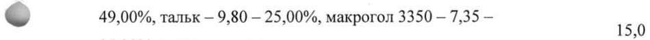
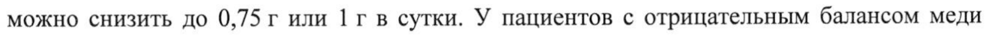

# Пеницилламин — внутрь

- Препарат: Пеницилламин-натив (таблетки, покрытые пленочной оболочкой;)
- АТХ: M01CC01
- Источник: ГРЛС, инструкция по медицинскому применению, РУ ЛП-005792, файл от 2024-06-03 (https://grls.rosminzdrav.ru/Grls_View_v2.aspx?routingGuid=853ec49e-5978-4959-a89a-963a2842fdb6)
- Распознано автоматически (OCR): 8 из 8 стр.
- Инструкция к другому РУ того же препарата: ЛП-005792 (срок действия истёк, решение от 10.06.2022). Текст может быть старше действующего
- Сомнительных строк после OCR: 2 (см. раздел «Проверка распознавания»)

## Общие сведения

МИНИСТЕРСТВО ЗДРАВООХРАНЕНИЯ РОССИЙСКОЙ ФЕДЕРАЦИИ
ИНСТРУКЦИЯ ПО МЕДИЦИНСКОМУ ПРИМЕНЕНИЮ ЛЕКАРСТВЕННОГО
ПРЕПАРАТА ПЕНИЦИЛЛАМИН-НАТИВ Регистрационный номер:
Торговое наименование препарата: Пеницилламин-натив
Международное непатентованное наименование: пеницилламин

## 3. Лекарственная форма

таблетки, покрытые пленочной оболочкой
таблетки, покрытые пленочной оболочкой
Состав на одну таблетку:
© Компонент Количество, мг Действующее вещество:
Пеницилламин 250,0 Вспомогательные вещества:
Крахмал картофельный 43,75 Лактозы моногидрат 166,25
© Повидон K-30 25,0 Тальк 10,0 Магния стеарат 5,0
Состав пленочной оболочки:
Опадрай II желтый (поливиниловый спирт — 35,0 —
& 49,00%, тальк — 9,80 — 25,00%, макрогол 3350 — 7,35 — 15 35,20%, титана диоксид и краситель железа оксид | жёлтый — 15,15 — 30,00%)
Описание Круглые, двояковыпуклые таблетки, покрытые пленочной оболочкой желтого цвета. На поперечном разрезе — ядро белого или почти белого цвета.
Фармакотерапевтическая группа: противовоспалительное средство
Код ATX: MO1CCO1 Фармакологические свойства

## 5.1. Фармакодинамика

Пеницилламин обладает высокой комплексообразующей активностью по отношению к металлам, главным образом к меди, ртути, мышьяку, свинцу, железу и кальцию.
Пеницилламин обладает высокой комплексообразующей активностью по отношению к металлам, главным образом к меди, ртути, мышьяку, свинцу, железу и кальцию.
Пеницилламин уменьшает резорбцию меди из пищи и устраняет ее избыток из тканей.
Оказывает влияние на различные звенья иммунной системы (подавление Т-хелперной функции лимфоцитов, торможение хемотаксиса нейтрофилов и выделения ферментов из лизосом этих клеток, усиление функции макрофагов). Обладает способностью нарушать синтез коллагена, расщепляя перекрестные связи между вновь синтезирующимися молекулами тропоколлагена. Пеницилламин является антагонистом пиридоксина;
оказывает противовоспалительное действие.

## 5.2. Фармакокинетика

w Всасывание Пеницилламин легко всасывается из желудочно-кишечного тракта (ЖКТ), достигая максимальной концентрации (Cmax) в крови в течение 1-3 часов. В ЖКТ всасывается до 50 % пеницилламина.
Распределение

© Пеницилламин образует с ионами тяжелых металлов хелаты — стойкие комплексные соединения, растворимые в воде и выводимые почками.
Метаболизм Пеницилламин метаболизируется в печени.
Выведение Выведение пеницилламина проходит в 2 фазы: период полувыведения (Т!/2) для первой

- фазы составляет 1 час, для второй — достигает 90 часов. Около 70-80 % адсорбированного пеницилламина выводится в виде метаболитов (цистеин-пеницилламин, дисульфид)
почками. Хелатные комплексы пеницилламина также выводятся почками.
Показания к применению e Болезнь Вильсона-Коновалова.
» Отравления медью, неорганическими соединениями ртути, свинца (при исключении

дальнейшего попадания свинца через ЖКТ), золота, цинка, железа.
® Цистиновый нефролитиаз.
® Системная склеродермия.
® Ревматоидный артрит.
Противопоказания e Повышенная чувствительность к пеницилламину и другим компонентам препарата.
e Беременность и период грудного вскармливания (за исключением болезни ВильсонаКоновалова).
e ЛАгранулоцитоз.
e Почечная недостаточность.
® Нарушения гемопоэза.
® Детский возраст до 3-х лет.

## 4.3. С осторожностью

Препарат Пеницилламин-натив должен применяться с осторожностью при анемии, протеинурии, проведении хирургических вмешательств.
Препарат Пеницилламин-натив должен применяться с осторожностью при анемии, протеинурии, проведении хирургических вмешательств.
© Применение при беременности и в период грудного вскармливания
Пеницилламин противопоказан к применению при беременности и в период грудного вскармливания (за исключением болезни Вильсона-Коновалова).

## 4.2. Способ применения и дозы

Препарат Пеницилламин-натив следует применять внутрь как минимум за 30 минут до еды, запивая водой, либо через 2 часа после приема пищи или других лекарственных w средств.
Препарат Пеницилламин-натив следует применять внутрь как минимум за 30 минут до еды, запивая водой, либо через 2 часа после приема пищи или других лекарственных w средств.
Болезнь Вильсона-Коновалова Взрослым: 1,5-2 г в сутки в дробных дозах. После достижения ремиссии заболевания дозу можно снизить до 0,75 г или 1 г в сутки. У пациентов с отрицательным балансом меди следует применять минимальную эффективную дозу пеницилламина.
& Дозу 2 г в сутки применять в течение He более 1 года.
Пациентам пожилого возраста: 20 мг/кг массы тела в сутки в дробных дозах. Дозу следует подобрать таким образом, чтобы достигнуть ремиссии заболевания и удержать отрицательный баланс меди.
Детям: обычно 20 мг/кг массы тела в сутки в дробных дозах.
Минимальная доза — 500 мг в сутки.
Цистинурия Лучше всего установить минимальную эффективную дозу после количественного определения концентрации аминокислот в моче хроматографическим методом.
Растворение цистиновых камней Взрослым: 1-3 г в сутки в дробных дозах. Следует удерживать концентрацию цистина в моче ниже 200 мг/л.
Предупреждение цистинового литиаза Взрослым: 0,5-1 г в сутки до момента достижения концентрации цистина в моче ниже 300 мг/л.
Пациентам пожилого возраста: назначают минимальную дозу до момента достижения концентрации цистина в моче ниже 200 мг/л.
Детям: Назначают минимальную дозу, которая позволяет достигнуть концентрации цистина в моче ниже 200 мг/л.
Внимание: во время лечения рекомендуется пить большое количество жидкости — не менее 3 литров в сутки. Пациент должен выпивать 500 мл воды перед сном, а затем 500 мл ночью, когда моча более концентрирована и более кислая, чем в течение дня.
Обычно, чем больше жидкости выпивает пациент, тем ниже его потребность в пеницилламине.
© Рекомендуется также диета с низким содержанием метионина, чтобы синтез цистина был как можно ниже. Ввиду низкого содержания белков, такая диета не рекомендуется детям в период роста и беременным женщинам.
Отравление свинцом Взрослым: 1-1,5 г в сутки в дробных дозах до момента достижения выделения свинца с мочой в пределах 0,5 мг в сутки.
© Пациентам пожилого возраста: 20 мг/кг массы тела в сутки в дробных дозах до момента достижения выделения свинца с мочой в пределах 0,5 мг в сутки.
Детям: 20 мг/кг массы тела в сутки.
Ревматоидный артрит Взрослым: 250 мг в сутки в течение первого месяца применения препарата
© Пеницилламин-натив. Затем дозу повышают каждые 4-12 недель на 250 мг до достижения ремиссии заболевания. После этого применяют минимальную эффективную дозу, которая позволяет тормозить симптомы заболевания. Если в течение 6 месяцев применения препарата Пеницилламин-натив терапевтический эффект не достигается, лечение следует прекратить.
Поддерживающая доза обычно составляет 500-750 мг в сутки. Нельзя превышать дозу 1,5 г пеницилламина в сутки. После достижения ремиссии заболевания, продолжающейся 6 месяцев, дозу пеницилламина рекомендуется постепенно уменьшать на 250 мг каждые 12 недель.
Пациентам пожилого возраста: начальная доза не должна превышать 250 мг в сутки в течение первого месяца применения препарата Пеницилламин-натив. Затем дозу можно повышать каждые 4-12 недель на 250 мг до достижения ремиссии заболевания. Нельзя превышать дозу 1 г препарата в сутки.
Детям: обычно 15-20 мг/кг массы тела в сутки. Начальная доза составляет 2,5-5,0 мг в сутки, ее можно повышать постепенно каждые 4 недели в течение 3-6 месяцев до минимальной эффективной дозы, но не более 500 мг.
Системная склеродермия По 250 мг в сутки в течение первого месяца применения препарата Пеницилламин-натив.
Затем дозу повышают каждые 4-12 недель на 250 мг до 1 г в сутки с последующим снижением до 250-500 мг в сутки. Эффект оценивается через 6-12 месяцев применения препарата Пеницилламин-натив.

## 4.8. Побочное действие

Нежелательные реакции (НР), зарегистрированные чаще, чем единичные наблюдения, перечислены ниже по органам и системам.
Нежелательные реакции (НР), зарегистрированные чаще, чем единичные наблюдения, перечислены ниже по органам и системам.

© Нарушения со стороны нервной системы: обратимый полиневрит (связано с дефицитом пиридоксина).
Нарушения со стороны дыхательной системы, органов грудной клетки и средостения:
аллергический альвеолит, интерстициальный пневмонит, диффузный фиброзирующий альвеолит, синдром Гудпасчера.

. Нарушения со стороны желудочно-кишечного тракта: анорексия, тошнота, рвота,

~ диарея, афтозный стоматит, глоссит, панкреатит, полная потеря или искажение вкусовых ощущений.
Нарушения со стороны печени и желчевыводящих путей: внутрипеченочный холестаз.
Нарушения со стороны кожи и подкожных тканей: кожная сыпь, эпидермальный некролиз, алопеция.

© Нарушения со стороны скелетно-мышечной и соединительной ткани: миастения, полимиозит, дерматомиозит.
Нарушения со стороны почек и мочевыводящих путей: нефрит, гематурия.
Нарушения со стороны половых органов и молочной железы: увеличение молочных желез с развитием галактореи (у женщин).
Общие расстройства и нарушения в месте введения: лихорадка, волчаночно-подобные реакции (артралгии, миалгии, эритематозная сыпь, появление антинуклеарных антител и антител к ДНК).
Нарушения со стороны крови и лимфатической системы: эозинофилия, тромбоцитопения, лейкопения, анемия (апластическая или гемолитическая), агранулоцитоз.

## 4.9. Передозировка

Случаев передозировки не отмечено. Антидот неизвестен. Лечение симптоматическое.
Случаев передозировки не отмечено. Антидот неизвестен. Лечение симптоматическое.

## 4.5. Взаимодействие с другими лекарственными средствами

Пеницилламин является антагонистом пиридоксина.
Пеницилламин не следует применять в комбинации с препаратами золота, аминохинолиновыми и цитостатическими лекарственными средствами, фенилбутазоном.
Пеницилламин нельзя применять с лекарственными средствами, которые могут вызывать нарушение функции костного мозга.
Пеницилламин образует с тяжелыми металлами стойкие комплексные соединения.
Противомалярийные лекарственные средства, левамизол и фенилбутазон повышают риск возникновения нежелательных реакций.
Антациды уменьшают всасывание пеницилламина.
w Особые указания При применении препарата Пеницилламин-натив требуются постоянные врачебные наблюдения: полное исследование крови (включая количество тромбоцитов) и мочи каждые три дня, потом каждую неделю; контроль функции почек; общие и неврологические исследования каждый месяц. В случае появления нежелательных
© реакций, о которых пациент обязан сообщить врачу, пеницилламин следует немедленно отменить, а после их прекращения его можно по решению врача применить повторно, начиная с самой низкой дозы.
Следует соблюдать меры предосторожности при одновременном применении препарата
Пеницилламин-натив и противовоспалительных или других лекарственных средств, которые могут вызвать нарушения функции костного мозга.
~ В случае отмены препаратов золота из-за отсутствия эффекта препарат
Пеницилламин-натив можно применять по истечении 6 месяцев.
Пациентам с нарушениями функции почек следует соответственно снижать дозу лекарственного средства и применять его с осторожностью.
Если пациенту рекомендовано лечение препаратами железа, следует соблюдать двухчасовой интервал при применении препарата Пеницилламин-натив.
Ввиду влияния пеницилламина на коллаген и эластин, любые хирургические вмешательства (включая стоматологические) в период применения препарата
Пеницилламин-натив следует производить с осторожностью.
Во время лечения следует контролировать клинический анализ мочи и клинический анализ крови 1 раз в 2 недели в течение первых 6 месяцев лечения, в дальнейшем — ежемесячно; 1 раз в 6 месяцев следует контролировать функцию почек и печени. При болезни Вильсона-Коновалова или цистинурии одновременно с пеницилламином назначают для постоянного приема пиридоксин (в связи с диетическими ограничениями, применяющимися для лечения этих заболеваний); при длительном лечении этим пациентам следует регулярно проводить рентгенологическое или ультразвуковое исследование почек и мочевыводящих путей.
Пеницилламин является антагонистом пиридоксина. При применении препарата
Пеницилламин-натив необходимо компенсировать недостаток пиридоксина. В случае развития признаков дефицита пиридоксина у пациентов с ревматоидным артритом, и в том случае, если эти признаки не проходят самостоятельно, дополнительно назначают 25 мг пиридоксина в сутки. В случае развития на фоне лечения лихорадки, нарастания протеинурии, появления гематурии, поражения легких, печени, выраженных
© гематологических или неврологических нарушений, миастении, гематурии, волчаночноподобных реакций или других тяжелых нежелательных реакций препарат
Пеницилламин-натив отменяют и при необходимости назначают глюкокортикостероиды.
В случае развития изолированной протеинурии, если она не нарастает и не превышает 1 г/сутки, лечение пеницилламином продолжают, в других случаях — отменяют.

## 4.7. Влияние на способность управлять транспортными средствами, механизмами

~ Пеницилламин не вызывает нарушений психофизических функций и, следовательно, не оказывает влияния на способность управлять транспортными средствами и механизмами.

## 6.5. Форма выпуска

Таблетки, покрытые пленочной оболочкой, 250 мг.
Таблетки, покрытые пленочной оболочкой, 250 мг.
| По 30 или 100 таблеток во флакон из полиэтилена высокой плотности, укупоренный we крышкой из полипропилена с кольцом контроля первого вскрытия или без него.
По 1 флакону вместе с инструкцией по применению помещают в картонную пачку.
По 10 таблеток в контурную ячейковую упаковку из фольги алюминиевой печатной лакированной и пленки поливинилхлоридной.
По 3 или 10 контурных ячейковых упаковок по 10 таблеток вместе с инструкцией по применению помещают в картонную пачку.

## 6.3. Срок годности

2 года.
2 года.
Не применять по истечении срока годности, указанного на упаковке.

## 6.4. Условия хранения

В защищенном от света месте при температуре не выше 25 °С.
В защищенном от света месте при температуре не выше 25 °С.
Хранить в недоступном для детей месте.
Условия отпуска Отпускают по рецепту.
Владелец регистрационного удостоверения и производитель / организация, принимающая претензии потребителей
ООО «Натива», Россия Юридический адрес: Россия, 143402, Московская область, г. Красногорск, ул.
Октябрьская, д. 13.
Тел: (495) 644-00-59 Тел/факс: (495) 502-16-43
E-mail: info@nativa.pro Www.nativa.pro w Адрес производственной площадки:
Московская область, Красногорский район, Петрово-Дальнее с.
—_ / / \

Генеральный директор (GP > | ООО «Натива» Lx | KN, А.А. Малин

(7 \ K

A дл 5 —о

Е me Г eal

3 PON Giieti je}

2 Jif

< XQ on р: As я, 7 “Ане
## Проверка распознавания

Страницы-сканы распознаны автоматически. В 2 строках с дозировками цифры могли распознаться с ошибкой — сверьте с вырезкой из оригинала:

- стр. 1: «& 49,00%, тальк — 9,80 — 25,00%, макрогол 3350 — 7,35 — 15» — низкая уверенность: «15» (50)  
  
- стр. 3: «можно снизить до 0,75 г или 1 г в сутки. У пациентов с отрицательным балансом меди» — низкая уверенность: «0,75» (76), «1» (52)  
  
