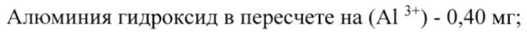

# Пептидный антиген №1 белков вируса Эбола, конъюгированный на белок-носитель + Пептидный антиген №2 белков вируса Эбола, конъюгированный на белок-носитель — парентерально

- Препарат: Вакцина для профилактики лихорадки Эбола на основе пептидных антигенов ЭпиВакЭбола (суспензия для подкожного введения;)
- АТХ: J07B
- Источник: ГРЛС, инструкция по медицинскому применению, РУ ЛП-004750, файл от 2023-11-15 (https://grls.rosminzdrav.ru/Grls_View_v2.aspx?routingGuid=b6e70f7d-f42b-4e97-9f68-6baa0a75ffad)
- Распознано автоматически (OCR): 5 из 5 стр.
- Инструкция к другому РУ того же препарата: ЛП-004750 (национальное РУ, переоформленное по правилам ЕАЭС, решение от 02.11.2023). Текст может быть старше действующего
- Сомнительных строк после OCR: 1 (см. раздел «Проверка распознавания»)

## Общие сведения

——_ МИНИСТЕРСТВО ЗДРАВООХРАНЕНИЯ РОССИЙСКОЙ ФЕДЕРАЦИИ |
| ЛИ- 004750 - 260318 | ИНСТРУКЦИЯ ПО МЕДИЦИНСКОМУ ПРИМВИЕНИЮ |
ЛЕКАРСТВЕННОГО ПРЕПАРАТА Вакцина для профилактики лихорадки Эбола на основе пептидных антигенов
ЭпиВакЭбола Регистрационный номер:
Торговое наименование: Вакцина для профилактики лихорадки Эбола на основе пептидных антигенов ЭпиВакЭбола
| Международное непатентованное наименование или группировочное наименование: Вакцина для профилактики лихорадки Эбола

## 3. Лекарственная форма

суспензия для подкожного введения
суспензия для подкожного введения

## 2. Состав

0,5 мл (1 доза) вакцины содержит:
0,5 мл (1 доза) вакцины содержит:
Действующие вещества:
Пептидный антиген № | белков вируса Эбола, конъюгированный на белок-носитель - 50 мкг;
Пептидный антиген № 2 белков вируса Эбола, конъюгированный на белок-носитель - 50 мкг;
Вспомогательные вещества:
Алюминия гидроксид в пересчете на (Al 3*) - 0,40 мг;
Калия дигидрофосфат — 0,12 мг;
Калия хлорид - 0,10 мг;
Натрия гидрофосфата додекагидрат - 1,82 мг;
Натрия хлорид - 4,0 мг;
Вода для инъекций до 0,5 мл.
| | | м

Описание: Суспензия белого цвета при отстаивании разделяется на два слоя: верхнийпрозрачная, бесцветная жидкость; нижний-осадок белого цвета, легко разбивающийся при встряхивании.
Характеристика препарата Вакцина представляет собой химически синтезированные пептидные антигены белков вируса Эбола, конъюгированные с белком-носителем и адсорбированные на алюминийсодержащем адъюванте (алюминия гидроксиде).
Фармакотерапевтическая группа: МИБП - вакцина.
Код ATX: JO7B Иммунобиологические свойства
Вакцина для профилактики лихорадки Эбола на основе пептидных антигенов ЭпиВакЭбола способствует выработке иммунитета против вируса Эбола после двукратного подкожного применения с интервалом 21-28 дней.

## 4.1. Показания к применению

| Активная профилактика лихорадки Эбола:
| Активная профилактика лихорадки Эбола:
- у взрослых, проживающих в странах энзоотичных по данному заболеванию;
- улиц, работающих с возбудителем лихорадки;
- у медицинских работников, имеющих контакт с кровью, выделениями, другими жидкостями и органами инфицированного человека;
- улиц, выезжающих за рубеж в страны энзоотичные по данному заболеванию.

## 4.3. Противопоказания

- Гиперчувствительность к компонентам препарата (гидроокиси алюминия и другим);
- Гиперчувствительность к компонентам препарата (гидроокиси алюминия и другим);
- Тяжелые формы аллергических заболеваний;
- Острые инфекционные и неинфекционные заболевания, хронические заболевания в стадии обострения - прививки проводят не ранее чем через месяц после выздоровления
(ремиссии). При нетяжелых ОРВИ, острых кишечных заболеваниях вакцинацию проводят после нормализации температуры;
- Злокачественные заболевания крови и новообразования;
- Беременность и период грудного вскармливания;

ы

- Детский возраст до 18 лет в связи с отсутствием данных по эффективности и безопасности.
Меры предосторожности при применении Учитывая возможность развития аллергических реакций немедленного типа
(анафилактический шок, отек Квинке, крапивница) у особо чувствительных лиц, за привитыми необходимо обеспечить медицинское наблюдение в течение 30 мин. Места проведения прививок должны быть обеспечены средствами противошоковой терапии. Если после введения первой дозы вакцины для профилактики лихорадки Эбола на основе пептидных антигенов ЭпиВакЭбола развилась аллергическая реакция, вводить вторую дозу вакцины запрещается!

Все лица, подлежащие прививкам, должны быть обследованы врачом с учетом

анамнестических данных. С целью выявления противопоказаний врач в день прививки

проводит опрос и осмотр прививаемых с обязательной термометрией. При температуре выше 37 °С вакцинацию не проводят. За правильность назначения прививки отвечает врач.

С осторожностью применять при тромбоцитопении, нарушении свертываемости крови.

## 4.6. Применение при беременности и в период грудного вскармливания

Вакцину не следует вводить во время беременности.

Применение в период грудного вскармливания не изучено, клинических исследований не

проводилось.

## 4.2. Способ применения и дозы

Не вводить внутривенно!

Вакцину вводят двукратно, подкожно с интервалом 21 - 28 дней, в дозе 0,5 мл (1 доза), в

верхнюю треть наружной поверхности плеча - в область дельтовидной мышцы.

Перед применением ампулу с вакциной необходимо выдержать при комнатной температуре

в течение нескольких минут. Непосредственно перед применением ампулу встряхивают.

Ампулу следует осмотреть на предмет наличия посторонних частиц и/или изменения

внешнего вида. При обнаружении посторонних включений и/или изменении внешнего вида

вакцина подлежит уничтожению.

Вскрытие ампул и процедуру вакцинации осуществляют при строгом соблюдении правил
| асептики и антисептики: перед вскрытием ампульный нож, шейку ампулы протирают ватой, смоченной 70 % этиловым спиртом, вскрывают ампулу, набирают вакцину в шприц
| 3 | .

одноразового применения и удаляют из шприца избыток воздуха. Спиртом протирают кожу

в месте инъекции. Препарат во вскрытой ампуле хранению не подлежит.

Проведенную прививку регистрируют в установленных учетных формах с указанием даты

введения препарата, дозы, номера серии и наименования предприятия-производителя.

## 4.8. Побочное действие

Частота развития побочных реакций, зарегистрированных при проведении клинических

исследований, представлена в соответствии с классификацией ВОЗ НЛР. Частота

встречаемости определялась на основании следующих критериев: очень часто (>1/10), часто (>1/100 и <1/10), нечасто (>1/1000 и <1/100), редко ((>1/10000 и <1/1000), очень редко

(<1/10000, включая отдельные случаи).

Местные реакции:

Часто: болезненность, гиперемия, уплотнение и отек в месте введения;
| Нечасто: инфильтрат в месте введения.

Общие реакции:
Часто: повышение температуры тела > 37,0 °С, головная боль, недомогание, слабость.
| Аллергические реакции:

Нечасто: сыпь.

Лабораторные показатели:

Часто: повышение иммуноглобулинов класса Е;

Нечасто: повышение С реактивного белка.

Если любые из указанных в инструкции побочных эффектов усугубляются или Вы заметили любые другие побочные эффекты, не указанные в инструкции, сообщите об этом
| врачу.

## 4.9. Передозировка

Случаи передозировки не установлены.
Случаи передозировки не установлены.

## 4.5. Взаимодействие с другими лекарственными средствами

Нет данных о возможном взаимном влиянии при совместном использовании с другими

лекарственными средствами и продуктами.

## 4.7. Влияние на способность управлять транспортными средствами, механизмами

Исследования по изучению влияния вакцины на способность к управлению автомобилями

и другими механизмами не проводились.

| Об бт Ба в пы а В ЗИ eS Se тт те реже ee иаонех

## 4.4. Особые указания

Конкретное решение о необходимости проведения прививок больным с хроническими заболеваниями, злокачественными болезнями крови и новообразованиями и т. п., проживающих в энзоотичных районах по лихорадке Эбола, зависит от степени риска заболевания. Уничтожение неиспользованной вакцины осуществлять в соответствии с требованиями СанПиН 2.1.7.2790-10 «Санитарно-эпидемиологические требования к обращению с медицинскими отходами». Класс А (эпидемиологически безопасные отходы, по составу приближенные к ТБО).
Конкретное решение о необходимости проведения прививок больным с хроническими заболеваниями, злокачественными болезнями крови и новообразованиями и т. п., проживающих в энзоотичных районах по лихорадке Эбола, зависит от степени риска заболевания. Уничтожение неиспользованной вакцины осуществлять в соответствии с требованиями СанПиН 2.1.7.2790-10 «Санитарно-эпидемиологические требования к обращению с медицинскими отходами». Класс А (эпидемиологически безопасные отходы, по составу приближенные к ТБО).

## 6.5. Форма выпуска

Суспензия для подкожного введения, 0,5 мл (1 доза).
Суспензия для подкожного введения, 0,5 мл (1 доза).
По 0,5 мл вакцины в ампуле. В пачке по 10 ампул, скарификатор ампульный (если необходимо), инструкция по применению.

## 6.3. Срок годности

1 год.
1 год.
Препарат с истекшим сроком годности применению не подлежит.

## 6.4. Условия хранения

Хранить при температуре от 2 до 8°С. Хранить в недоступном для детей месте.
Хранить при температуре от 2 до 8°С. Хранить в недоступном для детей месте.
Не замораживать!
Условия транспортирования Транспортировать при температуре от 2 до 8°С. Не замораживать!
Условия отпуска Для лечебно-профилактических учреждений.
| Производитель/организация, принимающая претензии
Федеральное бюджетное учреждение науки «Государственный научный центр вирусологии и биотехнологии «Вектор» Федеральной службы по надзору в сфере защиты прав и благополучия человека (ФБУН ГНЦ ВБ «Вектор» Роспотребнадзора), 630559,
Новосибирская область, р. п. Кольцово, тел. (383) 336-60-10, факс (383) 336-74-09, e-mail:
vector(@vector.nsc.ru.
## Проверка распознавания

Страницы-сканы распознаны автоматически. В 1 строках с дозировками цифры могли распознаться с ошибкой — сверьте с вырезкой из оригинала:

- стр. 1: «Алюминия гидроксид в пересчете на (Al 3*) - 0,40 мг;» — низкая уверенность: «3*)» (63)  
  
