# Пертузумаб + Трастузумаб — парентерально

- Препарат: Фесго® (раствор для подкожного введения;)
- АТХ: L01XY02
- Источник: ГРЛС, инструкция по медицинскому применению, РУ ЛП-007317, файл от 2023-05-30 (https://grls.rosminzdrav.ru/Grls_View_v2.aspx?routingGuid=72567379-1f5a-4ee9-aa7b-3026e22c6072)
- Распознано автоматически (OCR): 32 из 32 стр.
- Сомнительных строк после OCR: 14 (см. раздел «Проверка распознавания»)

## Общие сведения

И | МИНЗДРАВ РОССИИ | N-OOP3(F-310312 | МИНИСТЕРСТВО ЗДРАВООХРАНЕНИЯ РОССИЙСКОЙ ФЕДЕРАЦИИ |
| СОГЛАСОВАНО | ИНСТРУКЦИЯ ПО МЕДИЦИНСКОМУ ПРИМЕНЕНИЮ ЛЕКАРСТВЕННОГО ПРЕПАРАТА
ФЕСГО® Регистрационный номер ЛП-007317 Торговое наименование
Фесго® © Международное непатентованное или группировочное наименование
Пертузумаб + Трастузумаб Лекарственная форма
© Раствор для подкожного введения Состав 1 флакон (15 мл) с препаратом в дозировке 600 мг+600 мг/10 мл содержит:
действующие вещества: пертузумаб — 600 мг, трастузумаб — 600 мг;
вспомогательные вещества: рекомбинантная человеческая гиалуронидаза (rHuPH20), Lгистидин, [-гистидина гидрохлорида моногидрат, а, а-трегалозы дигидрат, сахароза,
© полисорбат 20, [.-метионин, вода для инъекций до 10 мл.
1 флакон (20 мл) с препаратом в дозировке 1200 мг+600 мг/15 мл содержит:
действующие вещества: пертузумаб — 1200 мг, трастузумаб — 600 мг;
вспомогательные вещества: рекомбинантная человеческая гиалуронидаза (rHuPH20), Lгистидин, Г-гистидина гидрохлорида моногидрат, а,а-трегалозы дигидрат, сахароза, полисорбат 20, Г.-метионин, вода для инъекций до 15 мл.
Описание Прозрачная или опалесцирующая, от бесцветного до слегка коричневатого цвета жидкость.
Фармакотерапевтическая группа Противоопухолевые средства, антитела моноклональные.
Код АТХ LOIXY02 Фармакологические свойства

## 5.1. Фармакодинамика

Механизм действия Пертузумаб и трастузумаб представляют собой рекомбинантные гуманизированные моноклональные антитела 12С1к (иммуноглобулин С, подкласс 1, легкая цепь к), которые взаимодействуют с рецептором эпидермального фактора роста человека 2 типа (HER2, также известный как C-erbB-2), трансмембранного гликопротеина с собственной
Механизм действия Пертузумаб и трастузумаб представляют собой рекомбинантные гуманизированные моноклональные антитела 12С1к (иммуноглобулин С, подкласс 1, легкая цепь к), которые взаимодействуют с рецептором эпидермального фактора роста человека 2 типа (HER2, также известный как C-erbB-2), трансмембранного гликопротеина с собственной

~ тирозинкиназной активностью. Пертузумаб и трастузумаб, He конкурируя между собой, связываются с определенными эпитопами HER2, субдоменами II иТУ, и имеют комплементарные механизмы для нарушения передачи сигнала HER2. Применение пертузумаба и трастузумаба в комбинации приводит к усилению антипролиферативной

© активности in vitro и т vivo.

Кроме того, часть кристаллизующегося фрагмента (Ес) каркасов IgG1 пертузумаба и трастузумаба способствует мощной активации антитело-зависимой клеточной цитотоксичности (АЗКЦ). м vitro АЗКЦ пертузумаба и трастузумаба больше направлена на опухолевые клетки с гиперэкспрессией HER2, чем на опухолевые клетки без гиперэкспрессии НЕК2.
Иммуногенность

© Как и при применении всех белковых лекарственных препаратов, у пациентов, получающих препарат Фесго*, может развиться иммунный ответ.
В исследовании FEDERICA частота возникновения антител к пертузумабу и трастузумабу, вызванных лечением, составила 6.1% (15/245) и 0.4% (1/245)
соответственно у пациентов, получавших в/в пертузумаб и трастузумаб. Среди пациентов, у которых тест на антитела к пертузумабу был положительным, нейтрализующие пертузумаб антитела были обнаружены у двух пациентов.
Частота обнаружения антител к пертузумабу и трастузумабу в любой временной точке
(включая начальный уровень) составила 10.3% (26/252) и 1.2% (3/252) соответственно у пациентов, получавших в/в пертузумаб в комбинации с трастузумабом. Среди таких пациентов нейтрализующие пертузумаб антитела были обнаружены у трех пациентов.

Частота возникновения антител к пертузумабу, трастузумабу и воргиалуронидазе альфа, вызванных лечением, составила 8.3% (20/241), 1.7% (4/241) и 3.8% (9/238) соответственно у пациентов, получавших терапию препаратом Фесго®. Среди таких пациентов нейтрализующие пертузумаб антитела были обнаружены у двух пациентов, а нейтрализующие трастузумаб антитела — у одного пациента.
Частота выявления антител к пертузумабу, трастузумабу и воргиалуронидазе альфа в любой временной точке (включая начальный уровень) составила 12.1% (30/248), 3.2%
(8/248) и 9% (22/245) соответственно у пациентов, получавших терапию препаратом
Фесго®. Среди таких пациентов нейтрализующие пертузумаб антитела были обнаружены у трех пациентов, нейтрализующие трастузумаб антитела — у одного пациента, нейтрализующие воргиалуронидазу альфа антитела — у одного пациента.

р Клиническая значимость появления антител к пертузумабу, трастузумабу или

~ воргиалуронидазе альфа после лечения препаратом Фесго® неизвестна.

## 5.2. Фармакокинетика

Экспозиции пертузумаба и трастузумаба после подкожного введения препарата Фесго®
Экспозиции пертузумаба и трастузумаба после подкожного введения препарата Фесго®
(нагрузочной дозы 1200 мг пертузумаба/600 мг трастузумаба с последующим введением

© 600 мг пертузумаба/600 мг трастузумаба каждые 3 недели) в опорном клиническом

исследовании представлены в таблице 1. Фармакокинетические результаты для первичной конечной точки минимальной концентрации (Ctrough) пертузумаба в цикле 7 (до введения в цикле 8) показали отсутствие превосходства в/в пертузумаба (геометрическое среднее 72.4 мкг/мл) по сравнению с пертузумабом в составе препарата Фесго® (геометрическое среднее 88.7 мкг/мл). Соотношение геометрических средних для пертузумаба в составе препарата Фесго® и в/в пертузумаба составило 1.22 (90% доверительный интервал (ДИ):

© 1.14-1.31). Нижняя граница двустороннего 90% ДИ для соотношения геометрических средних пертузумаба в составе препарата Фесго® и в/в пертузумаба составила 1.14, то есть была выше заранее определенного предела 0.8.
Фармакокинетические результаты для вторичной конечной точки Ctrough трастузумаба в цикле 7 (до введения в цикле 8) показали отсутствие превосходства в/в трастузумаба
(геометрическое среднее 43.2 мкг/мл) по сравнению с трастузумабом в составе препарата
Фесго® (геометрическое среднее 57.5 мкг/мл). Соотношение геометрических средних для трастузумаба в составе препарата Фесго® и в/в трастузумаба составило 1.33 (90% ДИ:
1.24-1.43).
Популяционная фармакокинетическая модель пертузумаба с линейным выведением из центральной камеры была спроектирована с использованием объединенных фармакокинетических данных по пертузумабу в составе препарата Фесго® и в/в

пертузумабу. Эти данные были получены в опорном клиническом исследовании и использовались для описания наблюдаемых фармакокинетических концентраций пертузумаба после подкожного введения препарата Фесго® и в/в введения пертузумаба.
Популяционная фармакокинетическая модель с параллельным линейным и нелинейным выведением из центральной камеры была спроектирована с использованием объединенных фармакокинетических данных из исследования по сравнению трастузумаба для подкожного (п/к) введения и в/в трастузумаба для описания наблюдаемых фармакокинетических концентраций после в/в или п/к введения трастузумаба у пациентов с НЕК2-положительным ранним раком молочной железы.
Фармакокинетический анализ с использованием описанной популяционной фармакокинетической модели показал отсутствие влияния пертузумаба в составе препарата Фесго® на фармакокинетику трастузумаба в составе препарата Фесго®,
~ поскольку фармакокинетика трастузумаба в составе препарата Фесго® и фармакокинетика п/к трастузумаба были сходными.
Спрогнозированные с помощью популяционной фармакокинетики экспозиции пертузумаба и трастузумаба представлены в таблице | ниже.
Таблица 1. Экспозиции пертузумаба и трастузумаба (средние 5"—95" перцентили) после подкожного введения препарата Фесго® или в/в введения пертузумаба или трастузумаба*
Пертузумаб в В/в пертузумаб | Трастузумаб в В/в составе составе трастузумабб
Показатель препарата препарата Фесго® Фесго®6
Цикл 85.1 74.9 27.7 31.4 Crrough 5 (48.7—122.5) (47.8—99.8) (13.6—43.2) (21.1-50.9)
& (мкг/мл) Цикл 88.9 78.5 57.5 44.9 7 (51.8—142.5) (41.3—114.9) (27.2-92.7) (29.7-76.2)
Максимальн | Цикл 106.5 304.8 44.6 172.9 ая 5 (62.9-152.6) (191.1-409.7) (31.0-63.1) (133.7-238.9)
концентраци fea 149.5 225.9 117.3 169.1 я (Cmax 7 (88.5—218.5) (158.5—301.8) (72.2—166.6) (130.6-238.9)
(мкг/мл))
Площадь Цикл 2306.9 2519.7 1023.8 1341.0 под кривой 5 (1388.4-3376.2) | (1898.4-3138.9) | (634.3-1442.6) | (1033.1-2029.0)
концентраци 2569.3 2454.3 1838.7 1668.6 я-время Цикл (1487.4—3786.1) | (1561.4-3346.1) | (1024.3-2715.5) | (1264.7-2576.9)
(AUCo-21 сутки (мкг/мл*сутк и))
а Первую дозу препарата Фесго®, в/в пертузумаба и трастузумаба, вводили в цикле 5.
6 Для симуляции фармакокинетики трастузумаба использовали популяционную фармакокинетическую модель согласно данным исследования по сравнению B/B трастузумаба и п/к трастузумаба.
Всасывание Средняя Cmax в сыворотке крови и время до достижения максимальной концентрации
(Tmax) для пертузумаба в составе препарата Decro® составили 157 мкг/мл и 3.82 суток соответственно. На основании популяционного фармакокинетического анализа абсолютная биодоступность составила 0.712, а степень всасывания первого порядка (Ка) — 0.348 1/сутки.
Средняя Cmax в сыворотке крови и Tmax для трастузумаба в составе препарата Фесго® составили 114 мкг/мл и 3.84 суток соответственно. На основании популяционного фармакокинетического анализа абсолютная биодоступность составила 0.771, а Ка- 0.404 1/сутки.
Распределение w Согласно данным популяционного фармакокинетического анализа, объем распределения пертузумаба в составе препарата Decro® в центральной камере (\‹) составляет 2.77 лу среднестатистического пациента.
Согласно данным популяционного фармакокинетического анализа, объем распределения п/к трастузумаба в центральной камере (Ус) составляет 2.91 л у среднестатистического
© пациента.
Метаболизм Метаболизм препарата Фесго® специально не изучался. Антитела выводятся преимущественно путем катаболизма.
Выведение На основании популяционного фармакокинетического анализа клиренс пертузумаба в
; составе препарата Фесго® составил 0.163 л/сутки, период полувыведения (#/2) —
~ приблизительно 24.3 суток.
На основании популяционного фармакокинетического анализа линейный клиренс п/к трастузумаба составил 0.111 л/сутки.
Установлено, что трастузумаб достигает концентраций <1 мкг/мл через 7 месяцев после введения последней дозы у >95% пациентов. Это составляет около 3% от популяционной рассчитанной минимальной концентрации в равновесном состоянии (Си) ИЛИ соответствует выведению ~97% препарата.
Фармакокинетика у особых групп пациентов
Пациенты детского возраста Исследований по изучению фармакокинетики препарата Фесго® у пациентов детского возраста не проводилось.
Пациенты пожилого возраста

Исследований по изучению фармакокинетики препарата Фесго® у пациентов пожилого

возраста не проводилось.

По результатам популяционного фармакокинетического анализа пертузумаба в составе

препарата Фесго® и в/в пертузумаба возраст не оказывает значимого влияния на

фармакокинетические параметры пертузумаба.

По результатам популяционного фармакокинетического анализа п/к или в/в трастузумаба

возраст не влияет на распределение трастузумаба.

Пациенты с нарушением функции почек

Специального исследования фармакокинетики препарата Фесго® у пациентов с

нарушением функции почек не проводилось.

На основании популяционного фармакокинетического анализа пертузумаба в составе

~ препарата Фесго® и в/в пертузумаба было показано, что нарушение функции почек не

оказывает влияния на экспозицию пертузумаба, однако данные по пациентам с

нарушением функции почек тяжелой степени тяжести, включенные в популяционный

фармакокинетичекий анализ, ограничены.
© По данным популяционного фармакокинетического анализа п/к и в/в трастузумаба нарушение функции почек не влияет на распределение трастузумаба.

Пациенты с нарушением функции печени

Специального исследования фармакокинетики препарата Фесго® у пациентов с

нарушением функции печени не проводилось.

## 4.1. Показания к применению

© Ранний рак молочной железы

Препарат Mecro® показан к применению в комбинации с химиотерапией:

»® в качестве неоадъювантной терапии у взрослых пациентов с НЕК?-положительным местно-распространенным, отечно-инфильтративным или ранним раком молочной железы с высоким риском рецидива;

® в качестве адъювантной терапии у взрослых пациентов с НЕК2-положительным ранним раком молочной железы с высоким риском рецидива.

Метастатический рак молочной железы

Препарат Фесго® показан к применению в комбинации с доцетакселом у взрослых

пациентов с НЕВ2-положительным метастатическим или местно-рецидивирующим,

неоперабельным раком молочной железы при отсутствии ранее проводимой HER2 специфичной терапии или химиотерапии по поводу метастатического заболевания.

## 4.3. Противопоказания

Гиперчувствительность к пертузумабу, трастузумабу или к другим компонентам препарата в анамнезе.
Гиперчувствительность к пертузумабу, трастузумабу или к другим компонентам препарата в анамнезе.

## 4.6. Применение при беременности и в период грудного вскармливания

Детский возраст до 18 лет (эффективность и безопасность применения не установлены).
Значения фракции выброса левого желудочка сердца (ФВЛЖ) до лечения <55% (ранний рак молочной железы) или <50% (метастатический рак молочной железы).
Застойная сердечная недостаточность в анамнезе.
Неконтролируемая артериальная гипертензия.
Недавно перенесенный инфаркт миокарда.
| Серьезные нарушения сердечного ритма, требующие лекарственной терапии на момент
~ назначения препарата Mecro®, за исключением фибрилляции предсердий и пароксизмальной наджелудочковой тахикардии.
Предшествующее лечение антрациклинами с кумулятивной дозой доксорубицина или эквивалентного препарата >360 mr/M?.
© Нарушения функции печени (эффективность и безопасность применения не изучались).

## 4.3. С осторожностью

Снижение ФВЛЖ до уровня <50% на фоне предшествующей адъювантной терапии трастузумабом. Предшествующее лечение антрациклинами или предшествующая лучевая терапия на область грудной клетки; состояния, которые способны нарушать функцию левого желудочка; при нарушениях функции почек.
Снижение ФВЛЖ до уровня <50% на фоне предшествующей адъювантной терапии трастузумабом. Предшествующее лечение антрациклинами или предшествующая лучевая терапия на область грудной клетки; состояния, которые способны нарушать функцию левого желудочка; при нарушениях функции почек.
© Применение при беременности и в период грудного вскармливания
Фертильность Специальных исследований фертильности у животных для оценки эффектов препарата
Фесго® не проводилось.
Специальных исследований фертильности у животных для оценки эффектов пертузумаба не проводилось. Нежелательного влияния на мужские и женские репродуктивные органы в ходе исследований токсичности повторных доз продолжительностью до 6 месяцев у яванских макак не отмечалось.
Репродуктивные исследования не выявили доказательств влияния на фертильность у самок яванских макак, получавших трастузумаб.
Контрацепция Пациентки, обладающие детородным потенциалом, а также женщины, являющиеся половыми партнерами пациентов, которые получают препарат, должны использовать эффективные методы контрацепции на фоне применения препарата Фесго® и в течение 7 месяцев после введения последней дозы.
Беременность Клинические исследования препарата Фесго® у беременных женщин не проводились.
Внутривенное введение пертузумаба яванским макакам во время органогенеза приводило к маловодию, задержке развития почек и гибели эмбриона/плода. В рамках пострегистрационного применения трастузумаба беременными женщинами отмечались случаи нарушения роста и/или нарушения функции почек у плода в связи с маловодием, некоторые из которых приводили к фатальной гипоплазии легких у плода.
; На основании вышеупомянутых исследований у животных и согласно

~ пострегистрационным данным, препарат Фесго® при его применении беременной женщиной может оказывать повреждающее действие на плод. В случае наступления беременности необходимо предупредить женщину о возможности повреждающего действия на плод. Если беременная женщина получает терапию препаратом Фесго® или

© забеременеет во время лечения или в течение 7 месяцев после последней дозы препарата,

то она должна находиться под тщательным наблюдением врачей разных специальностей.
Роды и родоразрешение Безопасность применения препарата Фесго® во время родов и родоразрешения не установлена.
Грудное вскармливание Поскольку IgG человека выделяется с грудным молоком, возможность всасывания и

© повреждающего действия на плод неизвестна. Таким образом, необходимо предупредить женщину о необходимости прекращения грудного вскармливания при применении препарата Фесго® и в течение 7 месяцев после приема последней дозы препарата.

## 4.2. Способ применения и дозы

Лечение препаратом Фесго® следует начинать только под руководством врача, имеющего опыт применения противоопухолевых препаратов.
Лечение препаратом Фесго® следует начинать только под руководством врача, имеющего опыт применения противоопухолевых препаратов.
Препарат Фесго® должен вводиться медицинскими специалистами, владеющими тактиками ведения пациентов с анафилаксией в условиях возможности незамедлительного начала полного спектра реанимационных мероприятий (см. раздел «Особые указания»).
Пациенты, которые в настоящее время получают пертузумаб и трастузумаб внутривенно, могут перейти на терапию препаратом Фесго?.

Переход от внутривенного введения пертузумаба и трастузумаба к подкожному введению препарата Фесго® (или наоборот) изучался в исследовании РНгапсе$ Са (см. раздел
«Побочное действие»).
Во избежание медицинских ошибок перед применением лекарственного препарата необходимо проверить этикетку на флаконе и убедиться, что используемый для приготовления и введения препарат представляет собой препарат Фесго®.
Режим дозирования Для назначения терапии препаратом Фесго® пациенты должны иметь HER2положительный статус опухоли, определяемый как 3+ балла по результатам иммуногистохимического анализа (IHC) и/или степень амплификации >2.0 по результатам гибридизации in situ (ISH). Следует использовать валидированные методы тестирования.
Тестирование должно быть выполнено в специализированной лаборатории, способной
~ обеспечить валидацию процесса тестирования для обеспечения точных и воспроизводимых результатов. Подробные указания по проведению НЕК?-тестирования и интерпретации его результатов приведены в инструкциях по применению валидированных тест-систем, предназначенных для определения HER2 статуса.
© Рекомендации по дозированию препарата Decro® при метастатическом и раннем раке молочной железы представлены в таблице 2.
Таблица 2. Рекомендуемые способ применения и дозы препарата Фесго®
Доза (независимо от Примерная Время массы тела) длительность наблюдения"б подкожной инъекции
Нагрузочная доза 1200 мг пертузумаба/ 8 минут 30 минут w 600 мг трастузумаба
Поддерживающая 600 мг пертузумаба/ 5 минут 15 минут доза (вводится через | 600 мг трастузумаба 3 недели после нагрузочной дозы и затем каждые 3 недели)
а За пациентами необходимо наблюдать на предмет возникновения реакций, связанных с введением, и реакций гиперчувствительности.
6 Период наблюдения должен начинаться после введения препарата Фесго® и завершаться перед последующем введением химиотерапии.
Если пациент получил пертузумаб и трастузумаб внутривенно менее 6 недель назад, то рекомендуемая доза препарата Фесго® должна соответствовать поддерживающей дозе, т.е.
600 мг пертузумаба/600 мг трастузумаба каждые 3 недели. Если пациент получил пертузумаб и трастузумаб внутривенно >6 недель назад, то рекомендуемая доза препарата
Фесго® должна соответствовать нагрузочной дозе, т.е. 1200 мг пертузумаба/600 мг трастузумаба, а затем поддерживающая доза 600 мг пертузумаба/600 мг трастузумаба через 3 недели после нагрузочной дозы и далее каждые 3 недели.
У пациентов, получающих таксаны, препарат Фесго® следует вводить до введения таксана.
При применении в комбинации с препаратом Фесго® рекомендуемая начальная доза доцетаксела составляет 75 мг/м2, которая может быть увеличена до 100 мг/м? в зависимости от выбранного режима и переносимости начальной дозы. Также доцетаксел может применяться в дозе 100 мг/м? каждые 3 недели в зависимости от выбранного режима.
Если пациент одновременно получает карбоплатин, то рекомендуемая доза доцетаксела
~ составляет 75 мг/м? в течение всей терапии (увеличение дозы He предусмотрено).
В случае применения в качестве адъювантной терапии рекомендуемая доза паклитаксела составляет 80 мг/м? один раз в неделю в течение 12 циклов.
У пациентов, получающих лечение по схеме на основе антрациклинов, препарат Фесго®
& следует вводить после завершения полного курса антрациклинов (см. раздел «Особые указания»).
Метастатический рак молочной железы Препарат Фесго® следует применять в комбинации с доцетакселом. Лечение препаратом
Фесго® проводится до прогрессирования заболевания или до развития признаков неприемлемой токсичности, в том числе и в случае отмены терапии доцетакселом (см.
раздел «Особые указания»).
© Ранний pak молочной железы В качестве неоадъювантной терапии препарат Фесго® следует вводить в течение 3-6 циклов в комбинации с химиотерапией в составе полной схемы лечения раннего рака молочной железы.
В качестве адъювантной терапии препарат Фесго® следует вводить до момента, когда общая продолжительность терапии составит 1 год (максимум 18 циклов), или до прогрессирования заболевания, или до развития признаков неприемлемой токсичности, в зависимости от того, что произойдет раньше, в составе полной схемы лечения раннего рака молочной железы вне зависимости от времени проведения операции.
Терапия должна включать стандартную химиотерапию на основе антрациклина и/или таксана. Введение препарата Фесго® следует начинать в день | первого цикла таксансодержащей химиотерапии и продолжать, в том числе, и в случае отмены химиотерапии.
Пропуск в плановом введении

Если интервал между двумя последовательными введениями составил:

e <6 недель - следует как можно скорее ввести поддерживающую дозу препарата Фесго®
(600 мг пертузумаба/600 мг трастузумаба), а затем продолжить применение препарата каждые 3 недели;

e >6 недель - следует повторно ввести нагрузочную дозу препарата Фесго® (1200 мг пертузумаба/600 мг трастузумаба), а затем вводить препарат Фесго® в поддерживающей дозе (600 мг пертузумаба/600 мг трастузумаба) каждые 3 недели.

Коррекция дозы

Не рекомендуется снижение дозы препарата Фесго®. Лечение препаратом Фесго® может

быть прекращено по решению лечащего врача.

В период возникновения обратимой миелосупрессии, вызванной химиотерапией, лечение

- может быть продолжено при условии тщательного контроля осложнений, обусловленных нейтропенией.

Указания по модификации дозы доцетаксела и других препаратов для химиотерапии

представлены в инструкциях по медицинскому применению указанных препаратов.

& Дисфункция левого желудочка

При любых признаках и симптомах, указывающих на застойную сердечную

недостаточность, следует приостановить прием препарата Фесго® не менее чем на 3

недели. При подтверждении симптомов сердечной недостаточности применение

препарата Фесго® следует прекратить (см. раздел «Особые указания»).

Пациенты с метастатическим раком молочной железы

Пациенты должны иметь значение ФВЛЖ до начала лечения >50%. Применение

© препарата Фесго® следует приостановить не менее чем на 3 недели в случае:

e Снижение ФВЛЖ составляет <40%;

e ФВЛЖ 40-45%, при условии, что ФВЛЖ снизилась на >10% по отношению к значениям до начала терапии.

Применение препарата Фесго® может быть возобновлено, если ФВЛЖ восстановилась до

>45% или до 40-45%, при условии, что ФВЛЖ снизилась на <10% по отношению к

значениям до начала терапии.

Пациенты с ранним раком молочной железы

Пациенты должны иметь значение ФВЛЖ до начала лечения >55% (>50% после

завершения антрациклинового компонента химиотерапии, если он проводился).

В случае снижения ФВЛЖ до <50%, при условии, что ФВЛЖ снизилась на >10% по отношению к значениям до начала терапии, следует приостановить применение препарата
Фесго® не менее чем на 3 недели.
Применение препарата Фесго® может быть возобновлено, если ФВЛЖ восстановилась до
>50%, при условии, что ФВЛЖ снизилась на <10% по отношению к значениям до начала терапии.
Особые указания по дозированию Пациенты пожилого возраста
В целом различий в эффективности препарата Decro® у пациентов в возрасте >65 и <65 лет не наблюдалось. Коррекции дозы препарата Фесго® у пациентов в возрасте >65 лет не требуется. Имеются ограниченные данные по пациентам >75 лет.
Информацию по безопасности препарата Фесго® у пациентов пожилого возраста см. в
- разделе «Побочное действие».

Пациенты с нарушением функции почек Коррекции дозы препарата Фесго® у пациентов с нарушением функции почек легкой или средней степени тяжести не требуется. Данные о фармакокинетике у пациентов с тяжелым

© нарушением функции почек ограничены, поэтому дать специальные указания по дозированию не представляется возможным (см. раздел «Фармакологические свойства)».
Пациенты с нарушением функции печени Эффективность и безопасность препарата Фесго® у пациентов с нарушением функции печени не изучались. Маловероятно, что пациентам с нарушением функции печени потребуется коррекция дозы препарата Фесго®. Таким образом, специальная коррекция дозы не рекомендуется (см. раздел «Фармакологические свойства»).

© Пациенты детского возраста Эффективность и безопасность препарата Фесго® у детей и подростков в возрасте до 18 лет не установлены. Нет данных о применении препарата Фесго® в детской популяции для лечения рака молочной железы.
Способ применения Препарат Фесго® предназначен для подкожного введения только в область бедра.
Препарат Фесго® не предназначен для внутривенного введения.
Инъекции следует производить попеременно только в левое и правое бедро. Место новой инъекции должно отстоять от предыдущего минимум на 2.5 см, располагаться на здоровом участке кожи и не затрагивать участки покраснения, синяков, болезненности и уплотнений. Не следует разделять дозу между двумя шприцами или между двумя местами введения.
В ходе лечения препаратом Фесго® следует использовать другие места введения для подкожного введения других препаратов.
Нагрузочная и поддерживающая дозы должны вводиться в течение 8 и 5 минут соответственно.
Рекомендованный период наблюдения для нагрузочной дозы составляет 30 минут, для поддерживающей — 15 минут для отслеживания реакций, связанных с введением (см.
разделы «Побочное действие» и «Особые указания»).
Реакции, связанные с введением Следует уменьшить скорость инъекции или на время прекратить введение препарата при развитии симптомов реакции, связанной с введением (см. разделы «Побочное действие» и
«Особые указания»). Кислородотерапия, бета-агонисты, антигистаминные препараты, быстрое внутривенное введение жидкостей и жаропонижающие средства могут быть
- использованы с целью облегчения системных симптомов.
Реакции гиперчувствительности/анафилаксии
Следует немедленно прервать введение препарата и полностью отменить терапию в случае развития реакции 4 степени тяжести по классификации NCI-CTCAE
© (анафилаксии), бронхоспазма или острого респираторного дистресс-синдрома (см.
разделы «Побочное действие» и «Особые указания»).
Обращение с препаратом 1200 мг пертузумаба/600 мг трастузумаба и 600 мг пертузумаба/600 мг трастузумаба в лекарственной форме «раствор для подкожного введения» являются готовыми к использованию растворами для инъекций, которые не нужно растворять в других лекарственных препаратах или смешивать.
© Перед введением раствор препарата Фесго® следует проверить (визуально) на предмет отсутствия механических примесей и изменения окраски. Не встряхивать.
Флакон с препаратом используется только однократно. Подготовка препарата к введению должна проводиться в асептических условиях.
Так как раствор препарата Фесго® не содержит антимикробного консерванта, с микробиологической точки зрения препарат должен быть использован сразу после его переноса из флакона в шприц.
После набора раствора в шприц рекомендуется заменить иглу-переходник на закрывающий колпачок шприца во избежание высыхания раствора в игле и снижения качества лекарственного препарата. Следует наклеить на шприц отрывную часть этикетки флакона. Игла для подкожного введения должна быть присоединена к шприцу непосредственно перед введением с корректировкой объема раствора до 10 мл (600 мг пертузумаба/600 мг трастузумаба) или 15 мл (1200 мг пертузумаба/600 мг трастузумаба).
Не отмечалось признаков несовместимости препарата Фесго® с полипропиленом, поликарбонатом, полиуретаном, полиэтиленом, поливинилхлоридом и фторированным этилен-полипропиленом.

## 4.8. Побочное действие

Резюме профиля безопасности
Резюме профиля безопасности
Наиболее частыми нежелательными реакциями (>30%), которые отмечались у пациентов, получавших препарат Фесго® или в/в пертузумаб в комбинации с трастузумабом и химиотерапией, были алопеция, диарея, тошнота, анемия, астения и артралгия.
Наиболее частыми серьезными нежелательными явлениями (>1%), отмечавшимися у
~ пациентов, получавших препарат Фесго® или в/в пертузумаб в комбинации с

трастузумабом, были фебрильная нейтропения, сердечная недостаточность, повышение температуры тела, нейтропения, нейтропенический сепсис, снижение числа нейтрофилов и пневмония.

© Профиль безопасности препарата Фесго® в целом соответствовал известному профилю безопасности в/в пертузумаба в комбинации с трастузумабом; дополнительно отмечались нежелательные реакции, связанные с введением (14.9% по сравнению с 0.4%).
Табличное резюме нежелательных реакций Безопасность пертузумаба в комбинации с трастузумабом была оценена у 3344 пациентов с НЕК2-положительным раком молочной железы в опорных исследованиях CLEOPATRA,
NEOSPHERE, ТКУРНАЕМА и APHINITY. В целом показатели безопасности были

© схожими во всех исследованиях, хотя частота и наиболее частые нежелательные реакции различались в зависимости от того, назначался ли пертузумаб в комбинации с трастузумабом с или без сопутствующей терапии противоопухолевыми препаратами.
Безопасность препарата Фесго® была оценена у 248 пациентов с НЕК2-положительным ранним раком молочной железы в опорном клиническом исследовании FEDERICA.
В таблице 3 представлены нежелательные реакции, о которых сообщалось в связи с применением в/в пертузумаба в комбинации с трастузумабом и химиотерапией в указанных ниже опорных клинических исследованиях (п=3344) и при пострегистрационном применении. Также в таблицу 3 включены нежелательные реакции, специфичные для пути введения препарата Decro®, о которых сообщалось в исследовании
FEDERICA.
e CLEOPATRA, в котором пертузумаб назначался в комбинации с трастузумабом и доцетакселом пациентам с метастатическим раком молочной железы (п=453).

e NEOSPHERE (n=309) и TRYPHAENA (п=218), в которых в качестве неоадъювантной терапии применялся пертузумаб в комбинации с трастузумабом и химиотерапией у пациентов с местно-распространенным, отечно-инфильтративным или ранним раком молочной железы.

e APHINITY, в котором в качестве адъювантной терапии применялся пертузумаб в комбинации с трастузумабом и химиотерапией на основе таксана в сочетании с антрациклин-содержащим режимом или без него у пациентов с ранним раком молочной железы (п=2364).

e FEDERICA, в котором препарат Фесго® (n=248) или в/в пертузумаб и трастузумаб

© (n=252) применялись в комбинации с химиотерапией у пациентов с ранним раком молочной железы.

Поскольку пертузумаб применяется в комбинации с трастузумабом и химиотерапией,

трудно установить причинно-следственную связь нежелательной реакции с конкретным

лекарственным препаратом.

& Ниже представлены нежелательные реакции, которые сгруппированы в соответствии с классами систем органов и категориями частоты медицинского словаря для нормативноправовой деятельности Мед ОКА:
® очень часто (>1/10);
® часто (>1/100 и <1/10);

e нечасто (>1/1000 и <1/100);

® редко (>1/10000 и <1/1000);

© »® очень редко (<1/10000);

® неизвестно (частота не может быть определена на основании имеющихся данных).

В рамках каждой категории частоты нежелательные реакции представлены в порядке

снижения серьезности.

Таблица 3. Резюме нежелательных реакций у пациентов, получавших терапию

пертузумабом, трастузумабом в опорных! клинических исследованиях и при

пострегистрационном применении” Класс систем Очень часто Часто Нечасто Редко
“a |e | ep ee БИ Инфекционные | Назофарингит Паронихия и паразитарные Инфекции заболевания верхних дыхательных путей
Нарушения со Фебрильная стороны крови | нейтропения?
и Нейтропения лимфатической | Лейкопения системы Анемия
Нарушения со Инфузионные Реакции Анафилактическ | Синдром стороны реакции? гиперчувствител | ие реакции* высвобождения иммунной ности? ЦИТОКИНОв° системы Лекарственная гиперчувствител
© ность Нарушения со Снижение Синдром лизиса стороны аппетита опухоли” обмена веществ и питания
Нарушения Бессонница ОЕ И ПИ НН ОНИ Нарушения со Периферическая стороны нейропатия нервной Головная боль системы Дисгевзия
Периферическая сенсорная нейропатия Головокружение
© Парестезия Нарушения со Повышенное стороны органа | слезоотделение зрения
Нарушения со Дисфункция Застойная стороны сердца левого сердечная желудочка? недостаточность
Нарушения co Приливы стороны сосудов Нарушения со Кашель Интерстициальн стороны Носовое ая болезнь дыхательной кровотечение легких системы, Одышка органов грудной Плевральный клетки и BbITIOT средостения
Нарушения со Диарея стороны Рвота желудочно- Стоматит кишечного Тошнота тракта Запор
Диспепсия Боль в животе Нарушения со Алопеция стороны кожи | Сыпь и подкожных Патология тканей ногтей
Зуд © Сухость кожи Нарушения со Миалгия стороны Артралгия скелетно- Боль в мышечной и конечностях соединительной
© ткани Общие Воспаление Озноб расстройства и | слизистых Боль нарушения в оболочек Отеки месте введения | Периферические отеки
Повышение температуры тела © Повышенная утомляемость
Астения Реакции в месте инъекции®
1 В таблице 3 представлены объединенные данные за общий период терапии в исследовании CLEOPATRA
(дата среза данных 11 февраля 2014 года; среднее число циклов пертузумаба составило 24); за период неоадъювантной терапии в исследованиях NEOSPHERE (среднее число циклов пертузумаба составило 4, по всем группам лечения) и ТКУРНАЕМА (среднее число циклов пертузумаба составило 3-6 по группам лечения); а также за период лечения в исследовании APHINITY (среднее число циклов пертузумаба составило 18). Также в таблице 3 приведены данные о нежелательных реакциях, характерных для способа введения препарата Фесго®, о которых сообщалось в исследовании FEDERICA (среднее число циклов препарата Mecro® составило 7).
2 В том числе нежелательные реакции с летальным исходом.
3 Для общего периода терапии в 4 исследованиях (CLEOPATRA, NEOSPHERE, TRYPHAENA, APHINITY).
Частота дисфункции левого желудочка и застойной сердечной недостаточности отражает предпочтительные термины Мед ОКА, отмечавшиеся в отдельных исследованиях.
4 Реакции гиперчувствительности/анафилаксии основаны на группе терминов.
> Инфузионные реакции включают ряд различных терминов в рамках временного интервала, определяемые как любые системные явления, зарегистрированные как гиперчувствительность, анафилактическая реакция, острая инфузионная реакция или синдром высвобождения цитокинов, возникающие во время инфузии ИЛИ В течение 24 часов после инфузии.
6 Наблюдались только при применении препарата Фесго®.
7 Нежелательные реакции, отмечавшиеся при пострегистрационном применении.
Описание отдельных нежелательных реакций
Дисфункция левого желудочка Препарат Фесго® в комбинации с химиотерапией
В опорном клиническом исследовании FEDERICA частота симптоматической сердечной недостаточности (Ш или ТУ класса по классификации Нью-Йоркской кардиологической ассоциации (МУНА)) со снижением ФВЛЖ на >10% от начального уровня и до уровня

© <50% составила 1.2% при применении препарата Decro® и 0.8% при применении в/в пертузумаба и трастузумаба. Ни у одного из пациентов с симптоматической сердечной недостаточностью, получавших препарат Фесго®, явление не разрешилось (на момент среза данных); при этом у одного пациента терапия препаратом Фесго® была прекращена в связи с симптоматической сердечной недостаточностью. Частота бессимптомного

w& снижения ФВЛЖ на >10% от начального уровня и до уровня <50% или со слабо

выраженными симптомами (класс II по классификации NYHA) (подтверждено вторичным анализом ФВЛЖ) составила 0.8% при применении препарата Фесго® и 4% при применении в/в пертузумаба и трастузумаба; при этом у пациента, получавшего препарат
Фесго®, явление разрешилось (на момент среза данных), у двух пациентов терапия препаратом Фесго® была прекращена (см. разделы «Способ применения и дозы» и
«Особые указания»).

© Пертузумаб в/в в комбинации с трастузумабом и химиотерапией
В опорном клиническом исследовании CLEOPATRA частота дисфункции левого желудочка во время лечения была выше в группе плацебо, чем в группе пертузумаба
(8.6% и 6.6% соответственно). Частота симптоматической дисфункции левого желудочка была также ниже в группе пертузумаба (1.8% в группе плацебо по сравнению с 1.5% в группе пертузумаба) (см. раздел «Особые указания»).
На фоне неоадъювантной терапии по данным исследования NEOSPHERE, в котором пациенты получили 4 цикла пертузумаба в качестве неоадъювантной терапии, частота дисфункции левого желудочка (в течение всего периода лечения) была выше в группе пертузумаба, трастузумаба и доцетаксела (7.5%) по сравнению с группой трастузумаба и доцетаксела (1.9%). В группе пертузумаба и трастузумаба зарегистрирован случай развития симптоматической дисфункции левого желудочка.

На фоне неоадъювантной терапии по данным исследования ТКУРНАЕМА частота дисфункции левого желудочка (в течение всего периода лечения) составила 8.3% в группе пациентов, получавших лечение пертузумабом, трастузумабом и FEC (5-фторурацил, эпирубицин, циклофосфамид), с последующим применением пертузумаба, трастузумаба и доцетаксела; 9.3% в группе пациентов, получавших лечение пертузумабом, трастузумабом и доцетакселом после терапии FEC; 6.6% в группе пациентов, получавших лечение пертузумабом в комбинации с TCH (доцетаксел, карбоплатин, трастузумаб). Частота симптоматической дисфункции левого желудочка (застойная сердечная недостаточность)
составила 1.3% в группе пациентов, получавших лечение пертузумабом, трастузумабом и доцетакселом после терапии FEC (исключая пациента, у которого развилась симптоматическая дисфункция левого желудочка во время терапии FEC до начала терапии пертузумабом, трастузумабом и доцетакселом) и также 1.3% в группе пациентов,
~ получавших лечение пертузумабом в комбинации с TCH. У пациентов, получавших

пертузумаб, трастузумаб и ЕЕС с последующим применением пертузумаба, трастузумаба и доцетаксела случаев симптоматической дисфункции левого желудочка не отмечалось.
В исследовании ВЕКЕМСЕ на фоне неоадъювантной терапии пертузумабом в

© комбинации с трастузумабом и паклитакселом после предшествующей химиотерапии доксорубицином и циклофосфамидом с сокращенными интервалами частота симптоматической дисфункции левого желудочка ШЛУ класса по классификации МУНА
(застойной сердечной недостаточности по классификации NCI-CTCAE, версия 4)
составила 1.5%. Ни у одного из пациентов (0%) не развилась симптоматическая дисфункция левого желудочка в группе пациентов, получавших FEC с последующим применением пертузумаба в комбинации с трастузумабом и доцетакселом.

© Частота бессимптомной дисфункции левого желудочка (предпочтительный термин — снижение фракции выброса по классификации NCI-CTCAE, версия 4) составила 7% у пациентов, получавших химиотерапию доксорубицином и циклофосфамидом с сокращенными интервалами, а затем пертузумаб в комбинации с трастузумабом и паклитакселом, и 3.5% у пациентов, получавших терапию пертузумабом, трастузумабом и доцетакселом, которой предшествовала терапия FEC.
В исследовании APHINITY частота симптоматической сердечной недостаточности (Ш или [У класса по классификации NYHA) со снижением ФВЛЖ на >10% от начального уровня и до уровня <50% была <1%: 0.6% у пациентов, получавших пертузумаб (у 46.7% явление разрешилось) и 0.3% у пациентов, получавших плацебо (у 57.1% явление разрешилось). Считалось, что явление разрешилось, если 2 последовательных измерения
ФВЛЖ были с результатом >50% на момент даты среза данных.
Большинство явлений отмечалось у пациентов, получавших антрациклины.
Частота бессимптомного снижения ФВЛЖ на >10% от начального уровня и до уровня
<50% или со слабо выраженными симптомами (класс II по классификации NYHA)
составила 2.7% у пациентов, получавших пертузумаб (у 79.7% явление разрешилось на момент даты среза данных) и 2.8% у пациентов, получавших плацебо (у 80.6% явление разрешилось на момент даты среза данных).
Реакции, связанные с введением/инфузионные реакции
Препарат Фесго® в комбинации с химиотерапией
В опорном клиническом исследовании FEDERICA любые системные реакции, отмечавшиеся в течение 24 часов после введения препарата Фесго® или в/в пертузумаба в комбинации с трастузумабом, были отнесены к реакциям, связанным с введением/инфузионным реакциям (см. раздел «Способ применения и дозы» и раздел
~ «Особые указания»).

Реакции, связанные с введением, наблюдались у 0.8% пациентов, получавших препарат
Фесго®, инфузионные реакции наблюдались у 10.7% пациентов, получавших в/в пертузумаб и трастузумаб. Большинство системных инфузионных реакций/реакций,

© связанных с введением, которые отмечались при применении препарата Фесго® или в/в пертузумаба представляли собой озноб, повышение температуры тела или рвоту.
Реакции в месте введения (к которым относилась любая местная реакция, отмечавшаяся в течение 24 часов после введения препарата Фесго®) наблюдались у 14.9% пациентов, получавших препарат Фесго®, и были 1 или 2 степени тяжести. Большинство реакций в месте инъекции при применении препарата Фесго® представляли собой болезненность или покраснение в месте инъекции.

© Пертузумаб в/в в комбинации с трастузумабом и химиотерапией
Реакции, связанные с введением препарата, определялись в опорных исследованиях как любое явление, о котором сообщалось как о гиперчувствительности, анафилактической реакции, острой инфузионной реакции или синдроме высвобождения цитокинов, возникшее во время инфузии или в тот же день, что и инфузия. В опорном исследовании
CLEOPATRA начальная доза пертузумаба вводилась за день до применения трастузумаба и доцетаксела, что дало возможность изучить реакции, связанные с введением пертузумаба. В первый день, когда проводилось введение только пертузумаба, общая частота инфузионных реакций составила 9.8% в группе плацебо и 13.2% в группе пертузумаба; при этом большинство реакций были легкой или средней степени тяжести.
Наиболее распространенными инфузионными реакциями (>1.0%) в группе пертузумаба были повышение температуры тела, озноб, повышенная утомляемость, головная боль, астения, гиперчувствительность и рвота.
Во время второго цикла, когда все препараты вводились в один день, наиболее частыми инфузионными реакциями (>1.0%) в группе пертузумаба были повышенная утомляемость, лекарственная гиперчувствительность, дисгевзия, гиперчувствительность, миалгия и рвота (см. раздел «Особые указания»).
В исследованиях неоадъювантной и адъювантной терапии пертузумаб вводился в тот же день, что и другие исследуемые препараты. Инфузионные реакции возниклиу 18.6% - 25.0% пациентов в первый день введения пертузумаба (в комбинации с трастузумабом и химиотерапией). Тип и тяжесть реакций соответствовали таковым, которые наблюдались в исследовании CLEOPATRA, при этом большинство реакций были легкой или средней степени тяжести.
~ Реакции гиперчувствительности/анафилаксии
Препарат Фесго® в комбинации с химиотерапией
В опорном исследовании FEDERICA общая частота реакций гиперчувствительности/ анафилаксии, связанных с применением НЕК?-таргетной терапии, составила 1.6% в
© группе препарата Фесго® по сравнению с 1.2% в группе пациентов, получавших в/в пертузумаб и трастузумаб. Ни одно из этих явлений не было 3-4 степени тяжести (NCIСТСАЕ версия 4.0) (см. раздел «Особые указания»). У одного пациента была отмечена реакции гиперчувствительности/анафилаксии во время или сразу после введения препарата Фесго® во время первого цикла, которая привела к прекращению терапии (см.
раздел «Способ применения и дозы» и «Особые указания»).
Пертузумаб в/в в комбинации с трастузумабом и химиотерапией
© В опорном исследовании CLEOPATRA при метастатическом раке молочной железы

общая частота явлений гиперчувствительности/анафилаксии по оценке исследователя составила 9.3% в группе плацебо и 11.3% в группе пертузумаба в/в; из данных явлений 2.5% и 2% соответственно были 3-4 степени тяжести по классификации NCI-CTCAE. В общей сложности у 2 пациентов в группе плацебо и у 4 пациентов в группе пертузумаба в/в отмечались явления, которые были расценены исследователем как анафилаксия (см.
раздел «Особые указания»).
В целом большинство реакций гиперчувствительности были легкой или средней степени тяжести и разрешались после соответствующего лечения. По результатам анализа реакций гиперчувствительности, при изменении режимов дозирования препаратов, установлено, что явления гиперчувствительности были связаны с инфузиями доцетаксела.

В исследованиях неоадъювантной и адъювантной терапии частота реакций гиперчувствительности/анафилаксии была сходной с таковой, которая наблюдалась в исследовании CLEOPATRA. Случаи анафилаксии зафиксированы у 2 пациентов в исследовании NEOSPHERE, получавших терапию пертузумабом и доцетакселом. По данным исследований ТКУРНАЕМА и APHINITY общая частота реакций гиперчувствительности/анафилаксии была выше при применении пертузумаба в комбинации с трастузумабом, доцетакселом и карбоплатином как в ходе неоадъювантной
(13.2%), так и в ходе адъювантной (7.6%) терапии. При этом у 2.6% и 1.3% пациентов соответственно наблюдались реакции 3-4 степени тяжести по классификации NCIСТСАЕ.
Фебрильная нейтропения Препарат Фесго® в комбинации с химиотерапией

- В опорном исследовании FEDERICA фебрильная нейтропения наблюдалась у 6.5% пациентов, получавших препарат Фесго®, иу 5.6% пациентов, получавших в/в пертузумаб в комбинации с трастузумабом.
Как и в опорных исследованиях внутривенного введения пертузумаба и трастузумаба,

© более высокая частота возникновения фебрильной нейтропении наблюдалась среди

азиатских пациентов, получавших в/в пертузумаб в комбинации с трастузумабом (13.0%), аналогично частота возникновения фебрильной нейтропении у азиатских пациентов, получавших Фесго®, также была выше (13.7%).
Пертузумаб в/в в комбинации с трастузумабом и химиотерапией
В опорном исследовании CLEOPATRA у большинства пациентов в обеих группах лечения как минимум однократно отмечалась лейкопения (63.0% пациентов в группе

© пертузумаба и 58.3% пациентов в группе плацебо), в большинстве случаев — нейтропения
(см. раздел «Особые указания»). Фебрильная нейтропения возникла у 13.7% пациентов, получавших пертузумаб, иу 7.6% пациентов, получавших плацебо. В обеих группах лечения доля пациентов с фебрильной нейтропенией была самой высокой в первом цикле терапии и снижалась в дальнейшем. Среди пациентов азиатского происхождения в обеих группах лечения наблюдалась повышенная частота фебрильной нейтропении по сравнению с пациентами других рас и из других географических регионов. Среди азиатских пациентов частота возникновения фебрильной нейтропении была выше в группе пертузумаба (25.8%) по сравнению с группой плацебо (11.3%).
В исследовании NEOSPHERE y 8.4% пациентов, получавших неоадъювантную терапию пертузумабом, трастузумабом и доцетакселом, наблюдалась фебрильная нейтропения по сравнению с 7.5% пациентов, получавших трастузумаб и доцетаксел. В исследовании

ТКУРНАЕМА фебрильная нейтропения отмечалась у 17.1% пациентов, получавших неоадъювантную терапию пертузумабом + ТСН, иу 9.3% пациентов, получавших неоадъювантную терапию пертузумабом, трастузумабом и доцетакселом после терапии
FEC. В исследовании ТКУРНАЕМА частота фебрильной нейтропении была выше у пациентов, получивших шесть циклов пертузумаба, по сравнению с пациентами, получившими три цикла пертузумаба, независимо от проводимой химиотерапии. Как ив исследовании CLEOPATRA, в обоих исследованиях неоадъювантной терапии наблюдалась более высокая частота нейтропении и фебрильной нейтропении среди пациентов азиатского происхождения по сравнению с другими пациентами. В исследовании NEOSPHERE y 8.3% азиатских пациентов, получавших неоадъювантное лечение пертузумабом, трастузумабом и доцетакселом, наблюдалась фебрильная нейтропения по сравнению с 4.0% азиатских пациентов, получавших неоадъювантное
~ лечение трастузумабом и доцетакселом В исследовании APHINITY фебрильная нейтропения возникла у 12.1% пациентов, получавших пертузумаб, иу 11.1% пациентов, получавших плацебо. Kak ив исследованиях CLEOPATRA, TRYPHAENA и NEOSPHERE, в исследовании APHINITY
© среди пациентов азиатского происхождения, получавших лечение пертузумабом, наблюдалась более высокая частота фебрильной нейтропении по сравнению с пациентами других рас (15.9% пациентов, получавших пертузумаб, и 9.9% пациентов, получавших плацебо).
Диарея Препарат Фесго® в комбинации с химиотерапией
В опорном исследовании FEDERICA диарея наблюдалась у 61.7% пациентов, получавших
© препарат Фесго®, иу 59.1% пациентов, получавших в/в пертузумаб и трастузумаб. Диарея
>3 степени тяжести отмечалась у 7.3% пациентов в группе препарата Фесго® по сравнению с 5.2% в группе пациентов, получавших в/в пертузумаб и трастузумаб.
Большинство явлений были | или 2 степени тяжести. Наибольшая частота диареи (все степени тяжести) отмечалась в период таргетной терапии и химиотерапии таксанами
(57.7% пациентов в группе препарата Mecro® по сравнению с 53.6% пациентов в группе пациентов, получавших в/в пертузумаб и трастузумаб).
Пертузумаб в/в в комбинации с трастузумабом и химиотерапией
В опорном исследовании CLEOPATRA при метастатическом раке молочной железы диарея наблюдалась у 68.4% пациентов, получавших пертузумаб, и у 48.7% пациентов, получавших плацебо. Большинство случаев были легкой или средней степени тяжести и возникали в первые несколько циклов лечения. Частота диареи 3-4 степени тяжести (по классификации NCI-CTCAE) составила 9.3% у пациентов, получавших пертузумаб, по сравнению с 5.1% у пациентов, получавших плацебо. Медиана продолжительности самого длительного эпизода составила 18 дней у пациентов, получавших пертузумаб, и 8 дней у пациентов, получавших плацебо. Диарея хорошо купировалось проактивным назначением противодиарейных препаратов.

В исследовании NEOSPHERE диарея наблюдалась у 45.8% пациентов, получавших неоадъювантное лечение пертузумабом, трастузумабом и доцетакселом, по сравнению с 33.6% пациентов, получавших трастузумаб и доцетаксел. В исследовании ТКУРНАЕМА диарея наблюдалась у 72.3% пациентов, получавших неоадъювантное лечение пертузумабом + ТСН, иу 61.4% пациентов, получавших неоадъювантное лечение пертузумабом, трастузумабом и доцетакселом после терапии FEC. В обоих исследованиях большинство явлений были легкой или средней степени тяжести.

- В исследовании APHINITY диарея чаще отмечалась у пациентов, получавших пертузумаб, (71.2%) по сравнению с плацебо (45.2%). Диарея >3 степени тяжести была зарегистрирована у 9.8% пациентов в группе пертузумаба по сравнению с 3.7% в группе плацебо. Большинство явлений были | или 2 степени тяжести. Наибольшая частота

© диареи (все степени тяжести) отмечалась в период таргетной терапии + химиотерапии таксанами (61.4% пациентов в группе пертузумаба по сравнению с 33.8% пациентов в группе плацебо). После прекращения химиотерапии частота диареи была значительно ниже: 18.1% пациентов в группе пертузумаба по сравнению с 9.2% пациентов в группе плацебо в период после окончания таргетной терапии.
Сыпь Препарат Фесго® в комбинации с химиотерапией

© В опорном исследовании FEDERICA сыпь наблюдалась у 18.1% пациентов, получавших препарат Фесго®, иу 21.8% пациентов, получавших в/в пертузумаб в комбинации с трастузумабом. Большинство случаев сыпи были 1 или 2 степени тяжести.

Пертузумаб в/в в комбинации с трастузумабом и химиотерапией

В опорном исследовании CLEOPATRA при метастатическом раке молочной железы сыпь

наблюдалась у 51.7% пациентов, получавших пертузумаб, по сравнению с 38.9%

пациентов, получавших плацебо. Большинство явлений были 1 или 2 степени тяжести,

возникали в первых двух циклах и купировались стандартными методами терапии, такими

как местное или пероральное лечение акне.

В исследовании NEOSPHERE сыпь наблюдалась у 40.2% пациентов, получавших

неоадъювантное лечение пертузумабом, трастузумабом и доцетакселом, по сравнению с

29.0% пациентов, получавших трастузумаб и доцетаксел. В исследовании TRYPHAENA сыпь отмечалась у 36.8% пациентов, получавших неоадъювантное лечение пертузумабом
+ ТСН, иу 20.0% пациентов, получавших неоадъювантное лечение пертузумабом, трастузумабом и доцетакселом после терапии ЕЕС. Частота возникновения сыпи была выше у пациентов, получивших шесть циклов пертузумаба, по сравнению с пациентами, получившими три цикла пертузумаба, независимо от проводимой химиотерапии.
В исследовании APHINITY сыпь наблюдалась у 25.8% пациентов, получавших пертузумаб, по сравнению с 20.3% пациентов, получавших плацебо. Большинство случаев сыпи были 1 или 2 степени тяжести.
Отклонения от нормы лабораторных показателей
Препарат Фесго® в комбинации с химиотерапией
В опорном исследовании FEDERICA частота случаев нейтропении 3-4 степени тяжести по
, классификации NCI-CTCAE (версия 4) была сбалансирована в двух группах лечения
~ (14.5% пациентов, получавших препарат Фесго®, и 13.9% пациентов, получавших в/в пертузумаб и трастузумаб).
Пертузумаб в/в в комбинации с трастузумабом и химиотерапией
В опорном исследовании CLEOPATRA при метастатическом раке молочной железы
© частота возникновения нейтропении по классификации NCI-CTCAE (версия 3) 3-4 степени тяжести была сбалансирована в двух группах лечения (86.3% пациентов, получавших пертузумаб, и 86.6% пациентов, получавших плацебо, включая 60.7% и 64.8% случаев нейтропении 4 степени тяжести соответственно).
В исследовании NEOSPHERE частота нейтропении по классификации NCI-CTCAE
(версия 3) 3-4 степени тяжести составила 74.5% у пациентов, получавших неоадъювантное лечение пертузумабом, трастузумабом и доцетакселом, по сравнению с
© 84.5% у пациентов, получавших трастузумаб и доцетаксел, включая 50.9% и 60.2%

нейтропении 4 степени тяжести соответственно. В исследовании ТКУРНАЕМА частота нейтропении по классификации NCI-CTCAE (версия 3) 3-4 степени тяжести составила 85.3% у пациентов, получавших неоадъювантное лечение пертузумабом + ТСН, и 77.0% у пациентов, получавших неоадъювантное лечение пертузумабом, трастузумабом и доцетакселом после терапии ЕЕС, включая 66.7% и 59.5% явлений нейтропении 4 степени тяжести соответственно.
В исследовании APHINITY частота нейтропении по классификации NCI-CTCAE (версия
4) 3-4 степени тяжести составила 40.6% у пациентов, получавших пертузумаб, трастузумаб и химиотерапию, по сравнению с 39.1% у пациентов, получавших плацебо, трастузумаб и химиотерапию, включая 28.3% и 26.5% явлений нейтропении 4 степени тяжести соответственно.

Переход с внутривенного введения пертузумаба и трастузумаба на терапию препаратом
Фесго® (и наоборот)
Переход от внутривенного введения пертузумаба и трастузумаба на терапию препаратом
Фесго® (и наоборот) хорошо переносился пациентами. Новых или клинически значимых сигналов по безопасности не было выявлено, все возникшие нежелательные явления соответствовали зарегистрированным в исследовании FEDERICA и в предыдущих исследованиях в/в пертузумаба и трастузумаба.
Пациенты пожилого возраста В целом в исследовании FEDERICA не было выявлено различий в безопасности препарата
Фесго? у пациентов в возрасте >65 и <65 лет.
Однако в опорных клинических исследованиях в/в пертузумаба в комбинации с трастузумабом частота снижения аппетита, анемии, уменьшения массы тела, астении,
- дисгевзии, периферической нейропатии, гипомагниемии и диареи была на >5% выше у

пациентов >65 лет (п= 418) по сравнению с пациентами <65 лет (п= 2926).
Имеются ограниченные данные клинических исследований у пациентов >75 лет, получавших терапию препаратом Фесго® или в/в пертузумаб и трастузумаб. Согласно

© пострегистрационным данным различий в безопасности пертузумаба в комбинации с трастузумабом у пациентов >65 и <65 лет нет.

## 4.9. Передозировка

Случаев передозировки препарата Фесго® в клинических исследованиях у человека не отмечалось. Максимальная изученная доза — 1200 мг пертузумаба/600 мг трастузумаба в составе препарата Фесго®.
Случаев передозировки препарата Фесго® в клинических исследованиях у человека не отмечалось. Максимальная изученная доза — 1200 мг пертузумаба/600 мг трастузумаба в составе препарата Фесго®.

© Взаимодействие с другими лекарственными средствами
Специальных исследований лекарственных взаимодействий не проводилось.
В/в пертузумаб Дополнительное исследование у 37 пациентов в рамках опорного клинического исследования при метастатическом раке молочной железы не выявило доказательств лекарственного взаимодействия между пертузумабом и трастузумабом и между пертузумабом и доцетакселом. Кроме того, на основании популяционного фармакокинетического анализа не было выявлено клинически значимого фармакокинетического влияния одновременно применяемого доцетаксела или трастузумаба на пертузумаб. Отсутствие лекарственного взаимодействия было подтверждено фармакокинетическими данными из опорных исследований

неоадъювантной и адъювантной терапии при раннем раке молочной железы.

Влияние пертузумаба на фармакокинетику одновременно применяемых цитотоксических

препаратов, доцетаксела, паклитаксела, гемцитабина, капецитабина, карбоплатина и

эрлотиниба оценивали в пяти исследованиях. Доказательств фармакокинетического

взаимодействия между пертузумабом и данными препаратами нет. Фармакокинетика

пертузумаба в этих исследованиях была сопоставима с таковой при применении в

исследованиях в виде монотерапии.

В/в трастузумаб

Специальных исследований лекарственных взаимодействий трастузумаба у человека не

проводилось. В клинических исследованиях клинически значимых взаимодействий между трастузумабом и одновременно применяемыми препаратами не отмечалось.

- При применении трастузумаба в комбинации с доцетакселом, карбоплатином или анастрозолом, фармакокинетические параметры данных препаратов, включая трастузумаб, не изменялись.

Концентрации паклитаксела и доксорубицина и их основных метаболитов (6-альфа-

© гидроксипаклитаксел и доксорубицинол) не изменялись в присутствии трастузумаба. Тем не менее, трастузумаб может повысить общую экспозицию одного из метаболитов доксорубицина (7-дезокси-13-дигидродоксорубицинон). Биологическая активность этого метаболита и клиническое значение повышения его экспозиции неизвестны. В присутствии паклитаксела и доксорубицина изменений в концентрации трастузумаба не наблюдалось.
Результаты изучения фармакокинетики капецитабина и цисплатина при использовании в

© комбинации с трастузумабом или без него предполагают, что экспозиция биологически активных метаболитов капецитабина (например, фторурацил) не изменялась при одновременном применении цисплатина или цисплатина и трастузумаба. Однако были зарегистрированы более высокие концентрации капецитабина и более длительный период его полувыведения при комбинации с трастузумабом. Данные также указывают, что фармакокинетика цисплатина не изменялась при одновременном применении капецитабина или капецитабина в комбинации с трастузумабом.

## 4.4. Особые указания

В медицинской документации пациента следует указывать торговое наименование препарата Фесго® и номер серии.
В медицинской документации пациента следует указывать торговое наименование препарата Фесго® и номер серии.
Дисфункция левого желудочка На фоне применения препаратов, блокирующих активность HER2, включая пертузумаб и трастузумаб, наблюдалось снижение ФВЛЖ. Частота симптоматической систолической дисфункции левого желудочка (застойная сердечная недостаточность) была выше при применении пертузумаба в комбинации с трастузумабом и химиотерапией по сравнению с применением только трастузумаба и химиотерапии. В ходе адъювантной терапии большинство случаев симптоматической сердечной недостаточности отмечалось у пациентов, получавших химиотерапию на основе антрациклинов (см. раздел «Побочное действие»). У пациентов, ранее получавших антрациклины или лучевую терапию на область грудной клетки, риск снижения ФВЛЖ может быть выше на основании данных исследований в/в пертузумаба в комбинации с трастузумабом и химиотерапией.
Препарат Фесго® и/или в/в пертузумаб и трастузумаб не исследовались у пациентов с исходным значением ФВЛЖ <55% (ранний рак молочной железы) или <50%
~ (метастатический рак молочной железы); застойной сердечной недостаточностью в анамнезе; при состояниях, которые способны нарушать функцию левого желудочка, таких как неконтролируемая артериальная гипертензия, недавно перенесенный инфаркт миокарда, серьезные нарушения сердечного ритма, требующие лекарственной терапии,
| или предшествующее лечение антрациклинами с кумулятивной дозой доксорубицина или эквивалентного препарата >360 мг/м2.
В/в пертузумаб в комбинации с трастузумабом и химиотерапией не изучались у пациентов с ранее наблюдавшимся снижением ФВЛЖ до значений <50% в ходе адъювантной терапии трастузумабом.
ФВЛЖ следует оценить перед началом лечения препаратом Фесго® и регулярно определять на фоне лечения для того, чтобы убедиться, что ФВЛЖ находится в пределах
© нормальных значений (см. раздел «Способ применения и дозы»). Если ФВЛЖ снижается
(см. раздел «Способ применения и дозы») и не улучшается, или происходит ее дальнейшее снижение после повторной оценки, следует рассмотреть вопрос об отмене препарата Фесго®, если только не будет принято решение, что преимущества его применения для конкретного пациента превосходят риск.
Реакции, связанные с введением/инфузионные реакции
При применении препарата Фесго® отмечались реакции, связанные с введением препарата. К реакциям, связанным с введением, были отнесены любые системные реакции с такими симптомами как лихорадка, озноб, головная боль, вероятно, связанные с высвобождением цитокинов. Данные реакции развивались в течение 24 часов после введения препарата Decro®.
При введении препарата Фесго® рекомендуется тщательно наблюдать за пациентом на протяжении введения нагрузочной дозы и в течение 30 минут после окончания инъекции, а также на протяжении введения поддерживающей дозы и в течение 15 минут после окончания инъекции.
При развитии клинически значимой реакции, связанной с введением, следует замедлить скорость введения или прервать инъекцию и провести соответствующие лечебные мероприятия. Следует тщательно наблюдать за пациентом и оценивать его состояние до полного разрешения симптомов. У пациентов с тяжелыми реакциями, связанными с введением, следует оценить необходимость полной отмены препарата с учетом степени тяжести наблюдавшейся реакции и характера ответа на лечение, назначенного в связи с нежелательной реакцией. Хотя при терапии препаратом Фесго® летальных исходов в результате реакций, связанных с введением, не наблюдалось, при его применении следует

- соблюдать осторожность, поскольку при терапии в/в пертузумабом в комбинации с в/в трастузумабом и химиотерапией отмечались инфузионные реакции с летальным исходом.
Реакции гиперчувствительности/анафилаксии
Необходимо тщательно следить за состоянием пациента на предмет развития у него

© реакций гиперчувствительности.

Хотя при терапии препаратом Фесго® тяжелых реакций гиперчувствительности, включая анафилаксию и явления с летальным исходом, не наблюдалось, следует соблюдать осторожность при его применении, поскольку при терапии в/в пертузумабом в комбинации с трастузумабом и химиотерапией данные реакции отмечались (см. раздел
«Побочное действие»). В случае возникновения реакций гиперчувствительности/анафилаксии необходимо незамедлительно начать

© соответствующие мероприятия и использовать необходимые лекарственные препараты и оборудование для оказания неотложной помощи. Препарат Фесго® противопоказан при наличии у пациента гиперчувствительности к пертузумабу, трастузумабу или к другим компонентам препарата.
Фебрильная нейтропения У пациентов, получающих терапию в/в пертузумабом, трастузумабом и доцетакселом, повышен риск развития фебрильной нейтропении по сравнению с пациентами, получающими терапию только трастузумабом и доцетакселом, особенно в течение первых 3-х циклов терапии.
При терапии метастатического рака молочной железы минимальные значения числа нейтрофилов были схожи у пациентов, получавших в/в пертузумаб, трастузумаб и доцетаксел, и у пациентов, получавших трастузумаб и доцетаксел.

Таким образом, более высокая частота фебрильной нейтропении у пациентов, получающих в/в пертузумаб, была связана с более высокой частотой мукозита и диареи, в связи с чем следует рассмотреть возможность симптоматического лечения мукозита и диареи. О случаях фебрильной нейтропении после исключения из схемы лечения доцетаксела не сообщалось.
Злоупотребление приемом препарата или лекарственная зависимость
Нет доказательств того, что препарат Фесго® может привести к злоупотреблению его приемом и лекарственной зависимости.
Особые группы пациентов Пациенты пожилого возраста
В целом профиль эффективности и безопасности препарата Фесго® у пациентов >65 и <65 лет не отличался.

~ Однако, при применении в/в пертузумаба в комбинации с трастузумабом частота развития нежелательных явлений всех степеней тяжести, таких как снижение аппетита, анемия, уменьшение массы тела, астения, дисгевзия, периферическая нейропатия, гипомагниемия и диарея, была, как минимум, на 5% выше у пациентов >65 лет по сравнению с

© пациентами <65 лет (см. раздел «Способ применения и дозы»).

Обращение с неиспользованным препаратом/препаратом с истекшим сроком годности
Попадание лекарственного препарата в окружающую среду должно быть сведено к минимуму. Не следует утилизировать препараты с помощью сточных вод или вместе с бытовыми отходами.
Необходимо строго соблюдать следующие рекомендации по использованию и утилизации шприцев и расходных материалов:

© ® иглы и шприцы нельзя использовать повторно;
® использованные иглы и шприцы помещают в защищенный от проколов контейнер

(емкость).
Уничтожение неиспользованного препарата или расходных материалов должно проводиться в соответствии с локальными требованиями.

## 4.7. Влияние на способность управлять транспортными средствами, механизмами

Препарат Decro® оказывает небольшое влияние на способность управлять транспортными средствами, механизмами. При терапии препаратом Фесго® могут развиться реакции, связанные с введением, и головокружение (см. разделы «Побочное действие» и «Особые указания»).

## 6.5. Форма выпуска

Раствор для подкожного введения 600 мг + 600 мг/10 мли 1200 mr + 600 мг/15 мл
Раствор для подкожного введения 600 мг + 600 мг/10 мли 1200 mr + 600 мг/15 мл
По 600 мг + 600 мг/10 мл или 1200 мг + 600 мг/15 мл препарата во флакон бесцветного стекла (гидролитический класс | ED), укупоренный пробкой из бутилкаучука, ламинированного фторполимером, обжатый алюминиевым колпачком и закрытый пластмассовой крышкой.
1 флакон с препаратом вместе с инструкцией по применению помещают в картонную пачку.
С целью контроля первого вскрытия на упаковку наносится защитная голографическая наклейка.

## 6.3. Срок годности

~ 18 месяцев.
~ 18 месяцев.
Не применять по истечении срока годности.

## 6.4. Условия хранения

© Хранить при температуре 2-8 °С в картонной пачке для защиты от света.
© Хранить при температуре 2-8 °С в картонной пачке для защиты от света.
Хранить в недоступном для детей месте.
Условия отпуска Отпускают по рецепту.
Владелец регистрационного удостоверения © Ф. Хоффманн-Ля Рош Лтд., Швейцария
Е. Hoffmann-La Roche Ltd, Grenzacherstrasse 124, 4070 Basel, Switzerland
Производитель Ф. Хоффманн-Ля Рош Лтд., Швейцария
Е. Hoffmann-La Roche Ltd, Wurmisweg, 4303 Kaiseraugst, Switzerland
Организация, уполномоченная Ha принятие претензий OT потребителя
Претензии потребителей направлять в компанию АО «Рош-Москва» по адресу:
107031, Россия, г. Москва, Трубная площадь, д. 2, помещение 1, этаж 1, комната 42 тел. (495) 229 29 99, факс (495) 229 79 99 или через форму обратной связи на сайте:
www.roche.ru Н.Н. Назарова Г Руководитель отдела регист ради, иобёспечения качества ЛС
BY Cz 864 NO, $ $ / 4 а Con en CF/ D7 7” \%
LY sy Or, ae A/S fn oP TG.) < А 5 = . py Дно © |@)\> ale ый ene =
А 2 TUR g Sa ie 58 Ме er Soret CN ЕВ м ОА
Az ° +s ho" wy, % (0% S < LAL en Oey Bravia Soa
## Проверка распознавания

Страницы-сканы распознаны автоматически. В 14 строках с дозировками цифры могли распознаться с ошибкой — сверьте с вырезкой из оригинала:

- стр. 4: «(AUCo-21 сутки» — низкая уверенность: «(AUCo-21» (54)  
  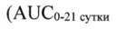
- стр. 9: «w 600 мг трастузумаба» — повторное чтение: «w | [ 600 мгтрастузумаба.»  
  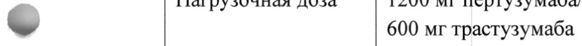
- стр. 10: «доцетаксела составляет 75 мг/м2, которая может быть увеличена до 100 мг/м? в» — низкая уверенность: «мг/м2,» (26)  
  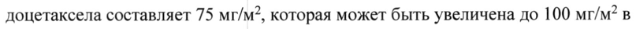
- стр. 10: «~ составляет 75 мг/м? в течение всей терапии (увеличение дозы He предусмотрено).» — повторное чтение: «оставля = 15 sae : течение | Le i  прапии (увеличе a . san не предус орет |»  
  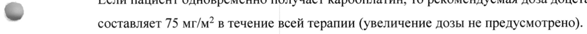
- стр. 11: «e >6 недель - следует повторно ввести нагрузочную дозу препарата Фесго® (1200 мг» — низкая уверенность: «>6» (56)  
  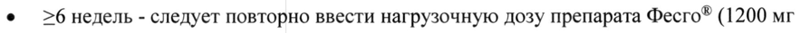
- стр. 20: «Частота бессимптомного снижения ФВЛЖ на >10% от начального уровня и до уровня» — низкая уверенность: «>10%» (56)  
  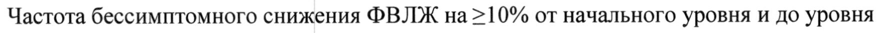
- стр. 22: «- В опорном исследовании FEDERICA фебрильная нейтропения наблюдалась у 6.5%» — повторное чтение: «~ ен носявцонании FEDERICA: фобий вбдоженун»  
  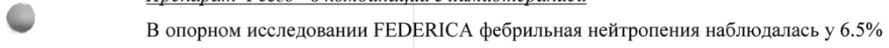
- стр. 22: «© пертузумаба и 58.3% пациентов в группе плацебо), в большинстве случаев — нейтропения» — повторное чтение: «Г рН " 85% пациент в Втрущие inns в большинстве учас нейтропения»  
  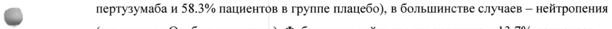
- стр. 25: «~ (14.5% пациентов, получавших препарат Фесго®, и 13.9% пациентов, получавших в/в» — повторное чтение: «- ( 4Sicenmenro an луч ao их препарат ecro®, и Виана пов,  получави ele»  
  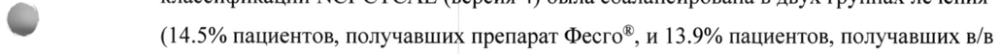
- стр. 25: «© 84.5% у пациентов, получавших трастузумаб и доцетаксел, включая 50.9% и 60.2%» — повторное чтение: «© 315% у ВИТО, получавших трастузумаб и PORETARCS, включая 209% и 60.2%»  
  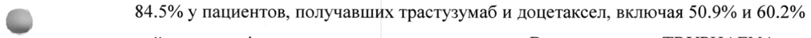
- стр. 26: «- дисгевзии, периферической нейропатии, гипомагниемии и диареи была на >5% выше у» — повторное чтение: «-  Жсгевзии, периферической «иропатии,  ипомагниемии и диареи была на 55% выше у»  
  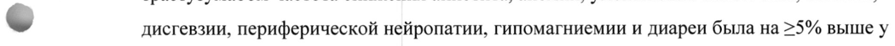
- стр. 28: «эквивалентного препарата >360 мг/м2.» — низкая уверенность: «мг/м2.» (58)  
  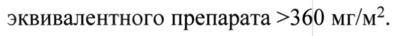
- стр. 31: «Раствор для подкожного введения 600 мг + 600 мг/10 мли 1200 mr + 600 мг/15 мл» — повторное чтение: «Раствор для подкожного введения 600 мг + 600 мг/10 мли 1200 мг + 600 мг/15 мл»  
  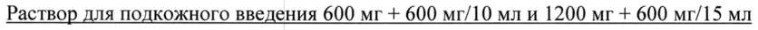
- стр. 32: «% (0% S» — низкая уверенность: «(0%» (34); повторное чтение: «RA OF Amy»  
  
