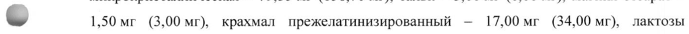

# Пинаверия бромид — внутрь

- Препарат: Дицетел® (таблетки, покрытые пленочной оболочкой;)
- АТХ: A03AX04
- Источник: ГРЛС, инструкция по медицинскому применению, РУ П N014873/01, файл от 2021-10-18 (https://grls.rosminzdrav.ru/Grls_View_v2.aspx?routingGuid=46297e41-17e6-45a5-88f9-9c218e58041a)
- Распознано автоматически (OCR): 6 из 6 стр.
- Инструкция к другому РУ того же препарата: П N014873/01 (национальное РУ, переоформленное по правилам ЕАЭС, решение от 13.09.2021). Текст может быть старше действующего
- Сомнительных строк после OCR: 1 (см. раздел «Проверка распознавания»)

## Общие сведения

| МИНЗДРАВ РОССИИ | ПИ ИДТИ о 7317213 МИНИСТЕРСТВО ЗДРАВООХРАНЕНИЯ Российской ФЕДЕРАЦИИ
ИНСТРУКЦИЯ ПО МЕДИЦИНСКОМУ ПРИМЕНЕНИЮ ЛЕКАРСТВЕННОГО ПРЕПАРАТА
Дицетел®

Регистрационный номер: П №014873/01

Торговое наименование: Дицетел®

Международное непатентованное наименование: пинаверия бромид

## 3. Лекарственная форма

таблетки, покрытые пленочной оболочкой
таблетки, покрытые пленочной оболочкой
_® Состав

1 таблетка, покрытая пленочной оболочкой, содержит:

Действующее вещество: пинаверия бромид — 50,0 мг (для дозировки 50 мг), 100,0 мг (для

дозировки 100 мг).

Вспомогательные вещества: кремния диоксид коллоидный - 1,00 мг (2,00 мг), целлюлоза

| микрокристаллическая — 79,35 мг (158,70 мг), тальк — 3,00 мг (6,00 мг), магния стеарат —

©, 1,50 мг (3,00 мг), крахмал прежелатинизированный — 17,00 мг (34,00 мг), лактозы

моногидрат — 18,15 мг (36,30 мг).

Пленочное покрытие: стеариновая кислота — 0,767 мг (1,534 мг), пленочное покрытие

Orange 2 — 10,283 мг (20,566 мг) (бутилметакрилата сополимер — 51,1573 %, натрия

лаурилсульфат — 5,1182 %, гипромеллоза - 2,1492 %, тальк — 40,5008 %, краситель железа
© оксид желтый - 1,0208 %, краситель железа оксид красный - 0,0537 %).

Описание

Таблетки 50 мг

Круглые двояковыпуклые таблетки, покрытые пленочной оболочкой, желто-оранжевого

цвета с гравировкой «50» на одной стороне.

Таблетки 100 мг

Круглые двояковыпуклые таблетки, покрытые пленочной оболочкой, желто-оранжевого

цвета с гравировкой «100» на одной стороне.

Фармакотерапевтическая группа: спазмолитическое средство

Код ATX: A03AX04 Фармакологические свойства

## 5.1. Фармакодинамика

Спазмолитическое средство с селективным действием на желудочно-кишечный тракт.
Спазмолитическое средство с селективным действием на желудочно-кишечный тракт.
Ингибирует поступление ионов кальция в клетки гладкой мускулатуры кишечника.
Исследования на животных показали, что пинаверия бромид напрямую или опосредованно уменьшает эффекты от стимуляции чувствительных нейронов. Не обладает существенным антихолинергическим действием. Не оказывает влияние на сердечно-сосудистую систему.

## 5.2. Фармакокинетика

После приема внутрь пинаверия бромид быстро всасывается и достигает максимальной концентрации в плазме крови через один час. Пинаверия бромид обладает высокой способностью связывания с белками плазмы крови (95 — 97 %).
После приема внутрь пинаверия бромид быстро всасывается и достигает максимальной концентрации в плазме крови через один час. Пинаверия бромид обладает высокой способностью связывания с белками плазмы крови (95 — 97 %).
© Препарат активно метаболизируется в печени. Период полувыведения составляет 1,5 ч.
Абсолютная биодоступность при приеме внутрь очень низкая (менее 1 %). Выводится из организма главным образом с калом.

## 4.1. Показания к применению

- Симптоматическое лечение болей, нарушений транзита кишечного содержимого и w дискомфорта, связанных с функциональными расстройствами работы кишечника;
- Симптоматическое лечение болей, нарушений транзита кишечного содержимого и w дискомфорта, связанных с функциональными расстройствами работы кишечника;
- Симптоматическое лечение болей, связанных с функциональными расстройствами желчевыводящих путей;
- Подготовка к рентгенологическому исследованию желудочно-кишечного тракта с применением бария сульфата.
w Противопоказания - Повышенная чувствительность к любому из компонентов препарата.
- Дефицит лактазы, непереносимость галактозы, глюкозо-галактозная мальабсорбция.
В связи с недостаточностью данных по эффективности и безопасности применение препарата у детей до 18 лет не рекомендовано.

## 4.6. Применение при беременности и в период грудного вскармливания

Нет достаточных данных применения пинаверия бромида беременными женщинами.
Исследования на животных недостаточно информативны для оценки воздействия препарата на беременность, развитие эмбриона/плода, протекание родов или постнатальное развитие ребенка. Потенциальный риск для человека неизвестен. Применение препарата во время беременности допускается, если польза от применения для матери превышает потенциальный риск для плода.
Кроме того, следует принять во внимание, что в состав препарата входит бром. В связи с этим назначение пинаверия бромида в конце беременности может вызвать неврологические расстройства (снижение артериального давления, седацию) у новорожденного.
Нет достаточной информации об экскреции препарата Дицетел® с материнским молоком у животных и человека. Физико-химические и доступные данные по фармакодинамике и токсикологии препарата Дицетел® указывают на экскрецию препарата с молоком матери, в связи с чем риск для грудного ребенка не может быть исключен.
Препарат Дицетел® не следует применять в период грудного вскармливания.

© Способ применения и дозы Препарат предназначен для приема внутрь.
Таблетки принимают во время еды целиком, не разжевывая и не рассасывая, запивая стаканом воды, чтобы предотвратить контакт пинаверия бромида со слизистой оболочкой пищевода (в связи с риском поражения слизистой оболочки пищевода, см. раздел «Особые

указания»).

= Дицетел®, таблетки, покрытые пленочной оболочкой, 50 мг:
Рекомендуемая суточная доза — по 1 таблетке 3 раза в день или по 2 таблетки 2 раза в день.
Если необходимо, суточная доза может быть увеличена до 2 таблеток 3 раза в день.
При подготовке к рентгенологическому исследованию — по 2 таблетки 2 раза в день в течение 3 дней перед исследованием.
Дицетел®, таблетки, покрытые пленочной оболочкой, 100 мг:

& Рекомендуемая суточная доза — по 1 таблетке 2 раза в день.
Если необходимо, суточная доза может быть увеличена до 1 таблетки 3 раза в день.
При подготовке к рентгенологическому исследованию — по 1 таблетке 2 раза в день в течение 3 дней перед исследованием.

## 4.8. Побочное действие

На основании объединенных данных 46 клинических исследований, проведенных компанией-спонсором, которые включали 3755 пациентов, получавших пинаверия бромид, сообщалось об указанных ниже нежелательных реакциях. Нежелательные реакции, перечисленные ниже, классифицированы в зависимости от частоты их возникновения и поражения определенных органов или систем органов. Классификация по частоте: очень частые (>1/10), частые (>1/100, но <1/10), нечастые (>1/1000, но <1/100), редкие (>1/10000,
На основании объединенных данных 46 клинических исследований, проведенных компанией-спонсором, которые включали 3755 пациентов, получавших пинаверия бромид, сообщалось об указанных ниже нежелательных реакциях. Нежелательные реакции, перечисленные ниже, классифицированы в зависимости от частоты их возникновения и поражения определенных органов или систем органов. Классификация по частоте: очень частые (>1/10), частые (>1/100, но <1/10), нечастые (>1/1000, но <1/100), редкие (>1/10000,

но <1/1000), или очень редкие (<1/10000).
Группа нежелательных реакций в Частота зависимости от поражения определенных органов или систем органов, согласно медицинскому словарю для нормативноправовой деятельности (Мед ОКА SOC
Нарушения со стороны желудочно-| Боль в животе!>, Диарея, рвота кишечного тракта запор”, сухость во рту?, диспепсия, тошнота
Общие расстройства и нарушения в месте Астения введения
Нарушения со стороны нервной системы | Головная боль Сонливость
- ' - Объединяет жалобы пациентов на: «боль в животе», «боль в нижней части живота»,
«боль в верхней части живота».
? - Нарушения со стороны желудочно-кишечного тракта преимущественно связаны с основным заболеванием. Частота сообщений о боли в животе, запоре и сухости во рту была примерно такая же или ниже, как при приеме плацебо.
Во время постмаркетингового применения сообщалось о следующих нежелательных
( реакциях. Сообщения носили спонтанный характер, и для точной оценки частоты случаев имеющихся данных недостаточно (частота неизвестна).
Нарушения со стороны желудочно-кишечного тракта:
Боль в области живота, диарея, тошнота, рвота, дисфагия.
При неправильном приеме препарата возможно поражение слизистой оболочки пищевода
(см. раздел «Особые указания»).
С Нарушения со стороны кожи и подкожных тканей:
Сыпь, зуд, крапивница, эритема.
Нарушения со стороны иммунной системы:
Гиперчувствительность.

## 4.9. Передозировка

Симптомы: передозировка может привести к желудочно-кишечным расстройствам, таким как тошнота, метеоризм и диарея.
Симптомы: передозировка может привести к желудочно-кишечным расстройствам, таким как тошнота, метеоризм и диарея.
Лечение: специальный антидот неизвестен; рекомендуется симптоматическое лечение.

## 4.5. Взаимодействие с другими лекарственными средствами

Клинические исследования не выявили каких-либо взаимодействий пинаверия бромида с препаратами наперстянки, пероральными гипогликемическими средствами, инсулином, аценокумаролом (антагонистом витамина К) и гепарином.
Одновременный прием антихолинергических средств может усилить купирование спазмов.
Не отмечалось влияния препарата на результаты лабораторных тестов по определению концентрации веществ в организме.

## 4.4. Особые указания

В связи с риском поражения слизистой оболочки пищевода необходимо тщательно придерживаться рекомендаций по применению. Пациенты с имеющимися в анамнезе
В связи с риском поражения слизистой оболочки пищевода необходимо тщательно придерживаться рекомендаций по применению. Пациенты с имеющимися в анамнезе
© поражениями пищевода и/или грыжей пищеводного отверстия должны уделять особое внимание правильному применению препарата.

## 4.7. Влияние на способность управлять транспортными средствами, механизмами

Исследований по влиянию препарата на способность к управлению транспортными средствами и другими механизмами не проводилось.
lw Но при приеме этого лекарственного препарата могут возникать нежелательные реакции, такие как сонливость (см. раздел «Побочное действие»). В таком состоянии скорость реакции может снижаться, в связи с чем следует соблюдать осторожность при управлении транспортными средствами и занятии другими потенциально опасными видами деятельности, требующими повышенной концентрации внимания и быстроты
; психомоторных реакций.
-

## 6.5. Форма выпуска

Таблетки, покрытые пленочной оболочкой, 50 мг.
Таблетки, покрытые пленочной оболочкой, 50 мг.
По 20 таблеток в ПВХ/Алю блистер. По 1 блистеру вместе с инструкцией по применению в пачку картонную.
Таблетки, покрытые пленочной оболочкой, 100 мг.
По 15 или 20 таблеток в ПВХ/Алю блистер. По | блистеру (по 20 таблеток) или по 2 блистера (по 15 таблеток) вместе с инструкцией по применению в пачку картонную.

## 6.4. Условия хранения

Хранить при температуре не выше 25 °С.
Хранить при температуре не выше 25 °С.
Хранить в недоступном для детей месте!

## 6.3. Срок годности

3 года.
3 года.
Не применять по истечении срока годности.
Условия отпуска Отпускают по рецепту.
Производитель Майлан Лэбораториз САС Рут де Бельвилль, Лье-ди Майар, 01400, Шатийон-сюр-Шаларон, Франция

® Организация, уполномоченная владельцем регистрационного удостоверения лекарственного препарата для медицинского применения на принятие претензий от потребителей
ООО «Эбботт Лэбораториз»
125171, г. Москва, Ленинградское шоссе, дом 16А, стр. 1.
Тел.: +7 (495) 258 42 80 Факс: +7 (495) 258 42 81 abbott-russia@abbott.com

yer ZE >,

Руководитель группы регистрации / \

© ООО «Эбботт Лэбораториз» Vee Д М. Щуклин
CCDS RDCCDS00028 1/4 version 4.0 | / /
## Проверка распознавания

Страницы-сканы распознаны автоматически. В 1 строках с дозировками цифры могли распознаться с ошибкой — сверьте с вырезкой из оригинала:

- стр. 1: «©, 1,50 мг (3,00 мг), крахмал прежелатинизированный — 17,00 мг (34,00 мг), лактозы» — низкая уверенность: «(3,00» (68), «17,00» (75); повторное чтение: «© sow ром, qe eee = oe ВА ОО, вели»  
  
