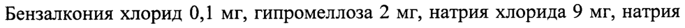
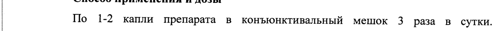

# Пластохинонилдецилтрифенилфосфония бромид — глаза

- Препарат: Визомитин® (капли глазные;)
- АТХ: S01XA
- Источник: ГРЛС, инструкция по медицинскому применению, РУ ЛП-001355, файл от 2025-09-22 (https://grls.rosminzdrav.ru/Grls_View_v2.aspx?routingGuid=f84d1a19-8611-44b0-b546-b13a3b801409)
- Распознано автоматически (OCR): 4 из 4 стр.
- Инструкция к другому РУ того же препарата: ЛП-001355 (национальное РУ, переоформленное по правилам ЕАЭС, решение от 01.09.2025). Текст может быть старше действующего
- Сомнительных строк после OCR: 2 (см. раздел «Проверка распознавания»)

## Общие сведения

| sO ЛП 001355-131211 | | | МИНИСТЕРСТВО ЗДРАВООХРАНЕНИЯ И СОЦИАЛЬНОГО РАЗВИТИЯ
| РОССИЙСКОЙ ФЕДЕРАЦИИ | | | : ИНСТРУКЦИЯ по применению лекарственного препарата для медицинского применения
Визомитин наименование лекарственного препарата
Регистрационный номер Торговое название препарата: Визомитин
Международное непатентованное название или группировочное название: -

## 3. Лекарственная форма

капли глазные Состав на 1 мл:
капли глазные Состав на 1 мл:
Активное вещество:
Пластохинонилдецилтрифенилфосфония бромид (ПДТФ) . . 0,155 мкг
Вспомогательные вещества:
& Бензалкония хлорид 0,1 мг, гипромеллоза 2 мг, натрия хлорида 9 Mr, натрия дигидрофосфата 0,81 мг, натрия гидрофосфата додекагидрата 116,35 мг, натрия гидроксида | М раствор до РН 6,3 — 7,3, воды для инъекций до 1 мл.
Описание: Прозрачная или слегка опалесцирующая бесцветная или слегка окрашенная жидкость.
Фармакотерапевтическая группа Кератопротекторное средство.
Код ATX: 5015 А | оо А ЛП 001355-131211 | Фармакологические свойства

## 5.1. Фармакодинамика

Пластохинонилдецилтрифенилфосфония бромид (ПДТФ) = является производным пластохинона, который через линкерную цепь (С10) связан с остатком трифенилфосфина. ПДТФ в низких (наномолярных) концентрациях проявляет высокую антиоксидантную активность. Также оказывает стимулирующее действие на процесс слезопродукции, эпителизации, способствует повышению стабильности слезной пленки.
Пластохинонилдецилтрифенилфосфония бромид (ПДТФ) = является производным пластохинона, который через линкерную цепь (С10) связан с остатком трифенилфосфина. ПДТФ в низких (наномолярных) концентрациях проявляет высокую антиоксидантную активность. Также оказывает стимулирующее действие на процесс слезопродукции, эпителизации, способствует повышению стабильности слезной пленки.

## 5.2. Фармакокинетика

1 Исследований фармакокинетики у человека не проводилось. В доклинических исследованиях на животных распределение ПДТФ в органах и тканях происходило в течение 48 ч после внутривенного и внутрижелудочного введения. Было обнаружено, что ПДТФ присутствует в наибольших концентрациях в тканях почки, печени и сердце в течение 1 ч после введения. ПДТФ относительно быстро подвергается ферментативному расщеплению и ковалентному связыванию с белками.

## 4.1. Показания к применению

Синдром «сухого глаза».
Синдром «сухого глаза».
w Противопоказания Гиперчувствительность к компонентам препарата, возраст до 18 лет.

## 4.6. Применение при беременности и в период грудного вскармливания

Адекватных контролируемых исследований у беременных и кормящих грудью женщин не проводилось. Не рекомендуется назначать препарат во время беременности. При необходимости назначения в период лактации на период лечения грудное вскармливание следует прекратить.
| ии | ЛП 001355-131211 Способ применения и дозы
| По 1-2 капли препарата в конъюнктивальный мешок 3 раза в сутки.
| | | Длительность курса лечения устанавливается врачом в зависимости от
| выраженности симптомов.
| | Побочное действие | Аллергические реакции.
| Передозировка Данные о передозировке при местном применении отсутствуют.

## 4.5. Взаимодействие с другими лекарственными средствами

При необходимости можно применять одновременно с другими глазными каплями. При этом перерыв между инстилляциями должен быть не менее 5 минут.

## 4.4. Особые указания

Влияние на способность управления транспортными средствами и механизмами
Влияние на способность управления транспортными средствами и механизмами
Если после применения препарата возникает кратковременная нечеткость
& зрения, до его восстановления не рекомендуется управлять транспортными средствами и заниматься видами деятельности, требующими повышенной концентрации внимания.

## 6.5. Форма выпуска

Капли глазные концентрацией 0,155 мкг/мл в полиэтиленовых флаконах по 5 мл с пробками - капельницами и навинчиваемыми колпачками. Каждый флакон с инструкцией по применению помещен в пачку из картона.
Капли глазные концентрацией 0,155 мкг/мл в полиэтиленовых флаконах по 5 мл с пробками - капельницами и навинчиваемыми колпачками. Каждый флакон с инструкцией по применению помещен в пачку из картона.

## 6.4. Условия хранения

| НИНЕ и | ЛП 001355-131211
| НИНЕ и | ЛП 001355-131211
| | В защищенном от света месте при температуре oT 2-8 °С.
| .
| Вскрытый флакон хранить в защищенном от света месте при температуре
| | 2-8 °C; использовать в течение 1 месяца.
| Хранить в недоступном для детей месте.
| | | | | Срок годности 1 год. Не использовать после истечения срока годности, указанного на
| упаковке. Вскрытый флакон использовать в течение 1 месяца.
| | | Условия отпуска &. По рецепту.

Наименование, адрес производителя лекарственного препарата и адрес

места производства лекарственного препарата

ЗАО «Фрамон», 121552, г. Москва, ул. Черепковская, д.15, стр.7

Организация, осуществляющая выпускающий контроль качества и

принимающая претензии от потребителей:

ООО «Митотех», 119992, г. Москва, Ленинские горы, дом 1, строение 77, к. 21.

Телефон/Факс (495)939 5945

5 TL
© (4 ly | <
3 SV аместитель директора Я ,
~~ id Wet ex] по регистрации лекарственных средств ЖР\\, „А амятнин
Sock aay
## Проверка распознавания

Страницы-сканы распознаны автоматически. В 2 строках с дозировками цифры могли распознаться с ошибкой — сверьте с вырезкой из оригинала:

- стр. 1: «Бензалкония хлорид 0,1 мг, гипромеллоза 2 мг, натрия хлорида 9 Mr, натрия» — повторное чтение: «Бензалкония хлорид 0,1 мг, гипромеллоза 2 мг, натрия хлорида 9 мг, натрия»  
  
- стр. 3: «| По 1-2 капли препарата в конъюнктивальный мешок 3 раза в сутки.» — повторное чтение: «| to 1-2 “ann препарата | в конъюнктивальный мешок 3 раза в сутки.»  
  
