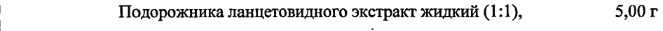
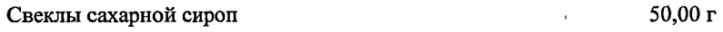
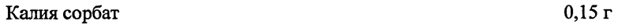
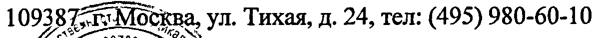

# Подорожника ланцетного листьев экстракт жидкий — внутрь

- Препарат: Доктор Тайсс сироп с подорожником (сироп;)
- АТХ: R05CA
- Источник: ГРЛС, инструкция по медицинскому применению, РУ П N011635/01, файл от 2025-02-03 (https://grls.rosminzdrav.ru/Grls_View_v2.aspx?routingGuid=147f6811-16f0-49ce-aed0-75dec8a82dbc)
- Распознано автоматически (OCR): 3 из 3 стр.
- Инструкция к другому РУ того же препарата: П N011635/01 (национальное РУ, переоформленное по правилам ЕАЭС, решение от 28.12.2024). Текст может быть старше действующего
- Сомнительных строк после OCR: 9 (см. раздел «Проверка распознавания»)

## Общие сведения

П №011635/01-150312 МИНИСТЕРСТВО ЗДРАВООХРАНЕНИЯ И СОЦИАЛЬНОГО РАЗВИТИЯ
РОССИЙСКОЙ ФЕДЕРАЦИИ ИНСТРУКЦИЯ по применению лекарственного препарата для медицинского применения
Доктор Taiice сироп с подорожником | | Регистрационный номер:
Торговое название препарата: Доктор Тайсс сироп с подорожником |

## 3. Лекарственная форма

сироп ® Состав: | 100 препарата содержат:
сироп ® Состав: | 100 препарата содержат:
Активный компонент: | | Подорожника ланцетовидного экстракт жидкий (1:1), 5,00 г экстрагент — этанол 20 % |
Вспомогательные компоненты:
Мяты перечной масло 0,01 г | Сахарный сироп инвертный (сахароза, декстроза, фруктоза) 23,00 г
Свеклы сахарной сироп 50,00 г Мед 2,00 г
Калия сорбат 0,15 г © Вода , 19,84 г | Описание
Непрозрачный, вязкий раствор коричневого цвета со специфическим запахом. |
Фармакотерапевтическая — группа: — отхаркивающее — средство — растительного происхождения.
Код ATX: ROSCA | Фармакологическое действие
Оказывает отхаркивающее, противовоспалительное и муколитическое действие. | ty by a
~ 4 а wo? ы 1 whoo 5 id eo В ` * . ‘ , 4 . pos , wok mo, а 1 co ‘ . ` II N011635/01-150312
` , 1 й a , ., ‘ , В . р , р ‹ 7” , a er - ` м , .

## 4.1. Показания к применению

:
:
at | . Воспалительные заболевания ‘дыхательных путей, сопровождающиеся ‘кашлем с’
.. * трудноотделяемой мокротой - в составе комплексной терапии. . о и” Е о oo ` , rT, oe, у ‘ cS a Coll ot va a! м п” phone a
. Противопоказания =} ) а. и А ‚ Повышенная индивидуальная чувствительность к компонентам препарата (в том числе Ke °’ |
| ` * и, Г: . - 21.
‚.,; .‘` продуктам пчеловодства), детский возраст (до 1 года). Дефицит сахаразы/изомальтазы, a
’ непереносимость фруктозы, глюкозо-галактозная мальабсорбция. ‹ °. б.р.
‘ . . ., = . , ; И й 4 .
| , , .’ ^. a ; ы у . a : i” ‚7 ив -“ . , 7
‚ ‚ Применение при беременности и в период грудного вскармливания ‹ ‘гг
. (“Препарат может применяться в период беременности и грудного вскармливания ‘по, :
‚. a t ‘ , м ‘ ce , . , "+ № м, г , ® у, согласованию с лечащим врачом. бе: и я ив “ \ , ; Ste ‘ ’ aye 4 о + * . ` та , й м ; ‘ . . . * * :
, t : , roe, , й . . a4 ; ‘ ~ .
ot ис ‘ wat «4 woe tt oe ‚ ве. ета о ти, , Способ применения и дозы‘ °| И с” ба с: О з hy : , о, й . . . , а .‘ о . rt . , - s. у р a + Внутрь, запивая небольшим количеством воды: 5! 4 ры ats ae
‘т. 4 детям om Ггода до 6 лет принимать no 1/2 чайной ложки. (2,5'Mm) каждые 3-4 4, но He ..- у . ! TT ote в: у ‚, вит ' . 7 a
| о. { более 4 раз в сутки; . и. ии Oo. poo" о и
Пе детям старше 6 лет и подросткам по 1 чайной ложке (5 мл) каждые 2-3 4, но не более 4 .” .
| ae ‚ pasBCyTKH;; . | м СОНИ Sts р ‚ взрослым по 1 столовой ложке (15 мл) каждые 2-3 ч. о oo ее р `›‚‘’ Длительность курса лечения» 2-3 ‘недели. Увеличение‘ длительности или, назначение | :
Me ; 1. а . _. rs о | . хз.
a . ‘ повторного курса лечения возможно после консультации с врачом... - >< |: ! ОИ oo `, : a | _ й my . , | ., . . ‘ , af weld, a . wo ы В :” ый 7, ;
x } wt pe ee ae , ИА "у 4 .:
„. . an ry ., ; И + os , ) . , : А ‘ - 7 ¥ * Мобочные действия. °. a rr ee 4 aan a af . , , car п й .` . . р ‘ . -. р a, ев
’’(, > ( Возможны аллергические реакции. . ‚' ‘ о и Lone 7
‚ 3 . , , . , . . , р : , + 4 . a ы ` . 1 . me ‘ с’ у, . , . Leg 4 :
a . “ tos 44 eo “* af ‘ ' , аи . р am , , + ..
||. , Взаимодействие с другими препаратами ‚ ~~ +. a me, | ra ". . He следует . применять.’ одновременно с. противокашлевыми‘ препаратами и. , .
2 р a a * ff ae ~ ie 4 4 пе > , р ‚.'- +) + Лекарственными средствами, уменьшающими образование мокроты, так как это -
* - , у . t i i ' . ¢ id ’ . у ', `“ .. ‚о. Затрудняет откашливание разжиженной мокроты. , Кн и ‚ . a й , р , ‘ . vy ` tee ., 2 ”. a8 не 7 |
И . у : у „^^ М no. № . . » ‚ a | ‚` Влияние на способность’ управлять транспортными средствами и работать с °, ’.
механизмами .. | о ИО ‘ .. Препарат.не оказывает влияния на способность к выполнению потенциально опасных , |
} 5, - . » . ‘ . , ' ‚о 7 ‘видов деятельности,. требующих повышенной концентрации; внимания’ и быстроты... °,.
2. *. И a , В tO? fen . , , . .. 5 2 , “ , , , vay ar ` у ре `, “ae . ы ‘в, fos ы , .’. ‘3 ‘ . ‘os , . - , ,, < ` , `, | ft ‚‘ a roy ', ‘ ра Ве . . ‹‘ "
. te 1 й ¢ t . ,? ‘ й . , . ар ау , но rhe 7 , ~ а
' IT N011635/01-150312 психомоторных реакций (в том числе, управление транспортными средствами, работа с движущимися механизмами).

## 4.4. Особые указания

| Сироп содержит углеводы, что необходимо учитывать пациентам, страдающим сахарным диабетом, а также при гипокалорийной диете.
| Сироп содержит углеводы, что необходимо учитывать пациентам, страдающим сахарным диабетом, а также при гипокалорийной диете.
В 1 чайной ложке сиропа (5 мл) содержится 1,81 г углеводов. Пациент получает на прием от 0,9 г (1/2 чайная ложка) (соответствует 0,075 хлебным единицам) до 5,43 г (1 столовая ложка или 3 чайной ложки) (соответствует 0,45 хлебным единицам) углеводов. ‘ |

## 6.5. Форма выпуска

| | ® Сироп. По 50, 100 или 250 мл в стеклянные флаконы коричневого стекла с | завинчивающейся пластиковой крышкой. |
| | ® Сироп. По 50, 100 или 250 мл в стеклянные флаконы коричневого стекла с | завинчивающейся пластиковой крышкой. |
Каждый флакон вместе с инструкцией по применению в картонную пачку. |
. Условия хранения | Хранить при температуре не выше 25 °С в упаковке с плотно закрытой крышкой.
Хранить в недоступном для детей месте. |

## 6.3. Срок годности

| Згода. Не применять по истечении срока годности, указанного на упаковке. |
| Згода. Не применять по истечении срока годности, указанного на упаковке. |
| _ @ Условия отпуска Без рецепта. | Владелец РУЛТроизводитель
Др. Тайсс Натурварен ГмбХ, Мишелинштрассе 10, 66424 Хомбург, Германия.
Представительство в России ` ЗАО «НАТУСАНА»
109387 г;„Москва, ул. Тихая, д. 24, тел: (495) 980-60-10 отв eI
KS ee 0 Or хх .
s/S ah Ге е BI ek ;
/ es Aa ee 3A & С. , Власов С.В.
© fe) cy УД QO WE"
## Проверка распознавания

Страницы-сканы распознаны автоматически. В 9 строках с дозировками цифры могли распознаться с ошибкой — сверьте с вырезкой из оригинала:

- стр. 1: «| Подорожника ланцетовидного экстракт жидкий (1:1), 5,00 г» — низкая уверенность: «5,00» (68)  
  
- стр. 1: «Мяты перечной масло 0,01 г |» — низкая уверенность: «0,01» (68)  
  
- стр. 1: «Свеклы сахарной сироп 50,00 г» — низкая уверенность: «50,00» (58)  
  
- стр. 1: «Калия сорбат 0,15 г» — низкая уверенность: «0,15» (62)  
  
- стр. 1: «© Вода , 19,84 г |» — низкая уверенность: «19,84» (74)  
  
- стр. 2: «| о. { более 4 раз в сутки; . и. ии Oo. poo" о и» — повторное чтение: «»  
  
- стр. 2: «Пе детям старше 6 лет и подросткам по 1 чайной ложке (5 мл) каждые 2-3 4, но не более 4 .” .» — низкая уверенность: «4,» (79); повторное чтение: «_ ve 7 `детям старше 6 лет и подросткам по | чайной ложке (5 мл) каждые 2-3 ч, HO He более 47 Ш й»  
  
- стр. 3: «® Сироп. По 50, 100 или 250 мл в стеклянные флаконы коричневого стекла с |» — повторное чтение: «»  
  
- стр. 3: «109387 г;„Москва, ул. Тихая, д. 24, тел: (495) 980-60-10» — низкая уверенность: «109387» (0); повторное чтение: «1093: 81т; Москва, ул. Тихая, д. 24, тел: (495) 980-60-10»  
  
