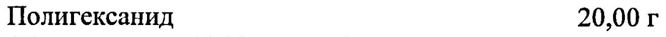
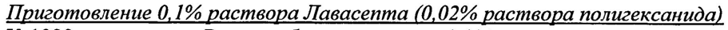
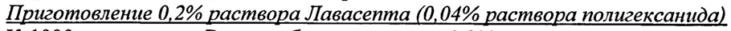

# Полигексанид — наружно

- Препарат: Лавасепт (концентрат для приготовления раствора для местного и наружного применения;)
- АТХ: D08AC05
- Источник: ГРЛС, инструкция по медицинскому применению, РУ П N016068/01, файл от 2026-11-10 (https://grls.rosminzdrav.ru/Grls_View_v2.aspx?routingGuid=f4af2727-07c8-4eea-baec-de595c6f4c73)
- Распознано автоматически (OCR): 5 из 5 стр.
- Инструкция к другому РУ того же препарата: П N016068/01 (национальное РУ, переоформленное по правилам ЕАЭС, решение от 28.09.2020). Текст может быть старше действующего
- Сомнительных строк после OCR: 3 (см. раздел «Проверка распознавания»)

## Общие сведения

П М016068/01-310811 | | ИНСТРУКЦИЯ по медицинскому применению препарата
Лавасепт Регистрационный номер:
® Торговое название: Лавасепт Международное непатентованное название (МНН): полигексанид

## 3. Лекарственная форма

концентрат для приготовления раствора для наружного и местного применения
концентрат для приготовления раствора для наружного и местного применения

## 2. Состав

, 100 мл препарата содержат:
, 100 мл препарата содержат:
Действующее вещество: | Полигексанид 20,00 г
(Полигексанид 20 % раствор) 97,98-103,19 г
® Вспомогательные вещества:
Макрогол-4000 1,00 г Хлористоводородная кислота 1 М раствор 0-1мл |
Вода для инъекций до 100 мл | pH 5,0-7,0
Описание: бесцветный прозрачный раствор без запаха.
Фармакотерапевтическая группа: антисептическое средство.
Код ATX: DO8ACOS.
- Poe 60629 ;
" 7 ‚. ‚ TIN016068/01-310811 Фармакологические свойства

## 5.1. Фармакодинамика

Действующее вещество препарата — полигексанид (полигексаметиленбигуанида гидрохлорид) — является полимерным производным бигуанида.
Действующее вещество препарата — полигексанид (полигексаметиленбигуанида гидрохлорид) — является полимерным производным бигуанида.
Бактерицидный эффект препарата обусловлен неспецифическим сродством полигексанида к бактериальным кислым фосфолипидам, что приводит к повышению проницаемости клеточных мембран и гибели микроорганизмов
Препарат Лавасепт обладает широким спектром действия: активен как в отношении грибов, так и бактерий таких, как Pseudomonas aeruginosa,
Escherichia coli, Staphylococcus aureus, Staphylococcus epidermidis,
Streptococcus pneumoniae и др. В присутствии крови и гнойного отделяемого,
. бактерицидное и фунгицидное действие ослабевает незначительно.

## 5.2. Фармакокинетика

® При местном и наружном применении практически не всасывается.
® При местном и наружном применении практически не всасывается.

## 4.1. Показания к применению

| | Лечение инфицированных ран и поверхностных повреждений мягких тканей. |
| | Лечение инфицированных ран и поверхностных повреждений мягких тканей. |
, Лечение ожогов и отморожений.
Промывание полостей, в том числе с использованием дренажа. |
Орошение операционного поля при угрозе инфицирования, при.
| реконструктивных операциях, в т.ч. при трансплантации костных тканей, при ` | эндопротезировании суставов:
Промывание имплантатов.
| Противопоказания Гиперчувствительность к компонентам препарата.
Операции на головном мозге, глазах, среднем и внутреннем ухе.
Промывание неинфицированных суставов и хрящей.
6 Беременность, период грудного вскармливания.
Детский возраст (до 18 лет).

## 4.3. С осторожностью

При операциях на неповрежденных хрящевых тканях.
При операциях на неповрежденных хрящевых тканях.
Раствор Лавасепта может применяться для промывания брюшной и плевральной полости (перитонит, интраоперационное инфицирование брюшной полости, острая и хроническая эмпиема — плевры, интраоперационное инфицирование плевральной полости) только после тщательной оценки соотношения риск/польза, оценки функционального состояния выделительной функции почек. |
| . ; | .. _ “LL 60629 . , г ! ` . i a ‘ ,
‘ Zz . & , , G ‘ . i , .. . , . 4 7 on , F ., ot , |
| | р ‚„ ¥1N016068/01-310811 Способ применения и дозы
Наружно и местно. Лавасепт можно использовать только разведенным в концентрации 0,1% или 0,2%.
Приготовление 0,1% раствора Лавасеита (0,02% раствора полигексанида)
К 1000 мл раствора Рингера без лактата или 0,9% раствора натрия хлорида шприцом добавляют!,0 мл концентрата.
Приготовление 0,2% раствора Лавасепта (0,04% раствора полигексанида)
К 1000 мл раствора Рингера без лактата или 0,9% раствора натрия хлорида шприцом добавляют 2,0 мл концентрата.
2 метода приготовления раствора из концентрата:
- необходимое количество концентрата стерильным шприцом вводят в бутылку со стерильным растворителем и перемешивают;
- необходимое количество концентрата смешивают с растворителем,
Ф разливают в подходящие емкости и стерилизуют (при температуре 121 °С
| в течение 15 мин).
Разведенный Лавасепт применяют для промывания ран, в том числе с использованием дренажа, а также в виде марлевых салфеток, обильно смоченных раствором. |
В начале обработки поверхностных гнойных ран, инфицированных грамотрицательной микрофлорой обычно применяют 0,2% раствор
| Лавасепта. Для последующей обработки ран, их активного промывания
| используют 0,1% раствор препарата.
Для промывания брюшной и плевральной полости используется 0,1% раствор Лавасепта. С целью предупреждения скопления препарата в полостях рекомендуется использовать аспирационные устройства.
Продолжительность применения Ограничений по продолжительности использования препарата не выявлено. |
6 Побочное действие
3 Возможны аллергические реакции (крапивница, кожная сыпь), крайне редко анафилактический шок (<1/10000).
| Взаимодействие с другими лекарственными препаратами и другие виды | взаимодействия .
Лекарственные взаимодействия с другими препаратами He известны. :
Одновременное использование Лавасепта и других анионных средств может | нарушить противомикробную эффективность препарата. |
| | Особые указания Лавасепт применяют только в разведенном виде!
Препарат предназначен только для наружного и местного применения!
| . 60629, ’ ы * й ‘ 4 : № “а ‘ j . 7 a А , 3 я ee р _ , coo oo, ra , ' 7
| " smh me. | TT N016068/01-310811 Лавасепт, как и другие антисептики, в эксперименте На животных, тормозил рост хрящевой ткани эмбрионов. При продолжительном применении препарат также может привести к` повреждению интактного хряща. При попадании препарата на поврежденный хрящ, рану следует промыть раствором Рингера без лактата или 0,9% раствором натрия хлорида.
При случайном попадании концентрата в глаза или на кожу необходимо промыть большим количеством воды.
В случае развития аллергической реакции следует немедленно прекратить и назначить симптоматическое лечение (антигистаминные препараты).
Хранение при температуре ниже 8 °С может вызвать образование кристаллов, которые растворяются при нагревании раствора до 60 °С.
Флакон с концентратом после вскрытия хранить не более 6 недель, но не позднее истечения срока годности.
® Раствор Лавасепта, готовый для применения, хранить 24 часа при температуре не выше 25 °С.

## 6.5. Форма выпуска

Концентрат для приготовления раствора для наружного и местного применения 20%. _
Концентрат для приготовления раствора для наружного и местного применения 20%. _
По 2 мл или 5 мл во флаконы из стекла гидролитического класса 1, укупоренные резиновыми пробками и алюминиевыми ‘колпачками с | бесцветными пластиковыми заглушками, соответствующие требованиям‘ |
Европейской Фармакопеи. По 100 мл во флаконы из стекла гидролитического класса 2, укупоренные резиновыми пробками и алюминиевыми колпачками, соответствующие требованиям Европейской
Фармакопеи.
По 1 флакону по 2 мл, 5 мл или 100 мл с инструкцией по применению в
® картонной пачке.

## 6.4. Условия хранения

Хранить при температуре от 8°С до 25°С в защищенном от света месте.
Хранить при температуре от 8°С до 25°С в защищенном от света месте.
Не замораживать.
Хранить в местах, недоступных для детей. ;

## 6.3. Срок годности

3 года.
3 года.
Не использовать после срока годности, указанного на упаковке.
Условия отпуска По рецепту.
| .. 60629 ’ .’ ° , : . , . * ' .’ - | | ‚’ , : , р ' ‚ ‚1 ‘ ь к * ro ah
| # а a oot ‘ ь (т | аа , i TI N016068/01-310811
Производитель Б.Браун Медикал АГ, Швейцария, произведено Солюфарм Фармацойтише
Эрцойгниссе ГмбХ, Индустриштрассе, 3, 34212, Мельзунген, Германия.
Представительство в России ООО «Б.Браун Медикал», 191040, Санкт-Петербург, ул. Пушкинская, д.10.
Тел./факс: (812) 320-40-04.
=_=” me, Zo a Cen ~ Представитель фирмы Loe - HISD
| «b. Браун Медикал АГ», к.ф.н. fa СУ Иа Е Околелова М.С.
$ ВВВАСМ olz {+ ai ® = О a mee Ce . О МЗСР РФ
>| ЭХСПЕРТНЫЙ ОТЧЕТ Е АДЕЙСТВИТЕЛЕН ДЛЯ ДАННОЙ Э e ВЕРСИИ ДОКУМЕНТА = 0065 00 0 60 4 60629 я :
## Проверка распознавания

Страницы-сканы распознаны автоматически. В 3 строках с дозировками цифры могли распознаться с ошибкой — сверьте с вырезкой из оригинала:

- стр. 1: «Полигексанид 20,00 г» — низкая уверенность: «20,00» (0)  
  
- стр. 3: «Приготовление 0,1% раствора Лавасеита (0,02% раствора полигексанида)» — повторное чтение: «Приготовление 0, 1% раствора Лавасеита (0, 02% раствора полигексанида)»  
  
- стр. 3: «Приготовление 0,2% раствора Лавасепта (0,04% раствора полигексанида)» — повторное чтение: «IT риготовление 0,2% раствора Лавасепта (0, 04 26. раствора полигексанида)»  
  
