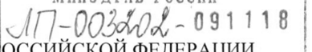

# Полипептиды шишковидной железы эпифиза крупного рогатого скота — парентерально

- Препарат: Пинеамин® (лиофилизат для приготовления раствора для внутримышечного введения;)
- АТХ: G02CX
- Источник: ГРЛС, инструкция по медицинскому применению, РУ ЛП-003202, файл от 2021-10-29 (https://grls.rosminzdrav.ru/Grls_View_v2.aspx?routingGuid=7608c053-4c18-4300-805e-845317eb3f18)
- Распознано автоматически (OCR): 6 из 6 стр.
- Инструкция к другому РУ того же препарата: ЛП-003202 (национальное РУ, переоформленное по правилам ЕАЭС, решение от 18.10.2021). Текст может быть старше действующего
- Сомнительных строк после OCR: 1 (см. раздел «Проверка распознавания»)

## Общие сведения

МИНЗДРАВ РОССИИ | 7. | ‹Г]-00240% - 091118 |
МИНИСТЕРСТВО ЗДРАВООХРАНЕНИЯ ВОССИИСКОЙ ФЕДЕРАЦИИ |
ОГЛАСОВАНО | en eae ee | ИНСТРУКЦИЯ ПО МЕДИЦИНСКОМУ ПРИМЕНЕНИЮ ЛЕКАРСТВЕННОГО ПРЕПАРАТА
ПИНЕАМИН” Регистрационный номер: ЛП-003202
Торговое наименование: ПИНЕАМИН® Международное непатентованное или группировочное наименование: полипептиды
& эпифиза [шишковидной железы] крупного рогатого скота.

## 3. Лекарственная форма

лиофилизат для приготовления раствора для внутримышечного введения.
лиофилизат для приготовления раствора для внутримышечного введения.

## 2. Состав

& Лекарственный препарат ПИНЕАМИНУ, лиофилизат для приготовления раствора для внутримышечного введения 10 мг, представляет собой комплекс водорастворимых полипептидных фракций эпифиза [шишковидной железы] крупного рогатого скота не старше 12-месячного возраста, выделенных из экстракта сухого Пинеамин"
& Лекарственный препарат ПИНЕАМИНУ, лиофилизат для приготовления раствора для внутримышечного введения 10 мг, представляет собой комплекс водорастворимых полипептидных фракций эпифиза [шишковидной железы] крупного рогатого скота не старше 12-месячного возраста, выделенных из экстракта сухого Пинеамин"
(ООО «ГЕРОФАРМ», Россия), содержащий в качестве стабилизатора глицин
(Аджиномото Ко. Инк, Япония; Панреак, Испания) в соотношении 1: 2.
Описание Порошок или пористая масса белого или белого с желтоватым оттенком цвета.
Фармакотерапевтическая группа: противоклимактерическое средство.
Код ATX: G02CX.
Фармакологические свойства Фармакодинамика
Действующим веществом препарата ПИНЕАМИН* является комплекс низкомолекулярных водорастворимых полипептидных фракций, выделенных из эпифиза крупного рогатого скота.
Препарат оптимизирует эпифизарно-гипоталамические взаимоотношения, нормализует

функцию передней доли гипофиза и баланс гонадотропных гормонов.

В экспериментах на лабораторных животных с возрастным снижением фертильности в

группах, получавших препарат ПИНЕАМИН», наблюдалась тенденция к повышению

либидо и увеличение репродуктивной способности, а также отмечалось легкое

успокаивающее действие на психоэмоциональное состояние животных.

В двойном слепом плацебо контролируемом исследовании препарата в популяции

женщин в периоде постменопаузы было установлено достоверное уменьшение

выраженности климактерических расстройств по данным индекса Куппермана за счет

позитивного влияния препарата на нейровегетативные проявления климактерического

синдрома, такие как приливы жара, гипергидроз, головные боли, ощущение сердцебиения
© в покое, повышенная возбудимость, нарушения сна и др.

Токсикологические исследования доказали нетоксичность препарата ПИНЕАМИН”. При

изучении острой токсичности достичь летальных эффектов при применении

максимальных доз, превышающих терапевтическую человеческую дозу в десятки тысяч

раз, не удалось. Подострое (30 дней) и хроническое (90 дней) ежедневное

внутримышечное введение препарата ПИНЕАМИН® экспериментальным животным не
- оказало негативного воздействия на основные системы (нервную, сердечно-сосудистую,

кроветворную, мочевыделительную и дыхательную), а также на обмен веществ и общее

состояние организма.

## 5.2. Фармакокинетика

Состав препарата ПИНЕАМИН®, действующее вещество которого является комплексом
- полипептидных фракций, не позволяет провести обычный фармакокинетический анализ

отдельных компонентов.

## 4.1. Показания к применению

Нейровегетативные расстройства при климактерическом синдроме у женщин при наличии

противопоказаний к проведению заместительной гормональной терапии (ЗГТ) или отказе

от ее проведения.

## 4.3. Противопоказания

Гиперчувствительность к действующему или вспомогательному веществу препарата,

возраст до 18 лет, беременность и период грудного вскармливания, кровянистые

выделения/кровотечения из половых путей неясной этиологии. Предраковые или злокачественные заболевания, в том числе эстрогензависимые опухоли половых органов и молочной железы.

## 4.3. С осторожностью

Препарат не оказывает влияния на концентрацию половых гормонов в плазме крови.
Препарат не оказывает влияния на концентрацию половых гормонов в плазме крови.
Однако рекомендуется с осторожностью применять его при лейомиоме матки и эндометриозе.

## 4.6. Применение при беременности и в период грудного вскармливания

Препарат не предназначен для применения при беременности и в период грудного вскармливания.
© Способ применения и дозы Препарат вводят внутримышечно.
Содержимое флакона перед инъекцией растворяют в 1-2 мл 0,5 % раствора прокаина, воды для инъекций или 0,9 % раствора натрия хлорида и вводят однократно ежедневно в дозе 10 мгв течение 10 дней.
При необходимости проводят повторный курс через 3-6 месяцев.
- В случае пропуска инъекции не рекомендуется вводить двойную дозу препарата, инъекцию проводят на следующий день в обычное время в той же дозе.

## 4.8. Побочное действие

Возможны аллергические реакции в случае индивидуальной гиперчувствительности к компонентам препарата.
Возможны аллергические реакции в случае индивидуальной гиперчувствительности к компонентам препарата.
= В проведенном клиническом исследовании были зарегистрированы следующие нежелательные реакции (НР):
oe IM si Нежелательная реакция MedDRA (по классификации ВОЗ)
Нарушения со стороны половых | Кровянистые выделения Часто (> 1%, но < 10% органов и молочной железы из влагалища назначений)
Нарушения со стороны кожи и Инфильтрат в месте Редко (> 0,01%, но < 0,1% подкожных тканей внутримышечного назначений)
введения препарата При возникновении указанных НР следует обратиться к врачу.
Если любые из указанных в инструкции НР усугубляются или возникли любые другие
НР, не указанные в инструкции, необходимо сообщить 06 этом врачу.

## 4.9. Передозировка

| Случаи передозировки не выявлены.
| Случаи передозировки не выявлены.
При передозировке препарата возможны кровянистые выделения из влагалища, повышение концентрации эстрадиола крови. В этих случаях необходима отмена препарата, проведение симптоматической терапии.

## 4.5. Взаимодействие с другими лекарственными средствами

Лекарственное взаимодействие с другими лекарственными средствами в настоящее время
© не выявлено.

## 4.4. Особые указания

Препарат ПИНЕАМИН® необходимо применять только по назначению врача!
Препарат ПИНЕАМИН® необходимо применять только по назначению врача!
Ввиду возможности индивидуальной гиперчувствительности к компонентам препарата, рекомендуется перед началом терапии проведение пробной инъекции.
= Раствор лекарственного препарата необходимо приготовить непосредственно перед применением. Приготовленный раствор хранить нельзя.
Раствор препарата ПИНЕАМИН® не рекомендуется смешивать с другими растворами.
Специальные меры предосторожности при уничтожении неиспользованного лекарственного препарата не требуются.
© Влияние на способность управлять транспортными средствами и механизмами
Применение препарата не оказывает влияния на способность к управлению транспортными средствами и механизмами, занятие потенциально опасными видами деятельности, требующими повышенной концентрации внимания и быстроты психомоторных реакций.

## 6.5. Форма выпуска

Лиофилизат для приготовления раствора для внутримышечного введения, 10 мг.
Лиофилизат для приготовления раствора для внутримышечного введения, 10 мг.
По 30 мг лиофилизата во флаконы из бесцветного стекла вместимостью 5 мл, укупоренные пробками резиновыми лиофильными с обкаткой колпачками алюминиевыми с отрывной пластиковой накладкой розового или оранжевого цвета с рельефной надписью
«ГЕРОФАРМ», по 5 флаконов в контурную ячейковую упаковку из пленки поливинилхлоридной или полиэтилентерефталатной и фольги алюминиевой. По 1 или 2 контурные ячейковые упаковки с инструкцией по применению в пачку из картона.

## 6.4. Условия хранения

В защищенном от света месте при температуре от 2 до 20 °С.
В защищенном от света месте при температуре от 2 до 20 °С.
Хранить в недоступном для детей месте.

## 6.3. Срок годности

3 года.
3 года.
Не применять после истечения срока годности, указанного на упаковке.
& Условия отпуска Отпускают по рецепту.
Юридическое лицо, на имя которого выдано регистрационное удостоверение
ООО «ГЕРОФАРМ», Россия 191119, г. Санкт-Петербург, ул. Звенигородская, д. 9
> Телефон: (812) 703-79-75 (многоканальный), факс: (812) 703-79-76
Производитель ООО «ГЕРОФАРМ», Россия Производство готовой лекарственной формы/первичная упаковка 196158, г. Санкт-Петербург, Московское шоссе, д. 13, лит. ВЛ;
= 142279, Московская обл., Серпуховский муниципальный район, городское поселение
Оболенск, район р.п. Оболенск, стр. №5; стр. № 5, корп. № 1.
Вторичная (потребительская) упаковка 142279, Московская обл., Серпуховский муниципальный район, городское поселение
Оболенск, район р.п. Оболенск, стр. № 5; стр. № 5, корп. № 1.
Выпускающий контроль качества 196158, г. Санкт-Петербург, Московское шоссе, д. 13, лит. ВЛ;
142279, Московская обл., Серпуховский муниципальный район, городское поселение
Оболенск, район р.п. Оболенск, стр. № 5; стр. № 5, корп. № 1.
Организация, принимающая претензии от потребителей
ООО «ГЕРОФАРМ», Российская Федерация, 191144, г. Санкт-Петербург, Дегтярный переулок, д. 11, лит. Б
Телефон: (812) 703-79-75 (многоканальный), факс: (812) 703-79-76
Телефон горячей линии: 8-800-333-4376 (звонок по России бесплатный)
www.geropharm.ru Информацию о нежелательных реакциях просим направлять Ha электронный адрес farmakonadzor@geropharm.com или по контактам ООО «ГЕРОФАРМ», указанным выше
- MEE
VS off | Noe Руководитель отдела регистрации iP й aa я Е Т.А. Моисеенко
В /, я \ и Жк ви Sek я и
## Проверка распознавания

Страницы-сканы распознаны автоматически. В 1 строках с дозировками цифры могли распознаться с ошибкой — сверьте с вырезкой из оригинала:

- стр. 1: «‹Г]-00240% - 091118 |» — низкая уверенность: «‹Г]-00240%» (0), «091118» (78); повторное чтение: «AT] 002 - 091118 |»  
  
