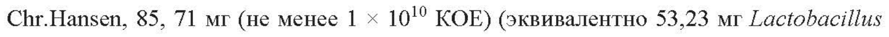

# Порошок, содержащий Lactobacillus rhamnosus GG — внутрь

- Препарат: Линекс® Протект (капсулы)
- АТХ: A07FA01
- Источник: ГРЛС, листок-вкладыш (ЕАЭС), РУ ЛП-№001542-(РГ-RU), файл от 2023-06-23 (https://grls.rosminzdrav.ru/Grls_View_v2.aspx?routingGuid=871f465f-185f-4385-be7d-4fad10134260)
- Распознано автоматически (OCR): 11 из 11 стр.
- Листок-вкладыш написан для пациента: полной инструкции по медицинскому применению и ОХЛП для этого препарата в открытом доступе нет
- Сомнительных строк после OCR: 1 (см. раздел «Проверка распознавания»)

## Общие сведения

ПП-№(001542)-1 КО) от 13.12.2022 СООТВЕТСТВУЕТ ЭКСПЕРТНОМУ ОТЧЕТУ от 09.12.2022 № 28547
(ПОСЛЕДОВАТЕЛЬНОСТЬ 0003)
ЛИСТОК-ВКЛАДЫШ — ИНФ®ОРМЬАНЕНЕЯ-НЕНЕЯННЕАЗНЕЯВЕНЕЕ
Линекс® Протект, 1 доза, капсулы Действующее вещество: Lactobacillus rhamnosus GG (LGG®), Chr.Hansen, не менее 1 х 1010
KOE* У Лекарственный препарат подлежит дополнительному мониторингу, который способствует быстрому выявлению новых сведений о безопасности. Вы можете помочь, сообщая информацию о любых нежелательных реакциях, которые возникли в период применения лекарственного препарата (в том числе и о случаях его неэффективности).
Способ сообщения о нежелательных реакциях описан в разделе 4 листка-вкладыша.
Перед приемом препарата полностью прочитайте листок-вкладьши, поскольку в нем содержатся важные для Вас сведения.
® Всегда принимайте препарат в точности с данным листком или рекомендациями лечащего врача или работника аптеки.
® Сохраните листок-вкладыш. Возможно, Вам потребуется прочитать его еще раз.
e Если Вам нужны дополнительные сведения или рекомендации, обратитесь к врачу или работнику аптеки.
e Bam следует обратиться к врачу, если Вы не почувствуете себя лучше или почувствуете себя хуже через 2 дня после начала приема препарата.
® Если у Вас возникли какие-либо нежелательные реакции, обратитесь к лечащему врачу, работнику аптеки или медицинской сестре. Данная рекомендация распространяется на любые возможные нежелательные реакции, в том числе на не перечисленные в разделе 4 листка-вкладыша.
СОДЕРЖАНИЕ ЛИСТКА-ВКЛАДЫША
1. Что из себя представляет препарат Линекс® Протект, и для чего его применяют.
2. О чем следует знать перед приемом препарата Линекс® Протект.
3. Прием препарата Линекс® Протект.
1 из 11 СООТВЕТСТВУЕТ ЭКСПЕРТНОМУ ОТЧЕТУ от 09.12.2022 № 28547
(ПОСЛЕДОВАТЕЛЬНОСТЬ 0003)
4. Возможные нежелательные реакции.
5. Хранение препарата Линекс® Протект.
6. Содержимое упаковки и прочие сведения.
* КОЕ: колониеобразующие единицы, единица измерения жизнеспособных лактобактерий на капсулу.

## 4.1. Показания к применению (листок-вкладыш, раздел 1)

ЕГО ПРИМЕНЯЮТ

Препарат Линекс® Протект — это пробиотик, то есть препарат, содержащий микроорганизмы, которые при попадании в организм в достаточном количестве оказывают благоприятное воздействие на организм человека в результате нормализации состава и
(или) повышения биологической активности нормальной микрофлоры кишечника. Он содержит наиболее изученный и известный штамм пробиотических бактерий: Lactobacillus rhamnosus GG (LGG®), Chr.Hansen. Этот штамм является нормальной составляющей естественной микрофлоры кишечника, выделен из кишечника здорового человека и не является генетически модифицированным.
Бактерии, в том числе лактобактерии, обычно находятся в тонком и толстом кишечнике, поддерживают кислотно-щелочной баланс, необходимый для нормального пищеварения и работы кишечника (перистальтики). Они вырабатывают питательные вещества и создают оптимальную среду, необходимую для клеток кишечника. Кроме того, они помогают переваривать компоненты пищевых продуктов, например, лактозу. Они необходимы для становления и функционирования иммунной системы и препятствуют чрезмерному росту вредных бактерий.
Lactobacillus rhamnosus GG (LGG®), Chr. Hansen помогают в восстановлении и поддержании физиологического баланса микрофлоры кишечника, их действие было доказано BO многих клинических исследованиях.

2 из 11 СООТВЕТСТВУЕТ ЭКСПЕРТНОМУ ОТЧЕТУ от 09.12.2022 № 28547
(ПОСЛЕДОВАТЕЛЬНОСТЬ 0003)
В состав препарата Линекс® Протект входят SerpibtesredwEsnpenantnte-Sarerep Pree высушенные при низкой температуре). В связи с этим возможно хранение препарата при комнатной температуре без изменения активности бактерий.
Бактерии Lactobacillus rhamnosus GG (LGG®), Chr.Hansen устойчивы к воздействию пищеварительных соков, что позволяет им выживать при прохождении через желудок и двенадцатиперстную кишку. Бактерии оживают в кишечнике, где они могут прикрепляться к поверхности слизистой оболочки и действовать в течение определенного времени.
Показания к применению Препарат Линекс® Протект применяют для профилактики и комплексного лечения антибиотик-ассоциированной диареи у взрослых (диареи, связанной с приемом антибиотиков).
2. О ЧЕМ СЛЕДУЕТ ЗНАТЬ ПЕРЕД ПРИЕМОМ ПРЕПАРАТА ЛИНЕКС®
ПРОТЕКТ Противопоказания Не принимайте препарат Линекс® Протект:
e если у Вас аллергия на действующее вещество или другие компоненты препарата
(перечисленные в разделе 6 листка-вкладыша);
e ссли у Вас есть наследственная непереносимость фруктозы, дефицит сахаразы, изомальтазы или глюкозо-галактозная мальабсорбция;
e сслиу Вас диабет;
e ссли у Вас иммунодефицит, в том числе вызванный применением лучевой и химиотерапии;
e ссли Вам проводились хирургические операции на органах желудочно-кишечного тракта (ЖКТ);
e сслиу Вас есть воспалительные заболевания кишечника, Целиакия или панкреатит;
e ecu y Вас синдром повышенной проницаемости кишечника;
® если у Вас синдром раздраженного кишечника;
3 из 11 СООТВЕТСТВУЕТ ЭКСПЕРТНОМУ ОТЧЕТУ от 09.12.2022 № 28547
(ПОСЛЕДОВАТЕЛЬНОСТЬ 0003)
e если Вы младше 18 лет.

## 4.4. Особые указания и меры предосторожности

Особые указания и меры предосторожности Перед приемом препарата Линекс® Протект проконсультируйтесь с лечащим врачом или работником аптеки если у Вас отмечаются следующие состояния:

® Томпература тела выше 38 °С;
® следы крови или слизи в стуле;
® диарея длительностью более двух суток;
® выраженная диарея с обезвоживанием и снижением массы тела;
® диарея в сочетании с сильной болью в животе;
® диарея на фоне других тяжелых сопутствующих состояний (тяжелое заболевание, наличие структурных заболеваний сердца, установленный центральный венозный катетер);
® ослабленный иммунитет (например, при ВИЧ-инфекции ИЛИ иммуносупрессивной терапии);
® применение кортикостероидов;
® нарушение кишечного барьера (в том числе в послеоперационный период);
® синдром повышенной проницаемости кишечника.
При лечении диареи абсолютно необходимо восполнение потерянной жидкости и электролитов.
Дети и подростки Не давайте препарат детям в возрасте до 18 лет, поскольку безопасность и эффективность применения препарата Линекс® Протект у детей и подростков до 18 лет не установлены.

## 4.5. Другие препараты и данный препарат (взаимодействие)

Другие препараты и препарат Линекс® Протект 4 из 11

СООТВЕТСТВУЕТ ЭКСПЕРТНОМУ ОТЧЕТУ от 09.12.2022 № 28547
(ПОСЛЕДОВАТЕЛЬНОСТЬ 0003)

Сообщите лечащему врачу или работнику ав о том--чте- Выё-нр лаете, недавно принимали или можете начать принимать какие-либо другие препараты.
Исследования лекарственного взаимодействия не проводились.
Подобно другим бактериям, лактобактерии чувствительны к антибиотикам. При одновременном применении с антибиотиками рекомендуется принимать препарат Линекс®
Протект не ранее чем через 3 часа после приема антибиотиков.
Препарат Линекс® Протект с напитками и алкоголем
Препарат Линекс® Протект не следует запивать фруктовыми соками, алкоголем или горячими напитками.

## 4.6. Беременность и грудное вскармливание

Беременность и грудное вскармливание Если Вы беременны или кормите грудью, думаете, что забеременели, или планируете беременность, перед началом применения препарата проконсультируйтесь с лечащим врачом.

В случае возникновения острой диареи во время беременности и кормления грудью необходимо соблюдать особые меры предосторожности с целью предотвращения дефицита жидкости и электролитов, а также других нежелательных реакций, которые могут угрожать здоровью плода или беременной женщины. Лечение диареи у беременных и кормящих грудью женщин должно проводиться под медицинским наблюдением.

## 4.7. Управление транспортными средствами и работа с механизмами

Управление транспортными средствами и работа с механизмами

Препарат Линекс® Протект не оказывает или оказывает несущественное влияние на способность управлять транспортными средствами и работать с механизмами, а также на другие виды деятельности, требующих повышенной концентрации внимания.
Препарат Линекс® Протект содержит сахарозу и мальтодекстрин. Если у Вас есть редкие наследственные заболевания, связанные с непереносимостью галактозы, врожденной недостаточностью лактазы или мальабсорбцией глюкозы и галактозы, то Вы не должны принимать этот препарат.

5 из 11 СООТВЕТСТВУЕТ ЭКСПЕРТНОМУ ОТЧЕТУ от 09.12.2022 № 28547
(ПОСЛЕДОВАТЕЛЬНОСТЬ 0003)
Декстрозный эквивалент (DE) мальтодекстриНеееетавяет-=Е3-ЕБретарат-еоерэюине-НЕЗЭ-мЕР глюкозы в одной капсуле.
Если у Вас непереносимость некоторых сахаров, обратитесь к лечащему врачу перед приемом данного препарата.
Данный препарат содержит менее 1 ммоль (23 мг) натрия в одной капсуле и, таким образом, фактически не содержит натрия.

## 4.2. Способ применения и дозы (листок-вкладыш, раздел 3)

Всегда принимайте препарат в полном соответствии с указаниями данного листкавкладыша или в полном соответствии с рекомендациями лечащего врача. При появлении сомнений посоветуйтесь с лечащим врачом.

e Линекс® Протект предназначен для приема внутрь.

e Препарат Линекс® Протект следует принимать во время еды для обеспечения максимальной эффективности лекарственного препарата.

e Препарат Линекс® Протект следует принимать не менее чем через 3 часа после приема антибиотиков (см. раздел «Другие препараты и препарат Линекс®
Протект»).

e Линекс® Протект не следует запивать алкоголем, фруктовыми соками или горячими напитками.

e При самостоятельном лечении диареи необходимо возмещение потерянной жидкости и электролитов.

e Если симптомы диареи не исчезают в течение 2 дней или усугубляются или появляются новые симптомы, то Вам необходимо проконсультироваться с врачом.

Режим дозирования и продолжительность лечения
Взрослые: 1 капсула 2 раза в день при профилактике и комплексном лечении антибиотикассоциированной диареи с 1-ого дня приема антибиотиков и на протяжении всего курса.

6 из 11 СООТВЕТСТВУЕТ ЭКСПЕРТНОМУ ОТЧЕТУ от 09.12.2022 № 28547
(ПОСЛЕДОВАТЕЛЬНОСТЬ 0003)
Путь и (или) способ введения Препарат Линекс Протект® предназначен для приема внутрь.
Препарат Линекс® Протект следует принимать во время еды для обеспечения максимальной эффективности лекарственного препарата.
® Препарат Линекс ” Протект не следует принимать натощак.
Препарат Линекс® Протект не следует запивать фруктовыми соками, алкоголем или горячими напитками.

## 4.9. Передозировка

Если Вы приняли препарата Линекс® Протект больше, чем следовало

Случаи передозировки не зарегистрированы.
Если после превышения дозы у Вас возникли нежелательные реакции, пожалуйста, обратитесь к Вашему врачу или работнику аптеки.
Если Вы забыли принять Линекс® Протект Не принимайте двойную дозу для восполнения пропущенной дозы. Продолжайте лечение в соответствии с назначением.
При наличии вопросов по применению препарата обратитесь к Вашему лечащему врачу, работнику аптеки или медицинской сестре.

## 4.8. Нежелательные реакции

Подобно всем лекарственным препаратам, данный препарат может вызывать нежелательные реакции, однако они возникают не у всех.
Возможные нежелательные реакции, которые могут быть признаком инфекции и заражения
Частота неизвестна (частоту возникновения невозможно оценить по имеющимся данным):

e бактериемия (наличие бактерий в крови);

® сепсис (нарушение ответа организма на инфекцию);

® эндокардит (воспаление внутренней оболочки сердца).

7 из 11 СООТВЕТСТВУЕТ ЭКСПЕРТНОМУ ОТЧЕТУ от 09.12.2022 № 28547
(ПОСЛЕДОВАТЕЛЬНОСТЬ 0003)
Данные нежелательные реакции HaO IO AUCh—y-HehHeHnPrep—e~Oripe Nese HHbINH —Panero pan риска (см. раздел 2).
Возможные нежелательные реакции, которые могут быть признаком нарушений иммунной системы
Частота неизвестна (частоту возникновения невозможно оценить по имеющимся данным):
® аллергическая сыпь;
® крапивница.
Возможные нежелательные реакции, которые могут быть признаком нарушения обмена веществ
Частота неизвестна (частоту возникновения невозможно оценить по имеющимся данным):
e -лактоацидоз (дефицит инсулина вместе с регулярным накоплением в крови молочной кислоты).
Наблюдалось у пациентов с синдромом короткой кишки и пороками развития желудочнокишечного тракта (см. раздел 2).
Сообщение о нежелательных реакциях Если у Вас возникают какие-либо нежелательные реакции, сообщите об этом врачу, работнику аптеки или медицинской сестре. Данная рекомендация распространяется на любые возможные нежелательные реакции, в том числе на не перечисленные в листкевкладыше. Вы также можете сообщить о нежелательных реакциях в информационную базу данных по нежелательным реакциям (действиям) на лекарственные препараты, включая сообщения о неэффективности лекарственных препаратов, выявленным на территории государств — членов Евразийского экономического союза. Сообщая о нежелательных реакциях, вы помогаете получить больше сведений о безопасности препарата:
Российская Федерация 109012, Москва, Славянская площадь, д. 4, стр. 1
Федеральная служба по надзору в сфере здравоохранения (Росздравнадзор)
Телефоны: +7 (495) 698-45-38, +7 (499) 578-02-30
Факс: +7 (495) 698-15-73 E-mail: pharm@roszdravnadzor. gov.ru www.roszdravnadzor.gov.ru 8 из 11
СООТВЕТСТВУЕТ ЭКСПЕРТНОМУ ОТЧЕТУ от 09.12.2022 № 28547
(ПОСЛЕДОВАТЕЛЬНОСТЬ 0003)
Республика Беларусь 220037, г. Минск, Товарищеский пер., 2а
РУП «Центр экспертиз и испытаний в здравоохранении»
Телефон/факс отдела фармаконадзора: +375 (17) 242-00-29
E-mail: repl@rceth.by www.rceth. by Республика Казахстан 010000, г. Нур-Султан, ул. А. Иманова, д. 13 (4 этаж)
PIII на ПХВ «Национальный центр экспертизы лекарственных средств и медицинских изделий» Комитета медицинского и фармацевтического контроля Министерства здравоохранения Республики Казахстан
Департамент фармаконадзора и мониторинга безопасности, эффективности и качества медицинских изделий
Телефон: +7 (7172) 78-98-28 E-mail: pdle@dari.kz www.ndda.kz

## 6.4. Хранение

Храните препарат в недоступном и невидном для детей месте.
Не принимайте данный лекарственный препарат после истечения срока годности, указанного на упаковке после надписи: «Годен до». Датой истечения срока годности является последний день месяца.
Хранить при температуре не выше 25°, в оригинальной упаковке (блистер в картонной пачке).
Не выбрасывайте лекарственные препараты в канализацию вместе с бытовыми отходами.
Обратитесь к работнику аптеки для получения указаний по утилизации остатков 9 из 11
СООТВЕТСТВУЕТ ЭКСПЕРТНОМУ ОТЧЕТУ от 09.12.2022 № 28547
(ПОСЛЕДОВАТЕЛЬНОСТЬ 0003)
лекарственных препаратов. Соблюдение эт мер осторожности CHOCOGCTBY CT заните окружающей среды.

## 6.5. Содержимое упаковки и прочие сведения

Препарат Линекс® Протект содержит:

e Действующее вещество: порошок, содержащий Lactobacillus rhamnosus GG (LGG*),
Chr.Hansen, 85, 71 мг (не менее 1 х 10'° KOE) (эквивалентно 53,23 mr Lactobacillus rhamnosus).

e Вспомогательные вещества: содержимое капсулы - сахароза, натрия аскорбат, мальтодекстрин, кремния диоксид, магния стеарат, оболочка капсулы - гипромеллоза, титана диоксид (Е 171), камедь геллановая, вода.

Внешний вид препарата Линекс® Протект и содержимое упаковки
Линекс® Протект — капсулы с белыми или почти белыми корпусом и крышечкой, заполненные порошком от белого до светло-коричневого цвета.
Препарат Линекс® Протект доступен в блистере из алюминия, помещенном в картонную пачку, содержащую по 1, 2, 3, 4, 6, 8 блистеров по 7 капсул вместе с листком-вкладышем.
Держатель регистрационного удостоверения и производитель
Держатель РУ: Сандоз д.д., Веровшкова 57, 1000 Любляна, Словения
Телефон: +386 1 580 2111 Факс: +386 1 568 3517
Эл. почта: info.sandoz@sandoz.com Производитель, фасовщик, упаковщик:
Лек д.д., Колодворска 27, 1234 Менгеш, Словения.
Выпускающий контроль качества:
Лек д.д., Веровшкова 57, 1526 Любляна, Словения.
10 из 11 от 09.12.2022 № 28547 (ПОСЛЕДОВАТЕЛЬНОСТЬ 0003)

За любой информацией о препарате, а MAKICC~C~ERYAAC-COSHARMOCENUA-TPICMEN SN CREO PE обращаться к локальному представителю держателя регистрационного удостоверения:
Российская Федерация АО «Сандоз», 125315, г. Москва, Ленинградский проспект, д. 70;
Телефон: +7 (495) 660-75-09;
Факс: +7 (495) 660-75-10.
E-mail: drug.safety_russia@novartis.com Республика Беларусь
Представительство АО «Сандоз Фармасьютикалз д. д.» (Словения) в Республике Беларусь 220141, г. Минск, ул. Академика Купревича, д. 3, помещение 49;
Телефон: +375 (17) 370-16-20;
Факс: +375 (17) 370-16-21.
E-mail: drugsafety.cis@novartis.com Республика Казахстан
Представительство акционерного общества «Сандоз Фармасьютикалс д.д.» в Республике
Казахстан Республика Казахстан, г. Алматы, 050000, ул. Курмангазы, д. 95;
Телефон: +7 (727) 258-24-47.
E-mail: drugsafety.cis@novartis.com Листок-вкладьши пересмотрен
Прочие источники информации Подробные сведения о лекарственном препарате содержатся на веб-сайте Союза:
http://eec.eaeunion. org/

11 из 11
## Проверка распознавания

Страницы-сканы распознаны автоматически. В 1 строках с дозировками цифры могли распознаться с ошибкой — сверьте с вырезкой из оригинала:

- стр. 10: «Chr.Hansen, 85, 71 мг (не менее 1 х 10'° KOE) (эквивалентно 53,23 mr Lactobacillus» — повторное чтение: «Chr.Hansen, 85, 71 мг (не менее 1 х 10° KOE) (эквивалентно 53,23 мг Lactobacillus»  
  
