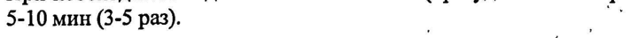

# Проксиметакаин — глаза

- Препарат: Алкаин® (капли глазные;)
- АТХ: S01HA04
- Источник: ГРЛС, инструкция по медицинскому применению, РУ П N012071/01, файл от 2023-06-19 (https://grls.rosminzdrav.ru/Grls_View_v2.aspx?routingGuid=e885cc56-9f97-495c-8d2f-4fd6265f875c)
- Распознано автоматически (OCR): 3 из 3 стр.
- Инструкция к другому РУ того же препарата: П N012071/01 (исключено из реестра, решение от 16.06.2023). Текст может быть старше действующего
- Сомнительных строк после OCR: 1 (см. раздел «Проверка распознавания»)

## Общие сведения

ви р НЕЕ ‘iy “e " wot П NO12071/01-180512
*.... МИНИСТЕРСТВО ЗДРАВООХРАНЕНИЯ И СОЦИАЛЬНОГО РАЗВИТИЯ й
: rr И .` * POCCHMCKOM ФЕДЕРАЦИИ / `’,. и ge
* | | . ~ | `^ | = ы й a | . у | , ‘ у ‘ aif " . |
"by “. , cu a ‘ om ‘ ‘c в _ my ’ р у ty we, ng 4 Paw fg be . oF Gly ay, re , ' р
° по применению лекарственного препарата для медицинского применения. ‚ ‘о
АЛКАИН® | ALCAINE® Регистрационный номер:
Торговое название: Алкаин® Международное непатентованное название (МНН): Проксиметакаин . .
® ’ Лекарственная форма: капли глазные pee
, ‚ . , у „ = Состав 1 мл раствора:
Активное вещество:
‚ проксиметакаина гидрохлорид 5,0 мг .
Вспомогательные вещества: бензалкония. хлорид, раствор, эквивалентно бензалкония .
.’, * _ хлориду 0,1 мг; глицерол 24,5 мг; хлористоводородная кислота концентрированная и/или .}
‚! 2х `_ натрия гидроксид q.s.; вода очищенная до | мл. (`` et, a oot . = Z т as Of he j ‘ты . =‘ ; й ож 1, . ;
, ; vt _ . ' в a , ve , ны x - sat i Описание: прозрачный раствор oT бесцветного до слегка желтоватого или слегка °F °’ желтовато-коричневатого цвета. ` LO
Фармакотерапевтическая группа: местноанестезирующее средство.
Код ATX: 501НАО4.
@. Фармакологические свойства’ Проксиметакаин`— местный анестетик из группы сложных эфиров для‘ применения в офтальмологии. Действие обычно развивается. через 30 секунд после инстилляции. и т, - продолжается около 15 минут. | 5 me ’ ' ‚о oO ‘TIpoxcumMetakavH угнетает ‘проницаемость клеточных мембран для ионов натрия, что + '
, ’’, ‚ препятствует генерации импульсов в нервных окончаниях и проведению импульсов по | 8 ‘' * нервным волокнам: ‘ег они И a р 4 = vay г ¥ pote бе кт се, й у а
"А. ‚ Фармакокинетика „г Ти я ии ет К и. '’ ‚. После инстилляции в’глаз быстро‘абсорбируется через конъюнктивальные капилляры и `. .
есь ‘гидролизуется. эстеразами. плазмы.' Выводится. почками в виде неактивных продуктов .
‚- расщепления. ’' ` о” о“ | Показания к применению
Местная анестезия в офтальмологии для проведения кратковременных диагностических и лечебных процедур, требующих быстрой и кратковременной анестезии: операции по
Pe удалению катаракты, удалению шовной нити из роговицы или конъюнктивы; тонометрия,
{ $ Е i * as : IT NO12071/01-180512 ‚ гониоскопия; ' удаление инородных тел из роговицы; конъюнктивальный соскоб для _ 2: 1 4.5, диагностических целей: °, И р р, | И их we ty : , , a ‚ mk a о де’ ' i i зо“ ^ Противопоказания , И er ee ee | i ; м Гиперчувствительность к компонентам препарата. = ‘i ta Ue И, . р |

## 4.2. Способ применения и дозы

Местно.
При выполнении тонометрии и других непродолжительных процедур закапывают 1-2 капли, непосредственно перед процедурой. При необходимости можно увеличить дозу. Для небольших хирургических процедур (удаление инородного тела или удаление шовной нити) закапывают 1-2 капли каждые 5-10 мин (1-3 раза).
При необходимости длительной анестезии (при удалении катаракты) - 1-2 капли каждые 5-10 мин (3-5 раз). . 7

## 4.3. С осторожностью

, ` "3 , Назначают с осторожностью пациентам с аллергическими реакциями, эпилепсией, ‚ eS заболеваниями сердца, гипертиреозом и нарушениями дыхания; пациентам, страдающим миастенией gravis, пациентам с низким содержанием ацетилхолинэстеразы в плазме, а также пациентам, проходящим лечение ингибиторами холинэстеразы (т.к. они больше подвержены риску системных нежелательных реакций), детям до 18 лет (т.к.
, ` "3 , Назначают с осторожностью пациентам с аллергическими реакциями, эпилепсией, ‚ eS заболеваниями сердца, гипертиреозом и нарушениями дыхания; пациентам, страдающим миастенией gravis, пациентам с низким содержанием ацетилхолинэстеразы в плазме, а также пациентам, проходящим лечение ингибиторами холинэстеразы (т.к. они больше подвержены риску системных нежелательных реакций), детям до 18 лет (т.к.
достаточного опыта по применению препарата у детей нет).
‚ „ Передозировка.’ “ ›. И о 7 ; ’ i « ‘, При попадании в глаза`избыточного количества препарата рекомендуется промыть глаза о mot ` ^ теплой водой. ‘а: аи : ЗИ ГОР
`, И При развитии токсических реакций в случае передозировки или гиперчувствительности, ~~ | ,.
4 ‚ рекомендуется успокоить пациента, поддерживать вентиляцию ‘легких и дыхание путем os о введения кислорода. При возникновении судорог можно внутривенно ввести барбитураты короткого действия или диазепам. В случае недостаточности кровообращения назначают внутривенно вазопрессорные препараты, такие как эфедрин и метараминол.

## 4.8. Побочное действие

Местное. В 1-10% случаев: зуд, жжение глаз, гиперемия конъюнктивы.
Местное. В 1-10% случаев: зуд, жжение глаз, гиперемия конъюнктивы.
@: В 0,1-1% случаев: сразу же после закапывания могут развиваться аллергические реакции
; немедленного типа, характеризующиеся развитием эпителиального кератита с
; формированием инфильтратов и 30H‘ HeKpo3a oNMTeNHA; диффузный стромальный. отек,
| и ва ‚ десцеметит, ирит. , т - * - soe, ;
м. Системное. В. 0,01-0,1% случаев системная токсичность, проявляется в возбуждении |
’ ">" "центральной нервной системы с последующим ее угнетением. . ‹` 7 ma
‚ ‚о _ Преходящее затуманивание‘ ‘зрения, ‚после закапывания. препарата; фотофобия; °°.
г, ‚ '. повышенное слезоотделение; инфекция: роговицы и/или помутнение роговицы ©’ * о длительной утратой зрения и, перфорацией роговицы, в- результате’ увеличения’ .’. |
} применяемого количества препарата (частота неизвестна).., “`` 21’ ° *, i о es у _ | р Fo & Г» | af _ er “4” ‘ :
‘ Взаимодействие с другими лекарственными препаратами° | р Данные по лекарственному взаимодействию отсутствуют. ‘ о

## 4.6. Применение при беременности и в период грудного вскармливания

: Достаточного опыта по применению препарата при беременности, во время кормления
5. грудью нет. Возможно применение при беременности, во время кормления грудью по ‘ i назначению лечащего врача, если ожидаемый лечебный эффект для матери превышает i é 5 a П NO12071/01-180512
- риск развития возможных побочных эффектов для плода или ребенка. , |
‘ a ``“ не F : И и Mea у ‘ у , | ‚ . `` Особые указания... + | о и. ` 2 , ‘ После хирургической: манипуляции: необходимо прикрыть, глаз , повязкой, ‘т.к. , ‘.
‘ "| ov. + "мигательный" рефлекс временно устранен; г 5. + А
` Препарат” Алкаин®' может использоваться! только ‘для местного. применения в * офтальмологии и не предназначен для инъекций.
Не рекомендуется использовать контактные линзы при применении препарата Алкаин®.
Длительное использование препарата Алкаин® может снизить продолжительность | эффекта и потребовать увеличения количества препарата, необходимого для достижения | желаемого анестетического эффекта. В течение всего периода анестезии следует | предохранять глаз от попадания в него раздражающих веществ, инородных тел, а также | не следует тереть глаз пока He пройдет действие анестетика. |
При развитии симптомов гиперчувствительности или раздражении глаз следует
‘ прекратить использование препарата. | ., Флакон необходимо закрывать после каждого использования. Не следует прикасаться | у кончиком пипетки к глазу. ‘ р |
: _ e Влияние на способность к вождению автотранспорта и управление механизмами ys Если после применения препарата возникло кратковременное затуманивание зрения, не a рекомендуется управлять транспортными средствами и заниматься видами деятельности, |
\ - требующими повышенного внимания и реакции, до его восстановления.
we `Форма выпуска. >. в о И. от; Капли глазные 0,5%. ит, words op ah ae | ost“. По 15 Mm Bo флакон-капельницу «Droptainer™» из полиэтилена низкой плотности.
`..’”' 2 По 1 флакону c инструкцией по применению в пачку картонную... . 0°” и,
. ; , em м ys | ОВ a _ a poe ea Срок годности | ‚' | 30 месяцев. После вскрытия флакона препарат следует использовать в течение 4 недель. |
Не использовать после срока годности, указанного Ha упаковке. |

## 6.4. Условия хранения

При температуре от 2 до 8 °С в холодильнике, в недоступном для детей месте.
При температуре от 2 до 8 °С в холодильнике, в недоступном для детей месте.
@ Условия отпуска из аптек: по рецепту. |
И Наименование, адрес производителя лекарственного препарата и' адрес” места at производства лекарственного препарата: —,. а а а pe «с.а. Алкон-Куврер н.в.» *', то. сор © ‘ и РВ.
‘+, * В-2870 Пуурс, Бельгия. se) ‚т ОХ ООО но“ Владелец регистрации на территории Российской Федерации. | - 2 «5 - и too, OOO «Ankou Фармацевтика». «+, - a ee п"
; ` Anpéc компании OOO «Алкон Фармацевтика» и принятия претензий: “ * . 7", °
“weet 109004, Москва, ул. Николоямская, 54 ‘ ee
; Ten. (495) 961-13-33 :
’ SER OTBETCTAG .
4 | Ser “ хо ce ЮЗ) “Anon ON 3 eS - “Ak sft и
Представитель фирмы A 3) Fammacevtika” LIC is Буйко Е.Г.
Ё “> “a I >? MockBA * ed | = noc > ¢
## Проверка распознавания

Страницы-сканы распознаны автоматически. В 1 строках с дозировками цифры могли распознаться с ошибкой — сверьте с вырезкой из оригинала:

- стр. 2: «5-10 мин (3-5 раз). . 7» — низкая уверенность: «7» (13)  
  
