# Пролголимаб — парентерально

- Препарат: ФОРТЕКА® (концентрат для приготовления раствора для инфузий;)
- АТХ: L01FF08
- Источник: ГРЛС, инструкция по медицинскому применению, РУ ЛП-006173, файл от 2024-03-27 (https://grls.rosminzdrav.ru/Grls_View_v2.aspx?routingGuid=594e2ef6-ca2a-40c5-a8a0-3a68cff1e875)
- Распознано автоматически (OCR): 22 из 22 стр.
- Инструкция к другому РУ того же препарата: ЛП-006173 (национальное РУ, переоформленное по правилам ЕАЭС, решение от 21.03.2024). Текст может быть старше действующего
- Сомнительных строк после OCR: 12 (см. раздел «Проверка распознавания»)

## Общие сведения

от 19.03.2024 № 5283 МИНИСТЕРСТВО ЗДРАВООХРАНЕНИЯ РОССИЯ ЕКОЙФЕДЕВАТЕЯР?)
ИНСТРУКЦИЯ ПО МЕДИЦИНСКОМУ ПРИМЕНЕНИЮ ЛЕКАРСТВЕННОГО ПРЕПАРАТА
@MOPTEKA® Регистрационный номер:
Торговое наименование: DOPTEKA® Международное непатентованное наименование или группировочное наименование:
пролголимаб Лекарственная форма: концентрат для приготовления раствора для инфузий

## 2. Состав

1 мл концентрата содержит:
1 мл концентрата содержит:
действующее вещество: пролголимаб - 20 мг;
вспомогательные вещества: натрия ацетата тригидрат 1,742 мг, трегалозы дигидрат 100 мг, кислота уксусная ледяная до РН 5,0, вода для инъекций до 1,0 мл.
Описание Прозрачная или слегка опалесцирующая жидкость от бесцветного до светло-желтого цвета.
Фармакотерапевтическая группа Противоопухолевое средство - антитела моноклональные.
Код ATX: LO1XC42 Фармакологические свойства

## 5.1. Фармакодинамика

Механизм действия Пролголимаб представляет собой человеческое моноклональное антитело, специфически связывающее рецептор программируемой клеточной смерти PD-1 и блокирующее его взаимодействие с лигандами PD-L1 и PD-L2. Пролголимаб является иммуноглобулином изотипа IgGl гибрид лямбда-каппа с молекулярной массой около 149 кДа. Ес-фрагмент пролголимаба модифицирован с целью предотвращения цитотоксического действия на клетки-мишени, экспрессирующие PD-1.
Механизм действия Пролголимаб представляет собой человеческое моноклональное антитело, специфически связывающее рецептор программируемой клеточной смерти PD-1 и блокирующее его взаимодействие с лигандами PD-L1 и PD-L2. Пролголимаб является иммуноглобулином изотипа IgGl гибрид лямбда-каппа с молекулярной массой около 149 кДа. Ес-фрагмент пролголимаба модифицирован с целью предотвращения цитотоксического действия на клетки-мишени, экспрессирующие PD-1.
PD-1 — это белковый рецептор — контрольная точка иммунного ответа, который
Lft.100.1.RU.04.01 С. 1 от 19.03.2024 № 5283 ограничивает активность Т-лимфоцитов. | On холевы ХЧааИЙ М2 исиоЯвзовать сигнальный путь PD-1 для ингибирования Т-клеточного иммунного ответа. Пролголимаб представляет собой высокоаффинное антитело к PD-1 рецептору, при ингибировании которого осуществляется двойная блокада сигнального пути РО-1, включающего лиганды
PD-L1 и PD-L2 на опухолевых или иммунных клетках. В результате ингибирования связывания рецептора РО-| с его лигандами пролголимаб реактивирует опухольспецифичные цитотоксические Т-лимфоциты и, таким образом, реактивирует противоопухолевый иммунитет.

Клиническая эффективность

Эффективность препарата пролголимаб была изучена в рамках: клинического исследования (КИ) ПЛИ фазы BCD-100-2/MIRACULUM и КИ Ш фазы BCD-1003/DOMAJOR. В рамках КИ BCD-100-2/MIRACULUM эффективность пролголимаба изучалась у 126 пациентов с метастатической или нерезектабельной меланомой (включая пациентов с опухолями не кожной локализации). При медиане наблюдения 13,8 месяца
(95% ДИ, 13,2-14,7) медиана общей выживаемости для пациентов, получавших пролголимаб в дозовом режиме 1 мг/кг 1 раз в 2 недели, не была достигнута, 12-месячная общая выживаемость составила 74,60%. Медиана беспрогрессивной выживаемости составила 5,78 месяца для пациентов, получавших пролголимаб в дозовом режиме 1 мг/кг 1 раз в 2 недели, 12-месячная беспрогрессивная выживаемость составила 41,27%. У пациентов, получавших пролголимаб в качестве терапии | линии, медиана беспрогрессивной выживаемости составила 8,67 месяца. Параметр общей частоты ответа достиг 38,10% (7,94% полных ответов + 30,16% частичных ответов), при этом у пациентов, получавших пролголимаб в качестве терапии | линии, параметр общей частоты ответа составил 47,83%, контроль над заболеванием был достигнуту 65,22 % пациентов.

В рамках КИ Ш фазы BCD-100-3/DOMAJOR эффективность пролголимаба изучалась у 292 пациентов с метастатическим немелкоклеточным раком легкого. На момент среза данных
(25.05.2023) медиана общей выживаемости для пациентов, получавших пролголимаб в дозовом режиме 3 мг/кг 1 раз в 3 недели в комбинации с химиотерапией, не была достигнута
(соотношение рисков 0,51 (95% ДИ 0,35; 0,73)), 24-месячная общая выживаемость составила 60,20%. Медиана беспрогрессивной выживаемости составила 9,1 месяца
(соотношение рисков 0,58 (95% ДИ 0,42; 0,81)) для пациентов, получавших пролголимаб в дозовом режиме 3 мг/кг 1 раз в 3 недели, 24-месячная беспрогрессивная выживаемость составила 24,6%. Параметр общей частоты ответа достиг 51,50% (все ответы были представлены как частичные), контроль над заболеванием был достигнут у 79,80 % пациентов.

Lft.100.1.RU.04.01 C.2 СООТВЕТСТВУЕТ ЭКСПЕРТНОМУ ОТЧЕТУ от 19.03.2024 № 5283

## 5.2. Фармакокинетика

(Входящий МЗ №4272555)
(Входящий МЗ №4272555)
Фармакокинетические свойства пролголимаба были изучены у 241 пациента с метастатической или нерезектабельной меланомой, получавших препарат в дозовых режимах 1 мг/кг 1 раз в 2 недели, 3 мг/кг 1 раз в 3 недели или 250 мг 1 раз в 3 недели иу 292 пациентов с метастатическим немелкоклеточным раком легкого, получавших препарат в дозовом режиме 3 мг/кг 1 раз в 3 недели в комбинации с химиотерапией.
Не было обнаружено клинически значимых различий в фармакокинетике пролголимаба среди изученных показаний.
Сопоставимая эффективность и безопасность была показана при применении фиксированной дозы пролголимаба 250 мг 1 раз в 3 недели в сравнении с режимом применения 1 мг/кг 1 раз в 2 недели или 3 мг/кг 1 раз в 3 недели.
Всасывание Препарат ФОРТЕКА® вводится внутривенно, поэтому пролголимаб немедленно и полностью становится биодоступным.
Распределение В соответствии с ограниченным внесосудистым распределением, объем распределения пролголимаба в равновесном состоянии незначительный (примерно 3,9 л; коэффициент вариации (СУ): 88 %). Как и другие антитела, пролголимаб не связывается с белками плазмы специфичным путем.
Метаболизм Пролголимаб подвергается катаболизму неспецифичными путями, метаболизм препарата не отражается на его клиренсе.
Выведение Клиренс пролголимаба носит линейный характер при применении в дозовых режимах 1 мг/кг 1 раз в 2 недели, 3 мг/кг 1 раз в 3 недели или 250 мг 1 раз в 3 недели. Клиренс пролголимаба после первого введения составляет примерно 0,5 л/сутки (CV: 67%); среднее значение конечного периода полувыведения (Т!1/2) составляет примерно 14 дней (CV: 96%)
на фоне достижения равновесных концентраций.
Характеристики выведения пролголимаба не имеют признаков дозозависимости и являются типичными для препаратов на основе моноклональных антител. Минимальные концентрации (Cmin) препарата как в дозе 1 мг/кг, так и в дозах 3 мг/кг и 250 мг на протяжении многократных введений препарата не снижаются.
После первого введения максимальная концентрация препарата (Cmax) в режиме дозирования 1 мг/кг каждые 2 недели, в среднем, составляла 35078 нг/мл, площадь под кривой (АП Со-зз6+) - 5306962 нг/мл. Перед вторым введением минимальная концентрация
Lft.100.1.RU.04.01 C. 3 от 19.03.2024 № 5283 препарата (Сим) в режиме дозирования | мИкг каждые Вхнвяаний ВИеридИем2 заеавляла 9011 нг/мл.

После первого введения максимальная концентрация препарата (Cmax) в режиме дозирования 3 мг/кг каждые 3 недели, в среднем, составляла 82924 нг/мл, площадь под кривой (АЦ Со-504ч) — 14952949 нг/мл. Перед вторым введением минимальная концентрация препарата (Cmin) в режиме дозирования 3 мг/кг каждые 3 недели, в среднем, составляла 24411 нг/мл.
После первого введения максимальная концентрация препарата (Cmax) в режиме дозирования 250 мг каждые 3 недели, в среднем, составляла 106930 нг/мл (среднее геометрическое=СО). Период полувыведения после однократного применения составил 328,134+425,200 4, клиренс 11,519+11,769 мл/ч, константа скорости элиминации 0,00211+0,01623 ч". Максимальная концентрация после многократного применения
(Cmax,ss) — 208,994117,98, средняя концентрация (Cay,ss) — 96,19-62,11 мкг/мл.
Линейность/нелинейность Фармакокинетика пролголимаба при применении в дозовых режимах 1 мг/кг каждые 2 недели, 3 мг/кг каждые 3 недели и 250 мг каждые 3 недели носит линейный, пропорциональный дозе характер, что свидетельствует о возможном насыщении мишеньопосредованного клиренса.

## 4.1. Показания к применению

Меланома Препарат DOPTEKA® показан для лечения взрослых пациентов с нерезектабельной или метастатической меланомой.
Меланома Препарат DOPTEKA® показан для лечения взрослых пациентов с нерезектабельной или метастатической меланомой.
Немелкоклеточный рак легкого Препарат ФОРТЕКА® показан в комбинации с химиотерапией, включающей препарат платины и пеметрексед в качестве 1-й линии терапии у взрослых пациентов с метастатическим неплоскоклеточным немелкоклеточным раком легкого (НМРЛ) при отсутствии мутаций в генах эпидермального фактора роста (EGFR) или перестроек в гене киназы анапластической лимфомы (ALA).

## 4.3. Противопоказания

e Повышенная чувствительность к любому компоненту препарата.

e Возраст до 18 лет (в связи с отсутствием данных по эффективности и безопасности).

® Беременность и период грудного вскармливания.

e Почечная недостаточность тяжелой степени тяжести (препарат не исследовался в
Lft.100.1.RU.04.01 С. 4 СООТВЕТСТВУЕТ ЭКСПЕРТНОМУ ОТЧЕТУ от 19.03.2024 № 5283 данной популяции пациентов). (Входящий МЗ №4272555)
e Печеночная недостаточность средней и тяжелой степеней тяжести (препарат не

исследовался в данной популяции пациентов).

## 4.3. С осторожностью

® Тяжелые аутоиммунные заболевания в активной стадии, при которых дальнейшая
® Тяжелые аутоиммунные заболевания в активной стадии, при которых дальнейшая

активация иммунной системы может представлять потенциальную угрозу жизни.

## 4.6. Применение при беременности и в период грудного вскармливания

Женщины детородного возраста Женщины детородного возраста должны использовать надежные методы контрацепции во время лечения пролголимабом и в течение не менее 10 недель после введения последней инфузии пролголимаба.
Беременность Данные о применении препарата пролголимаб у беременных женщин отсутствуют.
Специальные исследования по изучению влияния препарата пролголимаб на репродуктивную функцию у животных не проводились, тем не менее, в рамках доклинических исследований было показано, что блокада сигнальной системы PD-1/PD-L1 приводит к повышению риска иммуноопосредованного отторжения развивающегося плода и его гибели.
Известно, что человеческий иммуноглобулин IgGl способен проникать через плацентарный барьер, следовательно, пролголимаб (являющийся 1201) может проникать от матери к развивающемуся плоду. Таким образом, не рекомендуется применение пролголимаба во время беременности, а также у женщин с сохранной репродуктивной функцией, не использующих надежных средств контрацепции, если клиническая польза не превышает возможные риски.
Период грудного вскармливания Нет данных о секреции пролголимаба в грудное молоко. Известно, что антитела (в т.ч.
IgG1) способны секретироваться в грудное молоко, следовательно, невозможно исключить риск для новорожденных детей и детей, находящихся на грудном вскармливании.
Решение о необходимости прекращения грудного вскармливания или прекращения применения пролголимаба следует принимать, учитывая пользу грудного вскармливания для ребенка и пользу терапии пролголимабом для женщины.
Если женщина принимает решение о лечении препаратом пролголимаб, ей следует рекомендовать отказаться от грудного вскармливания на период лечения и в течение как
Lft.100.1.RU.04.01 C.5 СООТВЕТСТВУЕТ ЭКСПЕРТНОМУ ОТЧЕТУ минимум 10 недель после последней инфузи препарата Буи НН6!3 №=42 72555)
Влияние на фертильность Клинические данные о возможном влиянии препарата DOPTEKA® на репродуктивную функцию отсутствуют.

## 4.2. Способ применения и дозы

Препарат предназначен для введения как в амбулаторно-поликлинических условиях, так и в стационаре. Лечение следует начинать и проводить под контролем квалифицированных и опытных врачей-онкологов.
Препарат предназначен для введения как в амбулаторно-поликлинических условиях, так и в стационаре. Лечение следует начинать и проводить под контролем квалифицированных и опытных врачей-онкологов.
Препарат DOPTEKA® следует вводить внутривенно (в/в) в виде инфузии длительностью 60 минут, при хорошей переносимости длительность инфузии может быть сокращена до 30 минут.
Рекомендованная доза препарата DOPTEKA® составляет:
Метастатическая или нерезектабельная меланома e 1 мг/кг 1 разв 2 недели или 250 мг 1 раз в 3 недели при применении в режиме монотерапии у пациентов с нерезектабельной или метастатической меланомой.
Метастатический немелкоклеточный рак легкого e З мг/кг 1 раз в 3 недели или 250 мг 1 раз в 3 недели при применении в комбинации с химиотерапией у пациентов с метастатическим — неплоскоклеточным немелкоклеточным раком легкого (НМРЛ).
Лечение препаратом ФОРТЕКА® должно проводиться до прогрессирования заболевания или развития непереносимой токсичности. Наблюдались атипичные ответы
(«псевдопрогрессирование», т.е. первоначальное кратковременное увеличение размера опухоли или небольшие новые очаги в течение первых нескольких месяцев с последующим уменьшением размера опухоли). Рекомендуется продолжать лечение клинически стабильных пациентов с начальными признаками прогрессирования заболевания до момента подтверждения прогрессирования заболевания.
Временная или полная отмена лечения Рекомендации по временной или полной отмене лечения препаратом пролголимаб описаны ниже (см. также раздел «Особые указания»).
Таблица 1. Рекомендации по модификации введения препарата DOPTEKA®
„реакция |= СТСАЕ v5.0 — aoe опосредованный уменьшения симптомов нежелательных пневмонит реакций до 0—1 степени тяжести. пневмонита
Lft.100.1.RU.04.01 C.6 СООТВЕТСТВУЕТ ЭКСПЕРТНОМУ ОТЧЕТУ от 19.03.2024 № 5283
_ Нежелательная | _ реакция | СТСАЕ V5.0
® 3 или 4 степени тяжести Отмена препарата без возобновления пневмонита
® рецидивирующий пневмонит 2 степени тяжести опосредованный или колита ‘уменьшения симптомов нежелательных колит реакций до 0-1 степени тяжести колита
®4 степень тяжести диареи или Отмена препарата без возобновления колита
®рецидивирующий колит 3 степени тяжести Иммуно- увеличение активности АСТ Прекратить применение препарата до опосредованный или АЛТ до 2 степени (от 3 доуменьшения симптомов нежелательных гепатит 5 раз выше ВГН), или реакций до 0—1 степени тяжести.
® увеличение концентрации общего билирубина до 2 степени (от 1,5 до 3 раз выше
ВГН ® увеличение активности АСТ Отмена препарата без возобновления или АЛТ > 3 степени (> 5 раз выше ВГН) или концентрации общего билирубина (> 3 раз выше ВГН)
© у пациентов с метастазами в | Отмена препарата без возобновления печень, начавших лечение с умеренной (2) степенью повышения АЛТ или АСТ, если повышение АЛТ или
АСТ> 50% относительно исходных значений сохраняется более 1 недели
Иммуно- 2 степень тяжести повышения |Прекратить применение препарата до опосредованные уровня креатинина (креатинин уменьшения симптомов нежелательных нефрит и почечная сыворотки >1,5 до <3 раз реакций до 0-1 степени тяжести нефрита дисфункция превышает ВГН
>3 степень тяжести повышения Отмена препарата без возобновления ровня креатинина (креатинин сыворотки > 3 раз превышает
ВГН Иммуно- Умеренная (2 степень) Отмена лечения до достижения контроля опосредованная надпочечниковой состояния посредством заместительной эндокринопатия недостаточности и гипофизит терапии
Lft.100.1.RU.04.01 C.7 СООТВЕТСТВУЕТ ЭКСПЕРТНОМУ ОТЧЕТУ от 19.03.2024 № 5283 реакция | eC TCAR 5.050 И
Тяжелая или Временно отменить лечение до уменьшения жизнеугрожающая (3 или 4 симптомов нежелательных реакций до 0-1 степень) надпочечниковой степени тяжести.
недостаточности или симптоматический гипофизит
Сахарный диабет | типа, Для пациентов с тяжелой (3 степень) или сопровождающийся жизнеугрожающей (4 степень) степенью гипергликемией >3 степени эндокринопатий, которые улучшаются до 2 тяжести (гликемии > 250 мг/дл СТепени тяжести или ниже и
ИЛИ контролируются при помощи 13,9 ммоль/л) или заместительной гормонотерапии, если она кетоацидозом показана, можно рассмотреть возможность продолжения лечения препаратом
Гипертироидизм >3 степени ФОРТЕКА® после снижения дозы тяжести глюкокортикостероидов, если это необходимо. В случае отсутствия улучшения терапия должна быть отменена.
Гипотироидизм Гипотироидизм может быть купирован посредством применения заместительной терапии без отмены терапии ФОРТЕКА®
Иммуно- Сыпь 3 степени тяжести Прекратить применение препарата до кожные реакции реакций до 0-1 степени тяжести
Сыпь 4 степени тяжести или Отмена препарата без возобновления подтвержденный синдром
Стивенса-Джонса или токсический эпидермальный некролиз реакции опосредованные возникшая) ‘уменьшения симптомов нежелательных нежелательные реакций до 0-1 степени тяжести.
реакции ® 4 степень тяжести Отмена препарата без возобновления
® Рецидивирующая 3-я степень тяжести ® Иммуно-ассоциированный энцефалит 2—4 степени тяжести
® Миокардит 3 или 4 степени тяжести ® Синдром Гийена-Барре 2—4 степени тяжести
® 2 или 3 степень тяжести при сохранении реакций несмотря на приостановку лечения или при невозможности снизить суточную дозу глюкокортикостероидов до эквивалентной 10 мг преднизолона.
Примечание: степень тяжести нежелательных реакций соответствует классификации
Национального онкологического института США (NCI-CTCAE, версия 5,0).
Lft.100.1.RU.04.01 С. 8 от 19.03.2024 № 5283

(Входящий МЗ №4272555)
Особые группы пациентов Дети Эффективность и безопасность препарата ФОРТЕКА® у детей младше 18 лет не установлена. Данные отсутствуют.
Пожилые пациенты (>65 лет)
Не сообщалось о различиях в безопасности или эффективности между пожилыми пациентами (>65 лет) и более молодыми пациентами (<65 лет). Коррекция дозы у пациентов пожилого возраста не требуется.
Пациенты с нарушением функции почек У пациентов с почечной недостаточностью легкой или средней степени тяжести коррекция дозы не рекомендуется. Лечение препаратом ФОРТЕКА® у пациентов с почечной недостаточностью тяжелой степени тяжести не проводилось.
Пациенты с нарушением функции печени У пациентов с печеночной недостаточностью легкой степени тяжести коррекция дозы не рекомендуется. Лечение препаратом ФОРТЕКА® у пациентов с печеночной недостаточностью средней или тяжелой степени тяжести не проводилось.
Приготовление и введение Подготовка препарата к введению должна проводиться в асептических условиях.
Перед введением концентрат во флаконе следует проверить (визуально) на предмет отсутствия механических примесей и изменения окраски.
Препарат ФОРТЕКА® используют после разведения. Для этого необходимое количество препарата из флакона переносят в емкость для инфузий, содержащую стерильный 0,9% раствор натрия хлорида или стерильный 5% раствор декстрозы. Концентрация препарата
ФОРТЕКА® в приготовленном растворе должна составлять от 0,5 до 10 мг/мл.
Приготовленный раствор перемешивают путем осторожного переворачивания емкости для инфузий во избежание пенообразования. Препарат ФОРТЕКА® не содержит консерванты. Приготовленный инфузионный раствор необходимо использовать немедленно.
Препарат не должен вводиться параллельно с другими растворами и препаратами. Если перед введением препарата пациенту проводилась другая инфузия, для введения препарата
MOPTEKA® должна быть приготовлена отдельная инфузионная система.
Начальную дозу препарата вводят в течение 60 минут в виде внутривенной инфузии. Если первая инфузия хорошо переносится, то вторую и все последующие инфузии можно проводить в течение 30 минут.
Lft.100.1.RU.04.01 С. 9 СООТВЕТСТВУЕТ ЭКСПЕРТНОМУ ОТЧЕТУ от 19.03.2024 № 5283
= 4 = 7 1 После приготовления раствора для инфузии (Входящий M3 №4272555)
Препарат ФОРТЕКА® не содержит консерванты. Приготовленный инфузионный раствор необходимо использовать немедленно. Если инфузионный раствор не был использован немедленно, приготовленный инфузионный раствор может храниться при комнатной температуре не более 24 часов. Приготовленный инфузионный раствор может также храниться при температуре от 2 °С до 8 °С, однако общее время от приготовления инфузионного раствора до завершения инфузии не должно превышать 24 часов. После хранения в холодных условиях флаконы с препаратом и/или приготовленный инфузионный необходимо нагреть до комнатной температуры перед использованием.

## 4.8. Побочное действие

Резюме нежелательных реакций
Резюме нежелательных реакций
Ниже приведены данные о частоте нежелательных реакций, выявленных при применении препарата ФОРТЕКА® в виде монотерапии или в комбинации с химиотерапией.
Нежелательные реакции представлены по частоте их регистрации: очень частые (> 10%), частые (> 1%, < 10%), нечастые (> 0,1%, < 1%), редкие (> 0,01%, < 0,1%), очень редкие (> 0,001%, < 0,01%), частота неизвестна (на основании имеющихся данных оценить невозможно).
‚ Системно-органный класс | Частота | Побочные реакции |
| Очень | анемия, лимфопения 1 частые | 'Нарушения со стороны Частые | нейтропения, лейкопения, — лимфоцитоз, |
‘крови и лимфатической | тромбоцитопения |
‚системы | боль в лимфатическом узле, лимфаденопатия, |
| Нечастые |лейкоцитоз, эозинофилия, MOHOLHTO3, |
О Нйтрофилия | 'Инфекционные и | | Нечастые пневмония |
‘паразитарные заболевания | — | | Очень | а 6 | гипертиреоз", гипотиреоз 1 частые | |
| Нарушения со стороны ии В. И и И | Р | Частые | тиреоидит | эндокринной системы М
| | гиперпролактинемия надпочечниковая |
| Нечастые — Pup . a | | | недостаточность |
| | Частые | головная боль, периферическая нейропатия” |
Нарушения сб стороны ———— 6 | repeat системы Нечастые |НАРУшение памяти, BHYTPHMO3T OBOE a a | _ _ кровоизлияние, головокружение |
Психические расстройства |Часто | бессонница |
'Нарушения со стороны т PY P Нечастые увеит
‘органов зрения | Нарушения со стороны | Частые _— _ гипертензия‘ | сосудв i Heutactaie (гиперемия |
Lft.100.1.RU.04.01 C. 10 СООТВЕТСТВУЕТ ЭКСПЕРТНОМУ ОТЧЕТУ от 19.03.2024 № 5283

EB МЗ 4272555) | 'Системно-органный класс |Частота Побочные реакциг
| | | | Частые тахикардия | Нарушения со стороны | сердцебиение, фибрилляция предсердий, | сердца Нечастые блокада левой ножки пучка Гиса, |
| | | кардиомиопатия, синусовая тахикардия
Sah ilies ena ee ты на ананый ~ ~~ eee ~ |
Нарушения со — стороны | Частые | пневмонит”, одышка |
| Ot Ce Ee органов дыхательной | | | системы, грудной клетки и | Нечастые отек ротоглотки, кашель |
| средостения | | Нарушения со стороны Частые диарея, тошнота, рвота, боль в животе, желудочно-кишечного колит”, запор |
Те ‘тракта |Нечастые | гастрит, полип толстой кишки, сухость во рту |
Нарушения со — стороны | | печени и желчевыводящих | Нечастые — гепатит“, печеночная недостаточность | путей о | |
| с именная НЕ:
Нарушения со стороны | | почек и мочевыводящих Нечастые нефрит”, протеинурия, лейкоцитурия |
| a | ем | И Частые сыпь“, зуд, | | Нарушения со стороны кожи в ООО
| и гипергидроз, кожная гиперпигментация, |
`и подкожной клетчатки Нечастые 4 | | витилиго, эритема, дерматит"
'Нарушения со стороны | > > | | мышечной, скелетной и Частые | артралгия, миозит°, скелетно-мышечная боль" | соединительной ткани | |
Св a ae a ae aes ae ‚ Общие нарушения и реакции | Частые | астения, повышение температуры тела, отек’.
в месте введения | озноб, гриппоподобное заболевание,
| Нечастые | | недомогание; |

п А а а а | 'Нарушения метаболизма и | Частые гипергликемия, снижение аппетита |
‘питания |Нечастые `гипоальбуминемия, сахарный диабет | типа |
ООО ci aman tant en ened | повышение уровня щелочной фосфатазы в.

| | | | | крови, повышение уровня амилазы, |
| повышение уровня аланинаминотрансферазы, |
| повышение уровня | | аспартатаминотрансферазы, повышение |
Частые | Уровня тиреотропного гормона в крови,

| | понижение уровня тиреотропного гормона в.
| крови, повышение уровня | | лактатдегидрогеназы в крови, повышение | овня билирубина, повышение OBHS |

Лабораторные и | УР PY у УР | креатинина крови, повышение уровня’

инструментальные данные | мочевины в крови, снижение веса |

nL it о ООО

| повышение международного | | | нормализованного отношения, повышение |
| уровня печеночных ферментов, повышение |
| уровня трансаминазы, повышение уровня’

| Нечастые — гамма-глутамилтрансферазы, укорочение |

| | активированного частичного | | тромбоплатинового времени, увеличение |

| активированного частичного |

| [Тромбопластинового времени — | Lfi.100.1.RU.04.01 С. 11
СООТВЕТСТВУЕТ ЭКСПЕРТНОМУ ОТЧЕТУ от 19.03.2024 № 5283 ый М 27255) —
Системно-органный класс Частота Побочные реакции
Доброкачественные, | | | ‘злокачественные и | | неуточненные Нечастые |кровоточащая опухоль
| новообразования (вкл. кисты | | и полипы | | а. Термин «гипертиреоз» является составным термином и включает в себя такие понятия как иммуноопосредованный гипертиреоз и гипертиреоз.
6. Термин «гипотиреоз» является составным термином и включает в себя такие понятия как иммуноопосредованный гипотиреоз и гипотиреоз.
В. Термин «тиреоидит» является составным термином и включает в себя такие понятия как аутоиммунный тиреоидит, иммуноопосредованный тиреоидит и тиреоидит;
Г. Термин «надпочечниковая недостаточность» является составным термином и включает в себя такие понятия как первичная надпочечниковая недостаточность и вторичная надпочечниковая недостаточность;
д. Термин «периферическая нейропатия» является составным термином и включает в себя такие понятия как парестезия, токсическая нейропатия и периферическая нейропатия.
е. Термин «гипертензия» является составным термином и включает в себя такие понятия как систолическая гипертензия, диастолическая гипертензия и гипертензия.
HK. Термин «пневмонит» является составным термином и включает в себя такие понятия как гиперчувствительный пневмонит, иммуноопосредованный пневмонит, пневмонит, аутоиммунное заболевание легких и иммуноопосредованное легочное заболевание.
3. Термин «боль в животе» является составным термином и включает в себя такие понятия как боль в верхних отделах живота, боль внизу живота и боль в животе.
И. Термин «колит» является составным термином и включает в себя такие понятия как иммуноопосредованный колит, энтероколит, иммуноопосредованный энтероколит и колит.
К. Термин «гепатит» является составным термином и включает в себя такие понятия как аутоиммунный гепатит, иммуноопосредованный гепатит и гепатит.
Л. Термин «нефрит» является составным термином и включает в себя такие понятия как иммуноопосредованный нефрит, острое повреждение почек и нефрит
М. Термин «сыпь» является составным термином и включает в себя такие понятия как папулезная сыпь, макулопапулезная сыпь, крапивница и сыпь.
H. Термин «дерматит» является составным термином и включает в себя такие понятия как акнеформный дерматит, дерматит аллергический и дерматит.
0. Термин «миозит» является составным термином и включает в себя такие понятия как миалгия, аутоиммунный миозит, иммуноопосредованный миозит, миозит и мышечная слабость.
п. Термин «скелетно-мышечная боль» является составным термином и включает в себя такие понятия как боль со стороны спины, боль в мышцах и костях грудной клетки, боль в костях и скелетно-мышечная боль.
р. Термин «отек» является составным термином и включает в себя такие понятия как периферический отек, распространенный отек, локальный отек, отек лица, периорбитальный отек и отек.
Ниже приведены нежелательные реакции, которые не отмечались у пациентов, получающих терапию препаратом ФОРТЕКА®, но отмечались при терапии другими препаратами того же класса, моноклональными антителами против РО-1 - пембролизумабом и ниволумабом. Учитывая одинаковый механизм действия, возможно возникновение описанных нежелательных реакций у пациентов, получающих терапию препаратом DOPTEKA®.
Нарушения со стороны крови и лимфатической системы
Нечастые: иммунная тромбоцитопеническая пурпура, гемолитическая анемия, эритроцитарная аплазия, гемофагоцитарный лимфогистиоцитоз;
Нарушения со стороны эндокринной системы
Нечастые: гипофизит, гипопитуитаризм;
Lft.100.1.RU.04.01 С. 12 СООТВЕТСТВУЕТ ЭКСПЕРТНОМУ ОТЧЕТУ
Нарушения со стороны нервной системы (Входящий МЗ №4272555)
Частые: вялость, дисгевзия;
Нечасто: эпилепсия;
Редкие: синдром Гийена-Барре, миастенический синдром, энцефалит, миелит, менингит
(асептический), неврит, паралич малоберцового нерва;
Нарушения со стороны органов зрения Частые: нечеткость зрения;
Нечастые: сухость глаз;
Редкие: синдром Фогта-Коянаги-Харада;
Нарушения со стороны сердечно-сосудистой системы
Нечастые: перикардиальный выпот, перикардит;
Редкие: миокардит;
Нарушения со стороны органов дыхательной системы, грудной клетки и средостения
Нечастые: плевральный выпот;
Нарушения со стороны желудочно-кишечного тракта
Частые: стоматит;
Нечастые: панкреатит, язвы желудочно-кишечного тракта, дуоденит;
Редкие: перфорация тонкой кишки;
Нарушения со стороны иммунной системы Частые: инфузионные реакции, гиперчувствительность;
Редкие: анафилактическая реакция;
Нечастые: саркоидоз;
Частота неизвестна: отторжение трансплантата солидного органа;
Нарушения со стороны кожи и подкожных тканей
Частые: тяжелые кожные реакции, сухость кожи, алопеция;
Нечастые: многоформная эритема, псориаз, экзема, лихеноидный кератоз, изменение цвета волос;
Редкие: токсический эпидермальный некролиз', синдром Стивена-Джонсона':
Нарушения со стороны скелетно-мышечной системы и соединительной ткани
Частые: артрит, боль в конечностях;
Нечастые: теносиновит, рабдомиолиз, синдром Шегрена;
Общие расстройства и нарушения в месте введения
Очень частые: утомляемость;
Нарушение метаболизма и питания:
Частые: гипонатриемия, гипокалиемия, гипокальциемия, дегидратация, гипогликемия;
Lft.100.1.RU.04.01 С. 13 СООТВЕТСТВУЕТ ЭКСПЕРТНОМУ ОТЧЕТУ от 19.03.2024 № 5283

Лабораторные отклонения (Входящий МЗ №4272555}
Очень частые: повышение активности липазы, гиперкальциемия, гипомагниемия;
Доброкачественные, злокачественные и неуточненные новообразования (вкл. кисты и полипы)
Редкие: гистиоцитарный некротизирующий лимфаденит (лимфаденит Кикучи);
Примечание ' _ Включая побочные реакции с летальным исходом.
Иммуногенность Иммуногенность препарата ФОРТЕКА® изучалась в рамках клинического исследования 1 фазы BCD-100-1 и клинического исследования ПЛИ фазы BCD-100-2/MIRACULUM, клинического исследования Ш фазы BCD-100-3/DOMAJOR y 428 пациентов. Исследование иммуногенности не выявило образования связывающих антител к препарату DOPTEKA® ни у одного из пациентов.

## 4.9. Передозировка

Клинические данные о передозировке препаратом DOPTEKA® отсутствует.
Клинические данные о передозировке препаратом DOPTEKA® отсутствует.
В случае передозировки необходимо проводить тщательный мониторинг пациентов в отношении признаков и симптомов нежелательных реакций и назначить соответствующее симптоматическое лечение.

## 4.5. Взаимодействие с другими лекарственными средствами

Потенциальное влияние других препаратов на воздействие препарата ФОРТЕКА®
Следует избегать применения системных глюкокортикостероидов ИЛИ иммунодепрессантов до начала терапии препаратом DOPTEKA®, учитывая их возможное влияние на фармакодинамическую активность и эффективность препарата ФОРТЕКА*.
Тем не менее, системные глюкокортикостероиды или другие иммунодепрессанты можно использовать после начала лечения препаратом ФОРТЕКА® для терапии иммуноопосредованных нежелательных реакции.
Потенциальное влияние препарата ФОРТЕКА® на действие других лекарственных препаратов
Специальных исследований фармакокинетического взаимодействия препарата ФОРТЕКА® с другими лекарственным и препаратами не проводили. Поскольку ФОРТЕКА* выводится из кровообращения за счет катаболизма, то не следует ожидать метаболических лекарственных взаимодействий.
Lft.100.1.RU.04.01 С. 14 СООТВЕТСТВУЕТ ЭКСПЕРТНОМУ ОТЧЕТУ
(Входящий МЗ №4272555)

## 4.4. Особые указания

Прослеживаемость В целях улучшения прослеживаемости биотехнологических лекарственных препаратов наименование и номер серии назначаемого лекарственного препарата DOPTEKA® должны указываться в медицинской документации пациента.
Прослеживаемость В целях улучшения прослеживаемости биотехнологических лекарственных препаратов наименование и номер серии назначаемого лекарственного препарата DOPTEKA® должны указываться в медицинской документации пациента.
Иммуноопосредованные нежелательные реакции
Лечение пациентов препаратом пролголимаб должно осуществляться только под контролем врача, имеющего опыт проведения противоопухолевой терапии. Ввиду своего механизма действия пролголимаб может способствовать развитию иммуноопосредованных нежелательных реакций, в том числе тяжелых и с последующим летальным исходом.
Пациенты должны находиться под наблюдением в течение длительного периода, поскольку нежелательные реакции, обусловленные применением пролголимаба, могут развиться в любое время в ходе терапии или после ее отмены. При подозрении на развитие иммуноопосредованной нежелательной реакции, требуется провести тщательную оценку состояния пациента для подтверждения иммунного генеза нежелательной реакции и исключения других возможных причин ее развития.
Иммуноопосредованные нежелательные реакции купируются посредством модификации терапии (на основании предписанных для пролголимаба критериев модификации терапии), заместительной гормональной терапией (только по клиническим показаниям), кортикостероидами или другими лекарственными средствами. В зависимости от степени тяжести нежелательной реакции терапию пролголимабом следует приостановить или отменить и назначить терапию глюкокортикостероидами.
Если для купирования нежелательного явления применялась иммуносупрессия кортикостероидами, отмену препарата по достижению улучшения состояния пациента
(снижения степени тяжести нежелательной реакции до | и менее степени тяжести) следует производить с постепенным снижением дозы, длящимся как минимум 1 месяц. Быстрое снижение дозы может привести к ухудшению состояния пациента, либо к рецидиву нежелательной реакции. Если состояние пациента на фоне терапии кортикостероидами не улучшается либо ухудшается, необходимо назначение дополнительной терапии другими иммунодепрессантами системного действия.
Не следует возобновлять введение препарата ФОРТЕКА® в период получения пациентом кортикостероидов, либо иных иммунодепрессантов в дозах, подавляющих иммунитет.
Информация по отдельным нежелательным реакциям, описанным ниже, основана на анализе профиля безопасности пролголимаба при применении у пациентов в рамках
Lft.100.1.RU.04.01 С. 13 СООТВЕТСТВУЕТ ЭКСПЕРТНОМУ ОТЧЕТУ от 19.03.2024 № 5283

клинических исследований [и П/ИШ фазы. (Входящий МЗ №4272555)
У пациентов, получавших препарат ФОРТЕКА®, отмечались иммуноопосредованные нежелательные реакции. Большинство иммуноопосредованных нежелательных реакций, наблюдавшихся в клинических исследованиях, были обратимы и контролировались посредством временной отмены применения препарата ФОРТЕКА*, применения глюкокортикостероидов и/или симптоматической терапии. Возможно развитие иммуноопосредованных нежелательных реакций, затрагивающих более одной системы органов одновременно. При подозрении на иммуноопосредованные нежелательные реакции требуется провести тщательную оценку с целью подтвердить иммунный генез и исключить другие возможные причины. Основываясь на тяжести нежелательной реакции, необходимо временно отменить применение препарата ФОРТЕКА® и назначить глюкокортикостероиды (см. ниже). С момента улучшения до | степени тяжести или менее начать постепенное уменьшение дозы глюкокортикостероидов и продолжить постепенное снижение в течение, по меньшей мере, 1 месяца. У пациентов, у которых иммуноопосредованные нежелательные реакции не поддаются контролю посредством применения глюкокортикостероидов, может быть рассмотрена возможность назначения других системных иммунодепрессантов. Возобновление применение препарата
ФОРТЕКА® возможно в случае, если выраженность нежелательной реакции остается | степени тяжести или менее после постепенного уменьшения дозы глюкокортикостероидов.
При возникновении другого эпизода нежелательной реакции тяжелой степени необходимо полностью прекратить применение препарата ФОРТЕКА® (см. «Способ применения и дозы» и «Побочное действие»).
Иммуноопосредованный пневмонит У пациентов, получавших препарат ФОРТЕКА*®, сообщалось о случаях развития пневмонита. Необходимо проводить активное наблюдение за пациентами в отношении признаков и симптомов пневмонита. К ним относятся изменения, выявляемые при рентгенологическим исследовании (например, очаговые затемнения по типу матового стекла, неоднородные инфильтраты), одышка и гипоксия. Должны быть исключены инфекционная этиология пневмонита, а также связанные с течением основного заболевания причины его развития Иммуноопосредованный пневмонит купируется посредством модификации терапии (на основании предписанных для пролголимаба критериев модификации терапии), кортикостероидами или другими лекарственными средствами
(инфликсимаб, внутривенные иммуноглобулины, микофенолата мофетил).
Терапию глюкокортикостероидами назначают при пневмоните 2 степени тяжести или выше
(начальная доза 1-2 мг/кг/сутки преднизона (или эквивалента) с последующим
Lft.100.1.RU.04.01 C. 16 СООТВЕТСТВУЕТ ЭКСПЕРТНОМУ ОТЧЕТУ постепенным уменьшением дозы). Временно ртменяют пражевений ен урана ФОРТЕКА*® при пневмоните 2 (умеренной) степени тяжести и полностью отменяют применение препарата ФОРТЕКА® при 3 (тяжелой) или 4 (жизнеугрожающей) степени тяжести пневмонита или рецидиве пневмонита 2 (умеренной) степени тяжести (см. «Способ применения и дозы»).

Иммуноопосредованный колит

У пациентов, получавших препарат ФОРТЕКА*, сообщалось о случаях развития колита.
Необходимо проводить активное наблюдение за пациентами в отношении признаков и симптомов колита. Иммуноопосредованный колит купируется посредством модификации терапии (на основании предписанных для пролголимаба критериев модификации терапии), кортикостероидами или другими лекарственными средствами (инфликсимаб).

Терапию глюкокортикостероидами назначают при 2 степени тяжести или выше (начальная доза 1-2 мг/кг/сутки преднизона (или эквивалента) с последующим постепенным уменьшением дозы). Временно отменяют применение препарата ФОРТЕКА® при 2
(умеренной) или 3 (тяжелой) степени тяжести колита и применение препарата ФОРТЕКА® полностью отменяют при колите 4 (жизнеугрожающей) степени тяжести (см. «Способ применения и дозы»).

Иммуноопосредованные эндокринопатии

У пациентов, получавших препарат ФОРТЕКА®, сообщалось о случаях развития недостаточной функции надпочечников. У пациентов, получавших препарат ФОРТЕКА*, также сообщалось о случаях развития гипофизита (см. «Побочное действие»). Необходимо проводить наблюдение за пациентами в отношении признаков и симптомов недостаточности функции надпочечников и гипофизита (включая гипопитуитаризм) и исключить другие причины. В случае появления вторичной надпочечниковой недостаточности назначают терапию глюкокортикостероидами или другую заместительную гормональную терапию в соответствии с клинической оценкой. Временно отменяют терапию препаратом ФОРТЕКА® в случае 2 (умеренной) степени тяжести недостаточности функции надпочечников или гипофизита до достижения полного контроля эндокринопатии посредством заместительной терапии. Полностью отменяют препарат ФОРТЕКА® при 3 (тяжелой) или 4 (жизнеугрожающей) степени тяжести недостаточности функции надпочечников или гипофизита (см. «Способ применения и дозы»). Необходимо проводить регулярный контроль функции гипофиза и уровень гормонов с целью обеспечения адекватной гормональной заместительной терапии.

У пациентов, получавших препарат ФОРТЕКА*, сообщалось о случаях развития сахарного диабета | типа, включая случаи развития диабетического кетоацидоза. Необходимо
Lft.100.1.RU.04.01 Е. 17 СООТВЕТСТВУЕТ ЭКСПЕРТНОМУ ОТЧЕТУ от 19.03.2024 № 5283

проводить наблюдение за пациентами в отношении гипебяяяаний ИА Neveu признаков и симптомов сахарного диабета. При сахарном диабете | типа назначают инсулин, а в случаях развития 3 (тяжелой) и более степени тяжести гипергликемии или кетоацидоза терапию препаратом ФОРТЕКА® временно отменяют до достижения контроля над метаболизмом (см. «Способ применения и дозы»).
У пациентов, получавших препарат ФОРТЕКА*, сообщалось о нарушениях со стороны щитовидной железы, включая гипертиреоз, гипотиреоз и тиреоидит; они могут развиться в любой момент времени на протяжении лечения. Исходя из этого, требуется наблюдение за пациентами в отношении изменения функции щитовидной железы (в начале лечения, периодически на протяжении терапии, а также на основании клинической оценки) и клинических признаков и симптомов нарушений функции щитовидной железы. Лечение гипотиреоза может осуществляться посредством заместительной терапии без прерывания лечения и без применения глюкокортикостероидов. При гипертиреозе возможно симптоматическое лечение. Временно или полностью отменяют терапию препаратом
ФОРТЕКА* при тяжелой (3) или жизнеугрожающей (4) степени тяжести гипертиреоза (см.
«Способ применения и дозы») до снижения степени тяжести гипертиреоза до | (легкой) и менее степени тяжести. Требуется проводить регулярный контроль функции сывороточных концентраций гормонов щитовидной железы с целью обеспечения надлежащей гормональной заместительной терапии.
У пациентов с тяжелой (3) или жизнеугрожающей (4) степенью тяжести эндокринопатии при улучшении до 2 или ниже степени тяжести и контроле посредством заместительной гормонотерапии при необходимости может рассматриваться продолжение применения препарат ФОРТЕКА*. В случае отсутствия улучшения терапию препаратом ФОРТЕКА® полностью отменяют.
Иммуноопосредованные кожные реакции У пациентов, получавших препарат ФОРТЕКА*, отмечались тяжелые формы сыпи и зуда.
Необходимо проводить активное наблюдение за пациентами на предмет предполагаемых тяжелых нежелательных реакций со стороны кожных покровов, а также следует исключить другие причины. Иммуноопосредованные нежелательные реакции со стороны кожных покровов купируются посредством модификации терапии (на основании предписанных для пролголимаба критериев модификации терапии), кортикостероидами или другими лекарственными средствами (смягчающее средство для местного применения, пероральный антигистаминный препарат, агонисты рецепторов ГАМК, апрепитант или омализумаб). Применение препарата ФОРТЕКА® следует приостановить при кожных реакциях 3 степени тяжести до разрешения до | (легкой) степени тяжести и отменить без
Lft.100.1.RU.04.01 С. 18 СООТВЕТСТВУЕТ ЭКСПЕРТНОМУ ОТЧЕТУ восстановления при 4 (жизнеугрожающей] степени ОНИ бин заАкциях тяжелой степени назначается лечение глюкокортикостероидами в дозе |-2 мг/кг/сутки преднизона (или аналогичная) с последующим постепенным уменьшением дозы. Препарат
ФОРТЕКА® следует назначать с осторожностью у пациентов, у которых ранее отмечались тяжелые или жизнеугрожающие нежелательные кожные реакции при лечении иными иммуностимулирующими противоопухолевыми препаратами.

Иммуноопосредованный гепатит

У пациентов, получавших препарат ФОРТЕКА®, сообщалось о случаях развития иммуноопосредованного гепатита. Необходимо проводить наблюдение за пациентами в отношении динамики функциональных печеночных проб (в начале лечения, периодически на протяжении терапии, а также на основании клинической оценки) и симптомов гепатита и исключить другие причины. Терапию глюкокортикостероидами назначают при гепатите 2 степени тяжести (начальная доза 0,5—1 мг/кг/сутки преднизона (или аналогичная) с последующим постепенным уменьшением дозы) и при гепатите 3 степени тяжести или выше (1-2 мг/кг/сутки преднизона или эквивалента с последующим постепенным уменьшением дозы). Временно или полностью отменяют применение препарата
ФОРТЕКА® в соответствии с уровнем повышения активности ферментов печени (см.
«Способ применения и дозы»).

Иммуноопосредованный нефрит

У пациентов, получавших препарат DOPTEKA®, сообщалось о случаях развития нефрита.
Необходимо проводить наблюдение за пациентами в отношении изменения функции почек и исключить другие причины. Терапию глюкокортикостероидами назначают при развитии нежелательных явлений 2 степени тяжести и выше (начальная доза 1-2 мг/кг/сутки преднизона (или аналогичная) с последующим постепенным уменьшением дозы). На основании степени тяжести повышения креатинина временно отменяют применение препарата ФОРТЕКА® в случае развития 2 (умеренной) степени тяжести нефрита и полностью отменяют применение препарата ФОРТЕКА® при 3 (тяжелой) или 4
(жизнеугрожающей) степени тяжести нефрита (см. «Способ применения и дозы»).

Другие иммуноопосредованные нежелательные реакции

При применении препаратов моноклональных антител против РО-| возможно развитие иных иммуноопосредованных нежелательных реакций: увеита, артрита, миозита, миокардита, панкреатита, синдрома Гийена-Барре, миастенического синдрома, гемолитической анемии, саркоидоза, энцефалита, миелита, васкулита, склерозирующего холангита, гастрита, неинфекционного цистита и гипопаратироидизма.

Lft.100.1.RU.04.01 C.19 от 19.03.2024 № 5283
При подозрении на развитие иммуноопоснедованных | pena sees bree ‘малтежащая оценка для подтверждения иммунной этиологии и исключения иных причин. В случае развития и подтверждения подозреваемой иммуноопосредованной реакции в зависимости от степени тяжести требуется временная приостановка применения препарата ФОРТЕКА® и назначение глюкокортикостероидов. В случае развития иммуноопосредованных нежелательных реакций 2 или 3 степени тяжести терапия препаратом ФОРТЕКА“ приостанавливается и назначаются глюкокортикостероиды. В случае развития миокаодита 3 степени тяжести, энцефалита или синдрома Гийена-Барре 2 степени тяжести, иных рецидивирующих иммуноопосредованных нежелательных реакций 3 степени тяжести или достижения 4 степени тяжести терапия препаратом ФОРТЕКА® прекращается без последующего возобновления.
При подозрении На миокардит необходимо незамедлительное назначение глюкокортикостероидов в высоких дозах (преднизон в дозе от 1 до 2 мг/кг/день или метилпреднизолон в дозе от | до 2 мг/кг/день), консультация кардиолога и диагностическое обследование в соответствии с действующими клиническими рекомендациями. При подтверждении диагноза миокардита 3 или 4 степени тяжести терапия препаратом
ФОРТЕКА*® должна быть отменена без последующего возобновления.
Инфузионные реакции В рамках клинических исследований препарата ФОРТЕКА* не сообщалось о развитии тяжелых инфузионных реакций. При этом известно о случаях развития тяжелых инфузионных реакций при применении других препаратов моноклональных антител против РО-1. Учитывая схожий механизм действия, возможно развитие данной нежелательной реакции при применении препарата ФОРТЕКА®. При инфузионной реакции 3 или 4 степени тяжести необходимо прервать инфузию и полностью прекратить применение препарата ФОРТЕКА® (см. «Способ применения и дозы»). У пациентов с легкой или умеренной степенью тяжести инфузионных реакций может рассматриваться возможность продолжения применения препарата ФОРТЕКА® под тщательным наблюдением врача-онколога при проведении премедикации в соответствии со стандартами профилактики инфузионных реакций.

## 4.7. Влияние на способность управлять транспортными средствами, механизмами

Препарат ФОРТЕКА* может оказывать незначительное влияние на способность управлять автомобилем и работать с механизмами. Сообщалось об утомляемости после введения препарата DOPTEKA® (см. «Побочное действие»)
Lft.100.1.RU.04.01 C. 20 от 19.03.2024 № 5283

## 6.5. Форма выпуска

(Входящий МЗ №4272555)
(Входящий МЗ №4272555)
Концентрат для приготовления раствора для инфузий, 20 мг/мл.
По 2,5 мл или 5,0 мл препарата помещают во флакон из бесцветного нейтрального стекла | гидролитического класса, укупоренный бромбутиловой резиновыми пробкой, с обкаткой алюминиевым колпачком с пластиковой крышкой типа «flip-off». На каждый флакон наклеивают самоклеящуюся этикетку.
По 1 флакону с инструкцией по применению помещают в пачку из картона, или по 1 флакону в контурную ячейковую упаковку из пленки ПВХ с инструкцией по применению помещают в пачку из картона.
Допускается наклеивание этикетки контроля первого, вскрытия на пачку из картона.

## 6.4. Условия хранения

Хранить в защищенном от света месте при температуре от 2 до 8 °С. Не замораживать.
Хранить в защищенном от света месте при температуре от 2 до 8 °С. Не замораживать.
Хранить в недоступном для детей месте.

## 6.3. Срок годности

2 года.
2 года.
Не применять по истечении срока годности.
Условия отпуска Отпускают по рецепту.
Владелец регистрационного удостоверения АО «БИОКАД», Россия, 198515, г. Санкт-Петербург, вн.тер.г. поселок Стрельна, п. Стрельна, ул. Связи, д. 38, стр. 1, помецщ. 89.
Производитель АО «БИОКАД», Россия, 143422, Московская обл., г.о. Красногорск, с. Петрово-Дальнее, ул. Промышленная, д. 5, к. 1.
АО «БИОКАД», Россия, 198515, г. Санкт-Петербург, вн.тер.г. поселок Стрельна, п. Стрельна, ул. Связи, д. 38, стр. 1. |
Организация, принимающая претензии АО «БИОКАД», Россия, 198515, г. Санкт-Петербург, вн.тер.г. поселок Стрельна, п. Стрельна, ул. Связи, д. 38, стр. 1, moment. 89.
Lft.100.1.RU.04.01 С. 21 СООТВЕТСТВУЕТ ЭКСПЕРТНОМУ ОТЧЕТУ от 19.03.2024 № 5283

Тел.: +7 (812) 380 49 33, факс: +7 (812) 380 4934, e-mail: Бам 42 72555)
Информацию о развитии нежелательных реакций направлять по адресу: safety@biocad.ru

ff yy oy Я.

fe) и 6 as

xf of / ДАХ \ - Руководитель направления регистрации als БИО т < Ы лекарственных средств в РФ и странах С \ON Н.В. Чуракова
АО «БИОКАД» | ох б xs $ Lft.100.1.RU.04.01 C. 22
## Проверка распознавания

Страницы-сканы распознаны автоматически. В 12 строках с дозировками цифры могли распознаться с ошибкой — сверьте с вырезкой из оригинала:

- стр. 2: «(95% ДИ, 13,2-14,7) медиана общей выживаемости для пациентов, получавших» — низкая уверенность: «13,2-14,7)» (80)  
  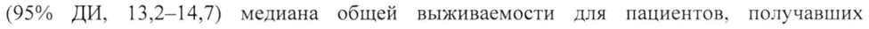
- стр. 3: «1 мг/кг 1 раз в 2 недели, 3 мг/кг 1 раз в 3 недели или 250 мг 1 раз в 3 недели. Клиренс» — низкая уверенность: «1» (76)  
  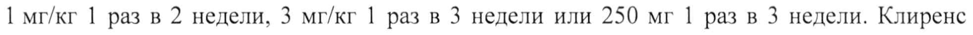
- стр. 3: «значение конечного периода полувыведения (Т!1/2) составляет примерно 14 дней (CV: 96%)» — низкая уверенность: «(Т!1/2)» (47)  
  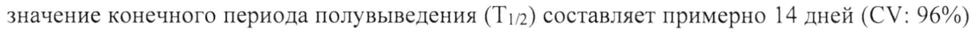
- стр. 3: «кривой (АП Со-зз6+) - 5306962 нг/мл. Перед вторым введением минимальная концентрация» — низкая уверенность: «Со-зз6+)» (24)  
  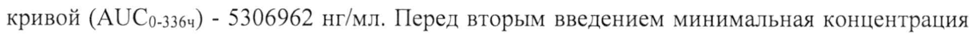
- стр. 4: «кривой (АЦ Со-504ч) — 14952949 нг/мл. Перед вторым введением минимальная концентрация» — низкая уверенность: «Со-504ч)» (26)  
  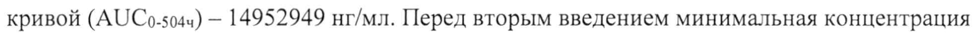
- стр. 4: «328,134+425,200 4, клиренс 11,519+11,769 мл/ч, константа скорости элиминации» — низкая уверенность: «11,519+11,769» (62)  
  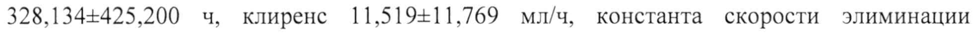
- стр. 4: «(Cmax,ss) — 208,994117,98, средняя концентрация (Cay,ss) — 96,19-62,11 мкг/мл.» — низкая уверенность: «208,994117,98,» (70)  
  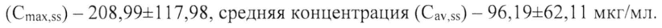
- стр. 6: «e 1 мг/кг 1 разв 2 недели или 250 мг 1 раз в 3 недели при применении в режиме» — низкая уверенность: «1» (74); повторное чтение: «e 1 мг/кг 1 раз в 2 недели или 250 мг 1 раз в 3 недели при применении в режиме»  
  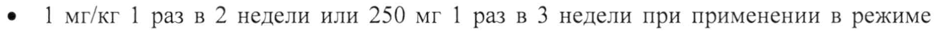
- стр. 7: «общего билирубина (> 3 раз» — повторное чтение: «общего билирубина (>3 ‘раз»  
  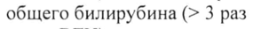
- стр. 8: «яжести (гликемии > 250 мг/дл СТепени тяжести или ниже и» — повторное чтение: «гяжести (гликемии > 250 ммдл Степени тяжести или ниже и»  
  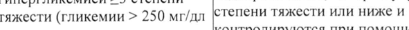
- стр. 19: «тяжелой степени назначается лечение глюкокортикостероидами в дозе |-2 мг/кг/сутки» — низкая уверенность: «|-2» (74)  
  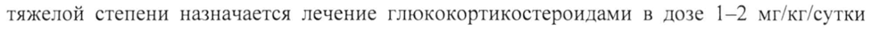
- стр. 19: «2 степени тяжести (начальная доза 0,5—1 мг/кг/сутки преднизона (или аналогичная) с» — низкая уверенность: «0,5—1» (66)  
  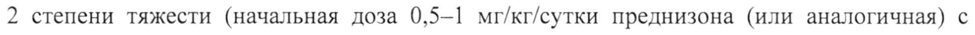
