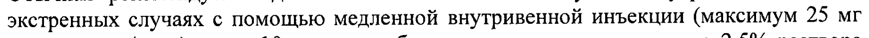
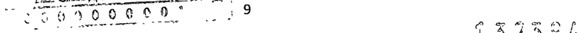

# Прометазин — парентерально

- Препарат: Пипольфен® (раствор для внутривенного и внутримышечного введения)
- АТХ: R06AD02
- Источник: ОХЛП, Единый реестр ЛС ЕАЭС, запись 5f7c523bfb44f117bda8883a, документ от 2024-09-12
- Распознано автоматически (OCR): 9 из 9 стр.
- Сомнительных строк после OCR: 2 (см. раздел «Проверка распознавания»)

## Общие сведения

лИ-№(000170)-(РГ-ВО)-240321 ОБЩАЯ ХАРАКТЕРИСТИКА ЛЕКАРСТВЕННОГО ПРЕПАРАТА

## 1. Наименование лекарственного препарата

Пипольфен, 25 мг/мл, раствор для внутривенного и внутримышечного введения

## 2. Качественный и количественный состав

Действующее вещество: прометазин Каждая ампула вместимостью 2 мл содержит 50 мг прометазина гидрохлорида.
Полный перечень вспомогательных веществ приведен в разделе 6.1.

## 3. Лекарственная форма

Раствор для внутривенного и внутримышечного введения.
Прозрачный бесцветный или с зеленым оттенком раствор без запаха.

## 4. Клинические данные

## 4.1. Показания к применению

Аллергические заболевания, в том числе крапивница, сывороточная болезнь, поллиноз (сенная лихорадка), ринит, конъюнктивит, ангионевротический отек, зуд;

e Вспомогательная терапия анафилактических реакций (после купирования острых проявлений другими средствами, например, адреналином);
e В качестве седативного средства в пред- и послеоперационной период;
e Тошнота и рвота, связанные с наркозом и/или появляющейся в послеоперационном периоде (для предупреждения и купирования);
e Послеоперационные боли (в сочетании с анальгетиками);
, e Головокружение и тошнота во время поездок на транспорте (для предупреждения и устранения);
» Усиление эффекта анальгетиков, анестетиков (для потенцирования наркоза).

## 4.2. Режим дозирования и способ применения

Режим дозирования Обычная рекомендуемая доза составляет 25-50 мг глубоко внутримышечно, а в экстренных случаях с помощью медленной внутривенной инъекции (максимум 25 мг прометазина/мин.) после 10-кратного объемного разведения исходного 2,5% раствора водой для инъекций непосредственно перед введением.
Максимальная парентеральная доза составляет 100 мг.
Особые группы пациентов Пациенты пожилого возраста
Нет специфических рекомендаций по дозированию
ИИ | er | ^ ЭКСИЕРОНЬЯ ore? ы Е >: НЕТ 7 Pag? ‘ ed = _ +
F: jmeracrOMT ENR Дия ДАИНОЙ О 1 132292 3’ уси HOKYMEHTA ПП, 990000000”.
JITI-No(000170)-(PI'-RU)-240321 Дети 6,25 мг - 12,5 мг для детей в возрасте 5-10 лет путем глубоких внутримышечных инъекций.
Раствор для инъекций нельзя применять у детей младше 2 лет (см. раздел 4.3).
Способ применения Препарат для внутримышечного или внутривенного (после разбавления) введения.
Внутривенное введение следует проводить с осторожностью во избежание экстравазации или непреднамеренного интраартериального введения (см. раздел 4.4).
При внутримышечном введении также требуется соблюдать осторожность во избежание случайного подкожного введения, которое может вызвать некроз в месте введения (см.
раздел 4.4).

## 4.3. Противопоказания

. повышенная чувствительность к действующему веществу или любому из

вспомогательных веществ, приведенных в разделе 6.1.;

* коматозные состояния или другие виды глубокого угнетения функций центральной нервной системы:

. период менее 14 дней после приема ингибиторов МАО;

. дети до 2 лет.

## 4.4. Особые указания и меры предосторожности при применении

e Внутривенное введение следует проводить с особой осторожностью во избежание экстравазации или непреднамеренного интраартериального введения.
что может вызвать некроз или периферическую гангрену. Если пациент жалуется на боль при внутривенном введении, следует немедленно прекратить введение препарата. так как боль может быть признаком экстравазации или непреднамеренного интраартериального введения. При внутримышечном введении также требуется соблюдать осторожность во избежание случайного подкожного введения, которое может вызвать некроз в месте введения.

® Oco6aa осторожность необходима при применении препарата (особенно высоких
03) у пожилых пациентов из-за повышенного риска развития тяжелых нежелательных реакций. Пожилые пациенты особенно чувствительны к антихолинергическим эффектам прометазина, которые также могут вызвать спутанность сознания.

e Прометазин может маскировать признаки-предвестники ототоксического действия, вызванного ототоксичными медицинскими препаратами, например, салицилатами.

e Вследствие подавления рвоты, прометазин препятствует своевременной диагностике кишечной непроходимости или повышенного внутричерепного давления.

® Особую осторожность следует соблюдать при назначении препарата пациентам с заболеваниями сердечно-сосудистой системы, почек и печени.

® Прометазин может вызвать (в основном после парентерального введения)
холестатическую желтуху.

® Препарат снижает порог судорожной готовности. Это следует учитывать при лечении пациентов, склонных к судорогам или получающих другие препараты аналогичного действия одновременно с прометазином.

2 и, 32484 JIM1-Ne(000170)-(PT-RU)-240321

e Вследствие антихолинергического действия прометазина может наступить ухудшение течения некоторых заболеваний (закрытоугольная глаукома, стенозирующая язва желудка, обструкция шейки мочевого пузыря и/или гипертрофия предстательной железы). При назначении этого препарата пациентам с такими заболеваниями необходима особая осторожность.

® Препарат следует назначать с осторожностью пациентам с бронхиальной астмой или тяжелыми заболеваниями органов дыхания. Прометазин способен уменьшить влажность слизистой дыхательных путей, увеличить вязкость мокроты и ухудшить ее выделение. Также препарат может вызывать угнетение дыхания с летальным исходом.

® Парадоксальные реакции. Повышенная возбудимость и ненормальная активность наблюдались после однократного применения прометазина. При развитии таких симптомов следует отменить прометазин и перейти на другие препараты.

e При применении прометазина наблюдалось развитие злокачественного нейролептического синдрома (ЗНС) с угрозой летального исхода. К симптомам
ЗНС относятся: гипертермия, мышечная ригидность, психические нарушения, расстройства вегетативной нервной системы (нерегулярный пульс. нестабильное артериальное давление (АД), тахикардия, нарушение сердечного ритма). При подозрении на ЗНС следует немедленно отменить прометазин. Так как наблюдались случаи рецидивов ЗНС при применении фенотиазинов, следует соблюдать особую осторожность при повторном применении прометазина.

e Bo время лечения следует избегать употребления алкоголя.

e Тест на толерантность к глюкозе: у пациентов, получающих прометазин, отмечено повышение концентрации глюкозы крови.

® Препарат Пипольфен содержат калия дисульфит и натрия сульфит безводный.
которые в редких случаях могут вызывать тяжелые реакции гиперчувствительности и бронхоспазм.

Дети

e Прометазин нельзя назначать детям младше 2 лет, в связи с возможностью развития летального торможения дыхания.

e У детей в возрасте 2 лет и старше прометазин следует применять с особой осторожностью. Детям в возрасте 2 лет и старше рекомендуется назначать самую низкую эффективную дозу прометазина и избегать параллельного использования других препаратов, тормозящих дыхание.

® В связи с тем, что симптомы недиагностированной энцефалопатии, синдрома
Рейе и побочных эффектов препарата прометазина имеют определенные сходства, препарат Пипольфен следует применять с особой осторожностью у детей, в случае, если не установлен диагноз основного заболевания.

® Препарат следует отменить при наличии признаков и симптомов болезни Рейе.

## 4.5. Взаимодействие с другими лекарственными препаратами и другие виды взаимодействия

e Прометазин потенцирует тормозящий эффект седативных и снотворных препаратов, трициклических антидепрессантов и транквилизаторов на центральную нервную систему (ЦНС). Поэтому во время лечения рекомендуется снижать дозу этих препаратов.

e Прометазин может усиливать действие препаратов с антихолинергическим действием.

“32854 | ЛП-№(000170)-(РГ-В0)-240321 ® При одновременном введении с адреналином могут развиться парадоксальная гипотензия и тахикардия (прометазин может блокировать альфа-адренорецепторы и ослаблять прессорный эффект адреналина).

e Прометазин может усиливать действие антигипертензивных средств.

e Совместное применение прометазина с препаратами. вызывающими экстрапирамидные симптомы. может увеличить риск развития побочных эффектов со стороны ЦНС.

e Прометазин снижает судорожный порог, в связи с чем может потребоваться коррекция дозы противосудорожных препаратов.

e Тест на беременность: во время приема прометазина возможны ложноотрицательные или ложноположительные результаты диагностических тестов на беременность.

e Необходимо прекратить прием прометазина за 72 часа до проведения кожных аллергических проб, поскольку прометазин ингибирует высвобождение гистамина, и его применение может привести к ложноотрицательному результату.

## 4.6. Фертильность, беременность и лактация

Беременность Препарат не следует назначать беременным, за исключением случаев, когда врач считает это необходимым. Применение препарата Пипольфен не рекомендуется за 2 недели до родов в связи с риском развития повышенной возбудимости у новорожденного.
Лактация По имеющимся данным, лишь минимальное количество прометазина секретируется в материнское молоко. Несмотря на это, нельзя исключить риск развития повышенной возбудимости у новорожденного.
4.7 Влияние на способность управлять транспортными средствами и работать с механизмами
В начальный период лечения необходимо воздерживаться от вождения автотранспорта и занятий потенциально опасными видами деятельности, требующими повышенной концентрации внимания и быстроты психомоторных реакций. В дальнейшем степень ограничений определяют в зависимости от индивидуальной переносимости пациента.

## 4.8. Нежелательные реакции

Резюме нежелательных реакций Нарушения со стороны крови и лимфатической системы
Лейкопения и тромбоцитопения, гемолитическая анемия, агранулоцитоз.
Нарушения со стороны иммунной системы В очень редких случаях наблюдались аллергические реакции, такие как крапивница, сыпь, зуд, ангионевротический отек и анафилаксия.
Нарушения со стороны обмена веществ и питания
Анорексия.
Психические нарушения Спутанность сознания, дезориентация, беспокойство, возбуждение (у детей может развиться парадоксальная повышенная возбудимость), ночные кошмары, утомляемость, эйфория, нервозность, галлюцинации.
и * хня ий J ot Ay ЛП-№(000170)-(РГ-ВО)-240321

Нарушения со стороны нервной системы Экстрапирамидные симптомы, например. окулогирный криз, кривошея, протрузия языка
(по всей вероятности, при применении более высоких парентеральных и пероральных доз), тремор, седация, сонливость, головокружение, головные боли, нарушение координации движений, бессонница, судорожные приступы.
Имеются данные о развитии ЗНС (с угрозой летального исхода).
Нарушения со стороны органа зрения Нечеткость зрения, диплопия.
Нарушения со стороны органа слуха и лабиринта
Звон или шум в ушах.
Нарушения со стороны сердца Сердцебиение, аритмия. тахикардия. брадикардия.
Нарушения со стороны сосудов Повышение или понижение АД. обмороки.
Нарушения со стороны дыхательной системы, органов грудной клетки и средостения
Астма, заложенность носа, угнетение дыхания (потенциально летальное) и остановка дыхания (потенциально летальная).
Желудочно-кишечные нарушения Рвота, запор, тошнота, сухость во рту, раздражение желудка.
Нарушения со стороны печени и желчевыводящих путей
Желтуха (обусловленная холестазом).
Нарушения со стороны кожи и подкожных тканей
Кожные высыпания, фотосенсибилизация, дерматит, крапивница.
Нарушения со стороны почек и мочевыводящих путей
Задержка мочи.
Сообщение о подозреваемых нежелательных реакциях
Важно сообщать о подозреваемых нежелательных реакциях после регистрации лекарственного препарата с целью обеспечения непрерывного мониторинга соотношения «польза — риск» лекарственного препарата. Медицинским работникам рекомендуется сообщать о любых подозреваемых нежелательных реакциях лекарственного препарата через национальные системы сообщения о нежелательных реакциях государств — членов Евразийского экономического союза.

Российская Федерация

Адрес: 109074, Москва, Славянская площадь, д. 4, cmp. 1

Федеральная служба по надзору в сфере здравоохранения Российской Федерации

Телефон: +7 (495) 698-45-38, +7 (499) 578-02-30

Электронная почта: рнагпкаго5загаупа4рЕоГ.ги

Сайт: http:/Awww.roszdravnadzor.ru/

Республика Казахстан

Адрес: 010000, г. Нур-Султан, np. Мэнгик Ел, 20

Е С т а 9 4 о, Be ЛП-№(000170)-(РГ-В)-240321
PIU на TXB «Национальный центр экспертизы лекарственных средств и медицинских изделий» Комитета контроля качества и безопасности товаров и услуг
Министерства здравоохранения Республики Казахстан
Тел.: 8 (7172) 73-98-28 Электронная почта: farni@dari.kz
Сайт: Вирил: паЧа. К Республика Беларусь
Адрес: 220037, Минск, Товарищеский пер., 2а
Республиканское унитарное предприятие «Центр экспертиз и испытаний в здравоохранении»
Тел.: +375-17-299-55-14 Факс: +375-17-299-53-58
Электронная почта: гсрКалсей.Ьу Сайт: http: /wow.reeth by!
Республика Армения Адрес: 0051, Ереван, пр. Комитаса 49/4
«Научный Центр экспертизы лекарств и медицинских технологий им. академика Э.
Габриеляна» АОЗТ Тел.: (+374 10) 23 08 96
Факс: (+374 10) 232118, 232942 Электронная почта: vigilanceepharmam
Сайт. http.vviw.pharm.am/

## 4.9. Передозировка

Симптомы Симптомы тяжелой передозировки разнообразны.
У детей они характеризуются различными сочетаниями возбуждения, атаксии, нарушениями координации движений, атетозом и галлюцинациями.
У взрослых симптомы проявляются в виде сонливости с переходом в кому. Наблюдались судороги, которым может предшествовать кома или возбуждение. Угнетение сердечной деятельности и дыхания отмечаются нечасто.
Лечение Если пациент попадает к врачу вскоре после лекарственной экспозиции, то возможно вызвать рвоту, несмотря на противорвотный эффект прометазина. В качестве альтернативного метода можно применять промывание желудка.
В остальном применяют симптоматическую и поддерживающую терапию, основной целью которой является поддержание адекватной дыхательной функции и сердечной деятельности.
В случае возникновения судорог вводятся препараты бензодиазепинового ряда или другие подходящие противосудорожные препараты.
Прометазин не выводится из организма с помощью диализа.

## 5. Фармакологические свойства

5.1. — Фармакодинамические свойства Фармакотерапевтическая группа: противоаллергическое средство - H; гистаминовых рецепторов блокатор
Код ATX: RO6A 202 "ЧИЗУАД ЛП-№(000170)-(РГ-ВО)-240321

Механизм действия, фармакодинамические эффекты
Прометазин - производное фенотиазина, обладает высокой антигистаминной активностью и выраженным влиянием на центральную нервную систему (оказывает седативное. снотворное, противорвотное, антипсихотическое и гипотермическое действие). Предупреждает и успокаивает икоту.
Предотвращает, но не устраняет эффекты, опосредованные гистамином (включая крапивницу и зуд). Антихолинергическое действие обусловливает подсушивающий эффект на слизистые оболочки полостей носа и рта.
Противорвотное действие прометазина — обусловлено его центральным антихолинергическим эффектом. снижением возбудимости вестибулярной системы.
подавлением функции лабиринта, а также прямым тормозным эффектом на триггерные хеморецепторные зоны продолговатого мозга.
Седативное действие обусловлено ингибированием гистамин-М№-метилтрансферазы и блокадой центральных гистаминергических рецепторов. Возможна также блокада и других рецепторов центральной нервной системы, таких как серотониновые и ацетилхолиновые. стимуляция альфа-адренергических рецепторов косвенно ослабляет стимуляцию ретикулярной формации ствола мозга. Поскольку его химическая структура отлична от структуры антипсихотических фенотиазинов, прометазин обладает более слабым антипсихотическим действием.
В терапевтических дозах не влияет на сердечно-сосудистую систему.

## 5.2. Фармакокинетические свойства

Абсорбция Клинические эффекты проявляются через 20 минут после внутримышечного введения или 3 - 5 минут после внутривенного введения и длятся обычно 4-6 часов, иногда сохраняясь до 12 часов.
Распределение Связывание препарата с белками составляет около 90%.
Биотрансформация Прометазин подвергается активному метаболизму в печени с эффектом первого прохождения. Основной процесс метаболизма - $-окисление. Сульфоксиды прометазина и №-деметилпрометазин - главные метаболиты, выделяемые с мочой.
Элиминация Период полувыведения основного соединения составляет 7 - 15 часов. Выводится преимущественно почками, в меньшей степени — желчью. Проникает через гематоэнцефалический барьер и плацентарный барьер.

## 6. Фармацевтические свойства

6.1. — Перечень вспомогательных веществ Гидрохинон калия дисульфит натрия сульфит безводный натрия хлорид вода для инъекций

## 6.2. Несовместимость

ЛП-№(000170)-(РГ-ВО)-240321 Не применимо
6.3. Cpok годности (срок хранения)
5 лет.
6.4 Особые меры предосторожности при хранении
В защищенном от света месте при температуре не выше 25 °С.
6.5 Характер и содержание первичной упаковки
Раствор для внутривенного и внутримышечного введения 25 мг/мл.
По 2 мл препарата в ампулы из бесцветного стекла (стекло гидролитического класса I) с точкой излома и синим кодовым кольцом, по 5 ампул в пластиковую ячейковую упаковку, запаянную прозрачной пленкой. 2 ячейковые упаковки (10 ампул) в картонную пачку вместе с инструкцией по применению.
6.6 Особые меры предосторожности при уничтожении использованного лекарственного препарата или отходов, полученных после применения лекарственного препарата и другие манипуляции с препаратом
Особые требования отсутствуют.

## 7. Держатель регистрационного удостоверения

Венгрия ЗАО «Фармацевтический завод ЭГИС»
1106 Будапешт, ул. Керестури 30-38 Телефон: (36-1) 803-5555,
Факс: (36-1) 803-5529 Электронная почта: mailbox@egis.hu 7.1. — Представитель держателя регистрационного удостоверения
Претензии потребителей направлять по адресу:
Российская Федерация:
ООО «ЭГИС-РУС», Россия 121108, г. Москва, ул. Ивана Франко, д. 8,
Телефон: (495) 363-39-66 Факс: +7(495) 789-66-31
Электронная почта: pharmacovigilance@egis.ru
В Республике Казахстан:
Представительство в РК ЗАО «Фармацевтический завод ЭГИС»
050060, г. Алматы, ул. Жарокова 286 Г Телефон: + 7 (727) 247 63 34, +7 (727) 247 63 33
Факс: + 7 (727) 247 61 41 Электронная почта: egis@egis.kz 8 oC FF Pp FY
ЗАЗ ЗА ЛП-№(000170)-(РГ-В0)-240321 В Республике Беларусь:
Представительство ЗАО «Фармацевтический завод ЭГИС» в Республике Беларусь 220053, г. Минск. пер. Ермака. д. 6A
Телефон: (017) 380-00-80, (017) 227-35-51(52)
Факс: (017) 227-35-53 Электронная почта: info@egis.by
В Республике Армения:
Представительство ЗАО «Фармацевтический завод ЭГИС» в Республике Армения 0025, Ереван, ул. Чаренца, дом 1
Телефон: +374-10-574509, +374-10-574686 Электронная почта: info@egis.am

## 8. Номер регистрационного удостоверения

## 9. Дата первичной регистрации

(ПОДТВЕРЖДЕНИЯ РЕГИСТРАЦИИ,

ПЕРЕРЕГИСТРАЦИИ)
Дата первой регистрации:
10. ДАТА ПЕРЕСМОТРА ТЕКСТА
Общая характеристика лекарственного препарата Пипольфен доступна на информационном портале Евразийского экономического союза в информационнокоммуникационной сети «Интернет» http://www.eurasiancommission.org.
т Re |

_г Skeramnlaria” В

В bre Oc Я DARROW а |

3 pyro OKYMEHTA |

7 Neen) oy Oo 8 г. ao 77 9 oO os a м р mo [S45 54
## Проверка распознавания

Страницы-сканы распознаны автоматически. В 2 строках с дозировками цифры могли распознаться с ошибкой — сверьте с вырезкой из оригинала:

- стр. 1: «экстренных случаях с помощью медленной внутривенной инъекции (максимум 25 мг» — повторное чтение: «экстренных случаях с помощью медленной внутривенной инъекции (максимум 25 ‘MP»  
  
- стр. 9: «7 Neen) oy Oo 8 г. ao 77 9 oO os a м р» — низкая уверенность: «7» (28), «8» (15), «77» (25); повторное чтение: «Поло” 39 я давил»  
  
