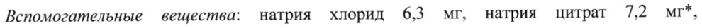
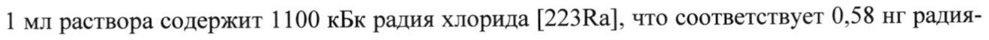
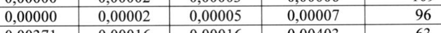
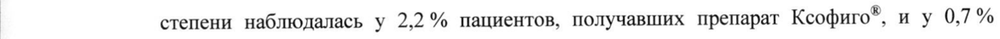
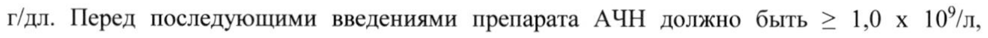
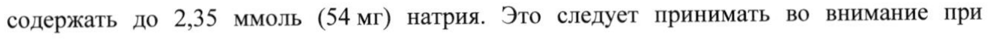

# Радия хлорид — парентерально

- Препарат: Ксофиго® (раствор для внутривенного введения;)
- АТХ: V10XX03
- Источник: ГРЛС, инструкция по медицинскому применению, РУ ЛП-004060, файл от 2024-04-09 (https://grls.rosminzdrav.ru/Grls_View_v2.aspx?routingGuid=bf8da8b1-54e6-4ab3-8e82-b5d389ce980d)
- Распознано автоматически (OCR): 18 из 18 стр.
- Инструкция к другому РУ того же препарата: ЛП-004060 (срок действия истёк, решение от 01.04.2024). Текст может быть старше действующего
- Сомнительных строк после OCR: 6 (см. раздел «Проверка распознавания»)

## Общие сведения

| JUH1-004060-190718 МИНИСТЕРСТВО ЗДРАВООХРАНЕНИЯ РОССИЙСКОЙ ФЕДЕРАЦИИ
ИНСТРУКЦИЯ ПО МЕДИЦИНСКОМУ ПРИМЕНЕНИЮ ЛЕКАРСТВЕННОГО ПРЕПАРАТА
КСОФИГО® / XOFIGO® Регистрационный номер: ЛП-004060
Торговое наименование препарата: Ксофиго®
Международное непатентованное или группировочное наименование: радия хлорид
[223Ra] Лекарственная форма: раствор для внутривенного введения

## 2. Состав

1 мл раствора для внутривенного введения содержит:
1 мл раствора для внутривенного введения содержит:
Действующее вещество: радия хлорид [223Ra], в пересчете на радий-223 (в референтную дату) 1100 кБк (0,58 нг).
Вспомогательные вещества: натрия хлорид 6,3 мг, натрия цитрат 7,2 мг*, хлористоводородная кислота 0,2 мг, вода для инъекций до 1,0 мл.
Содержание радия хлорида [223Ка] указано в пересчете на радий-223 в референтную
Дату, | * указано количество натрия цитрата безводного; в процессе производства используется натрия цитрата дигидрат;
** референтная дата — дата, установленная как «12.00 часов по центральноевропейскому времени через 14 дней после даты производства лекарственного препарата» и
| соответствующая дате калибровки.
Описание Бесцветный прозрачный раствор.
Фармакотерапевтическая группа Радиофармацевтическое терапевтическое средство.
Код ATX: V10XX03 Физико-химические свойства 1 мл раствора содержит 1100 кБк радия хлорида [223Ra], что соответствует 0,58 нг радия223 в референтную дату. Радий содержится в растворе в виде свободного иона.
111270 ЛП-004060-190718 В каждом флаконе содержится 6 мл раствора (6600 кБк радия хлорида [223Ra] в | референтную дату).
Радия хлорид [223Ra] испускает альфа-частицы и имеет период полураспада 11,4 дней.
Удельная активность радия-223 1,9 МБк/нг.
Радиоактивный распад радия-223 до свинца-207 состоит из шести звеньев цепочки короткоживущих дочерних изотопов и сопровождается испусканием альфа-, бета- и гамма-частиц с разной вероятностью эмиссии и величиной энергии распада. Величина энергии альфа-излучения составляет 95,3 % (диапазон энергии 5,0 — 7,5 МэВ), величина энергии бета-излучения — 3,6 % (среднее значение энергии 0,445 МэВ и 0,492 МэВ), величина энергии гамма-излучения — 1,1 % (диапазон энергии 0,01 — 1,27 МэВ).
Рисунок 1. Цепочка радиоактивного распада радия-223 (с характером распада и параметрами периодов полураспада).
233 ра а 1144 1Ва а 4.05 | | 207 ив: 215Ро
= >? min 1 ав £ Е | 4.8 mn 36.1 mn | Фармакологические свойства

## 5.1. Фармакодинамика

Механизм действия Ксофиго® является препаратом, терапевтическое действие которого обусловлено эмиссией а-частиц.
Механизм действия Ксофиго® является препаратом, терапевтическое действие которого обусловлено эмиссией а-частиц.
Действующее вещество препарата Ксофиго®, изотоп радия (радия хлорид [223Ва]), имитирует кальций и образует комплексное соединение с минералом костной ткани гидроксиапатитом. Благодаря этому изотоп радия избирательно воздействует на костную ткань, в частности на костные метастатические очаги рака предстательной железы.
Высокое линейное значение энергии переноса а-частиц (80 кэВ/мкм) приводит к высокой частоте разрыва двухцепочечной молекулы ДНК и вызывает сильный цитотоксический эффект. На моделях in vivo было показано дополнительное воздействие препарата на
EU SPC 14.08.2017 С. 2 из 18 111270 ЛП-004060-190718 микроокружение опухоли, включая остеокласты и остеобласты, что способствовало его дополнительной эффективности. Диапазон действия а-частиц радия хлорида [223Ка] менее 100 мкм (менее десяти диаметров клетки), что минимизирует повреждение здоровых окружающих тканей.

## 5.2. Фармакокинетика

Всасывание

При внутривенном введении препарата Ксофиго* его биодоступность составляет 100 %.

Распределение и накопление в органах

После внутривенного введения изотоп радия (радий-223) быстро выводится из системного

кровотока и накапливается, в первую очередь, в костях и костных метастазах или

выделяется непосредственно в кишечник.

Около 20 % введенной дозы препарата оставалось в системном кровотоке через 15 минут

после введения. Около 4 % введенной дозы препарата оставалось в системном кровотоке

через 4 часа после введения, снижаясь до менее | % через 24 часа. Объем распределения

превышал объем циркулирующей крови, что свидетельствует о распределении в

периферических полостях.

Радиофармацевтическая активность отмечалась в костях и кишечнике через 10 минут

после введения. Через 4 часа после введения средние значения радиоактивной дозы,

определяющейся в костях и кишечнике, составляли около 61 % и 49 % соответственно. Не

отмечалось значительного накопления изотопа радия в таких органах, как сердце, печень,

почки, мочевой пузырь и селезенка через 4 часа после инъекции.

Биотрансформация

Изотоп радия (радий-223) подвергается радиоактивному распаду и не метаболизируется.

Выведение

Изотоп радия в основном выводится из организма через кишечник. Около 5 % выводится

почками. Данные о гепатобилиарной экскреции отсутствуют.

Результаты измерения радиоактивности всего тела через 7 дней после введения препарата
(с учетом фактора распада) показывают, что 76 % введенной дозы выводятся из организма. На скорость выведения радия-223 из желудочно-кишечного тракта влияет |
| высокая вариабельность скорости прохождения содержимого через кишечник в

популяции. Нормальный диапазон частоты опорожнения кишечника составляет от 1 раза в |

день до 1 раза в неделю.

Линейность/нелинейность

В исследованном диапазоне активности (51-276 кБк/кг) фармакокинетические показатели

радия хлорида [223Ка] были линейными.

EU SPC 14.08.2017 С. 3 из 18 111270 ЛП-004060-190718
| | Дети Безопасность и эффективность препарата Ксофиго® не изучались у детей и подростков до 18 лет.

## 4.1. Показания к применению

| e Кастрационно-резистентный рак предстательной железы с костными метастазами и отсутствием висцеральных метастазов.
| e Кастрационно-резистентный рак предстательной железы с костными метастазами и отсутствием висцеральных метастазов.
Противопоказания e Гиперчувствительность к действующему веществу или любому вспомогательному
| компоненту препарата e Детский возраст до 18 лет (информация об эффективности и безопасности применения | препарата Ксофиго® у детей отсутствует).
С осторожностью e у пациентов со снижением функции костного мозга;
» у пациентов с раком предстательной железы на стадии прогрессирующей диффузной инфильтрации костей;
» у пациентов с риском возникновения компрессии спинного мозга или с состоявшейся компрессией спинного мозга.
® у пациентов с переломами костей;
® у пациентов с болезнью Крона и язвенным колитом;
e у пациентов с нарушением функции печени;
» у пациентов с нарушением функции почек тяжелой степени тяжести (КК < 30 мл/мин).

## 4.6. Применение при беременности и в период грудного вскармливания

Препарат Ксофиго® не применяется у женщин.

## 4.2. Способ применения и дозы

Для внутривенного введения.
Для внутривенного введения.
Препарат Ксофиго® должен назначаться только врачом, имеющим опыт применения радиофармацевтических препаратов. Перед назначением препарата пациент должен пройти обследование. Применение препарата может осуществляться только в специализированных лечебных учреждениях персоналом, имеющим разрешение на
| обращение с радиофармацевтическими препаратами.
Активная доза препарата Ксофиго® составляет 55 кБк/кг. Назначается 6 инъекций препарата с интервалами в 4 недели. |
EU SPC 14.08.2017 11127 0 С. 4 из 18 —- БЛЮ АЯ ЕИЕИЕИИЕЕЕКЕИЕЕИИЕИА ЕЕ ЕЖЕ ЕЕК Е ИИ ЕЕ ИЩИ
ЛП-004060-190718 Безопасность и эффективность препарата Ксофиго® при получении пациентом более 6-ти инъекций не изучались.
Способ введения Препарат Ксофиго® предназначен для внутривенного введения. Препарат следует вводить медленно (как правило, до 1 минуты).
Иглу от инфузионной системы или катетер до и после введения препарата следует промыть изотоническим раствором натрия хлорида 0,9 %.
Подготовка к введению радиофармацевтического препарата
Перед применением следует внимательно осмотреть раствор. Препарат Ксофиго® представляет собой прозрачный бесцветный раствор. При изменении цвета, обнаружении видимых частиц или дефекта упаковки препарат применять нельзя.
Препарат Ксофиго® представляет собой раствор, готовый к применению. Не следует разводить или смешивать препарат Ксофиго® с другими растворами.
Флакон с препаратом предназначен только для однократного использования.
При расчете объема, предназначенного для введения пациенту, необходимо учитывать:
- массу тела пациента, кг;
- уровень активной дозы (55 кБк/кг);
- активную концентрацию препарата на референтную дату (1100 кБк/мл); референтная дата указывается на этикетке флакона и свинцового контейнера;
- коэффициент радиоактивного распада радия-223. Таблица со значениями коэффициента радиоактивного распада находится в каждой упаковке препарата.
Следует подтвердить уровень радиоактивности препарата в каждом флаконе с помощью радиометрического дозиметра.
Суммарный объем вводимого раствора для каждого пациента рассчитывается по формуле:
масса тела пациента (кг) х активная доза (55 кБк/кг)
ОБС ТО а enn коэффициент радиоактивного распада х 1100 кБк/мл
Дозиметрия Расчет лучевой нагрузки основывается на клинических данных по биораспределению препарата Ксофиго®. Расчет проводился при помощи оценки экспоненциального моделирования дозы внутреннего облучения в органах (OLINDA/EXM), программного обеспечения, основанного на алгоритме терапевтической дозы внутреннего облучения
(ТДВО), широко используемого для имплантированных бета- и гамма-активных радионуклидов. Изотоп радия-223 испускает преимущественно а-частицы. Были сделаны дополнительные допущения для оптимального расчета лучевой нагрузки препарата
EU SPC 14.08.2017 ЕТО С. 5 из 18 em | JIT1-004060-190718
Ксофиго® для кишечника, красного костного мозга и костной ткани/остеогенных клеток с учетом биораспределения и характерных особенностей препарата.
Таблица 3. Лучевая нагрузка Орган-мишень Альфа- Бета- Гамма- | Суммарная | Коэффициент излучение' | излучение | излучение доза отклонения р/МБк р/МБк Гр/МБк р/МБк % 0,00000 | 0,00002 | 0,00009 0,00012 0,00000 | 0.00002 | 0,00008 0,0000 | 80 | 0,00000 | 0,00002 | 0,00003 0,00005 0,00000 0,00002 0,00021 0,00023
Толстой кишки 0,00319 | 0.00360 | 0,00047 0,00726 0,00000 | 0,00002 | 0,00011 0,00014 толстой кишки 0,00161__| 0,00007 | 0.00005 0,00173 0,00299 | 0,00011 | 0,00011 0,00321 0,00279 | 0,00010 | 0,00008 0,00298 0,00109 | 0,00007 | 0.00005 0,00121 0,00000 | 0,00002 | 0,00010 0,00012
`Яичники [| 0,00000 | 0,00002 | 0,00046 0,00049 0,00000 | 0,00002 | 0.00009 0,00011
| 0,13217__| 0,00642 | 0,00020 0,13879 113689 | 0,01487 | 0,00030 1,15206 0,00000 | 0.00002 | 0,00005 0,00007 0,00000 | 0,00002 | 0.00007 0,00009 0,00000 | 0,00002 | 0.00006 0,00008 0,00000 | 0.00002 | 0,00003 0,00006 | 19 id 0,00000 | 0,00002 | 0.00005 000007, | 9% 0,00371 | 0,00016 | 0,00016 0,00403 0,00000 | 0,00002 | 0,00023 0,00026 0,02220 | 0,00081 | 0,00012 0,02312 | 16|
1 Поскольку изотоп радия-223 не накапливается в большинстве мягких тканей, вклад альфа-
| излучения в суммарную дозу облучения для данных органов был установлен как 0.
2 Лучевая нагрузка на легкие основывается на расчете смоделированных данных, показывающих зависимость радиофармацевтической активности препарата в крови ОТ времени, с использованием совокупных значений, полученных у всех пациентов.
В клинических исследованиях препарата Ксофиго® частота и тяжесть гематологических нежелательных реакций были значительно ниже, чем можно было бы ожидать, основываясь на лучевой нагрузке для красного костного мозга. Это может быть связано с
| пространственным распределением а-частиц, что приводит K неравномерному распределению дозы ионизирующего излучения в красном КОСТНОМ мозге.
| Особые группы пациентов | | Пациенты с нарушением функции печени
| EU SPC 14.08.2017 р 1 1 1 2 7 0 С. 6 из 18
ЛП-004060-190718 Безопасность и эффективность препарата Ксофиго® не изучались у пациентов с нарушением функции печени.

Поскольку изотоп радия-223 не подвергается метаболизму в печени и не выводится с желчью, предполагается, что нарушение функции печени не влияет на | фармакокинетические показатели радия хлорида [223Ва]. Пациентам с нарушением функции печени коррекция дозы не требуется.

Пациенты с нарушением функции почек

В клиническом исследовании Ш фазы не наблюдалось значимых различий безопасности

или эффективности препарата Ксофиго® у пациентов с нарушением функции почек легкой | степени тяжести (КК 50-80 мл/мин) в сравнении с пациентами с нормальной функцией почек. Имеются ограниченные данные для пациентов с нарушением функции почек средней степени тяжести (КК 30-50 мл/мин). Нет данных для пациентов с тяжелой (КК <

30 мл/мин) или терминальной степенью нарушения функции почек. Однако, поскольку экскреция радия-223 хлорида через почки является минимальной, и его выведение осуществляется, главным образом, через кишечник, предполагается, что нарушение функции почек не влияет на фармакокинетические показатели радия-223 хлорида.

Пациентам с нарушением функции почек коррекции дозы не требуется.

| Пациенты пожилого возраста

В целом в клинических исследованиях не отмечалось значимых различий безопасности и эффективности препарата Ксофиго® у пожилых (65 лет и старше) пациентов в сравнении с более молодыми пациентами. Пациентам пожилого возраста коррекция дозы не требуется.
Дети Безопасность и эффективность препарата Ксофиго® не изучались у детей и подростков до 18 лет. Опыт применения препарата у детей с раком предстательной железы отсутствует.

## 4.8. Побочное действие

Общий профиль безопасности препарата Ксофиго® основывается на данных клинических исследований с участием 600 пациентов, получавших терапию в клинических исследованиях Ш фазы.
Общий профиль безопасности препарата Ксофиго® основывается на данных клинических исследований с участием 600 пациентов, получавших терапию в клинических исследованиях Ш фазы.
В клинических исследованиях наиболее частыми нежелательными реакциями (> 10% пациентов) были диарея, тошнота, рвота и тромбоцитопения.
Наиболее серьезными нежелательными реакциями при применении препарата Ксофиго® были тромбоцитопения и нейтропения (см. раздел «Особые указания»).

| Перечисленные ниже нежелательные реакции, отмеченные при применении препарата

| Ксофиго® в ходе клинических исследований, представлены в соответствии с поражением

EU SPC 14.08.2017 11127 0 С. 7 из 18 ЛП-004060-190718 органов и систем, и распределены по частоте возникновения в соответствии со следующей градацией: очень часто (>1/10), часто (от >1/100 до <1/10), нечасто (от > 1/1000 до <1/100). Для классификации и описания конкретной реакции, ее синонимов и связанных с ней состояний, используется наиболее подходящий термин из Медицинского словаря для регуляторной деятельности (MedDRA).

В каждой частотной группе нежелательные явления представлены в порядке уменьшения их значимости.
Таблица 4. Неблагоприятные реакции, наблюдавшиеся в ходе клинических исследований препарата Ксофиго®
MedDRA лимфатической системы пения панцитопения, лейкопения

= Е |

кишечного тракта рвота,

тошнота

|

месте введения введения

Описание отдельных нежелательных реакций

Тромбоцитопения и нейтропения

Тромбоцитопения (все степени) наблюдалась у 11,5 % пациентов, получавших терапию препаратом Ксофиго® иу 5,6 % пациентов, получавших плацебо. Тромбоцитопения 3-й и 4-й степени наблюдалась у 6,3 % пациентов, получавших препарат Ксофиго® иу2% пациентов, получавших плацебо (см. раздел «Особые указания»). В целом, частота случаев тромбоцитопении 3-й и 4-й степени была ниже у пациентов, ранее не получавших доцетаксел (2,8 % у пациентов, принимавших препарат Ксофиго*, в сравнении с 0,8 % у пациентов, принимавших плацебо) в сравнении с пациентами, которые ранее получали | доцетаксел (8,9 % у пациентов, принимавших препарат Ксофиго*, в сравнении с 2,9 % у пациентов, принимавших плацебо). |
У пациентов с распространенной диффузной инфильтрацией костей сообщалось о случаях тромбоцитопении (все степени) у 19,6 % пациентов, получавших терапию препаратом
Ксофиго*, иу 6,7 % пациентов, получавших плацебо. Тромбоцитопения 3-й и 4-й степени наблюдалась у 5,9 % пациентов, получавших препарат Ксофиго*, иу 6,7 % пациентов, получавших плацебо (см. раздел «Особые указания»).

Сообщалось о случаях нейтропении (все степени) у 5 % пациентов, получавших терапию

| препаратом Ксофиго®, иу 1 % пациентов, получавших плацебо. Нейтропения 3-й и 4-й
EU SPC 14.08.2017 111270 С. 8 из 18 | JIN1-004060-190718
| степени наблюдалась у 2,2 % пациентов, получавших препарат Ксофиго®, иу 0,71% пациентов, получавших плацебо. В целом частота случаев нейтропении 3-й и 4-й степени была ниже у пациентов, ранее не получавших доцетаксел (0,8 % у пациентов, принимавших препарат Ксофиго®, и 0,8% у пациентов, принимавших плацебо) в сравнении с пациентами, которые ранее получали доцетаксел (3,2 % у пациентов, принимавших препарат Ксофиго*, и 0,6 % у пациентов, принимавших плацебо).
В клиническом исследовании | фазы максимальное снижение количества нейтрофилов и тромбоцитов возникало через 2-3 недели после однократного внутривенного введения препарата Ксофиго®.
Реакции в месте введения Сообщалось о реакциях в месте введения 1-й и 2-й степени, которые включали эритему, боль и отек, у 1,2 % пациентов, получавших препарат Ксофиго®, и у 0% пациентов, получавших плацебо.
Вторичные злокачественные опухоли Терапия препаратом Ксофиго® приводит к длительному суммарному накоплению
| радиационного воздействия у пациентов. Длительное накопление радиационного воздействия может быть связано с повышенным риском возникновения рака и наследственных пороков развития. В частности, может повышаться риск развития остеосаркомы, миелодиспластического синдрома и лейкозов.
В клинических исследованиях препарата Ксофиго® не сообщалось о вторичных онкологических заболеваниях на фоне терапии препаратом при последующем наблюдении до трех лет.

## 4.9. Передозировка

Симптомы | Не сообщалось о случаях непреднамеренной передозировки препарата Ксофиго® в клинических исследованиях.
Симптомы | Не сообщалось о случаях непреднамеренной передозировки препарата Ксофиго® в клинических исследованиях.
Лечение Специфический антидот отсутствует.
В случае непреднамеренной передозировки препарата Ксофиго® следует принять стандартные поддерживающие меры, включая контроль токсического действия на систему крови и желудочно-кишечный тракт.
В клиническом исследовании I фазы оценивалась разовая активная доза препарата
| Ксофиго®, которая составляла 276 кБк/кг. Ограничивающая дозу токсичность не наблюдалась.
EU SPC 14.08.2017 11127 0 С. 9 из 18 ЛП-004060-190718

## 4.5. Взаимодействие с другими лекарственными средствами

Клинические исследования взаимодействия препарата Ксофиго® с другими препаратами не проводились.
Существует вероятность взаимодействия препарата Ксофиго® с кальцием и фосфатами.
Следует прекратить прием препаратов, содержащих данные вещества и/или витамин D за несколько дней до начала терапии препаратом Ксофиго®.
Сочетанное проведение химиотерапии и терапии препаратом Ксофиго® может оказывать аддитивное действие на подавление функции костного мозга (см. раздел «Особые указания»). Безопасность и эффективность сочетанной химиотерапии и терапии препаратом Ксофиго® не установлены.

## 4.4. Особые указания

Подавление функции костного мозга
Подавление функции костного мозга
Сообщалось о случаях подавления функции костного мозга (тромбоцитопения, нейтропения, лейкопения, панцитопения) у пациентов, получавших терапию препаратом
Ксофиго® (см. раздел "Побочное действие").
Следует проводить общий анализ крови у пациентов перед каждой инъекцией препарата
Ксофиго®. Перед первым введением препарата абсолютное число нейтрофилов (АЧН)
должно быть > 1,5 x 10°/n, количество тромбоцитов > 100 x 107/л и гемоглобин > 10,0 г/дл. Перед последующими введениями препарата АЧН должно быть > 1,0 x 10%/л, количество тромбоцитов > 50 x 10°/n. Если, несмотря на проведение поддерживающей терапии, данные показатели не нормализуются в течение 6-ти недель после последнего введения препарата Ксофиго®, дальнейшую терапию следует продолжать только после тщательной оценки соотношения пользы и риска.
В клинических исследованиях Ш фазы наблюдалось повышение частоты нежелательных реакций со стороны крови (нейтропения и тромбоцитопения) у пациентов со снижением функции костного мозга (например, после предшествующей цитотоксической химиотерапии и/или наружной дистанционной лучевой терапии (НДЛТ)), или у пациентов с раком предстательной железы на стадии прогрессирующей диффузной инфильтрации костей по данным радиоизотопного исследования (см. раздел «Побочное действие»). При лечении таких пациентов следует соблюдать осторожность.
Эффективность и безопасность цитотоксической химиотерапии, проводившейся после терапии препаратом Ксофиго®, не установлены. Имеющиеся ограниченные данные показывают, что пациенты получавшие химиотерапию после терапии препаратом
EU SPC 14.08.2017 111270 С. 10 из 18 ЛП-004060-190718
| Ксофиго®, имели сопоставимые гематологические показатели, в сравнении с пациентами, получавшими химиотерапию после приема плацебо (см.раздел «Фармакодинамика»).
Болезнь Крона и язвенный колит Безопасность и эффективность препарата Ксофиго® у пациентов с болезнью Крона и язвенным колитом не изучались. Поскольку препарат Ксофиго® выводится через кишечник, радиоактивное излучение может привести к обострению острого воспалительного заболевания кишечника. Следует внимательно оценивать соотношение пользы и риска при назначении препарата Ксофиго® пациентам с острым воспалительным заболеванием кишечника.
Компрессия спинного мозга Следует завершить стандартную поддерживающую терапию, проводимую по клиническим показаниям, у пациентов с нелеченой угрожающей или выявленной компрессией спинного мозга до начала или возобновления терапии препаратом Ксофиго®.
Переломы костей У пациентов с переломами костей ортопедическую стабилизацию переломов следует выполнить до начала или возобновления терапии препаратом Ксофиго®.
Остеонекроз челюсти | У пациентов, получавших терапию бисфосфонатами и препаратом Ксофиго*, не может исключаться повышенный риск остеонекроза челюсти (ОНЧ). В клиническом исследовании Ш фазы сообщалось о случаях остеонекроза челюсти у 0,67% пациентов
(4/600) в группе препарата Ксофиго® в сравнении с 0,33% у пациентов (1/301) в группе, принимавшей плацебо. При этом все пациенты с остеонекрозом челюсти получали предшествующую или сопутствующую терапию бисфосфонатами (например, золедроновая кислота) и предшествующую химиотерапию (например, доцетаксел).
Вторичные злокачественные опухоли Терапия препаратом Ксофиго® приводит к длительному суммарному накоплению радиационного воздействия у пациентов. Длительное накопление радиационного
| воздействия может быть связано с повышенным риском возникновения рака и
| наследственных пороков развития. В частности, может повышаться риск развития остеосаркомы, миелодиспластического синдрома и лейкозов.
| В клинических исследованиях препарата Ксофиго® не сообщалось о вторичных онкологических заболеваниях на фоне терапии препаратом при последующем наблюдении до трех лет.
Токсическое поражение желудочно-кишечного тракта
EU SPC 14.08.2017 11127 0 С. И из 18 | Терапия препаратом Ксофиго® увеличивает частоту случаев диареи, тошноты и рвоты (см.
раздел «Побочное действие»). Это может быть причиной дегидратации. Необходимо
| следить за своевременным приёмом жидкости и контролировать водный баланс организма.
В случае развития тяжёлой или стойкой диареи, тошноты и рвоты следует рекомендовать пациентам обращаться за медицинской помощью.
Лечение пациентов с признаками или симптомами дегидратации или гиповолемии должно быть начато как можно скорее.
| Информация о некоторых ингредиентах | | В зависимости от вводимого объема, разовая доза лекарственного препарата может содержать до 2,35 ммоль (54 мг) натрия. Это следует принимать во внимание при назначении препарата пациентам, соблюдающим диету, контролирующую потребление натрия.
Фертильность Данные о влиянии препарата Ксофиго® на фертильность человека отсутствуют.
Данные исследований на животных показали возможность риска негативного влияния препарата Ксофиго® на фертильность Мужчинам следует проконсультироваться относительно консервации спермы перед началом терапии.
Контрацепция у мужчин Не проводилось исследований применения препарата Ксофиго® для оценки его влияния на репродуктивную функцию у животных.
Вследствие возможного влияния на сперматогенез, связанного с радиоактивным воздействием, следует рекомендовать мужчинам применять надежные методы контрацепции во время лечения и в течение 6 месяцев после терапии препаратом
Ксофиго®.
Особые указания по обращению с препаратом и его утилизации
Общие указания Работа с препаратом Ксофиго® должна осуществляться в соответствии с «Нормами радиационной безопасности» (НРБ-99/2009) и «Основными санитарными правилами обеспечения радиационной безопасности» (ОСПОРБ-99/10). Радиофармацевтический препарат Ксофиго® могут получать, использовать и назначать только квалифицированные сотрудники, имеющие соответствующую подготовку и разрешение на работу с радиоактивными веществами. Работа с препаратом, его хранение и утилизация должны осуществляться в специализированном лечебном учреждении, имеющем лицензию на
| право осуществления деятельности в области использования атомной энергии.
EU SPC 14.08.2017 111270 С. 12 из 18 ЛП-004060-190718 |
| Использование препарата Ксофиго® должно отвечать требованиям радиационной безопасности и качества лекарственных препаратов. Применение препарата следует проводить с соблюдением правил асептики.
Радиационная защита Изотоп радия-223 испускает преимущественно а-частицы, тем не менее, при распаде радия-223 и его дочерних изотопов образуется бета- и гамма-излучение. Благодаря гаммаизлучению, использование специальных приборов позволяет измерить радиоактивность препарата Ксофиго® и определить степень радиоактивного загрязнения.
Сотрудникам, работающим с радиофармацевтическими препаратами и подвергающимся риску радиоактивного заражения в результате внешнего облучения или заражения от разлитых отходов жизнедеятельности пациентов (например, моча, кал, рвотные массы и др.) необходимо соблюдать меры радиационной защиты в соответствии с нормативными требованиями. Следует соблюдать осторожность при контакте с материалами (например, постельное белье), использовавшимися пациентами. Поскольку введенная активная доза препарата Ксофиго®, как правило, менее 8 МБк, воздействие внешнего облучения на персонал при контакте с пациентом, получающим терапию препаратом Ксофиго*, существенно ниже в сравнении с другими радиофармацевтическими препаратами, применяющимися с терапевтической целью. Тем не менее, следуя принципам ALARA
(«достижение результата с минимально возможным воздействием»), для минимизации радиационного воздействия на персонал рекомендуется до минимума сократить время, проводимое в зоне облучения, максимально увеличить расстояние до источника излучения, использовать средства радиационной защиты.
Неиспользованный препарат, упаковку и материалы, используемые при подготовке и введении препарата Ксофиго®, следует утилизировать как радиоактивные отходы в соответствии с нормативными требованиями.

## 4.7. Влияние на способность управлять транспортными средствами, механизмами

Данные о влиянии препарата на способность управлять транспортными средствами и работу с другими механизмами отсутствуют.

## 6.5. Форма выпуска

Раствор для внутривенного введения, 1100 кБк/мл.
Раствор для внутривенного введения, 1100 кБк/мл.
По 6 мл раствора препарата (6600 кБк на референтную дату) во флакон из бесцветного стекла I гидролитического класса, вместимостью 10 мл, укупоренный резиновой пробкой серого цвета с обкаткой колпачком алюминиевым.
EU SPC 14.08.2017 11 12 т 0 С. 13 из 18 ЛП-004060-190718
Флакон снабжен пластиковой крышкой и пластиковым донышком и обернут клейкой прозрачной пленкой. Каждый флакон и два влагопоглощающих диска из целлюлозы
(снизу флакона) помещают в свинцовый контейнер, покрытый снаружи серым пластиком.
По 1 свинцовому контейнеру с инструкцией по применению и таблицами со значениями коэффициента радиоактивного распада в картонную коробку типа А для транспортирования радиоактивных веществ.

## 6.4. Условия хранения

Хранение и работа с препаратом должны проводиться в соответствии с «Нормами радиационной безопасности» (НРБ-99/2009) и «Основными санитарными правилами обеспечения радиационной безопасности (ОСПОРБ-99/10)».
Хранение и работа с препаратом должны проводиться в соответствии с «Нормами радиационной безопасности» (НРБ-99/2009) и «Основными санитарными правилами обеспечения радиационной безопасности (ОСПОРБ-99/10)».
Хранить в недоступном для детей месте.

## 6.3. Срок годности

28 сут. с даты производства.
28 сут. с даты производства.
Не использовать по истечении срока годности.
Условия отпуска Отпуск только для специализированных лечебно-диагностических учреждений.
Не подлежит реализации через аптечную сеть.
Производители Производство готовой лекарственной формы
Институт Энергетических Технологий, Институтвейен, 18, NO-2007, г. Хьеллер, Норвегия
Institutt for energiteknikk Isoptolaboratoriene, Instituttveien 18, NO-2007 Kjeller, Norway
Первичная упаковка Институт Энергетических Технологий, Институтвейен, 18, NO-2007, г. Хьеллер, Норвегия
Institutt for energiteknikk Isoptolaboratoriene, Instituttveien 18, NO-2007 Kjeller, Norway
Вторичная/третичная упаковка Институт Энергетических Технологий, Институтвейен, 18, NO-2007, г. Хьеллер, Норвегия
Institutt for energiteknikk Isoptolaboratoriene, Instituttveien 18, NO-2007 Kjeller, Norway
Выпускающий контроль качества Байер AC, Драмменсвейен 288, NO-0283 Осло, Норвегия.
Bayer AS, Drammensveien 288, NO-0283 Oslo, Norway.
| JIT1-004060- 190718 Наименование и адрес юридического лица, на имя которого выдано регистрационное удостоверение
Байер АГ, Кайзер-Вильгельм-Аллее, 1, 51373 Леверкузен, Германия
Bayer АС, Kaiser-Wilhelm-Allee, 1, 51373 Leverkusen, Germany
За дополнительной информацией и с претензиями обращаться по адресу:
107113 Москва, 3-я Рыбинская ул., д.18, стр.2
Тел.: +7 (495) 231 12 00 www.pharma.bayer.ru
Руководитель по управлению регуляторной политикой a Сычева Е.И.
- р “baGe
AO «БАИЕР» N ‘aug a £/AC Ch A ps, 3 S{ до pier):
a\ PAYER |1 eon 4 WOCK aA Hey EU SPC 14.08.2017 111270 С. 15 из 18
JI1-004060- 190718 Таблицы значений коэффициента радиоактивного распада радия-223 в день М относительно референтной даты.
Таблица 1. Значения коэффициента радиоактивного распада радия-223 для часовых зон с 2-й (МЖК — 1; ОТС + 2) по 4-ю (MSK + 1; UTC + 4)*.

День N от референтной даты Коэффициент радиоактивного распада
ИИ Ибн ОЕ О ПО Е ООО ОЕ ПЕ У ОЕ ЗО ПО ЗОО
ОИ ОЕ Е ОЕ ЗО ПО О ООО оО Е О ООС ХЗ ЗО ОХ ЗО
О ЗО ПСО О А ОЗ ОЕ: ОХ О: О ОХ ЗОО 0 5 ОТ О ОЗ
ОЕ О ОХ О

Таблица 2. Значения коэффициента радиоактивного распада радия-223 для часовых зон с 5-й (MSK+2; UTC+5) no 7-ю (MSK+4; UTC+7)*.
| относительно референтной даты радия-223
ОЕ ПО ООО EU SPC 14.08.2017 11127 0 С. 16 из 18
ЛН-004060-190718 SS ee COBO ПОХ ОООООИ О То О ОО ЗИ
ОЕ ООО ООО У ООО О У ОО < ООО О ТОО ОО ЗИ
ТОО 088 Таблица 3. Значения коэффициента радиоактивного распада радия-223 для часовых зон с 8-й (MSK+5; UTC+8) no 12-ю (MSK+9; UTC+12)*.
Дата введения препарата Ксофиго" Коэффициент радиоактивного распада относительно референтной даты радия-223
О ПО: ОИ О ОИ ПОЕТ ЗО ПОЕТ ЗООИ О ПО Е: ООО
О ЗОО МОЕ УР НИ ОЕ ОО ПОЕТ: ОИ Е О ОО УЗИ
ОР ЗО О УИ О ЗОО ПОС У ОИ ЗО ПОХ ОИ | EU SPC 14.08.2017 111270 С. 17 из 18
ЛП-004060-190718 * МУК - московское время;
] | ** UTC — всемирное координированное время. Центральноевропейское время СЕ =
UTC+1.
5 М Б
Руководитель по управлению регуляторной политикой the ычева Е.И.
.. ky, ‘On AO «BAHEP» р _ г 9 |) ЗАМЕР» 5 тт | $ BAY R У
Е hee < $ On ay 2 a oO «С»
| -- МЗРФ В ЕЙС КСПЕРТНЫЙ ОТЧЕТ | 6 [| `` ТВИТЕлЕн для В
BEPC: * ДАННОЙ WO | 0 - = tH ДОКУМЕНТА 8
| 00 000 OES EU SPC 14.08.2017 111270 С. 18 из 18
## Проверка распознавания

Страницы-сканы распознаны автоматически. В 6 строках с дозировками цифры могли распознаться с ошибкой — сверьте с вырезкой из оригинала:

- стр. 1: «Вспомогательные вещества: натрия хлорид 6,3 мг, натрия цитрат 7,2 мг*,» — низкая уверенность: «7,2» (57)  
  
- стр. 1: «1 мл раствора содержит 1100 кБк радия хлорида [223Ra], что соответствует 0,58 нг радия-» — повторное чтение: «1 мл раствора содержит 1100 кБк радия хлорида [223Ва], что соответствует 0,58 Hr радия-»  
  
- стр. 6: «0,00000 | 0,00002 | 0.00005 000007, | 9%» — низкая уверенность: «0,00002» (77), «0.00005» (44), «000007,» (29), «9%» (36); повторное чтение: «0.00000 | 0.00002 | 0.00005 | 0,0007 | 96»  
  
- стр. 9: «| степени наблюдалась у 2,2 % пациентов, получавших препарат Ксофиго®, иу 0,71%» — низкая уверенность: «0,71%» (61)  
  
- стр. 10: «г/дл. Перед последующими введениями препарата АЧН должно быть > 1,0 x 10%/л,» — низкая уверенность: «10%/л,» (63)  
  
- стр. 12: «содержать до 2,35 ммоль (54 мг) натрия. Это следует принимать во внимание при» — низкая уверенность: «(54» (52)  
  
