# Рамуцирумаб — парентерально

- Препарат: Цирамза® (концентрат для приготовления раствора для инфузий;)
- АТХ: L01FG02
- Источник: ГРЛС, инструкция по медицинскому применению, РУ ЛП-004518, файл от 2025-09-08 (https://grls.rosminzdrav.ru/Grls_View_v2.aspx?routingGuid=966bca42-c071-4236-9dad-d24e8ceca564)
- Распознано автоматически (OCR): 29 из 29 стр.
- Инструкция к другому РУ того же препарата: ЛП-004518 (национальное РУ, переоформленное по правилам ЕАЭС, решение от 06.08.2025). Текст может быть старше действующего
- Сомнительных строк после OCR: 14 (см. раздел «Проверка распознавания»)

## Общие сведения

ПП-004518 от 02.06.2023 СООТВЕТСТВУЕТ ЭКСПЕРТНОМУ ОТЧЕТУ от 25.05.2023 № 9753
(Входящий МЗ №4235096)
МИНИСТЕРСТВО ЗДРАВООХРАНЕНИЯ РОССИЙСКОЙ ФЕДЕРАЦИИ
ИНСТРУКЦИЯ ПО МЕДИЦИНСКОМУ ПРИМЕНЕНИЮ ЛЕКАРСТВЕННОГО ПРЕПАРАТА
ЦИРАМЗА®

Регистрационный номер: ЛП-004518 Торговое наименование препарата: ЦИРАМЗА®
Международное непатентованное наименование: Рамуцирумаб

## 3. Лекарственная форма

Концентрат для приготовления раствора для инфузий

## 2. Состав

1 мл препарата содержит:

действующее вещество: рамуцирумаб 10 мг; | вспомогательные вещества: глицин - 9,98 мг, Г-гистидин — 0,65 мг, Г-гистидин моногидрохлорид - 1,22 мг, полисорбат 80 — 0,10 мг, натрия хлорид — 4,38 мг, вода для инъекций - 4.5. до 1 мл.

Описание

Жидкость, от прозрачной до слабо опалесцирующей, от бесцветной до слегка желтого цвета.

io Фармакотерапевтическая группа

Противоопухолевые средства, моноклональные антитела.

Код ATX: LO1XC21

Фармакологические свойства

## 5.1. Фармакодинамика

Рамуцирумаб представляет собой человеческое моноклональное антитело, относящееся к классу иммуноглобулинов 12С1, которое специфически связывается с рецептором 2 типа фактора роста эндотелия сосудов (VEGF) и блокирует связывание рецептора 2 типа VEGF с лигандами VEGF-A, VEGF-C и VEGF-D. Рецептор 2 типа VEGF является ключевым медиатором ангиогенеза, индуцируемого VEGF.

от 25.05.2023 № 9753 (Входящий МЗ №4235096)
В результате рамуцирумаб ингибирует лиганд-стимулированную активацию рецептора 2 типа УЕСЕ и компонентов его нисходящего сигнального каскада, в том числе митогенактивируемых протеинкиназ р44/р42, нейтрализуя лиганд-индуцированную пролиферацию и миграцию эндотелиальных клеток человека.
Иммуногенность Как и все терапевтические протеины, рамуцирумаб обладает потенциальной иммуногенностью. Антитела к рамуцирумабу были выявлены у 2,2% пациентов, включенных в исследование и получавших терапию рамуцирумабом. Ни у одного из пациентов, у которых были обнаружены антитела к рамуцирумабу, инфузионные реакции не зарегистрированы. Ни у одного из пациентов не было обнаружено нейтрализующих антител к рамуцирумабу. Данных для того, чтобы оценить действие антител на
& эффективность и безопасность рамуцирумаба, недостаточно.
Дети Безопасность и фармакокинетика рамуцирумаба, применяемого в качестве монотерапии, были исследованы в многоцентровом, открытом исследовании | фазы I4T-MC-JVDA у детей и молодых взрослых пациентов в возрасте от 1 года до 21 года с целью определения рекомендуемой дозы для исследования 2 фазы. Исследование состояло из 2 частей. В части
А исследования рамуцирумаб вводили 23 пациентам с рецидивирующими или рефрактерными опухолями, находящимися за пределами ЦНС, в дозе 8 мг/кг или 12 мг/кг внутривенно в течение 60 минут каждые 2 недели. Максимально переносимая доза достигнута не была. Доза 12 мг/кг каждые 2 недели была определена как рекомендуемая для исследования 2 фазы. В части В исследования рамуцирумаб вводили в рекомендуемой для исследования 2 фазы дозе 6 пациентам с рецидивирующими или рефрактерными
- опухолями центральной нервной системы с целью оценки переносимости у этой популяции пациентов. Ответа солидных опухолей не наблюдалось ни в части А, ни в части В исследования.

## 5.2. Фармакокинетика

При проведении монотерапии рамуцирумабом в дозе 8 мг/кг каждые 2 недели средние значения минимальной концентрации (Cmin) рамуцирумаба в сыворотке крови пациентов с поздними стадиями рака желудка составляли 49,5 мкг/мл (диапазон: 6,3 - 228 мкг/мл) и 74,4 мкг/мл (диапазон: 13,8 — 234 мкг/мл) перед введением четвертой и седьмой доз, о соответственно. При проведении монотерапии рамуцирумабом в дозе 8 мг/кг каждые 2 недели средние значения Сп» рамуцирумаба в сыворотке крови пациентов с гепатоцеллюлярной карциномой составляли 23,5 мкг/мл (диапазон: 2,9 — 76,5 мкг/мл), от 25.05.2023 № 9753
При проведении монотерапии рамуцирумабом в дозе 8 мг/кг каждые 2 недели средние значения минимальной концентрации (Cmin) рамуцирумаба в сыворотке крови пациентов с поздними стадиями рака желудка составляли 49,5 мкг/мл (диапазон: 6,3 - 228 мкг/мл) и 74,4 мкг/мл (диапазон: 13,8 — 234 мкг/мл) перед введением четвертой и седьмой доз, о соответственно. При проведении монотерапии рамуцирумабом в дозе 8 мг/кг каждые 2 недели средние значения Сп» рамуцирумаба в сыворотке крови пациентов с гепатоцеллюлярной карциномой составляли 23,5 мкг/мл (диапазон: 2,9 — 76,5 мкг/мл), от 25.05.2023 № 9753
(Входящий МЗ №4235096)
44,1 мкг/мл (диапазон: 4,2 — 137 мкг/мл) и 60,2 мкг/мл (диапазон: 18,3 — 123 мкг/мл) перед введением второй, четвертой и седьмой доз, соответственно.
При проведении комбинированной терапии рамуцирумабом в дозе 10 мг/кг с доцетакселом каждые 3 недели средние значения Cmin рамуцирумаба в сыворотке крови пациентов с немелкоклеточным раком легкого составляли 28,3 мкг/мл (диапазон: 2,5 - 108 мкг/мл) и 38,4 мкг/мл (диапазон: 3,1 - 128 мкг/мл) перед введением третьей и пятой доз, соответственно.
При проведении комбинированной терапии рамуцирумабом в дозе 8 мг/кг с иринотеканом кальция фолинатом и фторурацилом (режим FOLFIRI) каждые 2 недели, средние значения
Cmin рамуцирумаба в сыворотке крови пациентов с метастатическим колоректальным раком составляли 46,3 мкг/мл (диапазон: 7,7 - 119 мкг/мл) и 65,1 мкг/мл (диапазон: 14,5 — 205
© мкг/мл) перед введением третьей и пятой доз, соответственно.
При проведении комбинированной терапии рамуцирумабом в дозе 10 мг/кг с эрлотинибом каждые 2 недели средние значения Cmin рамуцирумаба в сыворотке крови пациентов с немелкоклеточным раком легкого составляли 68,5 мкг/мл (диапазон: 20,3 - 142 мкг/мл) и 85,7 мкг/мл (диапазон: 36,0 - 197 мкг/мл) перед введением четвертой и седьмой доз, соответственно.
Всасывание Рамуцирумаб предназначен только для внутривенных инфузий.
Распределение Средний (коэффициент вариации, %, CV%) объем распределения рамуцирумаба в равновесном состоянии составляет 5,4 л (15%).
Метаболизм - Метаболизм рамуцирумаба не исследован. Антитела в основном выводятся в процессе катаболизма.
Выведение Средний (СУ%) клиренс рамуцирумаба составляет 0,015 л/ч (30%), а средний период полувыведения (Т1/2) — 14 дней (20%).
Временная и дозовая зависимость Четкого отклонения от пропорциональности дозы при исследовании фармакокинетики рамуцирумаба в дозах от 6 мг/кг до 20 мг/кг не обнаружено. При введении рамуцирумаба каждые 2 недели наблюдался коэффициент накопления, равный 1,5. На основании моделей, построенных методом популяционного фармакокинетического моделирования, равновесное состояние достигается после введения шестой дозы.
Особые группы пациентов от 25.05.2023 № 9753
(Входящий МЗ №4235096)
Пациенты пожилого возраста По результатам популяционного анализа фармакокинетики отличия между экспозицией рамуцирумаба (площадь под кривой «концентрация-время», AUC) у пациентов в возрасте 65 лет и старше и пациентов в возрасте до 65 лет отсутствуют.
Пациенты с почечной недостаточностью Исследования по оценке влияния почечной недостаточности на фармакокинетику рамуцирумаба не проводились. По результатам популяционного анализа фармакокинетики
AUC была примерно одинаковой у пациентов с легкой степенью почечной недостаточности
(60 мл/мин < клиренс креатинина < 90 мл/мин), умеренной степенью почечной недостаточности (30 мл/мин < клиренс креатинина < 60 мл/мин), тяжелой степенью почечной недостаточности (клиренс креатинина от 15 мл/мин до 29 мл/мин) и у пациентов
& с нормальной функцией почек (клиренс креатинина > 90 MJI/MHH).
Пациенты с печеночной недостаточностью Исследования по оценке влияния печеночной недостаточности на фармакокинетику рамуцирумаба не проводились. По результатам популяционного анализа фармакокинетики
AUC у пациентов с легкой степенью печеночной недостаточности (общий билирубин > 1,01,5 х ВГН (верхней границы нормы) при любой активности аспартатаминотрансферазы
(АСТ) или активность АСТ выше ВГН при общем билирубине < 1,0 x BIH согласно критериям Национального института рака США (NCI CTCAE)) и умеренной степенью печеночной недостаточности (общий билирубин > 1,5-3,0 х ВГН при любой активности
АСТ) была примерно такой же, как и у пациентов с нормальной функцией печени (общий билирубин и АСТ < ВГН). Исследования рамуцирумаба при участии пациентов с печеночной недостаточностью тяжелой степени не проводились (общий билирубин > 3,0 х ow BIH при любой активности АСТ).
Дети Экспозиция рамуцирумаба у детей и молодых взрослых пациентов (в возрасте > 12 месяцев и < 21 года) с рефрактерными солидными опухолями, включая опухоли центральной нервной системы, после введения однократной дозы или многократных доз 8 мг/кг или 12 мг/кг, была схожа с экспозицией, наблюдаемой у взрослых пациентов. Кроме того, экспозиция рамуцирумаба после введения дозы 12 мг/кг была схожа в диапазоне возраста > 12 месяцев и < 21 года.
Другие группы пациентов По результатам популяционного анализа фармакокинетики было показано, что возраст, пол, расовая принадлежность, уровень альбумина не оказывают влияния на фармакокинетику рамуцирумаба.
от 25.05.2023 № 9753 (Входящий МЗ №4235096)

## 4.1. Показания к применению

- Рак желудка или аденокарцинома гастроэзофагеального перехода поздних стадий в составе комбинированной терапии с паклитакселом или в качестве монотерапии У пациентов с прогрессированием заболевания после предшествующего проведения химиотерапии на основе препаратов платины и фторпиримидина.
- Рак желудка или аденокарцинома гастроэзофагеального перехода поздних стадий в составе комбинированной терапии с паклитакселом или в качестве монотерапии У пациентов с прогрессированием заболевания после предшествующего проведения химиотерапии на основе препаратов платины и фторпиримидина.
- Местнораспространенный или метастатический немелкоклеточный рак легкого (НМРЛ)
в составе комбинированной терапии с доцетакселом у пациентов с прогрессированием заболевания после предшествующего проведения химиотерапии на основе препаратов платины.
- Метастатический НМРЛ в составе комбинированной терапии с эрлотинибом в качестве
© терапии первой линии у пациентов с активирующими мутациями рецептора эпидермального фактора роста (EGFR).
- Метастатический колоректальный рак (мКРР) в составе комбинированной терапии с иринотеканом, кальция фолинатом и фторурацилом у пациентов с прогрессированием заболевания при проведении или после предшествующей терапии бевацизумабом, оксалиплатином и фторпиримидином.
- Гепатоцеллюлярная карцинома в качестве монотерапии у пациентов с уровнем альфафетопротеина > 400 нг/мл с непереносимостью или прогрессированием заболевания после предшествующей терапии сорафенибом.

## 4.3. Противопоказания

> Гиперчувствительность к действующему или любому из вспомогательных
> Гиперчувствительность к действующему или любому из вспомогательных
- компонентов препарата.
> Пациенты с НМРЛ при наличии инвазии опухолью крупных кровеносных сосудов или распада опухоли.
> Возраст до 18 лет (эффективность и безопасность не установлены).
> Беременность.
> Период грудного вскармливания.

## 4.3. С осторожностью

Пациенты с предрасположенностью к кровотечениям (см. раздел «Особые указания») и пациенты, принимающие антикоагулянты; пациенты с тяжелыми незаживающими ранами;
Пациенты с предрасположенностью к кровотечениям (см. раздел «Особые указания») и пациенты, принимающие антикоагулянты; пациенты с тяжелыми незаживающими ранами;
пациенты с неконтролируемой гипертензией; тяжелое нарушение функции почек; тяжелая печеночная недостаточность (класс В и С по классификации Чайлд-Пью); печеночная от 25.05.2023 № 9753
(Входящий МЗ №4235096)
энцефалопатия; гепаторенальный синдром; клинически значимый асцит вследствие цирроза; пациенты старше 65 лет.

## 4.6. Применение при беременности и в период грудного вскармливания

Женщинам детородного возраста рекомендуется избегать наступления беременности во время терапии препаратом Цирамза®. Пациенток следует проинформировать о потенциальном риске для беременности и плода. Женщинам детородного возраста необходимо применять эффективные методы контрацепции во время терапии и на протяжении 3 месяцев после введения последней дозы рамуцирумаба.
Беременность Данные о применении рамуцирумаба у беременных женщин отсутствуют. Данных по
© репродуктивной токсичности, полученных при проведении исследований на животных, недостаточно. Так как ангиогенез крайне важен для сохранения беременности и развития плода, подавление ангиогенеза, вызванное введением рамуцирумаба, может отрицательно сказаться на течение беременности, в том числе на состоянии плода. В случае наступления беременности во время терапии рамуцирумабом пациентку следует проинформировать о возможном риске, связанном с сохранением беременности, а также риске для плода.
Применение препарата Цирамза® не рекомендовано во время беременности, а также женщинам детородного возраста, не использующим контрацепцию.
Период грудного вскармливания Информация относительно проникновения рамуцирумаба в грудное молоко отсутствует.
Ожидается, что проникновение в грудное молоко незначительно. Так как риск для находящихся на грудном вскармливании новорожденных/младенцев исключить нельзя, во
- время терапии препаратом Цирамза® и в течение как минимум 3 месяцев после введения последней дозы грудное вскармливание следует прекратить.
Фертильность Данные о влиянии рамуцирумаба на фертильность у человека отсутствуют. На основании результатов, полученных при проведении исследований на животных, терапия препаратом
Цирамза® может отрицательно сказаться на фертильности.

## 4.2. Способ применения и дозы

Для внутривенных инфузий.
Для внутривенных инфузий.
Терапия препаратом Цирамза® может быть назначена и проводиться только под наблюдением врача, имеющего опыт применения противоопухолевых препаратов.
от 25.05.2023 № 9753 (Входящий МЗ №4235096)
После разведения препарат Цирамза® вводят методом внутривенной инфузии в течение периода продолжительностью около 60 минут.
Не следует вводить препарат внутривенным болюсным методом или в виде быстрого внутривенного введения.
Для достижения необходимой продолжительности инфузии, составляющей около 60 минут, максимальная скорость инфузии не должна превышать 25 мг/мин, либо следует увеличить продолжительность инфузии. Во время проведения инфузии рекомендуется следить за состоянием пациента для выявления признаков инфузионных реакций. Кроме того, необходимо обеспечить доступность соответствующей реанимационной аппаратуры.
Премедикация Перед проведением инфузий рамуцирумаба рекомендуется проводить премедикацию
- антигистаминными препаратами (например, дифенгидрамин). В случае развития у пациента инфузионной реакции | или 2 степени тяжести согласно классификации NCI
СТСАЕ, премедикацию необходимо проводить перед всеми последующими инфузиями рамуцирумаба. В случае повторного развития инфузионной реакции | или 2 степени тяжести пациенту необходимо проводить премедикацию глюкокортикостероидами
(например, дексаметазон). В дальнейшем перед проведением последующих инфузий рамуцирумаба необходимо проводить премедикацию с применением следующих лекарственных препаратов или их аналогов: антигистаминные препараты (например, дифенгидрамина гидрохлорид) внутривенно, парацетамол и дексаметазон.
Рекомендуется обратиться к инструкции по медицинскому применению препаратов схемы
FOLFIRI, паклитаксела и доцетаксела для ознакомления с требованиями к премедикации и
- получения дополнительной информации.
Рак желудка или аденокарцинома гастроэзофагеального перехода поздних стадий
Комбинированная терапия с паклитакселом Рекомендуемая доза препарата Цирамза® составляет 8 мг/кг в 1-ый и 15-ый дни 28-дневного цикла до проведения инфузии паклитаксела. Рекомендуемая доза паклитаксела составляет 80 мг/м? в виде внутривенной инфузии в течение около 60 минут в 1-ый, 8-й и 15-ый дни 28-дневного цикла. Перед каждой инфузией паклитаксела пациентам следует провести клинический и биохимический анализы крови с целью оценки состояния функции печени.
Перед каждой инфузией паклитаксела необходимо соблюдение критериев, приведенных в таблице 1.
Таблица 1. Необходимые критерии перед каждой инфузией паклитаксела.
от 25.05.2023 № 9753 (Входящий МЗ №4235096)
cre Нейтрофилы 1-ый день: 21,5 x 10/л 8-й и 15-й дни: —1,0х 10°/n
Тромбоциты 1-ый день: >100х 10°/n 8-й и 15-й дни: >75 x 10°/л рб SBM
АСТ/Аланинаминотрансфераза (АЛТ) Отсутствие метастазов в печень -
AJIT/ACT <3 x ВГН Метастазы в печень - АЛТ/АСТ <5 x BPH
© Применение препарата Цирамза® в качестве монотерапии
Рекомендуемая доза препарата Цирамза® при проведении монотерапии составляет 8 мг/кг каждые 2 недели в виде внутривенной инфузии в течение около 60 минут, максимальная скорость инфузии 25 мг/мин.
Местнораспространенный или метастатический НМРЛ
Препарат Цирамза® в составе комбинированной терапии с доцетакселом для лечения
НМРЛ после предшествующего проведения химиотерапии на основе препаратов платины
Рекомендуемая доза препарата Цирамза® составляет 10 мг/кг в виде внутривенной инфузии в течение около 60 минут в 1-й день 21-дневного цикла перед инфузией доцетаксела.
Доцетаксел в дозе 75 мг/м? необходимо вводить в виде внутривенной инфузии в течение около 60 минутв 1-й день 21-дневного цикла.
© Препарат Цирамза® в составе комбинированной терапии с эрлотинибом для лечения
НМРЛ с активирующими мутациями ЕСЕК Рекомендуемая доза препарата Цирамза® в комбинации с эрлотинибом составляет 10 мг/кг каждые 2 недели в виде внутривенной инфузии в течение около 60 минут, максимальная скорость инфузии 25 мг/мин.
Перед началом комбинированной терапии препаратами Цирамза® и эрлотиниб следует определить статус мутаций EGFR с использованием валидированного метода. Способ применения и доза эрлотиниба указаны в его инструкции по медицинскому применению.
Метастатический колоректальный рак Рекомендуемая доза препарата Цирамза® составляет 8 мг/кг в виде внутривенной инфузии в течение около 60 минут каждые две недели перед проведением комбинированной от 25.05.2023 № 9753
(Входящий МЗ №4235096)
химиотерапии по схеме FOLFIRI. Перед началом химиотерапии пациентам следует провести клинический анализ крови.
Перед проведением химиотерапии по схеме FOLFIRI необходимо соблюдение критериев, приведенных в таблице 2.

Таблица 2. Необходимые критерии перед химиотерапией по схеме FOLFIRI.
И СООО Токсические явления со — стороны | < 1 степени (согласно критериям NCI

желудочно-кишечного тракта на фоне | СТСАЕ)
химиотерапии

- Монотерапия гепатоцеллюлярной карциномы с уровнем АФП более 400 нг/мл после терапии сорафенибом
Рекомендуемая доза препарата Цирамза® при проведении монотерапии составляет 8 мг/кг каждые 2 недели.
Продолжительность терапии Терапию препаратом Цирамза® следует продолжать до появления признаков

прогрессирования заболевания или развития неприемлемой токсичности.

Рекомендации по коррекции режима дозирования
Инфузионные реакции

© В случае развития у пациента инфузионной реакции | или 2 степени тяжести следует снизить скорость инфузии препарата Цирамза® на 50% для проводящейся, а также для всех последующих инфузий. В случае развития инфузионной реакции 3 или 4 степени тяжести терапию препаратом Цирамза® следует немедленно и полностью прекратить.
Артериальная гипертензия Перед каждым введением препарата Цирамза® следует контролировать артериальное давление с проведением терапии в соответствии с клиническими показаниями. В случае развития артериальной гипертензии тяжелой степени терапию препаратом Цирамза® следует временно прекратить до достижения адекватного контроля на фоне лекарственной терапии. В случае если проведение гипотензивной терапии не приводит к достижению безопасного уровня артериального давления, терапию препаратом Цирамза® следует полностью прекратить.

от 25.05.2023 № 9753 (Входящий МЗ №4235096)
Протеинурия Во время проведения терапии препаратом Цирамза® необходимо контролировать состояние пациентов для выявления признаков развития или усиления протеинурии. Если уровень белка в моче на тест-полоске составляет >2+, следует провести анализ суточной мочи. Если уровень белка в моче составляет 22 г/24 часа, терапию препаратом Цирамза® следует временно прекратить. После снижения уровня белка в моче до <2 г/24 часа, терапию следует возобновить с уменьшением дозы согласно таблице 3. В случае повторного повышения уровня белка до >2 1/24 часа рекомендуется повторное снижение дозы согласно таблице 3.
Таблица 3. Уменьшение дозы препарата Цирамза® при протеинурии.
доза препарата Цирамза® | препарата Цирамза® препарата Цирамза®
“ Если уровень белка в моче составляет >3 г/24 часа, либо в случае развития нефротического синдрома терапию препаратом Цирамза® следует полностью прекратить.
Плановые операции или замедление процесса заживления ран
Терапию препаратом Цирамза® следует временно прекратить как минимум за 4 недели до проведения плановой операции. В случае возникновения осложнений, связанных с замедлением процесса заживления ран, терапию препаратом Цирамза® следует временно прекратить до полного заживления ран.
Терапию рамуцирумабом следует прекратить на неопределенный срок в случае:
© развития тяжелых артериальных тромбоэмболических осложнений
© ® желудочно-кишечных перфораций » кровотечения 3 или 4 степени тяжести согласно критериям NCI СТСАЕ
© спонтанного образования фистул ® печеночной энцефалопатии или гепаторенального синдрома.
Коррекция режима дозирования паклитаксела
На основании отмечаемой у пациента степени токсичности доза паклитаксела может быть снижена. При развитии гематологической токсичности 4 степени тяжести или негематологической токсичности 3 степени тяжести, связанной с терапией паклитакселом, в соответствии с критериями NCI CTCAE рекомендуется снизить дозу паклитаксела на 10 мг/м? на время всех последующих циклов терапии. Следующее снижение дозы на 10 мг/м? рекомендовано в случае сохранения или повторного развития токсичности.
от 25.05.2023 № 9753 (Входящий МЗ №4235096)
Коррекция режима дозирования схемы FOLFIRI (иринотекан, кальция фолинат и фторурацил)
При развитии определенных проявлений токсичности дозы отдельных препаратов схемы
ЕОГЕ могут быть снижены. Изменение дозы каждого отдельного препарата схемы
FOLFIRI должно осуществляться независимо друг от друга по алгоритму, представленному в таблице 4. В таблице 5 представлена подробная информация об отсрочке введения или снижении дозы препаратов схемы FOLFIRI во время следующего цикла на основании максимальной степени выраженности определенных нежелательных реакций на лекарственный препарат (НР).
Таблица 4. Снижение дозы препаратов схемы FOLFIRI.
© схемы Начальная -3 ror fm ИИ Фторурацил 400 мг/м? 200 мг/м? 0 мг/м? 0 мг/м?
eel ee Фторурацил 2400 мг/м? за | 2000 мг/m? за 1600 мг/м* за 1200 мг/м? за
Таблица 5. Изменение дозы препаратов схемы FOLFIRI при развитии определенных НР.
Нежелательная Степень Изменение дозы в 1-й день цикла лечения, реакция МСТ следующего за развитием НР
СТСАЕ & Диарея 2 Если выраженность диареи уменьшилась до < | степени, дозу фторурацила снижают на 1 дозовый уровень.
При возобновлении диареи 2 степени выраженности дозу фторурцила и иринотекана снижают на 1 дозовый уровень.

3 Если выраженность диареи уменьшилась до < | степени, дозу фторурацила и иринотекана снижают на 1 дозовый уровень.

4 Если выраженность диареи уменьшилась до < | степени, дозу фторурацила и иринотекана снижают на 2 дозовых уровня.

| от 25.05.2023 № 9753 (Входящий МЗ №4235096)
Если диарея 4 степени выраженности не разрешилась до < |1 степени, введение фторурацила и иринотекана откладывают не более чем на 28* дней до разрешения реакции до < 1 степени.
Нейтропения ИЛИ При соответствии | При несоответствии тромбоцитопения гематологическим гематологическим критериям в таблице 2 | критериям в таблице 2
2 Коррекция дозы не | Дозу фторурацила и требуется. иринотекана снижают на
1 дозовый уровень.
© 3 Дозу фторурацила и | Введение фторурацила и иринотекана снижают | иринотекана
Ha 1 дозовый уровень. | откладывают не более чем на 28* дней до разрешения реакции до
< 1 степени, затем дозу фторурацила и иринотекана снижают на 1 дозовый уровень.
4 Дозу фторурацила и | Введение фторурацила и иринотекана снижают | иринотекана на 2 дозовых уровня. откладывают не более
© чем Ha 28* дней до разрешения реакции до
< 1 степени, затем дозу фторурацила и иринотекана снижают на 2 дозовых уровня.
Стоматит/воспаление | 2 Если выраженность стоматита/воспаления слизистой оболочки слизистой оболочки ротовой полости ротовой полости уменьшилась до < | степени, дозу фторурацила снижают на 1 дозовый уровень.
При возобновлении стоматита/воспаления | слизистой оболочки ротовой полости 2 степени от 25.05.2023 № 9753
(Входящий МЗ №4235096)
выраженности, дозу фторурацила снижают на 2
3 Если выраженность — стоматита/воспаления слизистой оболочки ротовой полости уменьшилась до < | степени, дозу фторурацила снижают на 1 дозовый уровень.
Если 3 степень выраженности стоматита/воспаления — слизистой оболочки ротовой полости не уменьшилась до < 1 степени, введение фторурацила откладывают не более чем на 28* дней до разрешения реакции до < 1 степени,
© затем дозу фторурацила снижают на 2 дозовых уровня.
4 Введение фторурацила откладывают не более чем
Ha 28* дней до разрешения реакции до < | степени, затем дозу фторурацила снижают на 2 дозовых уровня.
Фебрильная При соответствии | При несоответствии нейтропения гематологическим гематологическим критериям в таблице 2 | критериям в таблице 2 и и разрешении 1 разрешении лихорадки лихорадки
Дозу фторурацила и | Введение фторурацила и
~ иринотекана снижают | иринотекана на 2 дозовых уровня. откладывают не более чем на 28* дней до разрешения реакции до
< | степени, затем дозу фторурацила и иринотекана снижают на 2 дозовых уровня.
До начала следующего цикла следует рассмотреть возможность от 25.05.2023 № 9753
(Входящий МЗ №4235096)
использования колониестимулирующих факторов.
* - 28-дневный период начинается в 1-й день цикла, следующего за развитием НР.
Коррекция режима дозирования доцетаксела
На основании отмечаемой у пациента степени токсичности доза доцетаксела может быть снижена. Пациенты, у которых в ходе лечения доцетакселом наблюдается развитие фебрильной нейтропении, снижение уровня нейтрофилов < 500 клеток/мм? в течение более
1 недели, тяжелые и кумулятивные кожные реакции или другие негематологические проявления токсичности 3 или 4 степени, должны прекратить терапию доцетакселом до разрешения данных проявлений токсичности. Рекомендуется снизить дозу доцетаксела на
© 10 мг/м? на время всех последующих циклов терапии. Следующее снижение дозы на 15 мг/м? рекомендовано в случае сохранения или повторного развития токсичности.
Особые группы пациентов Пациенты пожилого возраста
При проведении клинических исследований данные о повышении риска побочных эффектов у пациентов в возрасте 65 лет и старше по сравнению с пациентами в возрасте до 65 лет были ограничены. Рекомендации относительно снижения доз отсутствуют.
Пациенты с почечной недостаточностью Исследований применения препарата Цирамза® у пациентов с почечной недостаточностью не проводилось. Согласно имеющимся клиническим данным, можно предположить, что пациентам с почечной недостаточностью легкой, умеренной или тяжелой степени тяжести w коррекция дозы не требуется. Рекомендации относительно снижения доз отсутствуют.
Пациенты с печеночной недостаточностью Исследований применения препарата Цирамза® у пациентов с печеночной недостаточностью не проводилось. Согласно клиническим данным, можно предположить, что пациентам с печеночной недостаточностью легкой или умеренной степени тяжести коррекция дозы не требуется. Данные относительно применения рамуцирумаба у пациентов с печеночной недостаточностью тяжелой степени отсутствуют. Рекомендации относительно снижения доз отсутствуют.
Дети Безопасность и эффективность препарата Цирамза® при применении у детей и подростков в возрасте до 18 лет не установлены. Имеющиеся на сегодняшний день данные приведены от 25.05.2023 № 9753
(Входящий МЗ №4235096)

в разделах «Фармакологические свойства» и «Побочное действие». Ввиду ограниченности

данных невозможно дать рекомендации по режиму дозирования.

Опыт применения препарата Цирамза® в детской популяции с раком желудка или

аденокарциномой гастроэзофагеального перехода поздних стадий,

местнораспространенным или метастатическим НМРЛ, метастатическим колоректальным

раком и гепатоцеллюлярной карциномой отсутствует.

Инструкции по приготовлению и введению инфузионного раствора

В качестве растворителя следует использовать только 0,9% раствор натрия хлорида.

Препарат Цирамза® не следует назначать или смешивать с растворами декстрозы.

Каждый флакон предназначен для однократного применения. Перед разведением

необходимо проверить содержимое флакона на наличие механических включений и
- изменение цвета. В случае обнаружения механических включений или изменения цвета

флакон не следует использовать.

Для того чтобы гарантировать стерильность приготовленного инфузионного раствора,

необходимо соблюдение методов асептики.

В случае использования предварительно заполненных контейнеров для внутривенных

инфузий

На основании рассчитанного объема рамуцирумаба необходимо удалить соответствующий

объем 0,9% раствора натрия хлорида из предварительно заполненного контейнера для

внутривенных инфузий объемом 250 мл. С соблюдением методов асептики ввести

рассчитанный объем рамуцирумаба в контейнер для внутривенных инфузий. Общий объем

содержимого контейнера должен составлять 250 мл. Осторожно перевернуть контейнер для
© равномерного перемешивания. Раствор для инфузий не замораживать и не встряхивать.

Не разбавлять другими растворами и не использовать одновременно с другими

электролитами или лекарственными препаратами.

В случае использования пустых контейнеров для внутривенных инфузий

С соблюдением методов асептики необходимо ввести рассчитанный объем рамуцирумаба в

пустой контейнер для внутривенных инфузий. Добавить соответствующее количество 0,9%

раствора натрия хлорида, чтобы общий объем составлял 250 мл. Осторожно перевернуть

контейнер для равномерного перемешивания. Раствор для инфузий не замораживать и не

встряхивать. Не разбавлять другими растворами и не использовать одновременно с

другими электролитами или лекарственными препаратами.

Неиспользованный раствор препарата следует утилизировать соответствующим способом,

так как препарат Цирамза® не содержит противомикробных консервантов.

от 25.05.2023 № 9753 (Входящий МЗ №4235096)

Вводить препарат рекомендуется с использованием инфузионной помпы. Для проведения

инфузии следует использовать отдельную систему для инфузий со встроенным фильтром с

низкой степенью связывания белков с размером пор 0,22 мкм. В конце инфузии систему

следует промыть 0,9% раствором натрия хлорида.

Приготовленный инфузионный раствор

Раствор для инфузий Цирамза®, приготовленный в соответствии с инструкцией, не

содержит противомикробных консервантов.

Раствор для инфузий Цирамза® остается стабильным с точки зрения химических и

физических свойств в течение 24 часов при температуре от 2 до 8 °С или в течение 4 часов

при комнатной температуре ниже 30 °С. Однако раствор следует использовать сразу же

после приготовления во избежание микробиологической контаминации. Если полученный
© раствор не может быть использован немедленно, ответственность за его хранение и

дальнейшее использование несет пользователь. Срок хранения не должен превышать 24

часа при температуре от 2 до 8 °С, за исключением случаев, когда разведение проводили в

контролируемых и валидированных асептических условиях.

## 4.8. Побочное действие

Наиболее распространенными серьезными нежелательными реакциями, связанными с

терапией рамуцирумабом (в качестве монотерапии или в комбинации с цитотоксической

химиотерапией), были желудочно-кишечные перфорации, тяжелые желудочно-кишечные

кровотечения, артериальные тромбоэмболические осложнения, синдром задней обратимой

энцефалопатии.

Наиболее частыми нежелательными реакциями, наблюдавшимися у пациентов, w получавших рамуцирумаб в качестве монотерапии, были периферические отеки,

артериальная гипертензия, диарея, боль в животе, головная боль, протеинурия и

тромбоцитопения.

Наиболее частыми нежелательными реакциями, наблюдавшимися у пациентов,

получавших рамуцирумаб в комбинации с химиотерапией, были утомляемость/астения,

нейтропения, диарея, носовые кровотечения и стоматит.

Наиболее частыми нежелательными реакциями, наблюдавшимися у пациентов,

получавших рамуцирумаб в комбинации с эрлотинибом, были инфекции, диарея,

артериальная гипертензия, стоматит, протеинурия, алопеция и носовые кровотечения.

В таблицах 6 и 7 перечислены нежелательные реакции, зарегистрированные у пациентов в

ходе плацебо-контролируемых клинических исследований 3 фазы, связанные с

применением рамуцирумаба в качестве монотерапии при лечении рака желудка и

от 25.05.2023 № 9753

(Входящий МЗ №4235096)
гепатоцеллюлярной карциномы, а также в составе комбинированной терапии с другими химиотерапевтическими препаратами или эрлотинибом при лечении рака желудка, мКРР и
НМРЛ. В соответствии с классификацией, представленной в Медицинском словаре для нормативно-правовой деятельности (MedDRA), зарегистрированные у пациентов нежелательные реакции распределены и представлены ниже по классам систем органов.
Используется следующая классификация для описания частоты развития:
Очень частые (> 1/10)
Частые (от > 1/100 до <1/10)
Нечастые (от 21/1000 до <1/100)
Редкие (от = 1/10000 до <1/1000)
Очень редкие (<1/10000)

- Частота не известна (частота не может быть определена на основании доступных данных).
В каждой группе нежелательные реакции расположены в порядке убывания их серьезности.
Таблица 6. Нежелательные реакции, зарегистрированные у пациентов в ходе клинических исследований 3 фазы, в которых рамуцирумаб применялся в качестве монотерапии.

Класс системы Очень частые Частые Нечастые органов
(MedDRA)
Нарушения со | Тромбоцитопения' | Нейтропения' стороны крови и лимфатической системы
Нарушения со Гипокалиемия'”?
- стороны обмена Гипонатриемия!
веществ и питания Гипоальбуминемия' Нарушения со | Головная боль Печеночная стороны — нервной энцефалопатия?
системы Нарушения со | Артериальная Артериальные стороны сосудов гипертензия" * тромбоэмболические осложнения!
Нарушения со Носовые стороны кровотечения дыхательной от 25.05.2023 № 9753
(Входящий МЗ №4235096)
системы, органов грудной клетки и средостения
Нарушения со | Боль в животе!” Непроходимость Желудочностороны желудочно- | Диарея кишечника! кишечные кишечного тракта перфорации'
Нарушения со Сыпь!
стороны кожи и подкожных тканей Нарушения co | Протеинурия"® стороны почек и
© мочевыводящих путей Общие Периферические Инфузионные расстройства и | отеки реакции!
нарушения в месте введения ' - Термины представляют собой группу явлений, описывающих медицинское понятие, а не отдельное явление или предпочтительный термин.
2 — Включает гипокалиемию и снижение уровня калия в крови.
3 _ На основании клинических исследований препарата в качестве монотерапии при гепатоцеллюлярной карциноме. Включает печеночную энцефалопатию и печеночную кому.
4 _ Включает повышение артериального давления и артериальную гипертензию.
© 5 _ Включает боль в животе, боль в нижней части живота, боль в верхней части живота и боль в печени.
6 — Включает один случай развития нефротического синдрома.
Таблица 7. Нежелательные реакции, зарегистрированные у пациентов в ходе плацебо-контролируемых клинических исследований 3 фазы, в которых рамуцирумаб применялся в составе комбинированной терапии с химиотерапевтическими препаратами или эрлотинибом.
Класс системы Очень частые Нечастые органов
(MedDRA)
О О СБ ОИ Нарушения со | Нейтропения! Фебрильная стороны крови и | Лейкопения'? нейтропения“ от 25.05.2023 № 9753
(Входящий МЗ №4235096)
лимфатической Тромбоцитопения' системы Анемия!
Нарушения со Гипоальбуминемия' стороны обмена Гипонатриемия!'!
веществ и питания Нарушения со | Головная боль ° стороны нервной системы
Нарушения со Сердечная стороны сердца недостаточность
Нарушения со | Артериальная © стороны сосудов гипертензия"
Нарушения со | Носовые Легочное стороны дыхательной | кровотечения кровотечение!012 системы, — органов грудной клетки и средостения
Нарушения со | Стоматит Желудочностороны желудочно- | Диарея кишечные кишечного тракта кровотечения" °
Желудочнокишечные © перфорации' Кровоточивость десен
Нарушения со | Алопеция' Синдром ладонностороны кожи и подошвенной подкожных тканей эритродизестезии”
Нарушения со | Протеинурия"* стороны почек и мочевыводящих путей iy от 25.05.2023 № 9753
(Входящий МЗ №4235096)
Общие расстройства | Утомляемость'” и нарушения в месте | Воспаление введения слизистой оболочки“
Периферические отеки ' - Термины представляют собой группу явлений, описывающих медицинское понятие, а не отдельное явление или предпочтительный термин.
2 _ Наосновании клинического исследования рамуцирумаба в комбинации с паклитакселом.
3 _ На основании клинического исследования рамуцирумаба в комбинации с паклитакселом.
Включает лейкопению и снижение числа лейкоцитов.

& 4 - На основании клинического исследования рамуцирумаба в комбинации с доцетакселом.
5 — Включает повышение артериального давления, артериальную гипертензию и кардиомиопатию.

6 - На основании клинических исследований рамуцирумаба в комбинации с паклитакселом и препаратами схемы FOLFIRI. Включает анальное кровотечение, диарею с кровью, желудочное кровотечение, желудочно-кишечное кровотечение, рвоту с кровью, гематохезию, геморроидальное кровотечение, синдром Маллори-Вейсса, мелену, пищеводное кровотечение, ректальное кровотечение и кровотечение из верхних отделов желудочно-кишечного тракта.

7 - На основании клинического исследования рамуцирумаба в комбинации с препаратами схемы FOLFIRI.

$ — Включает случаи нефротического синдрома.

- 9 - На основании клинических исследований рамуцирумаба в комбинации с паклитакселом и доцетакселом. Включает утомляемость и астению.

10 _ На основании клинического исследования рамуцирумаба в комбинации с эрлотинибом.

И — Включает все предпочтительные термины, являющиеся частью класса системы органов

«Инфекции и инвазии». Наиболее частыми (>1%) инфекциями >3 степени являются

пневмония, целлюлит, паронихия, инфекция кожи и воспаление мочевыводящих путей.

1? _ Включает кровохарканье, кровотечение из гортани, гемоторакс (зафиксирован один

случай летального исхода) и легочное кровотечение.

Клинически значимыми нежелательными реакциями (включая реакции >3 степени),

связанными с проведением антиангиогенной терапии, наблюдаемыми у пациентов,

получавших лечение препаратом Цирамза” при проведении различных клинических от 25.05.2023 № 9753
(Входящий МЗ №4235096)
исследований, были желудочно-кишечные перфорации, инфузионные реакции и протеинурия.
Метастатический колоректальный рак В ходе клинического исследования наиболее частой (21%) нежелательной реакцией, наблюдаемой у пациентов, получавших рамуцирумаб в комбинации с препаратами схемы
FOLFIRI, которая приводила к отмене рамуцирумаба, была протеинурия (1,5%). Наиболее частыми (21%) нежелательными реакциями, которые приводили к отмене одного или нескольких компонентов FOLFIRI, были нейтропения (12,5%), тромбоцитопения (4,2%), диарея (2,3%) и стоматит (2,3%). Среди компонентов FOLFIRI наиболее часто наблюдалась отмена фторурацила болюсно.
Сообщения о нежелательных реакциях из других источников
© Таблица 8. Нежелательные реакции, связанные с применением рамуцирумаба, о которых сообщалось в ходе клинических исследований, а также посредством системы постмаркетингового репортирования.
Класс системы Частые Нечастые Редкие Частота не органов известна
(MedDRA)
Доброкачественные, | Гемангиома злокачественные и неуточненные новообразования
(включая кисты и полипы)
© Нарушения со Тромботическая стороны крови и микроангиопатия лимфатической системы
Нарушения со | Гипотиреоз стороны эндокринной системы
Нарушения со Синдром задней стороны — нервной обратимой системы энцефалопатии от 25.05.2023 № 9753
(Входящий МЗ №4235096)
Нарушения со Сердечная стороны сердца недостаточность!
Нарушения со Аневризмы и стороны сосудов расслоение артерий
Нарушения со | Дисфония стороны дыхательной системы, органов грудной клетки и средостения
© Т - В постмаркетинговом периоде сообщалось © случаях развития сердечной недостаточности при применении рамуцирумаба, в основном в комбинации с паклитакселом.
Дети Не было выявлено новых данных в отношении безопасности на основании анализа ограниченного количества пациентов детского возраста, получавших монотерапию рамуцирумабом в исследовании IT4-MC-JVDA (см. раздел «Фармакологические свойства»).
У одного пациента в исследовании наблюдалось прогрессирующее расширение дистальной зоны роста бедренной кости. Неизвестно, оказывает ли это изменение на рост.

## 4.9. Передозировка

© Данные о передозировке у человека отсутствуют. Препарат Цирамза® назначали во время проведения исследования | фазы в дозах до 10 мг/кг каждые 2 недели, при этом максимально переносимая доза достигнута не была. В случае передозировки следует проводить симптоматическую терапию.
© Данные о передозировке у человека отсутствуют. Препарат Цирамза® назначали во время проведения исследования | фазы в дозах до 10 мг/кг каждые 2 недели, при этом максимально переносимая доза достигнута не была. В случае передозировки следует проводить симптоматическую терапию.

## 4.5. Взаимодействие с другими лекарственными средствами

Паклитаксел — при одновременном применении рамуцирумаб не оказывает влияния на фармакокинетику паклитаксела, а паклитаксел не оказывает влияния на фармакокинетику рамуцирумаба.
Доцетаксел — при одновременном применении рамуцирумаб не оказывает влияния на фармакокинетику доцетаксела.
Эрлотиниб — при одновременном применении рамуцирумаб не оказывает влияния на фармакокинетику эрлотиниба.
от 25.05.2023 № 9753 (Входящий МЗ №4235096)
Иринотекан — при одновременном применении рамуцирумаб не оказывает влияния на фармакокинетику иринотекана и его активного метаболита, SN-38.

## 4.4. Особые указания

Артериальные тромбоэмболические осложнения
Артериальные тромбоэмболические осложнения
В ходе клинических исследований были зарегистрированы серьезные, иногда с летальным исходом, артериальные тромбоэмболические осложнения, включающие инфаркт миокарда, остановку сердца, инсульт, ишемию головного мозга. При возникновении серьезного артериального тромбоэмболического осложнения терапию рамуцирумабом следует полностью прекратить.
Желудочно-кишечные перфорации © Рамуцирумаб относится к антиангиогенной терапии и может повышать риск желудочнокишечных перфораций. Сообщалось о случаях развития желудочно-кишечных перфораций у пациентов, получавших терапию рамуцирумабом. При возникновении желудочнокишечной перфорации терапию рамуцирумабом следует полностью прекратить.
Тяжелое кровотечение Рамуцирумаб относится к антиангиогенной терапии и может повышать риск развития тяжелого кровотечения. При возникновении кровотечения 3 или 4 степени тяжести терапию рамуцирумабом следует полностью прекратить. У пациентов с предрасположенностью к кровотечениям, а также у пациентов, одновременно получающих лечение антикоагулянтами или другими лекарственными препаратами, повышающими риск кровотечения, необходимо контролировать клинический анализ крови и параметры свертываемости. У пациентов с гепатоцеллюлярной карциномой при наличии признаков
> портальной артериальной гипертензии или в случае ранее перенесенных кровотечений из варикозно расширенных вен пищевода, следует провести скрининг и лечение варикозно расширенных вен пищевода в соответствии с существующими стандартами лечения перед началом терапии рамуцирумабом.
У пациентов с раком желудка, получавших лечение рамуцирумабом в составе комбинированной терапии с паклитакселом, и у пациентов с MKPP, получавших лечение рамуцирумабом в составе комбинированной терапии по схеме FOLFIRI, были отмечены тяжелые желудочно-кишечные кровотечения, в том числе с летальным исходом.
Легочное кровотечение при НМЕЛ Пациенты с плоскоклеточным гистологическим типом опухоли подвержены повышенному риску развития серьезных легочных кровотечений. Однако увеличения частоты случаев легочного кровотечения 5 степени выраженности среди пациентов с плоскоклеточным от 25.05.2023 № 9753
(Входящий МЗ №4235096)

типом опухоли, получавших терапию рамуцирумабом, в рамках клинического исследования отмечено не было. Пациенты с НМРЛ, у которых в анамнезе имелось легочное кровотечение в недавнем прошлом (>2,5 мл или артериальная кровь), а также пациенты с признаками образования полости распада в опухоли (вне зависимости от гистологического типа) на исходном этапе и пациенты с любыми признаками инвазии опухолью крупных кровеносных сосудов или прорастания опухоли вблизи крупных кровеносных сосудов не допускались к участию в клинических исследованиях (см. раздел «Противопоказания»). В клиническое исследование рамуцирумаба в составе комбинированной терапии с доцетакселом по показанию НМРЛ не включались пациенты, получавшие терапию антикоагулянтами по любой схеме. В клинические исследования рамуцирумаба в составе комбинированной терапии с доцетакселом или эрлотинибом по показанию НМРЛ не включались пациенты,

© получавшие длительную терапию нестероидными противовоспалительными препаратами или антитромбоцитарными препаратами. Допускалось применение ацетилсалициловой кислоты в дозах не более 325 мг в сутки.
Инфузионные реакции В ходе клинических исследований с рамуцирумабом были отмечены инфузионные реакции.
Большинство реакций было зарегистрировано при первой или второй инфузии рамуцирумаба. Во время проведения инфузии необходимо следить за симптомами гиперчувствительности. Симптомы могут включать мышечную ригидность тремор, боль в спине/спазмы, боль в груди и/или чувство сдавленности, озноб, гиперемию кожи, одышку, свистящее дыхание, гипоксию и парестезию. Тяжелые случаи могут сопровождаться следующими симптомами: бронхоспазм, наджелудочковая тахикардия, артериальная гипотензия.

= При возникновении инфузионных реакций 3 или 4 степени тяжести терапию рамуцирумабом следует незамедлительно и полностью прекратить.
Артериальная гипертензия Сообщалось о повышении частоты случаев тяжелой артериальной гипертензии у пациентов, получавших рамуцирумаб, по сравнению с плацебо. В большинстве случаев артериальную гипертензию купировали с помощью стандартной антигипертензивной терапии.
В случае предшествующей артериальной гипертензии у пациента, терапию рамуцирумабом не следует начинать до полного контроля над уровнем артериального давления. Во время терапии рамуцирумабом рекомендуется осуществлять мониторинг артериального давления.
При возникновении тяжелой артериальной гипертензии терапию рамуцирумабом следует временно приостановить до нормализации состояния с помощью антигипертензивной

от 25.05.2023 № 9753 (Входящий МЗ №4235096)

терапии. При развитии клинически значимой артериальной гипертензии, которая не

поддается контролю при помощи антигипертензивных лекарственных средств, терапию

рамуцирумабом следует полностью прекратить.

Синдром задней обратимой энцефалопатии

Редко сообщалось о случаях развития синдрома задней обратимой энцефалопатии (C309),

включая летальные исходы, у пациентов, получавших рамуцирумаб. Симптомы C309

могут включать судороги, головную боль, тошноту/рвоту, слепоту или нарушение сознания,

при наличии артериальной гипертензии или без нее. Диагноз СЗОЭ может быть

подтвержден с помощью визуализации мозга (например, магнитно-резонансной

томографии). При развитии СЗОЭ терапию рамуцирумабом следует прекратить. О

безопасности возобновления терапии рамуцирумабом у пациентов, у которых наблюдалось
© выздоровление после СЗОЭ, не известно.

Аневризмы и расслоение артерий

Применение ингибиторов сигнального пути VEGF у пациентов с артериальной

гипертензией или без нее может способствовать образованию аневризм и/или расслоению

артерий. Перед началом терапии препаратом Цирамза® следует тщательно оценить этот

риск у пациентов с такими факторами риска, как артериальная гипертензия или аневризмы

в анамнезе.

Замедление процесса заживления ран

Влияние рамуцирумаба на процесс заживления ран у пациентов с тяжелыми или

незаживающими ранами не изучено. В ходе доклинических исследований на животных

рамуцирумаб не замедлял процесс заживления ран. Однако рамуцирумаб относится к

антиангиогенной терапии и потенциально может оказывать негативное влияние на процесс
“ заживления ран, поэтому, по крайней мере, за 4 недели перед плановым хирургическим

вмешательством терапию рамуцирумабом следует временно приостановить. Решение о

возобновлении терапии рамуцирумабом после хирургического вмешательства следует

принимать на основании клинического заключения о достаточном заживлении ран.

В случае возникновения у пациента осложнений, связанных с заживлением ран, терапию

рамуцирумабом следует прекратить до полного заживления ран.

Печеночная недостаточность

Рамуцирумаб следует с осторожностью назначать пациентам с циррозом печени тяжелой

степени (класс В или С по классификации Чайлд-Пью), циррозом с печеночной

энцефалопатией, клинически значимым асцитом вследствие цирроза и гепаторенальным

синдромом. У таких пациентов рамуцирумаб следует применять только в случае, если

от 25.05.2023 № 9753 (Входящий МЗ №4235096)
потенциальная польза терапии превышает возможный риск прогрессирования печеночной недостаточности.
Среди пациентов с гепатоцеллюлярной карциномой, получавших рамуцирумаб, наблюдалась более высокая частота развития печеночной энцефалопатии по сравнению с пациентами, получавшими плацебо (см. раздел «Побочное действие»).
Сердечная недостаточность В объединенных данных клинических исследований рамуцирумаба сообщалось о более высокой частоте сердечной недостаточности у пациентов, получавших рамуцирумаб в комбинации с различными схемами химиотерапии или эрлотинибом, по сравнению с химиотерапией или монотерапией эрлотинибом. Это увеличение частоты не наблюдалось у пациентов, получавших рамуцирумаб, по сравнению с плацебо в клинических
© исследованиях по оценке монотерапии. В постмаркетинговом периоде сообщалось о случаях развития сердечной недостаточности при применении рамуцирумаба, в основном в комбинации с паклитакселом. Во время терапии рекомендуется следить за состоянием пациента для выявления клинических признаков и симптомов сердечной недостаточности,
При развитии клинических признаков и симптомов сердечной недостаточности следует рассмотреть вопрос о временном прекращении лечения (см. раздел «Побочное действие»).
Фистулы Терапия рамуцирумабом может способствовать повышению риска образования фистул у пациентов. В случае образования фистулы терапию рамуцирумабом следует прекратить.
Протеинурия Сообщалось о повышении частоты случаев протеинурии у пациентов, получавших терапию рамуцирумабом, по сравнению с плацебо. Во время проведения терапии рамуцирумабом ie необходим мониторинг пациентов с целью выявления развития или нарастания протеинурии. Если уровень белка в моче на тест-полоске составляет 22+, следует провести анализ суточной мочи. Если уровень белка в моче составляет 22 г/24 часа, терапию рамуцирумабом следует временно прекратить. После снижения уровня белка в моче до <2 г/24 часа, терапию следует возобновить с уменьшением дозы. В случае повторного повышения уровня белка до =2 г/24 часа рекомендуется повторное снижение дозы.
Если уровень белка в моче составляет >3 г/24 часа, либо в случае развития нефротического синдрома терапию рамуцирумабом следует полностью прекратить.
Стоматит Среди пациентов, получавших рамуцирумаб в комбинации с химиотерапевтическими препаратами, было отмечено повышение частоты случаев развития стоматита по сравнению от 25.05.2023 № 9753
(Входящий МЗ №4235096)
с пациентами, получавшими плацебо в сочетании с химиотерапевтическими препаратами.
В случае развития стоматита следует незамедлительно начать симптоматическое лечение.
Почечная недостаточность Данные о безопасности применения рамуцирумаба у пациентов с почечной недостаточностью тяжелой степени (клиренс креатинина от 15 мл/мин до 29 мл/мин)
ограничены.
Пациенты пожилого возраста с НМРЛ Отмечалась тенденция к снижению эффективности рамуцирумаба с увеличением возраста пациентов, получавших терапию рамуцирумабом в комбинации с доцетакселом для лечения
НМРЛ поздних стадий с прогрессированием заболевания после предшествующего
| проведения химиотерапии на основе препаратов платины. Следовательно, перед началом
© терапии у пациентов пожилого возраста следует тщательно оценить сопутствующие заболевания, характерные для пожилого возраста, общее состояние и ожидаемую переносимость химиотерапии.
При применении рамуцирумаба в комбинации с эрлотинибом в качестве первой линии терапии НМРЛ у пациентов с активирующими мутациями EGFR в возрасте 70 лет и старше по сравнению с пациентами в возрасте до 70 лет наблюдалась более высокая частота развития нежелательных явлений >3 степени тяжести и серьезных нежелательных явлений всех степеней тяжести.
Диета с ограничением потребления поваренной соли
В каждом флаконе объемом 10 мл содержится менее | ммоль натрия (23 мг), то есть препарат является практически безнатриевым. В каждом флаконе объемом 50 мл содержится около 85 мг натрия, что эквивалентно примерно 4% от рекомендуемой ВОЗ w максимальной суточной дозы для взрослого человека, составляющей 2 г.

## 4.7. Влияние на способность управлять транспортными средствами, механизмами

Препарат Цирамза® не оказывает влияния или оказывает незначительное влияние на способность управлять транспортными средствами и работать с механизмами. В случае возникновения симптомов, оказывающих влияние на концентрацию внимания и быстроту психомоторных реакций, следует воздержаться от управления транспортом и работы с механизмами до исчезновения данного эффекта.

## 6.5. Форма выпуска

Концентрат для приготовления раствора для инфузий 10 мг/мл.
Концентрат для приготовления раствора для инфузий 10 мг/мл.
от 25.05.2023 № 9753 (Входящий МЗ №4235096)
По 10 мл (100 мг/10 мл) или 50 мл (500 мг/50 мл) препарата в бесцветный стеклянный флакон типа I, укупоренный резиновой пробкой из хлорбутила, алюминиевой обкаткой и полипропиленовым колпачком.
По 1 флакону вместе с инструкцией по применению в пачке картонной.

## 6.4. Условия хранения

В защищенном от света месте при температуре от 2 до 8°С.
В защищенном от света месте при температуре от 2 до 8°С.
Приготовленный раствор хранить не более 24 часов при температуре от 2 до 8 °С или не более 4 часов при комнатной температуре ниже 30 °С.
Не замораживать и не встряхивать!
Хранить в местах, недоступных для детей.
© Хранить в оригинальной упаковке для защиты от света.

## 6.3. Срок годности

2 года.
2 года.
Не применять по истечении срока годности.
Условия отпуска Отпускают по рецепту.
Наименование и адрес производителя Произведено:
Эли Лилли энд Компани, США > Eli Lilly and Company, USA

Корпоративный центр Лилли, Индианаполис, Индиана 46285, США
Lilly Corporate Center, Indianapolis, Indiana 46285, USA или
Лилли Франс, Франция Lilly France, France 2 py ду Колонел Лилли, 67640 Фегершейм, Франция 2 rue du Colonel Lilly, 67640 Fegersheim, France
Упаковано:
Эли Лилли энд Компани, США Eli Lilly and Company, USA
Корпоративный центр Лилли, Индианаполис, Индиана 46285, США

от 25.05.2023 № 9753 (Входящий МЗ №4235096)
Lilly Corporate Center, Indianapolis, Indiana 46285, USA
ИЛИ Лилли Франс, Франция Lilly France, France 2 py ay Колонел Лилли, 67640 Фегершейм, Франция 2 rue du Colonel Lilly, 67640 Fegersheim, France
WIM ОАО «Фармстандарт-УфаВИТА», Россия 450077, Республика Башкортостан, г. Уфа, ул. Худайбердина, д. 28
Представительство в России/Организация, принимающая претензии потребителей:
< Представительство АО «Эли Лилли Восток С.А.»
123112, Москва, Пресненская Ha6., д. 10 тел. +7 (495) 258-50-01 ны факс +7 (495) 258-50-05 И ~ eN
| Е Li “at \ )
Старший менеджер по регистрации \ -\ К < | | ] Глазова Е.К.
Представительство АО «Эли Лилли Восток С.А.» \ \ ey 7 р Y ww
## Проверка распознавания

Страницы-сканы распознаны автоматически. В 14 строках с дозировками цифры могли распознаться с ошибкой — сверьте с вырезкой из оригинала:

- стр. 1: «вспомогательные вещества: глицин - 9,98 мг, Г-гистидин — 0,65 мг, Г-гистидин» — повторное чтение: «вспомогательные вещества: глицин - 9,98 мг, Г-гистидин — 0.65 мг, Г-гистидин»  
  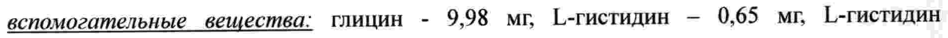
- стр. 3: «полувыведения (Т1/2) — 14 дней (20%).» — низкая уверенность: «(Т1/2)» (55)  
  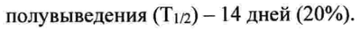
- стр. 10: «уровень белка в моче составляет 22 г/24 часа, терапию препаратом Цирамза® следует» — низкая уверенность: «22» (71)  
  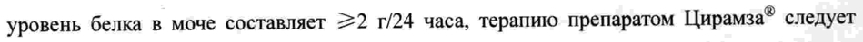
- стр. 10: «временно прекратить. После снижения уровня белка в моче до <2 г/24 часа, терапию следует» — низкая уверенность: «г/24» (79)  
  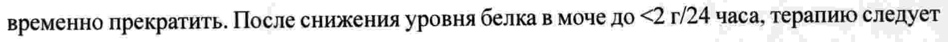
- стр. 11: «Фторурацил 400 мг/м? 200 мг/м? 0 мг/м? 0 мг/м?» — низкая уверенность: «0» (74)  
  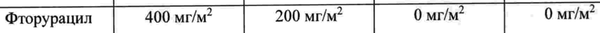
- стр. 12: «© 3 Дозу фторурацила и | Введение фторурацила и» — повторное чтение: «© | 3 | Дозу фторурацила и | Введение фторурацила и»  
  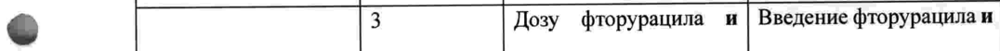
- стр. 12: «Ha 1 дозовый уровень. | откладывают не более» — повторное чтение: «на 1 дозовый уровень. | откладывают He более»  
  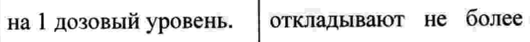
- стр. 12: «4 Дозу фторурацила и | Введение фторурацила и» — повторное чтение: «4 | Дозу фторурацила и | Введение фторурацила и»  
  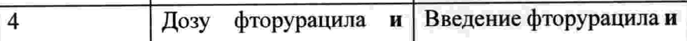
- стр. 13: «снижают на 1 дозовый уровень.» — повторное чтение: «снижают на 1 дозовый уровень.»  
  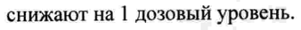
- стр. 14: «© 10 мг/м? на время всех последующих циклов терапии. Следующее снижение дозы на» — повторное чтение: «& 10 Мей на время всех последующих циклов терапии. Следующее снижение дозы на»  
  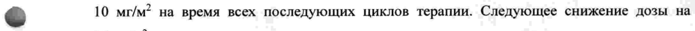
- стр. 21: «частыми (21%) нежелательными реакциями, которые приводили к отмене одного или» — низкая уверенность: «(21%)» (42)  
  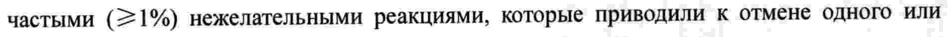
- стр. 26: «анализ суточной мочи. Если уровень белка в моче составляет 22 г/24 часа, терапию» — повторное чтение: «анализ суточной мочи. Если уровень белка в моче составляет >2 г/24 часа, терапию»  
  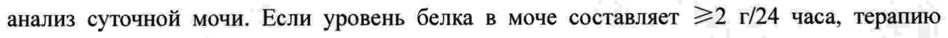
- стр. 26: «повышения уровня белка до =2 г/24 часа рекомендуется повторное снижение дозы.» — низкая уверенность: «=2» (48)  
  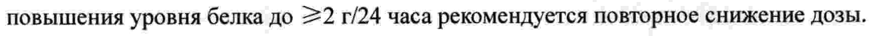
- стр. 28: «По 10 мл (100 мг/10 мл) или 50 мл (500 мг/50 мл) препарата в бесцветный стеклянный» — повторное чтение: «По 10 мл (100 мг/10 мл) или 50 мл (500 мг/50 мл) препарата в бесцветный стеклянный»  
  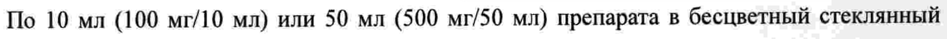
