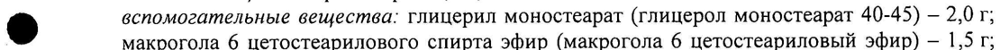
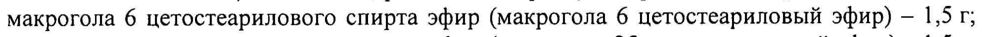
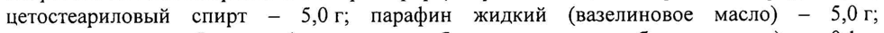
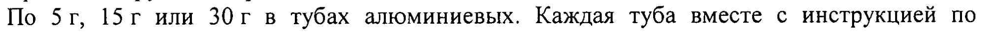

# Рибавирин — наружно

- Препарат: Девирс® (крем для наружного применения;)
- АТХ: D06BB
- Источник: ГРЛС, инструкция по медицинскому применению, РУ ЛП-000237, файл от 2022-05-26 (https://grls.rosminzdrav.ru/Grls_View_v2.aspx?routingGuid=aaef1d94-eeb9-4ad6-be79-b6cb7fb0fa8e)
- Распознано автоматически (OCR): 3 из 3 стр.
- Инструкция к другому РУ того же препарата: ЛП-000237 (национальное РУ, переоформленное по правилам ЕАЭС, решение от 25.04.2022). Текст может быть старше действующего
- Сомнительных строк после OCR: 4 (см. раздел «Проверка распознавания»)

## Общие сведения

МИНИСТЕРСТВО ЗДРАВООХРАНЕНИЯ РОССИЙСКОЙ ФЕДЕРАЦИИ
ИНСТРУКЦИЯ по применению лекарственного препарата для медицинского применения
Девирс® МИНЗДРАВ РОССИИ PAT) - 00043708041 6
{ .. ] СОГЛАСОВАНО | Регистрационный номер: м
Торговое наименование: Девирс® Международное непатентованное наименование (МНН): рибавирин

## 3. Лекарственная форма

крем для наружного применения
крем для наружного применения

## 2. Состав

100 г крема содержат:
100 г крема содержат:
активное вещество: рибавирин 7,5 г;
® вспомогательные вещества: глицерил моностеарат (глицерол моностеарат 40-45) — 2,0 г;
макрогола 6 цетостеарилового спирта эфир (макрогола 6 цетостеариловый эфир) - 1,5 г;
макрогола 25 цетостеарилового спирта эфир (макрогола 25 цетостеариловый эфир) - 1,5 г;
цетостеариловый спирт — 5,0г; парафин жидкий (вазелиновое масло) — 5,0 г;
метилпарагидроксибензоат (метилгидроксибензоат, метилпарабен, нипагин) — 0,1 г;
пропилпарагидроксибензоат (пропилгидроксибензоат, пропилпарабен, нипазол) - 0,02 г;
вода очищенная — до 100,0 г.
Описание © © Однородный крем белого или почти белого цвета.
Фармакотерапевтическая группа Противовирусное средство.
Код АТХ D06BB ® Фармакологические свойства

## 5.1. Фармакодинамика

| Рибавирин является синтетическим аналогом нуклеозидов, активных in vitro в отношении некоторых РНК- и ДНК-содержащих вирусов. Рибавиринтрифосфат (РТФ) является мощным — ингибитором — инозинмонофосфатдегидрогеназы — (ИМФ-дегидрогеназы), вирусной РНК-полимеразы и вирусной мРНК-гуанилилтрансферазы. Ингибирование последней прекращает кэппирование мРНК, что приводит к значительному истощению | внутриклеточных запасов гуанозинтрифосфата и ингибированию синтеза вирусной РНК и белка. Рибавирин также встраивается в вирусный геном, вызывая летальные мутации, с | последующим снижением патогенности вируса. Рибавирин ингибирует репликацию новых вирионов, что обеспечивает снижение вирусной нагрузки, селективно ингибирует синтез вирусной РНК, не подавляя синтез РНК в нормально функционирующих клетках.
| Рибавирин является синтетическим аналогом нуклеозидов, активных in vitro в отношении некоторых РНК- и ДНК-содержащих вирусов. Рибавиринтрифосфат (РТФ) является мощным — ингибитором — инозинмонофосфатдегидрогеназы — (ИМФ-дегидрогеназы), вирусной РНК-полимеразы и вирусной мРНК-гуанилилтрансферазы. Ингибирование последней прекращает кэппирование мРНК, что приводит к значительному истощению | внутриклеточных запасов гуанозинтрифосфата и ингибированию синтеза вирусной РНК и белка. Рибавирин также встраивается в вирусный геном, вызывая летальные мутации, с | последующим снижением патогенности вируса. Рибавирин ингибирует репликацию новых вирионов, что обеспечивает снижение вирусной нагрузки, селективно ингибирует синтез вирусной РНК, не подавляя синтез РНК в нормально функционирующих клетках.
Наиболее чувствительные к рибавирину ДНК-вирусы — вирус простого герпеса, аденовирусы, ЦМВ, вирусы группы оспы, болезни Марека; РНК-вирусы — вирусы гриппа
А, В, парамиксовирусы (парагриппа, эпидемического паротита, ньюкаслской болезни), реовирусы, аренавирусы (вирус лихорадки Jlacca, боливийской геморрагической лихорадки), буньявирусы (вирус лихорадки Долины Рифт, вирус Крым-Конго
| геморрагической лихорадки), хантавирусы (вирус геморрагической лихорадки с почечным

или легочным синдромом), онкогенные РНК-вирусы.

Нечувствительные к рибавирину ДНК-вирусы: Varicella zoster, вирус псевдобешенства,

натуральной коровьей оспы; РНК-вирусы: энтеровирусы, риновирусы, вирус энцефалита

леса Семлики.

## 5.2. Фармакокинетика

При нанесении на кожу системная абсорбция минимальна и практически незначима.

## 4.1. Показания к применению

— инфекции кожи, вызванные вирусом Herpes simplex типов | и 2, различной

локализации, в том числе и в области гениталий;

— опоясывающий лишай.

## 4.3. Противопоказания

— повышенная чувствительность к рибавирину или другим компонентам препарата;

— беременность; |

— период грудного вскармливания;
© — детский и юношеский возраст (до 18 лет).

## 4.3. С осторожностью

— почечная недостаточность;

— у женщин и мужчин репродуктивного возраста.

## 4.6. Применение при беременности и в период грудного вскармливания

Применение крема во время беременности и в период грудного вскармливания
# противопоказано.

## 4.2. Способ применения и дозы

Наружно, наносить на пораженные участки кожи (предварительно вымытые и

высушенные) равномерным тонким слоем, слегка втирая.

Применять 5 раз в сутки до полного исчезновения симптомов заболевания.

При отсутствии улучшения в течение 8 дней применения препарата прекратить

применение и обратиться к врачу.

Для получения наилучшего эффекта лечение следует начинать как можно раньше при
* первом появлении симптомов заболевания.

## 4.8. Побочное действие

Аллергические реакции: кожная сыпь, крапивница, экзантема.

Прочие: выпадение волос, изменение содержания тиреотропного гормона, симптомы

аутоиммунных заболеваний (крайне редко).

Наблюдаемые эффекты, как правило, обратимы, не влияют на эффективность лечения и

прекращаются после окончания лечения.

## 4.9. Передозировка

Передозировка возможна при случайном проглатывании препарата.

Симитомы |

Возможно усиление дозозависимого побочного действия.

Лечение

Отмена препарата, симптоматическая терапия.

## 4.5. Взаимодействие с другими лекарственными средствами

Не выявлено.

## 4.4. Особые указания

Не использовать для лечения офтальмогерпеса, не наносить в области глаз и на слизистые оболочки.
Не использовать для лечения офтальмогерпеса, не наносить в области глаз и на слизистые оболочки.
Препарат следует применять с особой осторожностью у пациентов с почечной недостаточностью.
Мужчины и женщины детородного возраста во время лечения и в течение 7 месяцев после окончания терапии должны использовать эффективные контрацептивные средства.

## 4.7. Влияние на способность управлять транспортными средствами, механизмами

Не изучалось.

## 6.5. Форма выпуска

Крем для наружного применения 7,5 %.
Крем для наружного применения 7,5 %.
По 5г, 15г или 30г в тубах алюминиевых. Каждая туба вместе с инструкцией по применению в пачке из картона.

## 6.4. Условия хранения

* Хранить при температуре не выше 25 °С.
* Хранить при температуре не выше 25 °С.
Хранить в недоступном для детей месте.

## 6.3. Срок годности

3 года.
3 года.
Не использовать по истечении срока годности.
Условия отпуска Отпускают по рецепту.
Производитель/организация, принимающая претензии
ЗАО «ВЕРТЕКС», Россия Юридический адрес:
° 196135, г. Санкт-Петербург, ул. Типанова, 8-100.
` Адрес производства:
199106, г. Санкт-Петербург, В. O., 24 линия, д. 27, лит. А.
или’ * г. Санкт-Петербург, дорога в Каменку, д. 62, лит. A.
Адрес для направления претензий потребителей:
199106, г. Санкт-Петербург, В. O., 24 линия, д. 27, лит. А.
Тел./факс:
y Linn LOS Представитель ЗАО «BEPTEKC» (У © С. А. Копатько
| 3 ВЕР a 4 . р о, eee KC fay EEN7203782190% °
“Ей
## Проверка распознавания

Страницы-сканы распознаны автоматически. В 4 строках с дозировками цифры могли распознаться с ошибкой — сверьте с вырезкой из оригинала:

- стр. 1: «® вспомогательные вещества: глицерил моностеарат (глицерол моностеарат 40-45) — 2,0 г;» — повторное чтение: «® о сооногмтельные вещества: глицерил моностеарат (глицерол моностеарат 40-45) — 2.0т:»  
  
- стр. 1: «макрогола 6 цетостеарилового спирта эфир (макрогола 6 цетостеариловый эфир) - 1,5 г;» — повторное чтение: «макрогола 6 цетостеарилового спирта эфир (макрогола 6 цетостеариловый эфир) - 1,5 ри»  
  
- стр. 1: «цетостеариловый спирт — 5,0г; парафин жидкий (вазелиновое масло) — 5,0 г;» — низкая уверенность: «5,0» (37)  
  
- стр. 3: «По 5г, 15г или 30г в тубах алюминиевых. Каждая туба вместе с инструкцией по» — повторное чтение: «По 5%, 15г или 30r B тубах алюминиевых. Каждая туба вместе с инструкцией по»  
  
