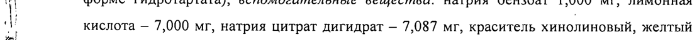
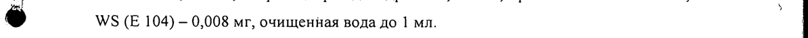
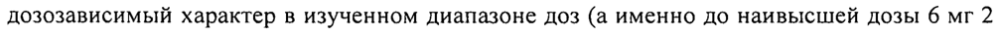
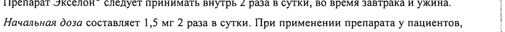
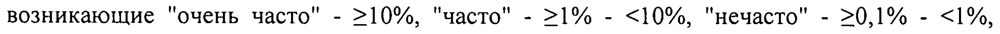
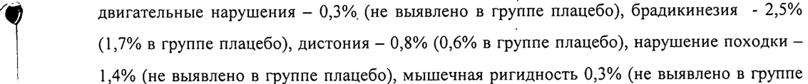
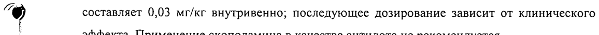

# Ривастигмин — внутрь

- Препарат: Экселон® (раствор для приема внутрь;)
- АТХ: N06DA03
- Источник: ГРЛС, инструкция по медицинскому применению, РУ П N012952/01, файл от 2025-05-30 (https://grls.rosminzdrav.ru/Grls_View_v2.aspx?routingGuid=ce7fa361-9c2c-4d37-a57a-22c624a65105)
- Распознано автоматически (OCR): 14 из 14 стр.
- Инструкция к другому РУ того же препарата: П N012952/01 (национальное РУ, переоформленное по правилам ЕАЭС, решение от 22.04.2025). Текст может быть старше действующего
- Сомнительных строк после OCR: 7 (см. раздел «Проверка распознавания»)

## Общие сведения

МИНИСТЕРСТВО ЗДРАВООХРАНЕНИЯ РОССИЙСКОЙ ФЕДЕРАЦИИ
ИНСТРУКЦИЯ ;
| ПО ПРИМЕНЕНИЮ ЛЕКАРСТВЕННОГО-НРЕПАФ ЭКСЕЛОН® МИНЗДРАВ РОССИИ
СОГЛАСОВАНО Внимательно прочитайте эту инструкцию перед тем, как начать прием/использование этого лекарства.
° Сохраните инструкцию, она может потребоваться вновь.
° Если у Вас возникли вопросы, обратитесь к врачу.
@ ® Это лекарство назначено лично Вам, и его не следует передавать другим лицам,
; поскольку ОНО может причинить им вред даже при наличии тех же симптомов, что иу
||: | Вас.
aw | РЕГИСТРАЦИОННЫЙ НОМЕР: П №012952/01
| | ТОРГОВОЕ НАЗВАНИЕ: Экселон® | МЕЖДУНАРОДНОЕ НЕПАТЕНТОВАННОЕ НАЗВАНИЕ (МНН): ривастигмин
| ЛЕКАРСТВЕННАЯ ФОРМА: раствор для приема внутрь
| CoctaB: ‘_ | 1 мл раствора для приема внутрь содержит: активное вещество — ривастигмин 2 мг (в |
| форме гидротартата); вспомогательные вещества: натрия бензоат 1,000 мг, лимонная
| кислота — 7,000 мг, натрия цитрат дигидрат — 7,087 мг, краситель хинолиновый, желтый
9 WS (Е 104) - 0,008 мг, очищенная вода до 1 мл. |
ОПИСАНИЕ: прозрачный раствор желтого цвета |
ФАРМАКОТЕРАПЕВТИЧЕСКАЯ ГРУППА: холинэстеразы ингибитор
Код ATX: NO6DA03 ФАРМАКОЛОГИЧЕСКИЕ СВОЙСТВА
Фармакодинамика й Действующим веществом препарата Экселон® является ривастигмин - селективный ингибитор ацетилхолинэстеразы и бутирилхолинэстеразы головного мозга, применяемый для лечения болезни Альцгеймера и деменции при болезни Паркинсона. Ривастигмин | замедляет разрушение ацетилхолина, вырабатываемого функционально сохранными нейронами. При этом ривастигмин селективно увеличивает содержание ацетилхолина в коре головного мозга и гиппокампе, и, таким образом, способствует улучшению
| | | | холинергической нервной передачи. Ривастигмин может оказывать положительное действие при снижении когнитивных функций, связанных с дефицитом ацетилхолина, в частности, при деменции, ассоциированной с болезнью Альцгеймера и болезнью
| Паркинсона. Кроме того, существуют доказательства того, что ингибирование
| холинэстераз может замедлять образование фрагментов белкового предшественника бетаамилоида, принимающего участие в амилоидогенезе, и, таким образом, замедлять формирование амилоидных бляшек, являющихся одним из главных патологических

признаков болезни Альцгеймера.
Ривастигмин взаимодействует с ферментом-мишенью с образованием ковалентной связи, что ведет к временной инактивации фермента. Было показано, что у молодых здоровых
| мужчин после приема ривастигмина в дозе 3 мг активность ацетилхолинэстеразы в
‘a спинномозговой жидкости (СМЖ) снижается приблизительно на 40% в течение первых 1,5 часов. После достижения максимального ингибирующего эффекта активность
| фермента возвращается к исходной примерно через 9 часов. Показано, что активность
| бутирилхолинэстеразы в СМЖ у молодых здоровых добровольцев ингибируется обратимо и восстанавливается до исходной через 3,6 часа. У пациентов с болезнью Альцгеймера ингибирование ривастигмином активности ацетилхолинэстеразы в СМЖ имеет дозозависимый характер в изученном диапазоне доз (а именно до наивысшей дозы 6 мг 2 раза в сутки). Ингибирование активности бутирилхолинэстеразы также дозозависимо;
доза 6 мг 2 раза в сутки вызывает снижение активности фермента более чем на 60% по сравнению с исходной. Данный эффект ривастигмина сохранялся на протяжении 12
1 месяцев терапии (максимальный изученный период). Было установлено наличие
@ статистически значимой корреляции между степенью ингибирования ривастигмином обоих ферментов в СМЖ и изменениями когнитивных функций у пациентов с болезнью
Альцгеймера; при этом, именно ингибирование активности бутирилхолинэстеразы в
СМЖ достоверно и стабильно коррелирует с улучшением результатов тестов памяти,

| внимания и быстроты реакции. | | Фармакокинетика
Всасывание

Ривастигмин быстро и полностью всасывается. Максимальная концентрация в плазме крови (Cmax) достигается примерно через 1 час. Вследствие взаимодействия ривастигмина с ферментом-мишенью при увеличении дозы препарата повышение его биодоступности в 1,5 раза превышает ожидаемое (для данного увеличения дозы). После приема дозы 3 мг абсолютная биодоступность составляет около 36+13%. При приеме ривастигмина в форме
| раствора для приема внутрь вместе с пищей всасывание ривастигмина замедляется (время
| достижения Cmax увеличивается на 74 минуты); величина Cmax снижается на 43%, при этом площадь под кривой «концентрация — время» (AUC) увеличивается приблизительно на 9%.
Распределение Ривастигмин связывается с белками плазмы в слабой степени (приблизительно на 40%).
Ривастигмин эквивалентно распределяется в плазме и в крови, коэффициент распределения крови к плазме равен 0,9 при концентрациях от 1 до 400 нг/мл.
Легко проникает через гематоэнцефалический барьер, достигая пиковой концентрации через 1-4 часа, отношение AUC цереброспинальной жидкости и плазмы крови составляет 40%. Кажущийся объем распределения после внутривенного введения составляет 1,8-2,7
, |. л/кг. | | \( ~ Метаболизм Ривастигмин быстро и в значительной степени метаболизируется (период полувыведения из плазмы (Tj) составляет около 1 часа), главным образом путем гидролиза
| холинэстеразой с образованием декарбамилированного метаболита (NAP226-90). Jn vitro у этого метаболита показана минимальная способность ингибировать активность ацетилхолинэстеразы (< 10%). Основываясь на данных, полученных в М vilro исследованиях, не ожидается взаимодействия с препаратами, метаболизирующимися с участием следующих изоферментов системы цитохрома: СУР1А2, CYP2D6, CYP3A4/5,
СУР2Е1, CYP2C9, CYP2C8, СУР2С19 или CYP2B6. В соответствии с данными,
| полученными в экспериментальных исследованиях, основные изоферменты цитохрома
Р450 вовлечены в метаболизм ривастигмина в минимальной степени. Этим данным соответствуют и наблюдения, свидетельствующие об отсутствии у человека взаимодействий ривастигмина с лекарственными препаратами, метаболизирующимися при участии цитохрома Р450. Общий клиренс ривастигмина после внутривенного
| введения составляет приблизительно 130 л/ч при дозе 0,2 мг, и снижается до 70 л/ч - при
| 2,7 мг. | | Выведение | Ривастигмин выводится, главным образом, почками в виде метаболитов; в неизмененном виде в моче не обнаруживается. Через 24 часа после приема выводится более 90% дозы. С калом выводится менее 1% дозы. У пациентов с болезнью Альцгеймера кумуляции ривастигмина или его декарбамилированного метаболита не отмечается.
| Фармакокинетика у пожилых пациентов В исследовании, влияния возраста на фармакокинетику ривастигмина после применения внутрь в дозе 1,0 мг было показано, что концентрация ривастигмина плазмы крови выше у
| пожилых здоровых добровольцев (61-71 лет) по сравнению с молодыми (19-40 лет).
Данная разница увеличивалась с возрастанием дозы ривастигмина (2,5 мг): у пожилых здоровых добровольцев концентрация ривастигмина плазмы крови была на 30% больше,
| чем у молодых. Возраст не влиял на концентрацию декарбамилированных феноловых
} метаболитов. У пациентов с болезнью Альцгеймера в возрасте от 50 до 92 лет в
| проведенных клинических исследованиях не было выявлено изменений биодоступности,
| связанных с возрастом.
Нарушение функции почек \ Г Было показано, что при однократном приеме внутрь в дозе 3 мг концентрация м ривастигмина в плазме крови не отличается у здоровых пациентов и пациентов с нарушением функции почек тяжелой степени (СКФ < 10 мл/мин). Клиренс ривастигмина был равен 4,8 л/мин и 6,9 л/мин у пациентов и у здоровых добровольцев соответственно.
| Однако у пациентов с нарушением функции почек средней степени тяжести (СКФ 10-50 мл/мин), Cmax ривастигмина в плазме крови была увеличена почти в 2,5 раза и AUC
| декарбамилированных феноловых метаболитов была увеличена примерно на 50%.
Клиренс ривастигмина был равен 1,7 л/мин. Причина несоответствия между степенью выраженности нарушения функции почек и клиренсом ривастигмина не ясна.
| | Нарушение функции печени | После приема внутрь Cmax ривастигмина была примерно на 60% выше и AUC была более чем в 2 раза больше у пациентов с нарушением функции печени легкой и средней степени тяжести по сравнению со здоровыми добровольцами. При приеме 3 мг ривастигмина
| однократно или многократного приема препарата по схеме 6 мг 2 раза в день клиренс ривастигмина был примерно на 60-65% меньше у пациентов с нарушением функции
| печени легкой и средней степени тяжести по сравнению со здоровыми добровольцами.
| Эти фармакокинетические особенности не влияют на частоту встречаемости и выраженность нежелательных явлений.
| ПОКАЗАНИЯ К ПРИМЕНЕНИЮ - Слабо или умеренно выраженная деменция альцгеймеровского типа (вероятная болезнь
Альцгеймера, болезнь Альцгеймера).
- Слабо или умеренно выраженная деменция при болезни Паркинсона.
| | | ПРОТИВОПОКАЗАНИЯ Повышенная чувствительность к ривастигмину, другим производным карбамата или прочим компонентам, входящим в состав препарата.
Кожные реакции, подозрительные на аллергический контактный дерматит, на фоне применения препарата Экселон® TTC.
Возраст до 18 лет.
| С ОСТОРОЖНОСТЬЮ Препарат Экселон®, как и другие холиномиметические средства, следует применять с осторожностью у пациентов с синдромом слабости синусового узла или нарушениями | сердечной проводимости (синоатриальная блокада, атриовентрикулярная блокада).
Холинергическая стимуляция может повышать секрецию соляной кислоты в желудке, :
приводить к усилению обструкции мочевыводящих путей и обострению судорожного | синдрома, поэтому следует соблюдать осторожность при применении препарата Экселон® | у пациентов, предрасположенных к этим состояниям. |
Препарат Экселон®, так же как и другие холиномиметики, следует с осторожностью | применять у пациентов с бронхиальной астмой или другими обструктивными | заболеваниями дыхательных путей в анамнезе. « !
Применение ривастигмина у пациентов с нарушением функции печени тяжелой степени | возможно под тщательным контролем медперсонала; исследования у данной категории пациентов не проводились.
Принимая во внимание фармакодинамические свойства ривастигмина, его не следует применять одновременно с другими холиномиметическими препаратами.
ПРИМЕНЕНИЕ ПРИ БЕРЕМЕННОСЛИ И В ПЕРИОД ГРУДНОГО ВСКАРМЛИВАНИЯ
Беременность В исследованиях у животных ривастигмин проникал через плаценту. Нет данных о способности ривастигмина проникать через гематоплацентарный барьер у человека.
Экспериментальные данные показали, что ривастигмин не имеет тератогенных свойств. В исследованиях у животных отмечалось увеличение продолжительности гестационного периода. Безопасность применения препарата Экселон® при беременности у человека до настоящего времени не установлена, поэтому препарат можно применять при
| беременности только в тех случаях, когда ожидаемая польза лечения превосходит
| потенциальный риск для плода.
| Грудное вскармливание | В исследованиях ривастигмин и его метаболиты выделялись с молоком лактирующих
| 5 if | | животных. Неизвестно, проникает ли ривастигмин в грудное молоко, поэтому ВО время применения препарата следует отказаться от кормления грудью. |
Фертильность | Нет данных о влиянии ривастигмина На женщин репродуктивного возраста.
Нет данных о влиянии ривастигмина на фертильность у человека. В исследованиях у животных не отмечено отрицательного влияния на фертильность самцов и самок, как
| родителей, так и потомства. | СПОСОБ ПРИМЕНЕНИЯ И ДОЗЫ |
Препарат Экселон® следует принимать внутрь 2 раза в сутки, во время завтрака и ужина. |
Начальная доза составляет 1,5 мг 2 раза в сутки. При применении препарата у пациентов, | особенно чувствительных к воздействию холинергических препаратов, лечение следует | начинать с дозы 1 мг 2 раза в сутки.
| Подбор дозы. Начальная рекомендуемая доза - 1,5 мг (0,75 мл раствора) 2 раза в сутки.

Если по прошествии минимум двух недель лечения отмечается хорошая переносимость,

доза может быть увеличена до 3 мг (1,5 мл раствора) 2 раза в сутки. В случае хорошей

| переносимости возможно дальнейшее увеличение до 4,5 мг (2,25 мл раствора) 2 раза в |

сутки и далее до 6 мг (3 мл раствора) 2 раза в сутки с интервалом не менее 2-х недель

после каждого увеличения дозы.
Нежелательные явления, а именно, тошнота, рвота, боли в животе, снижение аппетита или снижение массы тела, наблюдающиеся во время лечения, могут уменьшиться после пропуска одной или нескольких доз препарата. Если нежелательные явления сохраняются, суточную дозу препарата следует снизить до предыдущей хорошо переносимой дозы, или прекратить прием препарата. .

| Поддерживающая доза составляет OT 3 мг до 6 мг 2 раза в сутки. С целью достижения наилучшего терапевтического эффекта дозу препарата следует сохранять на максимальном хорошо переносимом уровне. Эффективность препарата при длительности применения более 6 месяцев не установлена.

Максимальная суточная доза: 6 мг 2 раза в сутки.

Поддерживающее лечение может быть продолжено, пока сохраняется терапевтический эффект. Таким образом, следует регулярно оценивать терапевтический эффект, особенно у пациентов, получающих лечение дозами менее 3 мг 2 раза в сутки. В случае если по

| прошествии 3 месяцев терапии препаратом в поддерживающей дозе у пациента не наблюдается положительной динамики уменьшения симптомов деменции, лечение следует прекратить. Следует также рассмотреть вопрос о прекращении терапии

препаратом в случае, если ранее отмеченный терапевтический эффект более не наблюдается.
Возобновление приема препарата после перерыва
Частота возникновения и тяжесть нежелательных явлений возрастает с повышением дозы ривастигмина. Если перерыв в приеме препарата составил более трех дней, возобновлять лечение следует с начальной дозы с целью уменьшения риска повторного возникновения побочных реакций (например, тяжелой рвоты). Постепенное увеличение дозы проводят ступенчато, как описано выше.
Способ применения раствора для приема внутрь
Необходимое количество раствора следует извлекать из флакона при помощи прилагаемого к нему дозатора. Раствор можно принимать непосредственно из дозатора.
` < Равные дозы препарата, применяемые в виде капсул и в виде раствора для приема внутрь, являются взаимозаменяемыми.
У пациентов с нарушениями функции почек или печени коррекции режима дозирования препарата не требуется. Однако вследствие увеличения экспозиции препарата у пациентов с нарушением функции почек средней степени тяжести и нарушением функции печени легкой и средней степени тяжести, рекомендовано тщательно подбирать дозу ривастигмина у пациентов данной категории в соответствии с индивидуальной — переносимостью вследствие повышенного риска развития дозозависимых нежелательных явлений. Применение ривастигмина у пациентов с , нарушением функции печени тяжелой степени возможно под тщательным контролем медперсонала, исследований у данной категории пациентов не проводились.
g ПОБОЧНОЕ ДЕЙСТВИЕ .
| Наиболее часто сообщалось о нежелательных явлениях (НЯ) со стороны о пищеварительной системы: тошнота (38%), рвота (23%), в основном в период повышения
1 дозы. По данным клинических исследований нежелательные реакции со стороны пищеварительной системы и снижение массы тела чаще отмечались у женщин.
Частота возникновения нежелательных реакций оценивалась следующим образом:
возникающие "очень часто" - 210%, "часто" - >1% - <10%, "нечасто" - >0,1% - <1%,
: "редко" - >0,01% - <0,1%, "очень редко" - <0,01%, включая отдельные спонтанные
| сообщения о НЯ.
У пациентов с деменцией альцгеймеровского типа, получавших терапию препаратом
| Экселон®, отмечались следующие НЯ Инфекционные и паразитарные заболевания: очень редко - инфекции мочевыводящих
| путей. !

Нарушения психики: часто - ажитация, тревога, спутанность сознания; нечасто -

бессонница, депрессия; очень редко — галлюцинации. |

Нарушения со стороны нервной системы: очень часто — головокружение; часто — |

головная боль, сонливость, тремор; нечасто — обморок; редко — судорожные приступы; |

очень редко — экстрапирамидные нарушения (в том числе ухудшение течения !
сопутствующей болезни Паркинсона).

Нарушения со стороны сердца: редко — стенокардия, инфаркт миокарда; очень редко -

аритмия (брадикардия, атриовентрикулярная блокада, фибрилляция предсердий,

тахикардия).

Нарушения со стороны сосудов: очень редко - повышение артериального давления (АД).

Нарушения со стороны пищеварительной системы: очень часто — тошнота, рвота, диарея, |
: снижение аппетита; часто - боли в животе и диспепсия; редко - язвы желудка и !

двенадцатиперстной кишки; очень редко - кровотечения желудочно-кишечного тракта

(ЖКТ), панкреатит, тяжелая рвота, приводящая к разрыву пищевода.

Нарушения со стороны кожси и подкожных тканей: часто - гипергидроз; редко — сыпь,

зуд.

Нарушения со стороны обмена веществ и питания: часто — снижение массы тела. |

Общие расстройства и нарушения в месте введения: часто - повышенная утомляемость и | астения, общее недомогание; нечасто - падения. |

Нарушения со стороны печени и желчевыводящих путей: нечасто - нарушения

лабораторных показателей функции печени.

При применении препарата Экселон® ТТС у пациентов с деменцией альцгемеровского

типа получены сообщения о следующих НЯ: часто — недержание мочи; нечасто — |

нарушение мозгового кровообращения, делирий, психомоторное возбуждение; редко —

эритема, крапивница, образование волдырей, аллергический дерматит.

У пациентов с деменцией при болезни Паркинсона, получавших терапию препаратом
| Экселон® в капсулах, отмечались следующие НЯ.

Нарушения психики: часто — беспокойство, бессонница, тревога.

Нарушения со стороны нервной системы: очень часто — тремор; часто — головокружение, | сонливость, головная боль, ухудшение течения болезни Паркинсона, брадикинезия,
| дискинезия, гипокинезия, ригидность по типу «зубчатого колеса»; нечасто — дистония.

Нарушения со стороны сердца: часто — брадикардия; нечасто - фибрилляция предсердий,

атриовентрикулярная блокада. |

| Нарушения со стороны пищеварительной системы: очень часто — тошнота, рвота; часто — | диарея, боль в животе и диспепсия, повышенное слюноотделение, снижение аппетита. |
Нарушения со стороны кожи и подкожных тканей: часто — повышенное потоотделение. |
Общие расстройства и нарушения в месте введения: очень часто — случайные падения; !
часто — дегидратация, повышенная утомляемость и астения, нарушения походки.
Нижеперечисленные НЯ отмечались в ходе клинического исследования у пациентов с !
болезнью Паркинсона, _ получающих _JIeyeHue препаратом Экселон® в_ виде
| трансдермальной терапевтической системы (TTC): часто — ажитация, депрессия. |
Отдельные сообщения о нежелательных явлениях по данным постмаркетингового | применения (частота неизвестна).
На фоне терапии препаратом Экселон® (капсулы или раствор для приема внутрь) в | клинической практике отмечались следующие нежелательные явления (частота НЯ не | установлена): дегидратация, агрессия, беспокойство, экстрапирамидные расстройства у | пациентов с деменцией альцгеймеровского типа, синдром слабости синусового узла, гепатит, распространенный аллергический дерматит. |
По данным клинического исследования у пациентов с деменцией, вызванной болезнью
Паркинсона, была установлена частота (в сравнении с плацебо) следующих НЯ, способных привести к усугублению симптомов паркинсонизма: тремор - 10,2% (3,9 % в группе плацебо), падение - 5,8% (6,1% в группе плацебо), ухудшение течения болезни
Паркинсона - 3,3% (1,1% в группе плацебо), повышенное слюноотделение - 1,4% (не выявлено в группе плацебо), дискинезия - 1,4% (0,6% в группе плацебо), паркинсонизм — 2,2% (0,6% в группе плацебо), гипокинезия - 0,3% (не выявлено в группе плацебо),
‘@ двигательные нарушения — 0,3% (не выявлено в групне плацебо), брадикинезия - 2,5%
] (1,7% в группе плацебо), дистония - 0,8% (0,6% в группе плацебо), нарушение походки —
| 1,4% (не выявлено в группе плацебо), мышечная ригидность 0,3% (не выявлено в группе плацебо), нарушение равновесия — 0,8% (1,1% в групйе плацебо), костно-мышечная скованность — 0,8% (не выявлено в группе плацебо), дрожь — 0,3% (не выявлено в группе плацебо), моторная дисфункция - 0,3% (не выявлено в группе плацебо).
Если любые из указанных в инструкции побочных эффектов усугубляются, или Вы
| заметили любые другие побочные эффекты, не указанные в инструкции, сообщите об этом врачу.

## 4.9. Передозировка

Симптомы. Случайная передозировка препаратом в большинстве случаев не сопровождалась какими-либо клиническими проявлениями; практически все пациенты
Симптомы. Случайная передозировка препаратом в большинстве случаев не сопровождалась какими-либо клиническими проявлениями; практически все пациенты
- 9 продолжали лечение препаратом Экселон®. При передозировке отмечались тошнота, рвота, диарея, боль в животе, головокружение, тремор, головная боль, сонливость, о брадикардия, спутанность сознания, повышенное потоотделение, повышение АД, галлюцинации, общее недомогание. Передозировка ингибиторами холинэстеразы может приводить к холинергическому кризу с развитием таких симптомов, как выраженная тошнота, рвота, повышенное слюноотделение, потливость, брадикардия, снижение артериального давления, угнетение дыхательной деятельности и судороги. Возможно развитие мышечной слабости, что может привести к летальному исходу при вовлечении дыхательной мускулатуры. Учитывая ваготонический эффект ингибиторов холинэстеразы
| на частоту сердечных сокращений (ЧСС), нельзя исключить возникновение брадикардии и/или обморочных состояний. При передозировке препаратом отмечались редкие случаи летального исхода, однако связь с применением препарата остается неясной. Симптомы и исход варьировали у различных пациентов. Не прослеживалось четкой связи между принятой дозой препарата и тяжестью исхода.
Лечение. Поскольку Тиз ривастигмина из плазмы крови составляет около 1 часа, а длительность ингибирования активности ацетилхолинэстеразы составляет около 9 часов, в случаях бессимптомно протекающей передозировки рекомендуется не применять препарат Экселон® в течение последующих 24 часов. Если передозировка сопровождается выраженной тошнотой и рвотой, следует рассмотреть вопрос о применении противорвотных средств. При возникновении других нежелательных явлений при
| необходимости проводят соответствующее симптоматическое лечение.
При значительной передозировке может быть применен атропин, начальная доза которого q $ составляет 0,03 мг/кг внутривенно; последующее дозирование зависит от клинического эффекта. Применение скополамина в качестве антидота не рекомендуется.

## 4.5. Взаимодействие с другими лекарственными средствами

| Ривастигмин метаболизируется преимущественно путем гидролиза при участии эстераз.
Метаболизм ривастигмина при участии основных изоферментов цитохрома Р450 происходит в минимальной степени. Таким образом, фармакокинетических
| взаимодействий ривастигмина с другими лекарственными средствами,
| метаболизирующимися с участием данных ферментов, не предвидится.
Нерекомендованное взаимодействие Метоклопрамид
Учитывая возможность возникновения совокупного влияния препаратов на экстрапирамидную систему, одновременное применение метоклопрамида и ривастигмина не рекомендовано.
| Препараты, влияющие на холинергическую систему
Учитывая фармакодинамические характеристики ривастигмина, следует избегать одновременного применения его с другими холиномиметиками в связи с возможностью развития их совокупного действия. Ривастигмин может влиять на действие холиноблокаторов (например, оксибутинина, толтеродина).
Соли суксаметония При проведении анестезии ривастигмин, являясь ингибитором холинэстеразы, может усиливать эффекты деполяризующих миорелаксантов (миорелаксантов солей суксаметония). Рекомендовано соблюдать осторожность при выборе средства для анестезии. При необходимости перед проведением анестезии возможно уменьшение дозы 6 ривастигмина или временная остановка терапии.
> Взаимодействия, которые следует принимать во внимание
| Бета-адреноблокаторы При одновременном применении ривастигмина с различными бета-адреноблокаторами
| (включая атенолол) было отмечено синергическое взаимодействие, приводившее к развитию брадикардии, что, в свою очередь может стать причиной синкопальных
| состояний. Несмотря на то, что одновременное применение с кардиоселективными бетаадреноблокаторами связано с наибольшим риском развития таких эффектов, данные НЯ отмечались также и у пациентов, получавших и другие препараты данной группы.
Взаимодействие с никотином Показано увеличение всасывания ривастигмина на 23% при применении внутрь (в форме в капсул в дозе до 12 мг/сут) у пациентов, принимающих никотин.
Взаимодействие с наиболее часто одновременно применяемыми препаратами
| У здоровых добровольцев фармакокинетического взаимодействия между ривастигмином и дигоксином, варфарином, диазепамом или флуоксетином выявлено не было. Вызванное варфарином увеличение протромбинового времени при применении ривастигмина не изменялось. При одновременном применении ривастигмина и — дигоксина неблагоприятного влияния на внутрисердечную проводимость отмечено не было.
Одновременное применение ривастигмина с такими часто применяемыми препаратами, как антацидные средства, противорвотные средства, гипогликемические средства,
\ гипотензивные препараты центрального действия, блокаторы «медленных» кальциевых - каналов, препараты, оказывающие положительное инотропное действие, антиангинальные
| средства, нестероидные противовоспалительные препараты, эстрогены, анальгезирующие
| И | средства, анксиолитические средства (бензодиазепины) и Н!-гистаминовых рецепторов блокаторы, не сопровождалось какими-либо изменениями кинетики ривастигмина или повышением риска возникновения клинически значимых нежелательных явлений.
. ОСОБЫЕ УКАЗАНИЯ Лечение необходимо всегда начинать с дозы 1,5 мг 2 раза в день, которую постепенно увеличивают до поддерживающей дозы. При прерывании лечения более чем на три дня, следует возобновлять терапию с минимальной суточной дозы для снижения вероятности развития нежелательных явлений.
Расстройства пищеварительной системы, такие как тошнота, рвота и диарея могут возникнуть в начале лечения или при увеличении дозы препарата и могут купироваться при уменьшении дозы. В противном случае лечение препаратом Экселон® следует
| отменить. Пациентам, у которых развились признаки дегидратации, вследствие
> продолжительной диареи или рвоты, рекомендовано внутривенное введение жидкости и
| снижение дозы или отмена терапии ривастигмином. Дегидратация может иметь серьезные последствия.
Необходимо контролировать массу тела пациентов с болезнью Альцгеймера, так как у данной группы пациентов возможна потеря веса при приеме ингибиторов холинэстеразы, включая ривастигмин.
Пациенты с массой тела менее 50 кг хуже переносят терапию ривастигмином и чаще вынуждены прерывать лечение вследствие развития нежелательных явлений.
В состав раствора для приема внутрь входит натрия бензоат. Бензойная кислота оказывает незначительное раздражающее действие на кожу, слизистые оболочки и при попадании в oq глаза. |
| ? Подобно другим холиномиметикам, при применении ривастигмина возможно развитие
| обструкции мочевыводящих путей, а также возникновение или увеличение выраженности
| экстрапирамидных расстройств. При применении ривастигмина у пациентов с деменцией при болезни Паркинсона отмечалось увеличение выраженности симптомов
| | паркинсонизма, особенно тремора.
| После увеличения дозы препарата Экселон® возможно кратковременное повышение
| артериального давления и возникновение галлюцинаций у пациентов с деменцией
| , : альцгеймеровского типа, a также усугубление экстрапирамидных расстройств (особенно
| тремора) у пациентов с деменцией при болезни Паркинсона. Данные симптомы могут исчезнуть при снижении дозы, в противном случае препарат следует отменить. Следует
| регулярно оценивать состояние пациентов для выявления данных нежелательных и
| явлений. | | Кожные реакции Кожные реакции, возникающие на фоне применения препарата Экселон® ТТС, были, как правило, легкой или умеренной степени выраженности. Эти реакции не являются t показателем сенсибилизации пациента к ривастигмину. Тем не менее, на фоне применения препарата Экселон® ТТС может возникнуть аллергический контактный
. дерматит.
| При развитии у пациентов контактного аллергического дерматита на фоне применения препарата Экселон® TTC, если есть необходимость продолжения терапии ривастигмином,
. пациента под контролем медицинского персонала и после получения отрицательного
| результата аллергологического тестирования рекомендовано перевести На лекарственные
® формы ривастигмина для приема внутрь. У некоторых пациентов с сенсибилизацией к у ривастигмину после применения препарата Экселон® ТТС, применение ривастигмина в других лекарственных формах может оказаться невозможным.
Аллергический контактный дерматит следует заподозрить, если в месте прикрепления
ТТС возникла кожная реакция, распространяющаяся за пределы размера ТТС, или кожные реакции в месте прикрепления достигли выраженной интенсивности (например, усиливающаяся эритема, отек, возникновение папул, везикул), а также, если выраженность кожных реакций существенно не уменьшается в течение 48 часов после удаления ТТС. В этих случаях лечение препаратом следует прекратить (см. раздел

## 4.3. Противопоказания

).
).
| В постмаркетинговом периоде были получены данные о развитии у некоторых пациентов
® распространенного аллергического дерматита при применении ривастигмина вне зависимости от способа применения (внутрь или трансдермально). В этих случаях лечение
| препаратом следует полностью отменить (см. раздел Противопоказания). Пациенты и
| лица, осуществляющие уход за ними, должны быть проинформированы о возможности |
1 развития соответствующих кожных реакций На фоне применения ривастигмина. |

## 4.7. Влияние на способность управлять транспортными средствами, механизмами

| МЕХАНИЗМАМИ Болезнь Паркинсона и болезнь Альцгеймера могут снижать способность управлять
| транспортными средствами и механизмами. Ривастигмин может вызывать головокружение и сонливость, особенно в начале терапии и при наращивании дозы.
Таким образом, способность пациентов управлять автотранспортом и сложными
| механизмами должна регулярно оцениваться лечащим врачом.
| :

## 6.5. Форма выпуска

По 50 мл или 120 мл во флаконы темного стекла, снабженные пробкой с насосной трубочкой и завинчивающейся крышкой с защитой от детей в комплекте с дозатором и инструкцией по применению в картонной пачке. |
По 50 мл или 120 мл во флаконы темного стекла, снабженные пробкой с насосной трубочкой и завинчивающейся крышкой с защитой от детей в комплекте с дозатором и инструкцией по применению в картонной пачке. |

## 6.4. Условия хранения

| Хранить при температуре не выше 30°C. Не замораживать.
| Хранить при температуре не выше 30°C. Не замораживать.
Флакон следует хранить в вертикальном положении.
| Препарат следует хранить в недоступном для детей месте.
| СРОК ГОДНОСТИ 3 года | Препарат не следует использовать после истечения срока годности.
| ae УСЛОВИЯ ОТПУСКА ИЗ АПТЕК | © По рецепту.
| ПРОИЗВОДИТЕЛЬ | | НОВАРТИС ФАРМА АГ, ШВЕЙЦАРИЯ, ПРОИЗВЕДЕНО ДЕЛЬФАРМ Юнинг С.А.С. ФРАНЦИЯ
| | NOVARTIS PHARMA AG, SWITZERLAND, MANUFACTURED BY DELPHARM HUNINGUE
S.A.S., FRANCE АДРЕС:
ЛихтшТРАССЕ 35, 4056 БАЗЕЛЬ, ШВЕЙЦАРИЯЛ АСНТЗТВАЗЗЕ 35, 4056 BASEL, SWITZERLAND
| | ДОПОЛНИТЕЛЬНУЮ ИНФОРМАЦИЮ О ПРЕПАРАТЕ МОЖНО ПОЛУЧИТЬ ПО АДРЕСУ:
125315, Москва, Ленинградский проспект, дом 72, корпус 3 |
© Тел. (495) 967 12 70, факс (495) 967 12 68
Г | | ky <a .
№ = (‘Howonue Opn АЕ arma LLC)
Широкова О.В. К / Ay | Директор nenapramen SS : Я епаратов на рынок
ООО «НОВАРТИС ФАРМА»
| .
| 14
## Проверка распознавания

Страницы-сканы распознаны автоматически. В 7 строках с дозировками цифры могли распознаться с ошибкой — сверьте с вырезкой из оригинала:

- стр. 1: «| кислота — 7,000 мг, натрия цитрат дигидрат — 7,087 мг, краситель хинолиновый, желтый» — повторное чтение: «| : sonora > 7000 натрия  итрат дигидрат. 0 37 и  паситель кинолиновый желтый»  
  
- стр. 1: «9 WS (Е 104) - 0,008 мг, очищенная вода до 1 мл. |» — низкая уверенность: «9» (46); повторное чтение: «9 WS (Е 104) _ 0,008 wr, очищенная вода no 1 мл. | — | | |»  
  
- стр. 2: «дозозависимый характер в изученном диапазоне доз (а именно до наивысшей дозы 6 мг 2» — низкая уверенность: «2» (70)  
  
- стр. 6: «Начальная доза составляет 1,5 мг 2 раза в сутки. При применении препарата у пациентов, |» — повторное чтение: «Havansvas доза воетньляет 1.5 мг 2 рва всуни При применении препарата ynauuewon, |»  
  
- стр. 7: «возникающие "очень часто" - 210%, "часто" - >1% - <10%, "нечасто" - >0,1% - <1%,» — низкая уверенность: «210%,» (32), «<1%,» (57)  
  
- стр. 9: «] (1,7% в группе плацебо), дистония - 0,8% (0,6% в группе плацебо), нарушение походки —» — повторное чтение: «у и 0, =o na et ee on»  
  
- стр. 10: «q $ составляет 0,03 мг/кг внутривенно; последующее дозирование зависит от клинического» — повторное чтение: «® поставляет ОЗ MORE внутривенно; последующее дозирование зависит от клинического»  
  
