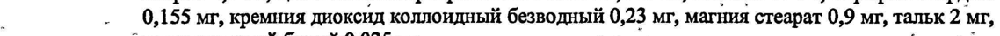
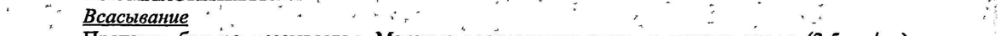
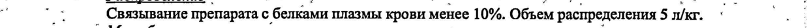
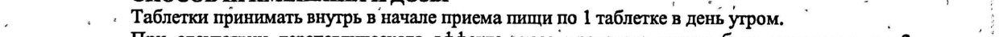
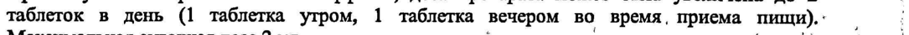
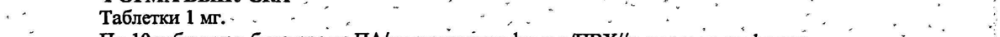

# Рилменидин — внутрь

- Препарат: Альбарел® (таблетки;)
- АТХ: C02AC06
- Источник: ГРЛС, инструкция по медицинскому применению, РУ П N013071/01, файл от 2022-09-07 (https://grls.rosminzdrav.ru/Grls_View_v2.aspx?routingGuid=899a8e4f-a323-4567-bd89-3a487758769e)
- Распознано автоматически (OCR): 5 из 5 стр.
- Сомнительных строк после OCR: 6 (см. раздел «Проверка распознавания»)

## Общие сведения

. : П М013071/01-231211

‘ 4 é - - , . * ‘ ‘ . ”, | ; . ` МИНИСТЕРСТВО ЗДРАВООХРАНЕНИЯ И СОЦИАЛЬНОГО РАЗВИТИЯ ’ ОИ:
: . | РОССИЙСКОЙ ФЕДЕРАЦИИ ›' (а, rey a Е ъ i ; _— _ 4 р , > {
. “в, . . И ; * № р ; #, _ _ о _ ИНСТРУКЦИЯ -. | oe к 7
‚ По применению лекарственного препарата для медицинского применения ‘` | т.е. НЫ АЛЬБАРЕЛ® . - i 3 a у ; - К = é F * pas :
| Регистрационный номер: ; ; eT, :
Торговое название: АЛЬБАРЕЛ® ”' -’ г ! , a о
. . . Международное непатентованное название: Рилменидин га oe .
, Лекарственная форма: таблетки . -& дв * ..
1 г Состав: 1 таблетка содержит 1,544 мг рилменидина дигидрофосфата, что соответствует 1 мг - |
’. рилменидина (активного, вещества). Вспомогательные вещества: карбоксиметилкрахмал |
‚ ' натрия 4,5 мг, целлюлоза микрокристаллическая 33,646 мг, лактоза 47 мг; парафин твердый :
| - 0,155 мг, кремния диоксид коллоидный безводный 0,23 мг, магния стеарат 0,9 мг, тальк 2 мг,
. ` воск пчелиный белый 0,025 мг. | О ag | по "|
‚в Описание: Круглые двояковыпуклые таблетки белого цвета‘с гравировкой на обеих ` |
`° сторонах таблетки в виде знака «Н». - co о aon
ФАРМАКОТЕРАПЕВТИЧЕСКАЯ ГРУППА .
ПРА Гипотензивное средство центрального действия. ‚ | a а КОД ATX: С02АС0б ., . . | . `
- ' ФАРМАКОЛОГИЧЕСКИЕ СВОЙСТВА’ i st.” о a
; ФАРМАКОДИНАМИКА ` . о о | - ‚’’ ЛАЛЬБАРЕЛ®, производное оксазолина с антигипертензивным действием, оказывает }
| : избирательный эффект Ha имидазолиновые рецепторы (Ij) корковых и периферических
. ‚- + вазомоторных ‘центров, в частности почечных центров: Связывание рилменидина с '
: | `имидазолиновыми рецепторами (1) подавляет симпатомиметическую активность как a ee корковых, так и периферических центров; что ведет к снижению артериального давления ВИ
: ( АД). . + , . у 7 7 ~ . :
‘ _* *Y пациентов ¢, артериальной гипертензией, АЛЬБАРЕЛ® приводит к дозозависимому |
|, снижению систолического и диастолического АД как в положении «лежа», так и «стоя».
; | Показано, что назначение терапевтических доз АЛЬБАРЕЛ® (1 мг/суг однократно или -‹ _2 мг/суг в 2 приема) эффективно при лечении легкой и умеренной степени артериальной .
0 гипертензии. Действует в течение 24 4 и эффективен BO время физических нагрузок. При .
7 ‚ ° длительном применении препарата АЛЬБАРЕЛ® привыкание к препарату не развивается. ; , 5 . , В терапевтических дозах АЛЬБАРЕЛ® не приводит к задержке жидкости и электролитов в. ‘ 4’. ‘организме и не нарушает метаболическое равновесие. ° °° et Е о
° АЛЬБАРЕЛ® сохраняет значительную антигипертензивную активность через 24 часа после :
| приема, причем снижается общее периферическое сопротивление без изменений сердечного выброса. Сократимость миокарда и электрофизиологические индексы остаются без :
изменения. | - - В я" | о о AJIBBAPEJI° не влияет на ортостатическую регуляцию, в частности у пожилых пациентов, a”
=. также на физиологическую компенсаторную реакцию сердечного ритма на физическую ^“ =
АЛЬБАРЕЛ® не изменяет почечный кровоток, клубочковую фильтрацию или фильтруемую

фракцию. ‚ р II N013071/01-231211 . 7 , . a wot tt Тм , oa 3 и: | т ‚ АЛЬБАРЕЛ® не влияет`на регуляцию обмена глюкозы, в том числе у больных сахарным aA,
. > диабетом 1 и 2 типа; не влияет Ha липидный обмен.. г. ‘ _ ~.' , |
; „” ФАРМАКОКИНЕТИКА . в. .* |.
‘ . Всасывание ‘ И 7 an ; | ы { р 7 г)

. Препарат быстро всасывается. Максимальная ‘концентрация в плазме крови (3,5 нг/мл)
‘ ‹ достигается через 1,5 - 2 часа после однократного приема рилменидина в дозе 1 мг BHYyrph. ° —

`` Абсолютная биодоступность составляет 100% без эффекта «первичного прохождения» через
, печень. Прием препарата одновременно с пищей не влияет на его биодоступность. --
‚ ‚ Распределение р о ВЫ ан о. :
- 7 Связывание препарата с белками плазмы крови менее 10%. Объем распределения 5 л/кг. ‹ a
| ” Метаболизм | | a | :
.‘ Метаболиты обнаруживаются в следовых количествах в моче и являются результатом
, ‘ + ' гидролиза или окисления оксазолинового кольца. Эти метаболиты не являются агонистами :
‘* + «* альфа-2 адренергических рецепторов. ' , р 2 pt ? ; т i
2 Выведение . - =, м . é - „|
‚, ° В основном выводится через почки. 65% принятой дозы выводится в неизмененном виде с й
-“. : мочой. Почечный клиренс составляет две трети общего клиренса... ‚ . 7 Е:
7 | Период полувыведения — 8 часов. Он не изменяется при изменении дозы или многократном °
‚”’ введении препарата. © 7 о. .*” oe a |
- ’ Повторное назначение препарата '. о a "7, a 2
| Равновесная концентрация достигается через 3 дня приема препарата. | :
. Содержание препарата АЛЬБАРЕЛ® в плазме крови при длительном приеме препарата ° :
nT У пациентов с артериальной гипертензией, получающих АЛЬБАРЕЛ® в течение 2 лет, |
. концентрация препарата в плазме остается стабильной. . .
‘ ‚ У пожилых пациентов: . р, о ° + i . . - Период полувыведения у пациентов в возрасте 70 лет и старше составляет 13+1 4. :
т. - У пациентов_с печеночной недостаточностью = '?` . |
= - Период полувыведения — 12-1 часов- . о: „о у
. У пациентов с почечной недостаточностью .
| ‚ - Поскольку выведение препарата осуществляется в основном почками, у таких пациентов OHO ;
; замедляется, что коррелирует с клиренсом креатинина. У пациентов с выраженной почечной р ь недостаточностью (клиренс креатинина менее 15 мл/мин) период полувыведения составляет a
| `_.. ‘приблизительно 35 часов. . . . “Lote, 0 . о:
“ - Выделяется с грудным молоком. .‘ howe _ so vor
- ‚ и’ ПОКАЗАНИЯ К ПРИМЕНЕНИЮ ```° «|. о -” -
7 Артериальная гипертензия. = 5 © - , fe |
ПРОТИВОПОКАЗАНИЯ oe ор ие ‚ °- ` Повышенная чувствительность к рилменидину и вспомогательным веществам препарата; }
| депрессия; тяжелая. почечная недостаточность (клиренс креатинина менее 15 мл/мин); | :
о > беременность и кормление грудью; возраст до 18 лет (эффективность и безопасность не` :
| , установлены); дефицит лактазы, непереносимость лактозы, глюкозо-галактозная ‘ \
, мальабсорбция (препарат содержит лактозу); одновременное применение с сультопридом.
о С осторожностью: одновременное применение с алкоголем, бета-адреноблокаторами, ~
‚применяемыми для терапии сердечной недостаточности (бисопролол, `метопролол, - ° |
. ‚ _ карведилол); недавно перенесенный инсульт или инфаркт миокарда: ОИ |

р . , * , ое yw Joo, Е iD mae | .

. 2и35 ' .
: и П N013071/01-231211 . + . ! .. и - т. a ` , В a ` }
- -. ^^ ПРИМЕНЕНИЕ ПРИ БЕРЕМЕННОСТИ И ЛАКТАЦИИ °. ‹: ам aa
‚- + › Ввиду отсутствия клинических данных, прием препарата 'АЛЬБАРЕЛ® противопоказан 3
_ © , беременным, хотя в экспериментах на животных не отмечено `тератогенных или * °°:
; ” . Эмбриотоксических эффектов. . т. Spm ‘ :
‚о Поскольку рилменидин выделяется в грудное молоко, его не рекомендуется назначать в
‚›`' период грудного вскармливания. ©; °° - * tery a :
` СПОСОБ ПРИМЕНЕНИЯ И ДОЗЫ °- ав,’ ‘ | ; . : Таблетки принимать внутрь в начале приема пищи по 1 таблетке в день утром. ` , 5}
При отсутствии терапевтического эффекта, доза препарата может быть увеличена до 2 у таблеток в день (1 таблетка утром, 1 таблетка вечером во время, приема пищи). . ; i
Максимальная суточная доза 2 мг. —›‚ tee | И:
_ При почечной недостаточности с клиренсом креатинина выше 15 мл/мин коррекция дозы - m ‚ препарата не требуется. te о, "и ‘ CN
| `` ПОБОЧНОЕ ДЕЙСТВИЕ. °`'. . wt, . ° _—
_ . Со стороны - сердечно-сосудистой . системы: ощущение сердцебиения, ортостатическая © *
- + Типотеизия. . Е ока ам № ` о ss Г)
_* - - Со стороны центральной нервной системы: астения, бессонница, сонливость, чрезмерная утомляемость при нагрузке, тревожность, депрессия ‘ . - . f 4
‚2 Со стороны пищеварительной системы: гастралгия, сухость слизистой оболочки полости рта, И
‚ Диарея, тошнота, запор. | я - ‚.
4 Co стороны кожных покровов: кожная сыпь, кожный зуд. ОЗ
„я Прочее: похолодание конечностей, нарушение половой функции, отечный синдром, "т
| _ ‘ судороги, "приливы" крови к коже лица. . | „. - |
| | ? , . = ув ‘ | 7 . . oie i ПЕРЕДОЗИРОВКА iss _ о . a
Симптомы: выраженное снижение АД и психоэмоциональная` лабильность, расстройства сознания. и а
- Лечение: ‚промывание желудка и .проведение симптоматической терапии. Гемодиализ ._ i
° ° малоэффективен. ; | ен:
‘ ВЗАИМОДЕЙСТВИЕ С ДРУГИМИ ЛЕКАРСТВЕННЫМИ СРЕДСТВАМИ `. `` !
, Противопоказано одновременное применение препарата АЛЬБАРЕЛ® с. сультопридом, из-за ‘ |
_ повышенного риска желудочковой аритмии, в частности аритмии типа «пируэт». .
(о Не рекомендуется одновременное применение с: . |
. - этанолом, так как спиртные напитки способствуют усилению седативного действия, ‚г '° ‘ `
, - с бета-адреноблокаторами, применяемыми при сердечной недостаточности (бисопролол;
-^ карведилол, метопролол): снижение тонуса центрального отдела симпатической нервной `_ 7 _' системы и сосудорасширяющий эффект гипотензивных препаратов могут быть опасны для. «| ь пациентов с ‘сердечной ` недостаточностью, принимающих бета-адреноблокаторы --и
* сосудорасширяющие препараты. + И * И Г.
| ° ^_^ Следует соблюдать осторожность при одновременном применении АЛЬБАРЕЛ® с: .
- баклофеном: усиливает антигипертензивное действие, может потребоваться коррекция
: дозы гипотензивного препарата; = ° ^ - бета- адреноблокаторами: значительное повышение АД в случае внезапного прекращения ““
| ° ‚ приема гипотеизивного препарата. Следует избегать внезапного - прекращения . приема а
| ° гипотензивного препарата; и И" 7 -. - препараты, вызывающие ; аэритмию типа «пируэт» (за исключением сультоприда):. ` повышенный риск-желудочковой аритмии. Необходим ЭКГ-мониторинг и медицинское '‘.
° | наблюдение; -_ , | ь | - антиаритмические препараты ТА класса (хинидин, гидрохинидин, дизопирамид); .'
- антиаритмические препараты Ш класса (амиодарон, дофетилид, ибутилид), соталол; ‘
_ ; 3 из 5 | . = II N013071/01-231211 :
5 - ,"3 at 3 * Я - р z * р =” 4 “yn. = определенные нейролептики: фенотиазины (хлорпромазин, левомепромазин, тиоридазин), ° 7 i сам .бензамиды (амисульприд, сульприд, тиаприд), бутирофеноны (дроперидол, галоперидол) - «|
` ... , Прочие нейролептики (пимозид); =. ви о . -- .>* ar
+. < прочие препараты: бепридил, цисаприд, дифеманил,. эритромицин. внутривенно, И:
a ‘ галофантрин, мизоластин, моксифлоксацин; пентамидин, спирамицин внутривенно, ~ й
| р винкамин внутривенно. ` о ma BO ye LG
`. Следует учитывать возможные взаимодействия при одновременном приеме АЛЬБАРЕЛ® с: ` .
й - _альфа-адреноблокаторы: усиление гипотензивного ~ действия, повышенный. риск ro
; - ` ортостатической гипотензии,. ` ке но Fw ; i
` «амифостин: усиление антигипертензивного действия, . ‘
Г - кортикостероиды, тетракозактид (системное применение) (за исключением гидрокортизона, _- :
° применяемого в качестве заместительной терапии при хронической кортикальной :
. надпочечниковой недостаточности): ослабление антигипертензивного действия (задержка: ~ ‘
| * водынатрия в организме, вызванная кортикостероидами), =|. . . :
_.“’, = нейролептики, ^- имипрамин’- и’ трициклические антидепрессанты: усиление «| а "| антигипертензивного действия и риска ортостатической гипотензии (кумулятивный эффект), - .
' . - другие средства, влияющие ‘на ЦНС: производные морфина’ (анальгетики, .’ я
‚. °° противокашлевые препараты `и, заместительная терапия), бензодиазепины, анксиолитики
. ` помимо бензодиазепинов, снотворные средства, нейролептики, седативные антагонисты
‘ сл. тистаминовых Н-рецепторов; „седативные. антидепрессанты (амитриптилин, доксепин, Е миансерин, миртазапин, тримипрамин),: другие “ гипотензивные препараты, баклофен, :
талидомид, пизотифен, индорамин: угнетение ЦНС. |
+, ОСОБЫЕ УКАЗАНИЯ. ‚- - -“ . :
a Прием препарата АЛЬБАРЕЛ® пациентами, недавно перенесшими сосудистые заболевания $
- (инсульт или инфаркт миокарда), требует регулярного медицинского наблюдения. ,
: ; `` Bo время курса лечения не рекомендуется употреблять алкогольные напитки. .
Ввиду отсутствия достаточных клинических данных препарат не рекомендуется назначать |
, детям до 18 лет. , | , Благодаря хорошей переносимости можно применять как у пациентов пожилого возраста,
‚” ' такиупациентов с артериальной гипертензией и сопутствующим сахарным диабетом. ^
- ° `` Препарат следует принимать длительно. Отменять препарат следует постепенно, несмотря на = :
= ‚ то, что отмена препарат не приводит к резкому увеличению АД. © “t. . i .
` Влияние на способность к вождению транспортных средств и управлению. 5
" "| * Механизмами`. , а“. И Lo 7 | “ . ‚ . Рекомендуется соблюдать осторожность при управлении транспортными средствами или *’ i механизмами, так как при повышении дозы препарата или в сочетании с лекарственными * р
- средствами, снижающими способность к концентрации, терапия препаратом АЛЬБАРЕЛ®Ю | :
“4 ‚ может сопровождаться снижением способности к концентрации внимания. . . к. “ :

## 6.5. Форма выпуска

-. и.” т Ty:
-. и.” т Ty:
a Таблетки 1 мг. - , ог as - я Мир ков. J
| По 10 таблеток в блистере из ПА/алюминиевая фольга ПВХ//алюминиевая фольга. - у P } 1, 2 или 3 блистера вместе с инструкцией по применению в картонной пачке. :_7 _ УСЛОВИЯ ХРАНЕНИЯ о . _^ oe 8.
.” ^ Хранить при температуре ниже 30°С. Хранить в недоступном для детей месте! о
- ‚ СРОК ГОДНОСТИ а М т poe eg
» Foe 2 года. oy - - т oo rng . Не использовать препарат после истечения срока годности, указанного на упаковке. о
. 4 из5 П N013071/01-231211 УСЛОВИЯ ОТПУСКА ИЗ АПТЕК —
По рецепту | ‚ ПРОИЗВОДИТЕЛЬ (ДЕРЖАТЕЛЬ РЕГИСТРАЦИОННОГО УДОСТОВЕРЕНИЯ)
ОАО Фармацевтический завод ЭГИС 1106 Будапешт, ул. Керестури, 30-38 ВЕНГРИЯ
Телефон: (36-1)803-5555 Факс: (36-1)803-5529
Производитель готовой лекарственной формы/лицензодатель:
Лаборатории Сервье - Франция Представительство ОАО «Фармацевтический завод ЭГИС» (Венгрия) г. Москва 121108, г. Москва, ул. Ивана Франко, д. 8, телефон: (495) 363-39-66
ЕВ х SG скин 4, | ` s/s” “АХ v Представитель фирмы a= ets ЕЁ Творогова Е.В.
| 3 не ~~ x ry = 5 © “>. Pade) [SM NCHS ty? МОСКВА 5 Y 5 из 5
## Проверка распознавания

Страницы-сканы распознаны автоматически. В 6 строках с дозировками цифры могли распознаться с ошибкой — сверьте с вырезкой из оригинала:

- стр. 1: «| - 0,155 мг, кремния диоксид коллоидный безводный 0,23 мг, магния стеарат 0,9 мг, тальк 2 мг,» — низкая уверенность: «0,155» (78)  
  
- стр. 2: «‘ . Всасывание ‘ И 7 an ; | ы { р 7 г)» — низкая уверенность: «7» (1), «7» (0); повторное чтение: «(7 Веавывание "О»  
  
- стр. 2: «- 7 Связывание препарата с белками плазмы крови менее 10%. Объем распределения 5 л/кг. ‹ a» — низкая уверенность: «7» (31); повторное чтение: «в "1 ; Связывание препарата с белками плазмы крови менее 10%. Объем распределения 5 n/xr. `.»  
  
- стр. 3: «; . : Таблетки принимать внутрь в начале приема пищи по 1 таблетке в день утром. ` , 5}» — низкая уверенность: «5}» (18)  
  
- стр. 3: «таблеток в день (1 таблетка утром, 1 таблетка вечером во время, приема пищи). . ; i» — повторное чтение: «таблеток в день а таблетка утром, 1 таблетка вечером во время, ‘приема пищи). ,»  
  
- стр. 4: «a Таблетки 1 мг. - , ог as - я Мир ков. J» — повторное чтение: «| 7 Таблетки 1 мг. - - | . "_. 7 _ a . | — .) ы | = . ° ы _ . . :»  
  
