# Рилпивирин + Тенофовир + Эмтрицитабин — внутрь

- Препарат: Тенрилтаб (таблетки, покрытые пленочной оболочкой;)
- АТХ: J05AR08
- Источник: ГРЛС, инструкция по медицинскому применению, РУ ЛП-005231, файл от 2021-10-13 (https://grls.rosminzdrav.ru/Grls_View_v2.aspx?routingGuid=21f992dd-021f-4335-8842-2ea41d888f84)
- Распознано автоматически (OCR): 42 из 42 стр.
- Инструкция к другому РУ того же препарата: ЛП-005231 (срок действия истёк, решение от 05.12.2018). Текст может быть старше действующего
- Сомнительных строк после OCR: 42 (см. раздел «Проверка распознавания»)

## Общие сведения

МИНИСТЕРСТВО ЗДРАВООХРАНЕНИЯ РОССИЙСКОЙ ФЕДЕРАЦИИ ——^ 1ИЗПРАВ РОССИИ аи № - 005231 - 051218 по медицинскому применению лекарственного препарата но
ТЕНРИЛТАБ Регистрационный номер:
Торговое наименование препарата: Тенрилтаб
Международное непатентованное или группировочное наименование: Рилпивирин+
Тенофовир+ Эмтрицитабин Лекарственная форма: таблетки, покрытые пленочной оболочкой
© Состав Каждая таблетка содержит:
Действующие вещества;
Рилпивирина гидрохлорид 27,5 мг (в пересчете на рилпивирин) 25 мг
Тенофовира дизопроксил фумарат 300 мг © Эмтрицитабин 200 мг
Вспомогательные вещества:
Ядро: Лактозы моногидрат — 249,0 мг; гипролоза низкозамещенная — 75,0 мг; целлюлоза микрокристаллическая — 135,0; крахмал кукурузный прежелатинизированный — 60,0 мг;
кроскармелоза натрия — 77,0 мг; гипромеллоза Е15 — 8,0 мг; повидон K30 - 3,65 мг;
полисорбат 20 — 0,85 мг; натрия стеарилфумарат — 14,0 мг.
© Пленочная водорастворимая оболочка: гипромеллоза Е15 - 12,0 мг, лактозы моногидрат — 6,3 мг, макрогол 4000 — 2,4 мг, триэтилцитрат - 1,8 мг, титана диоксид - 7,5 мг.
Описание Овальные, двояковыпуклые таблетки, покрытые пленочной оболочкой белого цвета. На поперечном разрезе ядро белого или почти белого цвета.
Фармакотерапевтическая группа: противовирусное [ВИЧ] средство.
Код ATX: JOSARO8 Фармакологические свойства

## 5.1. Фармакодинамика

Рилпивирин+тенофовир+эмтрицитабин — это комбинированный препарат с фиксированной дозой рилпивирина, тенофовира, эмтрицитабина.
Рилпивирин+тенофовир+эмтрицитабин — это комбинированный препарат с фиксированной дозой рилпивирина, тенофовира, эмтрицитабина.
Механизм действия | Эмтрицитабин является нуклеозидным аналогом цитидина. Тенофовира дизопроксила фумарат преобразуется in vivo в тенофовир, аналог нуклеозидмонофосфата (нуклеотида)
аденозина монофосфата. Как эмтрицитабин, так и тенофовир, обладают специфической активностью в отношении вируса иммунодефицита человека (ВИЧ-1 и ВИЧ-2) и вируса гепатита В.
Рилпивирин представляет собой диарилпиримидиновый ненуклеозидный ингибитор обратной транскриптазы ВИЧ-1. Активность рилпивирина опосредована неконкурентным ингибированием обратной транскриптазы ВИЧ-1.
Эмтрицитабин и тенофовир фосфорилируются клеточными ферментами с образованием эмтрицитабина трифосфага и тенофовира дифосфата, соответственно. Исследования in vitro показали, что как эмтрицитабин, так и тенофовир, могут полностью
© фосфорилироваться при одновременном нахождении в клетке. Эмтрицитабина трифосфат и тенофовира дифосфат ингибируют обратную транскриптазу ВИЧ-1 по конкурентному механизму, приводя к терминации синтеза цепи вирусной ДНК.
Как эмтрицитабина трифосфат, так и тенофовира дифосфат являются слабыми ингибиторами ДНК-полимеразы млекопитающих. In vitro и in \уо данных об их токсичности в отношении митохондрий не имеется. Рилпивирин не ингибирует
| клеточную а и В ДНК-полимеразу человека и митохондриальную у ДНК-полимеразу.
Противовирусная активность т vitro Комбинация эмтрицитабина, рилпивирина и тенофовира проявляет синергичную противовирусную активность в клеточной культуре.
Противовирусная активность эмтрицитабина в отношении лабораторных и клинических изолятов ВИЧ-1 оценивалась на линии лимфобластоидных клеток, линии клеток MAGI-
& ССВ5 и на мононуклеарных клетках периферической крови. Значения 50% эффективной концентрации (ECso) эмтрицитабина были в диапазоне от 0.0013 до 0.64 мкмоль.
Эмтрицитабин проявляет противовирусную активность в клеточной культуре в отношении подтипов А, В, С, О, Е, Е, и С ВИЧ-1 (диапазон значений ЕС от 0,007 до 0,075 мкмоль), а также специфическую активность в отношении штаммов ВИЧ-2
(диапазон значений ECso от 0,007 до 1,5 мкмоль).
В исследованиях комбинации эмтрицитабина с нуклеозидными ингибиторами обратной транскриптазы (НИОТ) (абакавир, диданозин, ламивудин, ставудин, тенофовир и зидовудин), ненуклеозидными ингибиторами обратной транскриптазы (ННИОТ)
(делавирдин, эфавиренз, невирапин и рилпивирин) и ингибиторами протеазы (ИП)
(ампренавир, нелфинавир, ритонавир и саквинавир) наблюдался аддитивный или синергический эффект.
и.
Рилпивирин проявляет активность в отношении лабораторных штаммов ВИЧ-1 дикого типа на остро инфицированной Т-клеточной линии с медианой значения ЕСуВИЧ-ИШВ 0,73 нмоль (0,27 нг/мл). Хотя in vitro рилпивирин демонстрировал ограниченную активность в отношении ВИЧ-2 со значениями ECso в диапазоне от 2,510 до 10,830 нмоль
(от 920 до 3970 нг/мл), в отсутствии клинических данных не рекомендуется лечение инфекции ВИЧ-2 рилпивирина гидрохлоридом.
Рилпивирин также демонстрировал противовирусную активность в отношении широкого спектра первичных изолятов штаммов ВИЧ-1 группы М (подтип А, В, tC, №; F; G; В) ee значениями ECso в диапазоне от 0,07 до 1,01 нмоль (от 0,03 до 0,37 нг/мл) и первичных изолятов группы О со значениями ECso в диапазоне от 2,88 до 8,45 нмоль (от 1,06 до 3,10 нг/мл).

© Противовирусная активность тенофовира в отношении лабораторных и клинических изолятов ВИЧ-| оценивалась на лимфобластоидных клеточных линиях, в основном на моноцитах/макрофагах и на лимфоцитах периферической крови. Значения ECs0 тенофовира были в диапазоне от 0,04 до 8,5 мкмоль.
Тенофовир демонстрировал противовирусную активность в клеточной культуре в отношении подтипов А, В, С, О, Е, Е, СиО ВИЧ-1 (диапазон значений ECso от 0,5 до 2,2

| мкмоль), а также специфическую активность в отношении штаммов ВИЧ-2 (диапазон значений ECso от 1,6 мкмоль до 5,5 мкмоль).
В исследованиях комбинации тенофовира с НИОТ (абакавир, диданозин, эмтрицитабин, ламивудин, ставудин и зидовудин), ННИОТ (делавирдин, эфавиренз, невирапин и рилпивирин) и ИП (ампренавир, индинавир, нелфинавир, ритонавир и саквинавир)
наблюдался аддитивный или синергический эффект.

> Резистентность Клеточная культура Резистентность к эмтрицитабину или тенофовиру наблюдалась in vitro и у некоторых
ВИЧ-1! инфицированных пациентов вследствие замещения в кодонах М184У или М1841 обратной транскриптазы (ОТ) для эмтрицитабина или в кодоне К65К обратной транскриптазы для тенофовира. Кроме того, замещение в кодоне К7ОЕ обратной транскриптазы ВИЧ-| вызывает незначительное понижение чувствительности к абакавиру, эмтрицитабину, тенофовиру и ламивудину. Других механизмов развития резистентности к эмтрицитабину или тенофовиру выявлено не было. Эмтрицитабинрезистентные вирусы с мутацией М184УЛ демонстрировали перекрестную резистентность к ламивудину, но оставались чувствительными к диданозину, ставудину, тенофовиру, залцитабину и зидовудину.

Мутация в кодоне K65R также может быть связана с резистентностью к абакавиру или диданозину и приводить к снижению чувствительности к этим препаратам, а также к ламивудину, эмтрицитабину, и тенофовиру. Тенофовир не должен применяться у пациентов с K65R мутацией ВИЧ-1. ВИЧ-1 с мутациями в кодонах K65R, M184V и
K65R+M184V остается полностью чувствительным к рилпивирину.
Резистентные к рилпивирину и к ННИОТ штаммы выделялись на клеточных культурах из диких типов ВИЧ-1 различной природы и подтипов. Наиболее часто наблюдались такие связанные с резистентностью мутации, как 1.1001, KIOIE, V1081, E138K, VI79F, У181С,
H221Y, Е227С и M2301.
С учетом всех имеющихся in vitro и in VIVO данных у пациентов, ранее He получавших антиретровирусную терапию, на активность комбинированного препарата могут влиять
© следующие мутации: K65R, K70E, KIOIE, KIOIP, E138A, E138G, E138K, E138Q, E138R,
VI79L, У181С, У181, YI81V, MI84I, М184У, Н221У, F227C, M2301 и M230L (при их выявлении до начала лечения). Эти, связанные с резистентностью, мутации должны учитываться только при использовании рилпивирина+тенофовира+эмтрицитабина для лечения пациентов, ранее не получавших антиретровирусную терапию.
Эти связанные с резистентностью мутации были выявлены по данным IN VIVO только у
& пациентов, ранее не получавших лечение, и поэтому не могут использоваться для прогнозирования активности рилпивирина+тенофовира+эмтрицитабина у пациентов с вирусологической неэффективностью антиретровирусной терапии.
Как и при использовании других антиретровирусных средств, на фоне приема рилпивирина+тенофовира+эмтрицитабина должно проводиться исследование генотипической резистентности.
© ВИЧ-1 инфицированные пациенты, ранее не получавшие антиретровирусную терапию
В объединенном анализе данных, полученных в ходе клинических исследований Ш фазы
(C209 и C215) среди пациентов, получавших эмтрицитабин+тенофовир-+рилпивирин у 62 пациентов была установлена вирусологическая неудача терапии, при этом информация по развитию резистентности была доступна для 54 из 62 пациентов. Были установлены аминокислотные замены, которые ассоциировались с резистентностью к ННИОТ и чаще всего встречались у таких пациентов: \У901, KIOIE, Е138К/О, У18ТС, V189I и H221Y.
Однако наличие таких мутаций как V90I и V189I He оказало влияние На эффективность лечения. У более чем 3-х пациентов во время терапии были выявлены мутации, связанные с резистентностью к НИОТ: К65К, K70E, М184УЛ и К219Е.
Перекрестная резистентность При развитии устойчивости ВИЧ-1 к рилпивирину не отмечается развития перекрестной устойчивости к эмтрицитабину и тенофовиру и наоборот.
Резистентность на клеточной культуре Эмтрицитабин: резистентные к эмтрицитабину штаммы с замещением в кодоне M184V/I демонстрировали перекрестную резистентность к ламивудину, HO оставались чувствительными к диданозину, ставудину, тенофовиру и зидовудину. Штаммы вирусов с замещениями, обуславливающими снижение чувствительности к ставудину, и с мутациями резистентности к аналогам зидовудина-тимидина (М4 11, D67N, K70R, L210W,
T215Y/F, K219Q/E) или диданозина (L74V), оставались чувствительными к эмтрицитабину. ВИЧ-1, содержащие замещение K103N или другие замещения, связанные с резистентностью к рилпивирину и другим ННИОТ, оставались чувствительными к
© эмтрицитабину.
Рилпивирин: в группе из 67 рекомбинантных лабораторных штаммов ВИЧ-| с мутацией резистентности к ННИОТ в одном кодоне ОТ, включая наиболее распространенные
K103N и У181С мутации, рилпивирин демонстрировал противовирусную активность в отношении 64 (96%) из этих штаммов. Мутациями резистентности в одном кодоне, связанными с потерей чувствительности к рилпивирину, были: К101Ри У181 УЛ.

© Тенофовир: мутации в кодоне K65R и К7ОЕ вызывают снижение чувствительности к абакавиру, диданозину, ламивудину, эмтрицитабину и тенофовиру, при сохранении чувствительности к зидовудину.

У пациентов с тремя и более мутациями резистентности ВИЧ-1 к аналогам зидовудинатимидина, включая М4 11, или L210W, отмечалось снижение уровня ответной реакции на тенофовир.

& Вирусологический ответ на тенофовир не был снижен у пациентов с ВИЧ-1 инфекцией ис мутацией M184V, связанной с резистентностью к абакавиру/эмтрицитабину/ламивудину.
Пациенты с мутациями К103М№ и YI8IC, или с замещениями, связанными с резистентностью к рилпивирину и ННИОТ, были чувствительны к тенофовиру.

ВИЧ-1 инфицированные пациенты, ранее не получавшие антиретровирусную терапию
В объединенном анализе данных, полученных в ходе клинических исследований Ш фазы
(C209 и C215) среди пациентов, получавших эмтрицитабин/тенофовир+рилпивирин, у 54 пациентов с вирусологической неудачей терапии была доступна фенотипическая информация по развитию резистентности, 37 пациентов в процессе лечения потеряли чувствительность к эмтрицитабину. 29 - к рилпивирину и 2 - к тенофовиру, соответственно. Среди этих пациентов, 37 были устойчивы к ламивудину, 28 к этравирину, 26 к эфавирензу, и 12 к невирапипу. В некоторых случаях наблюдалось снижение чувствительности к абакавиру и/или диданозину.

## 5.2. Фармакокинетика

Абсорбция Биоэквивалентность одной таблетки комбинации рилпивирина+тенофовира+эмтрицитабина, покрытой — пленочной оболочкой, и комбинации одной капсулы эмтрицитабина 200 мг, одной таблетки, покрытой пленочной оболочкой, рилпивирина (в виде гидрохлорида) 25 мг и одной таблетки, покрытой пленочной оболочкой, тенофовира дизопроксила (в виде фумарата) 245 мг определялась при применении однократных доз после еды здоровым добровольцам.
Абсорбция Биоэквивалентность одной таблетки комбинации рилпивирина+тенофовира+эмтрицитабина, покрытой — пленочной оболочкой, и комбинации одной капсулы эмтрицитабина 200 мг, одной таблетки, покрытой пленочной оболочкой, рилпивирина (в виде гидрохлорида) 25 мг и одной таблетки, покрытой пленочной оболочкой, тенофовира дизопроксила (в виде фумарата) 245 мг определялась при применении однократных доз после еды здоровым добровольцам.
Прием комбинации рилпивирина+тенофовира+эмтрицитабина вместе с легким приемом
© пищи (390 Ккал, 12 г жира) или со стандартным приемом пищи (540 Ккал, 21 г жира)
вызывал увеличение концентрации рилпивирина и тенофовира в плазме. Максимальная концентрация в плазме (Cmax) и площадь под кривой "концентрация-время" (AUC)
рилпивирина увеличивались на 34% и 9% соответственно при применении с легким приемом пищи, и на 26% и 16% соответственно при применении со стандартным приемом пищи. Cmax и AUC тенофовира увеличивались на 12% и 28% соответственно при
©, применении с легким приемом пищи, и на 32% и 38% соответственно при применении со стандартным приемом пищи. Концентрация эмтрицитабина не зависела от приема пищи.
После перорального приема комбинации рилпивирина+тенофовира+эмтрицитабина вместе с пищей, эмтрицитабин быстро и интенсивно всасывался в желудочно-кишечном тракте (ЖКТ) с достижением максимальной концентрации в плазме в течение 2,5 часов.
Максимальная концентрация тенофовира в плазме (Cmax) наблюдается в течение 2 часов, а
© максимальная концентрация рилпивирина в плазме обычно достигается в течение 4-5 часов. После перорального приема тенофовира дизопроксила фумарата ВИЧинфицированными пациентами, он быстро всасывается и превращается в тенофовир.
Абсолютная биодоступность эмтрицитабина в дозе 200 мг в виде твердых капсул составляла 93%. Нет данных об абсолютной биодоступности рилпивирина.
Для оптимального уровня абсорбции, рилпивирин+тенофовир+эмтрицитабин должен приниматься вместе с пищей.
Распределение После внутривенного введения, объем распределения отдельных компонентов эмтрицитабина и тенофовира, примерно составил 1400 мл/кг и 800 мл/кг, соответственно.
После перорального приема, эмтрицитабин и тенофовир широко распределяются в организме. In vitro связывание эмтрицитабина с белками плазмы человека составлял <4% и не зависел от концентрации в диапазоне от 0,02 до 200 мкг/мл.
In vitro связывание рилпивирина с белками плазмы составляет примерно 99,7%, в основном за счет связи с альбуминами. Jn vitro связывание тенофовира с белками плазмы и сыворотки крови было менее 0,7% и 7,2% соответственно, в диапазоне концентраций тенофовира от 0,01 до 25 мкг/мл.
Метаболизм Эмтрицитабин подвергается неполному метаболизму в организме. Биотрансформация эмтрицитабина включает окисление тиоловой группы с образованием 3'-сульфоксидных диастерсомеров (примерно 9% от дозы) и конъюгирование с глюкуроновой кислотой с образованием 2’-О-глюкуронида (примерно 4% от дозы). /и vitro эксперименты
© показывают, что рилпивирина гидрохлорид подвергается в основном окислительному метаболизму, опосредованному ферментной системой изофермента цитохрома Р450
(CYP3A). Jn vitro исследования продемонстрировали, что ни тенофовира дизопроксила фумарат, ни тенофовир не являются субстратами изоферментов СУР450. Ни эмтрицитабин, ни тенофовир не ингибируют in уЙто лекарственный метаболизм, опосредованный любым из основных изоферментов СУР450, участвующих в
& биотрансформации. Кроме этого, эмтрицитабин He ингибирует уридин-5дифосфоглюкуронил трансферазу (фермент, ответственный за глюкуронизацию).
Выведение Эмтрицитабин в основном экскретируется почками (примерно 86%) и через кишечник
(примерно 14%). 13% от дозы эмтрицитабина было обнаружено в моче в виде трех метаболитов. Системный клиренс эмтрицитабина в среднем был равен 307 мл/мин.
& Период полувыведения после перорального применения эмтрицитабина составляет примерно 10 4.
Конечный период полувыведения рилпивирина составляет примерно 45 ч. После применения однократной пероральной дозы '“С-рилпивирина, радиоактивные дозы были обнаружены в кале и моче в среднем в 85% и 6,1%, соответственно. В кале неизмененный рилпивирин составлял в среднем 25% от принятой дозы. В моче были выявлены лишь незначительные концентрации рилпивирина (<1% от дозы).
Тенофовир в основном экскретируется почками, как в результате фильтрации, так и с помощью системы активного канальцевого транспорта (транспортер органических ионов человека | [hOAT1]). Примерно 70-80% от принятой дозы экскретируется в неизмененном виде с мочой после внутривенного применения. Кажущийся клиренс тенофовира составлял в среднем примерно 307 мл/мин. Почечный клиренс должен составлять примерно 210 мл/мин, что превышает скорость клубочковой фильтрации. Это указывает

на то, что активная канальцевая секреция является важной частью процесса выведения

тенофовира. После перорального приема, период полувыведения тенофовира составляет в

среднем от 12 до 18 4.

Особые группы пациентов

Пожилые пациенты

Популяционный фармакокинетический анализ данных ВИЧ-1-инфицированных

пациентов показал, что фармакокинетика рилпивирина остается сопоставимой для всех

возрастных групп (от 18 до 78 лет).

Пол

Не отмечалось клинически значимых различий в фармакокинетических параметрах
© рилпивирина у мужчин и женщин.

Раса

Не отмечалось клинически значимых различий в фармакокинетических параметрах у

пациентов с различным этническим происхождением.

Дети

Фармакокинетика рилпивирина у детей в возрасте от 12 до 18 лет, принимающих
© рилпивирин 1 раз в сутки в дозе 25 мг, была сопоставима с таковой у взрослых пациентов,

принимающих 25 мг рилпивирина 1 раз в сутки. Масса тела не оказывала влияния на

фармакокинетику рилпивирина у детей, что так же наблюдалось и у взрослых пациентов.

Фармакокинетические параметры рилпивирина у детей в возрасте менее 12 лет в

настоящее время изучаются.

В целом, фармакокинетические параметры эмтрицитабина у новорожденных, детей и
& подростков (в возрасте от 4 месяцев до 18 лет) схожи с теми, что наблюдаются у

взрослых. Концентрация тенофовира после однократного приема внутрь в дозе 300 мгу

детей в возрасте от 12 до 18 лет сопоставима с таковой у взрослых, получающих

тенофовир 1 раз в сутки в дозе 300 мг.

Нарушение функции почек

Эмтрицитабин и тенофовир выводятся преимущественно почками, и их плазменные

концентрации увеличиваются у пациентов с нарушением функции почек.

Фармакокинетика рилпивирина не изучалась у пациентов с нарушением функции почек.

Рилпивирин в незначительной степени выводится почками. В этой связи не ожидается,

что нарушение функции почек окажет влияние на выведение рилпивирина. Так как

рилпивирин в высокой степени связывается с белками плазмы крови, то не ожидается его

значительного выведения при проведении гемодиализа или перитонеального диализа.

Ограниченные данные клинических исследований подтверждают возможность приема рилпивирина+тенофовира+эмтрицитабина один раз в день пациентам с нарушением функции почек легкой степени (клиренс креатинина 50-80 мл/мин). Однако у пациентов с нарушением функции почек легкой степени не проводилось оценки безопасности отдельных компонентов препарата, эмтрицитабина и тенофовира дизопроксила фумарата.
Поэтому рилпивирин+тенофовир+эмтрицитабин должен использоваться у таких пациентов только в том случае, если потенциальная польза от лечения превосходит возможный риск.
Рилпивирин+тенофовир+эмтрицитабин противопоказан пациентам с нарушением функции почек средней или тяжелой степени (клиренс креатинина <50 мл/мин, включая пациентов, которым требуется проведение гемодиализа). Данной группе пациентов
© необходима коррекция интервала дозирования эмтрицитабина и тенофовира, что не осуществимо при использовании комбинированного препарата.
Фармакокинетические параметры определялись в основном после применения однократных доз эмтрицитабина 200 мг или тенофовира дизопроксила 245 мг ВИЧ неинфицированным пациентам с почечной недостаточностью различной степени тяжести.
Степень тяжести нарушения функции почек определялась в соответствии с исходным
© клиренсом креатинина (CrCl) (нормальная функция почек при CrCl > 80 мл/мин;
нарушение функции почек легкой степени при СгС! = 50-79 мл/мин; нарушение функции почек средней степени при CrCl = 30-49 мл/мин и нарушение функции почек тяжелой степени при CrCl = 10-29 мл/мин).
Средняя экспозиция (% СУ) эмтрицитабина повышалась с 12 (25%) мкг ч/мл у пациентов с нормальной функцией почек до 20 (6%) мкг ч/мл, 25 (23%) мкг ч/мл и 34 (6%) мкг ч/мл у
© пациентов с нарушением функции почек легкой, средней и тяжелой степени, соответственно.
Средняя экспозиция (% CV) тенофовира повышалась с 2185 (12%) мкг ч/мл у пациентов с нормальной функцией почек до 3064 (30%) xr ч/мл, 6009 (42%) ur ч/мл и 15985(45%) Hr ч/мл у пациентов с нарушением функции почек легкой, средней и тяжелой степени, соответственно.
У пациентов с терминальной стадией почечной недостаточности, которым требовался гемодиализ, экспозиция между диализными сессиями устойчиво повышалась в течение 72 часов до 53 мкг ч/мл (19%) у эмтрицитабина, и в течение 48 часов до 42857 нг ч/мл (29%)
у тенофовира.
Фармакокинетика рилпивирина не изучалась у пациентов с нарушением функции почек.
Экскреция рилпивирина почками незначительна. У пациентов с нарушением функции почек тяжелой или терминальной стадии концентрация препарата в плазме может повышаться из-за вторичного изменения абсорбции, распределения и/или метаболизма вследствие нарушения функции почек. Поскольку рилпивирин имеет высокий уровень связывания с белками плазмы, маловероятно, что он будет в значительной степени выводиться из организма при гемодиализе или при перитонеальном диализе.
Нарушение функции печени Пациентам с нарушением функции печени средней степени не требуется коррекция дозы рилпивирина+тенофовира+эмтрицитабина, HO его следует с осторожностью назначать этой группе пациентов.
Рилпивирин+тенофовир+эмтрицитабин не изучался у пациентов с нарушением функции печени тяжелой степени (класс С по шкале Чайлд-Пью). Поэтому его противопоказано
© применять у пациентов с печеночной недостаточностью тяжелой степени.
Фармакокинетика эмтрицитабина не изучалась у пациентов с различной степенью нарушения функции печени.
Рилпивирина гидрохлорид метаболизируется и элиминируется в основном печенью.
Уровень воздействия многократных доз рилпивирина был на 47% выше у пациентов с печеночной недостаточностью легкой степени (класс А по шкале Чайлд-Пью) и на 5%
© выше у пациентов с печеночной недостаточностью средней степени (класс В по шкале
Чайлд-Пью) по сравнению с соответствующими контрольными группами. Применение рилпивирина не изучалось у пациентов с тяжелой печеночной недостаточностью (класс С по шкале Чайлд-Пью). Однако нельзя исключить, что воздействие фармакологически активного, не связанного рилпивирина значимо повышается при печеночной недостаточности средней степени.

& Однократная доза тенофовира дизопроксила 245 мг применялась у ВИЧ-инфицированных пациентов с различной степенью нарушения функции печени, определявшейся в соответствии со шкалой Чайлд-Пью. Фармакокинетические параметры тенофовира существенно не изменялись у пациентов с печеночной недостаточностью, указывая на отсутствие необходимости коррекции дозы у этих пациентов „Средние значения (% CV)
Cmax и АЧСо» тенофовира составили 223 (34,8%) нг/мл и 2050 (50,8%) Hr ч/мл, соответственно, у пациентов с нормальной функцией печени, в сравнении с 289 (46%)
нг/мл и 2310 (43,5%) нг ч/мл у пациентов с печеночной недостаточностью средней степени и 305 (24,8 %) нг ч/мл и 2740 (44,0 %) нг ч/мл у пациентов с печеночной недостаточностью тяжелой степени.

Сопутствующая инфекция гепатита В и/или гепатита С
В целом, фармакокинетические параметры эмтрицитабина у пациентов с гепатитом В были похожи с теми, что наблюдались у здоровых добровольцев и у ВИЧинфицированных пациентов.
Согласно данным популяционного фармакокинетического анализа сопутствующая инфекция, вызванная вирусом гепатита В и/или С, не оказывает значимого влияния на уровень воздействия рилпивирина.

## 4.1. Показания к применению

Лечение инфекции, вызванной вирусом иммунодефицита | типа (ВИЧ-1) у взрослых пациентов и у детей в возрасте от 12 до 18 лет, имеющих показатели РНК ВИЧ-| в пределах не более 100 000 копий/мл и не имеющих известных мутаций, связанных с резистентностью к ненуклеозидным ингибиторам обратной транскриптазы, тенофовиру
Лечение инфекции, вызванной вирусом иммунодефицита | типа (ВИЧ-1) у взрослых пациентов и у детей в возрасте от 12 до 18 лет, имеющих показатели РНК ВИЧ-| в пределах не более 100 000 копий/мл и не имеющих известных мутаций, связанных с резистентностью к ненуклеозидным ингибиторам обратной транскриптазы, тенофовиру
© или эмтрицитабину.
Противопоказания iP Повышенная чувствительность к рилпивирину, тенофовиру, эмтрицитабину и/или другим компонентам препарата;
23 Детский возраст до 12 лет;
3, Нарушение функции почек средней и тяжелой степени тяжести (клиренс
© креатинина < 50 мл/мин);
4. Нарушение функции печени тяжелой степени тяжести (класс С по Чайлд-Пью);
5. Период грудного вскармливания;
6. Дефицит лактазы, непереносимость лактозы, глюкозо-галактозная мальабсорбция;
\. Рилпивирин+тенофовир+эмтрицитабин не следует применять одновременно со следующими препаратами:
& e Препараты, содержащие монокомпоненты рилпивирина+тенофовира+эмтрицитабина;
e ННИОТ;
. Противосудорожные средства — карбамазепин, окскарбазепин, фенобарбитал, фенитоин;
. Противотуберкулезные средства — рифабутин, рифампицин, рифапентин;
. Ингибиторы протонной помпы — такие как омепразол, эзомепразол, лансопразол, пантопразол, рабепразол;
e Глюкокортикостероидные препараты системного действия — дексаметазон (при приеме более чем одной дозы препарата);
‚ Препараты на основе зверобоя продырявленного (Hypericum perforatum);
e Диданозин;
‚ Аналоги цитидина (ламивудин);
‚ Адефовира дипивоксил;
¢ Нефротоксичные препараты (аминогликозиды, амфотерицин В, фоскарнет, ганцикловир, пентамидин, ванкомицин, цидофовир или интерлейкин-2 (также называемый алдеслейкин) или вскоре после их отмены.

## 4.3. С осторожностью

1. Нарушение функции печени средней степени (класс В по шкале Чайлд-Пью);
a Возраст старше 65 лет;
3. Нарушение функции почек (клиренс креатинина 50-80 мл/мин);
4. Одновременное применение с:
e Препаратами способными вызвать полиморфную желудочковую тахикардию
©, типа «пируэт»;
e Блокаторами Н2-гистаминовых рецепторов;
e Антацидами (например, гидроксид магния или алюминия, карбонат кальция):
e Ингибиторами изоферментов P450;
e Субстратами Р-гликопротеина (дигоксин, метформин, дабигатран).

## 4.6. Применение при беременности и в период грудного вскармливания

© Беременность Не имеется клинических данных OO использовании комбинированного препарата у беременных женщин. Однако умеренное количество данных (300-1000 исходов беременности) указывает на отсутствие врожденных пороков развития плода или неонатальной токсичности при использовании эмтрицитабина и тенофовира дизопроксила фумарата.

w Исследования у животных показали отсутствие репродуктивной токсичности (при использовании компонентов комбинированного препарата), а также небольшое количество случаев проникновения рилпивирина через плаценту. Неизвестно, проникает ли рилпивирин через плаценту у беременных женщин. При использовании рилпивирина у крыс и кроликов не наблюдалось признаков тератогенности.
Рилпивирин+тенофовир+эмтрицитабин не должен использоваться во время беременности, за исключением случаев, когда потенциальная польза от лечения для матери превышает возможный риск для плода.

Период грудного вскармливания Было показано, что эмтрицитабин и тенофовир выделяются с грудным молоком у женщин. Данных об экскреции рилпивирина с грудным молоком у женщин не имеется.

Не имеется достаточных данных о влиянии монокомпонентов препарата на новорожденных/детей. Поэтому комбинированный препарат не должен использоваться женщинами во время грудного вскармливания.
Для исключения передачи ВИЧ новорожденному рекомендуется, чтобы ВИЧинфицированные женщины полностью отказались от грудного вскармливания.

## 4.2. Способ применения и дозы

Внутрь.
Внутрь.
Лечение должно проводиться врачом, имеющим опыт терапии ВИЧ-инфекции.
Взрослые и дети в возрасте от 12 д0 18 лет и с массой тела не менее 35 кг:
Рилпивирин+тенофовир+эмтрицитабин применяется только перорально, по одной таблетке один раз в день вместе с пищей. Таблетку следует проглатывать целиком,
© запивая водой. Таблетки нельзя разжевывать или разламывать, поскольку это может повлиять на всасывание препарата. В случае если требуется отмена или изменение дозы одного из компонентов рилпивирина+тенофовира+эмтрицитабина, следует применять другие имеющиеся на рынке отдельные лекарственные формы эмтрицитабина, рилпивирина гидрохлорида и тенофовира дизопроксила фумарата (см. инструкции по применению этих препаратов).
© Если опоздание в приеме препарата составило менее 12 часов, пропущенную дозу следует как можно скорее принять вместе с пищей и возобновить обычный режим дозирования препарата. Если опоздание в приеме препарата составило более 12 часов, пропущенную дозу принимать не следует; следующая таблетка принимается в обычное время.
Если у пациента возникла рвота в течение 4 часов после приема рилпивирина+тенофовира+эмтрицитабина, вместе с пищей должна быть принята еще
& одна таблетка. Если у пациента возникла рвота более чем через 4 часа после приема рилпивирин+тенофовир+эмтрицитабин, нет необходимости в приеме еще одной таблетки до времени получения следующей плановой дозы препарата.
Коррекция дозы В случае необходимости совместного применения рилпивирина+тенофовира+эмтрицитабина и рифабутина рекомендуется дополнительно принимать 25 мг рилпивирина в сутки в течение всего периода совместного применения с рифабутином.
Особые группы пациентов Пожилые пациенты
Применение рилпивирина+тенофовира+эмтрицитабина не изучалось у пациентов старше 65 лет. Рилпивирин+тенофовир+эмтрицитабин должен применяться с осторожностью у пожилых пациентов.
Нарушение функции почек Лечение рилпивирином+тенофовиром+эмтрицитабином вызывало небольшое повышение средней концентрации креатинина в крови на ранних этапах терапии. Данный параметр оставался стабильным с течением времени и не считается клинически значимым.
Ограниченные данные клинических исследований подтверждают режим дозирования комбинированного рилпивирина+тенофовира+эмтрицитабина один раз в день у пациентов с нарушением функции почек легкой степени (клиренс креатинина 50-80 мл/мин). Однако у пациентов с недостаточностью функции почек легкой степени не проводилось оценки
© безопасности отдельных компонентов препарата (эмтрицитабина и тенофовира дизопроксила фумарата). Поэтому рилпивирин+тенофовир+эмтрицитабин должен использоваться у пациентов с недостаточностью функции почек легкой степени только в том случае, если потенциальная польза от лечения превосходит возможный риск.
Рилпивирин+тенофовир+эмтрицитабин противопоказано применять у пациентов с нарушением функции почек средней или тяжелой степени (клиренс креатинина < 50
© мл/мин), поскольку таким пациентам необходима коррекция интервала дозирования эмтрицитабина и тенофовира дизопроксила фумарата, что невозможно осуществить при использовании комбинированного препарата.
Нарушение функции печени Имеется ограниченная информация относительно использования рилпивирина+тенофовира+эмтрицитабина у пациентов с нарушением функции печени
& легкой и средней степени (класс A и В по шкале Чайлд-Пью). Пациентам с нарушением функции печени легкой и средней степени не требуется коррекция дозы рилпивирина+тенофовира+эмтрицитабина. Тем не менее, комбинированный препарат следует применять с осторожностью у пациентов с нарушением функции печени средней степени.
Применение рилпивирина+тенофовира+эмтрицитабина не изучалось у пациентов с нарушением функции печени тяжелой степени (класс С по шкале Чайлд-Пью). Поэтому его применение у этой группы пациентов противопоказано.
В случае отмены препарата у пациентов с ВИЧ-инфекцией и с сопутствующим гепатитом
В, состояние пациентов должно тщательно контролироваться на предмет выявления признаков обострения гепатита.
Дети (в возрасте менее 12 лет)
Безопасность и эффективность применения рилпивирина+тенофовира+эмтрицитабина у детей в возрасте менее 12 лет и у детей с массой тела менее 35 кг не установлены.

## 4.8. Побочное действие

Наиболее часто регистрировавшимися побочными реакциями, вероятно связанными с приемом рилпивирина гидрохлорида, эмтрицитабина, тенофовира дизопроксила фумарата, были тошнота (9%), головокружение (8%), необычные сновидения (7%), головная боль (6%), диарея (5%) и бессонница (5%). Профиль безопасности эмтрицитабина и тенофовира дизопроксила фумарата в этих исследованиях соответствовал предшествующему опыту использования этих препаратов, когда каждый из них применялся с другими антиретровирусными препаратами.
Наиболее часто регистрировавшимися побочными реакциями, вероятно связанными с приемом рилпивирина гидрохлорида, эмтрицитабина, тенофовира дизопроксила фумарата, были тошнота (9%), головокружение (8%), необычные сновидения (7%), головная боль (6%), диарея (5%) и бессонница (5%). Профиль безопасности эмтрицитабина и тенофовира дизопроксила фумарата в этих исследованиях соответствовал предшествующему опыту использования этих препаратов, когда каждый из них применялся с другими антиретровирусными препаратами.
Сообщалось о редких случаях развития почечной недостаточности и проксимальной
& тубулопатии (включая синдром Фанкони) у пациентов, получавших тенофовира дизопроксила фумарат, что иногда приводило к костным нарушениям (изредка способствовавшим развитию переломов). Рекомендуется вести наблюдение за функцией почек у пациентов, получающих рилпивирин+тенофовир+эмтрицитабин.
Применение тенофовира дизопроксила фумарата и эмтрицитабина может сопровождаться развитием лактат-ацидоза, тяжелой гепатомегалии с жировой инфильтрацией печени и
& липодистрофии.
Отмена рилпивирина+тенофовира+эмтрицитабина у ВИЧ-инфицированных пациентов © сопутствующим гепатитом В может сопровождаться тяжелым обострением гепатита.
Побочные реакции препарата систематизированы относительно каждой из систем органов в зависимости от частоты встречаемости, с использованием следующей классификации:
Очень часто (>1/10);
- Часто (>1/100-<1/10);
Нечасто (>;1/1000-<1/100);
Редко (>1/10000-<1/1000);
Очень редко (<1/10000), включая единичные случаи.
дизопроксил фумарат Часто: Нейтропения лейкоцитов, снижение концентрации гемоглобина, снижение числа тромбоцитов
О ЕСО ООО ПОНИ Синдром восстановления Нечасто:
иммунитета Нарушения обмена веществ и питания:
Повышение концентрации общего холестерина натощак
Очень часто: ( mak), Гипофосфатемия' повышение концентрации липопротеинов низкой плотности (ЛИНП) (натощак)
Снижение аппетита, Гипергликемия, Часто: повышение концентрации гипертриглицеридемия триглицеридов
& Нарушения психики:
Депрессия, бессонница, Бессонница, необычные | необычные сновидения,
Очень часто:
сновидения нарушение сна, подавленное настроение
Нарушения со стороны нервной системы:
Головная боль, Очень часто: | Головная боль Головокружение e головокружение
Часто: Головокружение Сонливость Головная боль
Нарушения со стороны желудочно-кишечного тракта:
Тошнота, повышение Очень часто: | Диарея, тошнота активности панкреатической | Диарея, рвота, тошнота амилазы
Повышение активности _ амилазы, включая | повышение активности |Боль в животе, рвота,
— панкреатической повышение активности Боль в животе, вздутие
| амилазы; повышение липазы, дискомфорт в живота, метеоризм активности липазы животе, сухость во рту сыворотки, рвота, боль в животе, диспепсия
Нарушения со стороны гепатобилиарной системы:
Повышение активности Очень часто: трансаминаз (АСТ и/или
АЛТ)
Повышение активности аспартат- Повышение активности
| Повышение концентрации Часто: аминотрансферазы в билирубина трансаминаз (АСТ и/или сыворотке (АСТ) и/или PY AJIT)
повышение активности аланинаминотрансферазы в сыворотке (АЛТ), гипербилирубинемия р Жировая инфильтрация
ЗИ: печени, гепатит Нарушения со стороны кожи и подкожных тканей:
Везикулобулезная сыпь, пустулезная сыпь, макулопапулезная
Часто: сыпь, сыпь, зуд, Сыпь крапивница, изменение цвета кожи (усиление пигментации)?
Ангионевротический Нечасто: 3 отек Ангионевротический
Редко: 3 отек:
Нарушения со стороны скелетно-мышечной и соединительной ткани:
Повышение активности Очень часто:
креатинкиназы Рабдомиолиз', мышечная Нечасто: | слабость
Остеомаляция (проявляющаяся в виде | костной боли и иногда
Редко:
способствующая развитию переломов)'°, миопатия'
Нарушение функции почек и мочевыводящих путей:
® Повышение Нечасто: концентрации креатинина, протеинурия
Почечная недостаточность (острая и хроническая), острый канальцевый некроз, проксимальная
Редко: тубулопатия, включая синдром Фанкони, нефрит (включая острый интерстициальный нефрит)*, нефрогенный несахарный диабет
Нарушения общего состояния и реакции в месте применения:
Часто: Боль, астения Усталость НИ 'Эта побочная реакция может возникнуть как осложнение проксимальной тубулопатии. В отсутствии данного состояния она не считается связанной с применением тенофовира дизопроксила фумарата.
2При применении эмтрицитабина у детей анемия наблюдалась часто, а изменение цвета кожи (повышенная пигментация) очень часто.
3Данная побочная реакция была выявлена при постмаркетинговом наблюдении, но не регистрировалась в рандомизированных, контролируемых клинических исследованиях. Частотная категория оценивалась на основании статистических расчетов, исходя из общего количества пациентов, подвергшихся воздействию эмтрицитабина в рандомизированных, контролируемых клинических исследованиях(п=1563) или в рандомизированных, контролируемых клинических исследованиях тенофовира дизопроксила фумарата ив программе расширенного доступа (п=7319).
Отклонение от нормы лабораторных показателей
Липиды Среднее изменение концентрации общего холестерина (натощак) составило 5 мг/дл, липопротеинов высокой плотности (натощак) — 4 мг/дл, липопротеинов низкой плотности
> (натощак) — 1 мг/дл и триглицеридов (натощак) — 7 мг/дл.
Концентрация креатинина в сыворотке крови
В ходе клинических исследований Ш фазы в течение первых четырех недель терапии рилпивирином наблюдалось увеличение концентрации креатинина в сыворотке крови, при этом концентрация креатинина оставалась стабильной вплоть до 48-й недели. После 48 tw недель терапии в среднем показатели составили 0,09 мг/дл (диапазон: от 0,20 мг/дл до 0,62 мг/дл). У пациентов с нарушением функции почек легкой или средней степени повышение концентрации креатинина в сыворотке крови было сопоставимым с увеличением концентрации креатинина в сыворотке крови у пациентов с нормальной функцией почек.
Эти изменения были расценены как клинически незначимые, и ни один не прекратил терапию по причине увеличения концентрации креатинина в сыворотке крови.
& Концентрация кортизола в сыворотке крови
В ходе клинических исследований Ш фазы через 96 недель терапии рилпивирином среднее уменьшение концентрации кортизола в крови составило 19,1 (от 30,85 до 7,37)
ммоль/л. Кроме того, концентрация кортизола при стимулировании его выработки адренокортикотропным гормоном в группе рилпивирина была меньше (18,4+8,36 ммоль/л), чем в группе эфевиренца (54,1+7,24 ммоль/л). В группе рилпивирина среднее значение базальной концентрации кортизола и концентрации кортизола при стимулировании его выработки адренокортикотропным гормоном находились в пределах нормы. Описанные изменения не являлись клинически значимыми. Клинические признаки и/или симптомы дисфункции надпочечников или половых желез отсутствовали.
Описание отдельных побочных реакций Нарушение функции почек
Поскольку рилпивирин+тенофовир+эмтрицитабин может вызывать повреждение почек, необходимо проводить мониторинг функции почек. Проксимальная ренальная тубулопатия обычно разрешалась или улучшалась после отмены тенофовира. Однако у некоторых пациентов, несмотря на отмену тенофовира, концентрация креатинина в крови полностью не восстанавливалась. У пациентов с риском возникновения почечной недостаточности (например, у пациентов с почечными факторами риска в анамнезе, с
ВИЧ инфекцией или у пациентов, одновременно принимающих нефротоксичные препараты) существует повышенная степень риска неполного восстановления почечной функции после отмены тенофовира.

## 4.5. Взаимодействие с другими лекарственными средствами

© диданозина, поскольку это приводит к 40-60% повышению системного воздействия диданозина, что может повысить риск развития связанных с диданозином нежелательных реакций. Сообщалось о редких случаях развития панкреатита и лактат-ацидоза, иногда со смертельным исходом.
Дислипидемия, липодистрофия и обменные нарушения
Комбинированная антиретровирусная терапия сопровождается такими метаболическими
- нарушениями, как гипертриглицеридемия, гиперхолестеринемия, инсулинорезистентность, гипергликемия и гиперлактатемия. Комбинированная антиретровирусная терапия вызывает перераспределение подкожно-жирового слоя
(липодистрофию) у ВИЧ-инфицированных пациентов и проявляется потерей подкожной жировой клетчатки на периферии (верхние и нижние конечности) и лицевой области, накоплением висцерального жира, гипертрофию молочной железы и скопление
~ подкожного жира в дорсоцервикальной области («горб буйвола»).
Синдром восстановления иммунитета У пациентов с ВИЧ и тяжелой степенью иммунодефицита в момент начала комбинированной антиретровирусной терапии могут возникать воспалительные реакции на бессимптомно протекающие или остаточные инфекции. Также отмечались аутоиммунные реакции (например, болезнь Грейвса). Однако время до начала заболевания может варьироваться, и такие заболевания могут начинаться спустя месяцы после начала терапии.
Остеонекроз Случаи остеонекроза регистрировались особенно часто у пациентов с общепризнанными факторами риска, с прогрессирующей ВИЧ-инфекцией и/или при длительном воздействии комбинированной антиретровирусной терапии. Частота этой нежелательной реакции не

известна.

Лактат-ацидоз и тяжелая гепатомегалия с жировой инфильтрацией печени

При использовании нуклеозидных аналогов сообщалось о развитии лактат-ацидоза,

обычно сопровождающегося жировой инфильтрацией печени. Лечение нуклеозидными

аналогами должно быть отменено в случае появления гиперлактатемии и

метаболического/лактат-ацидоза, прогрессирующей гепатомегалии или быстрого подъема

активности печеночных трансаминаз.

Обострение гепатита после отмены лечения

Следует тщательно контролировать клинические и лабораторные показатели пациентов с

ВИЧ-инфекцией и сопутствующим гепатитом В после отмены
& рилпивирина+тенофовира+эмтрицитабина.

Ко-инфекция ВИЧ/ВГВ или ВИЧ/ВГС

Профиль безопасности эмтрицитабина, рилпивирина и тенофовира дизопроксила

фумарата у пациентов с ко-инфекцией ВИЧ/ВГВ и ВИЧ/ ВГС был схож с профилем

безопасности, который наблюдался у пациентов, инфицированных ВИЧ без ко-инфекции.

Тем не менее, как и ожидалось, повышение активности АЛТ и АСТ у данной группы
- пациентов встречались чаще, чем в общей популяции ВИЧ-инфицированных пациентов.

Особые группы пациентов

Пожилые пациенты

Рилпивирин+тенофовир+эмтрицитабин не изучался у пациентов в возрасте старше 65 лет.

Так как у пожилых пациентов часто отмечается снижение функции почек, то следует

соблюдать осторожность при назначении рилпивирина+тенофовира+эмтрицитабина
- таким пациентам.

Дети

Профиль безопасности рилпивирина+тенофовира+эмтрицитабина при применении у

детей в возрасте от 12 до 18 лет сопоставим с таковым у взрослых.

В исследованиях применения эмтрицитабина у детей, дополнительно к нежелательным

явлениям, наблюдаемым у взрослых пациентов, часто наблюдалась анемия и очень часто

— гиперпигментация.

Побочные действия, выявленные в пострегистрационном периоде

В пострегистрационном периоде применения рилпивирина+тенофовира+эмтрицитабина

были выявлены некоторые дополнительные побочные действия. Так как сведения о

данных побочных действиях были получены на добровольной основе и размер популяции

неизвестен, то оценить их частоту невозможно.

Нарушения обмена веществ и питания: увеличение массы тела.

Нарушение со стороны кожи и подкожных тканей: в пострегистрационном периоде

отмечались серьезные кожные реакции с системными проявлениями, включая различные

ВИДЫ сыпи, сопровождаемые лихорадкой, волдырями, KOHbIOHKTHBHTOM,

ангионевротическим отеком, повышением значений функциональных проб печени и/или

эозинофилией.

## 4.9. Передозировка

При возникновении передозировки состояние пациента должно тщательно

контролироваться на предмет выявления признаков токсичности. Также, при
© необходимости, должна проводиться стандартная поддерживающая терапия, включающая

наблюдение за клиническим состоянием, контроль основных показателей состояния

организма и данных ЭКГ (длина интервала ОТ).

Специфического антидота нет. До 30% дозы эмтрицитабина и примерно 10% дозы

тенофовира может быть выведено из организма с помощью гемодиализа. Нет данных о

возможности выведения эмтрицитабина или тенофовира из организма с помощью
& перитонеального диализа. Поскольку рилпивирин характеризуется высокой связывающей

способностью с белками плазмы крови, диализ в случае передозировки неэффективен.

Для удаления, не всосавшегося в ЖКТ рилпивирина гидрохлорида также может быть

использован активированный уголь.

Взаимодействие с другими лекарственными препаратами

Поскольку в рилпивирине+тенофовире+эмтрицитабине содержится эмтрицитабин,
©, рилпивирина гидрохлорид и тенофовира дизопроксила фумарат, все случаи

лекарственного взаимодействия, выявленные для этих активными веществами или их

комбинаций, могут возникать при применении рилпивирина+тенофовира+эмтрицитабина.

Исследования лекарственного взаимодействия с этими препаратами проводились только у

взрослых пациентов.

Рилпивирин метаболизируется, главным образом, с помощью изофермента Р450 (СУРЗА).

Поэтому лекарственные препараты, индуцирующие или ингибирующие активность

изофермента СУРЗА, могут влиять на клиренс рилпивирина.

Препараты, противопоказанные для совместного применения

Наблюдалось снижение концентрации рилпивирина в плазме при одновременном

применении рилпивирина+тенофовира+эмтрицитабина и лекарственных веществ,

индуцирующих активность изоферментов СУРЗА, что может приводить к снижению терапевтического эффекта рилпивирина+тенофовира+эмтрицитабина.
Наблюдалось снижение концентрации рилпивирина в плазме при одновременном применении рилпивирина+тенофовира+эмтрицитабина с ингибиторами протонной помпы
(из-за повышения рН в желудке), что может приводить к снижению терапевтического эффекта комбинированного рилпивирина+тенофовира+эмтрицитабина.
Диданозин: одновременный прием рилпивирина+тенофовира+эмтрицитабина и диданозина противопоказан.
Рилпивирин+тенофовир+эмтрицитабин — это комбинированный лекарственный препарат, поэтому его противопоказано применять одновременно с другими препаратами, содержащими любой из его компонентов: эмтрицитабин, рилпивирина гидрохлорид или
© тенофовира дизопроксила фумарат.
Рилпивирин+тенофовир+эмтрицитабин противопоказано применять одновременно с другими аналогами цитидина, например, с ламивудином.
рилпивирина+тенофовира+эмтрицитабина не следует назначать одновременно с адефовиром дипивоксилом.
Лекарственные вещества, которые выводятся почками: поскольку эмтрицитабин и w& тенофовир B основном выводятся почками, совместное применение рилпивирина+тенофовира+эмтрицитабина с лекарственными веществами, снижающими функцию почек или конкурирующими за активную канальцевую секрецию (например, цидофовир), может повысить концентрацию в сыворотке эмтрицитабина, тенофовира и/или совместно назначаемых препаратов.
Рилпивирин+тенофовир+эмтрицитабин не должен применяться одновременно с a нефротоксичными лекарственными средствами, или вскоре после их отмены. К таким препаратам, наряду с другими, относятся аминогликозиды, амфотерицин В, фоскарнет, ганцикловир, пентамидин, ванкомицин, цидофовир или интерлейкин-2 (также называемый алдеслейкин).
Другие HHHOT: противопоказано совместное применение рилпивирина+тенофовира+эмтрицитабина с другими ННИОТ.
Препараты, рекомендуемые для совместного применения с осторожностью
Ингибиторы — изоферментов цитохрома 2Р450:при совместном — применении
Рилпивирина+тенофовира+эмтрицитабина с лекарственными средствами, ингибирующими активность изофермента СУРЗА, отмечалось повышение концентрации рилпивирина в плазме.
Препараты, удлиняющие интервал ОТ. рилпивирина+тенофовира+эмтрицитабина должен использоваться с осторожностью при совместном применении с лекарствами, известными своей способностью вызывать желудочковую тахикардию типа «пируэт». Имеется ограниченная информация относительно возможности фармакодинамического взаимодействия между рилпивирином и лекарственными средствами, удлиняющими интервал QTc на электрокардиограмме. В исследовании на здоровых добровольцах, применение сверх терапевтических доз рилпивирина (75 мг один раз в день и 300 мг один раз в день) сопровождалось удлинением интервала ОТс на ЭКГ.
Субстраты Р-гликопротеина: рилпивирина+тенофовира+эмтрицитабина рилпивирина+тенофовира+эмтрицитабина должен назначаться с осторожностью с лекарственными веществами, являющимися субстратами Р-гликопротеина (например, с
©, дигоксином и дабигатраном). Рилпивирин ингибирует активность Р-гликопротеина in vitro. Клиническая значимость этого ингибирования неизвестна. Рилпивирин может подавлять активность Р-гликопротеина в кишечнике и влиять на метаболизм лекарств, транспортируемых Р-гликопротеинами в кишечнике, например, на концентрацию дабигатрана. Это может привести к повышению концентрации в плазме таких препаратов.
Рилпивирин ингибирует активную канальцевую секрецию креатинина в почках. Благодаря w этому же механизму может быть повышена экспозиция метформина в крови. В начале или после окончания совместного применения рилпивирина и метформина состояние пациентов должно тщательно контролироваться.
Другие виды взаимодействия Взаимодействия между компонентами комбинированного рилпивирина+тенофовира+эмтрицитабина и совместно применяемыми лекарственными
© препаратами описываются ниже в Таблице | (повышение концентрации препарата показано стрелкой "1", снижение — "|" и отсутствие изменения — "->").
Таблица 1. Взаимодействие между отдельными компонентами рилпивирина+тенофовира+эмтрицитабина и другими лекарственными средствами
Воздействие на фармакокинетические Лекарственные параметры Рекомендащиимито препараты (AUC, Cmax, минимальная одновременном: привыю концентрация в плазме (Cin) другими препаратами других препаратов
Диданозин:
AUC: 1 12% Сия: не применимо Диданозин (400мг один раз | Cmax: => в день)/Рилпивирин' Рилпивирин:
AUC: «> Си: => Criax? => Одновременный прием тенофовира дизопроксила фумарата и диданозина приводит к 40-60% увеличению системного воздействия диданозина, что может привести к повышению
& риска нежелательных реакций, связанных с диданозином.
Сообщалось о редких случаях развития панкреатита и лактат- ———e оны ацидоза, иногда с летальным рилпивирина+тенофовира+эм исходом. Совместное применение eee трицитабина и диданозина не фумарата и диданозина в дозе 400 PeBOMERAY eet w мг в день связано со значимым снижением количества CD4
Диданозин/ Тенофовира клеток, возможно вследствие дизопроксила фумарат внутриклеточного взаимодействия, повышающего концентрацию фосфорилированного (активного)
диданозина.
Совместное назначение w сниженной дозы диданозина 250 мгс тенофовира дизопроксила фумаратом сопровождалось сообщениями о высокой частоте вирусологической неэффективности при использовании нескольких изучаемых комбинированных лекарственных форм для лечения
ВИЧ-1-инфекции.
Атазанавир/ Одновременный прием Ритонавир/ Взаимодействие не изучалось. комбинации
Эмтрицитабин рилпивирин/тенофовир/эмтрици
Атазанавир/ табин с усиленными Ритонавир/ Взаимодействие не изучалось. ритонавиром ИП вызывает рилпивирин повышение концентрации
Атазанави рилпивирина в плазме Атазанавир (300 мг один AUC: | say (ингибирование изоферментов раз в день)/ С 7 38% CYP3A). Коррекция дозы не
Ритонавир (100 мг один “ ° требуется.
Cmin: | 26% раз в день)/ Тенофовир:
Тенофовира дизопроксила ф ат (300 мг один раз в АЗС 218 у а дет В день Сны: 1 29%
Дарунавир/ Ритонавир/ Взаимодействие не изучалось.
Эмтрицитабин © Дарунавир:
АПС: «> Дарунавир (800 мг один He Conia: | 11% раз в день)/
Crags - Ритонавир (100 мг один | as валеныу Рилпивирин:
a ин | ave Pee ы Спи: 1 178% Cmax: | 79%
& Дарунавир (300 мг один ve раз в день)/
AUC: «> Ритонавир (100 мг один с...»
раз в день)/ mu Тенофовир:
Тенофовира дизопроксила фумарат (300 мг один раз в ee Tee
Умар ма В | 37% день)
Взаимодействие не изучалось.
© /эмтрицитабин Лопинавир:
Лопинавир (400 мг 1 разв | AUC: <> день) / Cmin: | 11% ритонавир (100 мг 2 разав | Cmax? => день) / Рилпивирин:
рилпивирин' AUC: 152% (мягкие капсулы) Ст: 174%
Cmax: 129% Лопинавир (400 мг 1 разв |Лопинавир/ритонавир день) / АПС: + ритонавир (100 мг 2 разав | Cmin? => день) / Cmax <?
тенофовира дизопроксила |Тенофовир:
фумарат (300 мг 1 разв AUC: 132% день) Снах =>
Ста: 151% Антагонисты рецептора ССЕ5 Маравирок/ ..
Взаимодействие не изучалось.
Эмтрицитабин Маравирок/ хе Взаимодействие не изучалось Не ожидается клинически
Рилпивирин значимого лекарственного Маравирок (300 мг 2разав | АПС: <> взаимодействия.
день)/ Cmax => Коррекция дозы не требуется.
Тенофовира дизопроксила |Концентрация тенофовира не фумарат (300 мг один раз в | измерялась, взаимодействия не день) ожидается
Ингибиторы интегразы w Ралтегравир/ ” Взаимодействие не изучалось.
Эмтрицитабин Ралтегравир:
AUC: 19% Ст: 127% Cmax: 110% Ралтегравир/ Рилпивирин
Рилпивирин:
AUC: «> | © Cmin: => Не ожидается клинически
Cmax «> значимого лекарственного взаимодействия.
Ралтегравир: K 6 коррекция дозы не требуется.
AUC: 1 49% ПРОЦ регу Cian T 3% Ралтегравир (400 мг два Cinax: 1 64% раза в день)/ (механизм взаимодействия
| Тенофовир дизопроксила | неизвестен)
& фумарат Тенофовир:
AUC: | 10% Cian | 13% Cinax: | 23% Другие противовирусные препараты
Пациенты, принимающие рилпивирина-+тенофовира+эм
Было показано увеличение трицитабина совместно с концентрации тенофовира при 7
Комбинация комбинацией ели аскиойабувия совместном применении с ледипасвир/софсб _ комбинацией р р an a находится под на м ледипасвир/софсбувир мы: ПНА предмет возникновения нежелательных реакций, обусловленных тенофовиром.
а Не ожидается клинически Взаимодействие с компонентами значимого лекарственного рилпивирина+тенофовира+эмтр _ не требуется point Совместное применение ин и рилпивирина+тенофовира+эм
Tenanpesup/ Coax: | 3% трицитабина и телапревира т Рилпивирин eee может вызывать увеличение
AUC: 1 78 % концентрации рилпивирина в Cin 1 93 % плазме.
Ск: 1 49% Коррекция дозы не требуется.
Кетоконазол/ 7 Взаимодействие He изучалось
Кетоконазол: рилпивирина+тенофовира+эм Кетоконазол (400 мгодин |AUC: | 24% трицитабина с азольными раз в день)/ Рилпивирин' | Crin: | 66% противогрибковыми
Флуконазол? Cmax? > препаратами может вызывать
Итраконазол? Рилпивирин: повышение концентрации
Позаконазол? AUC: 1 49% рилпивирина в плазме
Вориконазол? Си: 1 76% (ингибирование изоферментов
& Cinax: 1 30% CYP3A)
Perconasonl При дозе рилпивирина 25 мг Тенофовира дизопроксила | Взаимодействие не изучалось коррекции дозы не требуется, фумарат
При совместном применении Рифабутин: рилпивирина+тенофовира+эм
& AUC: ++ трицитабина с рифабутином Cinin: = возможно развитие значимого
Cinax? > снижения концентрации 25-0-дезацетил-рифабутин: рилпивирина в плазме (индукция
АСС: «> активности изофермента Си: => CYP3A). Это может привести к
Рифабутин (300 мгодин | Cmax: <> снижению терапевтической раз в день)/ Рилпивирин: эффективности
Рилпивирин' AUC: | 42% рилпивирина+тенофовира+эм
Спи: | 48% трицитабина. В случае Cmax: | 31% необходимости совместного
Рилпивирин (50 мг один раз в применения А 16% рилпивирина+тенофовира+эм трицитабина и рифабутина
Сти: => Cwnax: 1 43% рекомендуется дополнительно
(по сравнению с приемом 25 мг принимать 25 мг рилпивирина в рилпивирина 1 раз в день без день в течение всего периода каких-либо других препаратов) совместного применения с рифабутином. Вместе с
Рифабутин/ прекращением приема Тенофовир дизопроксила |Взаимодействие не изучалось рифабутина необходимо фумарат отменить и дополнительный прием 25 мг рилпивирина.
Рифампицин/ ..
Взаимодействие не изучалось Эмтрицитабин
Рифампицин:
AUC: «> Рилпивирин+тенофовир+эмтр Cinin? не применимо ицитабин не должен
Cmax? > использоваться в комбинации с Рифампицин (600 мгодин |25-дезацетил-рифампицин: рифампицином, поскольку при
& раз в день)/ AUC: | 9% сопутствующем применении
Рилпивирин' Ста: не применимо вероятно развитие значимого
Cmax: => снижения концентрации Рилпивирин: рилпивирина в плазме (индукция
AUC: | 80% активности изофермента Cmin: | 89% CYP3A). Это может привести к
Cmax: | 69% снижению терапевтической п Рифампицин: эффективности препарата
© Рифампицин (600 мг один Тенрилтаб.
AUC: «> раз в день)/ Стах: => Тенофовира дизопроксила n (300 мг один Тенофовир:
марат Mr a3 B sah pas В | AUC: => день)
Стах: => Рилпивирин+тенофовир+эмтр ицитабин не должен
< использоваться в комбинации с рифампицином, поскольку при сопутствующем применении
~ вероятно развитие значимого Взаимодействие с компонентами снижения концентрации
Рифапентин? рилпивирина+тенофовира+эмтр P рилпивирина в плазме (индукция ицитабина не изучалось активности изофермента
СУРЗА). Это может привести к снижению терапевтической эффективности рилпивирина+тенофовира+эм трицитабина.
АНТИБИОТИКИ ГРУППЫ МАКРОЛИДОВ Кларитромицин Взаимодействие с каким-либо Одновременный прием
Эритромицин компонентом рилпивирина+тенофовира+эм
Тролеандомицин рилпивирина+тенофовира+эмтр | трицитабина с макролидными ицитабина не изучалось антибиотиками может вызвать повышение концентрации рилпивирина в плазме
(ингибирование активности изоферментов СУРЗА).
Если имеется возможность, следует обсудить вопрос об использовании альтернативных препаратов, например, азитромицина.
ПРОТИВОСУДОРОЖНЫЕ ПРЕПАРАТЫ Рилпивирин+тенофовир+эмтр ицитабин не должен использоваться в комбинации с ’
& противосудорожными препаратами, поскольку при совместном применении
Карбамазепин 7 Взаимодействие с каким-либо вероятно развитие значимого
Окскарбазепин компонентом препарата не снижения концентрации
Фенобарбитал изучалось рилпивирина в плазме (индукция
Фенитоин активности изофермента СУРЗА). Это может привести к
& снижению терапевтической эффективности рилпивирина+тенофовира+эм трицитабина.
ГЛЮКОКОРТИКОСТЕРОИДЫ Рилпивирин+тенофовир+эмтр ицитабин не должен
© использоваться в комбинации с системным дексаметазоном, поскольку при сопутствующем применении вероятно развитие значимого снижения
Дексаметазон .. . концентрации рилпивирина в
(системный, за Взаимодействие с каким-либо плазме (индукция активности исключением компонентом препарата не изофермента СУРЗА). Это использования изучалось может привести к снижению однократных доз) 53 терапевтической эффективности рилпивирина+тенофовира+эм трицитабина. Следует обсудить вопрос об использовании альтернативных препаратов, особенно при длительном лечении.
ИНГИБИТОРЫ ПРОТОННОЙ ПОМПЫ Омепразол/ Эмтрицитабин | Взаимодействие не изучалось. Рилпивирин+тенофовир+эмтр е должен
Омепразол: ицитабин нед Омепразол (20 мг один раз AUC: | 14% использоваться в комбинации с в день)/ | = день) Сии: не применимо ингибиторами протонной
Рилпивирин . о помпы, поскольку при Лансопразол? Сия 1470 т р ь Рилпивирин: сопутствующем применении рабепразол р , AUC: | 40% вероятно развитие значимого
Пантопразол Спи: | 33% снижения концентрации п.
Эзомепразол 7 m р Cmax: 40% рилпивирина в плазме
(снижение всасывания, повышение рН желудка). Это
Омепразол/ может привести к снижению Тенофовир дизопроксила |Взаимодействие не изучалось. терапевтической эффективности фумарат рилпивирина+тенофовира+эм
| в трицитабина.
АНТАГОНИСТЫ Н2-ГИСТАМИНОВЫХ РЕЦЕПТОРОВ Фамотидин/ . Рилпивирин+тенофовир+эмтр
Взаимодействие не изучалось.
Эмтрицитабин ицитабин должен Фамотидин (однократная использоваться с особой доза 40 мг 3a 12 часов до ы осторожностью в комбинации с рилпивирин: 2
| приема рилпивирина)/ Аа a антагонистами Н›-рецепторов,
‘ 0 > Рилпивирин! С : поскольку при сопутствующем
: не применимо Циметидин? a +5195 применении вероятно развитие
. 0 Низатидин? max значимого снижения Ранитидин? концентрации рилпивирина в плазме (снижение всасывания,
Фамотидин (однократная |Рилпивирин: повышение рН желудка).
доза 40 мг за 2 часа до AUC: | 76% Должны использоваться только приема рилпивирина)/ Сити: не применимо те антагонисты Нэ-рецепторов, 1 . 0,
6 Рилпивирин Cmax: 121% которые можно применять один
Фамотидин (однократная |Рилпивирин: раз в день. Следует строго доза 40 мг за 4 часа до AUC: ] 13% следить за схемой дозирования приема Си: не применимо антагонистов Н›-рецепторов, рилпивирина)/Рилпивирин' | Cmax: 121% которые должны назначаться, как минимум, за 12 часов до или через 4 час получе
Фамотидин/ Тенофовира В > “Pp а после получения взаимодействие не изучалось. + дизопроксила фумарат ) рилпивирина+тенофовира+эм трицитабина.
АНТАЦИДНЫЕ СРЕДСТВА р Рилпивирин+тенофовир+эмт
Антациды (например, Взаимодействие с каким-либо 6 р фовир р ицитабин должен гидроксид магния или компонентом ы awn алюминия, карбонат рилпивирина+тенофовира+эмтр aii SEES ae в комбинации с антацидами кальция) ицитабина не изучалось Ч ПРИ поскольку при сопутствующем назначении вероятно развитие значимого снижения концентрации рилпивирина в плазме (снижение всасывания, повышение рН желудка).
Антациды должны назначаться либо, как минимум, за 2 часа до или через 4 часа после получения рилпивирина+тенофовира+эм трицитабина.
Эмтрицитабин метадона и © R(-) метадон: рилпивирина+тенофовира+эм
AUC: | 16% трицитабина коррекции дозы Сы | 22% не требуется.
Метадон (60-100 мгодин | Cmax: | 14% Однако рекомендуется раз в день, Рилпивирин: наблюдать за клиническим индивидуализированная AUC: «=> * состоянием пациента, поскольку доза)/ Рилпивирин Сы * некоторым пациентам может
Слах: ++ * потребоваться коррекция & *на основании исторического поддерживающей дозы контроля метадона.
Метадон:
AUC: «> Метадон/ Crin: «> Тенофовира дизопроксила Cons: + фумарат Тенофовир:
AUC: «> © Спи: = Cmax? => Парацетамол/ 7
Парацетамол:
AUC: «> Ст: не применимо Парацетамол (однократная | Cmax: «=> доза 500 мг)/ Рилпивирин' |Рилпивирин: Коррекции дозвгие тредуетоя
AUC: «=> Cmin: 1 26% Cmax: +> Парацетамол/ 7
ООО ООО ПЕРОРАЛЬНЫЕ КОНТРАЦЕПТИВЫ Этинилэстрадиол/
Норэтиндрон/ Взаимодействие не изучалось
Эмтрицитабин Этинилэстрадиол:
AUC: «> Скит: <*> Crax? 1 17% Этинилэстрадиол (0,035 мг | 1
Норэтиндрон: AUC: +> один раз в день)/ Ст: >
Рилпивирин Crriax? amd Норэтиндрон (1 мг один y abies ee Коррекции дозы He требуется аз в день
4 AUC: «> * рилпивирин
( P Сити: => * Стах: = * *на основании исторического контроля
Этинилэстрадиол:
AUC: => Этинилэстрадиол/ Cmax: <> Норэтиндрон/ Тенофовир дизопроксила фумарат Тенофонир:
© . . AUC: > Crnax? <>.
AHTHAPHTMH YECKHE ПРЕПАРАТЫ Может повыситься концентрация дигоксина в плазме (ингибирование Взаимодействие с каким-либо гликопротеина в кишечнике).
д компонентом Рекомендуется контролировать дигоксин
> рилпивирина-+тенофовира+эмтр | концентрацию дигоксина в ицитабина не изучалось крови при совместном назначении с рилпивирина+тенофовира+эм трицитабина.
АНТИКОАГУЛЯНТЫ Дабигатран следует с осторожностью назначать вместе
. с Взаимодействие с каким-либо рилпивирина+тенофовира+эм ql аи компонентом 6 a
P рилпивирина+тенофовира+эмтр львы предполагается повышение ицитабина не изучалось концентрации дабигатрана в плазме крови (ингибирование Ргликопротеина в кишечнике).
ГИПОГЛИКЕМИЧЕСКИЕ СРЕДСТВА Метформин Метформин:
(однократная доза 850 мг)/ | АПС: <> Коррекции дозы не требуется.
рилпивирин Стах: «> ЛЕКАРСТВЕННЫЕ ПРЕПАРАТЫ РАСТИТЕЛЬНОГО ПРОИСХОЖДЕНИЯ
Рилпивирин+тенофовир+эмтр ицитабин не должен использоваться одновременно с препаратами, содержащими
Зверобой продырявленный, Зверобой Не проводилось исследований поскольку при сопутствующем
P . взаимодействий ни с одним из назначении вероятно развитие продырявленный
. активных компонентов препарата |значимого снижения
(Hypericum perforatum)
Тенрилтаб. концентрации рилпивирина в & плазме. ITO может привести к снижению терапевтической эффективности рилпивирина+тенофовира+эм трицитабина.
ИНГИБИТОРЫ ГМГ-КоА РЕДУКТАЗЫ Взаимодействие не изучалось.
© Эмтрицитабин Аторвастатин:
AUC: => Cmin: {15% Коррекции дозы не требуется.
Аторвастатин (40 мгодин | Cmax: 1 35% раз в день)/ Рилпивирин' Рилпивирин:
AUC: «> Са: > & Cinax: | 9% ИНГИБИТОРЫ ФОСФОДИЭСТЕРАЗЫ 5 ТИПА (ФДЭ-5)
Силденафил/ 7 Взаимодействие не изучалось.
Эмтрицитабин Силденафил:
AUC: «> Силденафил (однократная | Cin? Не применимо доза 50 мг)/ Рилпивирин' = | Cmax? =>
Варденафил? Рилпивирин: Коррекции дозы не требуется
Тадалафил? AUC: «> Ст: => Crnax: —> Силденафил/
Тенофовира дизопроксил | Взаимодействие не изучалось фумарат 1В исследовании лекарственного взаимодействия использовалась доза, превышавшая

рекомендованную для оценки максимального эффекта рилпивирина гидрохлорида на

концентрацию совместно назначаемого лекарственного препарата. Указания по дозированию

применимы к рекомендованной дозе рилпивирина 25 мг один раз в день.

? Препараты одного класса, у которых можно прогнозировать похожее лекарственное

взаимодействие.

Исследования, проводившиеся с другими лекарственными препаратами

Эмтрицитабин

In vitro эмтрицитабин не подавляет метаболизм, опосредованный воздействием любого из

следующих изоферментов СУР450 человека: 1А2, 2A6, 2B6, 2C9, 2С19, 206 и ЗА4.

Эмтрицитабин не ингибирует активность фермента, ответственного за глюкуронизацию.

Не имеется клинически значимой фармакокинетической взаимосвязи при совместном

назначении эмтрицитабина с индинавиром, зидовудином, ставудином или
© фамцикловиром.

Тенофовира дизопроксила фумарат

Совместное назначение ламивудина, индинавира, эфавиренза, нелфинавира или

саквинавира (усиленного ритонавиром), рибавирина или адефовира дипивоксила с

тенофовира дизопроксилом фумаратом не вызывало какого-либо значимого
© фармакокинетического взаимодействия.

Комбинированный препарат эмтрицитабин + тенофовир

Совместное назначение такролимуса с эмтрицитабином/тенофовира дизопроксилом

фумаратом не вызывало какого-либо значимого фармакокинетического взаимодействия.

## 4.4. Особые указания

Пациенты должны быть предупреждены, что современные антиретровирусные препараты
& не излечивают от ВИЧ-инфекции, а также нельзя предупредить заражение ВИЧ-

инфекцией через кровь или посредством полового контакта. Следует принимать

необходимые меры предосторожности для предотвращения заражения ВИЧ-инфекцией.

Вирусологическая неэффективность терапии и развитие резистентности

Рилпивирин+тенофовир+эмтрицитабин не оценивался у пациентов, имевших в анамнезе

вирусологическую неэффективность при терапии каким-либо антиретровирусным

средством. рилпивирин+тенофовир+эмтрицитабин не должен назначаться пациентам с

ВИЧ-! инфекцией, имеющим мутацию в кодоне K65R. Следует руководствоваться

перечнем связанных с рилпивирином мутаций только при назначении

рилпивирина+тенофовира+эмтрицитабина пациентам, ранее не получавшим терапию.

У участников исследования, получавших эмтрицитабин+тенофовир в комбинации с

рилпивирином с РНК ВИЧ-| свыше 100 000 копий/мл на момент начала терапии чаще

отмечалось отсутствие вирусологического ответа, по сравнению с пациентами, у которых на момент начала терапии показатели РНК ВИЧ-1 были не более 100 000 копий/мл.
Наблюдаемая вирусологическая неэффективность у пациентов с показателями РНК ВИЧ-
| свыше 100 000 копий/мл на момент начала терапии при лечении комбинацией эмтрицитабин+тенофовир и рилпивирин приводила к более высокой частоте формирования резистентности к препаратам класса ННИОТ. У пациентов с наблюдаемой вирусологической неудачей терапии рилпивирином, чаще развивалась резистентность к ламивудину/эмтрицитабину, по сравнению с пациентами с наблюдаемой вирусологической неэффективностью, получавшими препарат эфавиренз.

В связи с этим применение рилпивирина+тенофовира+эмтрицитабина показано для лечения инфекции ВИЧ-1 в качестве первой линии терапии у пациентов, имеющих

[9 показатели РНК ВИЧ-1 в пределах не более 100 000 копий/мл.

Как и для других антиретровирусных препаратов, перед началом терапии рилпивирин+тенофовир+эмтрицитабин следует проанализировать генотипическую устойчивость.

Влияние на сердечно-сосудистую систему

Назначение рилпивирина в сверхтерапевтических дозах (75 мг и 300 мг один раз в день),

& сопровождается удлинением интервала QTc Ha электрокардиограмме (ЭКГ).
Использование рекомендованной дозы рилпивирина 25 мг один раз в день не сопровождается клинически значимым влиянием на длину интервала ОТс.
Рилпивирин+тенофовир+эмтрицитабин должен использоваться с осторожностью при совместном применении с препаратами, известными своей способностью вызывать желудочковую тахикардию типа «пируэт».

& Совместное назначение с другими лекарственными препаратами
Рилпивирин+тенофовир+эмтрицитабин не должен назначаться совместно с другими лекарственными средствами, содержащими эмтрицитабин, тенофовира дизопроксила фумарат или другие аналоги цитидина, например, ламивудин.
Рилпивирин+тенофовир+эмтрицитабин не следует применять одновременно с адефовира дипивоксилом. Рилпивирин+тенофовир+эмтрицитабин не следует применять совместно с рилпивирином, за исключением тех случаев, когда необходима коррекция дозы
(например, при совместном приеме с рифабутином).

Совместное _ назначение _ комбинации _рилпивирина+тенофовира+эмтрицитабина _и

диданозина

Противопоказано совместное назначение этих препаратов, поскольку системное

воздействие диданозина значимо повышается после совместного применения с с > тенофовира дизопроксила фумаратом, что может повысить риск развития побочных реакций, связанных с диданозином. Сообщалось о редких случаях развития панкреатита и лактат-ацидоза, иногда с летальным исходом.

Нарушение функции почек

Рилпивирин+тенофовир+эмтрицитабин противопоказано назначать пациентам с нарушением функции почек средней или тяжелой степени (клиренс креатинина < 50 мл/мин). Данным пациентам требуется корректировка интервала режима дозирования эмтрицитабина и тенофовира дизопроксила фумарата, что не может быть осуществлено при использовании комбинированного препарата. Рилпивирин+тенофовир+эмтрицитабин не должен приниматься совместно с нефротоксичными лекарственными средствами, или вскоре после их отмены.

6 При использовании в клинической практике тенофовира дизопроксила фумарата сообщалось о нарушении функции почек, почечной недостаточности, повышении концентрации креатинина, гипофосфатемии и проксимальной тубулопатии (включая синдром Фанкони).

Рекомендуется оценивать клиренс креатинина у всех пациентов до начала лечения рилпивирином+тенофовиром+эмтрицитабином, а также оценивать функцию почек

w (клиренс креатинина и концентрацию фосфатов в плазме) через 2-4 недели и через 3 месяца после начала применения препарата, а затем каждые 3-6 месяцев у пациентов без факторов риска развития нарушения функции почек. У пациентов с риском развития нарушения функции почек, включая пациентов с нарушением функции почек в анамнезе на фоне применения адефовира дипивоксила, следует чаще контролировать функцию почек.

© Если у какого-либо пациента, получающего рилпивирин+тенофовир+эмтрицитабин, концентрация фосфатов в сыворотке составляет < 1,5 мг/дл (0,48 ммоль/л) или клиренс креатинина снижен до < 50 мл/мин, функция почек должна оцениваться повторно в течение одной недели, включая определение концентраций глюкозы и калия в крови и глюкозы в моче. Поскольку рилпивирин+тенофовир+эмтрицитабин является комбинированным лекарственным средством, и интервалы дозирования его отдельных компонентов не могут быть изменены, лечение рилпивирин+тенофовир+эмтрицитабин следует прекращать у пациентов с подтвержденным снижением клиренса креатинина до < 50 мл/мин или снижением концентрации фосфатов в сыворотке < 1,0 мг/дл (0,32 ммоль/).
Если показана отмена одного из компонентов препарата или необходима коррекция дозы, можно использовать имеющиеся на рынке отдельные лекарственные формы эмтрицитабина, рилпивирина гидрохлорида и тенофовира дизопроксила фумарата.

Влияние на костную ткань

С помощью двухэнергетической рентгеновской абсорбциометрии (ДРА) было выявлено

небольшое, но статистически значимое снижение минеральной плотности костной ткани

(МПКТ) и содержания минералов в костной ткани (СМКТ) по сравнению с исходным

значением, которое оказалось одинаковым для группы рилпивирина и контрольной

группы.

Имеются данные о снижении МПКТ в позвоночнике и изменении уровня биомаркеров

костной ткани в сравнении с исходным значением у пациентов получающих лечение

терофовира дизопроксила фумаратом. Однако не отмечалось повышения риска переломов

или признаков клинически значимых костных нарушений.

Костные нарушения (иногда способствующие развитию переломов) могут быть связаны с
© проксимальной почечной тубулопатией. При подозрении на наличие костных нарушений

следует обратиться за соответствующей консультацией к врачу-специалисту.

Пациенты с ВИЧ и сопутствующей инфекцией, вызванной вирусом гепатита В или С

У пациентов с хроническим гепатитом” В или С, получающих антиретровирусную

терапию, отмечается повышенный риск развития тяжелых и потенциально смертельных

нежелательных реакций, связанных с нарушением функции печени.

& Для выбора оптимального метода лечения пациентов с ВИЧ-инфекцией и сопутствующим гепатитом В, врачи должны обращаться к современным руководствам по лечению ВИЧинфекции.

При одновременном назначении препаратов для лечения гепатита В или С см. также инструкции по применению этих препаратов. Безопасность и эффективность рилпивирин+тенофовир+эмтрицитабин при лечении хронического гепатита В не
| © оценивалась. Эмтрицитабин и тенофовир по отдельности и в комбинации демонстрировали активность в отношении вируса гепатита В в фармакодинамических исследованиях.
При отмене рилпивирина+тенофовира+эмтрицитабина у пациентов с ВИЧ-инфекцией и сопутствующим гепатитом В может возникнуть тяжелое обострение гепатита.
Клинические и лабораторные показатели пациентов с ВИЧ-инфекцией и сопутствующим гепатитом В, у которых был отменен рилпивирин+тенофовир+эмтрицитабин, следует тщательно контролировать как минимум в течение нескольких месяцев после прекращения лечения. В подобных случаях может быть обосновано возобновление лечения гепатита В. У пациентов с тяжелым заболеванием печени или циррозом не рекомендуется прекращать терапию, поскольку обострение гепатита после отмены препарата может привести к декомпенсации.
Заболевания печени Безопасность и эффективность рилпивирина+тенофовира+эмтрицитабина у пациентов со значимыми фоновыми заболеваниями печени не оценивались. У пациентов с недостаточностью функции печени фармакокинетика эмтрицитабина не изучалась.
Эмтрицитабин не подвергается существенному метаболизму ферментами печени, поэтому наличие недостаточности функции печени не должно существенно влиять на активность препарата. Пациентам с недостаточностью функции печени легкой или средней степени
(класс А и В по шкале Чайлд-Пью) не требуется коррекция дозы рилпивирина гидрохлорида. Применение рилпивирина гидрохлорида не изучалось у пациентов с тяжелой недостаточностью функции печени (класс С по шкале Чайлд-Пью). Изучение фармакокинетики тенофовира у пациентов с недостаточностью функции печени показало,
© что коррекция дозы у этих пациентов не требуется.
Маловероятно, что пациентам с недостаточностью функции печени легкой и средней степени может потребоваться коррекция дозы рилпивирина+тенофовира+эмтрицитабина.
Рилпивирин+тенофовир+эмтрицитабин должен использоваться с осторожностью у пациентов с недостаточностью функции печени средней степени (класс В по шкале
Чайлд-Пью) и противопоказан для назначения пациентам с недостаточностью функции
& печени тяжелой степени (класс С по шкале Чайлд-Пью).
У пациентов с нарушением функции печени в анамнезе также отмечается повышенная частота нарушений функции печени во время комбинированной антиретровирусной терапии. Эти пациенты должны находиться под тщательным наблюдением в соответствии со стандартной практикой. Если у таких пациентов имеются признаки ухудшения заболевания печени, следует рассмотреть вопрос о приостановлении или отмене лечения.
© Лактат-ацидоз При использовании аналогов нуклеозидов сообщалось о развитии лактат-ацидоза, обычно сопровождавшегося жировой инфильтрацией печени. Ранние проявления этого состояния
(симптоматическая гиперлактатемия) включают симптомы нарушения пищеварения в легкой форме (тошнота, рвота, боль в животе), неспецифические симптомы (недомогание, потеря аппетита, снижение массы тела), респираторные симптомы (частое и/или глубокое дыхание) или неврологические симптомы (включая мышечную слабость). Лактат-ацидоз связан с высоким уровнем смертности и может сопровождаться панкреатитом, недостаточностью функции печени и почек. Лактат-ацидоз обычно возникает после нескольких месяцев терапии.
Лечение аналогами нуклеозидов должно быть прекращено в случае развития симптоматической гиперлактатемии и метаболического/лактат-ацидоза, прогрессирующей гепатомегалии или быстро увеличивающейся — активности аминотрансфераз.
Аналоги нуклеозидов должны с осторожностью назначаться всем пациентам (особенно женщинам с ожирением) с гепатомегалией, гепатитом или с другими известными факторами риска (включая определенные лекарственные средства и алкоголь). Особому риску могут быть подвержены пациенты с сопутствующей ВГС-инфекцией, получающие альфа-интерферон и рибавирин.
Пациенты с повышенным риском должны находиться под тщательным контролем.
Перераспределение подкожной жировой клетчатки (ПЖК)
Комбинированная антиретровирусная терапия может вызывать перераспределение ПЖК
(липодистрофию) у ВИЧ-инфицированных пациентов. Точный механизм возникновения и отдаленные последствия этого явления в настоящее время не известны. Предполагается,
© что существует связь между развитием висцерального липоматоза и приемом ингибиторов протеазы (ИП), а также между липоатрофией и нуклеозидными ингибиторами обратной транскриптазы (НИОТ). Повышенный риск развития липодистрофии связан с такими индивидуальными факторами, как пожилой возраст, а также факторами, имеющими отношение к приему лекарственных средств, например, более длительный курс антиретровирусной терапии и связанные с этим нарушения метаболизма. Клинический
& осмотр пациентов должен включать оценку физических признаков перераспределения подкожного жира. Следует рассмотреть вопрос о необходимости контроля концентрации липидов в сыворотке натощак и концентрации глюкозы в крови. При наличии клинических показаний, должно проводиться лечение липидных нарушений.
Митохондриальные нарушения Нуклеозиды и аналоги нуклеозидов продемонстрировали способность вызывать in
| vitro и т Vivo митохондриальные нарушения различной степени. Сообщалось о развитии митохондриальных нарушений у ВИЧ-негативных новорожденных, подвергшихся внутриутробному и/или постнатальному воздействию аналогов нуклеозидов. Среди основных зарегистрированных побочных реакций отмечаются гематологические нарушения (анемия, нейтропения) и метаболические нарушения (гиперлактатемия, гиперлипаземия). Эти изменения часто имеют преходящий характер. Были зарегистрированы некоторые отдаленные неврологические нарушения (гипертония, судороги, поведенческие нарушения). В настоящее время неизвестно, являются ли неврологические нарушения преходящими или постоянными. Все дети, подвергшиеся внутриутробному воздействию нуклеозидов или аналогов нуклеозидов, даже ВИЧнегативные новорожденные, в случае проявления соответствующих признаков или симптомов должны находиться под тщательным клинико-лабораторным наблюдением и пройти тщательное обследование на предмет возможного наличия митохондриальных изменений.
Воспалительный синдром восстановления иммунитета
К началу антиретровирусной терапии у ВИЧ-инфицированных пациентов с тяжелым иммунодефицитом может развиться воспалительный ответ на наличие бессимптомных оппортунистических инфекций в виде появления или обострения симптомов заболевания, ранее протекавшего бессимптомно (синдром восстановления иммунитета), что может потребовать дальнейшего тщательного наблюдения и лечения. Обычно такие реакции наблюдаются в течение первых недель после начала лечения. Примерами могут служить цитомегаловирусный ретинит, генерализованные и/или очаговые микобактериальные инфекции и пневмоцистную пневмонию. Следует оценить любые симптомы воспаления и,
© в случае необходимости, своевременно назначить лечение. Аутоиммунные заболевания
(такие как болезнь Грейвса) также отмечались при возникновении воспалительного синдрома восстановления иммунитета. Однако время до начала заболевания может варьироваться, и такие заболевания могут начинаться спустя месяцы после начала терапии.
Остеонекроз w Хотя этиология остеонекроза считается многофакторной (включая использование кортикостероидов, употребление алкоголя, наличие тяжелой иммуносупрессии, более высокий индекс массы тела), случаи остеонекроза регистрировались особенно часто у пациентов с прогрессирующей ВИЧ-инфекцией и/или при длительном воздействии комбинированной антиретровирусной терапии. Пациентам следует рекомендовать обращаться за консультацией к врачу при появлении ломоты или боли в суставах,
|9 скованности в суставах или затруднении в движениях.
Пожилые пациенты Применение рилпивирина+тенофовира+эмтрицитабина не изучалось у пациентов старше 65 лет. У пожилых пациентов отмечается большая вероятность наличия сниженной функции почек, поэтому препарат должен назначаться с осторожностью в этой группе пациентов.
Контрацепция у мужчин и женщин Во время приема рилпивирина+тенофовира+эмтрицитабина должны применяться эффективные средства контрацепции.
Репродуктивная функция Не имеется данных о влиянии рилпивирина+тенофовира+эмтрицитабина на фертильность у людей.
Исследования у животных не указывают на вредное воздействие эмтрицитабина, рилпивирина гидрохлорида или тенофовира дизопроксила фумарата на фертильность.

## 4.7. Влияние на способность управлять транспортными средствами, механизмами

Рилпивирин-+тенофовир+эмтрицитабин не влияет или оказывает незначительное воздействие на способность управления транспортом и работу с механизмами.
Исследований по изучению влияния препарата на способность управления транспортом и работу с механизмами не проводилось. Однако пациентов следует проинформировать о возможности возникновения усталости, головокружения и сонливости во время лечения рилпивирином+тенофовиром+эмтрицитабином. Это должно учитываться при оценке способности пациентаого управлять транспортом и работать с механизмами. При появлении описанных нежелательных явлений следует воздержаться от выполнения
& указанных видов деятельности.

## 6.5. Форма выпуска

Таблетки, покрытые пленочной оболочкой, 25 мг + 300 мг + 200 мг.
Таблетки, покрытые пленочной оболочкой, 25 мг + 300 мг + 200 мг.
Первичная упаковка лекарственного препарата.
По 10 таблеток, покрытых пленочной оболочкой, помещают в контурную ячейковую упаковку из пленки поливинилхлоридной и фольги алюминиевой печатной лакированной.
|S По 30 таблеток, покрытых пленочной оболочкой, помещают в банку полимерную из полиэтилена с крышкой натягиваемой с контролем первого вскрытия. Свободное пространство заполняют ватой медицинской. На банки наклеивают этикетки из бумаги этикеточной, или писчей или из полимерных материалов, самоклеющиеся.
Вторичная упаковка лекарственного препарата.
По 3 контурных ячейковых упаковки вместе с инструкцией по применению помещают в w пачку из картона для потребительской тары. Пачки помещают в групповую упаковку.
По | банке вместе с инструкцией по применению помещают в пачку из картона для потребительской тары.
Пачки помещают в транспортную упаковку.

## 6.4. Условия хранения

В защищенном от света месте, при температуре не выше 30 °С.
В защищенном от света месте, при температуре не выше 30 °С.
Хранить в недоступном для детей месте.

## 6.3. Срок годности

3 года.
3 года.
Не применять по истечении срока годности, указанного на упаковки.
Условия отпуска Отпускают по рецепту.
Производитель АО «Фармасинтез», Россия.
Юридический адрес: 664007, г. Иркутск, Красногвардейская д. 23, оф. 3.
Адрес производственной площадки: г. Иркутск ул. Р. Люксембург, д. 184.
Претензии потребителей направлять по адресу:
АО «Фармасинтез», Россия, 664040, г. Иркутск, ул. Р. Люксембург, д. 184, тел.: (3952) 55-03-55, факс: (3952) 55-03-25.

i ae > Вице-президент по качеству и $. mat? 9 регуляторным вопросам ГУ \* С
АО «Фармасинтез» oo «il Н.Ю. Малых

; 2 2 \ Миди, / = 2)
й 21200137, eer ss
## Проверка распознавания

Страницы-сканы распознаны автоматически. В 42 строках с дозировками цифры могли распознаться с ошибкой — сверьте с вырезкой из оригинала:

- стр. 1: «© Эмтрицитабин 200 мг» — повторное чтение: «Зитрицизенни < УТРУ ТТУ РР 700 №»  
  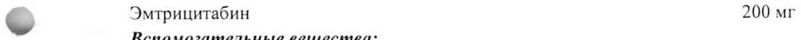
- стр. 1: «© Пленочная водорастворимая оболочка: гипромеллоза Е15 - 12,0 мг, лактозы моногидрат —» — повторное чтение: «& ОВД Е КО А ет Heo one»  
  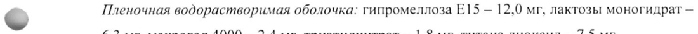
- стр. 2: «& ССВ5 и на мононуклеарных клетках периферической крови. Значения 50% эффективной» — низкая уверенность: «ССВ5» (47)  
  
- стр. 4: «диких типов ВИЧ-1 различной природы и подтипов. Наиболее часто наблюдались такие» — низкая уверенность: «ВИЧ-1» (7)  
  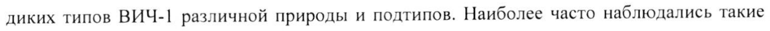
- стр. 7: «образованием 2’-О-глюкуронида (примерно 4% от дозы). /и vitro эксперименты» — низкая уверенность: «2’-О-глюкуронида» (64)  
  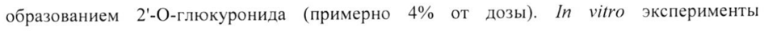
- стр. 12: «3. Нарушение функции почек (клиренс креатинина 50-80 мл/мин);» — низкая уверенность: «3.» (78), «50-80» (79)  
  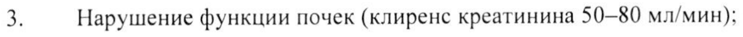
- стр. 13: «Взрослые и дети в возрасте от 12 д0 18 лет и с массой тела не менее 35 кг:» — низкая уверенность: «д0» (73)  
  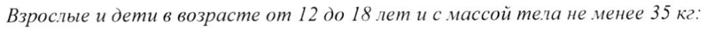
- стр. 14: «с нарушением функции почек легкой степени (клиренс креатинина 50-80 мл/мин). Однако» — низкая уверенность: «50-80» (68)  
  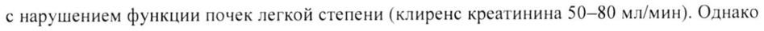
- стр. 18: «> (натощак) — 1 мг/дл и триглицеридов (натощак) — 7 мг/дл.» — повторное чтение: «® aroun) — 1 rian и триглицеридов (натощак) — 7 мидл.»  
  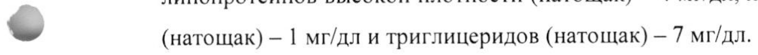
- стр. 18: «tw недель терапии в среднем показатели составили 0,09 мг/дл (диапазон: от 0,20 мг/дл до 0,62» — повторное чтение: «> недель терапии в среднем повазатели составили 0,09 eerie (диапазон: от 0,20 мг/дл до 0,62»  
  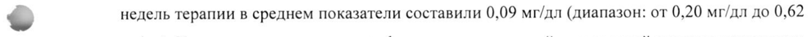
- стр. 25: «раз в день)/ С 7 38% CYP3A). Коррекция дозы не» — низкая уверенность: «7» (52), «38%» (48); повторное чтение: «равдьу [29% |CYP3A). Коррекция дозы не»  
  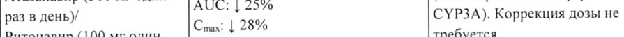
- стр. 25: «ф ат (300 мг один раз в АЗС 218» — низкая уверенность: «218» (61); повторное чтение: «dynapar GOO ur om раз [A 12»  
  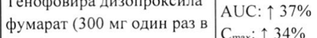
- стр. 25: «день Сны: 1 29%» — низкая уверенность: «1» (49)  
  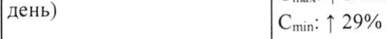
- стр. 25: «Дарунавир (800 мг один He» — повторное чтение: «— (800 мг один pai»  
  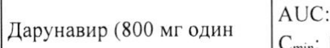
- стр. 25: «Conia: | 11%» — повторное чтение: «Cini 111%»  
  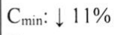
- стр. 25: «& Дарунавир (300 мг один ve» — повторное чтение: «@ «—«—=—Aapyarenn G00 mromes Laveranues»  
  
- стр. 25: «Ритонавир (100 мг один с...»» — повторное чтение: «|Ритонавир (100 мгодин |<,»  
  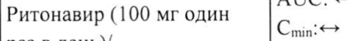
- стр. 25: «фумарат (300 мг один раз в ee Tee» — повторное чтение: «|фумарат (300 wr один разв | AUC: 122%»  
  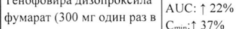
- стр. 25: «Умар ма В | 37%» — повторное чтение: «И (300 мг один разв [Сы 37%»  
  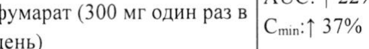
- стр. 25: «Лопинавир (400 мг 1 разв | AUC: <>» — повторное чтение: «| Лопинавир (400 мг 1 разв | AUC: <>»  
  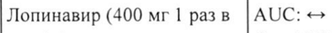
- стр. 25: «Cmax: 129%» — низкая уверенность: «129%» (68)  
  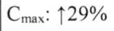
- стр. 25: «ритонавир (100 мг 2 разав | Cmin? =>» — низкая уверенность: «2» (70); повторное чтение: «| ритонавир (100 мг2 раза в | Coin: «>»  
  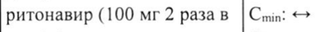
- стр. 26: «Ста: 151%» — низкая уверенность: «151%» (74)  
  
- стр. 27: «Tenanpesup/ Coax: | 3% трицитабина и телапревира» — низкая уверенность: «3%» (64); повторное чтение: «елапревир [13% | прищитебинади телвиреноа»  
  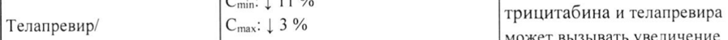
- стр. 27: «Cin 1 93 % плазме.» — низкая уверенность: «1» (69)  
  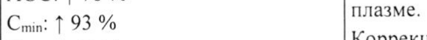
- стр. 27: «Ск: 1 49% Коррекция дозы не требуется.» — низкая уверенность: «1» (60), «49%» (70)  
  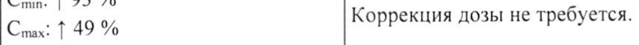
- стр. 27: «Кетоконазол (400 мгодин |AUC: | 24% трицитабина с азольными» — повторное чтение: «| Кетоконазол (400 мг один | AUC: | 24% |трицитабина с азольными»  
  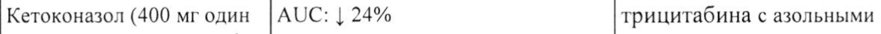
- стр. 27: «Позаконазол? AUC: 1 49% рилпивирина в плазме» — низкая уверенность: «1» (51)  
  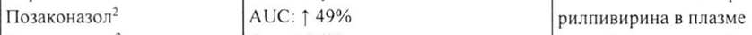
- стр. 27: «& Cinax: 1 30% CYP3A)» — низкая уверенность: «1» (58); повторное чтение: «О ПОНИ СЗ ООО Ко»  
  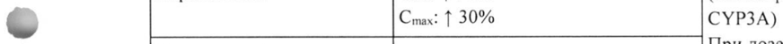
- стр. 27: «Perconasonl При дозе рилпивирина 25 мг» — повторное чтение: «Кетоконазол/ | ВБИ пони ринлинирини 25 9»  
  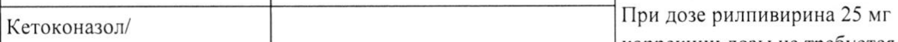
- стр. 27: «Спи: | 48% трицитабина. В случае» — повторное чтение: «| Спи: | anu | трицитабина. В случае»  
  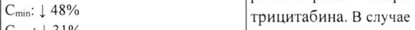
- стр. 27: «А 16% рилпивирина+тенофовира+эм» — повторное чтение: «ви |рилпивиринатенофовиратом»  
  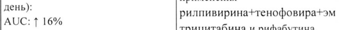
- стр. 27: «Cwnax: 1 43% рекомендуется дополнительно» — низкая уверенность: «1» (77)  
  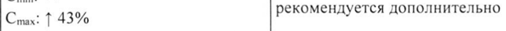
- стр. 28: «& раз в день)/ AUC: | 9% сопутствующем применении» — повторное чтение: «© [равдеь/  [|А0С:19% [сопутствующем применении»  
  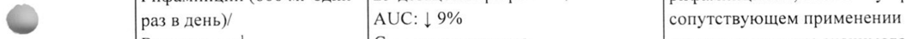
- стр. 30: «6 Рилпивирин Cmax: 121% которые можно применять один» — низкая уверенность: «6» (11); повторное чтение: «- | ыы onHokKnaTHag 1 г = nas b net ae ms aa cm»  
  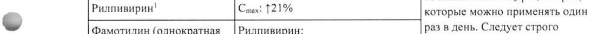
- стр. 31: «доза 500 мг)/ Рилпивирин' |Рилпивирин: Коррекции дозвгие тредуетоя» — повторное чтение: «[доза 500 sr)/ Рилпивирин' |Рилпивирин: Aenea nase mpebiyeros»  
  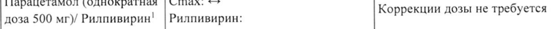
- стр. 31: «Cmin: 1 26%» — низкая уверенность: «1» (64)  
  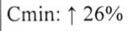
- стр. 32: «Crax? 1 17%» — низкая уверенность: «1» (76)  
  
- стр. 32: «Этинилэстрадиол (0,035 мг | 1» — низкая уверенность: «1» (43)  
  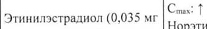
- стр. 32: «Норэтиндрон (1 мг один» — повторное чтение: «| Норэтиндрон (1 мгодин»  
  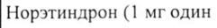
- стр. 33: «Cmin: {15% Коррекции дозы не требуется.» — низкая уверенность: «{15%» (69); повторное чтение: «"Спи 115% 'Коррекции дозы не требуется.»  
  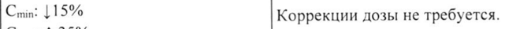
- стр. 33: «Аторвастатин (40 мгодин | Cmax: 1 35%» — повторное чтение: «| Аторвастатин (40 мг один | Cina: 135%»  
  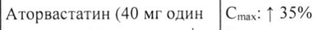
