# Розувастатин + Фенофибрат — внутрь

- Препарат: Супрозафен (таблетки, покрытые пленочной оболочкой;)
- АТХ: C10BA09
- Источник: ГРЛС, инструкция по медицинскому применению, РУ ЛП-006619, файл от 2020-12-17 (https://grls.rosminzdrav.ru/Grls_View_v2.aspx?routingGuid=edb50223-b555-4cfe-8f7f-c5dbb22d8920)
- Распознано автоматически (OCR): 23 из 23 стр.
- Инструкция к другому РУ того же препарата: ЛП-006619 (срок действия истёк, решение от 04.12.2020). Текст может быть старше действующего
- Сомнительных строк после OCR: 20 (см. раздел «Проверка распознавания»)

## Общие сведения

и | МИНИСТЕРСТВО ЗДРАВООХРАНЕНИЯ РОССИЙСКОЙ ФЕДЕРАЦИИ | |
ИНСТРУКЦИЯ А | ПО МЕДИЦИНСКОМУ ПРИМЕНЕНИЮ ЛЕКАРСТВЕННОГО ПРЕПАРАТА ~
СУПРОЗАФЕН Регистрационный номер:
Торговое наименование: Супрозафен Международное непатентованное или группировочное наименование: розувастатин + фенофибрат

## 3. Лекарственная форма

таблетки, покрытые пленочной оболочкой.
таблетки, покрытые пленочной оболочкой.

## 2. Состав

1 таблетка, покрытая пленочной оболочкой, содержит:
1 таблетка, покрытая пленочной оболочкой, содержит:
Дозировка $ мг + 145 мг ~ Первый слой таблетки:
Действующее вещество: розувастатин кальция (в пересчете на розувастатин) 5,20 мг
(5,00 мг)
Вспомогательные вещества: лактозы моногидрат, целлюлоза микрокристаллическая 112, кальция гидрофосфат, кросповидон, макрогол — 6000, натрия стеарилфумарат
Второй слой таблетки:
Действующее вещество: фенофибрат микронизированный 145 мг
Вспомогательные вещества: гипромеллоза, докузат натрия, лактозы моногидрат, натрия лаурилсульфат, сахароза, силикатированная микрокристаллическая целлюлоза [целлюлоза микрокристаллическая, кремния диоксид коллоидный], кросповидон, натрия стеарилфумарат
>, Пленочная _оболочка (слой _пленочного _покрытия __(иветного)): Опадрай розовый 88А240022 [поливиниловый спирт, тальк, титана диоксид (E171), глицерил монокаприлокапрат, натрия лаурилсульфат, краситель железа оксид желтый (E172), краситель железа оксид красный (E172)]
Дозировка 10 мг-+ 145 мг Первый слой таблетки:
Действующее вещество: розувастатин кальция (в пересчете на розувастатин) 10,40 мг
(10,00 мг)
Вспомогательные вещества: лактозы моногидрат, целлюлоза микрокристаллическая 102, кальция гидрофосфат, кросповидон, макрогол — 6000, натрия стеарилфумарат
Второй слой таблетки:
Действующее вещество: фенофибрат микронизированный 145 мг
Вспомогательные вещества: гипромеллоза, докузат натрия, лактозы моногидрат, натрия лаурилсульфат, сахароза, силикатированная микрокристаллическая целлюлоза [целлюлоза микрокристаллическая, кремния диоксид коллоидный], кросповидон, натрия стеарилфумарат
Пленочная оболочка (слой пленочного покрытия (иветного)):
Опадрай коричневый 88A265016, [поливиниловый спирт, тальк, титана диоксид (Е 171), краситель железа оксид красный (E172), краситель железа оксид желтый (E172), глицерил монокаприлокапрат, натрия лаурилсульфат, краситель железа оксид черный (Е172)]
Описание:
Дозировка 5мг + 145 мг. Овальные двояковыпуклые таблетки, покрытые пленочной
= оболочкой розового цвета. На поперечном разрезе ядро белого или почти белого цвета.
Дозировка 10 мг + 145 мг. Овальные двояковыпуклые таблетки, покрытые пленочной оболочкой коричневого цвета. На поперечном разрезе ядро белого или почти белого цвета.
Фармакотерапевтическая группа: гиполипидемическое средство комбинированное
(ГМГ-КоА-редуктазы ингибитор + фибрат).
Код ATX: С10ВАОУ.
Фармакологические свойства Фармакодинамика
Супрозафен, комбинированный препарат, содержащий два гиполипидемических средства:
розувастатин — ингибитор ГМГ-КоА-редуктазы (статин) и фенофибрат — фибрат. Действие препарата обусловлено входящими в его состав компонентами.
| Розувастатин: Селективный, конкурентный ингибитор гидроксиметилглютарил коэнзим А редуктазы (ГМГ-КоА-редуктазы) - фермента, превращающего 3-rugpoKcu-3метилглутарил-коэнзим А в мевалонат, предшественник холестерина.
Основной мишенью действия является печень, где осуществляется синтез холестерина (ХС)
и катаболизм липопротеинов низкой плотности (ЛНП). Увеличивает число "печеночных" рецепторов ЛНП на поверхности клеток, повышая захват и катаболизм ЛНП, что приводит к ингибированию синтеза липопротеинов очень низкой плотности (ЛОНП), уменьшая общее количество ЛНП и ЛОНП. Снижает повышенные концентрации холестерина-ЛНП
(ХС-ЛНП), общего холестерина, триглицеридов (ТГ), повышает концентрацию холестерина-липопротеинов высокой плотности (ХС-ЛВП), а также снижает концентрации аполипопротеина В (АпоВ), XC-HeJIBIT, ХС-ЛОНП, ТГ-ЛОНП и увеличивает концентрацию аполипопротеина А-Г (АпоА-[), снижает соотношение ХС-ЛНГИХС-ЛВП, общий ХС/ХС-ЛВП и ХС-неЛВГИХС-ЛВП и соотношение AnoB/AnoA-I. Терапевтический эффект развивается в течение 1 недели после начала терапии, через 2 недели лечения достигает 90% от максимально возможного. Максимальный терапевтический эффект достигается к 4-ой неделе терапии и поддерживается при регулярном приеме препарата.
Фенофибрат: Производное фиброевой кислоты. Активируя РАПП-альфа (альфарецепторы, активируемые пролифераторами пероксисом), усиливает липолиз и выведение из плазмы крови атерогенных липопротеидов с высокой концентрацией триглицеридов путем активации липопротеинлипазы и уменьшения синтеза апопротеина СШ. Активация
РАПП-альфа также приводит к усилению синтеза апопротеинов АГ и АП.
Описанные выше эффекты на липопротеиды приводят к уменьшению концентрации
© фракции ЛНП и ЛОНП, содержащей апопротеин В, и увеличению концентрации фракции
ЛВП, содержащей апопротеины АГи АП.
Также, за счет коррекции синтеза и катаболизма ЛОНП, фенофибрат повышает клиренс
ЛНП и снижает концентрацию малых плотных частиц ЛНП, характерных для пациентов с атерогенным фенотипом липидов, частым при риске ишемической болезни сердца. В ходе клинических исследований было отмечено, что применение фенофибрата снижает концентрацию общего холестерина на 20-25 % и триглицеридов на 40-55 % и повышает концентрацию ЛИВП-холестерина на 10-30 %. Учитывая влияние фенофибрата на концентрацию ЛИНП-холестерина и триглицеридов, применение препарата эффективно у пациентов с гиперхолестеринемией, как сопровождающейся, так и не сопровождающейся гипертриглицеридемией, включая вторичную гиперлипопротеинемию, например, при сахарном диабете 2-го типа. Терапия фенофибратом также привела к уменьшению
~ потребности в лазерном лечении диабетической ретинопатии (3,6 % по сравнению с 5,2 %,
Р=0,0003) в исследовании FIELD.

## 5.2. Фармакокинетика

Розувастатин Абсорбция и распределение: Максимальная концентрация в плазме крови достигается приблизительно через 5 часов после приема внутрь. Абсолютная биодоступность составляет примерно 20%. Метаболизируется преимущественно печенью. Объем распределения составляет примерно 134 л. Приблизительно 90 % связывается с белками плазмы крови, в основном с альбумином.
Розувастатин Абсорбция и распределение: Максимальная концентрация в плазме крови достигается приблизительно через 5 часов после приема внутрь. Абсолютная биодоступность составляет примерно 20%. Метаболизируется преимущественно печенью. Объем распределения составляет примерно 134 л. Приблизительно 90 % связывается с белками плазмы крови, в основном с альбумином.
Метаболизм, выведение: Подвергается ограниченному метаболизму (около 10%).
Является непрофильным субстратом для метаболизма ферментами системы цитохрома
Р450. Основным изоферментом, участвующим в метаболизме розувастатина, является изофермент CYP2C9. Изоферменты CYP2C19, CYP3A4 и CYP2D6 вовлечены в метаболизм в меньшей степени. Основными выявленными метаболитами розувастатина являются Nдесметил и лактоновые метаболиты. М-десметил примерно на 50 % менее активен, чем розувастатин, лактоновые метаболиты фармакологически не активны. Более 90% фармакологической активности по ингибированию циркулирующей ГМГ-КоА-редуктазы обеспечивается розувастатином, остальное — его метаболитами.
Около 90 % дозы розувастатина выводится в неизмененном виде через кишечник (включая абсорбированный и не абсорбированный розувастатин). Оставшаяся часть выводится почками. Плазменный период полувыведения (Т1/2) составляет примерно 19 часов. Тр не изменяется при увеличении дозы. Средний геометрический плазменный клиренс составляет приблизительно 50 л/час (коэффициент вариации 21,7 %). Как и в случае других
> ингибиторов ГМГ-КоА-редуктазы, в процесс "печеночного" захвата розувастатина вовлечен мембранный переносчик холестерина, выполняющий важную роль в печеночной элиминации розувастатина.
Линейность: Системная экспозиция увеличивается пропорционально — дозе.
Фармакокинетические параметры не изменяются при ежедневном приеме.
Особые группы пациентов Пол и возраст: Пол и возраст клинически значимо не влияют на фармакокинетику.
Пациенты с нарушением функции печени: У пациентов с различными стадиями печеночной недостаточности не выявлено увеличение Т1/2 розувастатина у пациентов с баллом 7 и ниже по шкале Чайлд-Пью. У двух пациентов с баллами 8 и 9 по шкале Чайлд-Пью отмечено увеличение 11/2, по крайней мере, в 2 раза. Опыт применения розувастатина у пациентов с
- баллом выше 9 по шкале Чайлд-Пью отсутствует.
Пациенты с нарушением функции почек: У пациентов с легкой и умеренно выраженной почечной недостаточностью величина плазменной концентрации розувастатина или Nдесметила существенно не меняется. У пациентов с выраженной почечной недостаточностью (клиренс креатинина (КК) менее 30 мл/мин.) концентрация розувастатина в плазме крови в 3 раза выше, а концентрация М-десметила в 9 раз выше, чем у здоровых добровольцев. Концентрация розувастатина в плазме крови у пациентов на гемодиализе была примерно на 50 % выше, чем у здоровых добровольцев.
Этнические группы: Фармакокинетические исследования показали приблизительно двукратное увеличение медианы AUC (площади под кривой «концентрация-время») и Cmax
(максимальной концентрации в плазме крови) розувастатина у пациентов азиатской национальности (японцев, китайцев, филиппинцев, вьетнамцев и корейцев) в сравнении с европейцами; у индийских пациентов показано увеличение медианы AUC и Cmax в 1,3 раза.
Фармакокинетический анализ не выявил клинически значимых различий в фармакокинетике среди европейцев и представителей негроидной расы.
Фенофибрат Абсорбция и распределение: Исходный фенофибрат в плазме крови не обнаруживается.
Основным плазменным метаболитом является фенофиброевая кислота. Максимальная концентрация в плазме крови достигается через 2—4 4 после приема внутрь. При длительном применении концентрация в плазме крови остается стабильной независимо от индивидуальных особенностей пациента. Максимальная концентрация в плазме крови не зависит от времени приема пищи, поэтому фенофибрат можно принимать в любое время

© независимо от приема пищи.
Фенофиброевая кислота прочно связывается с альбумином плазмы крови (более 99 %).
Метаболизм, выведение: Период полувыведения фенофиброевой кислоты - около 20 ч.
После приема внутрь фенофибрат быстро гидролизуется эстеразами. В плазме крови обнаруживается только основной активный метаболит фенофибрата — фенофиброевая кислота. Фенофибрат не является субстратом для изофермента СУРЗА4 и не принимает участия в микросомальном метаболизме. Выводится почками в виде фенофиброевой кислоты и конъюгата глюкуронида. В течение 6 дней фенофибрат выводится практически полностью. Общий клиренс фенофиброевой кислоты, определяемый у пожилых пациентов, не изменяется. Препарат не кумулирует после однократного приема и при длительном применении. При гемодиализе не выводится.
Особые группы пациентов

- Пациенты пожилого возраста: Действие фенофиброевой кислоты не зависит от возраста.
Ввиду того, что распространенность нарушений функции почек среди пациентов пожилого возраста выше, необходим мониторинг функции почек данной категории пациентов при применении препарата.
Пациенты с нарушениями функции почек: У пациентов с тяжелым нарушением функции почек скорость клиренса фенофиброевой кислоты значительно снижается, в связи с чем соединение может аккумулироваться при многократном приеме препарата. У пациентов с умеренным нарушением функции почек (клиренс креатинина (КК) от 30 до 60 мл/мин)
клиренс и объем распределения при пероральном приеме фенофиброевой кислоты увеличиваются по сравнению со здоровыми добровольцами (2,1 л/ч и 95 л в сравнении с 1,1 л/ч и 30 л, соответственно).

Пациенты с нарушениями функции печени: Фармакокинетические исследования фенофибрата у пациентов с нарушениями функции печени не проводились.

## 4.1. Показания к применению

Лекарственный препарат Супрозафен предназначен для применения у взрослых пациентов, которым показан одновременный прием розувастатина и фенофибрата в соответствующих дозах, при наличии следующих дислипидемий:

— первичная гиперхолестеринемия (тип Па по классификации Фредриксона) или смешанная гиперхолестеринемия (тип IIb по классификации Фредриксона) в качестве дополнения к диете, когда диета и другие немедикаментозные методы лечения (например, снижение массы тела, физические упражнения) оказываются недостаточными.

— гипертриглицеридемия (тип ГУ по классификации Фредриксона) в качестве
® дополнения к диете.
Лекарственный препарат Супрозафен не должен применяться для стартовой терапии у пациентов, ранее не получавших гиполипидемические лекарственные средства.

## 4.3. Противопоказания

e Гиперчувствительность к розувастатину, фенофибрату или любому компоненту препарата;

® Возраст до 18 лет (эффективность и безопасность не установлены);

® Тяжелые нарушения функции печени: класс С по классификации Чайлд-Пью (10-15 баллов по шкале Чайлд-Пью), включая билиарный цирроз и персистирующее нарушение функции печени неясной этиологии;

® Заболевания печени в активной фазе, включая стойкое повышение сывороточной

~ активности трансаминаз и любое повышение активности трансаминаз в сыворотке крови (> 3 раза по сравнению с верхней границей нормы (ВГН));

® Тяжелое и умеренное нарушение функции почек (КК ниже 60 мл/мин);

® Миопатия;

e Предрасположенность к развитию миотоксических осложнений;

® Миотоксичность на фоне применения ингибиторов ГМГ-КоА-редуктазы или фибратов в анамнезе;

e Наличие в анамнезе фотосенсибилизации или фототоксичности при лечении фибратами или кетопрофеном;

e Заболевания желчного пузыря в анамнезе;

® Хронический или острый панкреатит, за исключением случаев острого панкреатита, обусловленного выраженной гипертриглицеридемией;

» Одновременный прием лекарственного препарата Супрозафен и циклоспорина, других фибратов или других ингибиторов ГМГ-КоА-редуктазы (правастатин, аторвастатин, симвастатин и т.д.);

e У женщин: беременность, период грудного вскармливания, отсутствие адекватных методов контрацепции;

e Врожденная галактоземия, непереносимость лактозы, недостаточность лактазы, нарушение всасывания глюкозы и галактозы (препарат содержит лактозу);

» Врожденная фруктоземия, недостаточность сахаразы-изомальтазы, синдром глюкозо-галактозной мальабсорбции (препарат содержит сахарозу);

¥ С осторожностью Почечная недостаточность легкой степени тяжести, одновременный прием пероральных антикоагулянтов, возраст старше 65 лет, состояния, при которых отмечено повышение плазменной концентрации розувастатина, расовая принадлежность (азиатская раса), заболевания печени в анамнезе, сепсис, артериальная гипотензия, обширные хирургические вмешательства, травмы, тяжелые метаболические, эндокринные или электролитные нарушения или неконтролируемые судорожные припадки.

## 4.6. Применение при беременности и в период грудного вскармливания

Прием Супрозафена противопоказан при беременности и в период лактации. Женщины репродуктивного возраста должны применять адекватные методы контрацепции.
Фертильность: В доклинических исследованиях репродуктивной токсичности

v фенофибрата не выявлено. Однако, наблюдалась обратимая гипоспермия и вакуолизация яичек, а также незрелость яичников в исследовании токсичности на молодых собаках при многократном введении фенофиброевой кислоты.
Клинические данные по влиянию препарата на фертильность у людей отсутствуют.
Беременность:Нет достаточных данных о применении фенофибрата у беременных. В исследованиях на мышах, крысах и кроликах, тератогенного эффекта фенофибрата не было.
Эмбриотоксичность отмечена при назначении в доклинических испытаниях доз, токсичных для матери. При приеме фенофибрата в высоких дозах отмечены пролонгация периода беременности и осложнения при родах. Потенциальный риск для человека неизвестен.

Поскольку холестерин и другие продукты биосинтеза холестерина важны для развития

плода, потенциальный риск ингибирования ГМГ-КоА-редуктазы превышает пользу от

применения препарата у беременных. В случае возникновения беременности в процессе

терапии, прием препарата Супрозафен должен быть прекращен немедленно.

Период грудного вскармливания: Данные в отношении выделения розувастатина с грудным

молоком отсутствуют. Недостаточно информации об экскреции фенофибрата и/или его

метаболитов в грудное молоко. Нельзя исключить риск для грудных детей.

Прием препарата Супрозафен в период грудного вскармливания противопоказан. При

необходимости применения при лактации, грудное вскармливание необходимо прекратить.

## 4.2. Способ применения и дозы

Внутрь, в любое время суток, независимо от времени приема пищи. Таблетку проглатывают
© целиком, не разжевывая и не измельчая, запивая водой.

До начала терапии препаратом Супрозафен пациент должен начать соблюдать стандартную

гипохолестеринемическую диету и продолжать соблюдать ее во время лечения.

Препарат Супрозафен принимают по 1 таблетке один раз в сутки. Доза препарата должна

подбираться индивидуально в зависимости от целей терапии и терапевтического ответа на

лечение, принимая во внимание текущие рекомендации по целевым концентрациям

липидов.

Рекомендуемая начальная доза препарата Супрозафен составляет 5 мг + 145 мг 1 раз в

сутки. В случае необходимости доза препарата может быть увеличена через 4 недели до

максимальной дозы 10 мг +145 мг 1 раз в сутки.

Пациенты, у которых адекватный контроль дислипидемии ранее был достигнут при
© одновременном приеме розувастатина в дозе 5 или 10 мг в сутки с фенофибратом, могут

продолжить прием препарата Супрозафен в соответствующих дозах. Пациенты, ранее

принимавшие по одной капсуле фенофибрата микронизированного 200 мг в сутки или по

одной таблетке фенофибрата микронизированного 145 мг в сутки, могут перейти на прием

препарата Супрозафен без дополнительной корректировки дозы фенофибрата.

Особые группы пациентов

Пожилые пациенты

Коррекции дозы не требуется. Необходим мониторинг функции почек данной категории

пациентов.

Пациенты с нарушением функции почек

У пациентов с почечной недостаточностью легкой степени тяжести (КК > 60 мл/мин)

коррекция дозы не требуется.

Препарат Супрозафен следует применять с осторожностью у пациентов с почечной

недостаточностью легкой степени тяжести (см. раздел «С осторожностью»). У пациентов с

умеренной и тяжелой почечной недостаточностью (КК менее 60 мл/мин) применение

препарата Супрозафен противопоказано (см. раздел «Противопоказания»)..

Пациенты с нарушением функции печени

Препарат Супрозафен противопоказан пациентам с заболеваниями печени в активной фазе

и с тяжелыми нарушениями функции печени (класс С по классификации Чайлд-Пью / 10-

15 баллов по шкале Чайлд-Пью), включая пациентов с билиарным циррозом и

персистирующим нарушением функции печени неясной этиологии (см. раздел
~

«Противопоказания»).

Этнические группы

При изучении фармакокинетических параметров розувастатина у пациентов разных

этнических групп отмечено увеличение системной концентрации розувастатина у японцев

и китайцев. Надо учитывать этот факт при назначении препарата Супрозафен данным

группам пациентов. Рекомендуемая начальная доза розувастатина для пациентов

монголоидной расы — 5 мг.

Генетический полиморфизм

У носителей генотипов SLCOIB1 (OATPIB1) с.521СС и ABCG2 (BCRP) с.421АА было

увеличение экспозиции (AUC) к розувастатину по сравнению с носителями генотипов
; SLCOIB1 с.521ТТ и ABCG2 с.421СС. Для носителей генотипов с.521СС или с.421АА
- рекомендуемая максимальная доза розувастатина составляет 20 мг один раз в сутки.

Сопутствующая терапия

Розувастатин связывается с различными транспортными белками (в частности, с ОАТЗ1В1

и ВСКР). При одновременном применении препарата Супрозафен с лекарственными

препаратами (такими как циклоспорин, некоторые ингибиторы ВИЧ протеаз, включая

комбинацию ритонавира с атазанавиром, лопинавиром и/или типранавиром),

повышающими концентрацию розувастатина в плазме крови за счет взаимодействия с

транспортными белками, может повышаться риск миопатии, включая рабдомиолиз (см.

разделы «Особые указания» и «Взаимодействие с другими лекарственными средствами»).

В таких случаях следует оценить возможность назначения альтернативной терапии или

временного прекращения применения препарата Супрозафен. Если же применение

вышеназванных препаратов необходимо, следует оценить соотношение пользы и риска сопутствующей терапии препаратом Супрозафен и рассмотреть возможность снижения его дозы.
Дети Безопасность и эффективность розувастатина и фенофибрата у детей в возрасте до 18 лет не установлены. Данные отсутствуют. Препарат Супрозафен противопоказан к применению у детей в возрасте до 18 лет.

## 4.8. Побочное действие

Ниже представлены нежелательные лекарственные реакции (НЛР), возникавшие при применении препарата в клинических исследованиях с указанием частоты их возникновения. НЛР сгруппированы в соответствии с классификацией органов и систем органов Мед ОКА.
Ниже представлены нежелательные лекарственные реакции (НЛР), возникавшие при применении препарата в клинических исследованиях с указанием частоты их возникновения. НЛР сгруппированы в соответствии с классификацией органов и систем органов Мед ОКА.
Частота встречаемости определяется следующим образом: очень часто (> 1/10), часто
(> 1/100 и < 1/10), нечасто (> 1/1000 и < 1/100), редко (> 1/10000 и < 1/1000), очень редко
(< 1/10000, включая отдельные случаи).
Таблица 1. Нежелательные лекарственные реакции
Классификация Нежелательные Частота MedDRA эффекты Розувастатин Фенофибрат
Нарушения со | Снижение гемоглобина и Редко стороны крови и| лейкоцитов лимфатической ToomG Ч
Нарушения со | Реакции Редко Редко стороны иммунной гиперчувствительности, системы включая ангионевротический отек
\ Нарушение со Сахарный диабет 2 типа Часто* стороны эндокринной системы
Нарушения со НН Потеря или снижение Очень редко памяти
Периферическая Частота неизвестна нейропатия ом Г [Чана
Нарушения со Тромбоэмболия Нечасто стороны сосудов (тромбоэмболия легочной артерии и тромбоз глубоких вен нижних конечностей м [Частота неизвелна [4 |
Нарушения со ‚Одыша [Частота неизветна | | стороны Интерстициальное Частота неизвестна Частота неизвестна дыхательной заболевание легких системы, органов грудной клетки и средостения ыы ООО И ИИ желудочнокишечного тракта
|Mereopwsm facto Рапорт Чаю р Нарушения со Повышение активности Редко Часто стороны печени и сывороточных желчевыводящих трансаминаз
(например, холецистит, холангит, желчная колика
Нарушения со Кожные реакции Нечасто Нечасто стороны кожи и гиперчувствительности подкожных тканей | (например, кожная сыпь, кожный зуд, крапивница
Алопеция Tf Perko Реакции Редко НИ М ОБ
Синдром Стивенса Частота неизвестна Частота неизвестна
Джонсона Тяжелые кожные Частота неизвестна реакции, в том числе мультиморфная эритема,
©, токсический эпидермальный некролиз Нарушения со стороны скелетномышечной и [Артралгия [Очень редю | соединительной Иммуноопосредованная | Частота неизвестна ткани некротизирующая миопатия миозит
Мышечная слабость | [| Неаю 1 Кбпазм мыши | [Ню |
Нарушения со Гематурия Очень редко мочевыводящих путей
____ [Эрекильная дисфункция [+ [Неаю | Нарушения со Гинекомастия Частота неизвестна стороны половых органов и молочной экелезы
Общие Астенический синдром Часто расстройства и нарушения в месте введения
Лабораторные и Повышение уровня Очень часто инструментальные | гомоцистеина крови данные Повышение Нечасто концентрации креатинина в сыворотке крови
Повышение Редко концентрации азота мочевины в сыворотке крови w *Частота зависит от наличия или отсутствия факторов риска (уровень глюкозы в крови натощак > 5,6 ммоль/л, индекс массы тела (ИМТ) > 30 кг/м? площади поверхности тела, повышенный уровень триглицеридов в крови, артериальная гипертензия в анамнезе).
Как и при применении других ингибиторов ГМГ-КоА-редуктазы, частота развития нежелательных реакций при применении розувастатина зависит от дозы.
При приеме ингибиторов ГМГ-КоА-редуктазы сообщалось о побочных эффектах:
депрессия, нарушения сна, включая бессонницу и «кошмарные» сновидения, сексуальная дисфункция, гипергликемия, повышение уровня гликированного гемоглобина.
Сообщалось о единичных случаях интерстициального заболевания легких, особенно при длительном применении препаратов (см. раздел «Особые указания»).
Описание отдельных нежелательных реакций при применении розувастатина
( Нарушения со стороны почек и мочевыводящей системы: у получавших розувастатин, может выявляться протеинурия. Изменения количества белка в моче (от отсутствия или следовых количеств до ++ или больше) наблюдаются у менее | % пациентов, получающих 10-20 мг препарата, и у приблизительно 3 % пациентов, получающих 40 мг препарата.
Незначительное изменение количества белка в моче отмечалось при приеме дозы 20 мг. В большинстве случаев протеинурия уменьшается или исчезает в процессе терапии и не означает возникновения острого или прогрессирования существующего заболевания почек.
Нарушения со стороны скелетно-мышечной системы и соединительной ткани: при применении розувастатина во всех дозировках, в особенности при приеме доз выше 20 мг, сообщалось о воздействиях на опорно-двигательный аппарат: миалгия, миопатия (включая миозит), в редких случаях — рабдомиолиз с острой почечной недостаточностью или без неё.
Дозозависимое повышение активности креатинфосфокиназы (КФК) наблюдается у незначительного числа пациентов, принимавших розувастатин. В большинстве случаев оно было незначительным, бессимптомным и временным. При повышении активности КФК
(>5 раз по сравнению с ВГН) терапию следует приостановить (см. раздел «Особые указания»).
Нарушения со стороны печени и желчевыводящих путей. при применении ингибиторов
ГМГ-КоА-редуктазы (в том числе розувастатина) наблюдается дозозависимое повышение активности «печеночных» трансаминаз в плазме крови у небольшого числа пациентов. В большинстве случаев оно незначительно, бессимптомно и временно.
Лабораторные показатели: при приеме розувастатина отмечали изменения лабораторных показателей: повышение концентрации глюкозы, билирубина, активности гаммаглютамилтранспептидазы, щелочной фосфатазы, нарушения функции щитовидной железы.
v Передозировка Информация о передозировке для лекарственного препарата Супрозафен отсутствует.
Розувастатин: при одновременном приеме нескольких суточных доз фармакокинетические параметры розувастатина не изменяются. Специфического лечения при передозировке нет.
Специфический антидот неизвестен. Рекомендуется симптоматическое лечение, мероприятия, направленные на поддержание функций жизненно важных органов и систем, контроль функции печени и уровня КФК. Маловероятно, что гемодиализ будет эффективен.
Фенофибрат: есть единичные сообщения о передозировке, о симптомах не сообщалось.
Специфический антидот неизвестен. При подозрении на передозировку следует назначить симптоматическое и, при необходимости, поддерживающее лечение. Гемодиализ неэффективен.
— Взаимодействие с другими лекарственными средствами
Ингибиторы ГМГ-КоА-редуктазы и другие фибраты: при приеме фенофибрата одновременно со статинами (правастатин, симвастатин, аторвастатин) или другими фибратами повышается риск серьезного токсического воздействия на мышцы. Однако, одновременное применение фенофибрата (67 мг 3 раза в сутки) и розувастатина (10 мг 1 раз в сутки) в течение 7 дней не приводило к клинически значимому изменению концентрации обоих действующих веществ в плазме крови.
Розувастатин Влияние применения других препаратов на метаболизм розувастатина
Антациды: совместное применение розувастатина и суспензий антацидов, содержащих магния и алюминия гидроксид, приводит к снижению плазменной концентрации розувастатина примерно на 50 %. Эффект выражен слабее, если антациды принять через 2 часа после розувастатина. Клиническое значение взаимодействия не изучалось.
Гемфиброзил и dpyeue гиполипидемические средства: совместное применение розувастатина и гемфиброзила приводит к увеличению в 2 раза максимальной концентрации и AUC розувастатина в плазме крови (см. раздел «Особые указания»).
Основываясь на данных по специфическому взаимодействию, не ожидается фармакокинетически значимого взаимодействия с фенофибратом, возможно фармакодинамическое взаимодействие.
Ингибиторы транспортных белков: розувастатин связывается с некоторыми транспортными белками, как ОАТР1В] и BCRP. Сопутствующее применение ингибиторов этих транспортных белков, может сопровождаться увеличением концентрации

С розувастатина в плазме и повышенным риском развития миопатии (см. Табл. 2 и разделы
«Способ применения и дозы», «Особые указания»).
Ингибиторы протеазы вируса иммунодефицита человека (ВИЧ): точный механизм взаимодействия неизвестен, совместный приём ингибиторов протеазы ВИЧ может приводить к значительному увеличению экспозиции к розувастатину (см. Табл. 1).
Одновременное применение 20 мг розувастатина с комбинированным препаратом, содержащим два ингибитора протеазы ВИЧ (400 мг лопинавира / 100 мг ритонавира) у здоровых добровольцев приводило к двукратному и пятикратному увеличению AUC (0-24) и
Cmax розувастатина, соответственно. Поэтому одновременный прием розувастатина и ингибиторов протеазы ВИЧ не рекомендуется (см. разделы «Способ применения и дозы»,
«Особые указания», Табл. 1).

Изоферменты цитохрома Р450: результаты исследований in vivo и т vitro показали, что

- розувастатин не является ни ингибитором, ни индуктором изоферментов цитохрома Р450.
Розувастатин является слабым субстратом для этих изоферментов. Поэтому не ожидается взаимодействия розувастатина с другими лекарственными средствами на уровне метаболизма с участием изоферментов цитохрома Р450.
Не отмечено клинически значимого взаимодействия розувастатина с флуконазолом
(ингибитором СУР2С9 и CYP3A4) и кетоконазолом (ингибитором CYP2A6 и СУРЗА4).
Фузидовая кислота: исследований по изучению взаимодействия розувастатина и фузидовой кислоты не проводилось. Как и при приеме других статинов, были получены постмаркетинговые сообщения о случаях рабдомиолиза при совместном приеме розувастатина и фузидовой кислоты. Необходимо динамическое наблюдение пациентов.
При необходимости возможно временное прекращение приема розувастатина.

Циклоспорин: при совместном применении розувастатина и циклоспорина AUC розувастатина была в среднем в 7 раз выше, чем у здоровых добровольцев (см. Табл. 1).
Розувастатин не влияет на плазменную концентрацию циклоспорина. Розувастатин противопоказан пациентам, принимающим циклоспорин (см. раздел «Противопоказания»).
Одновременный прием препарата Супрозафен и циклоспорина противопоказан.
Эзетимиб: совместное применение розувастатина 10 мг и эзетимиба 10 мг сопровождалось увеличением AUC розувастатина у пациентов с гиперхолестеринемией (см. Табл. 1). Нельзя исключить увеличение риска возникновения побочных эффектов из-за фармакодинамического взаимодействия между розувастатином и эзетимибом.
Эритромицин: совместное применение розувастатина и эритромицина приводит к уменьшению AUC розувастатина на 20% и Cmax - на 30%. Взаимодействие может возникать в результате усиления моторики кишечника при приёме эритромицина.
` Взаимодействие с лекарственными средствами, которое требует коррекции дозы розувастатина (см. Табл. 2): дозу розувастатина корректируют при необходимости его совместного применения с лекарственными средствами, увеличивающими экспозицию к розувастатину. Следует ознакомиться с инструкцией по применению этих препаратов перед их назначением совместно с розувастатином. Если ожидается увеличение экспозиции в 2 раза и более, начальная доза розувастатина должна составлять 5 мг один раз в сутки. Также следует корректировать максимальную суточную дозу розувастатина так, чтобы ожидаемая экспозиция к розувастатину не превышала таковую для дозы 40 мг, принимаемой без одновременного назначения лекарственных средств, взаимодействующих с розувастатином. Например, максимальная суточная доза розувастатина при одновременном применении с гемфиброзилом составляет 20 мг (увеличение экспозиции в
- 1,9 раза), с ритонавиром/атазанавиром — 10 мг (увеличение экспозиции в 3,1 раза).
Таблица 2. Влияние сопутствующей терапии на экспозицию к розувастатину (AUC, данные приведены в порядке убывания) — результаты опубликованных клинических исследований розувастатина розувастатина 10 дней сутки, 8 дней
Режим сопутствующей терапии Режим приема Изменение AUC розувастатина розувастатина
Симепревир 152 мг 1 раз в сутки, 7 дней Увеличение в 2,8 раза
Велпатасвир 100 мг 1 раз в сутки, 11 дней Увеличение в 2,7 раза
Омбитасвир 25 мг/паритапревир 150 5 мг 1 раз в сутки, 7 Увеличение в 2,6 раза мг/ритонавир 100 мг/дасабувир 250 мг 1 разв 1 дней сутки, 14 дней
Гразопревир 200 мг/элбасвир 50 мг 1 раз в 10 мг однократно Увеличение в 2,3 раза сутки, 11 дней
Глекапревир 400 мг/пибрентасвир 120 мг 1 5 мг 1 раз в сутки, Увеличение в 2,2 раза раз в сутки, длительность неизвестна длительность неизвестна
©, Лопинавир 400 мг/ритонавир 100 мг 2 раза в 20 мг 1 раз в сутки, 7 | Увеличение в 2,1 раза сутки, 17 дней дней
Клопидогрел 300 мг (нагрузочная доза), затем | 20 мг однократно Увеличение в 2 раза 75 мг через 24 ч
Гемфиброзил 600 мг 2 раза в сутки, 7 дней Увеличение в 1,9 раза
Элтромбопаг 75 мг 1 раз в сутки, 10 дней Увеличение в 1,6 раза
Гразопревир 200 мг 1 раз в сутки, 11 дней Увеличение в 1,6 раза
Дарунавир 600 мг/ритонавир 100 мг 2 раза в 10 мг 1 раз в сутки, 7 | Увеличение в 1,5 раза сутки, 7 дней дней
Типранавир 500 мг/ритонавир 200 мг 2 разав | 10 мг однократно Увеличение в 1,4 раза сутки, 11 дней
© Дронедароп 400 мг 2 раза в сутки Увеличение в 1,4 раза
Итраконазол 200 мг 1 раз в сутки, 5 дней 10 мг или 80 мг Увеличение в 1,4 раза однократно
Омбитасвир 25 мг/паритапревир 150 5 мг 1 раз в сутки, 7 Увеличение в 1,3 раза мг/ритонавир 100 мг 1 раз в сутки, 14 дней дней
Эзетимиб 10 мг 1 раз в сутки, 14 дней 10 мг 1 раз в сутки, Увеличение в 1,2 раза 14 дней
Фосампренавир 700 мг/ритонавир 100 мг 2 10 мг однократно Без изменений раза в сутки, 8 дней розувастатина розувастатина
Влияние применения розувастатина на метаболизм других препаратов
Антагонисты витамина К: начало терапии розувастатином или увеличение дозы у
- пациентов, получающих одновременно антагонисты витамина К (например, варфарин), может приводить к увеличению Международного Нормализованного Отношения (МНО).
Отмена розувастатина или снижение дозы может приводить к уменьшению МНО.
Пероральные контрацептивы/гормон заместительная терапия: одновременное применение розувастатина и пероральных контрацептивов увеличивает AUC этинилэстрадиола и AUC норгестрела на 26 % и 34 %, соответственно. Такое увеличение плазменной концентрации должно учитываться при подборе дозы пероральных контрацептивов. Фармакокинетические данные по одновременному применению розувастатина и гормонозаместительной терапии отсутствуют, нельзя исключить аналогичного эффекта и при применении данного сочетания. Подобная комбинация широко применялась во время проведения клинических исследований и хорошо
| переносилась пациентами.
Другие лекарственные средства: не ожидается клинически значимого взаимодействия розувастатина с дигоксином.
Фенофибрат Изоферменты цитохрома Р450: исследования микросом из печени человека in vitro показали, что фенофибрат и фенофиброевая кислота не являются ингибиторами следующих изоферментов цитохрома Р450: CYP3A4, CYP2D6, CYP2E1, CYP1A2. В терапевтических концентрациях эти соединения являются слабыми ингибиторами изоферментов СУР2С19 и CYP2A6 и слабыми или умеренными ингибиторами СУР2С9.
Пациенты, применяющие фенофибрат одновременно с лекарственными препаратами, метаболизируемыми изоферментами СУР2С19 и СУР2Аб и особенно СУР2С9 с узким терапевтическим индексом, должны находиться под тщательным наблюдением и, при

необходимости рекомендуется корректировать дозы этих препаратов.

Пероральные антикоагулянты: фенофибрат усиливает эффект пероральных

антикоагулянтов и может повысить риск кровотечений, что связано с вытеснением

антикоагулянта из мест связывания с белками плазмы крови. В начале лечения препаратом

Супрозафен рекомендуется снизить дозу антикоагулянта приблизительно на треть с

последующим постепенным подбором дозы. Подбор дозы рекомендуется проводить под

контролем МНО.

Производные тиазолидиндиона (глитазоны): при одновременном применении

фенофибрата и глитазонов сообщалось о нескольких случаях обратимого парадоксального

снижения концентрации ЛВП. Поэтому при проведении одновременной терапии рекомендуется контроль концентрации ЛВП, и, в случае выраженного снижения
~

концентрации ЛВП, препараты отменить.

Секвестранты желчных кислот: абсорбция фибратов уменьшается холестирамином.

Циклоспорин: Описано несколько случаев тяжелого обратимого нарушения почечной

функции во время одновременного лечения фенофибратом и циклоспорином.

Эзетемиб: в фармакокинетическом исследовании при одновременном применении с

фенофибратом концентрация общего эзетемиба увеличивалась примерно в 1,5 раза.

Повышение расценено как клинически незначимое. Эффективность и безопасность

фенофибрата при совместном приеме с эзетемибом изучена в клиническом исследовании.

Эстрогены: эстрогены могут привести к повышению уровня липидов.

## 4.4. Особые указания

Перед назначением препарата Супрозафен следует провести лечение для устранения
< причины вторичной гиперхолестеринемии, например, при неконтролируемом сахарном

диабете 2 типа, гипотиреозе, нефротическом синдроме, диспротеинемии, обструктивных

заболеваниях печени, последствиях медикаментозной терапии, алкоголизме.

У пациентов с гиперлипидемией, принимающих эстрогены или гормональные

контрацептивы, содержащие эстрогены, необходимо ВЫЯСНИТЬ, имеет

гиперхолестеринемия первичную или вторичную природу. В таких случаях повышение

концентрации липидов может быть вызвано приемом эстрогенов.

Розувастатин:

Почечные эффекты |

У пациентов, получавших высокие дозы розувастатина (в основном 40 мг), наблюдалась

канальцевая протеинурия, которая в большинстве случаев была транзиторной. Такая

протеинурия не свидетельствовала об остром заболевании почек или прогрессировании заболевания почек.
Определение креатинфосфокиназы: определение КФК не следует проводить после интенсивных физических нагрузок или при наличии других возможных причин увеличения, что может привести к неверной интерпретации полученных результатов. В случае исходного уровня КФК в 5 раз выше, чем ВГН, через 5-7 дней провести повторное измерение. Не начинать терапию при повторном подтверждении уровня КФК выше >5 раз по сравнению с ВГН.
Во время терапии: следует проинформировать пациента о необходимости немедленного сообщения врачу о случаях неожиданного появления мышечных болей, мышечной слабости или спазмах, особенно в сочетании с недомоганием и лихорадкой. У таких
© пациентов следует определить КФК. Терапия должна быть прекращена, если уровень КФК значительно увеличен (> 5 раз по сравнению с ВГН) или если симптомы со стороны мышц резко выражены и вызывают ежедневный дискомфорт (даже, если уровень КФК в 5 раз меньше по сравнению с ВГН). Рутинный контроль КФК при отсутствии симптомов нецелесообразен. Отмечены очень редкие случаи — иммуно-опосредованной некротизирующей миопатии с клиническими проявлениями в виде стойкой слабости проксимальных мышц и повышения уровня КФК в сыворотке крови во время лечения или при прекращении приема статинов, в том числе розувастатина. Может потребоваться проведение дополнительных исследований мышечной и нервной системы, серологических исследований, а также терапия иммунодепрессивными средствами. Не отмечено признаков увеличения воздействия на скелетную мускулатуру при приеме розувастатина и сопутствующей терапии. Однако сообщалось об увеличении числа случаев миозита и
- миопатии у пациентов, принимавших другие ингибиторы ГМГ-КоА-редуктазы в сочетании с производными фибриновой кислоты, включая гемфиброзил, циклоспорин, никотиновую кислоту, азольные противогрибковые средства, ингибиторы протеаз и макролидные антибиотики. Гемфиброзил увеличивает риск возникновения миопатии при сочетанном назначении с некоторыми ингибиторами ГМГ-КоА-редуктазы.
Печень: рекомендуется проводить определение показателей функции печени до начала терапии и через 3 месяца после начала. Прием розувастатина прекратить или уменьшить дозу, если активность трансаминаз в сыворотке крови в 3 раза превышает ВГН. У пациентов с гиперхолестеринемией вследствие гипотиреоза или нефротического синдрома терапия основных заболеваний проводится до начала лечения розувастатином.
Ингибиторы протеаз: не рекомендуется совместное применение с ингибиторами протеаз.
Интерстициальное заболевание легких: при применении статинов, особенно в течение длительного времени, сообщалось о единичных случаях интерстициального заболевания легких. Проявления заболевания: одышка, непродуктивный кашель и ухудшение общего самочувствия (слабость, снижение веса и лихорадка). При подозрении на интерстициальное заболевание легких следует прекратить терапию препаратом Супрозафен.
Сахарный диабет 2-го типа: при концентрации глюкозы от 5,6 до 6,9 ммоль/л терапия розувастатина ассоциировался с повышенным риском развития СД 2-го типа.
Фенофибрат:
Функция печени: при приеме фенофибрата и других препаратов, снижающих концентрацию липидов, у некоторых пациентов описано повышение активности «печеночных»
трансаминаз. В большинстве случаев такое повышение было временным, незначительным

и бессимптомным. Рекомендуется контролировать активность трансаминаз (АЛТ, АСТ)

- каждые 3 месяца в течение первых 12 месяцев и периодически в течение дальнейшего лечения. Пациенты, у которых на фоне лечения повысилась активность «печеночных»
трансаминаз, требуют внимания, и в случае повышения активности АЛТ и АСТ >3 раза по сравнению с ВГН прием препарата прекращают. При появлении симптомов гепатита
(желтуха, кожный зуд) следует провести лабораторные исследования и, в случае подтверждения диагноза гепатит, отменить препарат.
Панкреатит: описаны случаи развития панкреатита в период лечения фенофибратом.
Возможными причинами панкреатита в этих случаях были: недостаточная эффективность препарата у пациентов с тяжелой гипертриглицеридемией, прямое воздействие препарата, а также вторичные явления, связанные с наличием камней или образованием осадка в желчных протоках, сопровождающихся непроходимостью общего желчного протока.

~ Мышцы: при приеме фенофибрата и других гиполипидемических препаратов, описаны случаи токсического влияния на мышечную ткань, с или без почечной недостаточности, включая миалгии, миопатии и очень редкие случаи рабдомиолиза. Частота такого нарушения повышается в случае гипоальбуминемии и нарушений функции почек в анамнезе. Совместное назначение фенофибрата и розувастатина допустимо только при отсутствии заболевания мышц в анамнезе и в условиях пристального контроля, направленного на выявление признаков развития токсического влияния на мышцы.
Токсическое влияние на мышечную ткань может быть заподозрено на основании жалоб пациента на слабость, диффузную миалгию, миозит, мышечные спазмы и судороги и/или выраженного повышения активности КФК (более чем в 5 раз выше ВГН). В этих случаях лечение препаратом Супрозафен необходимо прекратить.

Почечная функция: при повышении концентрации креатинина > 50 % выше ВГН лечение следует приостановить. Рекомендуется определять концентрацию креатинина в первые 3 месяца и периодически в течение дальнейшего лечения.
Гематологические нарушения: после начала терапии фенофибратом наблюдалось легкое или умеренное снижение уровня гемоглобина, снижение гематокрита и уменьшение числа лейкоцитов. При длительном применении значения данных показателей стабилизируются.
Сообщалось о возникновении тромбоцитопении и агранулоцитоза у отдельных пациентов, получавших фенофибрат. В первые двенадцать месяцев с момента начала терапии препаратом Супрозафен рекомендуется периодический контроль уровня эритроцитов и лейкоцитов.
Гиперчувствительность немедленного типа: в ходе пострегистрационного применения фенофибрата были зарегистрированы случаи возникновения анафилаксии и
- ангионевротического отека. В некоторых случаях подобные реакции представляли собой угрозу для жизни пациента и требовали проведения неотложной терапии. В случае, если наблюдаются признаки или симптомы гиперчувствительности немедленного типа, необходимо немедленно обратиться к врачу и прекратить применение препарата.
Гиперчувствительность замедленного типа: в ходе пострегистрационного применения фенофибрата были зарегистрированы случаи возникновения серьезных нежелательных реакций на лекарственный препарат со стороны кожи, включавших в себя синдром
Стивенса-Джонса, токсический эпидермальный некролиз, а также лекарственную реакцию с эозинофилией и системными проявлениями (ОКЕ$$-синдром). Такие реакции развивались в течение от нескольких дней до нескольких недель с момента начала терапии фенофибратом. Случаи возникновения ОКЕ$$-синдрома сопровождались кожными w реакциями (сыпь или эксфолиативный дерматит), и сочетанием эозинофилии и лихорадочного состояния с вовлечением в процесс почечной, печеночной или дыхательной систем. При подозрении на серьезные нежелательные реакции со стороны кожи необходимо прекратить прием и проводить специфическое лечение. Парадоксальное снижение ЛВП: в клинических исследованиях и при постмаркетинговом применении описаны случаи выраженного снижения уровня ЛВП (< 2 мг/дл) после начала терапии фибратами у пациентов с сахарным диабетом и без диабета. Снижение ЛВП сопровождалось снижением содержания аполипопротеина АТ. Такое снижение обычно развивалось в период от 2-х недель до нескольких лет после начала применения фибратов.
Содержание ЛВП оставалось низким до тех пор, пока продолжалась терапия фибратом.
После прекращения терапии фибратом отмечался быстрый и устойчивый ответ.
Клиническое значение такого снижения содержания ЛВП не установлено. Рекомендуется контролировать уровень содержания ЛВП в течение нескольких месяцев после начала терапии фибратом. При выраженном снижении содержания ЛВП следует отменить препарат и контролировать содержание ЛВП до возвращения к исходным значениям.
Повторно назначать препарат Супрозафен таким пациентам не следует.
Вспомогательные вещества:
Так как препарат Супрозафен содержит лактозу и сахарозу, его не следует применять при лактазной недостаточности, непереносимости галактозы и глюкозо-галактозной мальабсорбции, врожденной фруктоземии, недостаточностьи сахаразы-изомальтазы, синдроме глюкозо-галактозной мальабсорбции.

## 4.7. Влияние на способность управлять транспортными средствами, механизмами

Следует соблюдать осторожность при управлении автотранспортом или работе, связанной
~ с повышенной концентрацией внимания и психомоторной реакцией (риск развития головокружения).

## 6.5. Форма выпуска

Таблетки, покрытые пленочной оболочкой, 5 мг + 145 мги 10 мг + 145 мг.
Таблетки, покрытые пленочной оболочкой, 5 мг + 145 мги 10 мг + 145 мг.
По 10 таблеток в контурную ячейковую упаковку из пленки комбинированной ПВХ/АЛЛТА и фольги алюминиевой печатной лакированной. По 3 контурные ячейковые упаковки вместе с инструкцией по медицинскому применению помещают в пачку из картона.

## 6.4. Условия хранения

Хранить при температуре не выше 25 °С.
Хранить при температуре не выше 25 °С.
Хранить в недоступном для детей месте.

## 6.3. Срок годности

~ 2 года. Не применять по истечении срока годности, указанного на упаковке.
~ 2 года. Не применять по истечении срока годности, указанного на упаковке.
Условия отпуска Отпускают по рецепту Производитель
АО «ВЕРОФАРМ»У, Россия 308013, г. Белгород, ул. Рабочая, д. 14
Владелец регистрационного удостоверения «Эбботт Продактс Оперейшиз ЭйДжи», Швейцария
Хегенхаймерматтвег 127, 4123 Альшвиль, Швейцария.
Организация, уполномоченная владельцем регистрационного удостоверения на принятие претензий от потребителей
ООО «Эбботт Лэбораториз»
125171, г. Москва, Ленинградское шоссе, д. 16А, стр. 1
Тел.: +7 (495) 258-42-80 Факс: +7 (495) 258-42-81 abbott-russia@abbott.com
Генеральный директор АО «ИИХР» Кравченко Д. В.
- д
©
## Проверка распознавания

Страницы-сканы распознаны автоматически. В 20 строках с дозировками цифры могли распознаться с ошибкой — сверьте с вырезкой из оригинала:

- стр. 2: «Дозировка 10 мг + 145 мг. Овальные двояковыпуклые таблетки, покрытые пленочной» — низкая уверенность: «10» (22)  
  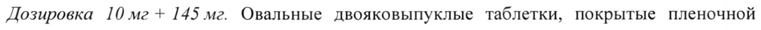
- стр. 4: «увеличение 11/2, по крайней мере, в 2 раза. Опыт применения розувастатина у пациентов с» — низкая уверенность: «11/2,» (20)  
  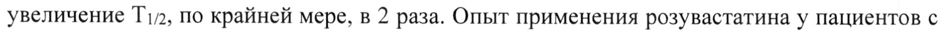
- стр. 4: «недостаточностью (клиренс креатинина (КК) менее 30 мл/мин.) концентрация» — низкая уверенность: «30» (64)  
  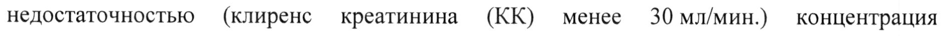
- стр. 8: «© одновременном приеме розувастатина в дозе 5 или 10 мг в сутки с фенофибратом, могут» — повторное чтение: «фо еее»  
  
- стр. 9: «- рекомендуемая максимальная доза розувастатина составляет 20 мг один раз в сутки.» — повторное чтение: «< рекомендуемая максимальная доза  розувастатина ставляет 20 ur дин ра a утки.»  
  
- стр. 14: «розувастатина и гемфиброзила приводит к увеличению в 2 раза максимальной» — повторное чтение: «розувастатина и гемфиброзила приводит к увеличению в 2 pasa максимальной»  
  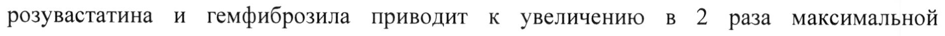
- стр. 15: «Эзетимиб: совместное применение розувастатина 10 мг и эзетимиба 10 мг сопровождалось» — повторное чтение: «Эзетимиб: совместное применение розувастатина 10 мги эзетимиба 10 мг сопровождалось»  
  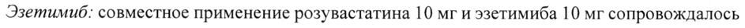
- стр. 15: «раза и более, начальная доза розувастатина должна составлять 5 мг один раз в сутки. Также» — повторное чтение: «раза и более, начальная доза розувастатина должна составлять 5 МГодДин раз в сутки. Также»  
  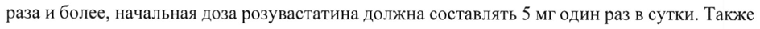
- стр. 15: «- 1,9 раза), с ритонавиром/атазанавиром — 10 мг (увеличение экспозиции в 3,1 раза).» — повторное чтение: «- 1,9 nase с азонавиромдтазанави ром 10 мг (увеличение жспозиции в3,1 раза).»  
  
- стр. 16: «Симепревир 152 мг 1 раз в сутки, 7 дней Увеличение в 2,8 раза» — повторное чтение: «Симепревир 152 мг 1 раз в сутки, 7 дней | 10 мг однократно | Увеличение в 2,8 раза»  
  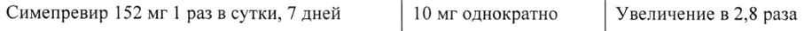
- стр. 16: «Велпатасвир 100 мг 1 раз в сутки, 11 дней Увеличение в 2,7 раза» — повторное чтение: «Велпатасвир 100 мг 1 раз в сутки, 11 дней | 10 мг однократно | Увеличение в 2,7 раза»  
  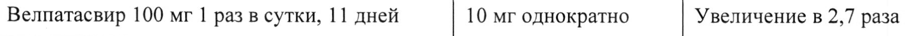
- стр. 16: «мг/ритонавир 100 мг/дасабувир 250 мг 1 разв 1 дней» — низкая уверенность: «1» (74); повторное чтение: «мг/ритонавир 100 мг/дасабувир 250 мг 1 разв 1 дней»  
  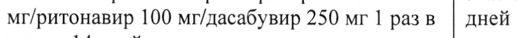
- стр. 16: «Гразопревир 200 мг/элбасвир 50 мг 1 раз в 10 мг однократно Увеличение в 2,3 раза» — повторное чтение: «В разопревир 200 мг/элбасвир 50 мг 1 разв | 10 мг однократно | Увеличение в 2,3 раза»  
  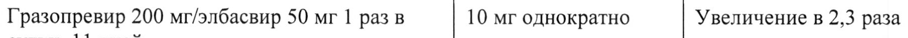
- стр. 16: «©, Лопинавир 400 мг/ритонавир 100 мг 2 раза в 20 мг 1 раз в сутки, 7 | Увеличение в 2,1 раза» — повторное чтение: «©, | acai a мг/ритонавир 100 мг 2 раза в | 0 ut 1 раз в сутки, 7 | Увеличение в 2,1 раза»  
  
- стр. 16: «Гемфиброзил 600 мг 2 раза в сутки, 7 дней Увеличение в 1,9 раза» — повторное чтение: «Гемфиброзил 600 мг 2 раза в сутки, 7 дней | 80 мг однократно | Увеличение в 1,9 раза»  
  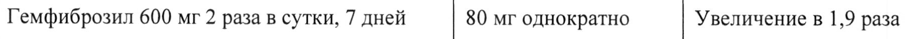
- стр. 16: «Элтромбопаг 75 мг 1 раз в сутки, 10 дней Увеличение в 1,6 раза» — повторное чтение: «Элтромбопаг 75 мг 1 раз в сутки, 10 дней | 10 мг однократно | Увеличение в 1,6 раза»  
  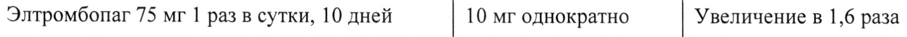
- стр. 16: «Гразопревир 200 мг 1 раз в сутки, 11 дней Увеличение в 1,6 раза» — повторное чтение: «Гразопревир 200 мг 1 раз в сутки, 11 дней | 10 мг однократно | Увеличение в 1,6 раза»  
  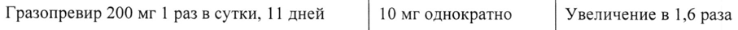
- стр. 16: «Дарунавир 600 мг/ритонавир 100 мг 2 раза в 10 мг 1 раз в сутки, 7 | Увеличение в 1,5 раза» — повторное чтение: «Дарунавир 600 мг/ритонавир 100 мг 2 раза в | 10 мг 1 раз в сутки, 7 | Увеличение в 1,5 раза»  
  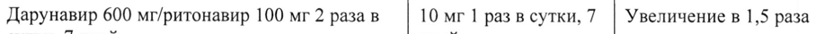
- стр. 16: «Типранавир 500 мг/ритонавир 200 мг 2 разав | 10 мг однократно Увеличение в 1,4 раза» — низкая уверенность: «2» (78)  
  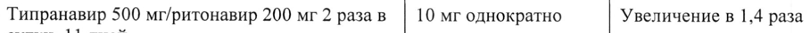
- стр. 16: «Фосампренавир 700 мг/ритонавир 100 мг 2 10 мг однократно Без изменений» — низкая уверенность: «2» (35)  
  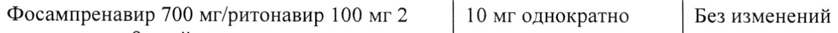
