# Ромосозумаб — парентерально

- Препарат: Ивенити® (раствор для подкожного введения;)
- АТХ: M05BX06
- Источник: ГРЛС, инструкция по медицинскому применению, РУ ЛП-008616, файл от 2022-10-21 (https://grls.rosminzdrav.ru/Grls_View_v2.aspx?routingGuid=d968b9a1-01e5-4bac-bfe7-81e134f12216)
- Распознано автоматически (OCR): 18 из 18 стр.
- Инструкция к другому РУ того же препарата: ЛП-008616 (национальное РУ, переоформленное по правилам ЕАЭС, решение от 14.10.2022). Текст может быть старше действующего
- Сомнительных строк после OCR: 13 (см. раздел «Проверка распознавания»)

## Общие сведения

МИНИСТЕРСТВО ЗДРАВООХРАНЕНИЯ РОССИИСКОЙ ФЕДЕРАЦИИ
ИНСТРУКЦИЯ ПО МЕДИЦИНСКОМУ ПРИМЕНЕНИЮ ЛЕКАРСТВЕННОГО ПРЕПАРАТА
ИВЕНИТИ® | ] | | ) A \ Регистрационный номер:
Торговое наименование: ИВЕНИТИ® Международное непатентованное наименование: ромосозумаб

## 3. Лекарственная форма

раствор для подкожного введения w Состав 1 предварительно заполненный шприц объемом 1,17 мл (номинальный объем для раствора с концентрацией 90 мг/мл) содержит:
раствор для подкожного введения w Состав 1 предварительно заполненный шприц объемом 1,17 мл (номинальный объем для раствора с концентрацией 90 мг/мл) содержит:
Действующее вещество: ромосозумаб - 105 мг.
Вспомогательные вещества: ацетат — 3,8 мг, кальций — 0,61 мг, полисорбат 20 — 0,070 мг и caxapo3a— 70 мг, натрия гидроксид- до достижения значения рН 5,2, вода для инъекций — до 1,17 мл.
Описание Прозрачная или опалесцирующая жидкость, от бесцветного до светло-желтого цвета.
- Фармакотерапевтическая группа
Препараты для лечения заболеваний костей — другие препараты, влияющие на структуру и минерализацию костей. Моноклональные антитела.
Код ATX: MOSBX06 Фармакологические свойства
Ромосозумаб представляет собой человеческое моноклональное антитело (202), образующееся в линии клеток млекопитающих (яичник китайского хомячка) при помощи технологии рекомбинантной ДНК. Приблизительная молекулярная масса ромосозумаба составляет 149 кДа.
Механизм действия

Препарат ИВЕНИТИ® подавляет действие склеростина, фактора, регулирующего

метаболизм костной ткани. Препарат ИВЕНИТИ® усиливает образование костной ткани и,

в меньшей степени, уменьшает резорбцию костной ткани. В исследованиях на животных

было показано, что ромосозумаб стимулирует образование новой костной ткани на

поверхности губчатого и компактного вещества кости посредством увеличения

активности остеобластов, что ведет к увеличению массы губчатого и компактного

вещества и прочности костей, а также улучшению их структуры (см. раздел «Клиническая

эффективность и безопасность»).

## 5.1. Фармакодинамика

Введение препарата ИВЕНИТИ® женщинам с остеопорозом, находящимся в

постменопаузальном периоде, сопровождалось увеличением концентрации маркера
| костеобразования, М-концевого телопептида проколлагена 1 типа (PINP), при этом
~ пиковое увеличение концентрации (приблизительно на 145% относительно исходного

уровня в сравнении с плацебо) наблюдалось через 2 недели после начала лечения. К

9 месяцу концентрации PINP в группе лечения возвращались к значениям,

зарегистрированным в группе плацебо. К 12 месяцу концентрации уменьшались и

достигали исходного уровня или становились приблизительно на 15% ниже тех

изменений, которые были отмечены на фоне введения плацебо.

Терапия препаратом ИВЕНИТИ® способствовала уменьшению концентрации маркера

резорбции костной ткани, С-концевого телопептида коллагена 1 типа (CTX);

максимальное уменьшение концентраций приблизительно до 55% относительно

исходного уровня в сравнении с плацебо было отмечено через 2 недели после начала

лечения. К 12 месяцу концентрации СТХ были ниже таковых в группе плацебо и стали
~ приблизительно Ha 25% ниже тех изменений, которые были отмечены Ha фоне введения

плацебо.

После прекращения лечения препаратом ИВЕНИТИ® концентрации P1INP вернулись к

исходным значениям в течение 12 месяцев; концентрации СТХ увеличились выше

исходных значений в течение 3 месяцев и вернулись к исходным значениям к 12 месяцу.

Клиническая эффективность и безопасность

Лечение остеопороза у женщин в постменопаузе

Исследование 1 (NCT01575834)

Влияние на переломы

Терапия препаратом ИВЕНИТИ® способствовала значимому уменыпению частоты вновь

возникших вертебральных переломов через 12 месяцев в сравнении с плацебо. Кроме

того, у женщин, получавших в течение первого года препарат ИВЕНИТИ? и впоследствии переведенных на деносумаб, значимое уменьшение риска сохранялось на протяжении второго года, в отличие от тех, которые до терапии деносумабом получали плацебо.
Терапия препаратом ИВЕНИТИ® способствовала значимому уменьшению частоты возникновения клинических переломов (комбинированная конечная точка для проявляющихся симптомами вертебральных переломов и невертебральных переломов)
через 12 месяцев лечения. Тем не менее, 88% этих клинических переломов составляли невертебральные переломы, и частота невертебральных переломов через 12 месяцев и 24 месяца лечения в группах, получавших препарат ИВЕНИТИ? или плацебо, статистически значимо не различалась.
Влияние на минеральную плотность костной ткани (МПКТ)
Терапия препаратом ИВЕНИТИ® способствовала значимому увеличению показателей
| МПКТ поясничного отдела позвоночника, бедренной кости и шейки бедренной кости, по
~ сравнению с плацебо через 12 месяцев лечения. Различия в показателях МПКТ между терапевтическими группами составили 12,7% в поясничном отделе позвоночника, 5,8% в бедренной кости и 5,2% в шейке бедренной кости.
После перехода с терапии препаратом ИВЕНИТИ® на лечение деносумабом через 12 месяцев МПКТ продолжала возрастать до 24 месяца. У пациенток, которые стали получать деносумаб после завершения курса плацебо, на фоне лечения деносумабом
МПКТ также увеличилась. Различия в показателях МПКТ, зарегистрированные между группами, получавшими препарат ИВЕНИТИ® или плацебо, через 12 месяцев лечения, в целом сохранялись и через 24 месяца, при сравнении данных пациенток, начавших терапию деносумабом после приема препарата ИВЕНИТИ®, и пациенток, которым
, деносумаб назначили вместо плацебо. Не выявлены различия во влиянии на МПКТ
~ поясничного отдела позвоночника или бедренной кости между подгруппами пациенток, выделенными на основании исходного возраста, исходных значений МПКТ или географического региона.
После прекращения терапии препаратом ИВЕНИТИ® и при отсутствии лечения препаратами, препятствующими резорбции костной ткани, показатели MIIKT возвращаются к значениям, приближающимся к исходным, в течение 12 месяцев
(см. раздел «Особые указания»).
Гистологическое строение и гистоморфометрия кости
При качественной гистологической оценке биоптатов, полученных от женщин из группы препарата ИВЕНИТИ, было установлено, что архитектоника и качество кости оставались нормальными во все временные точки. Признаков накопления остеоидной ткани, нарушения минерализации или фиброза костного мозга обнаружено не было.
Через 2 месяца лечения у женщин, получавших препарат ИВЕНИТИ®, наблюдалось увеличение гистоморфометрических индексов, отражающих образование костной ткани на поверхности губчатого вещества и эндоста. Такое влияние на образование костной ткани сопровождалось уменьшением индексов, отражающих резорбцию костной ткани.
Через 12 месяцев лечения в группе препарата ИВЕНИТИ® наблюдалось уменьшение индексов, отражающих образование и резорбцию костной ткани, в то время, как объем костей, а также толщина губчатого и компактного вещества увеличивались.
Исследование 2 (№СТ01631214)Пациентки были рандомизированы (1:1) на получение подкожных инъекций препарата ИВЕНИТИ® 1 раз в месяц или алендроновой кислоты в дозе 70 мг перорально 1 раз в неделю в течение 12 месяцев. В дополнение пациентки получали кальций в дозе 500-1000 мг и витамин О в дозе 600-800 международных единиц
~ ежедневно. По окончании 12-месячного периода лечения пациентки обеих групп вступили в период открытого лечения алендроновой кислотой в дозе 70 мг 1 раз в неделю, однако сохранялось маскирование в отношении первичного распределения по группам лечения.
Влияние на переломы Терапия препаратом ИВЕНИТИ® способствовала значимому уменыпению частоты вновь возникших вертебральных переломов через 24 месяца.
Терапия препаратом ИВЕНИТИ® способствовала значимому уменыпению риска клинических переломов в течение всего периода проведения первичного анализа. Это было исследование, управляемое исходами, и продолжительность периода отдаленного наблюдения у всех пациенток была различной. Медианная продолжительность
| последующего наблюдения для периода проведения первичного анализа составила
< 33 месяца. В течение периода проведения первичного анализа на долю пациентов с невертебральными переломами приходилось 83% пациенток с клиническими переломами.
В группе пациентов, получавших алендроновую кислоту после курса терапии препаратом
ИВЕНИТИ®, также наблюдалось значимое уменьшение риска невертебральных переломов в течение всего периода проведения первичного анализа (медианная продолжительность отдаленного наблюдения до 33 месяцев), в сравнении с группой, получавшей только алендроновую кислоту.
Влияние на минеральную плотность костной ткани (МПКТ)
Терапия препаратом ИВЕНИТИ® способствовала значимому увеличению показателей
МПКТ поясничного отдела позвоночника, бедренной кости и шейки бедренной кости, по сравнению с приемом алендроновой кислоты, через 12 месяцев лечения. Различия в показателях МПКТ между терапевтическими группами составили 8,7% в поясничном отделе позвоночника, 3,3% в бедренной кости и 3,2% в шейке бедренной кости.
В группе, получавшей двенадцатимесячный курс терапии препаратом ИВЕНИТИ® и последующий 12-месячный курс терапии алендроновой кислотой, отмечено статистически значимое увеличение показателей МПКТ по сравнению с группой, получавшей только алендроновую кислоту. Увеличение показателей МПКТ на фоне терапии препаратом
ИВЕНИТИ® по сравнению с приемом алендроновой кислоты, зарегистрированное через 12 месяцев лечения, сохранялось и через 24 месяца. Различия в показателях МПКТ между терапевтическими группами через 24 месяца составили 8,1% в поясничном отделе позвоночника, 3,8% в бедренной кости и 3,8% в шейке бедренной кости.
Не выявлены различия во влиянии на МПКТ поясничного отдела позвоночника или бедренной кости между подгруппами пациенток, выделенными на основании исходного возраста, исходных значений МПКТ или географического региона.
~ Фармакокинетика Максимальная концентрация ромосозумаба в плазме крови (Cmax) после однократного введения препарата ИВЕНИТИ® здоровым добровольцам в дозе 210 мг составила в среднем (стандартное отклонение [CO]) 22,2 (5,8) мкг/мл, а среднее значение (CO) AUC было равно 389 (127) мкг*день/мл. При ежемесячном введении препарата женщинам в постменопаузе в дозе 210 мг концентрация достигает постоянной величины к 3 месяцу.
Минимальные концентрации ромосозумаба в плазме крови через 3, 6, 9 и 12 месяцев лечения находились в пределах от 8 до 13 мкг/мл.
Ромосозумаб проявлял нелинейную фармакокинетику, при этом показатели экспозиции увеличивались в пропорционально большей степени, чем доза (например, увеличение
AUCint B 550 раз при увеличении дозы препарата для подкожного введения в диапазоне от
~ 0,1 до 10 мг/кг в 100 раз [в 0,03-3,3 раза по сравнению с утвержденной рекомендуемой дозой для женщин с массой тела 70 кг]).
Всасывание Медианное время до достижения максимальной концентрации ромосозумаба (Tmax)
составляет 5 суток (диапазон: 2-7 суток).
Распределение Расчетный объем распределения в равновесном состоянии равен 3,92 л.
Выведение Ромосозумаб проявлял нелинейную фармакокинетику, при этом при увеличении дозы клиренс ромосозумаба уменьшался. Расчетный общий системный клиренс (CL/F)
ромосозумаба составил в среднем 0,38 мл/ч/кг после однократного подкожного введения препарата в дозе 3 мг/кг (утвержденной рекомендуемой дозы для женщин с массой тела 70 кг). Средний эффективный период ti после введения 3 доз по 3 мг/кг | раз в 4 недели
(утвержденной рекомендуемой дозы для женщин с массой тела 70 кг) составил 12,8 суток.
Метаболизм Путь метаболизма ромосозумаба не описан. Поскольку ромосозумаб является человеческим моноклональным 1202 антителом, предполагают, что он распадается на небольшие пептиды и аминокислоты в процессе катаболизма, аналогичного таковому для эндогенных IgG.
Образование антител к ромосозумабу, влияющих на его фармакокинетику
Образование антител к ромосозумабу сопровождалось уменьшением концентраций ромосозумаба в плазме крови. Выработка антител к ромосозумабу приводила к уменьшению средних концентраций ромосозумаба в плазме крови на 22%. Выработка нейтрализующих антител к ромосозумабу приводила к уменьшению средних
- концентраций ромосозумаба в плазме крови до 63% (см. раздел «Побочное действие»).
Фармакокинетика ромосозумаба у особых групп пациенток
Возраст (20-89 лет), пол, расовая принадлежность, стадия заболевания (снижение плотности костной ткани или остеопороз), предшествующая экспозиция алендроновой кислоты или почечная недостаточность, в том числе терминальная стадия хронической почечной недостаточности (ТХПН), требующая проведения диализа, не оказывали клинически значимого влияния на фармакокинетику ромосозумаба. Влияние TXIIH, не требующей проведения диализа, на фармакокинетику ромосозумаба неизвестно.
Масса тела Экспозиция ромосозумаба уменьшается по мере увеличения массы тела.
~ Показания к применению Лечение остеопороза у женщин в постменопаузе с повышенным риском переломов.
Препарат ИВЕНИТИ® показан для терапии остеопороза у взрослых женщин в постменопаузе, составляющих группу повышенного риска переломов на основании наличия в анамнезе остеопоротических переломов или множественных факторов риска переломов, а также в случае низкой эффективности или непереносимости терапии другими лекарственными препаратами для лечения остеопороза.

## 4.3. Противопоказания

° Гиперчувствительность к ромосозумабу и/или к любому вспомогательному веществу в составе препарата.
° Гиперчувствительность к ромосозумабу и/или к любому вспомогательному веществу в составе препарата.
e Гипокальциемия (ранее выявленная гипокальциемия должна быть устранена до начала применения препарата ИВЕНИТИ®).
® Наличие инфаркта миокарда или инсульта в анамнезе.
e Возраст до 18 лет.
® Период беременности и грудного вскармливания.

## 4.3. С осторожностью

У пациенток с наличием факторов риска развития сердечно-сосудистых заболеваний;
У пациенток с наличием факторов риска развития сердечно-сосудистых заболеваний;
почечной недостаточностью тяжелой степени; анемией и коагулопатией; получающих терапию глюкокортикостероидами, препаратами сопутствующей терапии остеонекроза челюсти, ингибиторами ангиогенеза, химиотерапию или лучевую терапию.
Применение во время беременности и в период грудного вскармливания
Беременность © Применение препарата ИВЕНИТИ® не показано у беременных и женщин репродуктивного возраста. Данные о применении ромосозумаба у беременных отсутствуют. В одном доклиническом исследовании на животных с низкой частотой наблюдались пороки развития скелета у плодов крыс (включая синдактилию и полидактилию). Риск пороков развития пальцев у плода человека низкий вследствие времени формирования пальцев: в первом триместре беременности плацентарный перенос иммуноглобулинов ограничен.
Период грудного вскармливания Применение препарата ИВЕНИТИ® не показано в период грудного вскармливания.
Данных о проникновении ромосозумаба в грудное молоко человека нет. Известно, что
: человеческие IgG выделяются с грудным молоком в течение нескольких первых дней
< после рождения, далее концентрация снижается до низких значений, соответственно, в течение этого короткого времени риск для ребенка на грудном вскармливании нельзя
ИСКЛЮЧИТЬ.

## 4.2. Способ применения и дозы

Терапия ромосозумабом должна начинаться и контролироваться врачом-специалистом, имеющим опыт лечения остеопороза.
Терапия ромосозумабом должна начинаться и контролироваться врачом-специалистом, имеющим опыт лечения остеопороза.
Режим дозирования Рекомендуемая доза ромосозумаба составляет 210 мг (вводится в виде двух подкожных инъекций по 105 мг) | раз в месяц в течение 12 месяцев. Во время терапии препаратом пациентки должны получать пищевые добавки с адекватным содержанием кальция и витамина О.
После завершения терапии препаратом ИВЕНИТИ® рекомендуется переход на антирезорбтивную терапию для пролонгирования положительного эффекта, достигаемого при применении ромосозумаба, на срок более 12 месяцев.
Пропуск инъекции В случае пропуска дозы препарата ИВЕНИТИ®, ее следует ввести как можно скорее при первой же возможности. Следующую дозу ромосозумаба следует вводить не ранее, чем через 1 месяц с момента введения последней дозы.
Применение препарата в особых клинических группах пациенток
У детей и подростков Применение препарата ИВЕНИТИ® не показано у детей и подростков до 18 лет.
, Эффективность и безопасность ромосозумаба у девочек-подростков в возрасте до 18 лет
- не установлена.
У пациенток пожилого возраста Коррекции дозы ромосозумаба у пожилых пациенток не требуется.
У пациенток с нарушением функции почек У пациенток с почечной недостаточностью коррекции дозы ромосозумаба не требуется. У пациенток с почечной недостаточностью тяжелой степени или находящихся на диализе следует контролировать концентрацию кальция в плазме крови.
У пациенток с нарушением функции печени Клинических исследований ромосозумаба для оценки влияния печеночной недостаточности не проводилось.
Способ применения ~ Для подкожного введения.
Для введения дозы ромосозумаба 210 мг следует сделать 2 подкожные инъекции препарата ИВЕНИТИ? в область живота, бедро или плечо (необходимо 2 предварительно заполненных шприца, содержащие 105 мг в 1,17 мл раствора препарата). Вторую инъекцию следует сделать сразу же после первой, в другое место. Введение препарата
ИВЕНИТИ® должен выполнять медицинский работник.
Рекомендации по проведению инъекции препарата и утилизации
Этап 1. Перед введением:
® Извлеките 2 шприца из упаковки.
® Перед началом введения осмотрите раствор для выявления посторонних частиц или окраски. Раствор препарата ИВЕНИТИ® должен быть прозрачным или опалесцирующим и бесцветным или светло-желтым. Нельзя использовать раствор для инъекций в случае его помутнения, появления окрашивания или частиц.
® Не используйте шприцы, если e любая из их частей сломана или имеет трещины,
® серый защитный колпачок иглы отсутствует или прикреплен неплотно, e или если истек срок годности, указанный на этикетке.
e Всегда берите предварительно заполненный шприц с подноса, держась только за цилиндр. См. Рисунок А.
e Не берите шприц за шток поршня.
® Не берите шприц за серый защитный колпачок.
® Не снимайте серый защитный колпачок до того момента, когда будете готовы провести инъекцию.
© ® Перед введением оставьте препарат при комнатной температуре, по крайней мере, на 30 минут. Не используйте другие способы согревания препарата. Не встряхивать.
Этикетка и срок годности = Цилиндр /- Шток поршня 50 | z SXRD TREE 7 at ш—=)
_ | Упор для пальцев Серый защитный Препарат \ 5 колпачок м
Рисунок А Этап 2: Выберите место инъекции и подготовьте шприц
Приготовьте 2 места инъекции — по одному для каждой инъекции. См. Рисунок В.

Плечо

> Живот Бедро ` „ N ¢ Рисунок В Рекомендуется использовать следующие места для инъекций:
( ® Бедро

e Живот, за исключением области в радиусе 5 см вокруг пупка

з Внешняя сторона плеча

Протрите место инъекции спиртовой салфеткой. Дайте коже высохнуть.

e При каждой инъекции используйте новое место введения. При использовании одной области введения для двух инъекций убедитесь, что новое место инъекции не совпадает с местом предыдущей инъекции.

® Не проводите инъекцию в тех участках, где кожа истощена или утолщена, имеются гематомы или покраснения. Избегайте инъекций в местах шрамов и стрий.

Возьмите первый шприц. Перед введением снимите серый защитный колпачок, держа

шприц в направлении от себя. См. Рисунок С.

4)
aie:
ALY

T Рисунок С

® Не надевайте защитный колпачок обратно на шприц.

Этап 3: Введение препарата ИВЕНИТИ® Введите иглу и проведите подкожную инъекцию всего раствора. Не вводите препарат в мышцу или сосуды. См. Рисунок О.
иней ЖЕ = yj!
Рисунок О

После окончания инъекции аккуратно выньте шприц из кожи.
Этап 4: Утилизация шприцев и защитных колпачков
Немедленно поместите шприц и защитный колпачок в контейнер для острых медицинских отходов.
Важно: Повторите все действия со вторым шприцем для введения полной дозы.

## 4.8. Побочное действие

| Резюме профиля безопасности
| Резюме профиля безопасности
Наиболее частыми нежелательными реакциями были назофарингит (13,6 %) и артралгия
(12,4 %). Реакции гиперчувствительности наблюдались у 6,7 % пациентов, получавших ромосозумаб. Гипокальциемия отмечалась редко (у 0,4% пациентов, получавших

w ромосозумаб). В рандомизированных контролируемых исследованиях у пациентов, получавших ромосозумаб, отмечалось повышение частоты развития серьезных нежелательных явлений со стороны сердечно-сосудистой системы (инфаркт миокарда и инсульт) по сравнению с контрольной группой (см. раздел «Особые указания» и нижеприведенную информацию).
Табличный перечень нежелательных реакций
Нежелательные реакции, возможные на фоне терапии ромосозумабом, распределены по системно-органным классам с указанием частоты их возникновения согласно рекомендациям ВОЗ: очень часто (>1/10), часто (от >1/100 до <1/10), нечасто (от >1/1000 до <1/100), редко (от >1/10000 до <1/1000) и очень редко (<1/10000). Внутри каждой

частотной группы и системно-органного класса нежелательные реакции представлены в порядке уменьшения серьезности.
Категория Системно-органный класс по Мед ЭВА Нежелательная реакция частоты
Инфекционные и паразитарные Назофарингит Очень часто заболевания Синусит Часто
Гиперчувствительность* Часто Сыпь Часто Нарушения со стороны иммунной Дерматит Часто системы Крапивница Нечасто
Ангионевротический отек | Редко Многоформная эритема Редко
\ Нарушения co стороны обмена веществ и ь
Гипокальциемия Нечасто питания Головная боль Часто
Нарушения со стороны нервной системы Инсульт° Нечасто
Нарушения со стороны органа зрения Катаракта Нечасто
Нарушения со стороны сердца Инфаркт миокарда° Нечасто
Артралгия Очень часто Нарушения со стороны скелетно-
. . Боль в шее Часто мышечной и соединительной ткани
Мышечные спазмы Часто Общие расстройства и нарушения в 4
Реакции в месте введения Часто месте введения
| См. разделы «Противопоказания» и «Особые указания».
‚. Определялось как концентрация кальция в плазме крови с поправкой на содержание альбумина ниже нижней границы нормы. См. разделы «Противопоказания» и «Особые указания».
° См. раздел «Инфаркт миокарда и инсульт» ниже.
% Наиболее часто встречавшимися реакциями в месте введения были боль и эритема.
Описание отдельных нежелательных реакций
Иммуногенность У женщин в постменопаузе, получавших ромосозумаб ежемесячно, частота развития связывающих антител к ромосозумабу составляла 18,6 % (1162 из 6244), а частота развития нейтрализующих антител к ромосозумабу — 0,9 % (58 из 6244). Самое раннее появление антител к ромосозумабу отмечалось через 3 месяца после первого введения препарата. В большинстве случаев развитие антител имело транзиторный характер.
Наличие связывающих антител к ромосозумабу снижало экспозицию ромосозумаба на 25%. Никакого влияния на эффективность ромосозумаба в присутствии антител к ромосозумабу не наблюдалось. Ограниченные данные по безопасности указывают на то, что частота реакций в месте введения препарата была численно выше у пациенток с
© нейтрализующими антителами.
Инфаркт миокарда, инсульт и смертность В исследовании ромосозумаба с активным контролем при лечении тяжелого остеопороза у женщин в постменопаузе в рамках 12-месячной фазы двойного слепого лечения ромосозумабом инфаркт миокарда развился у 16 женщин (0,8 %) в группе ромосозумаба и у 5 женщин (0,2%) в группе алендроновой кислоты, при этом инсульт был зарегистрирован у 13 женщин (0,6 %) в группе ромосозумаба и у 7 женщин (0,3 %) в группе алендроновой кислоты. Данные нежелательные реакции отмечались у пациенток, как имевших, так и не имевших инфаркт миокарда или инсульт в анамнезе. Смерть от сердечно-сосудистых заболеваний была зарегистрирована у 17 женщин (0,8 %) в группе
© ромосозумаба и у 12 женщин (0,6 %) в группе алендроновой кислоты. Количество женщин с тяжелыми нежелательными реакциями со стороны сердечно-сосудистой системы (МАСЕ = подтвержденные смерть от сердечно-сосудистых заболеваний, инфаркт миокарда или инсульт) составляло 41 (2,0 %) в группе ромосозумаба и 22 (1,1 %) в группе алендроновой кислоты; отношение рисков для группы ромосозумаба по сравнению с группой алендроновой кислоты составило 1,87 (95 % доверительный интервал [1,11— 3,14]). Смерть по любой причине была зарегистрирована у 30 женщин (1,5 %) в группе ромосозумаба иу 22 (1,1 %) женщин в группе алендроновой кислоты.
В плацебо-контролируемом исследовании ромосозумаба при лечении остеопороза у женщин в постменопаузе (включая женщин с тяжелым и менее тяжелым остеопорозом) в рамках 12-месячной фазы двойного слепого лечения ромосозумабом не отмечалось
Е различий в частоте подтвержденных МАСЕ: 30 (0,8 %) случаев были зарегистрированы в группе ромосозумаба и 29 (0,8 %) случаев — в группе плацебо. Смерть по любой причине была зарегистрирована у 29 женшин (0,8 %) в группе ромосозумаба иу 24 (0,7 %) женщин в группе плацебо.
Сообщения о подозреваемых нежелательных реакциях
Важно сообщать о подозреваемых нежелательных реакциях после регистрации лекарственного препарата. Это позволяет осуществлять непрерывный контроль соотношения пользы и риска для данного лекарственного препарата. Просим специалистов здравоохранения сообщать о любых подозреваемых нежелательных реакциях, используя национальную систему сообщения о нежелательных реакциях.

©, Передозировка В клинических исследованиях случаев передозировки ромосозумаба не регистрировалось.
Специфического антидота нет. В случае передозировки рекомендуется наблюдение за пациентками и проведение симптоматической терапии.

## 4.5. Взаимодействие с другими лекарственными средствами

Исследований взаимодействия с другими лекарственными препаратами не проводилось.
Фармакокинетических лекарственных взаимодействий с ромосозумабом не ожидается.

## 4.4. Особые указания

Ограничения применения
Ограничения применения

= Анаболический эффект препарата ИВЕНИТИ® ослабевает после 12 месяцев терапии.
Поэтому следует применять препарат ИВЕНИТИ® не более 12 месяцев. При необходимости более длительной терапии следует рассмотреть вопрос о назначении антирезорбтивного средства (см. разделы «Фармакодинамика» и «Способ применения и дозы»).
Инфаркт миокарда и инсульт В рандомизированных контролируемых исследованиях у пациентов, получавших ромосозумаб, отмечалось повышение частоты развития тяжелых нежелательных реакций со стороны сердечно-сосудистой системы (инфаркт миокарда и инсульт) по сравнению с контрольной группой (см. раздел «Побочное действие»).

Ромосозумаб противопоказан пациентам с перенесенным инфарктом миокарда или инсультом (см. раздел «Противопоказания»).
При назначении пациенту ромосозумаба следует учитывать риск перелома в течение следующего года и сердечно-сосудистый риск с учетом факторов риска (например, диагностированных сердечно-сосудистых заболеваний, артериальной гипертензии, гиперлипидемии, сахарного диабета, курения, почечной недостаточности тяжелой степени, возраста). Ромосозумаб следует применять только по назначению врача и только при наличии согласия пациента с тем, что преимущества терапии ромосозумабом перевешивают риски. В случае развития инфаркта миокарда или инсульта в период терапии необходимо прекратить лечение ромосозумабом.
Гипокальциемия У пациентов, получавших ромосозумаб, наблюдалась преходящая гипокальциемия.

© Гипокальциемию следует скорректировать до начала терапии ромосозумабом. Пациенты должны находиться под наблюдением врача на предмет выявления соответствующих признаков и симптомов гипокальциемии. Если во время лечения у пациента появятся симптомы предполагаемой гипокальциемии (см. раздел «Побочное действие»), необходимо измерить концентрацию кальция. Пациенты должны в достаточном количестве получать препараты кальция и витамина D (см. разделы «Противопоказания»
и «Побочное действие»).
У пациентов с почечной недостаточностью тяжелой степени (расчетная скорость клубочковой фильтрации (pCK®) от 15 до 29 мл/мин/1,73 м?) и пациентов, находящихся на диализе, выше риск развития гипокальциемии, при этом данные по безопасности применения препарата у этих пациентов ограничены. У таких пациентов следует

- обеспечить контроль концентрации кальция в плазме крови.
Гиперчувствительность В клинических исследованиях в группах ромосозумаба наблюдались клинически значимые реакции гиперчувствительности, включая ангионевротический OTEK, многоформную эритему и крапивницу. При возникновении анафилактической или другой клинически значимой аллергической реакции следует начать соответствующую терапию и прекратить лечение ромосозумабом (см. разделы «Противопоказания» и «Побочное действие»).

Остеонекроз челюсти В редких случаях сообщалось о развитии остеонекроза челюсти (ОНЧ) у пациентов, получающих ромосозумаб. При оценке риска развития ОНЧ необходимо рассмотреть следующие факторы риска:
— активность лекарственного препарата, ингибирующего резорбцию костной ткани (риск увеличивается по мере роста антирезорбтивной активности препарата), и кумулятивная доза препарата, вызывающего резорбцию костной ткани;
— онкологические и другие сопутствующие заболевания (например, анемия, нарушения свертывания крови, инфекции), курение;
— препараты сопутствующей терапии: глюкокортикостероиды, химиотерапия, ингибиторы ангиогенеза, лучевая терапия на область головы и шеи;
— неудовлетворительная гигиена полости рта, пародонтоз, плохо подогнанные зубные
| протезы, инвазивные стоматологические процедуры, например, удаление зуба.

© Всем пациентам необходимо рекомендовать поддерживать надлежащую гигиену полости рта, проходить плановое обследование у стоматолога и незамедлительно сообщать о симптомах со стороны полости рта, таких как шаткость зубов, боль, отечность или плохое заживление открытых ранок или выделения из них, в период терапии ромосозумабом.
Пациенты с подозрением на развитие ОНЧ, или у которых ОНЧ развился во время лечения ромосозумабом, должны находиться под наблюдением стоматолога или челюстно-лицевого хирурга с опытом лечения ОНЧ. Следует рассмотреть временное прекращение терапии ромосозумабом до разрешения заболевания и снижения влияния сопутствующих факторов риска (в случаях, когда это возможно).
Атипичный перелом бедра

- В редких случаях сообщалось о спонтанных атипичных переломах тела бедренной кости вследствие воздействия незначительного усилия или незначительной травмы у пациентов, получающих ромосозумаб. У любого пациента с вновь появившейся или необычной болью в бедре или паху следует подозревать развитие атипичного перелома и провести обследование с целью исключения неполного перелома бедренной кости. Кроме того, у пациента с атипичным переломом бедренной кости следует провести оценку симптомов и признаков перелома в другой нижней конечности. На основании индивидуальной оценки соотношения пользы и риска следует рассмотреть вопрос о прекращении лечения ромосозумабом.

Содержание натрия Данный лекарственный препарат содержит менее | ммоль натрия (23 мг) на дозу, т.е.
фактически не содержит натрия.
Особые указания по хранению При использовании пациентом препарат может храниться в оригинальной упаковке для защиты от света при температуре не выше 25 °С в течение единого периода времени продолжительностью не более 30 дней.
После извлечения из холодильника препарат ИВЕНИТИ® можно хранить в оригинальной упаковке при комнатной температуре до 25 °С и необходимо использовать в течение 30 дней. Если в течение 30 дней препарат ИВЕНИТИ® не использован, его следует утилизировать.
Препарат ИВЕНИТИ® не следует подвергать воздействию температур, превышающих
© 2 AS Влияние на способность управлять транспортными средствами, механизмами
Терапия ромосозумабом не оказывает или оказывает незначительное влияние на способность управлять транспортными средствами и механизмами.

## 6.5. Форма выпуска

Раствор для подкожного введения, 105 мг/1,17 мл (90 мг/мл).
Раствор для подкожного введения, 105 мг/1,17 мл (90 мг/мл).
Предварительно заполненный шприц (ПЗШ) содержит номинальный объем 1,17 мл и состоит из шприца Кристал Зенис 1 мл со вставкой в форме иглы из нержавеющей стали, закрытой эластомерным колпачком, и хлорбутилового эластомерного ограничителя хода поршня шприца, ламинированного пленкой ФлуороТех® на стороне, контактирующей с
~ продуктом.

По 2 маркированных ПЗШ однократного применения помещают в пластиковые контейнеры. Каждый контейнер вместе с инструкцией по применению помещают в пачку картонную с контролем первого вскрытия (специальный стикер).

## 6.4. Условия хранения

Хранить при температуре 2 — 8 °С. Не замораживать.
Хранить при температуре 2 — 8 °С. Не замораживать.
Хранить в оригинальной упаковке для защиты от света.

## 6.3. Срок годности

3 года.
3 года.
Не применять по истечении срока годности.
Условия отпуска Отпускают по рецепту.
Владелец регистрационного удостоверения Амджен Европа Б.В., Нидерланды
Минервум 7061 4817 ZK Бреда Нидерланды - Производитель
Производитель готовой лекарственной формы / фасовщик (первичная) упаковка:
Патеон Италия С.п.А., Италия Виале Г.Б. Стуччи, 110, 20900 Монца (МБ), Италия
Производитель (Упаковщик (Вторичная (потребительская) упаковка)/ Выпускающий контроль качества):
Амджен Мэньюфэкчуринг Лимитед, Пуэрто-Рико, США
Роуд 31, Км 24.6, Джанкос, Пуэрто-Рико, 00777, США
ИЛИ ООО «Добролек», Россия © 115446 Москва, Коломенский проезд, 13A
Организация, принимающая претензии от потребителей
ООО «Амджен»
123112 Москва, Пресненская наб. дом 8 стр. 1, 7 этаж
Телефон: +7 495 745 04 78 Факс: +7 499 995 19 65 _
VSN Менеджер отдела регуляторных отношений li. A wine и i “A
ООО «Амджен» | \ | Ary м = ; ` Буданова Ю. А.
ми ый | > h — ЭКСПЕРТНЫЙ ОТЧЕТ | a < < ИО
| 0000000004 = те
## Проверка распознавания

Страницы-сканы распознаны автоматически. В 13 строках с дозировками цифры могли распознаться с ошибкой — сверьте с вырезкой из оригинала:

- стр. 1: «и caxapo3a— 70 мг, натрия гидроксид- до достижения значения рН 5,2, вода для» — низкая уверенность: «70» (63)  
  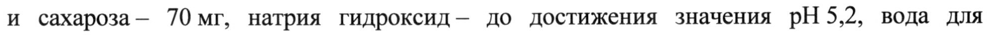
- стр. 2: «~ приблизительно Ha 25% ниже тех изменений, которые были отмечены Ha фоне введения» — повторное чтение: «® —сакиозитолььо п 29% maze пох изменений, колорые была сиоаеченых но фона wugneme»  
  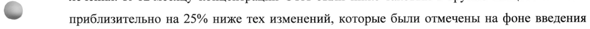
- стр. 4: «дозе 70 мг перорально 1 раз в неделю в течение 12 месяцев. В дополнение пациентки» — низкая уверенность: «1» (63)  
  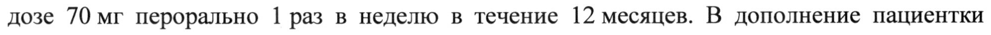
- стр. 4: «в период открытого лечения алендроновой кислотой в дозе 70 мг 1 раз в неделю, однако» — повторное чтение: «в период открытого лечения алендроновой кислотой в дозе 70 мг | раз в неделю, однако»  
  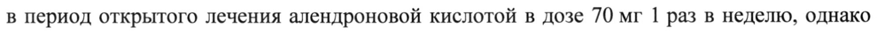
- стр. 5: «введения препарата ИВЕНИТИ® здоровым добровольцам в дозе 210 мг составила в» — низкая уверенность: «210» (46)  
  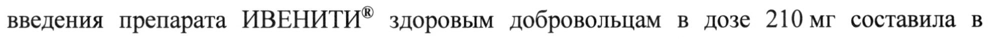
- стр. 5: «~ 0,1 до 10 мг/кг в 100 раз [в 0,03-3,3 раза по сравнению с утвержденной рекомендуемой» — повторное чтение: «~ 0,1 10 10 ric B 100 pa3 [B 0,03-3,3 pasa по  равнению c  твержденной  екомендуемой»  
  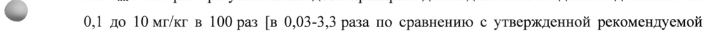
- стр. 8: «Для введения дозы ромосозумаба 210 мг следует сделать 2 подкожные инъекции» — низкая уверенность: «210» (21)  
  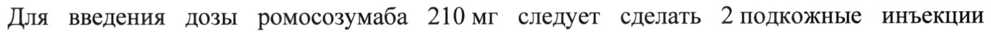
- стр. 8: «заполненных шприца, содержащие 105 мг в 1,17 мл раствора препарата). Вторую» — низкая уверенность: «105» (23), «1,17» (69)  
  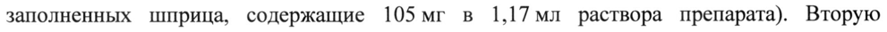
- стр. 13: «у 5 женщин (0,2%) в группе алендроновой кислоты, при этом инсульт был» — низкая уверенность: «5» (0)  
  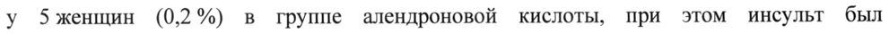
- стр. 13: «зарегистрирован у 13 женщин (0,6 %) в группе ромосозумаба и у 7 женщин (0,3 %) в» — низкая уверенность: «7» (80)  
  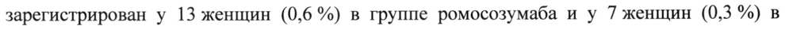
- стр. 13: «© ромосозумаба и у 12 женщин (0,6 %) в группе алендроновой кислоты. Количество» — низкая уверенность: «12» (51)  
  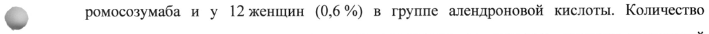
- стр. 17: «Раствор для подкожного введения, 105 мг/1,17 мл (90 мг/мл).» — низкая уверенность: «мг/1,17» (78)  
  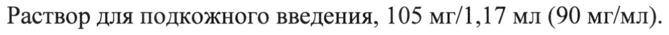
- стр. 17: «состоит из шприца Кристал Зенис 1 мл со вставкой в форме иглы из нержавеющей стали,» — повторное чтение: «состоит из шприца Кристал Зенис | мл со вставкой в форме иглы из нержавеющей стали,»  
  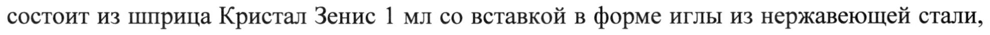
