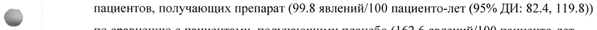
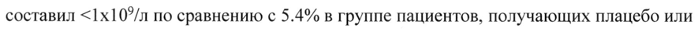
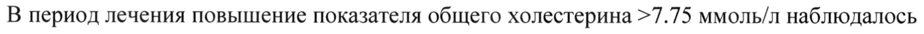

# Сатрализумаб — парентерально

- Препарат: ЭНСПРИНГ® (раствор для подкожного введения;)
- АТХ: L04AC19
- Источник: ГРЛС, инструкция по медицинскому применению, РУ ЛП-007335, файл от 2022-02-17 (https://grls.rosminzdrav.ru/Grls_View_v2.aspx?routingGuid=a0b786c6-1603-463c-8fd0-c203a35574a4)
- Распознано автоматически (OCR): 28 из 28 стр.
- Инструкция к другому РУ того же препарата: ЛП-007335 (срок действия истёк, решение от 02.02.2022). Текст может быть старше действующего
- Сомнительных строк после OCR: 3 (см. раздел «Проверка распознавания»)

## Общие сведения

| МИНИСТЕРСТВО ЗДРАВООХРАНЕНИЯ РОССИЙСКОЙ ФЕДЕРАЦИИ
ИНСТРУКЦИЯ ПО МЕДИЦИНСКОМУ ПРИМЕНЕНИЮ ЛЕКАРСТВЕННОГО ПРЕПАРАТА
ЭНСПРИНГ® Регистрационный номер Торговое наименование
Энспринг® Международное непатентованное или группировочное наименование
Сатрализумаб Лекарственная форма Раствор для подкожного введения

## 2. Состав

1 шприц-тюбик содержит:
1 шприц-тюбик содержит:
действующее вещество: сатрализумаб — 120 мг;
вспомогательные вещества: Г-гистидин — 3.1 мг, Г-аспарагиновая кислота до pH 6.0, Lаргинин — 26.1 мг, полоксамер 188 — 0.5 мг, вода для инъекций до | мл.
~~ Описание Жидкость от прозрачной до сильно опалесцирующей, от бесцветной до слегка желтоватого цвета.
Фармакотерапевтическая группа Антитела моноклональные
Код АТХ Г04АС19 Фармакологические свойства

## 5.1. Фармакодинамика

В клинических исследованиях препарата Энспринг® у пациентов с оптиконевромиелитом и заболеваниями спектра оптиконевромиелита отмечалось снижение показателей Среактивного белка (CPB), фибриногена и комплемента (C3, С4 и СН50).
В клинических исследованиях препарата Энспринг® у пациентов с оптиконевромиелитом и заболеваниями спектра оптиконевромиелита отмечалось снижение показателей Среактивного белка (CPB), фибриногена и комплемента (C3, С4 и СН50).
Механизм действия Сатрализумаб представляет собой гуманизированное моноклональное антитело из подкласса иммуноглобулинов G2 (1202), которое связывается как с растворимым, так и с мембранным человеческим рецептором интерлейкина-6 (IL-6R), и таким образом предотвращает передачу сигнала по нисходящему пути через эти рецепторы.
Интерлейкин-6 (IL-6) является многофункциональным цитокином, который продуцируется различными типами клеток и участвует в различных воспалительных
© процессах, таких как активация В-клеток, дифференцировка В-клеток в плазмобласты и выработка аутоантител, ТЬ17-клеточная активация и дифференцировка, ингибирование регуляторных Т-клеток, изменение проницаемости гематоэнцефалического барьера.
Уровни IL-6 повышаются у пациентов с оптиконевромиелитом и заболеваниями спектра оптиконевромиелита в спинномозговой жидкости и сыворотке крови в периоды активности заболевания. Некоторые функции IL-6 вовлечены в патогенез
& оптиконевромиелита и заболеваний спектра оптиконевромиелита, включая выработку патологических аутоантител к АОР4 (аквапорин 4, белок семейства водных каналов, который, главным образом, экспрессируется астроцитами в центральной нервной системе).
Доклинические данные по безопасности Канцерогенность w Исследований канцерогенности с целью определения канцерогенного потенциала сатрализумаба у грызунов не проводилось. В 6-ти месячном исследовании хронической токсичности у яванских макак пролиферирующих очагов не отмечалось.
Генотоксичность Исследований генотоксичности с целью определения мутагенного потенциала сатрализумаба не проводилось.
Не ожидается, что антитела будут оказывать влияние на ДНК.
Влияние на фертильность При длительном введении сатрализумаба обезьянам влияния на репродуктивные органы самцов и самок не наблюдалось.
Репродуктивная токсичность В ходе пренатального применения (до родов) сатрализумаба в дозах до 50 мг/кг | раз в неделю у беременных обезьян и их потомства (постнатальная экспозиция) не было выявлено какого-либо нежелательного влияния на материнский организм, развитие плода, исход беременности или выживаемость и развитие потомства, включая обучаемость.
Концентрации сатрализумаба в грудном молоке были очень низкими (<0.9% от соответствующей концентрации препарата в плазме матери).
Прочее Токсичность при повторном введении
Доклиническое изучение применения препарата у обезьян (вид с перекрестной реактивностью к сатрализумабу) не выявило отдельных рисков для человека на основании конечных точек исследований фармакологической безопасности, острой токсичности и
© токсичности при повторном введении. Не наблюдалось каких-либо токсических изменений, связанных с введением сатрализумаба, при повторном подкожном введении у яванских макак в дозах до 50 мг/кг 1 раз в неделю в 4-х и 26-ти недельном исследовании токсичности.
Единственным релевантным изменением в данных исследованиях было повышение уровня IL-6 в крови, которое считается результатом фармакологического действия
& сатрализумаба (нейтрализующее действие в отношении IL-6R). При этом повышение уровня IL-6 в крови не было связано с какими-либо нежелательными эффектами.
Введение сатрализумаба вызывало иммунный ответ с образованием антител к лекарственному препарату (АтП) у большинства животных, однако это не влияло на фармакологический ответ и не приводило к развитию каких-либо нежелательных явлений.
Местная переносимость “> Применение сатрализумаба в лекарственной форме для подкожного введения не вызывало каких-либо нежелательных реакций в месте инъекции у обезьян.
Тканевая перекрестная реактивность Тканевая перекрестная реактивность к сатрализумабу была обнаружена в тканях обезьяны и человека, экспрессирующих IL-6R. Релевантной тканевой перекрестной реактивности в других тканях обнаружено не было.
Синдром высвобождения цитокинов На основании результатов исследований крови человека in vitro риск высвобождения провоспалительных цитокинов при применении сатрализумаба (с учетом частоты и повышения уровня цитокинов) считается низким.
Иммуногенность В опорных клинических исследованиях сатрализумаба как в комбинации с иммуносупрессивной терапией, так и в монотерапии, АтП наблюдались у 41% и 71% пациентов, соответственно. Способность АтП нейтрализовывать связывание препарата
Энспринг® неизвестна.
Экспозиция препарата у пациентов с АтП была ниже, однако влияния на безопасность или явного влияния на показатели эффективности и фармакодинамики, указывающих на таргетное связывание, не было.
Терапия сатрализумабом приводила к сходному снижению риска развития признанного рецидива в опорных клинических исследованиях, независимо от различающихся показателей АтП в данных исследованиях. У пациентов с более высокой массой тела и низкой экспозицией препарата с большей вероятностью развивались АтП (независимо от

© фоновой терапии иммуносупрессантами), однако эффект от лечения был сопоставим во всех группах пациентов с различной массой тела как при применении сатрализумаба в комбинации с иммунносупрессивной терапией, так и в монотерапии. Рекомендуемая доза подходит всем пациентам, необходимость в прерывании лечения или изменения дозы у пациентов с АтП отсутствует.

## 5.2. Фармакокинетика

& Фармакокинетика препарата Энспринг® была изучена у здоровых добровольцев

(европеоидной расы и японцев), пациентов с оптиконевромиелитом и заболеваниями спектра оптиконевромиелита. Фармакокинетика у пациентов с оптиконевромиелитом и заболеваниями спектра оптиконевромиелита при применении препарата Энспринг® в рекомендованной дозе была изучена с использованием методов анализа популяционной фармакокинетики на основании данных, полученных у 154 пациентов.

& Показатель концентрация-время препарата Энспринг® у пациентов с оптиконевромиелитом и заболеваниями спектра оптиконевромиелита был точно описан с помощью двухкамерной популяционной фармакокинетической модели с параллельным линейным и мишень-опосредованным (Михаэлис-Ментен) выведением и подкожным всасыванием первого порядка. Параметры клиренса и объема распределения препарата
Энспринг® аллометрически масштабировали в зависимости от массы тела (посредством функции мощности с зафиксированными коэффициентами мощности 0.75 и 1 для параметров клиренса и объема распределения, соответственно). Было показано, что масса тела является значимой ковариатой; при этом клиренс и центральный объем распределения у пациентов с массой тела 123 кг (97.5 процентиль распределения по массе тела) повышались на 71.3% и 105% соответственно по сравнению с пациентом с массой тела 60 кг.

Равновесное состояние показателей фармакокинетики достигалось после введения препарата в нагрузочной дозе в течение 8 недель и составило среднее значение (+ стандартное отклонение, СО) 19.7 (12.2) мкг/мл для минимальной концентрации (Ст), 31.5 (14.9) мкг/мл для максимальной концентрации (Cmax) и 737 (386) мкг.мл/сутки для площади под кривой «концентрация-время» (AUC). Применение фоновой иммунотерапии не оказывало влияние на фармакокинетику препарата (см. раздел «Взаимодействие с другими лекарственными средствами»).
Всасывание Константа скорости всасывания препарата Энспринг® составила 0.251 1/сутки (95% доверительный интервал, ДИ: 0.216-0.285), что соответствует полупериоду всасывания
(-3 дня) при применении в рекомендованной дозе (см. раздел «Способ применения и

© дозы»). Биодоступность была высокой (85.4%, 95% ДИ: 79.5-95.3%).
Распределение Препарат Энспринг® подвергается двухфазному распределению. Центральный объем распределения составил 3.46 л (95% ДИ: 3.21-3.97), периферический объем распределения составил 2.07 л (95% ДИ: 1.78-2.59), интеркомпартментный клиренс — 0.336 л/сутки (95%
ДИ: 0.261-0.443).

& Метаболизм

Метаболизм препарата Энспринг® специально не изучался, поскольку моноклональные антитела выводятся, преимущественно, посредством катаболизма.
Выведение Общий клиренс препарата Энспринг® зависит от концентрации. Установлено, что линейный клиренс составляет 0.0601 л/сутки (95% ДИ: 0.0524-0.0695; расчетное значение

= составляет приблизительно половину общего клиренса в равновесном состоянии при применении препарата в рекомендованной дозе у пациентов с оптиконевромиелитом и заболеваниями спектра оптиконевромиелита). Соответствующий терминальный период полувыведения (11/2) составляет приблизительно 30 дней (диапазон 22-37 дней) согласно объединенным данным опорных клинических исследований.
Особые группы пациентов Популяционный фармакокинетический анализ у взрослых пациентов с оптиконевромиелитом и заболеваниями спектра оптиконевромиелита показал, что возраст, пол и раса не оказывают значимого влияния на фармакокинетику сатрализумаба.
Хотя масса тела оказывает влияние на фармакокинетику сатрализумаба, коррекция дозы с учетом указанных демографических факторов не рекомендуется.
Пациенты детского возраста

Данные, которые были получены у 8 подростков (13-17 лет) при применении препарата согласно режиму дозирования у взрослых пациентов, показали, что популяционные фармакокинетические параметры сатрализумаба у подростков не отличаются значительным образом от таковых у взрослых.
Таких образом, необходимость в коррекции дозы отсутствует.
Пациенты пожилого возраста Отдельных исследований для изучения фармакокинетики сатрализумаба у пациентов >65 лет не проводилось, однако пациенты с оптиконевромиелитом и заболеваниями спектра оптиконевромиелита от 65 до 74 лет принимали участие в опорных клинических исследованиях.
Согласно данным популяционного фармакокинетического анализа, полученных у этих

© пациентов, возраст не оказывает влияния на фармакокинетику сатрализумаба.
Пациенты с нарушением функции почек Специального исследования по оценке влияния нарушения функции почек на фармакокинетику сатрализумаба не проводилось. Однако пациенты с нарушением функции почек легкой степени тяжести (клиренс креатинина <80 мл/мин и >50 мл/мин)
принимали участие в опорных клинических исследованиях. Как и ожидалось, на

& основании известного механизма клиренса сатрализумаба влияния Ha фармакокинетику у данных пациентов не отмечалось, таким образом, коррекции дозы не требуется.
Пациенты с нарушением функции печени Специального исследования по изучению влияния нарушения функции печени на фармакокинетику сатрализумаба не проводилось.

& Показания к применению Препарат Энспринг® показан в виде монотерапии или в комбинации с иммуносупрессивной терапией для лечения взрослых и подростков >12 лет с оптиконевромиелитом и заболеваниями спектра оптиконевромиелита с антителами (IgG) к аквапорину-4.

## 4.3. Противопоказания

Повышенная чувствительность к сатрализумабу или к другим вспомогательным веществам препарата в анамнезе.
Повышенная чувствительность к сатрализумабу или к другим вспомогательным веществам препарата в анамнезе.

## 4.6. Применение при беременности и в период грудного вскармливания

Дети <12 лет.
Одновременное применение с живыми, в том числе ослабленными, вакцинами.

## 4.3. С осторожностью

Нарушение функции почек.
Нарушение функции почек.
Нарушение функции печени.
Одновременный прием или отмена препарата Энспринг® у пациентов, получающих субстраты CYP450 с узким терапевтическим индексом.
Язва кишечника или дивертикулит в анамнезе.
Применение при беременности и в период грудного вскармливания
Фертильность Данные клинических исследований по влиянию препарата Энспринг® на фертильность у
< человека отсутствуют. Результаты изучения препарата у животных показали отсутствие влияния на фертильность самцов и самок (см. раздел «Фармакологические свойства», подраздел «Доклинические данные по безопасности»).
Беременность Исследования у обезьян не выявили повреждающего действия в рамках репродуктивной токсичности (см. раздел «Фармакологические свойства», подраздел «Доклинические
| данные по безопасности»).
Данные по применению препарата Энспринг® у беременных женщин отсутствуют.
Применение препарата при беременности противопоказано.
Период грудного вскармливания Неизвестно, выводится ли препарат Энспринг® с грудным молоком у человека или подвергается системной абсорбции после проглатывания с молоком. Тем не менее, IgG w выводятся с грудным молоком у человека, также имеются доказательства выведения сатрализумаба с грудным молоком у животных (см. раздел «Фармакологические свойства», подраздел «Доклинические данные по безопасности»). Применение препарата в период грудного вскармливания противопоказано.

## 4.2. Способ применения и дозы

Общие рекомендации
Общие рекомендации
Замена препарата Энспринг® на другой препарат биологического происхождения должна быть согласована с лечащим врачом.
Во избежание медицинских ошибок перед применением лекарственного препарата необходимо проверить этикетку на шприц-тюбике и убедиться, что используемый для введения препарат представляет собой препарат Энспринг®.
Рекомендуемый режим дозирования

Препарат Энспринг® следует вводить в виде подкожной инъекции.

Препарат Энспринг® можно применять как в виде монотерапии, так и в комбинации с пероральными глюкокортикостероидами, азатиоприном или микофенолата мофетилом.
См. инструкцию по медицинскому применению данных лекарственных препаратов.
Нагрузочная доза

Рекомендуемая нагрузочная доза составляет 120 мг подкожно каждые 2 недели (первое введение на неделе 0, второе введение на неделе 2 и третье введение на неделе 4) - всего 3 инъекции.

Поддерживающая доза

Рекомендуемая поддерживающая доза составляет 120 мг подкожно каждые 4 недели.

© Способ применения Препарат рекомендуется вводить в области живота и бедер. Следует чередовать места инъекций и никогда не вводить препарат в родимые пятна, ткани рубцов, гематомы, в места с уплотнением или повреждением, в участки с чувствительной кожей, покраснением.

Подробное руководство по использованию препарата Энспринг® представлено ниже.

> Первое введение необходимо осуществлять под наблюдением квалифицированного медицинского специалиста.
По решению лечащего врача взрослый пациент/лицо, осуществляющее уход за пациентом, может вводить препарат Энспринг® дома при условии соблюдения техники проведения инъекции.
При появлении симптомов серьезных аллергических реакций пациенты/лица,

& осуществляющие уход за пациентом, должны незамедлительно обратиться за медицинской помощью и подтвердить с медицинским специалистом возможность продолжения применения препарата Энспринг®.

Продолжительность терапии Препарат Энспринг® предназначен для долгосрочной терапии.
Задержка введения или пропуск дозы Если инъекция была пропущена, по любой причине за исключением повышения активности ферментов печени, препарат следует ввести как указано в таблице ниже.
Таблица 1. Рекомендуемый режим дозирования при задержке введения или пропуске дозы
Введение последней дозы Рекомендуемый режим дозирования при задержке введения или пропуске дозы
Менее 8 недель в период поддерживающей | Ввести 120 мг путем подкожной инъекции

дозы или при пропуске нагрузочной дозы | как можно скорее, не дожидаясь следующего запланированного введения.
Поддерживающий период При задержке введения или пропуске дозы, скорректировать график применения препарата — каждые 4 недели.
Нагрузочный период При задержке введения или пропуске второй нагрузочной дозы следует ввести ее как можно скорее, а затем ввести

© третью и последнюю нагрузочную дозу через 2 недели.
При задержке введения или пропуске третьей нагрузочной дозы следует ввести ее как можно скорее, а затем ввести первую поддерживаю дозу через 4 недели.

& 8 недель — менее 12 недель 120 мг путем подкожной инъекции на неделе 0* и 2, затем 120 мг - каждые 4 недели.

12 недель или более 120 мг путем подкожной инъекции на неделе 0*, 2 и 4, затем 120 мг — каждые 4 недели.

& *0 недель относится к моменту первого введения после пропуска дозы.

Коррекция дозы Отклонения лабораторных показателей функции печени
При повышении активности аланинаминотрансферазы (АЛТ) или аспартатаминотрансферазы (АСТ) >5х верхней границы нормы (ВГН) с одновременным повышением уровня билирубина (любым) лечение препаратом Энспринг® следует прекратить; возобновление лечения не рекомендуется.
При повышении активности АЛТ или АСТ >5х ВГН без одновременного повышения уровня билирубина (любого) терапию препаратом Энспринг® следует прекратить; лечение можно возобновить (120 мг подкожно каждые 4 недели) после нормализации активности
АЛТ и АСТ на основании оценки пользы и риска для пациента.

В случае, если принято решение о возобновлении терапии препаратом Энспринг®, следует тщательно мониторировать показатели функции печени, при любом последующем повышении активности АЛТ/АСТ и/или уровня билирубина следует прекратить применение препарата; возобновление лечения не рекомендуется.
Таблица 2. Рекомендуемый режим дозирования при возобновлении лечения после повышения активности трансаминаз печени
Введение последней дозы Рекомендуемый режим дозирования после возобновления лечения
Менее 12 недель Возобновить введение в дозе 120 мг путем
ЕЙ © 12 недель или более Возобновить введение в дозе 120 мг путем подкожной инъекции на неделе 0*, 2 и 4, затем 120 мг — каждые 4 недели.
*0 недель относится к моменту первого введения после пропуска дозы.
Нейтропения > Если число нейтрофилов составляет <1.0x10°/n и подтверждено повторным тестированием, применение препарата Энспринг® следует прервать до тех пор, пока число нейтрофилов не будет >1.0x10°/n.
Дозирование в особых случаях Пациенты детского возраста
Эффективность и безопасность препарата Энспринг® у детей <12 лет не изучались (см.
w раздел «Особые указания», подраздел «Особые группы пациентов»).
Пациенты пожилого возраста Коррекции дозы у пациентов >65 лет не требуется (см. разделы «Фармакологические свойства», подраздел «Особые группы пациентов», и «Особые указания», подраздел
«Особые группы пациентов»).
Пациенты с нарушением функции почек Эффективность и безопасность препарата Энспринг® у пациентов с нарушением функции почек специально не изучались; однако необходимости в коррекции дозы у пациентов с нарушением функции почек не ожидается (см. разделы «Фармакологические свойства», подраздел «Особые группы пациентов», и «Особые указания», подраздел «Особые группы пациентов»).
Пациенты с нарушением функции печени Эффективность и безопасность препарата Энспринг® у пациентов с нарушением функции печени не изучались (см. разделы «Фармакологические свойства», подраздел «Особые группы пациентов», и «Особые указания», подраздел «Особые группы пациентов»).
Обращение с препаратом Шприц-тюбик с препаратом Энспринг® предназначен для введения только одной дозы.
При наличии посторонних включений в растворе, его помутнении или изменении окраски не следует вводить препарат.
Необходимо проверить шприц-тюбик на предмет повреждений. При наличии трещин или повреждений не следует вводить препарат.
Препарат Энспринг® до применения хранить при температуре 2-8 °С.
Невскрытую картонную пачку (оригинальную упаковку) можно достать и вернуть в
© холодильник при необходимости. Общее время хранения при комнатной температуре не выше 30 °С (вне холодильника) не должно превышать 8 дней.
Шприц-тюбики необходимо хранить в картонной пачке для защиты от света и всегда сохранять сухими.
Не замораживать. Не использовать, если шприц-тюбик был заморожен.
Не встряхивать.
© Использование и утилизация шириу-тюбика
Необходимо строго следовать следующим требованиям по использованию и утилизации шприц-тюбика.
e Шприц-тюбик никогда нельзя использовать повторно.
® Поместить использованный шприц-тюбик в контейнер для утилизации острых предметов сразу после использования.
& e Утилизировать шприц-тюбик в соответствии с локальными требованиями или в соответствии с указаниями лечащего врача.
® Хранить шприц-тюбик, как и все лекарственные препараты, в недоступном для детей месте.
Руководство по использованию препарата Важная информация для пациентов/лии, осуществляющих уход за пациентами
Не следует:
. Передавать шприц-тюбик другим людям — Вы можете передать им серьезную инфекцию или получить серьезную инфекцию от них;
¢ снимать колпачок иглы со шприц-тюбика до Tex пор, пока Вы не будете готовы ввести препарат Энспринг®;
. использовать шприц-тюбик, если Вы его уронили или он поврежден;
. Пытаться разобрать шприц-тюбик;
‚ оставлять шприц-тюбик без присмотра.
Шприц-тюбик с препаратом Энспринг® представлен на рисунках А и Bb.
Шприц-тюбик перед использованием Ограничители (не
Корпус трогать)
SG Ce i“ 7 ae j[= | | eat | Ni Колпачок Дата истечения
Поршень & иглы срока годности Рисунок А Шприц-тюбик после использования еее т]
TS)
Защитный предохранитель иглы & (закрытый и заблокированный)
Рисунок Б У шприц-тюбика есть специальный защитный предохранитель, который автоматически закроет иглу, после того как инъекция будет завершена.
Подготовка к использованию препарата
1. Достаньте картонную пачку со шприц-тюбиком из холодильника и поместите на чистую, плоскую, рабочую поверхность (например, на стол).
2. Проверьте дату истечения срока годности, указанную с обратной стороны картонной пачки (см. рисунок В). Не используйте препарат, если срок годности, указанный на картонной пачке, истек.
3. Проверьте, что передняя часть картонной пачки запечатана (см. рисунок В). Не используйте препарат, если имеются повреждения данной области картонной пачки.
Не используйте препарат, если его срок годности истек или запечатанная область картонной пачки повреждена. В таком случае см. шаг 21 «Утилизация препарата
Энспринг*®» и свяжитесь с медицинским работником.
e Проверьте дату истечения срока годности
@&> (обратная сторона) «Годен до»
® Проверьте, запечатана ли картонная пачка
Годен до + + a Рисунок В
4. Откройте запечатанную картонную пачку (см. рисунок Г).
Рисунок Г
5. Аккуратно достаньте шприц-тюбик из картонной пачки, держась за корпус (см. рисунок w He следует:
. переворачивать картонную пачку для извлечения шприц-тюбика;
. дотрагиваться до ограничителей — это может повредить шприц-тюбик;
. Держаться за поршень или колпачок иглы.
(\)
ae Ss КЕ — <= pa | Рисунок Д Проверка шприи-тюбика (см. рисунок Е)
6. Проверьте дату истечения срока годности, указанную на шприц-тюбике. Не используйте шприц-тюбик, если срок годности истек.
7. Проверьте шприц-тюбик на предмет каких-либо повреждений. Не используйте шприцтюбик, если на нем имеются трещины или он сломан.
8. Проверьте через смотровое окошко, что препарат представляет собой прозрачную жидкость от бесцветного до желтоватого цвета. Не вводите препарат, если раствор препарата мутный, изменил окраску или в нем присутствуют посторонние включения. В шприц-тюбике могут быть небольшие пузырьки воздуха. Это является нормой и Вам не следует пытаться удалить их.
<” . Проверьте дату истечения срока годности «Годен до»
| ‚ Проверьте раствор Г ‚ Проверьте шприц-тюбик на предмет повреждений a
® ф aN i Г ах 00 Рисунок Е wo Не используйте препарат, если срок годности истек, шприц-тюбик поврежден, раствор препарата мутный, изменил окраску или в нем присутствуют посторонние включения. В таком случае см. шаг 21 «Утилизация препарата Энспринг*®» и свяжитесь с медицинским работником.
Доведение шприи-тюбика до комнатной температуры
© 9. После проверки шприц-тюбика, поместите его на чистую плоскую рабочую поверхность (например, на стол) на 30 минут — это позволит довести препарат до комнатной температуры (см. рисунок Ж).
Важно позволить шприц-тюбику медленно согреться, поскольку введение холодного препарата может оказаться некомфортным и будет сложнее нажимать на поршень шприцтюбика.
Не следует:
. ускорять процесс согревания любым способом, например, используя микроволны или поместив шприц-тюбик в теплую воду;
. удалять колпачок иглы, пока шприц-тюбик не будет доведен до комнатной температуры.
в o> = iS 30 минут Рисунок Ж Мытье рук
10. Вымойте руки водой с мылом (см. рисунок 3).
Рисунок 3 w Выбор места unbekuuu
11. Выберете место инъекции:
. Нижняя часть живота ИЛИ ‚ Передняя и средняя поверхности бедер (см. рисунок И).
- д N Места инъекций
Рисунок И Не следует:
. проводить инъекции в области 5 см вокруг пупка;
. проводить инъекции в родимые пятна, ткани рубцов, гематомы, в места с уплотнением или повреждением, в участки с чувствительной кожей, покраснением.
Необходимо каждый раз менять место инъекции - при проведении инъекции следует отступать не менее чем на 2.5 сантиметра от области предыдущей инъекции.
Обработка места инъекции
12. Обработайте место инъекции спиртовой салфеткой и дайте ему высохнуть на воздухе.
Не следует:
. обмахивать или обдувать очищенный участок;
. прикасаться к месту инъекции до момента проведения инъекции.
© Рисунок К Введение препарата
13. Удерживайте корпус шприц-тюбика между большим и указательным пальцем. Другой рукой потяните колпачок иглы и сразу снимите его. Вы можете увидеть каплю жидкости
© на кончике иглы - это нормально и не повлияет Ha Вашу дозу (см. рисунок Л).
Используйте шприц-тюбик в течение 5 минут после снятия колпачка, поскольку игла может засориться.
Не следует:
. снимать колпачок с иглы до тех пор, пока Вы не будете готовы к введению препарата
Энспринг®;
© . надевать колпачок иглы обратно после снятия, поскольку это может повредить иглу;
. дотрагиваться до иглы или помещать ее на какую-либо поверхность после снятия колпачка.
= Рисунок Л
14. Незамедлительно поместите колпачок иглы в защищенный от проколов контейнер для утилизации острых предметов (см. шаг 21 «Утилизация препарата Энспринг®»).
15. Удерживайте корпус шприц-тюбика между большим и указательным пальцем. Другой рукой зажмите область кожи, которую Вы очистили (см. рисунок М).
16. Быстрым резким движением введите иглу под углом от 45° до 90° (см. рисунок М).
Не следует:
. вводить иглу через одежду;
. изменять угол инъекции;
. повторно вводить иглу.
90" OK => 45° | < ~ 92 — у + Рисунок М
17. После введения иглы, отпустите зажатую кожу.
© 18. Медленно введите препарат полностью, аккуратно нажимая на поршень вниз до конца до тех пор, пока он не коснется ограничителей (см. рисунок Н).
I 5 7 v

Рисунок Н
19. Медленно отпустите поршень и дайте игле выйти из кожи под тем углом, под которым производилось введение (см. рисунок О).

= TP

hea 7a BS

A OPC

UI ь

se Рисунок О

Теперь игла будет закрыта защитным предохранителем. Если игла не была закрыта, аккуратно поместите шприц-тюбик в защищенный от проколов контейнер для утилизации острых предметов во избежание повреждений (см. шаг 21 «Утилизация препарата
Энспринг®»).
Уход за местом инъекиии
20. В месте инъекции может наблюдаться небольшое кровотечение. Вы можете надавить ватным или марлевым тампоном на место инъекции, но не трите его. При необходимости
Вы также можете заклеить место инъекции небольшим пластырем. Если произошел контакт лекарственного препарата с кожей, промойте эту область водой.
Утилизация препарата Энспринг®
21. Не пытайтесь повторно надеть колпачок на шприц-тюбик. Поместите использованный
- шприц-тюбик в контейнер для утилизации острых предметов сразу после использования
(см. рисунок П). Не следует утилизировать шприц-тюбик с бытовыми отходами и подвергать переработке.
у : и Рисунок П . Проконсультируйтесь с медицинским работником или фармацевтом касательного
© того, где Вы можете получить контейнер для острых предметов или другие виды устойчивых к проколам контейнеров для безопасной утилизации использованных шприц-тюбиков и колпачков игл, если у Вас его нет.
. Утилизируйте использованный контейнер для острых предметов в соответствии с указаниями медицинского работника или фармацевта.
¢ Нельзя помещать использованный контейнер для утилизации острых предметов в бытовые отходы, за исключением случаев, когда это допустимо по локальным правилам.
. Нельзя подвергать использованный контейнер для утилизации острых предметов переработке.

## 4.8. Побочное действие

Резюме профиля безопасности
Резюме профиля безопасности
Безопасность лечения препаратом Энспринг® изучали в двух опорных клинических исследованиях, в которых 63 пациента получали препарат Энспринг® в виде монотерапии, a 41 - препарат Энспринг® в комбинации с иммуносупрессивной терапией. Медиана экспозиции к сатрализумабу составила приблизительно 2 года в обоих исследованиях (в каждом).
Наиболее частыми нежелательными реакциями были головная боль, артралгия, лейкопения и реакции, связанные с инъекцией.
Помимо указанных в разделе нежелательных реакций возможны также перфорация кишечника, оппортунистические инфекции, включая туберкулез, реактивация гепатита В, повышенный риск сердечно-сосудистых заболеваний, активация системы комплемента.
| Так же не могут быть исключены демиелинизирующие заболевания и злокачественные
- новообразования (см. раздел «Особые указания»).
Ниже представлены нежелательные реакции, которые были связаны с применением препарата Энспринг® в виде монотерапии или в комбинации с иммуносупрессивной терапией в клинических исследованиях. В данном разделе нежелательные реакции сгруппированы в соответствии с классами систем органов медицинского словаря для

© нормативно-правовой деятельности MedDRA.
Для описания частоты нежелательных реакций используется следующая классификация:
очень часто (>1/10), часто (>1/100 и <1/10), нечасто (>1/1000 и <1/100), редко (>1/10000 и
<1/1000), очень редко (<1/10000).
Нарушения со стороны крови и лимфатической системы: часто — гипофибриногенемия.
Нарушения психики: часто — бессонница.

& Нарушения со стороны нервной системы: очень часто — головная боль; часто — мигрень.
Нарушения со стороны дыхательной системы, органов грудной клетки и средостения:
часто — аллергический ринит.

Нарушения со стороны кожи и подкожных тканей: часто — сыпь, зуд.
Нарушения со стороны скелетно-мышечной и соединительной ткани: очень часто — артралгия; часто — скелетно-мышечная скованность.
Общие расстройства и нарушения в месте введения: часто — периферический отек.
Травмы, интоксикации и осложнения манипуляций: очень часто — реакции, связанные с инъекцией.
Лабораторные и инструментальные данные: очень часто — снижение числа лейкоцитов;
часто — повышение уровня билирубина.
Описание отдельных нежелательных реакций в клинических исследованиях

Реакции, связанные с инъекцией Реакции, связанные с инъекцией, наблюдались у пациентов, получающих препарат
Энспринг® как в виде монотерапии, так и в комбинации с иммуносупрессивной терапией;
были преимущественно от легкой до умеренной степени тяжести, большинство развивались в течение 24 часов после инъекции. Наиболее частыми системными симптомами были диарея и головная боль. Наиболее частыми локальными реакциями, связанными с инъекцией, были гиперемия, эритема, зуд, сыпь и боль. Ни одна реакция, связанная с инъекцией, не привела к необходимости прервать введение или прекратить применение препарата.
Инфекции В исследовании монотерапии препаратом Энспринг® частота инфекций была ниже у

© пациентов, получающих препарат (99.8 явлений/100 пациенто-лет (95% ДИ: 82.4, 119.8))
по сравнению с пациентами, получающими плацебо (162.6 явлений/100 пациенто-лет
(95% ДИ: 125.8, 206.9)). Частота серьезных инфекций составила 5.2 явлений/100 пациенто-лет (95% ДИ: 1.9, 11.3) у пациентов, получающих препарат Энспринг®, по сравнению с 9.9 явлений/100 пациенто-лет (95% ДИ: 2.7, 25.2) у пациентов, получающих плацебо.

& У пациентов, получающих препарат Энспринг® в комбинации с иммуносупрессивной терапией, частота инфекций составила 132.5 явлений/100 пациенто-лет (95% ДИ: 108.2, 160.5) по сравнению с 149.6 явлений/100 пациенто-лет (95% ДИ: 120.1, 184.1) у пациентов, получающих плацебо в комбинации с иммуносупрессивной терапией. У пациентов, получающих препарат Энспринг® в комбинации с иммуносупрессивной терапией, частота серьезных инфекций составила 2.6 явлений/100 пациенто-лет (95% ДИ:

| © 0.3, 9.2) по сравнению с 5.0 явлений/100 пациенто-лет (95% ДИ: 1.0, 14.7) у пациентов, получающих плацебо в комбинации с иммуносупрессивной терапией.
Увеличение массы тела В клинических исследованиях препарата Энспринг® в качестве монотерапии или в комбинации с иммуносупрессивной терапией увеличение массы тела >15% от исходного уровня наблюдалось у 3.8% пациентов по сравнению с 2.7% пациентов, получавших плацебо (или в комбинации с иммуносупрессивной терапией).
Отклонения со стороны лабораторных показателей
Нейтрофилы В период лечения снижение показателя нейтрофилов наблюдалось у 31.7% пациентов, получающих препарат Энспринг® (в виде монотерапии или в комбинации с иммуносупрессивной терапией), по сравнению с 21.6% пациентов, получающих плацебо

(или в комбинации с иммуносупрессивной терапией). Большинство случаев снижения нейтрофилов были временными или периодическими.
У 9.6% пациентов в группе терапии препаратом Энспринг® показатель нейтрофилов составил <1х10?/л по сравнению с 5.4% в группе пациентов, получающих плацебо или плацебо в комбинации с иммуносупрессивной терапией, что не было связано по времени с какими-либо серьезными инфекциями.
Тромбоциты В период лечения снижение числа тромбоцитов наблюдалось у 24.0% пациентов, получающих препарат Энспринг® (в виде монотерапии или в комбинации с иммуносупрессивной терапией), по сравнению с 9.5% пациентов, получающих плацебо или плацебо в комбинации с иммуносупрессивной терапией. Снижение числа
© тромбоцитов не было связано с явлениями кровотечений.
Большинство случаев снижения числа тромбоцитов были временными, число тромбоцитов при этом было не ниже 75х109/л. Ни у одного из пациентов не отмечалось снижения числа тромбоцитов <50 х109/л.
Показатели функции печени В период лечения повышение активности АЛТ или АСТ наблюдалосьу 27.9% и 18.3%
© пациентов, получающих препарат Энспринг® (в виде монотерапии или в комбинации с иммуносупрессивной терапией), соответственно, по сравнению с 12.2% и 13.5% пациентов, получающих плацебо или плацебо в комбинации с иммуносупрессивной терапией. В большинстве случаев повышение активности AJIT или АСТ было ниже 3x
ВГН, временным и разрешалось без прерывания терапии препаратом Энспринг®.
Повышение активности AJIT или АСТ >3x ВГН, которое не было связано с повышением
©, показателя общего билирубина, отмечалось у 2.9% и 1.9% пациентов, получающих препарат Энспринг® в виде монотерапии или в комбинации с иммуносупрессивной терапией, соответственно. Повышение активности АЛТ >5х ВГН отмечалось у одного пациента через 4 недели после начала терапии препаратом Энспринг® в комбинации с иммуносупрессивной терапией. Показатель АЛТ нормализовался после отмены препарата
Энспринг®.
Липидный профиль В период лечения повышение показателя общего холестерина >7.75 ммоль/л наблюдалось у 10.6% пациентов, получающих препарат Энспринг® (в виде монотерапии или в комбинации с иммуносупрессивной терапией), по сравнению с 1.4% пациентов, получающих плацебо или плацебо в комбинации с иммуносупрессивной терапией; у 20.2% пациентов, получающих препарат Энспринг®, отмечалось повышение показателя триглицеридов >3.42 ммоль/л по сравнению с 10.8% пациентов, получающих плацебо.
Повышение показателей липидного профиля не потребовало прерывания терапии препаратом Энспринг®.

## 4.9. Передозировка

Случаев передозировки препарата у пациентов с оптиконевромиелитом и заболеваниями спектра оптиконевромиелита не было.
Случаев передозировки препарата у пациентов с оптиконевромиелитом и заболеваниями спектра оптиконевромиелита не было.
Симптомы В одном клиническом исследовании препарат Энспринг® вводили здоровым взрослым добровольцам однократно в дозе <240 мг подкожно; серьезных или тяжелых нежелательных явлений не отмечалось.
© Лечение В случае передозировки следует тщательно наблюдать за пациентом, и при необходимости провести симптоматическую или поддерживающую терапию.

## 4.5. Взаимодействие с другими лекарственными средствами

Отдельных исследований лекарственных взаимодействий для препарата Энспринг® не
© проводилось.
Популяционный фармакокинетический анализ не выявил какого-либо влияния азатиоприна, глюкокортикостероидов или микофенолата мофетила на клиренс препарата
Энспринг®.
У взрослых пациентов применение препарата Энспринг® изучено в комбинации:
® с пероральным глюкокортикостероидом (в дозе до 15 мг/сутки эквивалента
© преднизолона) ИЛИ ® сазатиоприном (в дозе до 3 мг/кг/сутки) ИЛИ
® с микофенолата мофетилом (в дозе до 3000 мг/сутки).
У подростков применение препарата Энспринг® изучено в комбинации:
® сазатиоприном (в дозе до 3 мг/кг/сутки) и пероральным глюкокортикостероидом (в дозе до 15 мг/сутки эквивалента преднизолона) ИЛИ
® с микофенолата мофетилом (в дозе до 3000 мг/сутки) и пероральным глюкокортикостероидом (в дозе до 15 мг/сутки эквивалента преднизолона).
В ходе исследования применение препарата Энспринг® у подростков также допускалось в комбинации:
® сазатиоприном (в дозе до 3 мг/кг/сутки) ИЛИ
® с микофенолата мофетилом (в дозе до 3000 мг/сутки) ИЛИ
® с пероральным глюкокортикостероидом (в дозе до 15 мг/сутки эквивалента преднизолона).

Возможное влияние препарата Энспринг® на снижение экспозиции одновременно применяемых препаратов, метаболизирующихся изоферментами цитохрома СУР450, посредством блокады сигнального пути IL-6, изучали с использованием различных подходов на фармакокинетической модели, основанной на физиологии.
Было показано, что подавление передачи сигнала IL-6 при терапии препаратом Энспринг® от низких исходных уровней IL-6, отмечавшихся в клинических исследованиях, будет оказывать только небольшое влияние на экспозицию диапазона проб субстратов СУР450
(<15% уменьшение AUC для всех субстратов CYP 1A2, 3A4, 206, 2С19). Это указывает на то, что риск лекарственного взаимодействия является низким, однако при применении

© препарата Энспринг® или его отмене у пациентов, одновременно получающих субстраты
СУР450 с узким терапевтическим индексом, следует соблюдать осторожность.
Пациенты, принимающие индивидуально контролируемые дозы препаратов, метаболизируемых СУР450 3A4, 1A2 или 2С9 (например, аторвастатин, блокаторы кальциевых каналов, теофиллин, варфарин, фенитоин, циклоспорин или бензодиазепины), должны находиться под наблюдением в момент начала и в момент окончания терапии

& препаратом Энспринг®, при необходимости доза этих веществ может быть скорректирована. Учитывая длительный период полувыведения, влияние препарата
Энспринг® на активность ферментов СУР450 может сохраняться в течение нескольких недель после прекращения лечения.

## 4.4. Особые указания

& В медицинской документации пациента следует указывать торговое наименование и номер серии препарата.
Инфекции Следует отложить введение препарата Энспринг® у пациентов с активными инфекциями до взятия активных инфекций под контроль (см. раздел «Способ применения и дозы», подраздел «Задержка введения или пропуск дозы»).
Туберкулез Согласно рекомендациям для других иммуномодулирующих средств, перед началом терапии препаратом Энспринг® всех пациентов следует проверить на наличие латентного туберкулеза. Пациентам с латентным туберкулезом необходимо провести стандартную антибактериальную терапию перед началом лечения препаратом Энспринг®.
Вакцинация

Не следует одновременно применять препарат Энспринг® с живыми, в том числе ослабленными, вакцинами, поскольку клиническая безопасность такого сочетания не установлена. Интервал между введением живых вакцин и началом терапии препаратом
Энспринг® определяется в соответствии с действующими руководствами по вакцинации при применении иммуномодулирующих/иммуносупрессивных препаратов.
Данные по эффектам вакцинации у пациентов, получающих препарат Энспринг®, отсутствуют. Рекомендуется завершить все необходимые иммунизации согласно действующим руководствам по иммунизации перед началом терапии препаратом
Энспринг®.
Лабораторные показатели функции печени При применении препарата Энспринг® наблюдалось легкое или умеренное повышение активности печеночных трансаминаз. Большинство явлений были <5х ВГН, не приводили
- к приостановке или прекращению лечения и разрешались в период терапии препаратом
Энспринг®.
Следует мониторировать активность АЛТ и АСТ каждые 4 недели в течение первых трех месяцев терапии, затем каждые 3 месяца в течение одного года, далее — в зависимости от клинических показаний. Рекомендации по прекращению терапии см. в разделе «Способ
© применения и дозы», подраздел «Коррекция дозы».
Реактивация гепатита В При применении препаратов биологического происхождения наблюдались случаи реактивации гепатита В. Пациенты с положительными результатами анализов на гепатит исключались из клинических исследований препарата Энспринг®.
Число нейтрофилов © При применении препарата Энспринг® наблюдалось снижение числа нейтрофилов (см.
раздел «Побочное действие»).
Следует мониторировать число нейтрофилов через 4-8 недель после начала терапии, далее
— в зависимости от клинических показаний. Рекомендации по прерыванию терапии см. в разделе «Способ применения и дозы», подраздел «Коррекция дозы».
Злоупотребление приемом препарата или лекарственная зависимость
Исследования по изучению злоупотребления приемом препарата или лекарственной зависимости не проводились. Однако, согласно доступным данным нет доказательств того, что применение препарата Энспринг® может привести к лекарственной зависимости.
Злокачественные новообразования Иммуномодулирующие средства могут повышать риск развития злокачественных новообразований. Влияние лечения препаратом Энспринг® на развитие злокачественных новообразований неизвестно.
Активация системы комплемента Терапия ингибиторами рецепторов IL-6 может привести к активации системы комплемента. На основании имеющихся клинических данных при применении препарата
Энспринг® такого влияния не наблюдалось. Однако, в связи с ограниченными данными, этот риск при применении препарата Энспринг® не может быть точно оценен.
Демиелинизирующие заболевания ЦНС В ходе терапии ингибиторами рецепторов IL-6 отмечались случаи развития других воспалительных заболеваний ЦНС. Следует обратить внимание на симптомы,
© указывающие на развитие демиелинизирующего заболевания ЦНС. Однако, в связи с ограниченными данными, этот риск при применении препарата Энспринг® не может быть точно оценен.
Перфорация дивертикула/кишечника В ходе терапии ингибиторами рецепторов IL-6 у пациентов с ревматоидным артритом отмечались случаи перфорации дивертикула и кишечника. Пациенты с дивертикулитом в
© анамнезе исключались из опорных исследований препарата Энспринг®. Повышенный риск перфорации дивертикула/кишечника, который отмечался при применении других ингибиторов рецепторов IL-6, не может быть исключен при лечении препаратом
Энспринг®. У пациентов с язвой кишечника или дивертикулитом в анамнезе препарат
Энспринг® следует применять с осторожностью. В случае острой боли в животе пациентов следует незамедлительно проверить для раннего обнаружения перфорации
| © органов желудочно-кишечного тракта.
Особые группы пациентов Пациенты детского возраста
Безопасность и эффективность препарата Энспринг® изучали у ограниченного числа подростков >12 лет. Результаты изучения фармакокинетики, эффективности и безопасности соответствовали таковым у взрослых (см. раздел «Фармакологические свойства», подраздел «Особые группы пациентов»).
Безопасность и эффективность препарата Энспринг® у пациентов <12 лет еще не изучались (см. раздел «Способ применения и дозы», подраздел «Дозирование в особых случаях»).
Пациенты пожилого возраста Безопасность и эффективность препарата Энспринг® изучались у пациентов <74 лет (см.
раздел ««Фармакологические свойства», подраздел «Особые группы пациентов», и
«Способ применения и дозы», подраздел «Дозирование в особых случаях»).
Безопасность и эффективность препарата Энспринг® у пациентов >74 лет не изучались
(см. раздел «Способ применения и дозы», подраздел «Дозирование в особых случаях»).
Пациенты с нарушением функции почек Безопасность и эффективность препарата Энспринг® у пациентов с нарушением функции почек специально не изучались, однако препарат Энспринг® представляет собой моноклональное антитело и преимущественно выводится путем катаболизма (а не почками). Таким образом, не ожидается, что пациентам с нарушением функции почек потребуется коррекция дозы. Пациенты с нарушением функции почек легкой степени
© тяжести принимали участие в клинических исследованиях, фармакокинетика сатрализумаба у таких пациентов не изменялась (см. раздел ««Фармакологические свойства», подраздел «Особые группы пациентов», и «Способ применения и дозы», подраздел «Дозирование в особых случаях»).
Пациенты с нарушением функции печени Безопасность и эффективность препарата Энспринг® у пациентов с нарушением функции
& печени не изучались (см. раздел ««Фармакологические свойства», подраздел «Особые группы пациентов», и «Способ применения и дозы», подраздел «Дозирование в особых случаях»).
Инструкции по уничтожению неиспользованного препарата или препарата с истекшим сроком годности
Попадание лекарственного препарата в окружающую среду должно быть сведено к
& минимуму. Не следует утилизировать препарат с помощью сточных вод или вместе с бытовыми отходами. Уничтожение неиспользованного препарата или препарата с истекшим сроком годности должно проводиться в соответствии с локальными требованиями.

## 4.7. Влияние на способность управлять транспортными средствами, механизмами

Исследований по изучению влияния препарата Энспринг® на способность управлять транспортными средствами и механизмами не проводилось. Однако, согласно доступным данным нет доказательств того, что применение препарата Энспринг® может оказывать влияние на способность управлять транспортными средствами и механизмами.

## 6.5. Форма выпуска

Раствор для подкожного введения 120 мг/мл
Раствор для подкожного введения 120 мг/мл
По 120 мг/1 мл препарата в шприц-тюбик, корпус которого изготовлен из бесцветного полимерного материала (циклоолефин, соответствует ЕФ/Ф.США/ЯФ) и силиконизирован изнутри, закрывающийся с одной стороны пластмассовым поршнем, на конце которого имеется диск из несодержащего латекс хлорбутилкаучука, ламинированного фторполимером (РТЕЕ). С другой стороны шприц-тюбик имеет встроенную иглу для инъекций из нержавеющей стали, которая закрыта жестким защитным колпачком из несодержащего латекс хлорбутилкаучука, помещенным в наконечник из полипропилена.
Шприц-тюбик со встроенной иглой помещен в защитный корпус, изготовленный из бесцветного пластика, в котором свободно вращается. Над иглой в защитном корпусе находится сжатая пружина, которая, разжимаясь после проведения инъекции, приводит в действие спусковой механизм и обеспечивает втягивание иглы внутрь защитного корпуса.
© Ha защитный корпус надет пластиковый удлиненный упор для пальцев.
1 шприц-тюбик с препаратом вместе с инструкцией по применению помещают в картонную пачку.

## 6.3. Срок годности

© 2 года.
© 2 года.
Не применять по истечении срока годности.

## 6.4. Условия хранения

Хранить при температуре 2-8 °С в оригинальной упаковке для защиты от света.
Хранить при температуре 2-8 °С в оригинальной упаковке для защиты от света.
Хранить в недоступном для детей месте.
-
Условия отпуска Отпускают по рецепту.
Владелец регистрационного удостоверения Ф. Хоффманн-Ля Рош Лтд., Швейцария
Е. Hoffmann-La Roche Ltd, Grenzacherstrasse 124, 4070 Basel, Switzerland
Производитель Чугай Фарма Мануфектуринг Ко. Лтд., Япония
Chugai Pharma Manufacturing Co. Ltd, 16-3, Kiyohara Kogyodanchi, Utsunomiya city, Tochigi, 321-3231, Japan
Фасовщик (первичная упаковка)
Чугай Фарма Мануфектуринг Ко. Лтд., Япония
Chugai Pharma Manufacturing Co. Ltd, 16-3, Kiyohara Kogyodanchi, Utsunomiya city, Tochigi, 321-3231, Japan
Упаковщик (вторичная/потребительская упаковка)
Ф. Хоффманн-Ля Рош Лтд., Швейцария Е. Hoffmann-La Roche Ltd, Wurmisweg, 4303 Kaiseraugst, Switzerland
Выпускающий контроль качества Ф. Хоффманн-Ля Рош Лтд., Швейцария
© F. Hoffmann-La Roche Ltd, Wurmisweg, 4303 Kaiseraugst, Switzerland
Организация, принимающая претензии от потребителей
Претензии потребителей направлять в компанию АО «Рош-Москва» по адресу:
107045, Россия, г. Москва, Трубная площадь, д. 2, помещение 1, этаж 1, комната 42 тел. (495) 229 29 99, факс (495) 229 79 99
| или через форму обратной связи на сайте:
www.roche.ru / Q ДА © Н.Н. Назарова Y aN
Руководитель ay isi ации H-0Gec еЧения качества ЛС one =) 44 Li
25 Pe ee
## Проверка распознавания

Страницы-сканы распознаны автоматически. В 3 строках с дозировками цифры могли распознаться с ошибкой — сверьте с вырезкой из оригинала:

- стр. 20: «© пациентов, получающих препарат (99.8 явлений/100 пациенто-лет (95% ДИ: 82.4, 119.8))» — повторное чтение: «© BMS 02»: HOY RIOT BPSD КУН ERICH SY naneato-neE ЗИ ТАЙ»  
  
- стр. 21: «составил <1х10?/л по сравнению с 5.4% в группе пациентов, получающих плацебо или» — низкая уверенность: «<1х10?/л» (24)  
  
- стр. 21: «В период лечения повышение показателя общего холестерина >7.75 ммоль/л наблюдалось» — повторное чтение: «В период лечения повышение показателя общего холестерина >7.75 ммолы/л наблюдалось»  
  
