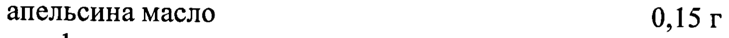
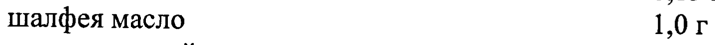
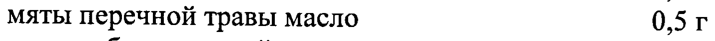
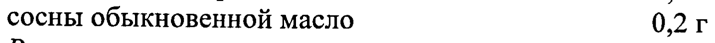

# Сгущенный экстракт — наружно

- Препарат: Фитолизин (паста для приготовления суспензии для приема внутрь;)
- АТХ: G04BX
- Источник: ГРЛС, инструкция по медицинскому применению, РУ П N014807/01, файл от 2022-12-05 (https://grls.rosminzdrav.ru/Grls_View_v2.aspx?routingGuid=858becdc-2b52-4a92-ac86-26bfbb1c5729)
- Распознано автоматически (OCR): 3 из 3 стр.
- Инструкция к другому РУ того же препарата: П N014807/01 (национальное РУ, переоформленное по правилам ЕАЭС, решение от 08.11.2022). Текст может быть старше действующего
- Сомнительных строк после OCR: 6 (см. раздел «Проверка распознавания»)

## Общие сведения

| II NO14807/01-301110 ИНСТРУКЦИЯ по медицинскому применению препарата
® ФИТОЛИЗИН Регистрационный номер:
Торговое название препарата ® ФИТОЛИЗИН МНН или группировочное название: -

## 3. Лекарственная форма

@ Паста для приготовления суспензии для приема внутрь
@ Паста для приготовления суспензии для приема внутрь

## 2. Состав

Активные вещества:
Активные вещества:
сгущенный экстракт смеси: золотарника травы, хвоща полевого травы, горца птичьего травы, пырея корневищ, шелухи лука, березы листьев, пажитника семян, петрушки корня, любистока
| корня — 67,2 г апельсина масло 0,15 г шалфея масло 1,0 г мяты перечной травы масло 0,5 г сосны обыкновенной масло 0,2 г
| Вспомогательные вещества: агар-агар 1,2 г, этилпарагидроксибензоат 0,2 г,
® крахмал пшеничный 2,3 г, ванилин 0,0004 г, глицерол (глицерин) до 100,0 г.
Описание Паста мягкой консистенции зелено-коричневого цвета, со специфическим запахом.
Фармакотерапевтическая группа Диуретическое средство растительного происхождения
Фармакологические свойства Оказывает мочегонное, противовоспалительное, спазмолитическое действие, способствует вымыванию песка и мелких конкрементов из мочевых путей, уменьшает кристаллизацию минеральных компонентов мочи.

## 5.2. Фармакокинетика

данные отсутствуют bo 561611
данные отсутствуют bo 561611
ИО о и п №014807/01-301110 “ : / Показания к применению °’, по. И
..., '. Инфекционно-воспалительные заболевания мочевых путей, нефроуролитиа ‘°
. (всоставе комплексной терапии). 5 и Противопоказания |
Повышенная чувствительность к компонентам препарата, почечная | недостаточность, сердечная недостаточность, гломерулонефрит, фосфатный уролитиаз, возраст до 18 лет.
Применение препарата при беременности и лактации
В связи с отсутствием данных, касающихся тератогенного действия компонентов препарата, не рекомендуется применять препарат в период беременности и кормления грудью.

## 4.2. Способ применения и дозы

® Взрослым назначают внутрь по 1 чайной ложке пасты, растворенной в 1/2 стакана теплой сладкой воды, 3-4 раза в день после еды.
® Взрослым назначают внутрь по 1 чайной ложке пасты, растворенной в 1/2 стакана теплой сладкой воды, 3-4 раза в день после еды.
Курс лечения: длительность терапии определяется врачом. Средний курс
| лечения составляет oT 2 недель до 1,5 месяцев. Увеличение продолжительности курса лечения возможно по назначению врача.

## 4.8. Побочное действие

Возможны аллергические реакции, иногда - тошнота.
Возможны аллергические реакции, иногда - тошнота.
| При повышенной чувствительности к ультрафиолетовым лучам возможны явления фотосенсибилизации.
При появлении побочных эффектов препарат следует отменить.

## 4.9. Передозировка

До настоящего времени о случаях передозировки не сообщалось.
До настоящего времени о случаях передозировки не сообщалось.
® Взаимодействие с другими лекарственными средствами
В связи с мочегонным действием препарата следует учитывать возможность ускоренного выведения других, одновременно применяемых лекарственных средств.
Фитолизин® может усиливать действие:
- антикоагулянтов, нестероидных противовоспалительных препаратов;
- гипогликемических лекарственных средств;
- лекарственных средств, содержащих соли лития;
- ингибиторов моноаминоксидазы;
- пролонгировать действие пентобарбитала, парацетамола.
Фитолизин® может уменьшить всасывание лекарственных средств в тонком кишечнике, в том числе бета-каротина, альфа-токоферола.
о т п 51611 | О | а `` 0№14807/01-301110 =
‚ ’ Особые указания: О | . oo a ‚ He следует применять препарат в’случае появления отеков, вызванных |
`, недостаточностью функции сердца или почек. | |
: Применение препарата не оказывает отрицательного влияния на способность |
; к выполнению потенциально опасных видов деятельности, требующих повышенной концентрации внимания и быстроты психомоторных реакций (в том числе управление автомобилем и другими транспортными средствами, работа с движущимися механизмами и т.п.).

## 6.5. Форма выпуска

Наста для приготовления суспензии для приема внутрь. По 100 г в тубы алюминиевые, покрытые внутри лаком. Каждую тубу вместе с инструкцией по применению помещают в картонную пачку.
Наста для приготовления суспензии для приема внутрь. По 100 г в тубы алюминиевые, покрытые внутри лаком. Каждую тубу вместе с инструкцией по применению помещают в картонную пачку.

## 6.4. Условия хранения

® При температуре невыше 25 °С.
® При температуре невыше 25 °С.
Хранить в недоступном для детей месте.

## 6.3. Срок годности

3 года.
3 года.
Не применять по истечении срока годности.
| | Условия отпуска из аптек Без рецепта.
Производитель Варшавский завод лекарственных растений „Гербаполь” 05-800 Прушкув, ул. Олувкова 54, Польша
Тел.: (48-22) 73-81-300;
® Факс: (48-22) 73-81-303.
Представительство в Москве Представительство ООО «ПОЛЬФА» в Москве 121248, Москва, Кутузовский пр-т, дом 7/4 кори. 5, кв. 12 |
Тел.: 8(499)243-16-63; 8(499)243-18-36; |
Факс: 8(499)243-77-27. | МЗСР PO - >| _ ЭКСПЕРТНЫЙ ОТЧЕТ |=
‹ДЕЙСТВИТЕЛЕН ДЛЯ ДАННОЙ ® т ь. |: ВЕРСИИ ДОКУМЕНТА =
, SS ETD а о ~2.09.0 0000 072"
5 A
Представитель фирм 970 В.М. Стенин ENN fs LS .
| ay % 5» у < у
7 Ser a 546723
1 ‚ 19336 % © ~
## Проверка распознавания

Страницы-сканы распознаны автоматически. В 6 строках с дозировками цифры могли распознаться с ошибкой — сверьте с вырезкой из оригинала:

- стр. 1: «апельсина масло 0,15 г» — низкая уверенность: «0,15» (25)  
  
- стр. 1: «шалфея масло 1,0 г» — низкая уверенность: «1,0» (48); повторное чтение: «шалфея масло. 1,0r»  
  
- стр. 1: «мяты перечной травы масло 0,5 г» — повторное чтение: «МЯТЫ перечной травы масло 0,5 r»  
  
- стр. 1: «сосны обыкновенной масло 0,2 г» — низкая уверенность: «0,2» (61)  
  
- стр. 1: «| Вспомогательные вещества: агар-агар 1,2 г, этилпарагидроксибензоат 0,2 г,» — повторное чтение: «_ Вспомогательные вещества: агар-агар 1 ‚2 Г, этилпарагидроксибензоат 0,2 г,»  
  
- стр. 3: «1 ‚ 19336 % © ~» — низкая уверенность: «1» (53), «19336» (57); повторное чтение: «К №. «eal -»  
  
