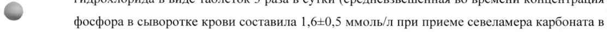
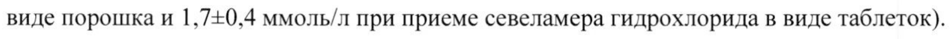
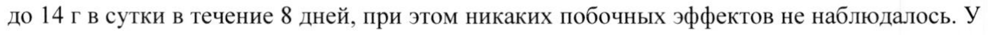
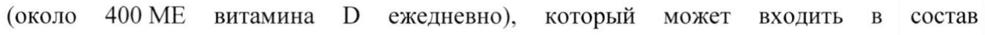

# Севеламера карбонат — внутрь

- Препарат: СЕЛАМЕРЕКС® (таблетки, покрытые пленочной оболочкой;)
- АТХ: V03AE02
- Источник: ГРЛС, инструкция по медицинскому применению, РУ ЛП-002733, файл от 2022-08-12 (https://grls.rosminzdrav.ru/Grls_View_v2.aspx?routingGuid=e726bb5b-0af9-4643-885b-b9d224e1897d)
- Распознано автоматически (OCR): 12 из 12 стр.
- Инструкция к другому РУ того же препарата: ЛП-002733 (национальное РУ, переоформленное по правилам ЕАЭС, решение от 10.06.2022). Текст может быть старше действующего
- Сомнительных строк после OCR: 4 (см. раздел «Проверка распознавания»)

## Общие сведения

МИНИСТЕРСТВО ЗДРАВООХРАНЕНИЯ РОССИЙСКОЙ ФЕДЕРАЦИИ
ИНСТРУКЦИЯ ПО МЕДИЦИНСКОМУ ПРИМЕНЕНИЮ ЛЕКАРСТВЕННОГО ПРЕПАРАТА
СЕЛАМЕРЕКС® _ ————— —— if МИНЗДРАВ РОССИИ
Регистрационный номер: ЛП-002733 Wal -00L 73 2— 3 0719
COT JACOBAHO — Торговое наименование: СЕЛАМЕРЕКС® ee |
© Международное непатентованное наименование: севеламер

## 3. Лекарственная форма

таблетки, покрытые пленочной оболочкой
таблетки, покрытые пленочной оболочкой
Состав на одну таблетку Действующее вещество: севеламера карбонат, в пересчете на сухое вещество — 800 мг;
& вспомогательные вещества: лактозы моногидрат, цинка стеарат, кремния диоксид коллоидный:
состав оболочки: опадрай 06А29148: гипромеллоза (15 мПа:с), гипромеллоза (5 мПа:с), диацетилированные моноглицериды.
" Описание: овальные двояковыпуклые таблетки, покрытые пленочной оболочкой от белого
- до почти белого цвета, с гравировкой SVL на одной стороне. На поперечном срезе ядро от белого до почти белого цвета.
Фармакотерапевтическая группа: гиперфосфатемии средство лечения
Код ATX: VO3AE02 Фармакологическое действие

## 5.1. Фармакодинамика

Активным веществом препарата СЕЛАМЕРЕКС® является севеламер — невсасывающийся в желудочно-кишечном тракте фосфатсвязывающий полимер, не содержащий металлов и кальция. Севеламер состоит из множества аминогрупп, отделенных одним атомом углерода от полимерного каркаса, которые протонируются в желудке. Эти протонированные аминогруппы связывают отрицательно заряженные ионы, такие как фосфаты, поступающие с пищей в кишечник. Севеламер связывает фосфаты в желудочнокишечном тракте, уменьшает их всасывание и благодаря этому снижает концентрацию фосфора в сыворотке крови. При применении препаратов, связывающих фосфаты, необходимо регулярно контролировать концентрацию фосфора в сыворотке крови.
Активным веществом препарата СЕЛАМЕРЕКС® является севеламер — невсасывающийся в желудочно-кишечном тракте фосфатсвязывающий полимер, не содержащий металлов и кальция. Севеламер состоит из множества аминогрупп, отделенных одним атомом углерода от полимерного каркаса, которые протонируются в желудке. Эти протонированные аминогруппы связывают отрицательно заряженные ионы, такие как фосфаты, поступающие с пищей в кишечник. Севеламер связывает фосфаты в желудочнокишечном тракте, уменьшает их всасывание и благодаря этому снижает концентрацию фосфора в сыворотке крови. При применении препаратов, связывающих фосфаты, необходимо регулярно контролировать концентрацию фосфора в сыворотке крови.
Терапевтическая эквивалентность севеламера карбоната, применявшегося в виде таблеток и порошка 3 раза в сутки, и севеламера гидрохлорида, а, следовательно, и эффективность контроля концентрации фосфора в сыворотке крови у пациентов с хронической почечной недостаточностью (ХПН), находящихся на гемодиализе, были показаны в двух рандомизированных перекрестных клинических исследованиях.
В первом исследовании с участием 79 пациентов, находившихся на гемодиализе и
~ получавших лечение в рамках двух рандомизированных периодов продолжительностью 8 недель, было показано, что применение таблеток севеламера карбоната 3 раза в сутки эквивалентно применению таблеток севеламера гидрохлорида 3 раза в сутки
(средневзвешенная во времени концентрация фосфора в сыворотке крови составила 1,5+0,3 ммоль/л как для группы, получавшей севеламера карбонат, так и для группы,
& получавшей севеламера гидрохлорид). Во втором исследовании с участием 31 пациента с гиперфосфатемией (концентрация фосфора в сыворотке крови > 1,78 ммоль/л), находившихся на гемодиализе и получавших лечение в рамках двух рандомизированных периодов продолжительностью 4 недели, было показано, что применение севеламера карбоната в виде порошка 3 раза в сутки, эквивалентно применению севеламера гидрохлорида в виде таблеток 3 раза в сутки (средневзвешенная во времени концентрация
- фосфора в сыворотке крови составила 1,6+0,5 ммоль/л при приеме севеламера карбоната в виде порошка и 1,7-0,4 ммоль/л при приеме севеламера гидрохлорида в виде таблеток).
В клинических исследованиях с участием пациентов, находившихся на гемодиализе, монотерапия севеламером не оказывала стойкого и клинически значимого эффекта на концентрацию интактного паратиреоидного гормона (иПТГ) в сыворотке крови. С целью снижения концентрации иПТГ у пациентов с вторичным гиперпаратиреозом препарат
CEJIAMEPEKC® следует применять в составе комплексной терапии, которая может включать препараты кальция, 1,25-дигироксихолекальциферол (1,25-дигидроксивитамин D3)
или один из его аналогов. В исследованиях in vitro и т vivo на экспериментальных моделях животных было установлено, что севеламер связывает желчные кислоты.
Связывание желчных кислот ионно-обменными смолами представляет собой один из основных методов снижения концентрации холестерина в крови.
В клинических исследованиях с применением севеламера было установлено снижение средних концентраций общего холестерина и холестерина ЛПНП на 15-39 %. Снижение концентрации холестерина наблюдалось через 2 недели лечения и сохранялось при долгосрочном применении препарата. Концентрации триглицеридов, холестерина ЛИВИ и альбумина во время лечения севеламером не изменялись.

Севеламер связывает желчные кислоты, что может влиять на всасывание жирорастворимых витаминов, таких как А, О, Е иК.

Севеламер не содержит кальций. На фоне его применения снижается частота возникновения гиперкальциемии по сравнению с таковой у пациентов, принимавших только связывающие фосфат препараты на основе кальция.

Способность севеламера гидрохлорида поддерживать концентрации фосфора и кальция была показана в ходе исследования с последующим однолетним наблюдением.

~ Фармакокинетика Исследований по изучению фармакокинетики севеламера карбоната не проводили.
Севеламера гидрохлорид, содержащий такое же активное вещество, как и севеламера карбонат, не всасывается в желудочно-кишечном тракте, что было подтверждено в исследовании его всасывания с участием здоровых добровольцев.

& В ходе однолетнего клинического исследования не было отмечено накопления севеламера. Однако нельзя полностью исключить возможное всасывание и накопление севеламера во время длительного лечения (более 1 года).

## 4.1. Показания к применению

— Гиперфосфатемия у взрослых пациентов с ХПН, находящихся на гемодиализе или
— Гиперфосфатемия у взрослых пациентов с ХПН, находящихся на гемодиализе или
© перитонеальном диализе.

— Гиперфосфатемия у взрослых пациентов с ХПН, не находящихся на диализе, у которых концентрация фосфора в сыворотке крови составляет > 1,78 ммоль/л.
Препарат следует применять в составе комплексной терапии, направленной на предупреждение поражения костей в связи с заболеванием почек и включающей кальцийсодержащие пищевые добавки, препараты кальция, 1,25-дигидроксиколекальциферол (1,25-дигидроксивитамин D3) или один из его аналогов.

## 4.3. Противопоказания

— гиперчувствительность к севеламеру или любому другому компоненту препарата;
— гиперчувствительность к севеламеру или любому другому компоненту препарата;
— гипофосфатемия;:
— кишечная непроходимость;

— непереносимость лактозы, дефицит лактазы, глюкозо-галактозная мальабсорбция;
— детский возраст до 18 лет.

## 4.3. С осторожностью

При приеме препарата СЕЛАМЕРЕКС* следует соблюдать особую осторожность пациентам со следующими изменениями:
При приеме препарата СЕЛАМЕРЕКС* следует соблюдать особую осторожность пациентам со следующими изменениями:
— дисфагия;
— нарушения глотания;
— тяжелые нарушения моторики желудочно-кишечного тракта, включая нелеченый или тяжелый парез желудка, задержку опорожнения желудка и патологическую или нерегулярную перистальтику кишечника;
© — воспалительные заболевания кишечника в стадии обострения:
— обширные хирургические операции на желудочно-кишечном тракте в анамнезе (см.
раздел «Особые указания»).
Также осторожность при лечении препаратом СЕЛАМЕРЕКС*® следует соблюдать пациентам, принимающим антиаритмические и противосудорожные средства (см. раздел
«Взаимодействия с другими лекарственными средствами»).
-

## 4.6. Применение при беременности и в период грудного вскармливания

Беременность Данных о применении севеламера у беременных женщин не накоплено. В ходе исследований на животных была отмечена некоторая репродуктивная токсичность при
© введении крысам высоких доз севеламера. Также севеламер ухудшал всасывание некоторых витаминов, включая фолиевую кислоту (см. раздел «Особые указания»). Потенциальный риск для человека не установлен.
Препарат СЕЛАМЕРЕКС® следует назначать беременным только в случае крайней необходимости и лишь после тщательной оценки соотношения риск/польза как для матери, так и для плода.
Период грудного вскармливания Данных о проникновении севеламера в грудное молоко нет. Как известно, севеламер не всасывается в желудочно-кишечном тракте, что указывает на малую вероятность его проникновения в грудное молоко. Решение о прекращении/продолжении кормления грудью или же прекращении/продолжении лечения должно приниматься с учетом пользы грудного вскармливания для ребенка и пользы лечения препаратом СЕЛАМЕРЕКС® для матери.

## 4.2. Способ применения и дозы

Режим дозирования
Режим дозирования
Рекомендуемая начальная суточная доза севеламера карбоната составляет 2,4 г или 4,8 гв зависимости от клинической необходимости и концентрации фосфора в сыворотке крови.
Препарат принимают 3 раза в сутки во время еды.
карбоната при приеме 3 раза в сутки во время еды

* — с последующим титрованием дозы согласно инструкции.

® С целью подбора оптимальной суточной дозы для пациентов, ранее получавших связывающие фосфат препараты (севеламера гидрохлорид или препараты кальция), препарат CEJIAMEPEKC® следует назначать из расчета один грамм на один грамм ранее применявшегося препарата с обязательным контролем концентрации фосфора в сыворотке крови.

Титрование и установление дозы

-
Необходимо контролировать концентрацию фосфора в сыворотке крови, а дозу севеламера карбоната титровать по 800 мг 3 раза в сутки (2,4 г/сут) каждые 2-4 недели до достижения оптимальной концентрации фосфора в сыворотке крови с последующим регулярным мониторингом.
Пациентам, принимающим препарат CEJIAMEPEKC", следует соблюдать предписанную

& им диету.
В клинической практике продолжительность лечения зависит от потребности в контроле концентрации фосфора в сыворотке крови, суточная доза для взрослых в среднем составляет около 6 г/сутки.
Дети У детей до 18 лет препарат СЕЛАМЕРЕКС®, таблетки, покрытые пленочной оболочкой, не применяется.
Пожилые пациенты Пациентам пожилого возраста препарат СЕЛАМЕРЕКС® назначают в тех же дозах, что и взрослым пациентам.
Способ применения Внутрь во время еды. Таблетки необходимо проглатывать целиком, не разжевывая, не размельчая, не дробя на части.

## 4.8. Побочное действие

Данные клинических исследований

Безопасность севеламера (его карбонатных и гидрохлоридных солей) оценивали в ходе

многочисленных клинических исследований, включавших 969 пациентов, находящихся на

гемодиализе, при продолжительности лечения от 4 до 50 недель (724 пациента получали

севеламера гидрохлорид, 245 — севеламера карбонат), 97 пациентов, находящихся на

перитонеальном диализе, при продолжительности лечения 12 недель (все пациенты

получали севеламера гидрохлорид) и 128 пациентов с ХПН, не получавших диализ, при

продолжительности лечения от 8 до 12 недель (79 пациентов получали севеламера

гидрохлорид, 49 — севеламера карбонат).

Наиболее частые (> 5 % пациентов) нежелательные реакции, возможно или вероятно

связанные с приемом севеламера, принадлежали к группе нарушений со стороны
- желудочно-кишечного тракта. Большинство нежелательных реакций по степени

выраженности были слабыми или умеренными. Данные о возможно или вероятно

связанных с севеламером нежелательных реакциях, полученные в ходе этих

исследований, приведены в таблице ниже. Нежелательные реакции классифицированы по

частоте встречаемости как очень часто (> 1/10), часто (> 1/100, < 1/10), нечасто (> 1/1000,
& < 1/100), редко (> 1/10000, < 1/1000), очень редко (< 1/10000), частота неизвестна (На

основании имеющихся данных оценить частоту возникновения побочного явления не

представляется возможным).

Нарушения со стороны желудочно- кишечного тракта: очень часто — тошнота, рвота,

боль в эпигастрии, запор; часто — диарея, диспепсия, метеоризм, боли в области живота;

частота неизвестна — кишечная непроходимость, илеус/субилеус, перфорация кишечника.

- Нарушения со стороны кожи и подкожных тканей: частота неизвестна — сыпь, зуд.

Нарушения со стороны иммунной системы: очень редко — реакции повышенной

чувствительности (опыт пострегистрационного применения).

Общие расстройства: часто — повышенная утомляемость, анорексия.

## 4.9. Передозировка

О случаях передозировки не сообщали. Севеламера гидрохлорид, содержащий такое же

активное вещество, что и севеламера карбонат, назначали здоровым добровольцам в дозе

до 14 г в сутки в течение 8 дней, при этом никаких побочных эффектов не наблюдалось. У

пациентов с ХИН максимальная суточная доза, применявшаяся в исследованиях, в

среднем составляла 14,4 г севеламера карбоната в виде однократной суточной дозы.

## 4.5. Взаимодействие с другими лекарственными средствами

Диализ У пациентов, находящихся на диализе, взаимодействия севеламера с другими лекарственными средствами не изучали.
С ципрофлоксацином В исследованиях с участием здоровых добровольцев было установлено, что севеламера гидрохлорид, который содержит такое же активное вещество, что и препарат
CEJIAMEPEKC®, уменьшал биодоступность ципрофлоксацина приблизительно на 50 % при его одновременном однократном приеме. Таким образом, препарат СЕЛАМЕРЕКС® не следует принимать одновременно с ципрофлоксацином.
С циклоспорином, микофенолата мофетилом и такролимусом у пациентов после трансплантации
~ После трансплантации у пациентов было обнаружено снижение концентраций циклоспорина, микофенолата мофетила и такролимуса при совместном приеме с севеламера гидрохлоридом без каких-либо клинических последствий (например, отторжение трансплантата). Вероятность взаимодействия нельзя исключить, поэтому необходимо тщательно контролировать концентрации циклоспорина, микофенолата мофетила и
& такролимуса в крови во время применения указанной комбинации препаратов, а также после прекращения лечения.
С левотироксином Очень редко сообщали о возникновении гипотиреоза у пациентов, одновременно принимавших севеламера гидрохлорид (содержащий то же активное вещество, что и севеламера карбонат) и левотироксин. Поэтому рекомендуется тщательно контролировать
~ концентрацию тиреотропного гормона (ТТГ) у пациентов, получающих севеламера карбонат совместно с левотироксином.
С антиаритмическими и противосудорожными средствами
Пациентов, принимающих антиаритмические средства для контроля аритмии и противосудорожные средства для контроля приступов эпилепсии, исключали из клинических исследований. По этой причине, при назначении препарата СЕЛАМЕРЕКС® этим пациентам необходимо соблюдать особую осторожность.
С дигоксином, варфарином, эналаприлом, метопрололом
В ходе исследований взаимодействия с другими лекарственными средствами у здоровых добровольцев севеламера гидрохлорид (содержащий то же активное вещество, что и севеламера карбонат) не оказывал влияния на биодоступность дигоксина, варфарина, эналаприла, метопролола.
С ингибиторами протонной помпы Во время пострегистрационного применения севеламера карбоната очень редко отмечались случаи повышения содержания фосфатов у пациентов, принимающих ингибиторы протонной помпы одновременно с севеламера карбонатом.
Влияние на биодоступность других препаратов
Препарат CEJIAMEPEKC® не всасывается в желудочно-кишечном тракте и может влиять на биодоступность других лекарственных средств. При одновременном применении препарата
СЕЛАМЕРЕКС® и препаратов, снижение биодоступности которых может иметь клиническое значение для эффективности и безопасности, их следует принимать как минимум за один час до или через три часа после приема препарата СЕЛАМЕРЕКС*®, или же следует рассмотреть вопрос о необходимости контроля их концентрации в крови.
~ Особые указания Эффективность и безопасность севеламера у взрослых пациентов с ХПН и концентрацией фосфора в сыворотке крови < 1,78 ммоль/л, не получающих диализ, не установлены.
Поэтому в настоящий момент препарат СЕЛАМЕРЕКС® не рекомендован для лечения таких пациентов.
& Эффективность и безопасность севеламера не изучали у пациентов со следующими изменениями:
— дисфагия;
— нарушения глотания;
— тяжелые нарушения моторики желудочно-кишечного тракта, включая нелеченый или
© тяжелый парез желудка, задержку опорожнения желудка и патологическую или нерегулярную перистальтику кишечника;
— воспалительные заболевания кишечника в стадии обострения;
— обширные хирургические операции на желудочно-кишечном тракте в анамнезе.
Поэтому при применении препарата CEJIAMEPEKC® указанным пациентам следует соблюдать особую осторожность.
Кишечная непроходимость (полная или частичная)
В очень редких случаях во время лечения севеламера гидрохлоридом (содержащим такое же активное вещество, что и севеламера карбонат) у пациентов наблюдалась полная или частичная кишечная непроходимость. Запор может являться предшествующим симптомом. В период приема препарата CEJIAMEPEKC® за состоянием пациентов с запорами следует тщательно наблюдать. У пациентов с тяжелым запором или другими тяжелыми симптомами со стороны желудочно-кишечного тракта лечение препаратом
СЕЛАМЕРЕКС® следует пересмотреть.
Жирорастворимые витамины В зависимости от характера питания и тяжести заболевания у пациентов с ХПН возможно снижение концентраций жирорастворимых витаминов А, О, Е и К. Не исключено, что препарат СЕЛАМЕРЕКС*® способен связывать жирорастворимые — витамины, содержащиеся в пище. У пациентов, принимающих севеламер, но не принимающих витамины, необходимо регулярно оценивать концентрации витаминов A, О, Еи Кв сыворотке крови. При необходимости рекомендован прием витаминных добавок.
Пациентам с ХПН, не находящимся на диализе и принимающим добавки с витамином О
(около 400 МЕ витамина Ш ежедневно), который может входить в состав мультивитаминных препаратов, рекомендуется разделить прием препарата

CEJIAMEPEKC® и витамина О.

~ У пациентов, находящихся на перитонеальном диализе, рекомендуется дополнительный мониторинг концентраций жирорастворимых витаминов и фолиевой кислоты.
Дефицит солей фолиевой кислоты На сегодняшний день недостаточно данных для исключения возможности развития дефицита солей фолиевой кислоты во время длительного лечения препаратом

& CEJIAMEPEKC®.
Гипокальциемия/гиперкальциемия У пациентов с ХПН могут развиться гипокальциемия или гиперкальциемия. Препарат
CEJIAMEPEKC® не содержит кальция, поэтому необходимо регулярно контролировать содержание кальция в сыворотке крови и при необходимости дополнительно назначить

препараты кальция.

- Метаболический ацидоз
Пациенты с ХИН предрасположены к-развитию метаболического ацидоза, поэтому в соответствии с рекомендациями стандарта надлежащей клинической практики рекомендуется контролировать концентрацию бикарбонатов в сыворотке крови.
Перитонит Пациенты, находящиеся на диализе, подвержены определенным рискам развития инфекций. Перитонит является известным осложнением у пациентов, находящихся на перитонеальном диализе. Таких пациентов следует тщательно контролировать, чтобы обеспечить правильное использование соответствующей асептической техники с быстрым распознаванием и контролем любых признаков и симптомов, связанных с перитонитом.
Трудности при глотании Нечасто сообщалось о возникновении трудностей при проглатывании таблеток. Во

многих случаях у пациентов были отмечены сопутствующие состояния, включая нарушения глотания и поражения пищевода.
При применении препарата CEJIAMEPEKC® у пациентов, испытывающих трудности при глотании, следует соблюдать осторожность. При лечении пациентов с подобным состоянием в анамнезе следует рассмотреть вопрос о применении севеламера карбоната в форме порошка для приготовления суспензии для перорального применения.
Антиаритмические и противосудорожные средства
При назначении препарата CEJIAMEPEKC® пациентам, принимающим антиаритмические и противосудорожные средства, следует соблюдать осторожность (см. раздел
«Взаимодействие с другими лекарственными средствами»).
Гипотиреоз Пациентам с гипотиреозом, которые одновременно принимают левотироксин и
- севеламера карбонат, рекомендовано более пристальное наблюдение (см. раздел
«Взаимодействие с другими лекарственными средствами»).
Долгосрочное применение В ходе однолетнего клинического исследования не было отмечено признаков накопления севеламера. Тем не менее, нельзя полностью исключить возможность всасывания и
& накопления севеламера при его длительном применении (более одного года) (см. раздел
«Фармакокинетика»).
Гиперпаратиреоз Препарат CEJIAMEPEKC® не показан для контроля гиперпаратиреоза. У пациентов с вторичным гиперпаратиреозом препарат следует применять в составе комплексного
| лечения, которое может включать препараты кальция, 1,25-дигидроксиколекальциферол
- (1,25-дигидроксивитамин D3) или один из его аналогов с целью снижения концентрации иПТГ.
Фертильность Данных по влиянию севеламера на фертильность у человека не получено. В ходе исследований на животных было отмечено, что севеламер не ухудшал фертильность самцов и самок крыс после введения 1Зг в сутки (дозы, в два раза превышавшей максимальную дозу, применявшуюся в клинических исследованиях, на основании относительной площади поверхности тела).
Желудочно-кишечные нарушения Были получены сообщения о развитии серьезных воспалительных нарушений желудочнокишечного тракта (в том числе таких серьезных осложнений как кровотечение, прободение, изъязвление, некроз и колит) в связи с образованием кристаллов севеламера.
Однако причинно-следственная связь кристаллов севеламера с этими нарушениями не доказана. Следует пересмотреть применение севеламера карбоната у пациентов, у которых развиваются серьезные симптомы желудочно-кишечных нарушений.

## 4.7. Влияние на способность управлять транспортными средствами, механизмами

Влияние на способность управлять транспортными средствами и заниматься другими потенциально опасными видами деятельности не изучали.

## 6.5. Форма выпуска

Таблетки, покрытые пленочной оболочкой, 800 мг.
Таблетки, покрытые пленочной оболочкой, 800 мг.
По 30, 60, 90 и 180 таблеток во флаконы полимерные для лекарственных средств с
© крышками полимерными, завинчивающимися, с защитой от детей и контролем первого вскрытия или без защиты от детей и контроля первого вскрытия и/или с влагопоглотителем или без влагопоглотителя.
По 1 флакону вместе с инструкцией по применению в пачке из картона.

## 6.4. Условия хранения

- Хранить при температуре не выше 25 °С.
- Хранить при температуре не выше 25 °С.
Хранить в недоступном для детей месте.

## 6.3. Срок годности

2 года. Не применять по истечении срока годности.
2 года. Не применять по истечении срока годности.
Условия отпуска Отпускают по рецепту.
Производитель Фармацевтический завод «Польфарма» С.А., Польша ул. Пельплиньска 19, 83-200 Старогард Гданьски
ИЛИ Синтон Испания С.Л., Испания К/Кастельо, № 1, Пол. Лас Салинас, Сант Бой Льобрегат, 08830 Барселона
Фасовщик (первичная упаковка)
ЗАО «ФармФирма «Сотекс», Россия Московская область, Сергиево-Посадский муниципальный район, сельское поселение
Березняковское, пос. Беликово, д. 10, д. 11, д. 12
Упаковщик (вторичная (потребительская) упаковка)
ЗАО «ФармФирма «Сотекс», Россия Московская область, Сергиево-Посадский муниципальный район, сельское поселение
Березняковское, пос. Беликово, д. 10, д. 11, д. 12
Выпускающий контроль качества Синтон Испания С.Л., Испания
> К/Кастельо, № 1, Пол. Лас Салинас, Сант Бой Льобрегат, 08830 Барселона
ИЛИ ЗАО «ФармФирма «Сотекс», Россия Московская область, Сергиево-Посадский муниципальный район, сельское поселение
Березняковское, пос. Беликово, д. 10, д. 11, д. 12
| Владелец регистрационного удостоверения/организация, принимающая претензии потребителей
ЗАО «ФармФирма «Сотекс», Россия 141345, Московская область, Сергиево-Посадский муниципальный район, сельское поселение Березняковское, пос. Беликово, д. 11
& Тел./факс: (495) 956-29-30 Начальник медицинского отдела р CK Тихонова И.В.
SR Aiton — ЗАО «ФармФирма «Сотекс» LAVA: be 9. \\
Pur 03182407 17.72 ща |: "Сотекс" = KS для Я |
## Проверка распознавания

Страницы-сканы распознаны автоматически. В 4 строках с дозировками цифры могли распознаться с ошибкой — сверьте с вырезкой из оригинала:

- стр. 2: «- фосфора в сыворотке крови составила 1,6+0,5 ммоль/л при приеме севеламера карбоната в» — повторное чтение: «лай pov составила 1620. Soporte ОИ»  
  
- стр. 2: «виде порошка и 1,7-0,4 ммоль/л при приеме севеламера гидрохлорида в виде таблеток).» — низкая уверенность: «1,7-0,4» (31)  
  
- стр. 6: «до 14 г в сутки в течение 8 дней, при этом никаких побочных эффектов не наблюдалось. У» — повторное чтение: «до 14 гв сутки в течение 8 дней, при этом никаких побочных эффектов не наблюдалось. У»  
  
- стр. 9: «(около 400 МЕ витамина Ш ежедневно), который может входить в состав» — низкая уверенность: «400» (0)  
  
