# Семаглутид — внутрь

- Препарат: Ребелсас® (таблетки;)
- АТХ: A10BJ06
- Источник: ГРЛС, инструкция по медицинскому применению, РУ ЛП-006910, файл от 2025-06-11 (https://grls.rosminzdrav.ru/Grls_View_v2.aspx?routingGuid=9e9a5ab6-c1cc-49ca-af95-b1a16579a467)
- Распознано автоматически (OCR): 15 из 15 стр.
- Сомнительных строк после OCR: 39 (см. раздел «Проверка распознавания»)

## Общие сведения

СООТВЕТСТВУЕТ ЭКСПЕРТНОМУ ОТЧЕТУ от 25.07.2023 № 14074
(Входящий МЗ №4219615 МИНИСТЕРСТВО ЗДРАВООХРАНЕНИЯ РОССИЙСКОЙ ФЕДЕРАЦИИ
ИНСТРУКЦИЯ ПО МЕДИЦИНСКОМУ ПРИМЕНЕНИЮ ЛЕКАРСТВЕННОГО
ПРЕПАРАТА Ребелсас® ‘Регистрационный номер: ЛП-006910
Торговое наименование: Ребелсас® Международное непатентованное наименование: семаглутид

## 3. Лекарственная форма

таблетки Состав 1 таблетка препарата содержит:
таблетки Состав 1 таблетка препарата содержит:
действующее вещество: семаглутид* 3 мг; 7 мг или 14 мг вспомогательные вещества: натрия салкапрозат, повидон K90, целлюлозу микрокристаллическую, магния стеарат.
-_ *аналог глюкагоноподобного пептида-1 человека (ГПП-1), произведенный методом
.& биотехнологии рекомбинантной ДНК с использованием штамма Saccharomyces cerevisiae.
Описание Таблетки, 3 мг:
Овальные двояковыпуклые таблетки от белого до светло-желтого цвета с гравировкой "3" на одной стороне и "поуо" на другой.
Таблетки, 7 мг:
Овальные двояковыпуклые таблетки от белого до светло-желтого цвета с гравировкой "7" на одной стороне и "поуо" на другой. :
Таблетки, 14 мг:
Овальные двояковыпуклые таблетки от белого до светло-желтого цвета с гравировкой "14" на одной стороне и "поуо" на другой. |
Фармакотерапевтическая группа Гипогликемическое средство - аналог глюкагоноподобного пептида-1 (ГГ]-1).
Код ATX: A10BJ06 Фармакологические свойства
Механизм действия oom Семаглутид представляет собой аналог ГИП-1, имеющий 94% гомологичности с человеческим
C ГПП-1. Семаглутид действует как агонист рецептора ГПП-1 (рГПП-1), который селективно связывается с рГПП-1 (мишенью нативного ГИП-1) и активирует его.
ГИП-1 является физиологическим гормоном, оказывающим сразу несколько эффектов на регуляцию концентрации глюкозы и аппетит, а также на сердечно-сосудистую систему (ССС).
Влияние на концентрацию глюкозы и аппетит специфически опосредовано рГИП-, расположенными в поджелудочной железе и головном мозге. Семаглутид снижает
| ‚ концентрацию глюкозы крови посредством глюкозозависимых стимуляции секреции инсулина и подавления секреции глюкагона при высокой концентрации глюкозы крови.
Механизм снижения концентрации глюкозы крови также связан с небольшой задержкой опорожнения желудка в ранней постпрандиальной фазе. Во время гипогликемии семаглутид уменьшает секрецию инсулина и не препятствует секреции глюкагона. Механизм действия семаглутида не зависит от способа применения.
| Семаглутид снижает массу тела и массу жировой ткани, уменьшая потребление энергии, в том числе в целом снижая аппетит. Кроме того, семаглутид снижает предпочтение к приему пищи с высоким содержанием жиров.
РГПИ-1 представлены в специфических областях сердца, сосудов, иммунной системы и почек.
В клинических исследованиях (КИ) семаглутид оказывал положительное влияние на липиды
СООТВЕТСТВУЕТ ЭКСПЕРТНОМУ ОТЧЕТУ от 25.07.2023 № 14074
(Входящий МЗ №4219615 5.
плазмы крови, снижал систолическое артериальное давление (АД) и уменьшал воспаление. В исследованиях на животных семаглутид замедлял развитие атеросклероза, предупреждая прогрессирование развития аортальных бляшек и уменьшая воспаление в бляшках.

## 5.1. Фармакодинамика

Результаты фармакодинамики семаглутида для приема внутрь оценивались после 12 недель применения.
Результаты фармакодинамики семаглутида для приема внутрь оценивались после 12 недель применения.
Гликемия натощак и постпрандиальная гликемия
Семаглутид снижает концентрацию глюкозы натощак и концентрацию постпрандиальной глюкозы. У пациентов с сахарным диабетом 2 типа (СД?) терапия семаглутидом привела к снижению концентрации глюкозы натощак на 22% и постпрандиальной концентрации глюкозы на 29% по сравнению с плацебо.
Секреция глюкагона Семаглутид снижает постпрандиальную концентрацию глюкагона. У пациентов с СД2 семаглутид приводит к снижению концентрации глюкагона по сравнению с плацебо, а именно к снижению постпрандиального глюкагонового ответа на 29%.
Опорожнение желудка Семаглутид вызывает небольшую задержку раннего постпрандиального опорожнения желудка
(экспозиция парацетамола (АО Со-1«) снижается на 31% в первый час после приема пищи), тем самым снижая скорость поступления постпрандиальной глюкозы в кровь.
Концентрация липидов натощак и после приема пищи |
По сравнению с плацебо семаглутид снижал концентрации триглицеридов и холестерина липопротеинов очень низкой плотности (ЛПОНП) натощак на 19% и 20%, соответственно. |
Постпрандиальное увеличение концентрации триглицеридов и холестерина ЛПОНП в ответ на | прием пищи с высоким содержанием жиров снизилось на 24% и 21%, соответственно. |
Концентрация AnoB48 снижалась как натощак, так и после приема пищи на 25% и 30%, соответственно.
Клиническая эффективность и безопасность
| Эффективность и безопасность препарата Ребелсас® оценивались в восьми глобальных рандомизированных контролируемых клинических исследованиях фазы Ша. Из них семь КИ в качестве основной цели оценивали эффективность гликемического контроля, в то время как одно КИ оценивало в качестве основной цели сердечно-сосудистый (СС) исход.
„о В КИ были включены 8842 рандомизированных пациента с СД2 (5169 человек получали
= 8 семаглутид), в том числе 1165 пациентов с умеренным нарушением функции почек. Средний возраст пациентов составил 61 год (от 18 до 92 лет), причем 40% пациентов были в возрасте 65 лет и старше, а 8% - 75 лет и старше. Эффективность семаглутида сравнивали с плацебо или активным контролем (ситаглиптин, эмпаглифлозин и лираглутид).
Возраст, пол, раса, этническая принадлежность, масса тела, индекс массы тела (ИМТ), длительность сахарного диабета (СД), заболевания верхних отделов желудочно-кишечного тракта и почечная недостаточность не повлияли на эффективность семаглутида.
Монотерапия ` В 26-недельном двойном слепом исследовании 703 пациента с СД2, недостаточно контролируемым диетой и физическими нагрузками, были рандомизированы в группы терапии
| препаратом Ребелсас® в дозах 3 мг, 7 мг, 14 мг или плацебо один раз в сутки.
По результатам исследования (анализ данных 703 пациентов) монотерапия препаратом
Ребелсас® в дозах 3 мг, 7 мги 14 мг раз в сутки в течение 26 недель привела к статистически значимому снижению показателей HbAic на 0,9%, 1,2% и 1,4% по сравнению с 0,3% в группе плацебо (р < 0,001 для всех дозировок).
Показатель глюкозы плазмы натощак (ГПН) на фоне монотерапии препаратом Ребелсас® в дозах 3 мг, 7 мги 14 мг раз в сутки в течение 26 недель снизился Ha 0,9 ммолы/л, 1,5 ммоль/л и |
СООТВЕТСТВУЕТ ЭКСПЕРТНОМУ ОТЧЕТУ от 25.07.2023 № 14074
(Входящий МЗ №4219615 | И на 1,8 ммоль/л, соответственно, по сравнению с 0,2 ммоль/л в группе плацебо (р = 0,003, р< 0,001, р < 0,001 соответственно дозам).
На терапии препаратом Ребелсас® 14 мг было получено статистически значимое снижение массы тела на 3,7 кг против снижения на 1,4 кг в группе плацебо (р < 0,001).
Доля пациентов, достигших целевого значения НЬА1с < 7%, составила 55%, 69%, 77% и 31% для препарата Ребелсас® 3 мг, 7 мг, 14 мг и плацебо, соответственно.
Семаглутид (препарат Ребелсас®) по сравнению с эмпаглифлозином, оба в комбинации с метформином
В 52-недельном открытом КИ 822 пациента с СД2 были рандомизированы в группы терапии препаратом Ребелсас® 14 мг один раз в сутки или эмпаглифлозином 25 мг один раз в сутки, оба в комбинации с метформином.
На 26 неделе (первичная конечная точка — анализ данных 822 пациентов) терапия препаратом
Ребелсас® 14 мг один раз в сутки по сравнению с эмпаглифлозином 25 мг один раз в сутки
. привела к статистически значимому снижению показателя НЬА1е на 1,3% против снижения на
У 0,9%, соответственно (р < 0,0001).
aa Доля пациентов, достигших целевого значения HbA; < 7% на 26 неделе, составила 67% и 40% для препарата Ребелсас® 14 мги эмпаглифлозина 25 мг, соответственно. Доля пациентов, достигших целевого значения HbAic <7% к завершению исследования на 52 неделе,
| сохранялась примерно в том же соотношении 66% и 43% для препарата Ребелсас® 14 мги |
| эмпаглифлозина 25 мг, соответственно. ; |
Семаглутид (препарат Ребелсас®) по сравнению с ситаглиптином, оба в комбинации с | метформином или метформином совместно с производными сульфонилмочевины
‘ В 78-недельном двойном слепом исследовании с двойным маскированием 1864 пациента < СД2 были рандомизированы в группы терапии препаратом Ребелсас® в дозе 3 мг, 7 мг, 14 мг или ситаглиптином в дозе 100 мг один раз в сутки (оба в комбинации с метформином или
| метформином совместно с производными сульфонилмочевины).
На 26 неделе (первичная конечная точка — анализ данных 1397 пациентов) терапия препаратом
| Ребелсас® 7 мг и 14 мг один раз в сутки привела к статистически значимому снижению показателя HbAjc на 1,0% и на 1,3% по сравнению со снижением на 0,8% на терапии pod ситаглиптином 100 мг один раз в сутки (р < 0,001 для обеих доз, соответственно).
‘oa Показатель ГПН на фоне терапии препаратом Ребелсас® в дозах 7 мг и 14 мг раз в сутки в
— течение 26 недель снизился на 1,2 ммоль/Л и на 1,7 ммоль/л, соответственно, по сравнению с 0,9 ммоль/л в группе терапии ситаглиптином 100 мг один раз в сутки (р < 0,05, р < 0,001 соответственно дозам).
На терапии препаратом Ребелсас® 7 мг и 14 мг в течение 26 недель было получено статистически значимое снижение массы тела на 2,2 кг и на 3,1 кг против снижения на 0,6 кг в группе терапии ситаглиптином 100 мг один раз в сутки (р < 0,001 для обеих доз).
Доля пациентов, достигших целевого значения HbAic <7% на 26 неделе исследования, составила 44%, 56% и 32% для препарата Ребелсас® 7 мг, 14 мг и ситаглиптина 100 мг, соответственно. Доля пациентов, достигших целевого значения НЬА1с < 7% к завершению исследования на 78 неделе, сохранялась примерно в том же соотношении 39%, 45% и 29% для препарата Ребелсас® 7 мг, 14 мг и ситаглиптина 100 мг, соответственно.
Семаглутид (препарат Pe6encac®) по сравнению с лираглутидом и плацебо, все в комбинации с метформином или метформином с ингибитором натрийзависимого переносчика глюкозы 2 muna (SGLT2)
т СООТВЕТСТВУЕТ ЭКСПЕРТНОМУ ОТЧЕТУ от 25.07.2023 № 14074
(Входящий МЗ №4219615 В 52-недельном двойном слепом исследовании с двойным маскированием 711 пациентов с
СД2 были рандомизированы в группы терапии препаратом Ребелсас® 14 мг, лираглутидом 1,8 мг в виде подкожной инъекции или плацебо один раз в сутки (все в комбинации с метформином или метформином с ингибитором SGLT2).
На 26 неделе (первичная конечная точка — анализ данных 711 пациентов) терапия препаратом
Ребелсас® 14 мг один раз в сутки привела к статистически значимому снижению показателя
HbA, на 1,2% по сравнению со снижением на 1,1% в группе терапии лираглутидом 1,8 мг в виде подкожной инъекции один раз в сутки (р<0,0001 в отношении не меньшей эффективности) и по сравнению со снижением на 0,2% в группе плацебо (р < 0,0001).
Показатель ГПН на фоне терапии препаратом Ребелсас® 14 мг раз в сутки в течение 26 недель снизился на 2,0 ммоль/л по сравнению с 0,4 ммоль/л в группе плацебо (р < 0,0001).
На терапии препаратом Ребелсас® 14 мг в течение 26 недель было получено статистически значимое снижение массы тела на 4,4 кг против снижения на 3,1 кг в группе терапии лираглутидом 1,8 мг в виде подкожной инъекции один раз в сутки (р = 0,0003) и по сравнению со снижением на 0,5 кг в группе плацебо (р < 0,0001).
` Доля пациентов, достигших HbAi: < 7% на 26 неделе исследования, составила 68%, 62% и 14% для препарата Ребелсас® 14 мг, лираглутида 1,8 мги плацебо, соответственно. Доля пациентов, достигших целевого значения HbAic < 7% к завершению исследования на 52 неделе, составила 61%, 55% и 15% для препарата Ребелсас® 14 мг, лираглутида 1,8 мг и плацебо, соответственно.
Семаглутид (препарат Pe6encac®) по сравнению с плацебо, оба в комбинации с монотерапией базальным инсулином или метформином, или производными сульфонилмочевины, или с комбинацией метформина и базального инсулина, или с комбинацией метформина и производных сульфонилмочевины у пациентов с умеренным нарушением функции почек
В 26-недельном двойном слепом исследовании 324 пациента с СД2 и умеренным нарушением функции почек (рСКФ 30-59 мл/мин/1,73 м²) были рандомизированы в группы терапии препаратом Ребелсас® 14 мг или плацебо один раз в сутки. Препарат исследования был добавлен к стабильному режиму гипогликемической терапии.
На 26 неделе (первичная конечная точка — анализ данных 324 пациентов) терапия препаратом
Ребелсас® 14 мг один раз в сутки по сравнению с плацебо привела к статистически значимому снижению показателей НЬАтс на 1,0% по сравнению с 0,2% в группе плацебо (р < 0,0001). `
_ Показатель ГПН на фоне терапии препаратом Ребелсас® 14 мг раз в сутки в течение 26 недель снизился на 1,5 ммоль/л по сравнению с 0,4 ммоль/л в группе плацебо (р < 0,05).
| На терапии препаратом Ребелсас® 14 мг было получено статистически значимое снижение массы тела на 3,4 кг по сравнению со снижением на 0,9 кг в группе плацебо (р < 0,0001).
Доля пациентов, достигших HbAic < 7%, составила 58% и 23% для препарата Ребелсас® 14 мг и плацебо, соответственно.
Семаглутид (препарат Ребелсас®) по сравнению с ситаглиптином, оба в комбинации с метформином, ингибиторами SGLT2, производными сульфонилмочевины или тиазолидиндионами. Исследование гибкой коррекции дозы
В 52-недельном открытом исследовании 504 пациента с СД? были рандомизированы в группы терапии препаратом Ребелсас® (гибкая коррекция дозы 3 мг, 7 мги 14 мг один раз в сутки) или ситаглиптином в дозе 100 мг один раз в сутки, оба в комбинации с 1-2 пероральными гипогликемическими лекарственными препаратами (метформин, ингибиторы SGLT2, производные сульфонилмочевины или тиазолидиндионы). Дозу препарата Ребелсас® корректировали каждые 8 недель в зависимости от гликемического ответа пациента и его переносимости. Доза ситаглиптина 100 мг была фиксированной.
СООТВЕТСТВУЕТ ЭКСПЕРТНОМУ ОТЧЕТУ от 25.07.2023 № 14074
(Входящий МЗ №4219615 ‘ 5 | На 52 неделе (первичная конечная точка — анализ данных 504 пациентов) количество пациентов, получающих терапию семаглутидом в дозах 3 мг, 7 мги 14 мг, составило примерно 10%, 30% и 60%, соответственно. Доля пациентов, достигших целевого значения HbAic < 7%, составила 58% и 25% для гибкой дозы препарата Ребелсас® один раз в сутки и ситаглиптина в фиксированной дозе 100 мг, соответственно (р < 0,001). Шанс достижения целевого значения
HbAic < 7% для гибкой дозы препарата Ребелсас® один раз в сутки был в 4,4 раза больше в сравнении с шансом на терапии ситаглиптином в фиксированной дозе 100 мг (р < 0,0001).
Терапия гибкой дозой препарата Ребелсас® один раз в день привела к статистически значимому снижению показателя массы тела на 2,6 кг в сравнении со снижением на 0,7 кг в группе терапии ситаглиптином в фиксированной дозе 100 мг (р < 0,001).
Семаглутид (препарат Ребелсас®) по сравнению с плацебо в комбинации с инсулином
В 52-недельном двойном слепом исследовании (основной конечный показатель на 26 неделе)
731 пациент с СД2, недостаточно контролируемым на терапии инсулином (базальным,
_ базальным/болюсным или двухфазным) с метформином или без него, был рандомизирован в 4 и группы терапии препаратом Ребелсас® в дозах 3 мг, 7 мг, 14 мг или плацебо один раз в сутки.
`- На 26 неделе (первичная конечная точка — анализ данных 731 пациента) терапия препаратом
Ребелсас® 3 мг, 7 мги 14 мг привела к статистически значимому снижению показателя НЬАис ` на 0,6%, на 0,9% и на 1,3% по сравнению с 0,1% в группе плацебо (р < 0,0001 для всех доз).
Показатель ГПН в группе терапии препаратом Ребелсас® в дозах 7 мги 14 мг раз в сутки в течение 26 недель снизился на 1,1 ммоль/л и на 1,3 ммоль/л, соответственно, по сравнению с увеличением на 0,3 ммоль/л в группе плацебо (р < 0,0001 для обеих доз). |
На терапии препаратом Ребелсас® 3 мг, 7 мг, 14 мг в течении 26 недель было получено статистически значимое снижение массы тела на 1,4 кг, на 2,4 кг и на 3,7 кг против снижения на 0,4 кг в группе плацебо (р < 0,05, р < 0,001, р < 0,001 соответственно дозе).
Доля пациентов, достигших целевого значения НЬАк <7% на 26 неделе исследования, составила 28%, 43%, 58% и 7% для препарата Ребелсас® 3 мг, 7 мг, 14 мг и плацебо, соответственно. Доля пациентов, достигших целевого значения HbAic < 7% к окончанию исследования на 52 неделе, сохранялась примерно B TOM же соотношении; 29%, 40%, 54% и 9% для препарата Ребелсас® 3 мг, 7 мг, 14 мги плацебо, соответственно.
_ Оценка влияния на сердечно-сосудистую систему
Е \ 3183 пациента с СД? и высоким сердечно-сосудистым (СС) риском были рандомизированы в
: двойное слепое КИ в группы терапии препаратом Ребелсас® 14 мг один раз в сутки или плацебо в дополнение к стандартному лечению. С учетом ранее проведенного исследования по влиянию на сердечно-сосудистую систему (ССС) в отношении инъекционной формы семаглутида протокол исследования был нацелен на подтверждение безопасности терапии
| препаратом Ребелсас® 14 мг, в связи с чем исследование было ограничено по времени: медиана периода наблюдения составляла 16 месяцев.
Первичная конечная точка представляла собой время от рандомизации до первого большого сердечно-сосудистого события (БССС), такого как смерть по причине СС патологии, инфаркт миокарда без смертельного исхода, инсульт без смертельного исхода.
Пациенты, подходящие для включения в исследование, были в возрасте 50 лет или старше и с установленным сердечно-сосудистым заболеванием (ССЗ) и/или хронической болезнью почек, или в возрасте 60 лет или старше только с факторами риска развития ССЗ. В общей сложности 1797 пациентов (56,5%) имели ССЗ без хронической болезни почек, 354 (11,1%)
имели только хроническую болезнь почек и 544 (17,1%) имели как ССЗ, так и болезни почек.
488 пациентов (15,3%) имели только факторы риска развития ССЗ. Средний возраст на момент включения в исследование составил 66 лет, 68% пациентов были мужчинами. Средний стаж
СООТВЕТСТВУЕТ ЭКСПЕРТНОМУ ОТЧЕТУ от 25.07.2023 № 14074
(Входящий МЗ N=4219615)
СД составлял 14,9 лет, средний ИМТ составлял 32,3 кг/м?. Инсульт или инфаркт миокарда был в анамнезеу 11,7% и 36,1% пациентов, соответственно.
Общее количество первых БССС было 137: 61 (3,8%) при применении семаглутида и 76 (4,8%)
при применении плацебо, тем самым у пациентов в группе терапии препаратом Ребелсас® продемонстрировано численное снижение на 21% частоты БССС в сравнении с пациентами в группе плацебо, отношение рисков 0,79 (0,57, 1,11), что достигало исходной цели исследования
— продемонстрировать отсутствие повышения сердечно-сосудистого риска на терапии препаратом Ребелсас® (р < 0,001).
Результаты анализа в отношении компонентов первичной конечной точки были следующими:
смерть по причине СС патологии — 0,9% случаев при применении семаглутида и 1,9% случаев при применении плацебо (снижение частоты событий на 51%); инфаркт миокарда без смертельного исхода — 2,3% случаев при применении семаглутида и 1,9% случаев при применении плацебо (нет различий в пользу семаглутида); инсульт без смертельного исхода — 0,8% случаев при применении семаглутида и 1,0% случаев при применении плацебо
(численное уменьшение частоты событий на 26%). Смерть по любым причинам возникла у
‘3 1,4% пациентов в группе семаглутида иу 2,8% пациентов в группе плацебо (снижение частоты событий на 49%).
Масса тела На терапии семаглутидом к окончанию исследования у 27-45% пациентов было достигнуто снижение массы тела на > 5%, ау 6-16% было достигнуто снижение массы тела на > 10% при применении семаглутида по сравнению с 12-39% и 2-8%, соответственно, при применении активных препаратов сравнения.
Артериальное давление Терапия препаратом Ребелсас® привела к снижению систолического АД на 2-7 мм рт. ст.
Дети и подростки Безопасность и эффективность применения препарата Ребелсас® у детей и подростков (младше 18 лет) не установлены.

## 5.2. Фармакокинетика

Абсорбция Семаглутид для перорального применения обладает низкой абсолютной биодоступностью и вариабельным всасыванием. Ежедневное применение препарата в соответствии с
Абсорбция Семаглутид для перорального применения обладает низкой абсолютной биодоступностью и вариабельным всасыванием. Ежедневное применение препарата в соответствии с
_, рекомендуемым режимом дозирования в комбинации с длительным периодом полувыведения
| уменьшает суточные колебания экспозиции.
Фармакокинетические свойства семаглутида были всесторонне изучены на здоровых добровольцах и пациентах с СД2. Максимальная концентрация семаглутида в плазме крови после приема внутрь достигалась через 1 час после применения препарата. Равновесная концентрация препарата была достигнута спустя 4-5 недель применения препарата один раз в сутки. У пациентов с СД2 средние равновесные концентрации составляли приблизительно 6,7 нмоль/л и 14,6 нмоль/л при применении семаглутида 7 мги 14 мг, соответственно; при этом 90% пациентов, получавших терапию семаглутидом в дозе 7 мг, имели среднюю концентрацию между 1,7 и 22,7 нмоль/л, а 90% пациентов, получавших терапию семаглутидом в дозе 14 мг, имели среднюю концентрацию между 3,7 и 41,3 нмоль/л. Системная экспозиция семаглутида увеличивалась пропорционально введенной дозе.
Основываясь на данных, полученных в условиях in vitro, натрия салкапрозат облегчает всасывание семаглутида. Всасывание семаглутида преимущественно происходит в желудке.
Расчетная биодоступность семаглутида после приема внутрь составляет приблизительно 1%.
Межиндивидуальная вариабельность абсорбции была высокой (коэффициент вариации составлял примерно 100%). Оценка внутрииндивидуальной вариабельности биодоступности не была достоверной.
СООТВЕТСТВУЕТ ЭКСПЕРТНОМУ ОТЧЕТУ от 25.07.2023 № 14074
(Входящий МЗ N=4219615)
Абсорбция семаглутида снижается, если препарат принимается вместе с пищей или с большим количеством воды. Более длительный интервал между приемом препарата и приемом пищи приводит к увеличению всасывания.
Распределение У пациентов с СД2 расчетный абсолютный объем распределения составляет приблизительно 8 л. Семаглутид в значительной степени связывается с белками плазмы крови (> 99%).
Метаболизм Семаглутид метаболизируется посредством протеолитического расщепления пептидной структуры с последующим бета-окислением жирной кислоты боковой цепи. В метаболизме семаглутида, по-видимому, участвует фермент нейтральная эндопептидаза (НЭП).
Выведение Основными путями выведения производных семаглутида является выведение с мочой и калом.
Приблизительно 3% от принятой дозы выводится с мочой в виде неизмененного семаглутида.
С периодом полувыведения примерно 1 неделя семаглутид будет присутствовать в общем кровотоке в течение приблизительно 5 недель после того, как пациент примет последнюю дозу. |
Г в У пациентов с СД2 клиренс семаглутида составляет примерно 0,04 л/ч. |
| Переход между пероральным применением и подкожным (п/к) введением.
Влияние перехода между пероральным применением и п/к введением семаглутида трудно прогнозировать из-за высокой фармакокинетической вариабельности перорального семаглутида. Экспозиция после перорального применения семаглутида 14 мг один раз в сутки сравнима с таковой при применении семаглутида в дозе 0,5 мг для п/к введения один раз в неделю. Пероральная доза, эквивалентная 1,0 мг семаглутида для п/к введения, не была установлена.
Особые группы пациентов Пациенты поэкилого возраста
На основании данных, полученных в ходе КИ, включавших пациентов в возрасте до 92 лет,
| возраст не оказывал влияния на фармакокинетику.
Пол Пол не оказывал клинически значимого влияния на фармакокинетику семаглутида.
Расовая и этническая принадлежность . Расовая группа (европеоидная, негроидная или афроамериканская, монголоидная) и ри этническая принадлежность (испанцы или латиноамериканцы, не испанцы и не
‚5 \ латиноамериканцы) не влияли на фармакокинетику семаглутида.
_ Масса тела Масса тела влияла на экспозицию семаглутида. Более высокая масса тела приводит к более низкой экспозиции, Семаглутид обеспечивал надлежащую системную экспозицию в диапазоне массы тела от 40 до 188 кг по данным КИ. ,
Почечная недостаточность Почечная недостаточность не оказывала клинически значимого эффекта на фармакокинетику семаглутида. Фармакокинетические свойства семаглутида оценивали у пациентов с легкой, средней или тяжелой почечной недостаточностью и пациентов с терминальной стадией почечной недостаточности, находящихся на диализе, по сравнению с пациентами с нормальной функцией почек, получавших в течение 10 дней подряд семаглутид один раз в сутки. Это также было показано для пациентов с СД2 и нарушением функции почек на основании данных исследований фазы Ша.
Печеночная недостаточность Печеночная недостаточность не оказывала клинически значимого эффекта на | фармакокинетику семаглутида. Фармакокинетические свойства семаглутида оценивали у пациентов с легкой, средней или тяжелой печеночной недостаточностью по сравнению с
СООТВЕТСТВУЕТ ЭКСПЕРТНОМУ ОТЧЕТУ от 25.07.2023 № 14074
(Входящий МЗ №4219615 пациентами с нормальной функцией печени, получавших в течение 10 дней подряд семаглутид один раз в сутки.
Заболевание верхних отделов ЖКТ Заболевания верхних отделов желудочно-кишечного тракта (хронический гастрит и/или гастроэзофагеальная рефлюксная болезнь) не оказывали клинически значимого эффекта на фармакокинетику семаглутида. Фармакокинетические свойства оценивали у пациентов с СД2 с заболеваниями верхних отделов желудочно-кишечного тракта или без них, получавших в течение 10 дней подряд семаглутид один раз в сутки. Это также было показано для пациентов с СД2 и заболеванием верхних отделов ЖКТ на основании данных исследований фазы Ша.
Дети и подростки Исследований семаглутида у детей и подростков до 18 лет не проводили.

## 4.1. Показания к применению

Препарат Ребелсас® показан для применения у взрослых пациентов с неудовлетворительным контролем СД2 в дополнение к диете и физической нагрузке для улучшения контроля
Препарат Ребелсас® показан для применения у взрослых пациентов с неудовлетворительным контролем СД2 в дополнение к диете и физической нагрузке для улучшения контроля
. гликемии:
—^ . в качестве монотерапии, когда применение метформина невозможно по причине непереносимости или наличия противопоказаний;
. в комбинированном применении с другими гипогликемическими лекарственными препаратами.
- Противопоказания
` -Гиперчувствительность к семаглутиду или к любому из вспомогательных веществ препарата;
- сахарный диабет 1 типа (СД1);
- диабетический кетоацидоз;
- медуллярный рак щитовидной железы в анамнезе, в том числе семейном;
- множественная эндокринная неоплазия (МЭН) 2 типа.
Противопоказано применение препарата Ребелсас® у следующих групи пациентов и при следующих состояниях/заболеваниях в связи с отсутствием данных по эффективности и безопасности и/или из-за ограниченного опыта:
- беременность и период грудного вскармливания;
- возраст до 18 лет;
- печеночная недостаточность тяжелой степени;
. - терминальная стадия почечной недостаточности (клиренс креатинина (КК) < 15 мл/мин);
- хроническая сердечная недостаточность IV функционального класса (в соответствии с классификацией МУНА (Нью-Йоркская кардиологическая ассоциация)).

## 4.3. С осторожностью

Препарат Ребелсас® рекомендуется применять с осторожностью у пациентов с панкреатитом в анамнезе (см. раздел «Способ применения и дозы»).
Препарат Ребелсас® рекомендуется применять с осторожностью у пациентов с панкреатитом в анамнезе (см. раздел «Способ применения и дозы»).

## 4.6. Применение при беременности и в период грудного вскармливания

’ Беременность Исследования на животных продемонстрировали репродуктивную токсичность препарата.
Данные по применению семаглутида у беременных женщин ограничены. В связи с этим применение семаглутида во время беременности противопоказано. Если пациентка готовится к беременности либо беременность уже наступила, терапию семаглутидом необходимо прекратить. Лечение семаглутидом следует прекратить, как минимум, за 2 месяца до | планируемой беременности по причине длительного периода полувыведения (см. раздел |
«Фармакокинетика»).
Период грудного вскармливания СООТВЕТСТВУЕТ ЭКСПЕРТНОМУ ОТЧЕТУ от 25.07.2023 № 14074
(Входящий МЗ №4219615 , 9 У лактирующих крыс семаглутид, натрия салкапрозат и/или его метаболиты проникали в молоко. Нельзя исключить риск для ребенка, находящегося на грудном вскармливании.
Противопоказано применять препарат Ребелсас® в период грудного вскармливания.

## 4.2. Способ применения и дозы

Способ применения
Способ применения
Препарат Ребелсас® представляет собой таблетки для приема внутрь один раз в сутки.
_ Препарат следует принимать натощак в любое время суток.
_ Таблетку необходимо проглатывать целиком, запивая водой (половина стакана воды, что эквивалентно 120 мл). Таблетки не следует делить, измельчать или разжевывать, так как
| неизвестно, влияет ли это на всасывание семаглутида.
_ Пациенты должны подождать не менее 30 минут перед приемом пищи или напитков или приемом других пероральных лекарственных препаратов. Несоблюдение данного условия приведет к снижению всасывания семаглутида (см. разделы «Взаимодействие с другими лекарственными средствами» и «Фармакокинетика»).
_ Дозы cr, Начальная доза препарата Ребелсас® составляет 3 мг один раз в сутки в течение 1 месяца. Через
~- 1 месяц применения дозу следует увеличить до 7 мг один раз в сутки. Для дальнейшего улучшения гликемического контроля после как минимум 1 месяца применения в дозе 7 мг 1 раз в сутки, дозу можно увеличить до поддерживающей дозы 14 мг 1 раз в сутки.
Максимальная рекомендуемая доза препарата Ребелсас® для приема 1 раз в сутки составляет 14 мг. Прием двух таблеток по 7 мг для достижения эффекта дозировки 14 мг не изучался и поэтому не рекомендуется.
Информация о переходе между семаглутидом для перорального применения и для подкожного
(п/к) введения представлена в разделе «Фармакокинетика».
При применении препарата Ребелсас® в комбинации с метформином и/или ингибитором
SGLT2 или тиазолидиндионом терапию метформином и/или ингибитором SGLT2 или тиазолидиндионом можно продолжить в прежних дозах.
При применении семаглутида в комбинации с производным сульфонилмочевины или инсулином следует предусмотреть снижение дозы производного сульфонилмочевины или инсулина с целью снижения риска возникновения гипогликемии (см. разделы «Особые указания» и «Побочное действие»).
св. Для коррекции дозы препарата Ребелсас® не требуется самостоятельный мониторинг концентрации глюкозы в крови. Самостоятельный мониторинг концентрации глюкозы в крови
, необходим для коррекции дозы сульфонилмочевины и инсулина, особенно в начале лечения семаглутидом и при снижении дозы инсулина. Рекомендуется использовать поэтапный подход к снижению дозы инсулина. |
Пропуск дозы В случае пропуска дозы препарата, пропущенную дозу дополнительно принимать не нужно, следует продолжить прием препарата в обычном режиме на следующий день. |
Применение в особых группах пациентов Пациенты пожилого возраста
Не требуется коррекции дозы в зависимости от возраста. Опыт применения препарата
Ребелсас® у пациентов в возрасте 75 лет и старше ограничен (см. раздел «Фармакокинетика»).
Пациенты с почечной недостаточностью , :
He требуется коррекция дозы у пациентов с легкой, средней или тяжелой почечной | недостаточностью. Опыт применения препарата у пациентов с тяжелой стадией почечной недостаточности ограничен. Препарат противопоказан пациентам с терминальной стадией почечной недостаточности (см. раздел «Фармакокинетика»).
Пациенты с печеночной недостаточностью |
, СООТВЕТСТВУЕТ ЭКСПЕРТНОМУ ОТЧЕТУ | от 25.07.2023 № 14074 |
; (Входящий МЗ N=4219615)
Не требуется коррекции дозы у пациентов с печеночной-недостаточностью. Опыт применения семаглутида у пациентов с печеночной недостаточностью тяжелой степени ограничен;
‚ применение препарата Ребелсас® у таких пациентов противопоказано (см. раздел
"Фармакокинетика").
‚ _ Детии подростки Применение препарата Ребелсас® у детей и подростков в возрасте до 18 лет противопоказано в связи с отсутствием данных по безопасности и эффективности.

## 4.8. Побочное действие

Краткий отчет по профилю безопасности
Краткий отчет по профилю безопасности
В 10 КИ Ша фазы 5707 пациентов получали семаглутид (препарат Ребелсас®) в качестве монотерапии или в комбинации с другими гипогликемическими препаратами.
Продолжительность лечения варьировалась от 26 недель до 78 недель. Наиболее часто регистрируемыми нежелательными реакциями (НР) во время КИ являлись нарушения со стороны ЖКТ, включая тошноту (очень часто), диарею (очень часто) и рвоту (часто).
Список нежелательных реакций в виде таблицы no В Таблице 1 приведены HP, выявленные ВО всех исследованиях Ша фазы у пациентов с СД2
(описаны в разделе «Фармакодинамика»). Частота встречаемости данных НР основана на объединенных исследованиях фазы Ша, за исключением исследования СС исходов.
| НР распределены по системно-органным классам в соответствии с MedDRA с указанием 1 частоты их возникновения согласно рекомендациям ВОЗ: очень часто (> 1/10); часто (от
> 1/100 до < 1/10); нечасто (от> 1/1 000 до < 1/100); редко (от > 1/10 000 до < 1/1 000) и очень редко (< 1/10 000). В каждой группе частота развития НР представлена по снижению степени тяжести,
Таблица 1 Нежелательные реакции из контролируемых исследований фазы Ша р И i со стороны ЛЬНОСТЬ? ие реакции иммунной системы ,
| Нарушения | Гипогликемия Гипогликемия Е |
А и питания применении с | применении с ‘ инсулином или | другими ПГГИ* производными Снижение сульфонилмочев | аппетита
HHBbI* Нарушения Осложнения со стороны диабетической зрения
Нарушения Увеличение со стороны частоты сердца сердечных |
ЧСС кишечные Диарея Боль в животе Задержка панкреатит нарушения Вздутие живота | опорожнения
Запор желудка Диспепсия СООТВЕТСТВУЕТ ЭКСПЕРТНОМУ ОТЧЕТУ от 25.07.2023 № 14074
(Входящий МЗ №4219615)
Гастрит ная рефлюксная | болезнь Метеоризм
Нарушения Холелитиаз со стороны печени и желчевывод ящих путей
Общие Утомляемость реакции в месте введения
Лабораторн Повышение Снижение и“ ые и активности массы тела |
‘ инструмента липазы льные Повышение данные активности амилазы со стороны нервной системы | а) Гипогликемия, определяемая как концентрация глюкозы крови < 3,0 ммоль/л или < 54 мг/дл.
b) Осложнения диабетической ретинопатии, включающие: необходимость в фотокоагуляции сетчатки глаза, необходимость в интравитреальном введении препаратов, кровоизлияние в стекловидное тело, развитие слепоты (нечасто), связанной с СД. Частота основана на исследовании СС исходов с применением семаглутида для п/к введения, но нельзя исключать, что риск выявленных осложнений диабетической ретинопатии также относится к препарату Ребелсас®.
с) Групповой термин, включающий также НР, связанные с гиперчувствительностью, такие как сыпь и крапивница.
Описание отдельных НР yey Гипогликемия и Тяжелая гипогликемия в основном наблюдалась при применении семаглутида в комбинации с производными сульфонилмочевины (< 0,1% пациентов, < 0,001 явлений/пациенто-год) или с инсулином (1,1% пациентов, 0,013 явлений/пациенто-год). Всего несколько эпизодов (0,1% пациентов, 0,001 явлений/пациенто-год) наблюдались при применении семаглутида в комбинации с ПГГП, за исключением производных сульфонилмочевины.
НР со стороны ЖКТ Во время терапии препаратом Ребелсас® у пациентов отмечалась тошнота (15%), диарея (10%)
и рвота (7%). Большинство реакций были от легкой до средней степени тяжести и краткосрочными. НР стали причиной преждевременного выбывания из КИ у 4% пациентов.
Чаще всего о НР сообщалось в первые месяцы терапии.
Острый панкреатит, подтвержденный по результатам экспертной оценки, был зарегистрирован в исследованиях Ша фазы при применении семаглутида (< 0,1%) и препарата сравнения (0,2%).
В исследовании СС исходов частота развития острого панкреатита, подтвержденная по результатам экспертной оценки, составила 0,1% при применении семаглутида и 0,2% при применении плацебо (см. раздел «Особые указания»).
Осложнения диабетической ретинопатии СООТВЕТСТВУЕТ ЭКСПЕРТНОМУ ОТЧЕТУ от 25.07.2023 № 14074
(Входящий МЗ N=4219615)
В 2-летнем КИ с применением семаглутида для п/к введения были изучены 3297 пациентов с
СД2 и высоким СС риском, длительным стажем СД и неадекватным контролем гликемии. В данном КИ подтвержденные случаи диабетической ретинопатии развились у ббльшего количества пациентов, получавших терапию семаглутидом для п/к введения (3,0%), по сравнению с пациентами, получавшими плацебо (1,8%). Развитие событий наблюдалось у пациентов с уже выявленной диабетической ретинопатией, получавших терапию инсулином.
Различия между видами терапии появлялись рано и сохранялись на протяжении всего исследования. Систематическая оценка осложнения диабетической ретинопатии была проведена только в исследовании СС исходов с применением семаглутида для п/к введения.
ВКИ препарата Ребелсас® длительностью до 18 месяцев с участием 6352 пациентов с СД2 частота НР, связанных с диабетической ретинопатией, была сходной в группе препарата
Ребелсас® и препаратов сравнения (4,2% и 3,8%, соответственно).
Иммуногенность Вследствие потенциальных иммуногенных свойств белковых и пептидных лекарственных препаратов у пациентов могут появиться антитела к препарату Ребелсас®. В конце КИ доля
` пациентов, у которых были обнаружены антитела к препарату Ребелсас® в любой момент времени, была низкой (0,5%), и ни у одного пациента не было обнаружено нейтрализующих антител к семаглутиду или антител с нейтрализующим эндогенный ГПП-1 эффектом.
Увеличение частоты сердечных сокращений | На фоне применения агонистов рецепторов ГИП-1 отмечалось увеличение частоты сердечных
| сокращений (ЧСС). В исследованиях препарата Ребелсас® фазы Ша наблюдались средние изменения ЧСС от 0 до 4 ударов в минуту (уд/мин) относительно исходного уровня, равного 69-76 уд/мин.

## 4.9. Передозировка

В ходе КИ передозировка препаратом Ребелсас® могла быть связана с нарушениями со стороны ЖКТ. В случае передозировки рекомендуется проведение соответствующей
В ходе КИ передозировка препаратом Ребелсас® могла быть связана с нарушениями со стороны ЖКТ. В случае передозировки рекомендуется проведение соответствующей
| симптоматической терапии в зависимости от клинических проявлений и симптомов у пациента. Учитывая длительный период полувыведения семаглутида (примерно 1 неделя), может потребоваться продолжительный период наблюдения и лечения симптомов передозировки (см. раздел «Фармакокинетика»). Специфического антидота при передозировке препарата Ребелсас® не существует.

## 4.5. Взаимодействие с другими лекарственными средствами

| Задержка опорожнения желудка при применении семаглутида может оказывать влияние на всасывание сопутствующих пероральных лекарственных препаратов.
Влияние семаглутида на другие лекарственные препараты
Левотироксин натрия Общая экспозиция (AUC) тироксина (с поправкой на эндогенные уровни) повышалась на 33% после применения однократной дозы левотироксина натрия. Максимальная экспозиция (Cmax)
не изменялась. Необходимо рассмотреть возможность проведения мониторинга показателей
| функции щитовидной железы при применении совместной терапии препаратом Ребелсас® с левотироксином натрия.
Варфарин Препарат Ребелсас® не изменял общую экспозицию AUC или Cmax R- и $-изомеров варфарина после однократной дозы варфарина, и фармакодинамическое действие варфарина согласно измерению с использованием международного нормализованного отношения (МНО) не подвергалось клинически значимому воздействию. Однако после начала терапии семаглутидом у пациентов, принимающих варфарин или другие производные кумарина, рекомендуется проводить частый мониторинг МНО.
Розувастатин СООТВЕТСТВУЕТ ЭКСПЕРТНОМУ ОТЧЕТУ от 25.07.2023 № 14074
(Входящий МЗ №4219615)} AUC розувастатина увеличивалась на 41% [90% ДИ: 24; 60] при одновременном применении препарата Ребелсас®. В связи с широким терапевтическим окном розувастатина величина изменений экспозиции признана клинически не значимой.
Дигоксин, пероральные контрацептивы, метформин, фуросемид
При одновременном применении с семаглутидом не наблюдалось клинически значимых изменений AUC или Cmax дигоксина, пероральных гормональных контрацептивных средств
(содержащих этинилэстрадиол и левоноргестрел), метформина или фуросемида.
Взаимодействие с лекарственными препаратами с очень низкой биодоступностью (Е: 1%)
не оценивалось.
Влияние других лекарственных препаратов на семаглутид
Омепразол При приеме с омепразолом не наблюдалось клинически значимого изменения AUC или Сшах .
семаглутида.
В исследовании фармакокинетики препарата Ребелсас®, применяемого вместе с пятью
_ другими таблетками, AUC семаглутида снизилась на 34%, а Cmax - на 32%. Это говорит о ТОМ,
°\ что наличие нескольких таблеток в желудке влияет на всасывание семаглутида при
-^ одновременном применении. После приема препарата Ребелсас® пациентам следует подождать 30 минут, прежде чем принимать другие пероральные лекарственные препараты
(см. раздел «Способ применения и дозы»).

## 4.4. Особые указания

Контроль применения препарата |
Контроль применения препарата |
Для улучшения контроля применения биологического лекарственного препарата следует четко указывать название и номер серии применяемого препарата.
Общие положения Семаглутид противопоказан пациентам с СД] или для лечения диабетического кетоацидоза.
Диабетический кетоацидоз был зарегистрирован у инсулинозависимых пациентов, у которых
| отмечалось быстрое прекращение лечения или снижение дозы инсулина при начале лечения агонистом рГПП-1 (cm. раздел «Способ применения и дозы»).
Опыт лечения пациентов с хронической сердечной недостаточностью TV функционального класса (в соответствии с классификацией МУНА (Нью-Йоркская кардиологическая ассоциация)) отсутствует, поэтому семаглутид противопоказан у этих пациентов.
7 Терапевтический опыт применения семаглутида у пациентов, перенесших бариатрическую a операцию, отсутствует.
| Реакции со стороны ЖКТ и дегидратация Применение агонистов рГШ]-1 может быть ассоциировано с НР со стороны ЖКТ, которые
| могут вызвать обезвоживание, что в редких случаях может привести к ухудшению функции
| почек (см. раздел «Побочное действие»). Пациентов, получающих терапию препаратом
Ребелсас®, необходимо проинформировать о потенциальном риске обезвоживания вследствие нежелательных реакций со стороны желудочно-кишечного тракта и о необходимости принятия мер предосторожности во избежание потери жидкости.
Острый панкреатит При применении агонистов рГПП-1 наблюдались случаи развития острого панкреатита.
| Пациенты должны быть проинформированы о характерных симптомах острого панкреатита. |
| При подозрении на панкреатит терапию семаглутидом необходимо прекратить. При | подтверждении острого панкреатита терапию семаглутидом возобновлять не следует. Следует соблюдать осторожность у пациентов с панкреатитом в анамнезе. |
Гипогликемия | Пациенты на терапии семаглутидом в комбинации. с производными сульфонилмочевины или | инсулином могут иметь повышенный риск развития гипогликемии (см. раздел «Побочное
СООТВЕТСТВУЕТ ЭКСПЕРТНОМУ ОТЧЕТУ от 25.07.2023 № 14074
(Входящий МЗ №4219615 действие»). В начале лечения семаглутидом риск развития гипогликемии можно снизить, уменьшив дозу производного сульфонилмочевины или инсулина (см. раздел «Способ применения и дозы»).
| Диабетическая ретинопатия ‚ Наблюдалось повышение риска развития осложнений диабетической ретинопатии у пациентов, получающих терапию инсулином и семаглутид для п/к применения. Данный риск нельзя исключить при лечении пероральным семаглутидом (см. раздел «Побочное действие»).
Следует соблюдать осторожность при применении семаглутида у пациентов с диабетической ретинопатией. Такие пациенты должны находиться под постоянным наблюдением и получать лечение в соответствии с клиническими рекомендациями. Быстрое улучшение гликемического контроля было ассоциировано с временным ухудшением диабетической ретинопатии, однако при этом нельзя исключать другие причины. Длительный контроль гликемии снижает риск развития диабетической ретинопатии.
Ответ на терапию Для достижения оптимального эффекта препарата Ребелсас® рекомендуется соблюдение
| и режима дозирования. Если ответ на лечение семаглутидом менее выражен, чем ожидалось, лечащий врач должен быть проинформирован о том, что всасывание семаглутида очень вариабельно и может быть минимальным (у 2-4% пациентов вовсе не будет наблюдаться экспозиции), а также что абсолютная биодоступность семаглутида низка.
Содержание натрия Препарат Ребелсас® содержит 23 мг натрия на’ таблетку, что эквивалентно 1% от рекомендованного ВОЗ максимального суточного потребления 2 г натрия для взрослого человека.
Женщины с репродуктивным потенциалом Женщинам с репродуктивным потенциалом рекомендуется использовать контрацепцию во время терапии семаглутидом.
Доклинические данные по безопасности Доклинические данные, основанные на исследованиях фармакологической безопасности, токсичности повторных доз и генотоксичности, не выявили какой-либо опасности для человека. .
В 2-летних исследованиях канцерогенности у крыс и мышей при клинически значимых концентрациях семаглутид стал причиной развития опухолей С-клеток щитовидной железы
Го без смертельного исхода. Опухоли С-клеток щитовидной железы без смертельного исхода, наблюдаемые у крыс, характерны для аналогов ГИП-1. Считается, что в отношении людей данный риск является низким, но не может быть полностью исключен.
Фертильность Действие семаглутида на фертильность у людей неизвестно. Семаглутид не влиял на фертильность самцов крыс. Среди самок крыс увеличение эстрального цикла и незначительное .
снижение количества овуляций наблюдалось при дозах, сопровождавшихся снижением массы тела самки.

## 4.7. Влияние на способность управлять транспортными средствами, механизмами

Семаглутид не влияет или незначительно влияет на способность управлять транспортными средствами или работу с механизмами. При применении семаглутидав комбинации с производными сульфонилмочевины и/или инсулином пациенты должны быть предупреждены о том, что им следует соблюдать меры предосторожности во избежание развития у них гипогликемии во время управления транспортными средствами и при работе с механизмами
(см. раздел «Особые указания»).

## 6.5. Форма выпуска

Таблетки 3 мг:
Таблетки 3 мг:
| СООТВЕТСТВУЕТ ЭКСПЕРТНОМУ ОТЧЕТУ от 25.07.2023 № 14074
(Входящий МЗ №4219615)
10 таблеток в блистер из формованной алюминиевой фольги зеленого цвета, ламинированной полипропиленом, и покровной алюминиевой фольги, ламинированной полипропиленом.
3 блистера с инструкцией по применению в картонную пачку.
Таблетки 7 мг:
10 таблеток в блистер из формованной алюминиевой фольги красного цвета, ламинированной полипропиленом, и покровной алюминиевой фольги, ламинированной полипропиленом.
3 блистера с инструкцией по применению в картонную пачку.
Таблетки 14 мг:
10 таблеток в блистер из формованной алюминиевой фольги синего цвета, ламинированной полипропиленом, и покровной алюминиевой фольги, ламинированной полипропиленом.
3 блистера с инструкцией по применению в картонную пачку.

## 6.3. Срок годности

| 30 месяцев. Не применять по истечении срока годности.
| 30 месяцев. Не применять по истечении срока годности.
| Условия хранения Хранить при температуре не выше 25°С в оригинальной упаковке (блистер) для защиты от влаги и света.
Хранить в недоступном для детей месте.
Условия отпуска Отпускают по рецепту Держатель регистрационного удостоверения
Ново Нордиск A/C, Ново Алле, DK-2880 Багсваерд, Дания www.novonordisk.com
Производитель:
Ново Нордиск А/С;
Юридический адрес: Ново Алле, DK-2880 Багсваерд, Дания
Производство готовой лекарственной формы:
Ново Нордиск Парк, DK-2760 Малов, Дания Первичная упаковка:
Ново Нордиск Парк, ОК-2760 Малов, Дания Халлас Алле, DK-4400 Калундборг, Дания
Вторичная/потребительская упаковка:
Ново Нордиск Парк, DK-2760 Малов, Дания Халлас Алле, DK-4400 Калундборг, Дания
Производитель (Выпускающий контроль качества): |
Ново Нордиск Парк, ОК-2760 Малов, Дания Организация, принимающая претензии от потребителей:
ООО "Ново Нордиск" 121614, г. Москва, Крылатская улица, д. 15, офис 41
Тел.: (495) 956-11-32, факс: (495) 956-50-13 www.novonordisk.ru
Ребелсас® - зарегистрированная торговая марка, принадлежащая компании Ново Нордиск
А/С, Дания © 20XX were TBEMHG™ Ново Нордиск A/C ©) <r \
Старший специалист по < [«НоврНорлиск» |= || | регистрации 5 \ Мо оз LLC Ny медицинской продукции а А.Г. Гуржиева
Он < * MOCKS*
## Проверка распознавания

Страницы-сканы распознаны автоматически. В 39 строках с дозировками цифры могли распознаться с ошибкой — сверьте с вырезкой из оригинала:

- стр. 1: «Таблетки, 7 мг:» — повторное чтение: «Таблетки, 7 Me:»  
  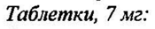
- стр. 1: «oom Семаглутид представляет собой аналог ГИП-1, имеющий 94% гомологичности с человеческим» — низкая уверенность: «ГИП-1,» (16)  
  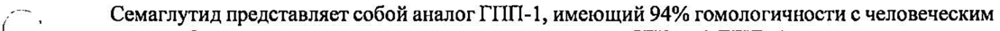
- стр. 2: «(экспозиция парацетамола (АО Со-1«) снижается на 31% в первый час после приема пищи), тем» — низкая уверенность: «Со-1«)» (2)  
  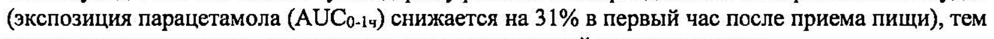
- стр. 2: «дозах 3 мг, 7 мги 14 мг раз в сутки в течение 26 недель снизился Ha 0,9 ммолы/л, 1,5 ммоль/л и |» — повторное чтение: «дозах 3 мг, 7 мги 14 мг раз в сутки в течение 26 недель снизился на 0,9 ммоль/л, 1,5 моль и |»  
  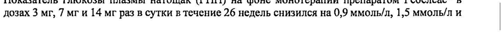
- стр. 3: «Доля пациентов, достигших целевого значения НЬА1с < 7%, составила 55%, 69%, 77% и 31%» — низкая уверенность: «НЬА1с» (26)  
  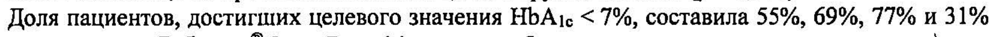
- стр. 3: «для препарата Ребелсас® 3 мг, 7 мг, 14 мг и плацебо, соответственно.» — повторное чтение: «ДлЯ препарата Ребелсас® 3 мг, 7 мг, 14 мги плацебо, соответственно.»  
  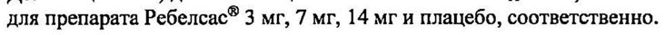
- стр. 3: «Ребелсас® 14 мг один раз в сутки по сравнению с эмпаглифлозином 25 мг один раз в сутки» — повторное чтение: «Ребелсас® 14 MP один раз в сутки по сравнению с эмпаглифлозином 25 Мг один раз В сутки»  
  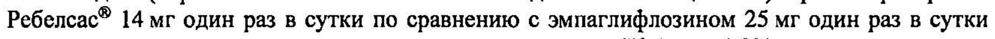
- стр. 3: «. привела к статистически значимому снижению показателя НЬА1е на 1,3% против снижения на» — низкая уверенность: «НЬА1е» (4)  
  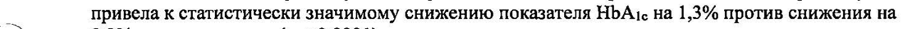
- стр. 3: «для препарата Ребелсас® 14 мги эмпаглифлозина 25 мг, соответственно. Доля пациентов,» — повторное чтение: «длЯ препарата Ребелсас® 14 мг и эмпаглифлозина 25 мг, соответственно. Доля пациентов,»  
  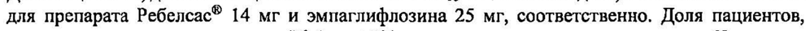
- стр. 3: «были рандомизированы в группы терапии препаратом Ребелсас® в дозе 3 мг, 7 мг, 14 мг или» — повторное чтение: «были рандомизированы в группы терапии препаратом Ребелсас® в дозе 3 мг, 7 мг, 14 мг или»  
  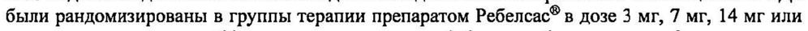
- стр. 3: «| Ребелсас® 7 мг и 14 мг один раз в сутки привела к статистически значимому снижению» — повторное чтение: «| Ребелсас® 7 rv 14 мг один раз в сутки привела к статистически значимому снижению»  
  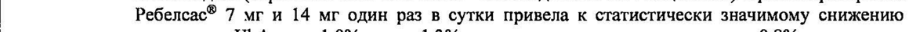
- стр. 3: «На терапии препаратом Ребелсас® 7 мг и 14 мг в течение 26 недель было получено» — повторное чтение: «На терапии препаратом Ребелсас® 7 мг и 14 мг в течение 26 недель было получено»  
  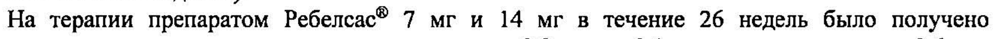
- стр. 3: «статистически значимое снижение массы тела на 2,2 кг и на 3,1 кг против снижения на 0,6 кг в» — повторное чтение: «статистически значимое снижение массы тела на 2,2 Kr И на 3,1 кг против снижения на 0,6 Kr B»  
  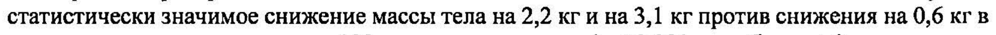
- стр. 3: «группе терапии ситаглиптином 100 мг один раз в сутки (р < 0,001 для обеих доз).» — повторное чтение: «группе терапии ситаглиптином 100 мг один раз в сутки (р < 0,001 для обеих доз).»  
  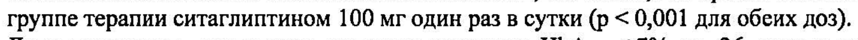
- стр. 3: «составила 44%, 56% и 32% для препарата Ребелсас® 7 мг, 14 мг и ситаглиптина 100 мг,» — повторное чтение: «составила 44%, 56% и 32% для препарата Ребелсас® 7 мг, 14 мг и ситаглиптина 100 мг,»  
  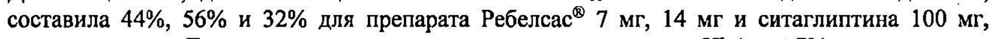
- стр. 3: «соответственно. Доля пациентов, достигших целевого значения НЬА1с < 7% к завершению» — низкая уверенность: «НЬА1с» (64)  
  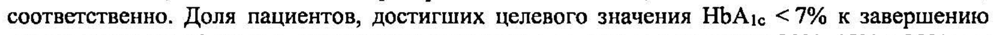
- стр. 4: «СД2 были рандомизированы в группы терапии препаратом Ребелсас® 14 мг, лираглутидом» — низкая уверенность: «СД2» (72)  
  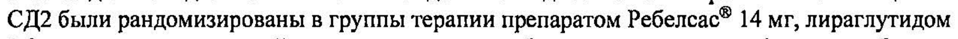
- стр. 4: «На терапии препаратом Ребелсас® 14 мг в течение 26 недель было получено статистически» — повторное чтение: «На терапии препаратом Ребелсас® 14 мг ‘в течение 26 ‘недель было получено статистически»  
  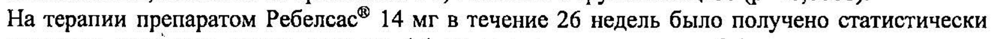
- стр. 4: «лираглутидом 1,8 мг в виде подкожной инъекции один раз в сутки (р = 0,0003) и по сравнению» — повторное чтение: «лираглутидом 1,8 мгв виде подкожной инъекции один раз в сутки (р = 0,0003) и по сравнению»  
  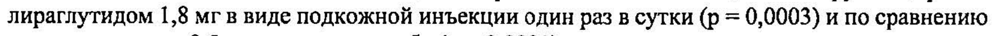
- стр. 4: «со снижением на 0,5 кг в группе плацебо (р < 0,0001).» — повторное чтение: «со снижением на 0,5 кгв группе плацебо (р < 0,0001).»  
  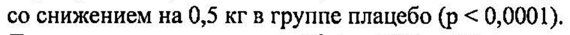
- стр. 4: «61%, 55% и 15% для препарата Ребелсас® 14 мг, лираглутида 1,8 мг и плацебо, соответственно.» — повторное чтение: «61 %, 55% и 15% для препарата Ребелсас® 14 мг, лираглутида 1,8 мги плацебо, соответственно.»  
  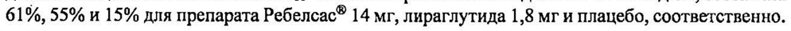
- стр. 4: «снижению показателей НЬАтс на 1,0% по сравнению с 0,2% в группе плацебо (р < 0,0001). `» — повторное чтение: «снижению показателей HbAic Ha 1,0% по сравнению с0,2% в группе плацебо (р < 0,0001). |»  
  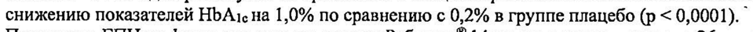
- стр. 4: «терапии препаратом Ребелсас® (гибкая коррекция дозы 3 мг, 7 мги 14 мг один раз в сутки) или» — повторное чтение: «терапии препаратом Ребелсас® (гибкая коррекция дозы 3 мг, 7 мги 14 мг один раз в сутки) ‘или»  
  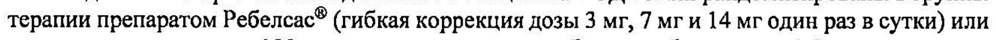
- стр. 5: «HbAic < 7% для гибкой дозы препарата Ребелсас® один раз в сутки был в 4,4 раза больше в» — низкая уверенность: «7%» (75)  
  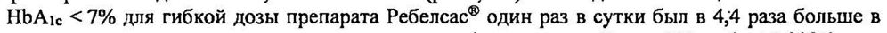
- стр. 5: «4 и группы терапии препаратом Ребелсас® в дозах 3 мг, 7 мг, 14 мг или плацебо один раз в сутки.» — низкая уверенность: «4» (72); повторное чтение: «{ № группы терапии препаратом Ребелсас® B дозах 3 мг, 7 мг, 14 МГ ИЛИ плацебо один раз в сутки.»  
  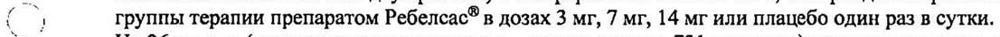
- стр. 5: «Ребелсас® 3 мг, 7 мги 14 мг привела к статистически значимому снижению показателя НЬАис `» — повторное чтение: «Ребелсас® 3 мг, 7 мги 14 мг привела к статистически значимому снижению показателя HbAtc `»  
  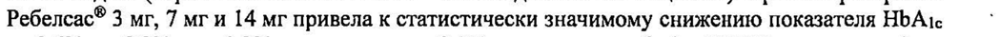
- стр. 5: «На терапии препаратом Ребелсас® 3 мг, 7 мг, 14 мг в течении 26 недель было получено» — повторное чтение: «На терапии препаратом Ребелсас® 3 мг, 7 мг, 14 мг в течении 26 недель было получено»  
  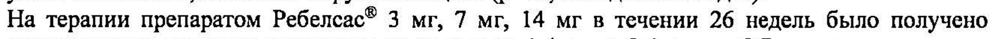
- стр. 5: «статистически значимое снижение массы тела на 1,4 кг, на 2,4 кг и на 3,7 кг против снижения» — повторное чтение: «статистически значимое снижение массы тела на 1,4 Ka, Ha 2,4 кги на 3,7 кг против снижения»  
  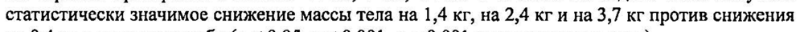
- стр. 5: «составила 28%, 43%, 58% и 7% для препарата Ребелсас® 3 мг, 7 мг, 14 мг и плацебо,» — низкая уверенность: «7» (14), «14» (18); повторное чтение: «составила 28%, 43%, 58% и 7% для препарата Ребелсас® 3 МГ, у мг, 14 мг и плацебо,»  
  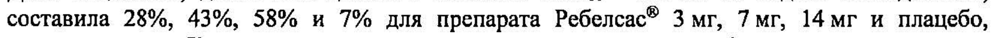
- стр. 5: «для препарата Ребелсас® 3 мг, 7 мг, 14 мги плацебо, соответственно.» — повторное чтение: «ДЛЯ препарата Ребелсас® 3 мг, 7 мг, 14 мг плацебо, соответственно.»  
  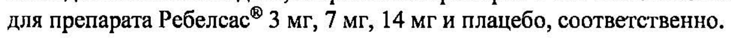
- стр. 5: «: двойное слепое КИ вгруппы терапии препаратом Ребелсас® 14 мг один раз в сутки или» — низкая уверенность: «14» (51)  
  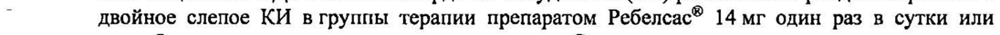
- стр. 6: «в анамнезеу 11,7% и 36,1% пациентов, соответственно.» — повторное чтение: «в анамнезеу 11,7% и 36, 1% пациентов, соответственно.»  
  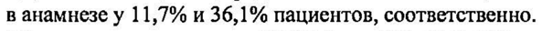
- стр. 6: «‘3 1,4% пациентов в группе семаглутида иу 2,8% пациентов в группе плацебо (снижение частоты» — низкая уверенность: «‘3» (42)  
  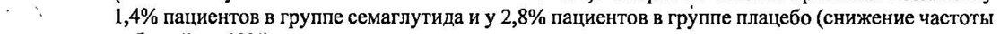
- стр. 6: «концентрацию между 1,7 и 22,7 нмоль/л, а 90% пациентов, получавших терапию семаглутидом» — повторное чтение: «концентрацию между 17 и 22,7 нмоль/Л, а90% пациентов, получавших терапию семаглутидом»  
  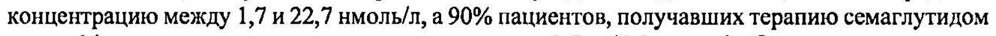
- стр. 7: «Г в У пациентов с СД2 клиренс семаглутида составляет примерно 0,04 л/ч. |» — повторное чтение: «^^, = Упациентов c СД? клиренс семаглутида составляет примерно 0,04 1/4. |»  
  
- стр. 7: «сравнима с таковой при применении семаглутида в дозе 0,5 мг для п/к введения один раз в» — повторное чтение: «сравнима с таковой при применении семаглутида в дозе 0,5 мг для п/к введения один раз В»  
  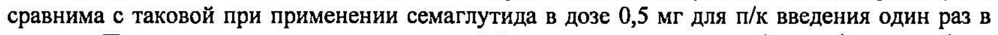
- стр. 9: «раз в сутки, дозу можно увеличить до поддерживающей дозы 14 мг 1 раз в сутки.» — повторное чтение: «раз в сутки, дозу можно увеличить до поддерживающей дозы 14 мг 1 pas B CYTKH.»  
  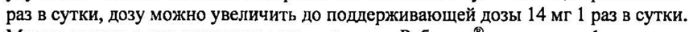
- стр. 11: «в исследованиях Ша фазы при применении семаглутида (< 0,1%) и препарата сравнения (0,2%).» — повторное чтение: «в исследованиях Ша фазы при применении семаглутида (< 0, 1%) и препарата сравнения (0,2%).»  
  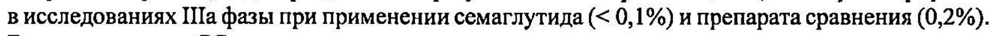
- стр. 14: «Таблетки 3 мг:» — повторное чтение: «Таблетки 3 мг:»  
  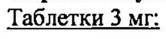
