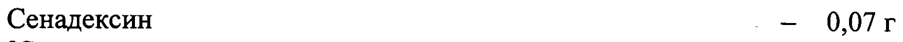
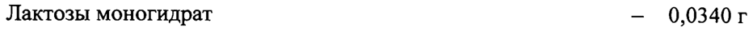
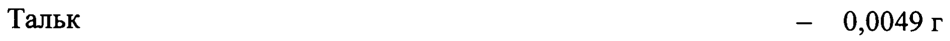
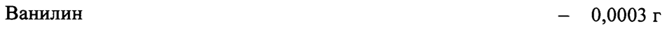
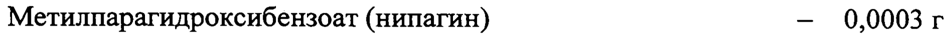
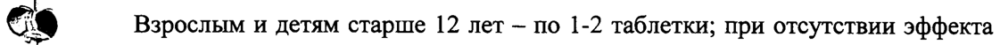
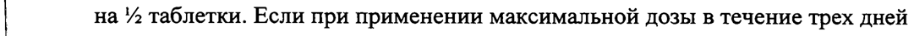

# Сенадексин — внутрь

- Препарат: Сенадексин (таблетки;)
- АТХ: A06AB06
- Источник: ГРЛС, инструкция по медицинскому применению, РУ ЛП-003290, файл от 2023-11-29 (https://grls.rosminzdrav.ru/Grls_View_v2.aspx?routingGuid=3b59caa2-70bb-48af-b284-547aa064d459)
- Распознано автоматически (OCR): 7 из 7 стр.
- Инструкция к другому РУ того же препарата: ЛП-003290 (национальное РУ, переоформленное по правилам ЕАЭС, решение от 08.11.2023). Текст может быть старше действующего
- Сомнительных строк после OCR: 7 (см. раздел «Проверка распознавания»)

## Общие сведения

| № | | МИНИСТЕРСТВО ЗДРАВООХРАНЕ РОССИЙСКОЙ „ФЕДЕР
ЛП - 003290 - 051115 | по применению вкаротвенного Пеларат НИ енения
| .
CEHAJIEKCHH | . наименование лекарственного препарата
Внимательно прочитайте эту инструкцию перед тем, как начать прием/использование этого лекарства.
® Это лекарство отпускается без рецепта. Для достижения
И оптимальных результатов его следует использовать, строго выполняя i все рекомендации, изложенные в инструкции.
ut e Сохраните инструкцию, она может потребоваться вновь.
, . e Если у Вас возникли вопросы, обратитесь к врачу.
р - Регистрационный номер: - | Торговое наименование: Сенадексин i Международное непатентованное или группировочное наименование:
i Сеннозиды A u B Cy Лекарственная форма: таблетки
Состав на одну таблетку Активный компонент
Сенадексин - = 0,07г (Сумма кальциевых солей сеннозидов А и В
| из кассии (сенны) остролистной листьев
| в пересчете на сухое вещество 20,0 %] Вспомогательные вещества
Крахмал кукурузный — 0,1370r Лактозы моногидрат — 0,0340 г
| ООО Тальк — 0,0049 г Кальция стеарат — 0,0020r
Магния стеарат — 0,0015г Ванилин — 0,0003 г
Метилпарагидроксибензоат (нипагин) — 0,0003 г
Описание | Таблетки круглые плоскоцилиндрической формы с фаской и риской, от серовато-коричневого до коричневого цвета с более темными и более ca светлыми вкраплениями со слабым характерным запахом.
> :
| Фармакотерапевтическая группа | Слабительное средство растительного происхождения.
| | Код ATX .
[A06AB06].
| Фармакологические свойства | Фармакодинамика. Оказывает слабительное действие, которое обусловлено антрагликозидами (в основном сеннозидами А и В), а также другими гликозидами. При применении внутрь гликозиды сенны проходят через желудок и тонкий кишечник в неизменённом виде, не всасываясь. В толстом кишечнике антрагликозиды расщепляются кишечными бактериями
| на фармакологически активные антроны и антранолы, которые раздражают интерорецепторы толстой кишки, усиливают перистальтику и ускоряют опорожнение кишечника. Антроны и антранолы препятствуют всасыванию воды и электролитов, способствуют диффузии воды в просвет кишечника.
Вследствие осмотического эффекта происходит разрыхление каловых масс и увеличение их объема, способствующее послабляющему эффекту антрагликозидов.
Слабительное действие проявляется через 6-10 часов. При длительном применении препарата интенсивность его действия может снижаться вследствие уменьшения содержания калия в организме.
| Фармакокинетика. Метаболиты антрагликозидов сенны практически
| не всасываются, в основном выводятся с калом, а также с мочой. Выводятся
‚ _ Также с потом, проникают в грудное молоко.

## 4.1. Показания к применению

| Хронический запор, гипо- и атония кишечника, регулирование стула ea при геморрое, проктите и анальных трещинах, очищение кишечника
| Хронический запор, гипо- и атония кишечника, регулирование стула ea при геморрое, проктите и анальных трещинах, очищение кишечника
Г. перед диагностическими и лечебными процедурами.

## 4.3. Противопоказания

Повышенная индивидуальная чувствительность к компонентам препарата,
Повышенная индивидуальная чувствительность к компонентам препарата,
| маточные кровотечения, кишечная непроходимость, спастический запор,
| острые воспалительные заболевания кишечника (болезнь Крона, язвенный
| колит, аппендицит), перитонит, пептическая язва желудка и двенадцатиперстной кишки, желудочно-кишечные кровотечения,
| ущемленная грыжа, цистит, боль в области живота неустановленного генеза,
С тяжелые нарушения водно-электролитного баланса, беременность, период
| грудного вскармливания, дефицит лактазы, непереносимость лактозы,
| глюкозо-галактозная мальабсорбция, детский возраст до 12 лет.

## 4.3. С осторожностью

| Сахарный диабет, заболевания печени и/или почек, детский возраст от 12 лет.
| Сахарный диабет, заболевания печени и/или почек, детский возраст от 12 лет.
Лицам, находящимся на диете с пониженным содержанием углеводов.
Если у Вас одно из перечисленных заболеваний, перед приемом препарата
| обязательно проконсультируйтесь с врачом.
| | | _ po ee oo | | | Применение при беременности и в период грудного вскармливания
Применение препарата у беременных противопоказано в связи с более высокой вероятностью развития побочных эффектов (абдоминальные боли, диарея). На время лечения препаратом кормление грудью рекомендуется прекратить, так как компоненты препарата могут проникать в грудное
‚ молоко и вызывать частый стул у младенца.

## 4.2. Способ применения и дозы

Принимают внутрь один раз в сутки вечером перед сном, запивая водой.
Принимают внутрь один раз в сутки вечером перед сном, запивая водой.
2% Взрослым и детям старше 12 лет - по 1-2 таблетки; при отсутствии эффекта дозу увеличивают до 2-3 таблеток на прием. Максимальная суточная доза — 3 таблетки.
Следует применять наименьшую дозу, необходимую для получения мягкого | кала. В процессе подбора одну и ту же дозу следует принимать в течение нескольких дней и при отсутствии эффекта постепенно увеличивать дозу
| на 2 таблетки. Если при применении максимальной дозы в течение трех дней
| дефекация не происходит, необходимо обратиться к врачу. Не следует
| применять препарат более двух недель.
(Е При необходимости курсового применения препарата по рекомендации
| | врача, после двух недель применения следует сделать перерыв на две недели.
| Побочное действие Со стороны желудочно-кишечного тракта: спастические боли в животе,
| тошнота, рвота, диарея, метеоризм, атония толстого кишечника, пигментация толстого кишечника (отложение пигмента меланина в слизистой оболочке толстой кишки).
Аллергические реакции: кожный зуд, эритема, кожная сыпь.
| А ОИ | Со стороны мочеполовой системы: желтовато-коричневое или красноватое
| окрашивание мочи (за счет метаболитов, выводящихся почками; это
| не является патологическим признаком и проходит после отмены препарата),
| протеинурия, гематурия (при длительном применении, особенно в высоких
1 дозах).
Нарушения метаболизма: гиповолемия, гипокалиемия (при длительном приеме, особенно в высоких дозах, на фоне приема диуретиков,
| кортикостероидов и сердечных гликозидов), вторичный гиперальдостеронизм. |
Прочие: утомляемость, спутанность сознания, мышечные судороги
Ce (при длительном применении).
| Если любые из указанных в инструкции побочных эффектов усугубляются, р или Вы заметили любые другие побочные эффекты, не указанные
| в инструкции, сообщите об этом врачу.

## 4.9. Передозировка

| Симптомы: диарея, рвота, боли в области живота, нарушение водно-
| Симптомы: диарея, рвота, боли в области живота, нарушение водно-
| электролитного баланса.
Лечение: отмена препарата, симптоматическая терапия, восполнение we жидкости и электролитов (особенно калия) для восстановления водноэлектролитного равновесия.

## 4.5. Взаимодействие с другими лекарственными средствами

| При длительном применении или применении в высоких дозах препарат усиливает эффект сердечных гликозидов и антиаритмических средств
| вследствие снижения содержания калия в организме, нарушает абсорбцию антибиотиков тетрациклинового ряда.
a / При одновременном применении с тиазидными диуретиками, гормонами
| коры надпочечников и препаратами солодки повышается риск развития
| гипокалиемии.

Снижает эффективность препаратов, которые медленно всасываются
| в желудочно-кишечном тракте.

## 4.4. Особые указания

|
|

Перед применением препарата следует проконсультироваться с врачом.
| Препарат рекомендуется применять только в том случае, если нормализации

et ) стула He удается добиться изменением диеты или применением препаратов,
| увеличивающих объем кишечного содержимого.
| При длительном применении препарата может развиться привыкание, в связи

с чем его прием целесообразно чередовать с другими слабительными

средствами.
| Больным сахарным диабетом необходимо учитывать, что в одной таблетке

содержится около 0,17 г углеводов (0,014 ХЕ).

Во время лечения кислая моча может приобретать желтовато-коричневый цвет, щелочная — красноватый цвет.
ahh | Влияние на способность управлять транспортными средствами,

механизмами

Применение препарата не оказывает влияния на способность к управлению

транспортными средствами и занятию другими потенциально опасными

видами деятельности, требующими повышенной концентрации внимания

и быстроты психомоторных реакций.

| 6 № . И ООО | | | | | Форма выпуска | | Таблетки. По 10 таблеток в контурную ячейковую или безъячейковую
| | упаковку. 2 или 3 контурные ячейковые упаковки вместе с инструкцией по применению помещают в пачку из картона. 60 или 200 контурных
| | безъячейковых упаковок вместе с равным количеством инструкций по применению помещают в коробку или в ящик из картона
| (для стационаров).
| | Условия хранения ® В сухом, защищенном от света месте при температуре не выше 25 °С.
| Хранить в недоступном для детей месте.
| Срок годности | .
! 3 года.
| Не применять по истечении срока годности.
| | , | Условия отпуска Отпускают без рецепта.
Pp Производитель/Организация, принимающая претензии потребителей
TNT | ЗАО «ВИФИТЕХ», Россия | Адрес: 142279, Московская обл., Серпуховский р-н, п. Оболенск, ГНЦ ПМ.
| Тел./факс: (495) 716-15-81, 716-15-90.
| | Адрес места осуществления производства: 142279, Московская обл.,
| Серпуховский р-н, п. Оболенск, корп. 84, корп. 87, зд. 90.
| : = Генеральный директор Sie Ce ЗАО «ВИФИТЕХ» < QI С.А. Постельников ia подпись” \$ А ФИО
НФ! > ой "ВЕ BHOUTEX') 2?
ca Ssh NON Wes SONG * ОХ >: я 7
## Проверка распознавания

Страницы-сканы распознаны автоматически. В 7 строках с дозировками цифры могли распознаться с ошибкой — сверьте с вырезкой из оригинала:

- стр. 1: «Сенадексин - = 0,07г» — низкая уверенность: «0,07г» (61)  
  
- стр. 1: «Лактозы моногидрат — 0,0340 г» — низкая уверенность: «0,0340» (8)  
  
- стр. 2: «Тальк — 0,0049 г» — низкая уверенность: «0,0049» (0)  
  
- стр. 2: «Ванилин — 0,0003 г» — низкая уверенность: «0,0003» (41)  
  
- стр. 2: «Метилпарагидроксибензоат (нипагин) — 0,0003 г» — низкая уверенность: «0,0003» (68)  
  
- стр. 4: «2% Взрослым и детям старше 12 лет - по 1-2 таблетки; при отсутствии эффекта» — низкая уверенность: «2%» (25); повторное чтение: «ce Взрослым и детям старше 12 лет - по 1-2 таблетки; при отсутствии эффекта»  
  
- стр. 4: «| на 2 таблетки. Если при применении максимальной дозы в течение трех дней» — низкая уверенность: «2» (57)  
  
