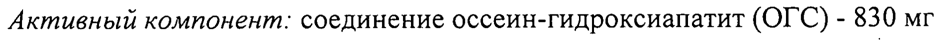

# Соединение оссеин-гидроксиапатит — внутрь

- Препарат: Остеогенон (таблетки, покрытые оболочкой;)
- АТХ: M05BX
- Источник: ГРЛС, инструкция по медицинскому применению, РУ П N013182/01, файл от  (https://grls.rosminzdrav.ru/Grls_View_v2.aspx?routingGuid=fc7c0980-b157-48e9-8692-5e92cb4a505f)
- Распознано автоматически (OCR): 8 из 8 стр.
- Инструкция к другому РУ того же препарата: П N013182/01 (национальное РУ, переоформленное по правилам ЕАЭС, решение от 07.10.2020). Текст может быть старше действующего
- Сомнительных строк после OCR: 1 (см. раздел «Проверка распознавания»)

## Общие сведения

МИНИСТЕРСТВО ЗДРАВООХРАНЕНИЯ ВОЕСИЙЕкей"ФЕДЕРАЦИ ad ИННЗДРАВ РОССИИ
| ПЛОВА 300316 ИНСТРУК СОГЛАСОВАНО по применению лекарственного препарата для медицинского применения
Остеогенон Регистрационный номер: IT №013182/01
Торговое название препарата: Остеогенон Лекарственная форма: таблетки, покрытые оболочкой

® Состав

Каждая таблетка, покрытая оболочкой, содержит:

Ядро таблетки |

Активный компонент: соединение оссеин-гидроксиапатит (ОГС) - 830 мг
(относится к сухой субстанции), соответствующее:

@ сссеин - около 291 мг, состоящий из:
неколлагеновых пептидов / протеинов - 75 мг, коллагенов - 216 мг;
кальция гидроксифосфат (гидроксиапатит) - около 444 мг, включающий: кальций - 178 мг, фосфор - 82 мг;

| @ неактивная органическая фракция OTC - около 95 мг,

ы состоящая из липидов, кислоты лимонной, гликозоаминогликана, карбонатов в различных соотношениях в зависимости от конкретной партии животного сырья.

Вспомогательные вещества: микрокристаллическая целлюлоза - 69 мг;
кремния диоксид коллоидный - 10 мг; магния стеарат - 3 мг;
крахмал картофельный - 15 мг (содержание воды в ОГС - около 58 мг).
Оболочка: | гипромеллоза — 9,0 мг; макрогол - 1,5 мг; железа оксид желтый - 0,5 мг;
титана диоксид — 3,0 мг; тальк — 1,0 мг

Го Описание Двояковыпуклые, продолговатой формы таблетки, покрытые оболочкой, светло-желтого цвета.
Фармакотерапевтическая группа Кальциево-фосфорного обмена регулятор
Код ATX MOSBX Фармакологические свойства

## 5.1. Фармакодинамика

Остеогенон содержит комплекс органических компонентов костного
Остеогенон содержит комплекс органических компонентов костного

@ матрикса и микрокристаллов гидроксиапатита, в котором присутствуют кальций и фосфор в физиологически сбалансированных пропорциях. Оссеин содержит неколлагеновые пептиды, протеины, коллаген, органические компоненты небелковой природы, которые оказывают положительное действие на образование костной ткани.

® Клинические исследования y здоровых добровольцев показали, что абсорбция кальция, необходимого для синтеза костной ткани, при применении оссеин-гидроксиапатитного соединения выше, чем при применении других препаратов, содержащих соли кальция.

р Фармакокинетика

® Всасывание препарата происходит в кишечнике. Медленное растворение оссеин-гидроксиапатитного соединения обеспечивает постепенное всасывание кальция на всем протяжении кишечника, в том числе - в дистальных отделах. Медленное растворение соединения обеспечивает | длительное всасывание. |
Данные доклинических исследований безопасности
Доклинические данные, полученные в ходе исследований токсичности, генотоксичности и репродуктивной токсичности при многократном применении препарата, не выявили потенциальных рисков для здоровья человека.

ООО ЗИК ОИ Показания к применению Остеопороз различной этиологии (постменопаузальный, ’сенильный, обусловленный применением глюкокортикостероидов).
Для регуляции кальциево-фосфорного баланса во время беременности и в период грудного вскармливания.
В качестве дополнительной терапии при переломах костей.

## 4.3. Противопоказания

Повышенная чувствительность к компонентам препарата, тяжелая почечная недостаточность, гемодиализ,
Повышенная чувствительность к компонентам препарата, тяжелая почечная недостаточность, гемодиализ,
® гиперкальциемия, гиперкальциурия, кальциевый нефролитиаз или кальцификация тканей, детский возраст.
Применение во время беременности и в период грудного вскармливания
Беременность ® Имеющиеся данные о применении оссеин-гидроксиапатитного соединения во время беременности свидетельствуют об отсутствии мальформативной или фето/неонатальной токсичности. Проведенные — доклинические | исследования на животных не выявили репродуктивной токсичности.
| Препарат Остеогенон можно применять во время беременности при наличии
® клинических показаний. | Грудное вскармливание
Оссеин-гидроксиапатитное соединение и, в частности, кальций потенциально могут проникать в грудное молоко. Согласно имеющимся данным, при применении препарата Остеогенон в рекомендованном диапазоне доз не ожидается какого-либо неблагоприятного влияния на ребенка, находящегося на грудном вскармливании.
Препарат Остеогенон можно применять в период грудного вскармливания.
ООО и Bn | Способ применения и дозы Препарат принимают внутрь, во время еды, запивая небольшим количеством воды. Таблетки не разжевывать.
При остеопорозе: по 2-4 таблетки 2 раза в сутки.
Для регуляции кальциево-фосфорного баланса во время беременности и в период грудного вскармливания: по1-2 таблетки в сутки.
В качестве дополнительной терапии при переломах костей у пациентов без патологии костной ткани: по 1-2 таблетки в сутки. У пациентов с патологией костной ткани дозу определяет врач, исходя из конкретной клинической ситуации.
9 Продолжительность курса лечения определяется врачом.

## 4.8. Побочное действие

Нежелательные реакции систематизированы по системно-органным классам в соответствии с MedDRA и по частоте развития в соответствии с
Нежелательные реакции систематизированы по системно-органным классам в соответствии с MedDRA и по частоте развития в соответствии с
® Классификацией ВОЗ: | | очень часто (> 1/10), часто (> 1/100, но < 1/10), нечасто (> 1/1000, но < 1/100), редко (> 1/10000, но < 1/1000),
_ очень редко (< 1/10000), частота неизвестна — частота не может быть определена на основе
@ имеющихся данных.
Нарушения со стороны обмена веществ и питания:
частота неизвестна - гиперкальциемия (повышенная концентрация кальция в плазме крови).
Нарушения со стороны желудочно-кишечного тракта: 1 частота неизвестна — тошнота, боль в животе, запор.
Нарушения со стороны кожи и подкожных тканей:
частота неизвестна — сыпь, зуд. | Нарушения со стороны почек и мочевыводящих путей:
частота неизвестна — гиперкальциурия (повышенная концентрация кальция в моче).
При возникновении любых нежелательных реакций сообщите об этом лечащему врачу.

## 4.9. Передозировка

Передозировка возможна при приеме кальция в дозе свыше 2000 мг/сутки
Передозировка возможна при приеме кальция в дозе свыше 2000 мг/сутки
(более 11 таблеток препарата Остеогенон в сутки). |
Клинические симптомы в основном связаны с гиперкальциемией: жажда,
® полиурия (увеличенное образование мочи), тошнота, рвота, обезвоживание,
| повышение артериального давления, вазомоторные нарушения, запор, потеря аппетита, аритмия, общая слабость, нефрокальциноз, нефролитиаз, боли в костях, изменение психического статуса.
Лечение: прекратить прием препарата; стандартное лечение включает
® регидратацию, коррекцию отклонений от нормы уровня электролитов в плазме крови; при необходимости применяют диуретики, глюкокортикостероиды, бисфосфонаты, кальцитонин. В некоторых случаях может потребоваться перитонеальный диализ или гемодиализ.
. Взаимодействие с другими лекарственными средствами
® Совместное применение не рекомендуется
Тиазидные диуретики: возможен риск гиперкальциемии в результате снижения выведения кальция с мочой.
Совместное применение с осторожностью Сердечные гликозиды: возможен риск развития нарушений сердечного ритма.
Рекомендуется медицинское наблюдение, при необходимости — проведение электрокардиографии, контроль концентрации кальция в плазме крови.
Тетрациклины: снижение всасывания тетрациклинов в желудочно-кишечном тракте. Между приемами препаратов необходимо делать перерыв не менее двух часов.
| ,

Лекарственные препараты и биологически активные добавки, содержащие железо и цинк: риск снижения кишечной абсорбции железа и цинка в связи с образованием хелатных соединений. Между приемами препаратов необходимо делать перерыв не менее двух часов.

Бисфосфонаты: риск снижения кишечной абсорбции бисфосфонатов в связи с образованием хелатных соединений. Между приемами препаратов необходимо делать перерыв не менее двух часов.

Хинолоны: риск снижения кишечной абсорбции хинолонов в связи с образованием хелатных соединений. Между приемами препаратов необходимо делать перерыв не менее двух часов.

9 Глюкокортикостероиды: риск снижения кишечной абсорбции кальция.
Между приемами препаратов необходимо делать перерыв не менее двух часов.

Препараты стронция: риск снижения кишечной абсорбции стронция.

Между приемами препаратов необходимо делать перерыв не менее двух oe часов.

Тиреоидные гормоны: риск снижения кишечной абсорбции левотироксина.

Между приемами препаратов необходимо делать перерыв не менее двух

часов.

©® Эстрамустин: риск снижения абсорбции эстрамустина. Между приемами препаратов необходимо делать перерыв не менее двух часов.

## 4.4. Особые указания

Кальций

При совместном применении с витамином Ш необходим регулярный

контроль концентрации кальция в плазме крови и моче. В случае повышения

концентрации кальция ‘в плазме крови или моче выше предельных

допустимых значений необходима корректировка дозы препаратов.

Пациентам с почечной недостаточностью рекомендуется регулярный

контроль концентрации кальция в плазме крови и моче. Следует избегать применения препарата в больших дозах и (или) длительного лечения.
Необходимо снизить дозу или временно приостановить прием препарата, если концентрация кальция в. моче достигнет 7,5 ммоль/24 часа
(300 мг/24 часа).
Пациентам с кальциевым нефролитиазом в анамнезе рекомендуется следующее: придерживаться стандартной профилактической диеты;
ограничить дозу кальция, получаемого с препаратом Остеогенон, до 500 мг в сутки (не более трех таблеток препарата в сутки); скорректировать прием кальция с пищей, чтобы не превышать суточную дозу кальция, составляющую 1,5 г; избегать сопутствующего приема препаратов, 9 содержащих витамин О.
Фосфор Пациентам с умеренной почечной недостаточностью рекомендуется регулярный мониторинг концентрации фосфора в плазме крови.
® Влияние на способность управлять транспортными средствами, механизмами
Специальные исследования не проводились. Случаев влияния препарата на способность к выполнению потенциально опасных видов деятельности, требующих повышенной концентрации внимания и быстроты
® психомоторных реакций (управление транспортными средствами, работа с движущимися механизмами) не выявлено.

## 6.5. Форма выпуска

Таблетки, покрытые оболочкой, 830 мг.
Таблетки, покрытые оболочкой, 830 мг.
По 10 таблеток в блистере из ПВХЛТВДХ и алюминиевой фольги.
4 блистера с инструкцией по применению в пачке картонной.

## 6.4. Условия хранения

При температуре не выше 30 °С.
При температуре не выше 30 °С.
Хранить в недоступном для детей месте.

## 6.3. Срок годности

4 года Не использовать по истечении срока годности.
4 года Не использовать по истечении срока годности.
Условия отпуска Отпускают по рецепту Владелец регистрационного удостоверения
Пьер Фабр Медикамент Продакшн 45, площадь Абель Ганс, 92100 Булонь, Франция
|) Производитель Пьер Фабр Медикамент Продакшн
Прогифарм, 45500 Жиен, Франция Организация, принимающая претензии потребителей
ООО «Пьер Фабр»
® Россия, 119435, Москва, Саввинская наб., 15
Тел.: (495)789-9533 Факс: (495)789-9534 ОР
® Email: info.pfrussia@pierre-fabre.com OR!
“ к ` ОИК | ия ny ot x os У Bon 017Н1057
SE = Heeb ag,- <x:
Представитель фирмы о @abp ¥ Че”. Черкасова М.Е.
Bele Bo NEN На | © ЕЕ «о < РД | . с SAS . 8
ЗА an MKB | LOS РЕГИСТ WO | OS? 08153130...
im
## Проверка распознавания

Страницы-сканы распознаны автоматически. В 1 строках с дозировками цифры могли распознаться с ошибкой — сверьте с вырезкой из оригинала:

- стр. 1: «Активный компонент: соединение оссеин-гидроксиапатит (ОГС) - 830 мг» — повторное чтение: «Активный компонент: соединение оссеин-гидроксиапатит (ОГС) - 830 Mr»  
  
