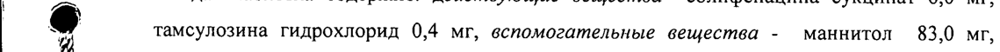
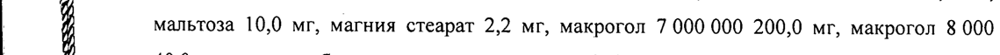
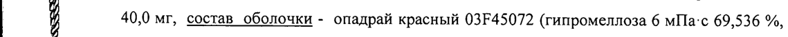
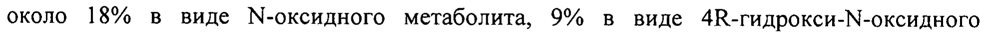
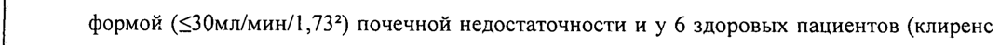
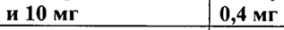

# Солифенацин + Тамсулозин — внутрь

- Препарат: Везомни (таблетки с модифицированным высвобождением, покрытые пленочной оболочкой;)
- АТХ: G04CA53
- Источник: ГРЛС, инструкция по медицинскому применению, РУ ЛП-003196, файл от  (https://grls.rosminzdrav.ru/Grls_View_v2.aspx?routingGuid=845745d8-951c-429e-81f6-e5bf26e2ed25)
- Распознано автоматически (OCR): 14 из 14 стр.
- Инструкция к другому РУ того же препарата: ЛП-003196 (срок действия истёк, решение от 23.07.2018). Текст может быть старше действующего
- Сомнительных строк после OCR: 6 (см. раздел «Проверка распознавания»)

## Общие сведения

МИНИСТЕРСТВО ЗДРАВООХРАНЕНИЯ РОССИЙСКОЙ ФЕДЕРАЦИИ |
ИНСТРУКЦИЯ | по применению лекарственного препарата для медицинского применения |
Регистрационный номер: | Торговое название препарата: Везомни
Группировочное название: Солифенацин+Тамсулозин

## 3. Лекарственная форма

таблетки с модифицированным высвобождением, покрытые
таблетки с модифицированным высвобождением, покрытые
| пленочной оболочкой | Состав | | = Каждая таблетка содержит: действующие вещества —солифенацина сукцинат 6,0 мг,
| @ тамсулозина гидрохлорид 0,4 мг, вспомогательные вещества - маннитол 83,0 мг,
| й мальтоза 10,0 мг, магния стеарат 2,2 мг, макрогол 7 000 000 200,0 мг, макрогол 8 000
| й 40,0 мг, состав оболочки - опадрай красный 03245072 (гипромеллоза 6 мПа:с 69,536 %, й краситель железа оксид красный 17,440 %, макрогол 8000 13,024 %) 10,2-mr. | й Каждая двухслойная таблетка содержит один слой солифенацина сукцината (6 мг) и один
| @ слой тамсулозина гидрохлорида (0,4 мг). | р < Описание |
‚ Круглые двояковыпуклые покрытые пленочной оболочкой таблетки коричневатокрасного цвета с гравировкой «6/0.4» на одной стороне.
Фармакотерапевтическая группа: простаты гиперплазии доброкачественной средство лечения.
Код ATX: 004СА53 МИНЗДРАВ РОССИИ | Фармакологические свойства ЛП - 003196 - 140915

## 5.1. Фармакодинамика

СОГЛАСОВАНО Механизм действия —
СОГЛАСОВАНО Механизм действия —
| Везомни — это комбинированный препарат, который содержит два активных вещества,
| солифенацин и тамсулозин. Данные активные вещества имеют независимые и
| взаимодополняющие механизмы действия при лечении симптомов нижних мочевых путей, связанных с доброкачественной гиперплазией предстательной железы, при | наличии симптомов наполнения.
| Солифенацин — селективный конкурентный ингибитор мускариновых рецепторов мочевого пузыря, преимущественно м3-подтипа, и имеет низкое или отсутствие сродства
| к различным другим рецепторам, ферментам и ионным каналам.
Тамсулозин — это альфа!-адреноблокатор. Он является селективным конкурентным блокатором постсинаптических @и-адренорецепторов, особенно O14 и Qip подтипов,
| отвечающих за расслабление гладкой мускулатуры нижних мочевых путей.
Фармакодинамическое воздействие Солифенацин облегчает симптомы наполнения мочевого пузыря (ирритативные симптомы), связанные с действием ацетилхолина, который — активирует м3-холинорецепторы в мочевом пузыре. Ацетилхолин активизирует сократительную функцию стенки мочевого пузыря, что ‘проявляется в виде ургентных позывов к мочеиспусканию или недержания мочи.
Тамсулозин облегчает симптомы опорожнения (обструктивные симптомы) путем расслабления гладкой мускулатуры предстательной железы, шейки мочевого пузыря и простатической части уретры. Также уменьшает симптомы наполнения.
® , Клиническая эффективность и безопасность
| Эффективность препарата была продемонстрирована в результате клинического
- исследования Ш фазы у пациентов с симптомами нижних мочевых путей на фоне доброкачественной гиперплазии предстательной железы. При приеме Везомни было отмечено статистически значимое уменьшение симптомов по шкале оценки ургентных
РА. позывов и частоты мочеиспускания, а также общей частоты мочеиспускания, среднего
«а.
объема мочи, выделенного за одно мочеиспускание, и балла по подшкале
[Р55-наполнение по сравнению с Омником OKAC (тамсулозином в форме контролируемого высвобождения; OCAS — oral controlled absorption system/OKAC — пероральная система контролируемого всасывания). Данные улучшения сопровождаются
| значительным увеличением показателя качества жизни по шкале IPSS и показателя
@ качества жизни по Опроснику оценки выраженности симптомов гиперактивности мочевого пузыря. Кроме того, Везомни не уступал тамсулозину Омник ОКАС в уменьшении симптомов при оценке общего балла по шкале IPSS (р <0.001).

## 5.2. Фармакокинетика

| Исследование биодоступности при многократном приеме показало, что фармакокинетика
| Исследование биодоступности при многократном приеме показало, что фармакокинетика
| при приеме Везомни сопоставима с фармакокинетикой при одновременном приеме солифенацина и тамсулозина ОКАС в аналогичной дозировке.
Абсорбция | После многократного приема Везомни время достижения максимальной концентрации
' (пах) для солифенацина варьировало между 4,27 4 и 4,76 ч в разных исследованиях, для тамсулозина - между 3,47 ч и 5,65 ч соответственно. Максимальная концентрация в
| | | плазме (Cmax) для солифенацина варьировала между 26,5 нг/мл и 32,0 нг/мл, для тамсулозина - между 6,56 нг/мл и 13,3 нг/мл. Значение площади под кривой
| «концентрация-время» (AUC ) для солифенацина варьировалось от 528 нгч/мл до 601 нгч/мл, для тамсулозина — между 97,1 нгч/мл и 222 нгч/мл. Абсолютная
| биодоступность для солифенацина составляет около 90%, в то время как тамсулозин
| абсорбируется на 70-79%.
Выведение | После однократного приема Везомни время полувыведения (tin) для солифенацина
| варьируется от 49,5 4 до 53,0 4, для тамсулозина — от 12,8 4 до 14,0 4.
Информация о фармакокинетике активных веществ комбинированного препарата дополняет фармакокинетические свойства Везомни:
| Солифенацин yp Абсорбция | Cmax достигается через 3-8 часов. {пах не зависит от дозы. Cmax и AUC увеличиваются
° пропорционально повышению дозы от 5 до 40 мг. Абсолютная биодоступность - 90%.
Распределение , Объем распределения солифенацина после внутривенного введения составляет примерно 600 л. Солифенацин в значительной степени (около 98%) связан с белками плазмы, преимущественно с о!-кислым гликопротеином. ,
Метаболизм:
Солифенацин активно метаболизируется печенью, преимущественно изоферментом 3A4 (CYP3A4) системы цитохромом Р450. Однако существуют альтернативные метаболические пути, посредством которых может осуществляться метаболизм | солифенацина. Системный клиренс солифенацина составляет около 9,5 л/час, а конечный период полувыведения равен 45-68 часам. После приема препарата внутрь в плазме помимо солифенацина были идентифицированы следующие метаболиты: один фармакологически активный — (4В-гидроксисолифенацин) и три неактивных
(№-глюкуронид, М-оксид и 4К-гидрокси-М-оксид солифенацина).
Выведение: После однократного введения 10 мг "“С-меченого солифенацина спустя |
| 26 дней около 70% радиоактивности было обнаружено в моче и 23% в фекалиях. В моче примерно 11% радиоактивности обнаружено в виде неизмененного активного вещества, | около 18% в виде М-оксидного метаболита, 9% в виде 4В-гидрокси-М-оксидного метаболита и 8% в виде 4К-гидрокси метаболита (активный метаболит).
| Тамсулозин Абсорбция Для тамсулозина в форме ОКАС абсорбция оценивается в 57% от введенной дозы.
Тамсулозин характеризуется линейной фармакокинетикой. В равновесном состоянии
\ концентрация тамсулозина в плазме достигает пика через 4-6 часов.
Распределение Связь с белками плазмы — около 99%, объем распределения небольшой (около 0,2 л/кг).
Метаболизм | Тамсулозин медленно метаболизируется в печени с образованием менее активных метаболитов. Большая часть тамсулозина представлена в плазме крови в неизмененной форме. Тамсулозин в основном метаболизируется в печени, преимущественно с участием изоферментов СУРЗА4 и CYP2D6.
Выведение После однократного приема 0,2 мг “С-меченого тамсулозина через 1 неделю около 76%
| радиоактивности было выявлено в моче и 21% в кале. В моче около 9% радиоактивности
| было обнаружено в виде неизмененного активного вещества; около 16% в виде сульфата о-деэтилированного тамсулозина, и 8% в виде о-этоксифенокси уксусной кислоты.
Особенности фармакокинетики у отдельных категорий пациентов
Пожилые люди В исследованиях клинической фармакологии и биодоступности возраст пациентов варьировался от 19 до 79 лет. После применения Везомни самые высокие показатели
| концентрации были выявлены у пожилых пациентов, хотя наблюдалось почти полное совпадение с отдельными показателями более молодых пациентов. Везомни можно использовать у пожилых пациентов. |
Почечная недостаточность Фармакокинетика Везомни не была изучена для пациентов с почечной недостаточностью.
Указанные ниже данные отражают информацию, доступную по каждому компоненту препарата относительно пациентов с почечной недостаточностью.
Солифенацин AUC и Cmax солифенацина у пациентов с легкой и умеренной почечной недостаточностью незначительно отличаются от соответствующих показателей у
, здоровых добровольцев. У пациентов с тяжелой почечной недостаточностью (клиренс креатинина <30 мл/мин) экспозиция солифенацина значительно выше - увеличение Стах составляет около 30%, АЧС- более 100% и ti — более 60%. Отмечена статистически значимая взаимосвязь между клиренсом креатинина и клиренсом солифенацина.
Фармакокинетика у пациентов, которым проводится гемодиализ, не изучалась.
Тамсулозин Было проведено сравнение фармакокинетики тамсулозина у 6 пациентов с легкой и умеренной формой (30> клиренс креатинина <70 мл/мин/1,73 м²) или умеренно-тяжелой
| формой (<30мл/мин/1,73?) почечной недостаточности и у 6 здоровых пациентов (клиренс креатинина >90 мл/мин/1,73 м²). В то время как наблюдалось изменение общей концентрации тамсулозина в плазме крови в результате изменения связи с альфа!-кислым гликопротеином, активная концентрация тамсулозина гидрохлорида, а также собственный клиренс оставались относительно стабильными. Фармакокинетика тамсулозина у пациентов с последней стадией почечной недостаточности (клиренс креатинина <
| 10мл/мин/1,73 м²) не была изучена. | | Печеночная недостаточность
| Фармакокинетика Везомни не была изучена для пациентов с печеночной
| недостаточностью. Указанные ниже данные отражают информацию, доступную по каждому компоненту препарата относительно пациентов с печеночной недостаточностью.
| Солифенацин У пациентов с умеренной печеночной недостаточностью (7-9 баллов по шкале ЧайлдПью) величина Cmax не меняется, AUC увеличивается на 60%, ti. увеличивается вдвое.
| Фармакокинетика у пациентов с тяжелой печеночной недостаточностью не определялась.
| Тамсулозин | Было проведено сравнение фармакокинетики тамсулозина у 8 пациентов с умеренной печеночной недостаточностью (7-9 баллов по шкале Чайлд-Пью) и у 8 здоровых
| пациентов. В то время как наблюдалось изменение общей концентрации тамсулозина в
| плазме крови в результате изменения связи с альфа!-кислым гликопротеином, активная
| концентрация тамсулозина гидрохлорида значительно не изменилась, а собственный клиренс неактивного тамсулозина умеренно изменился (32%). Фармакокинетика
| тамсулозина у пациентов с тяжелой формой печеночной недостаточности не была изучена.
Показания для применения Лечение симптомов наполнения (ирритативных симптомов), от умеренных до сильно выраженных (ургентные позывы к мочеиспусканию, учащенное мочеиспускание), и симптомов опорожнения (обструктивных симптомов), связанных с доброкачественной гиперплазией предстательной железы у мужчин.
| 5 Противопоказания - Повышенная чувствительность к активным веществам или любому из вспомогательных веществ
- Проведение гемодиализа \
| - Тяжелая печеночная недостаточность - Тяжелая почечная недостаточность или умеренная печеночная недостаточность при одновременном лечении сильными ингибиторами изофермента CYP3A4, например, кетоконазолом
- Наличие тяжелых желудочно-кишечных заболеваний (включая токсический мегаколон), миастении и закрытоугольной глаукомы
- Ортостатическая гипотензия
- Детский возраст до 18 лет (отсутствие данных по эффективности и безопасности)

## 4.3. С осторожностью

Везомни следует с осторожностью назначать пациентам с:
Везомни следует с осторожностью назначать пациентам с:
. - тяжелой почечной недостаточностью, - риском задержки мочеиспускания, .
- с желудочно-кишечными обструктивными заболеваниями,
- с риском пониженной моторики желудочно-кишечного тракта,
- с грыжей пищеводного отверстия диафрагмы, . гастроэзофагеальным рефлюксом и пациентам, одновременно принимающим лекарственные препараты (например,
| бисфосфонаты), которые могут вызвать или усилить эзофагит,
| | - с автономной нейропатией, - У пациентов с такими факторами риска, как синдром удлинения интервала ОТ и
| гипокалиемия, наблюдалась пролонгация интервала ОТ и тахикардия типа «пируэт».
| У некоторых пациентов, получавших лечение солифенацином после регистрации
| препарата, была отмечена анафилактическая реакция. При развитии анафилактических
| реакций лечение Везомни должно быть прекращено и необходимо проведение
| соответствующего лечения.
Как и при использовании других @!-адреноблокаторов, при лечении тамсулозином в отдельных случаях может наблюдаться снижение артериального давления, которое в
| | редких случаях может привести к обморочному состоянию. При первых признаках
| ортостатической гипотензии (головокружение, слабость) пациент должен сесть или лечь и оставаться в этом положении до тех пор, пока признаки не исчезнут.
| У некоторых пациентов, принимающих или ранее принимавших тамсулозина
| гидрохлорид, во время оперативного вмешательства по поводу катаракты и глаукомы
| | | | | _ отмечалось развитие синдрома интраоперационной нестабильности радужной оболочки глаза (синдром узкого зрачка), который может привести к осложнениям во время операции или в послеоперационном периоде. Не рекомендуется начинать терапию
Везомни у пациентов, которым запланирована операция по поводу катаракты или

глаукомы. Целесообразность отмены терапии Везомни за 1-2 недели до операции по поводу катаракты или глаукомы до сих пор не доказана. Во время предоперационного обследования пациентов хирург и врач-офтальмолог должны учитывать, принимает или принимал ли данный пациент 'Везомни. Это необходимо для подготовки к возможности развития во время операции синдрома интраоперационной нестабильности радужной .
оболочки глаза. | Везомни следует использовать с осторожностью в комбинации с сильными и умеренными ингибиторами СУРЗА4, например, верапамилом, кетоконазолом, ритонавиром,
} нелфинавиром, итраконазолом. Препарат не следует использовать у пациентов с
| нарушением метаболизма изофермента CYP2D6 в комбинации с сильными ингибиторами
|. CYP3A4 или сильными ингибиторами CYP2D6, например, пароксетином.
Пациенты с почечной недостаточностью у | Везомни может применяться пациентами с легкой и умеренной почечной oN недостаточностью, HO с осторожностью следует применять пациентам с тяжелой почечной
| недостаточностью.
Пациенты с печеночной недостаточностью | Везомни может применяться пациентами с легкой печеночной недостаточностью (балл по
| шкале Чайлд-Пью < 7). Пациентам с умеренной печеночной недостаточностью (7-9 баллов по шкале Чайлд-Пью) следует принимать препарат с осторожностью. Пациентам с тяжелой печеночной недостаточностью (балл по шкале Чайлд-Пью выше 9) применение
| Везомни противопоказано.

## 4.6. Применение при беременности и в период грудного вскармливания

| | фертильность | Воздействие Везомни на репродуктивную функцию не было изучено. Исследования на
| животных не выявили прямого неблагоприятного воздействия солифенацина или
| | тамсулозина На фертильность или развитие эмбриона/плода.
Беременность и лактация Препарат Везомни предназначен для применения только у лиц мужского пола.
| Способ применения и дозы Взрослые старше 18 лет, атак же пожилые пациенты
| Внутрь, по 1 таблетке 1 раз в сутки независимо от приема пищи.
| 7 Таблетка должна быть принята целиком, ее нельзя разжевывать, так как это может повлиять на пролонгированное высвобождение активного вещества.
| Побочное действие Везомни может вызвать побочные эффекты, связанные с м-холиноблокирующим действием солифенацина, чаще слабой или умеренной выраженности. Наиболее часто в ходе проведения клинических исследований с применением Везомни сообщалось о таких побочных эффектах, как сухость во рту (9,5%), запор (3,2%) и диспепсия (включая боли в животе — 2,4%). К другим общим нежелательным реакциям относятся головокружение
(1,4%), нечеткость зрения (1,2%), усталость (1,2%) и расстройства эякуляции (включая ретроградную эякуляцию - 1,5%). Острая задержка мочеиспускания (0,3%, редко) — это наиболее серьезный побочный эффект, который наблюдался в ходе лечения препаратом
Везомни при проведении клинических исследований.
В таблице ниже колонка «Частота нежелательных реакций при приеме Везомни» отражает
| побочные реакции, зарегистрированные в ходе клинического исследования препарата
. Везомни.
Колонки «частота возникновения нежелательных реакций солифенацина и тамсулозина»
отражают нежелательные реакции, о которых сообщалось в отношении отдельных
, компонентов (данные из инструкций лекарственных препаратов солифенацин 5 и 10 мги тамсулозин 0,4 мг соответственно), и которые потенциально могут возникнуть при приеме препарата Везомни.
| | Частота побочных реакций определяется следующим образом: очень часто (>1/10); часто
(21/100 до <1/10); нечасто (>1/1000 до <1/100); редко (>1/10,000 до <1/1000); очень редко
(<1/10,000), неизвестно (невозможно оценить на основании имеющихся в наличии данных).
| Частота Частота возникновения НР возникновения | относительно отдельных
НР при приеме | активных веществ | Везомни Солифенацин 5 мг | Тамсулозин и 10 мг 0,4 мг
| Инфекции и инвазии О ПО ПОНИ | | Инфекции мочевыводящих Нечасто |
| путей | | | Цистит [Не ОНИ | | Нарушения со стороны иммунной системы
Анафилактическая реакция | Неизвестно * И
Нарушения метаболизма и питания | Снижение аппетита [Неизвестно * |
| у | ООО ss [Tunepkanmemna | [Наивно [|
|Menxuueckne napymrenma | TTC [Tanmouwnaumn | One pemo* TC
[Howxop One pero * Td [Boa [Нав * | нервной системы
| | [Conmmpocts Ню | ВДиегевзия а | Головная боль о [Рею* | Heat |
Коро рю | | Нарушения со стороны ЕЕ ПИ ПО ПОНИ
"Нечеткость зрения [Чаю [Чаю | Интраоперационная Неизвестно * оболочки
Кбухость гл ewacto | Глаукома р [Нав [| Е
| сердечно-сосудистой системы Ощущение сердцебиения т | Heuacro |
| Тахикардия типа «пиру» | |Неизвелно* [| электрокардиограмме
Фибрилляция предеерий | | Неизвестно* |
| Химия | Незвемно* | Кажикардия о |Незвемно* |
"Ортостатическая гипотензия | [| ecto | Нарушения со стороны
И АА клетки и средостения Paw [Ню | Сухость в носу Ню | дыша [Незвено* |
| Muchos Td Hewznectno * Cd | желудочно-кишечного тракта
| [Сухость во рту [Чаю о [Оченьчаю [| ГДиепепсия acto [Чаю |
| Тошнота р [Чаю [Ню | | Коль в животе | acto TCS
| PoP Heuacto Cd ар estar | | |Cyxocrspropne [Ню |
| [Ppora [Рю [Нею | ГЕ ПО ОИ ООО | непроходимость
| 9 \ | [Konpocras ею Кишечная непроходимоть _ | [Неизвелно* ||
Дискомфорт в области живота __| о [Неизветно* ||
НГепатобилиарные нарушения | | „Нарушение функции печени | [Неизвелно* [|
Повышение активности Неизвестно * он ПИ БОИ ОИ подкожной клетчатки
|Cyxocrbkoxn | | (Com Cd [Рею* | Нечаю |
Аллергическаясыь (| [Оченьредко* _ | Начало |
Синдром Стивенса-Джонсна_ | [| | Оченьредю |
[Отек Квинке | [| Оченьредк* _ |Редю | | _Мультиформная эритема | [Оченьредю* | |
|Эксфолиативный дерматит | [Неизвелно* ||
Нарушения со стороны о о | опорно-двигательного аппарата
[Мышечная слабость | [НМеизвено* | | и мочевыводящих путей .
| Задержка мочеиспускания | Неизвестно [Редю ||
Затруднение мочеиспускания | sé Henao ||
[Почечная недостаточноть | [Меизвеяно* ||
ЕК О ОИ ИО репродуктивной системы [Нарушения эякуляции [Чат Г [Чаю |
| риал о [| Очерею | | Нарушения общего состояния | |
| КУвталость о [Чаю Неа | Периферический отек Неа |
@ JAcrenma CT [Ню | *: наблюдались после регистрации препарата. В связи с тем, что данные были получены методом спонтанных сообщений в период после регистрации, определение частоты и причинно-следственной связи с приемом тамсулозина и солифенацина представляется
| затруднительным.
Долгосрочные данные по безопасности Везомни |
Виды и частота нежелательных реакций, которые наблюдались в ходе лечения в течение 1 года препаратом Везомни, совпадали с данными, которые наблюдались в ходе 12недельного исследования. Препарат хорошо переносится и не было выявлено особых
| нежелательных реакций, связанных с длительным приемом препарата. |
| || Передозировка Передозировка комбинацией солифенацина и тамсулозина может сопровождаться тяжелыми м-холиноблокирующими нарушениями наряду с острой гипотензией. Самая высокая доза, которую приняли случайно в ходе клинического исследования, соответствовала 126 мг солифенацина и 5,6 мг тамсулозина. Эта доза хорошо переносилась, было отмечено единственное нежелательное явление - сухость во рту слабой степени выраженности в течение 16 дней.
Лечение В случаях передозировки следует назначить активированный уголь, промыть желудок, но не следует вызывать рвоту. Как и в случаях передозировки других м-холиноблокаторов, симптомы следует лечить следующим образом:
0 при тяжелых м-холиноблокирующих эффектах центрального действия
(галлюцинации, выраженная возбудимость) - физостигмин или активированный уголь.
О при судорогах или выраженной возбудимости — бензодиазепины.
0 при дыхательной недостаточности — искусственное дыхание.
0 при тахикардии - симптоматическое лечение по необходимости. Бетаадреноблокаторы следует использовать с осторожностью, поскольку одновременная
А передозировка с тамсулозином может потенциально привести к тяжелой гипотензии.
О при острой задержке мочи - катетеризация. .
Как и в случае передозировки других м-холиноблокаторов, особое внимание следует уделять пациентам с установленным риском удлинения интервала ОТ (т. е. при гипокалиемии, брадикардии и при одновременном приеме препаратов, вызывающих удлинения интервала ОТ) и пациентам с заболеваниями сердца (ишемия миокарда, аритмии, хроническая сердечная недостаточность).
| Острую гипотензию, которая может возникнуть после передозировки тамсулозина, следует лечить симптоматически. Маловероятно, что диализ будет эффективен, так как тамсулозин интенсивно связывается с белками плазмы.

## 4.5. Взаимодействие с другими лекарственными средствами

Взаимодействие с ингибиторами CYP3A4 и CYP2D6
Одновременное применение солифенацина и кетоконазола (200 мг в день), мощного ингибитора изофермента CYP3A4, вызывало двукратное увеличение AUC солифенацина,
‚ ав дозе 400 мг/день - трехкратное увеличение.
Одновременное применение тамсулозина с кетоконазолом в дозировке 400 мг/день приводит к увеличению Cmax и AUC тамсулозина в 2,2 и 2,8 раза соответственно.
ПР EE a Одновременный прием Везомни с верапамилом (умеренный ингибитор CYP3A4)
приводит к увеличению Cmax и AUC тамсулозина в 2,2 раза и увеличению Cmax и AUC
| солифенацина приблизительно в 1,6 раза.

Одновременный прием тамсулозина с сильным ингибитором CYP2D6 пароксетином
(20мг/день) приводит к увеличению Cmax и AUC тамсулозина в 1,3 и 1,6 раза
| соответственно.
Поскольку солифенацин и тамсулозин метаболизируются изоферментом СУРЗА4, возможны фармакокинетические взаимодействия с индукторами изофермента СУРЗА4
| (например, рифампицином).
Другие взаимодействия Солифенацин | - Солифенацин может снизить эффект лекарственных препаратов, стимулирующих
| моторику желудочно-кишечного тракта, например - метоклопрамида и цизаприда.
| - Исследования in vitro показали, что в терапевтических концентрациях солифенацин не ингибирует изоферменты СУР1А1/2, 2B6, 2C8, 2C9, 2С19, 206, 2E1 или 3A4. Поэтому
| маловероятно, что солифенацин изменит клиренс лекарств, метаболизируемых этими
| изоСУР-ферментами.
А - Прием солифенацина не вызывал изменений фармакокинетики В-варфарина или Sварфарина или их влияния на протромбиновое время.
- Прием солифенацина не оказывает воздействия на фармакокинетику дигоксина.
Тамсулозин - Одновременное назначение других блокаторов а1-адренорецепторов может привести к гипотензивному эффекту.
- Диазепам, пропранолол, трихлорметиазид, хлормадинон, амитриптилин, диклофенак, | глибенкламид, симвастатин и варфарин не изменяют свободную фракцию тамсулозина в
| плазме человека in vitro. В свою очередь, тамсулозин также не изменяет свободные фракции диазепама, пропранолола, трихлорметиазида и хлормадинона. Диклофенак и варфарин могут увеличивать скорость выведения тамсулозина.
- При одновременном применении с фуросемидом отмечено некоторое снижение концентрации, однако это не требует изменения дозы, поскольку концентрация препарата остается в пределах нормального диапазона.
- Исследования in vitro показали, что в терапевтических концентрациях тамсулозин не
| ингибирует изоферменты CYPIAI/2, 2C9, 2C19, 206, 2El или 3A4. Поэтому маловероятно, что тамсулозин изменит клиренс лекарств, метаболизируемых этими
| изоСУР-ферментами.
oF oo.
- При назначении тамсулозина вместе с атенололом, эналаприлом или теофиллином взаимодействий обнаружено не было. |

## 4.7. Влияние на способность управлять транспортными средствами, механизмами

Исследования воздействия препарата Везомни на способность управлять транспортными

| средствами и заниматься потенциально опасными видами деятельности не проводились.
Однако пациент должен быть информирован о возможном возникновении
| головокружения, нечеткости зрения, усталости и реже сонливости, что может
| отрицательно сказаться на способности управлять автомобилем и работать с механизмами.
| Форма выпуска } Таблетки с модифицированным высвобождением, покрытые пленочной оболочкой 6 мг+0,4 мг.
По 10 таблеток в блистере из алюминиевой пленки и алюминиевой фольги, по | или 3
| блистера вместе с инструкцией по применению в картонную пачку. |
} Условия хранения Хранить при температуре не выше 30°С. .
| Хранить в недоступном для детей месте.

## 6.3. Срок годности

3 года.
3 года.
Препарат не следует применять после срока годности, указанного на упаковке.
_ Условия отпуска из аптек По рецепту врача.
Владелец регистрационного удостоверения:
| «Астеллас Фарма Юроп Б.В.», Нидерланды
Силвиусвег 62, 2333 ВЕ Лейден Производитель
«Астеллас Фарма Текнолоджис Инк.», США 3300 Маршалл Эвенью
1 г. Норман, штат Оклахома, 730072 аа —_ aed РН
Выпускающий контроль качества:
| «Астеллас Фарма Юроп Б.В.», Нидерланды
| | | | Претензии по качеству принимаются Представительством компании в Москве
Адрес Представительства компании «Астеллас Фарма Юроп Б.В.» (Нидерланды):
109147, Москва, Марксистская ул. 16 | «Мосаларко Плаза-1» бизнес-центр, этаж 3.
| Телефон: +7 (495) 737-07-55; 737-07-56 Факс: +7 (495) 737-07-67 |
| SDI OAL LE fs qn 2 0, \ | | WAY oN | S18 UP A 2 \
Xj is р: —. ‘< oO Руководитель группы регистрации er (< hed, - Е Григорьева А.М. ,
. we 7 > Уд o/s we hex aS /o, Ония В ] |
| 14
## Проверка распознавания

Страницы-сканы распознаны автоматически. В 6 строках с дозировками цифры могли распознаться с ошибкой — сверьте с вырезкой из оригинала:

- стр. 1: «| @ тамсулозина гидрохлорид 0,4 мг, вспомогательные вещества - маннитол 83,0 мг,» — повторное чтение: «| @ rameynoauna  идрохлорид 04 мг, вспомогательные вещества _ маннитол 83.0 vn»  
  
- стр. 1: «| й мальтоза 10,0 мг, магния стеарат 2,2 мг, макрогол 7 000 000 200,0 мг, макрогол 8 000» — повторное чтение: «| р мальтоза 10,0 мт, магния стеарат 2,2 мг, макрогол 7 000 000 200,0 мг, maxporon 8 000»  
  
- стр. 1: «| й 40,0 мг, состав оболочки - опадрай красный 03245072 (гипромеллоза 6 мПа:с 69,536 %,» — низкая уверенность: «03245072» (5)  
  
- стр. 3: «около 18% в виде М-оксидного метаболита, 9% в виде 4В-гидрокси-М-оксидного» — низкая уверенность: «4В-гидрокси-М-оксидного» (70)  
  
- стр. 5: «| формой (<30мл/мин/1,73?) почечной недостаточности и у 6 здоровых пациентов (клиренс» — низкая уверенность: «(<30мл/мин/1,73?)» (54)  
  
- стр. 8: «и 10 мг 0,4 мг» — низкая уверенность: «10» (60); повторное чтение: «и 10 мг | 0,4 мг»  
  
