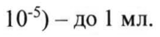

# Стерильные очищенные фильтраты фаголизатов бактерий Staphylococcus spp., Streptococcus spp., Proteus — наружно

- Препарат: Секстафаг® Пиобактериофаг поливалентный (раствор для приема внутрь, местного и наружного применения)
- АТХ: V03AX
- Источник: ОХЛП, Единый реестр ЛС ЕАЭС, запись 64e59cd2fb44f13b9518db74, документ от 2024-10-25
- Распознано автоматически (OCR): 10 из 10 стр.
- Сомнительных строк после OCR: 1 (см. раздел «Проверка распознавания»)

## Общие сведения

ЛП- #009876 -ГП-РУ ПОСЛЕДОВАТЕЛЬНОСТЬ 00 0 4
ОБЩАЯ ХАРАКТЕРИСТИКА ЛЕКАРСТВЕННОГО ПРЕПАРАТА

## 1. Наименование лекарственного препарата

Секстафаг Пиобактериофаг поливалентный, раствор для приема внутрь, местного и наружного применения.
Р .. м НИТРО ыы

## 2. Качественный и количественный состав

|

В 1 мл препарата содержится: ie BS Gm lore SPIRE
Действующее вещество. — Стерильные очищенные фильтраты фаголизатов бактерий Staphylococcus 5рр.,
Streptococcus spp., Proteus (P. vulgaris, P. mirabilis), Pseudomonas aeruginosa, Klebsiella pneumoniae, энтеропатогенных Escherichia coli (с активностью по Аппельману — He менее 10°) — до 1 мл.
Полный перечень вспомогательных веществ приведен в разделе 6.1.

## 3. Лекарственная форма

Раствор для приема внутрь, местного и наружного применения. |
Прозрачная жидкость желтого цвета различной интенсивности, возможен зеленоватый оттенок.

## 4. Клинические данные

## 4.1. Показания к применению

Препарат показан к применению у взрослых и детей с рождения.

Лечение и профилактика гнойно-воспалительных и энтеральных заболеваний, вызванных стафилококками, стрептококками, протеями, клебсиеллами, синегнойной и кишечной палочками:

-заболевания уха, горла, носа, дыхательных путей и легких — воспаления пазух носа, среднего уха, ангина, фарингит, ларингит, трахеит, бронхит, пневмония, плеврит;

-хирургические инфекции — нагноение ран, ожоги, абсцесс, флегмона, фурункулы, карбункулы, гидраденит, панариции, парапроктит, мастит, бурсит, остеомиелит;

-урогенитальные инфекции — уретрит, цистит, пиелонефрит, кольпит, эндометрит, сальпингоофорит;

-посттравматические конъюнктивиты, кератоконъюнктивиты, гнойные язвы роговицы и иридоциклиты;

-энтеральные инфекции — гастроэнтероколит, холецистит, дисбактериоз;

-генерализованные септические заболевания;
ЛП-#00 9826 -ГП-ВУ ПОСЛЕДОВАТЕЛЬНОСТЬ 0 0 4

-гнойно-воспалительные заболевания новорожденных — омфалит, пиодермия, ^ конъюнктивит, гастроэнтероколит, сепсис и др.;

-другие заболевания, вызванные бактериями стафилококков, стрептококков (в том числе энтерококков), протея, клебсиелл пневмонии, синегнойной и кишечной палочек.

При тяжелых проявлениях инфекций, вызванных стафилококками, стрептококками, протеем, клебсиеллой пневмонии, синегнойной и кишечной палочками, препарат назначается в составе комплексной терапии с другими препаратами.

С профилактической целью препарат используют для обработки операционных и свежеинфицированных ран, а также для профилактики внутрибольничных инфекций по эпидемическим показаниям.

Важным условием эффективной фаготерапии является предварительное определение фагочувствительности возбудителя.

## 4.2. Режим дозирования и способ применения

Способ применения

Перед использованием флакон с бактериофагом необходимо взболтать и просмотреть. Пренарат должен быть прозрачным и не содержать осадка.

Лечение гнойно-воспалительных заболеваний с локализованными поражениями должно проводиться одновременно как местно, так и приемом препарата внутрь в течение 7-20 дней (по клиническим показаниям). оо aaa ==

В зависимости от характера очага инфекции бактериофаг применяют:

1. Местно в виде орошения, примочек и тампонирования жидким фагом в количестве до 200 мл в зависимости от размеров пораженного участка. При абсцессах бактериофаг вводят в полость очага после удаления гноя с помощью пункции. Количество вводимого препарата должно быть несколько меньше объема удаленного гноя. При остеомиелите после соответствующей хирургической обработки в рану вливают бактериофаг по 10-20 мл.

2. Введение в полости — плевральную, суставную и другие ограниченные полости до
100 мл бактериофага, после чего оставляют капиллярный дренаж, через который в течение нескольких дней повторно вводят бактериофаг.

3. При циститах, пиелонефритах, уретритах препарат принимают внутрь. В случае, если полость мочевого пузыря или почечной лоханки дренированы, бактериофаг вводят через цистостому или нефростому 1-2 раза в день по 20-50 мл в мочевой пузырь и по 5-7 мл в почечную лоханку.

4. При гнойно-воспалительных гинекологических заболеваниях препарат вводят в полость вагины, матки в дозе 5-10 мл ежедневно однократно.

| ЛП-800 9826 -ГП-ВУ ПОСЛЕДОВАТЕЛЬНОСТЬ 04 9 &

5. При гнойно-воспалительных заболеваниях уха, горла, носа препарат вводят в дозе |
2-10 мл 1-3 раза в день. Бактериофаг используют для полоскания, промывания, закапывания, введения смоченных турунд (оставляя их на 1 час).

6. При конъюнкгивитах и кератоконъюнктивитах препарат закапывают по 2-3 капли .
4-5 раз в день, при гнойной язве роговицы — по 4-5 капель, при гнойных иридоциклитах | препарат применяют по 6-8 капель каждые 3 часа в сочетании с приемом внутрь.

7. При лечении стоматитов и хронических генерализованных пародонтитов препарат | используют в виде полосканий полости рта 3-4 раза в день в дозе 10-20 мл, а также введением в пародонтальные карманы турунд, пропитанных препаратом, на 5-10 минут.

8. При кишечных формах заболевания, заболеваниях внутренних органов, дисбактериозе бактериофаг применяют через рот и в виде клизм в течение 7-20 дней. Через рот бактериофаг дают 3 раза в сутки натощак за 1 час до еды. В виде клизм назначают 1 раз в день вместо одного приема через рот.

Режим дозирования

Рекомендуемые дозировки препарата

cm pom te О ООО

В случае, если до применения бактериофага для лечения ран применялись

химические антисептики, рана должна быть тщательно промыта стерильным 0,9 % раствором натрия хлорида.

Дети

Дети (до 6 месяцев). При сепсисе, энтероколите новорожденных, включая недоношенных детей, бактериофаг применяют в виде высоких клизм (через газоотводную трубку или катетер) 2-3 раза в сутки (см. табл.). При отсутствии рвоты и срыгивания возможно применение препарата через рот. В этом случае он смешивается с грудным молоком.
Возможно сочетание ректального (в клизмах) и перорального (через рот) применения препарата. Курс лечения 5-15 дней. При рецидивирующем течении заболевания возможно проведение повторных курсов лечения. С целью профилактики сепсиса и энтероколита

7 OS
ЛП-#009826-ГП-ВУ ПОСЛЕДОВАТЕЛЬНОСТЬ 0 040 & при внутриутробном инфицировании или опасности возникновения внутрибольничной инфекции у новорожденных детей бактериофаг применяют в виде клизм 2 раза в день в течение 5-7 дней.

При лечении омфалитов, пиодермий, инфицированных ран препарат применяют в виде аппликаций ежедневно двукратно (марлевую салфетку смачивают бактериофагом и накладывают на пупочную ранку или на пораженный участок кожи).

Если после лечения улучшения не наступает или симптомы усугубляются, или появляются новые симптомы, необходимо проконсультироваться с врачом. Применяйте препарат только согласно тем показаниям, тому способу применения и в тех дозах, которые указаны в инструкции.

## 4.3. Противопоказания

Гиперчувствительность к действующему веществу или к вспомогательному веществу, перечисленному в разделе 6.1.

## 4.4. Особые указания и меры предосторожности при применении

Важным условием эффективной фаготерапии является предварительное определение чувствительнести возбудителя к бактериофагу и раннее применение препарата.

Не пригоден к применению препарат во флаконах с нарушенной целостностью или маркировкой, при истекшем сроке годности, при помутнении.

Перед употреблением флакон с жидким бактериофагом необходимо взбалтывать. у
При помутнении препарат не применять!

Вследствие содержания в препарате питательной среды, в которой могут развиваться бактерии из окружающей среды, вызывая помутнение препарата, необходимо при вскрытии флакона соблюдать следующие правила:

-тщательно мыть руки;

-обработать колпачок спиртосодержащим раствором;

-снять колпачок, не открывая пробки;

-не класть пробку внутренней поверхностью на стол или другие предметы;

-не оставлять флакон открытым;

-вскрытый флакон хранить только в холодильнике.

При использовании малых доз (2-8 капель) препарат необходимо отбирать стерильным шприцем в объеме 0,5-1 мл.

Препарат из вскрытого флакона при соблюдении условий хранения, вышеперечисленных правил и отсутствии помутнения может быть использован в течение всего срока годности
(срока хранения).
ЛП-900 9826 -ГП-ВУ ПОСЛЕДОВАТЕЛЬНОСТЬ 0 050 4

## 4.5. Взаимодействие с другими лекарственными препаратами и другие виды взаимодействия

Применение препарата возможно в сочетании с другими лекарственными средствами, в том числе с антибиотиками.

## 4.6. Фертильность, беременность и лактация

Беременность Целесообразно применение препарата при беременности при наличии инфекций, вызванных фагочувствительными штаммами бактерий (по рекомендации врача).
Лактация Целесообразно применение препарата в период кормления грудью при наличии инфекций, вызванных фагочувствительными штаммами бактерий (по рекомендации врача).
Фертильность Нет данных о влиянии препарата на способность к воспроизведению здорового потомства
(фертильность) человека.
4.7.Влияние на. способность управлять-транспортными средствами и работать с механизмами :

| Преларат не оказывает влияния на способность к выполнению потенциально опасных видов деятельнести, требующих повышенной концентрации внимания и быстроты психомоторных реакций (в том числе, управление транспортными средствами, работа с движущимися механизмами, работа диспетчера и оператора).

## 4.8. Нежелательные реакции

Нежелательные реакции перечислены в соответствии с поражением органов и систем органов (классификацией MedDRA) и частотой встречаемости. Частота развития нежелательных реакций представлена в соответствии с рекомендациями Всемирной организации здравоохранения и включает следующие категории: очень часто (>1/10), часто (>1/100 и <1/10), нечасто (>1/1000 до <1/100), редко (>1/10000 и <1/1000), очень редко (<1/10000, включая отдельные случаи).

Нарушения со стороны иммунной системы.
Очень редко — аллергические реакции Сообщение о подозреваемых нежелательных реакциях.
Важно сообщать о подозреваемых нежелательных реакциях после регистрации лекарственного препарата с целью обеспечения непрерывного мониторинга соотношения
«польза-риск» лекарственного препарата. Медицинским работникам рекомендуется сообщать о любых подозреваемых нежелательных реакциях лекарственного препарата
ЛП-400 3828 -ГП-ВУ ПОСЛЕДОВАТЕЛЬНОСТЬ 8 0 9 4 через национальные системы сообщения о нежелательных реакциях государств - членов
Евразийского экономического союза.
Российская Федерация 109012, г. Москва, Славянская площадь, д. 4, crp.]
Федеральная служба по надзору в сфере здравоохранения (Росздравнадзор)
Телефон: +7 800 550-99-03 Электронная почта: pharm@roszdravnadzor.gov.ru
Адрес в интернете: https://roszdravnadzor.gov.ru
Республика Беларусь 220037, г. Минск, Товарищеский nep., д. 2a
УП «Центр экспертиз и испытаний в здравоохранении»
Телефон/факс отдела фармаконадзора: +375 (17) 242 00 29.
Электронная почта: repl@rceth.by, rceth@rceth.by https://www.rceth.by
Кыргызская Республика 720044, г. Бишкек, ул. 3-я Линия, 25
Департамент лекарственных средств и медицинских изделий при Министерстве здравоохранения Кыргызской Республики
Телефон: 0800 800 26 26 Электронная почта: dlomt@pharm.kg
Адрес в интернете: http://www.pharm.kg

## 4.9. Передозировка

Случаи передозировки до настоящего времени не зарегистрированы.

## 5. Фармакологические свойства

5.1. — Фармакодинамические свойства Фармакотерапевтическая группа: прочие лечебные средства.
Код ATX. VO3AX Механизм действия Препарат обладает способностью специфически лизировать бактерии стафилококков, стрептококков (в том числе энтерококков), протея, клебсиелл пневмонии, синегнойной и кишечной палочек.
Фармакодинамические эффекты Исследование фармакодинамических свойств для бактериофагов не предусмотрено.
Клиническая эффективность и безопасность
Попадая в очаг воспаления, бактериофаги оказывают положительное влияние на иммунный статус. Под воздействием препарата Секстафаг Пиобактериофаг поливалентный, раствор для приема внутрь, местного и наружного применения происходит в первую очередь активация фагоцитоза, повышается активность
ЛП-&009826-ГП-ВУ ПОСЛЕДОВАТЕЛЬНОСТЬ 07 04 нейтрофилов и их метаболическая активность, что препятствует случаям рецидивов | инфекции и переходу острого воспалительного процесса в хронический.
При лечении острой дизентерии бактериофагом отмечено повышение клеточного иммунитета в большей степени, чем при лечении антибиотиками. Соответствие препарата бактериофагов современной этиологической структуре возбудителей достигается за счет их постоянной адаптации к циркулирующим штаммам путем обновления фаговых рас и производственных бактериальных штаммов.
Антимикробный эффект бактериофагов обусловлен внедрением фага в бактериальную клетку с последующим его размножением и лизисом инфицированной клетки. Вышедшие во внешнюю среду в результате лизиса бактериофаги повторно инфицируют и лизируют другие бактериальные клетки, действуя до полного уничтожения патогенных бактерий в очаге воспаления.
Бактериофаги высокоспецифичны при лечении бактериальных инфекций, не вызывают развития резистентности микроорганизмов, ДНК бактериофага встраивается в хромосому бактерии, вследствие чего бактериальная клетка начинает продуцировать сотни бактериофагов, поражающих бактерии до их полного уничтожения. ..
Бактериофаги проникают в очаг инфекции, за счет функции саморегуляции снижение количества пораженных ими бактерий приводит к быстрому удалению и самих бактериофагов из организма.
В исследованиях не описаны случаи нежелательных явлений или серьезных побочных эффектов применения бактериофагов.
Дети Применение препарата у детей возможно в соответствии со способом применения и режимом дозирования (см. раздел 4.2).

## 5.2. Фармакокинетические свойства

Абсорбция Механизм всасывания бактериофагов в желудочно-кишечном тракте до конца не изучен.
При состояниях, увеличивающих проницаемость кишечной стенки, биодоступность бактериофагов увеличивается. Наиболее вероятным механизмом всасывания фагов является трансцитоз — процесс, объединяющий эндоцитоз и экзоцитоз. При пероральном применении системная биодоступность может повышаться за счет их всасывания через слизистые, находящиеся выше желудка и даже дыхательные пути. Так, фаги были обнаружены в системном кровотоке после перорального приема при полном прекращении пассажа через желудок.
Распределение т ПП-#00 9826 -ГП-ВУ

ПОСЛЕДОВАТЕЛЬНОСТ р Антибактериальный эффект препаратов бактериофагов обусловлен внедрением re 6 ‘ dara в бактериальную клетку с последующим его размножением и лизисом инфицированной клетки. Вышедшие во внешнюю среду в результате лизиса бактериофаги повторно инфицируют и лизируют другие бактериальные клетки, действуя до полного уничтожения патогенных бактерий в очаге воспаления. Распределение и связывание с белками плазмы не играют роли в выполнении биологической функции препарата.
Метаболизм Препарат, введенный любым способом, поступает в общий ток крови, в крови не задерживается и адсорбируется тканями, аккумулируясь в первую очередь в лимфатических узлах, печени и селезенке.
Выведение Препарат выводится из организма через кишечник и почки. Скорость элиминации фагов может существенно меняться в разных физиологических состояниях. При воспалительном ответе скорость элиминации значительно увеличивается. Введение препарата вместе с чувствительным микроорганизмом существенно (в 10-1000 раз) увеличивает уровень жизнеспособных фагов в фекалиях. „В =приеутетвии бактерии-минвени...уревеньыеек == бактериофага может кратковременно повышаться, что приводит к лизису бактериальных клеток, а затем — к падению концентрации бактериофага. При отсутствии гомологичной бактерии, введенный перорально препарат, как правило, полнеетью-злиминируется-из-——— - организма в течение первых суток после приема.
5.3. Данные доклинической безопасности
По имеющимся данным доклинических исследований стандартных исследований токсичности особый вред для человека не выявлен.

## 6. Фармацевтические свойства

6.1. Перечень вспомогательных веществ
8-гидроксихинолина сульфат/ 8-гидроксихинолина сульфата моногидрат в пересчете на 8гидроксихинолина сульфат — 0,0001 г/мл (содержание расчетное).

## 6.2. Несовместимость

Данный лекарственный препарат не следует смешивать с другими лекарственными препаратами.

## 6.3. Срок годности (срок хранения)

2 года.
6.4. Особые меры предосторожности при хранении
Хранить при температуре от 2 до 8 °С в защищенном от света месте.
ЛП-#00 9825 -ГП “BY,
6.5. Характер и содержание первичной упаковки ПОСЛЕДОВАТЕЛЬНОСТЬ 0004
По 20 мл во флаконах стеклянных.
А. 4 или 10 флаконов по 20 мл в пачке из картона вместе с листком-вкладышем.
Б. 4 флакона по 20 мл во вкладыше фиксирующем из полимерных материалов.
1 вкладыш фиксирующий из полимерных материалов в пачке из картона вместе с листкомвкладышем.
6.6. Особые меры предосторожности при уничтожении использованного лекарственного препарата или отходов, полученных после применения лекарственного препарата и другие манипуляции с препаратом

## 6.4. Особые меры предосторожности при хранении

Весь оставшийся лекарственный препарат и отходы следует уничтожить в установленном порядке.

## 7. Держатель регистрационного удостоверения

Российская Федерация Акционерное общество «Научно-производственное объединение по медицинским иммунобиологическим препаратам «Микроген» (АО «НПО «Микроген»)
Адрес: 115088, г. Москва, ул. 1-я Дубровская, д. 15, стр. 2
Телефон: 8 (495) 710-37-87 Факс: 8 (495) 783-88-04
Адрес электронной почты: info@microgen.ru.
7.1. Адрес производства
Российская Федерация АО «НПО «Микроген»
614089, Пермский край, г. Пермь, ул. Братская, д. 177, тел. (342) 281-94-96.
7.2. Представитель держателя регистрационного удостоверения
Претензии потребителя направлять по адресу:
Российская Федерация Акционерное общество «Научно-производственное объединение по медицинским иммунобиологическим препаратам «Микроген» (АО «НПО «Микроген»)
Адрес: 115088, г. Москва, ул. 1-я Дубровская, д. 15, стр. 2
Телефон: 8 (495) 710-37-87 Факс: 8 (495) 783-88-04 11-800 9826 -ГП-ВУ
ПОСЛЕДОВАТЕЛЬНОСТЬ 00 0 4 Адрес электронной почты: info@microgen.ru. .

## 8. Номер регистрационного удостоверения

## 9. Дата первичной регистрации

(ПОДТВЕРЖДЕНИЯ РЕГИСТРАЦИИ,

ПЕРЕРЕГИСТРАЦИИ)
Дата первой регистрации:
10. ДАТА ПЕРЕСМОТРА ТЕКСТА
Общая характеристика лекарственного препарата Секстафаг Пиобактериофаг поливалентный, раствор для приема внутрь, местного и наружного применения доступна на информационном портале Евразийского экономического союза в информационнокоммуникационной сети «Интернет» https://eec.eaeunion.org.
## Проверка распознавания

Страницы-сканы распознаны автоматически. В 1 строках с дозировками цифры могли распознаться с ошибкой — сверьте с вырезкой из оригинала:

- стр. 1: «10°) — до 1 мл.» — низкая уверенность: «10°)» (66)  
  
