# Сульфадимидин — внутрь

- Препарат: Сульфадимезин (таблетки;)
- АТХ: J01EB03
- Источник: ГРЛС, инструкция по медицинскому применению, РУ ЛП-000447, файл от 2024-09-02 (https://grls.rosminzdrav.ru/Grls_View_v2.aspx?routingGuid=0fdd13b4-1429-4e32-8784-33eeaebea6cc)
- Распознано автоматически (OCR): 3 из 3 стр.
- Инструкция к другому РУ того же препарата: ЛП-000447 (национальное РУ, переоформленное по правилам ЕАЭС, решение от 07.08.2024). Текст может быть старше действующего
- Сомнительных строк после OCR: 16 (см. раздел «Проверка распознавания»)

## Общие сведения

ats = oo i ЛП 000447-010311 » oe о : | ИНСТРУКЦИЯ © ‘ ae т
‘и. - по медицинскому применению препарата cot 7 СУЛЬФАДИМЕЗИН ,
^ Регистрационный номер: ‘ Торговое название; Сульфадимезин |
Международное непатентованное название: сульфадимидин

## 3. Лекарственная форма

таблетки Состав: на одну таблетку: . |
таблетки Состав: на одну таблетку: . |
Активное вещество: сульфадимидин (сульфадимезин) — 500 мг. é |
Вспомогательные вещества: крахмал картофельный, тальк, стеариновая кислота, полисорбат-80
(твин-80). | Описание: таблетки белого или белого со слегка желтоватым оттенком цвета, плоскоцилиндрические с фаской и риской.
Фармакотерапевтическая группа: Противомикробное средство, сульфаниламид.
Код ATX: JOLEB03 ; у _ @ P2PMaxonornueckue свойства a Противомикробное бактериостатическое средство, сульфаниламид. Механизм действия
‚.` . обусловлен конкурентным антагонизмом с пара-аминобензойной кислотой, угнетением
‘ . Дигидроптероатсинтазы, нарушением синтеза тетрагидрофолиевой кислоты, необходимой для синтеза пуринов и пиримидинов. Активен в отношении грамположительных и грамотрицательных
;кокков, Escherichia coli, Shigella spp., Klebsiella spp., Vibrio cholerae, Clostridium perfringens, Bacillus
| anthracis, Corynebacterium diphtheriae, Yersinia pestis, Chlamydia spp., Actinomyces israelii. —. ;
* ы § ial ‘ 1 ‘Фармакокинетика 7 oF > .. |
Абсорбция — быстрая (преимущественно в тонкой кишке). Связь с белками плазмы — 75-86%. |
Хорошо проникает.в ткани (в т.ч. легкие, ликвор). Метаболизируется в печени путем | ацетилирования. Период полувыведения (Т12) — 7 ч. Выводится почками путем клубочковой
; фильтрации. Ацетилированные метаболиты при концентрировании в моче могут выпадать в осадок. Растворимость метаболитов улучшается при защелачивании мочи.

## 4.1. Показания к применению

| "+ шфИнфекционно-воспалительные заболевания, вызванные чувствительными к препарату
| "+ шфИнфекционно-воспалительные заболевания, вызванные чувствительными к препарату
| Watucpoopranvamanu: тонзиллит, гайморит, средний отит, обострение хронического бронхита, |
` пневмония, воспалительные заболевания желчевыводящих и мочевыводящих путей, шигеллез, рожа, раневая инфекция.
| | Противопоказания Гиперчувствительность (в том числе к другим сульфаниламидам), угнетение костномозгового кроветворения, хроническая почечная недостаточность, азотемия, врожденный дефицит глюкозо-6-
| фосфатдегидрогеназы, порфирия, детский возраст до 3-х net, гипербилирубинемия у детей (риск
| развития билирубиновой энцефалопатии).
| С осторожностью Нациентам с нарушениями функции печени, с аллергическими заболеваниями в анамнезе.
| | Беременность и период лактации .
, _'° Препарат противопоказан к применению при беременности и в период лактации (грудного. + . te
„’’ `` вскармливания). `. met roe * a _ Se

## 4.2. Способ применения и дозы

| .) к ’, - Принимают внутрь. , . о
| .) к ’, - Принимают внутрь. , . о
, a Г о , . , к ". - ы re ‘ р . “.. te 7, so 2 cok i КА, АВ ‚ „ЛП 000447-010311°.-" 1! Lon Е (т: . р га и . x . ь a |
. ‘ , г ``, . | , , , , р ‚. ’’ Пневмония: для взрослых - на 1 прием назначают 2 г, затем по 1 г4-6 раз в ‘сутки, для детей старше 3-x лет - 0,1 г/кг на первый прием, затем по 0,1-0,15 г/кг/сут, разделенные на 4-6 приемов. Прием препарата прекращают через 2-3 дня после исчезновения симптомов заболевания.
Тонзиллит: для взрослых - по 1 r 2-3 раз в сутки; для детей старше 3-х лет — по 0,05-0,075 г/кг/сут, разделенные на 2-3 приемов. Длительность терапии: 5-7 дней. . |
Гайморит: для взрослых - по 1 г 4-6 раз в сутки; для детей старше 3-х лет — по 0,1-0,15 г/кг/сут, разделенные на 4-6 приемов. Длительность терапии: 7-10 дней. |
Средний отит: для взрослых - по 1г 2 раз в сутки; для детей старше 3-х лет — по 0,05-0,075 , г/кг/сут, разделенные на 2 приемов. Длительность терапии: 7-10 дней. ,
Обострение хронического бронхита: для взрослых - по 1 г 4-6 раз в сутки; для детей старше 3-х.
лет — по 0,1-0,15 г/кг/сут, разделенные на 4-6 приемов. Длительность терапии: 10-14 дней. °.
Воспалительные заболевания желчевыводящих и мочевыводящих путей: для взрослых -по 0.5 г 4-6 раз в сутки; для детей старше 3-х лет — по 0,05-0,075 г/кг/сут, разделенные на 4-6 приемов. |
Длительность терапии: 7-10 дней. . , .
Шигеллез: Проводят 2 курса лечения. И : ‘
_> ‚Первый курс: 1 и 2 день- по 1 гкаждые 4 ч (всего 6 г/сут), 3 и 4 день— по 1 г каждые 6 4 (4 г/сут), 5 и 6 день — 1 гкаждые 8 ч (3 г/сут). яна, | ucpes 5-6 дней проводят второй курс: 1 и 2 день — по 1 г каждые 4 4, ночью — через 8 ч (всего 5
. , ут) 3 и4 день — 1 гчерез 4 ч (4 г/сут, ночью не дают), 5 день — 3 г/сут. a .
‚.‘’” Рожа; для‘ взрослых -по 1 г 4-6 раз в сутки; для детей‘ старше 3-х лет — по 0,1-0,15 г/кг/сут, |
„ „разделенные на 4-6 приемов. Длительность терапии: 7-10 дней. . .° a eo ey?
‚ *.` Раневые инфекции: для взрослых — на 1 прием 2 г, затем по 1 г 4-6 раз в день; для детей старше 3-х ae “лет по 0,05-0,075 г/кг/сут, разделенные на 4-6 приемов. Длительность терапии при легкой форме- |
.- i 5-7 дней, при тяжелой форме — около 10 дней. ., ip - . “eR oe * , -
-’ ‚Высшие дозы: для взрослых: разовая - 2 г, суточная - 7 г; для детей старше 3-х лет: суточная — 0,1- 1 я `0,15 т/кг. ©, , о к nae р Побочное действие ., о о. . | |
‚ , Тошнота, рвота, кристаллурия, аллергические реакции, лейкопения, агранулоцитоз. _ ое os
’. Передозировка. в ; пи <. Данные по передозировке отсутствуют. ` вы | | ‘ 5
| Фзлимодействие с другими лекарственными средствами о
’ ‘ Снижает эффективность бактерицидных. антибиотиков, действующих только на делящиеся
Ps микроорганизмы (в т.ч. пенициллинов ий цефалоспоринов). . .
Ё Повышает (взаимно) гематотоксичность хлорамфеникола, тиамазола. .,
| Бензокаин, прокаин снижают противомикробную активность (при гидролизе высвобождают пара-
| аминобензойную кислоту). , | Аскорбиновая кислота, метенамин повышают риск развития кристаллурии. Нестероидные | противовоспалительные препараты, гипогликемические лекарственные средства (производные сульфонилмочевины), фенитоин и антикоагулянты кумаринового ряда усиливают выраженность побочных эффектов препарата (лейкопения, агранулоцитоз).
Антациды снижают всасывание в кишечнике.
При токсоплазмозе возможно сочетание с пириметамином.
Миелотоксичные лекарственные средства усиливают проявления гематотоксичности препарата. | 5 0 . a Ry А , 7 | “ у —
‚ ` Особые указания, ``, - ' И а ‘+, Во время лечения слёдует обеспечить адекватное потребление жидкости в связи с риском развития " oan у - При длительном применении необходим контроль показателей периферической крови.. = п in” да” . ots ag, ee att т ‘ wee a , ь ' ~ ` a , / “4 +
ЛП 000447-010311 Влияние на способность управления транспортными средствами
Не влияет на вождение автотранспорта и занятие потенциально опасными видами деятельности, требующими повышенной концентрации внимания и быстроты психомоторных реакций.

## 6.5. Форма выпуска

Таблетки 500 мг.
Таблетки 500 мг.
По 10 таблеток в контурную безъячейковую упаковку.
По 10 таблеток в контурную ячейковую упаковку.
2 контурные ячейковые упаковки с инструкцией по применению помещают в пачку из картона.
500 контурных безъячейковых упаковок вместе с инструкциями по применению помещают в коробку из картона (для стационаров).

## 6.4. Условия хранения

Хранить в сухом, защищенном от света месте, при температуре не выше 25 °С.
Хранить в сухом, защищенном от света месте, при температуре не выше 25 °С.
ое" в недоступном для детей месте.

## 6.3. Срок годности

5 лет По истечении срока годности препарат не применять.
5 лет По истечении срока годности препарат не применять.
Условия отпуска из аптек По рецепту.
Производитель ОАО «Ирбитский химико-фармацевтический завод»
623856, Свердловская обл., г. Ирбит, ул. Кирова, 172 |
Тел.: (343-55) 3-61-01; факс: (343-55) 3-60-73.
сийская 5 A: ont On re £2) oy 9 % Генеральный директор 2S 2 Л.А. Солодухина
ОАО «Ирбитский химико- Е =: Bin 26 @ papmanesriecknii завод» Bal 7 смз 5)
\ 4, =. ca Moe | \ 2. oN о & ми, › т * 5х хи POEL ENS
| | | | | МЗСР РФ - 5 >| —_ ЭКСПЕРТНЫЙ ОТЧЕТ =
Ч ДЕЙСТВИТЕЛЕН ДЛЯ ДАННОЙ | 8 ВЕРСИИ ДОКУМЕНТА = 20 0.0000 000 3
| 57229 |
## Проверка распознавания

Страницы-сканы распознаны автоматически. В 16 строках с дозировками цифры могли распознаться с ошибкой — сверьте с вырезкой из оригинала:

- стр. 1: «Активное вещество: сульфадимидин (сульфадимезин) — 500 мг. é |» — повторное чтение: «Активное вещество: сульфадимидин (сульфадимезин) — 500 м.»  
  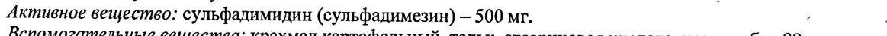
- стр. 1: «ацетилирования. Период полувыведения (Т12) — 7 ч. Выводится почками путем клубочковой» — низкая уверенность: «(Т12)» (60); повторное чтение: «ацетилирования. Период полувыведения (Tip) — 7 4, Выводится почками путем клубочковой»  
  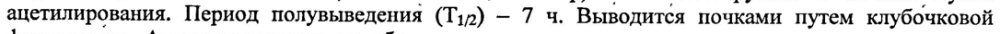
- стр. 2: «‚. ’’ Пневмония: для взрослых - на 1 прием назначают 2 г, затем по 1 г4-6 раз в ‘сутки, для детей старше» — повторное чтение: «.. `` Пневмония: для взрослых - на 1 прием назначают 2 г, затем по 1 г 4-6 раз в`сутки; для детей старше»  
  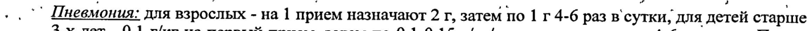
- стр. 2: «3-x лет - 0,1 г/кг на первый прием, затем по 0,1-0,15 г/кг/сут, разделенные на 4-6 приемов. Прием» — повторное чтение: «3-х. лет - 0,1 rr Ha первый прием, затем по 0,1-0,15 г/кг/сут, разделенные на 4-6 приемов. Прием»  
  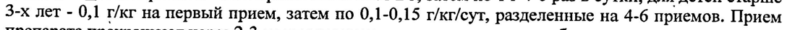
- стр. 2: «Тонзиллит: для взрослых - по 1 r 2-3 раз в сутки; для детей старше 3-х лет — по 0,05-0,075 г/кг/сут,» — повторное чтение: «Тонзиллит: для взрослых - по 1 г 2-3 раз в сутки; для детей старше 3-х лет — по 0,05-0,075 г/кг/сут,»  
  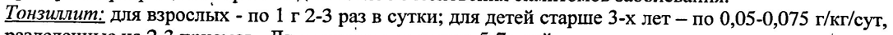
- стр. 2: «Гайморит: для взрослых - по 1 г 4-6 раз в сутки; для детей старше 3-х лет — по 0,1-0,15 г/кг/сут,» — повторное чтение: «Гайморит: для взрослых - по. 1 г 4-6 раз в сутки; для детей старше 3-х лет — по 0,1-0,15 r/xr/eyr,»  
  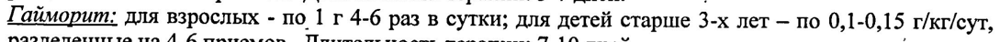
- стр. 2: «лет — по 0,1-0,15 г/кг/сут, разделенные на 4-6 приемов. Длительность терапии: 10-14 дней. °.» — повторное чтение: «лет — по 0,1-0,15 т/кг/сут, разделенные на 4-6 приемов. Длительность терапии: 10-14 дней. ``°.»  
  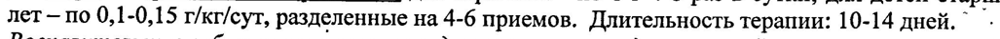
- стр. 2: «_> ‚Первый курс: 1 и 2 день- по 1 гкаждые 4 ч (всего 6 г/сут), 3 и 4 день— по 1 г каждые 6 4 (4 г/сут),» — повторное чтение: «(о, Первый курс: ! и2 день— по 1 гкаждые 4 ч (всего 6 г/сут), 3 u4 день— по 1 гкаждые 6 4 (4 г/сут),»  
  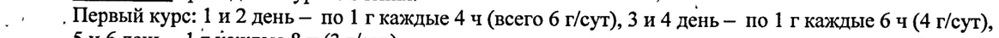
- стр. 2: «ucpes 5-6 дней проводят второй курс: 1 и 2 день — по 1 г каждые 4 4, ночью — через 8 ч (всего 5» — повторное чтение: «Фте:: 5-6 дней проводят второй курс: 1 и2 день — по Ir каждые 44, ночью _ через 8 ч (scero 5»  
  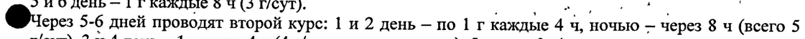
- стр. 2: «. , ут) 3 и4 день — 1 гчерез 4 ч (4 г/сут, ночью не дают), 5 день — 3 г/сут. a .» — низкая уверенность: «3» (0); повторное чтение: «; +, уп, 3 и4 день- 1 глерез 4 ч (4 г/сут, ночью не дают), 5 день-3 су. 0.»  
  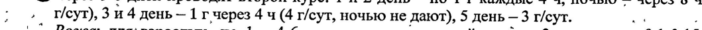
- стр. 2: «‚.‘’” Рожа; для‘ взрослых -по 1 г 4-6 раз в сутки; для детей‘ старше 3-х лет — по 0,1-0,15 г/кг/сут, |» — повторное чтение: «‚. |” Рожа: для‘ взрослых -по 1 г 4-6 раз в сутки; для детей старше 3-х лет — по 0,1-0,15 r/xr/eyr, =»  
  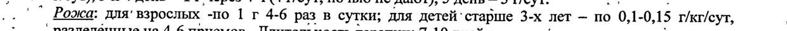
- стр. 2: «‚ *.` Раневые инфекции: для взрослых — на 1 прием 2 г, затем по 1 г 4-6 раз в день; для детей старше 3-х» — низкая уверенность: «1» (76)  
  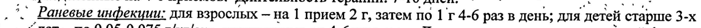
- стр. 2: «ae “лет по 0,05-0,075 г/кг/сут, разделенные на 4-6 приемов. Длительность терапии при легкой форме- |» — повторное чтение: «= р | “ лет ко 0,05-0,075 r/xr/eyr, разделенные на 4-6 приемов. "Длительность терапии при легкой форме- |»  
  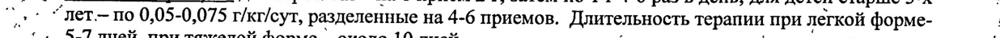
- стр. 2: «-’ ‚Высшие дозы: для взрослых: разовая - 2 г, суточная - 7 г; для детей старше 3-х лет: суточная — 0,1- 1» — низкая уверенность: «1» (54); повторное чтение: «- oy Высшие дозы: для взрослых: разовая -2r, суточная - 7г; ‘для детей старше 3-х лет: суточная _ 0,1- ;»  
  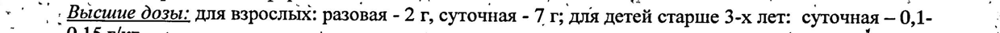
- стр. 3: «£2) oy 9 %» — низкая уверенность: «£2)» (31), «9» (34); повторное чтение: «»  
  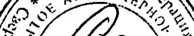
- стр. 3: «Генеральный директор 2S 2 Л.А. Солодухина» — низкая уверенность: «2S» (33), «2» (21); повторное чтение: «Генеральный директор fs of GP 4 Л.А. Солодухина»  
  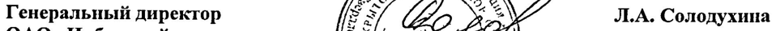
