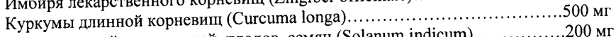
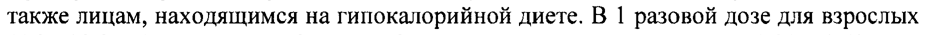

# Сухие экстракты, выделенные из: Адатоды васики листьев, корней, цветков, коры — внутрь

- Препарат: Доктор Мом® (сироп;)
- АТХ: R05CA10
- Источник: ГРЛС, инструкция по медицинскому применению, РУ П N015983/01, файл от 2023-09-29 (https://grls.rosminzdrav.ru/Grls_View_v2.aspx?routingGuid=95ea7de0-8ba2-4e02-bdfb-fbc287902ca6)
- Распознано автоматически (OCR): 3 из 3 стр.
- Инструкция к другому РУ того же препарата: П N015983/01 (национальное РУ, переоформленное по правилам ЕАЭС, решение от 15.09.2023). Текст может быть старше действующего
- Сомнительных строк после OCR: 2 (см. раздел «Проверка распознавания»)

## Общие сведения

ИИА П №01 5983/01-301 109 :
\ ИНСТРУКЦИЯ по медицинскому применению лекарственного препарата
® ДОКТОР МОМ Регистрационный номер:
Торговое название ® ДОКТОР МОМ ` Лекарственная форма
Сироп Состав на 100 мл сиропа:
Активные компоненты:
сухие экстракты, выделенные из:
Адатоды васики листьев, корней, цветков, коры (Adhatoda vasika)... ......600 мг
Алоэ барбадосского листьев, сока и мякоти (Aloe barbadensis)........+.+- ...500 мг
Базилика священного листьев, семян и корней (Ocimum sanctum)....... ...1000 мг
Девясила кистецветного корней (Inula гасетоза)...... еее ееннни ние ........200 мг
Имбиря лекарственного корневищ (Zingiber оЁйста[е)........ееенннеиии ..100 мг
Куркумы длинной корневищ (Сигсита 1опра)..... нь ееениннеининннннии ин: 900 МГ
Паслена индийского корней, плодов, семян (Solanum indicum)........+...+- ..200 мг
Перца кубебы плодов (Piper сыбефа)..... о илнинннииннииненнннннни ини 100 мг
Солодки голой корней (Glycyrrhiza Чата)... неииининеинеинннин 11600 мг
. Терминалии белерики плодов (Terminalia belerica)...... ccc veneeeceeeverteeseeenee20Q MP wo и Левоментол аа ланнииннинзнтинин линии ннинннни ни: OQ Mr вспомогательные вещества: сахароза, глицерол, лимонной кислоты моногидрат, натрия бензоат, метилпарагидроксибензоат натрия, пропилпарагидроксибензоат натрия, сорбиновая кислота, краситель ВО Супра (смесь красителей хинолинового желтого и бриллиантового голубого), ароматизатор ананасовый, вода очищенная.
Описание Сироп темно-зеленого цвета с запахом ананаса.
Фармакотерапевтическая группа Отхаркивающее средство растительного происхождения
Код ATX [В05СА10] Фармакологические свойства
Комбинированный препарат растительного происхождения; обладает бронхолитическим, муколитическим, отхаркивающим и противовоспалительным действием.
| 1 94301 П N015983/01-301109 i

\ Показания к применению Симптоматическая терапия острых и хронических заболеваний дыхательных путей, сопровождающихся сухим кашлем или кашлем с трудноотделяемой мокротой
(фарингит, ларингит, в том числе «лекторский», трахеит, бронхит).

## 4.3. Противопоказания

Повышенная чувствительность к компонентам препарата, детский возраст (до 3 лет).
Повышенная чувствительность к компонентам препарата, детский возраст (до 3 лет).
Применение препарата при беременности и лактации
В связи с отсутствием опыта применения у беременных и кормящих женщин назначение препарата данной группе не рекомендуется.

## 4.2. Способ применения и дозы

Детям: с 3 до 5 лет - по 1/2 чайной ложке (2,5 мл) 3 раза в день;
Детям: с 3 до 5 лет - по 1/2 чайной ложке (2,5 мл) 3 раза в день;

сб до 14 лет - по 1/2 - | чайной ложке (2,5 мл - 5,0 мл) 3 раза в день.
ow Взрослым и детям старше 14 лет:
по 5,0 - 10,0 мл 3 раза в день.

Курс лечения — 2 — 3 недели. Увеличение продолжительности и проведение повторных курсов лечения возможно по рекомендации врача.

## 4.8. Побочное действие

Возможны аллергические реакции
Возможны аллергические реакции

## 4.9. Передозировка

Сведения о передозировке препарата до настоящего времени не поступали.
Сведения о передозировке препарата до настоящего времени не поступали.

## 4.5. Взаимодействие с другими лекарственными средствами

Не рекомендуется одновременный прием с противокашлевыми препаратами в связи с возможностью нарушения отхождения разжиженной мокроты.

## 4.4. Особые указания

jw Препарат содержит сахар, что необходимо учитывать больным сахарным диабетом, a также лицам, находящимся на гипокалорийной диете. В 1 разовой дозе для взрослых
(5,0 - 10,0 мл) содержится 3,75 - 7,50 г сахарозы, что соответствует 0,31 - 0,62 XE.

## 6.5. Форма выпуска

Сироп. По 100 мл во флакон из темного стекла или во флакон из полиэтилентерефталата зеленого цвета, укупоренные алюминиевыми крышками с контролем первого вскрытия. Один флакон в комплекте с мерным стаканчиком из полипропилена (15 мл) и инструкцией по применению в картонную пачку.
Сироп. По 100 мл во флакон из темного стекла или во флакон из полиэтилентерефталата зеленого цвета, укупоренные алюминиевыми крышками с контролем первого вскрытия. Один флакон в комплекте с мерным стаканчиком из полипропилена (15 мл) и инструкцией по применению в картонную пачку.

## 6.4. Условия хранения

При температуре не выше 30 °С.
При температуре не выше 30 °С.
Хранить в местах, недоступных для детей.

## 6.3. Срок годности

5 лет.
5 лет.
Не использовать после истечения срока годности.

564307 II N015983/01-301109 by Условия отпуска из аптек
Без рецепта ® - товарный знак Производится фирмой
«Юник Фармасьютикал Лабораториз»
(Отделение фирмы «Дж.Б.Кемикалс энд Фармасьютикалс Лтд.»)
Ворли, Мумбай 400 030, Индия Представительство в России г. Москва 121059, ул. Брянская, д.5
Тел: (495) 662-18-11, Факс: (495) 662-18-12
Представитель фирмы — YH, — О.В. Некрасова wy 54301
## Проверка распознавания

Страницы-сканы распознаны автоматически. В 2 строках с дозировками цифры могли распознаться с ошибкой — сверьте с вырезкой из оригинала:

- стр. 1: «Куркумы длинной корневищ (Сигсита 1опра)..... нь ееениннеининннннии ин: 900 МГ» — низкая уверенность: «1опра).....» (11), «900» (0); повторное чтение: «Куркумы длинной корневищ (Curcuma ое)... 500 МГ»  
  
- стр. 2: «также лицам, находящимся на гипокалорийной диете. В 1 разовой дозе для взрослых» — повторное чтение: «также лицам, находящимся на гипокалорийной диете. Bl разовой дозе для взрослых»  
  
