# Талазопариб — внутрь

- Препарат: Талценна (капсулы;)
- АТХ: L01XK04
- Источник: ГРЛС, инструкция по медицинскому применению, РУ ЛП-006116, файл от 2021-09-21 (https://grls.rosminzdrav.ru/Grls_View_v2.aspx?routingGuid=b606c5c4-200e-450c-84dc-d312452f4db4)
- Распознано автоматически (OCR): 16 из 16 стр.
- Инструкция к другому РУ того же препарата: ЛП-006116 (срок действия истёк, решение от 30.08.2021). Текст может быть старше действующего
- Сомнительных строк после OCR: 11 (см. раздел «Проверка распознавания»)

## Общие сведения

МИНИСТЕРСТВО ЗДРАВООХРАНЕНИЯ РОССИЙСКОЙ ФЕДЕРАЦИИ
ИНСТРУКЦИЯ ПО МЕДИЦИНСКОМУ ПРИМЕНЕНИЮ ЛЕКАРСТВЕННОГО ПРЕПАРАТА
ТАЛЦЕННА МИНЗДРАВ POCCHH ЛП - 006116-280220

Регистрационный номер: СОГЛАСОВА HO

Торговое наименование: Талценна

Международное непатентованное или группировочное наименование: талазопариб

© Лекарственная форма: капсулы

## 2. Состав

СОСТАВ

Одна капсула содержит:

Действующее вещество: талазопариб в виде талазопариба тозилата 0,25 мг (0,363 мг)/

1 mr (1,453 мг)

Вспомогательные вещества: целлюлоза микрокристаллическая силифицированная 50
(Prosolv® 50) 33,855 mr/33.419 мг, целлюлоза микрокристаллическая силифицированная 90
(Ргозойу® 90) 50,782 mr/50,128 мг.

Состав капсулы:

w Дозировка 0,25 мг: корпус капсулы: гипромеллоза 22,344 мг, титана диоксид (E171) 0,456 мг; крышечка капсулы: гипромеллоза 14,894 мг, краситель железа оксид желтый (Е172)
0,015 мг, титана диоксид (Е171) 0,292 мг, чернила черные (TekPrint® SW-9008 Black) = 0,15 mr.

Дозировка 1 мг: корпус капсулы: гипромеллоза 22,344 мг, титана диоксид (E171) 0,456 мг;
крышечка капсулы: гипромеллоза 14,867 мг, краситель железа оксид красный (Е172) 0,067 мг, краситель железа оксид желтый (Е172) 0,064 мг, титана диоксид (Е171) 0,201 мг, чернила черные (TekPrint® SW-9008 Black) ~ 0,15 мг.
Состав чернил: шеллак 24-27 %, пропиленгликоль 3-7 %, аммиака раствор концентрированный 1-2 %, краситель железа оксид черный 24-28 %, калия гидроксид 0,05-0,1 %.

Описание Дозировка 0.25 мг: твердые непрозрачные капсулы размером 4, с крышечкой от белого с кремоватым оттенком до светло-желтого цвета и корпусом белого цвета, с надписями черного цвета «Pfizer» - на крышечке и «ТГ, 0.25» - на корпусе.
Содержимое капсулы — белый или почти белый с желтоватым оттенком порошок.
Дозировка 1 мг: твердые непрозрачные капсулы размером 4, с крышечкой от светлокрасного до темно-оранжевого цвета и корпусом белого цвета, с надписями черного цвета
«Pfizer» - на крышечке и «TLZ 1» - на корпусе.
Содержимое капсулы — белый или почти белый с желтоватым оттенком порошок.
Фармакотерапевтическая группа: противоопухолевое средство

& Код ATX: LOIXX Фармакологические свойства

## 5.1. Фармакодинамика

Механизм действия Талазопариб является мощным ингибитором ферментов семейства PARP — РАКР] и
Механизм действия Талазопариб является мощным ингибитором ферментов семейства PARP — РАКР] и
PARP2. Ферменты PARP участвуют в сигнальных путях клеточного ответа на повреждение ДНК, таких как репарация ДНК, транскрипция генов, регуляция клеточного цикла и гибель клетки. Ингибиторы PARP оказывают цитотоксическое действие на клетки опухоли посредством двух механизмов: ингибирование каталитической активности РАКР и формирование комплекса РАКР-ловушки, в результате чего белок PARP, связанный с

- ингибитором РАКР, не отсоединяется легко от места повреждения ДНК, препятствуя репарации, репликации и транскрипции ДНК и, в конечном счете, вызывая апоптоз и/или гибель клетки. Обработка линий опухолевых клеток с дефектами в генах репарации ДНК талазопарибом в качестве единственного средства вызывает повышение уровня YH2AX, который является маркером двухцепочечных разрывов ДНК, приводящих к снижению пролиферации клетки и усилению апоптоза. Противоопухолевая активность талазопариба также наблюдалась на полученной от пациентки ксенотрансплантатной модели рака молочной железы с наличием мутации гена BRCA, которая ранее получала терапию препаратами платины. На этой модели талазопариб снижал рост опухоли, а также повышал уровень YH2AX и апоптоз клеток опухоли.
Электрофизиология сердца

Влияние талазопариба на сердечную реполяризацию оценивали с помощью согласованных по времени электрокардиограмм (ЭКГ), изучая взаимоотношения между изменением интервала ОТ, скорректированного с учетом частоты сердечных сокращений
(QTc) от исходного уровня, и соответствующими концентрациями талазопариба в плазме крови у 37 пациентов с распространенными солидными опухолями. Талазопариб в максимальной клинически рекомендуемой дозе 1 мг один раз в сутки не оказывал клинически значимого влияния на удлинение интервала ОТс.

## 5.2. Фармакокинетика

Экспозиция талазопариба, как правило, увеличивалась пропорционально дозе в диапазоне от 0,025 мг до 2 мг после ежедневного приема нескольких доз. После многократного ежедневного приема 1мг талазопариба у пациентов среднее геометрическое [%
Экспозиция талазопариба, как правило, увеличивалась пропорционально дозе в диапазоне от 0,025 мг до 2 мг после ежедневного приема нескольких доз. После многократного ежедневного приема 1мг талазопариба у пациентов среднее геометрическое [%
© коэффициента вариации (KB%)| площади под кривой зависимости концентрации в плазме крови от времени (AUC) и максимальная концентрация талазопариба, наблюдаемая в плазме крови (Cmax) в равновесном состоянии, находились в диапазоне от 126 (107) нг*час/мл до 208 (37) нг*час/мл и от 11 (90) нимл до 19 (27) нг/мл, соответственно. После многократного ежедневного приема концентрации талазопариба в плазме крови достигали равновесного состояния в течение от 2 до 3 недель. Медиана коэффициента накопления талазопариба после многократного приема внутрь в дозе 1 мг один раз в сутки находилась в диапазоне от 2,3 до 5,2. Талазопариб является субстратом транспортеров P-gp и BCRP.
Всасывание После приема талазопариба внутрь медиана времени до достижения Cmax (Tmax)
© составляла, как правило, от | до 2 часов после приема препарата. Исследование абсолютной биодоступности у человека не проводилось. Однако на основании данных об экскреции через почки абсолютная биодоступность составляет по меньшей мере 41 % при этом всосавшаяся фракция составляет не менее 69 % (см. раздел «Выведение»). Значимого влияния средств, снижающих уровень кислотности, на талазопариб не ожидается, учитывая достаточную растворимость его при всех значениях рН от 1 до 6,8.
Влияние пищи Прием пищи снижал скорость, но не степень всасывания талазопариба. После приема однократной дозы талазопариба внутрь с высококалорийной пищей с высоким содержанием жиров (приблизительно 827 калорий, 57% жиров) средняя Cmax талазопариба снижалась приблизительно на 46 %, медиана Tmax была отсрочена с 1 часа до 4 часов, при этом АЧСиг не изменялась. Исходя из этих результатов, препарат Талценна можно принимать как с пищей, так и без нее.
Распределение Популяционный средний кажущийся объем распределения талазопариба (Vss/F) составлял 420 л. Invitro приблизительно 74% талазопариба связывается с белками плазмы независимо от концентрации в диапазоне концентраций от 0,01 мкМ до 1 мкМ.
Метаболизм Талазопариб у человека подвергается минимальному метаболизму в печени. После приема внутрь ['4C] талазопариба в однократной дозе 1 мг в плазме крови человека не выявлялось основных циркулирующих метаболитов, а талазопариб был единственным обнаруженным циркулирующим соединением, которое являлось производным препарата. В моче и фекалиях не было обнаружено ни одного метаболита, который отдельно составлял бы
© более 10 % введенной дозы.
In vitro талазопариб не являлся ингибитором цитохрома CYP1A2, CYP2B6, CYP2C8,
CYP2C9, CYP2C19, CYP2D6 или CYP3A4/5 или же индуктором CYP1A2, CYP2B6 или
CYP3A4 в клинически значимых концентрациях.
[и уЙго талазопариб в клинически значимых концентрациях не ингибировал ни один из основных мембранных транспортеров в кишечнике, печени или почках (P-gp, BCRP, транспортный полипептид органических анионов [ОАТР]1В1, OATP1B3, транспортер органических катионов [ОСТ]1 ОСТ2, транспортер органических анионов [OAT]1, ОАТЗ, помпа, экспортирующая желчные кислоты [bile salt export pump — BSEP], белок, обеспечивающий множественную лекарственную устойчивость и выведение токсинов
| [МАТЕП и МАТЕ?-К).

- Jn vitro талазопариб в клинически значимых концентрациях не ингибировал ни одну из основных изоформ уридиндифосфат-глюкуронозилтрансферазы (УГТ) (1АТ, 1A4, 1A6, 1A9, 2B7 и 2815).

Выведение Выведение талазопариба в неизмененном виде почками (пассивная фильтрация и активная секреция) является основным путем его элиминации. Вероятно, что P-gp участвует в активной почечной секреции талазопариба. Средний (+ стандартное отклонение)
конечный период полувыведения талазопариба из плазмы крови составлял 90 (+ 58) часов, а среднее популяционное значение кажущегося клиренса после перорального применения
(CL/F) у пациентов со злокачественными опухолями составляло 6,5 (31%) л/час. У 6 пациенток с распространенными солидными опухолями, получивших однократную дозу
['4C] талазопариба перорально, в среднем 69 % (+ 8,6 %) и 20 % (+ 5,5) от всей введенной радиоактивной дозы выводилось почками и через кишечник, соответственно. Выделение неизмененного талазопариба почками являлось основным путем выведения, составляя 55% от введенной дозы, тогда как количество неизмененного талазопариба, выделенного с через кишечник, составляло 14 %.
Возраст, пол и масса тела Популяционный анализ показал, что возраст, пол и масса тела не оказывали клинически значимого влияния на ФК талазопариба.
Пациенты детского возраста Фармакокинетику талазопариба у пациентов в возрасте < 18 лет не оценивали.
Нарушение функции почек По данным популяционного фармакокинетического анализа, в который было включено 490 пациентов, из которых у 132 пациентов имелось нарушение функции почек легкой
© степени (60 мл/мин < клиренс креатинина (КК) < 90 мл/мин), у 33 пациентов имелось нарушение функции почек средней степени (30 мл/мин < КК < 60 мл/мин), иу 1 пациента имелось нарушение функции почек тяжелой степени (КК < 30 мл/мин), CL/F талазопариба был снижен на 14 % и 37% у пациентов с нарушением функции почек легкой и средней степени, соответственно, в сравнении с пациентами с нормальной функцией почек (КК
> 90 мл/мин). Имеющихся данных недостаточно для оценки влияния нарушения функции почек тяжелой степени на CL/F талазопариба у данной популяции пациентов. ФК талазопариба не изучалась у пациентов, которым требовалось проведение гемодиализа.
Нарушение функции печени На основании результатов популяционного фармакокинетического анализа, включавшего 490 пациентов, из которых у 118 пациентов имелось нарушение функции печени легкой w степени (общий билирубин <1,0 х верхняя граница нормы (BIH) и аспартатаминотрансфераза (АСТ) > ВГН или общий билирубин от > 1,0 до 1,5 х ВГН при любом уровне АСТ). Нарушение функции печени легкой степени не оказывало влияния на
ФК талазопариба. ФК талазопариба у пациентов с нарушением функции печени средней степени (общий билирубин от > 1,5 до 3,0 х ВГН при любом уровне АСТ) или тяжелой степени (общий билирубин > 3,0 х ВГН при любом уровне АСТ) не исследовали.

## 4.1. Показания к применению

Препарат Талценна показан в качестве монотерапии для лечения взрослых пациентов с местнораспространенным или метастатическим НЕК?-негативным раком молочной железы с герминальными мутациями в генах BRCA, ранее получавших лечение антрациклинами и (или) таксанами в качестве неоадъювантной или адъювантной терапии или по поводу местнораспространенного или метастатического заболевания, за исключением случаев, когда пациенты не подходят для такого лечения (см. раздел
Препарат Талценна показан в качестве монотерапии для лечения взрослых пациентов с местнораспространенным или метастатическим НЕК?-негативным раком молочной железы с герминальными мутациями в генах BRCA, ранее получавших лечение антрациклинами и (или) таксанами в качестве неоадъювантной или адъювантной терапии или по поводу местнораспространенного или метастатического заболевания, за исключением случаев, когда пациенты не подходят для такого лечения (см. раздел
«Фармакологические свойства»). Пациенты с НК-положительным раком молочной железы в качестве предшествующего лечения должны получить эндокринную терапию или считаться неподходящими для эндокринной терапии.

## 4.3. Противопоказания

- повышенная чувствительность к действующему веществу или любому из вспомогательных веществ
- повышенная чувствительность к действующему веществу или любому из вспомогательных веществ
- нарушение функции печени средней и тяжелой степени;
- нарушение функции почек тяжелой степени;
- необходимость проведения гемодиализа;
& - дети и подростки в возрасте до 18 лет;

- беременность;
- период грудного вскармливания.

## 4.3. С осторожностью

Необходимо избегать одновременного применения сильных ингибиторов P-gp (включая, помимо прочего, амиодарон, карведилол, кларитромицин, кобицистат, дарунавир, дронедарон, эритромицин, индинавир, итраконазол, кетоконазол, лапатиниб, лопинавир, пропафенон, хинидин, ранолазин, ритонавир, саквинавир, телапревир, типранавир и верапамил), сильных индукторов P-gp, ингибиторов BCRP (включая, помимо прочего,
Необходимо избегать одновременного применения сильных ингибиторов P-gp (включая, помимо прочего, амиодарон, карведилол, кларитромицин, кобицистат, дарунавир, дронедарон, эритромицин, индинавир, итраконазол, кетоконазол, лапатиниб, лопинавир, пропафенон, хинидин, ранолазин, ритонавир, саквинавир, телапревир, типранавир и верапамил), сильных индукторов P-gp, ингибиторов BCRP (включая, помимо прочего,

куркумин и циклоспорин) во время терапии талазопарибом (см. раздел «Взаимодействие с

- другими лекарственными средствами»).

## 4.6. Применение при беременности и в период грудного вскармливания

Женщины с сохраненной репродуктивной функцией/контрацепция у мужчин и женщин
Женщинам с сохраненной репродуктивной функцией следует исключить беременность на момент начала терапии и избегать беременности во время терапии препаратом Талценна.
Тест на беременность следует выполнять всем женщинам с сохраненной репродуктивной функцией до начала лечения (см. раздел «Особые указания»).
Женщинам с сохраненной репродуктивной функцией требуется применение высокоэффективных методов контрацепции (см. раздел «Особые указания») до начала, во время и в течение, по меньшей мере, 7 месяцев после завершения терапии талазопарибом.
Поскольку применение гормональной контрацепции у пациенток с раком молочной железы не рекомендуется, следует использовать два негормональных и дополняющих друг друга метода контрацепции. Мужчинам, чьи партнерши способны к деторождению или беременны, следует использовать эффективные методы контрацепции (даже после вазэктомии) во время терапии препаратом Талценна и в течение не менее 4 месяцев после приема последней дозы препарата (см. раздел «Особые указания»).
Беременность Данные по применению препарата Талценна у беременных женщин отсутствуют.
Препарат Талценна может оказывать негативное влияние на плод при его применении у беременной женщины. Препарат Талценна не следует принимать во время беременности.
Его также не рекомендуется принимать женщинам с сохраненной репродуктивной функцией и не предохраняющимся от беременности (см. раздел «Особые указания»).
Период грудного вскармливания & Неизвестно, выделяется ли препарат Талценна в женское грудное молоко. Нельзя исключить риск для детей, находящихся на грудном вскармливании, и поэтому не рекомендуется проводить грудное вскармливание в период лечения препаратом
‚ Талценна и не менее чем в течение 1 месяца после получения последней дозы препарата.
Репродуктивная функция Данные о влиянии на репродуктивную функцию пациентов отсутствуют.

## 4.2. Способ применения и дозы

Лечение препаратом Талценна необходимо начинать и проводить под наблюдением врача, имеющего опыт в применении противоопухолевых лекарственных препаратов. Пациенты
Лечение препаратом Талценна необходимо начинать и проводить под наблюдением врача, имеющего опыт в применении противоопухолевых лекарственных препаратов. Пациенты
- для лечения рака молочной железы препаратом Талценна должны быть отобраны на основании подтверждённого наличия герминальных мутаций в генах BRCA, определенных с использованием валидированного метода в лаборатории, имеющей опыт проведения подобных исследований.
Пациенты с мутациями в генах ВКСА должны пройти генетическое консультирование в соответствии с локальными рекомендациями.
Режим дозирования Рекомендуемая доза препарата Талценна — 1 Mr внутрь один раз в сутки. Пациенты должны получать терапию до прогрессирования заболевания либо развития неприемлемой токсичности.
Пропуск дозы При развитии рвоты или пропуске дозы не следует принимать дополнительную дозу препарата, а принять следующую дозу в обычное для нее время.
Коррекция дозы Лечение некоторых нежелательных явлений может потребовать временного прекращения терапии или снижения дозы препарата в зависимости от тяжести реакций и клинической картины (таблица 2). Рекомендуемые уровни снижения дозы указаны в таблице 1.
Таблица 1. Коррекция дозы при явлениях токсичности
[| Уровеьдоы Рекомендуемая начальная 1 мг (одна капсула дозировкой 1 мг) один раз в сутки доза
Первое снижение дозы 0,75 мг (три капсулы дозировкой 0,25 мг) один раз в сутки
Второе снижение дозы 0,5 мг (две капсулы дозировкой 0,25 мг) один раз в
© сутки Третье снижение дозы 0,25 мг (одна капсула дозировкой 0,25 мг) один раз в сутки
Общий анализ крови следует выполнять до начала терапии препаратом Талценна и далее ежемесячно и по клиническим показаниям (см. таблицу 2 и раздел «Особые указания»).
Таблица 2. Коррекция дозы и режима лечения
Приостановить Возобновить лечение лечение препаратом Талценна препаратом
Талценна до увеличения показателей до [4 Гемоглобин < 8 г/дл > 9г/дл
Количество тромбоцитов > 75 000/мкл Возобновить терапию препаратом
< 50 000/мкл = Талценна с использованием
Количество нейтрофилов следующей более низкой дозы
> 1500/мкл < 1000/мкл Рассмотреть возможность
Негематологические 2 opencun возобновления лечения нежелательные реакции 3-4 — й препаратом Талценна В тяжести ы я степени тяжести следующей более низкой дозе или прекратить лечение полностью
Одновременная терапия ингибиторами Р-гликопротеина (P-gp)
Сильные ингибиторы P-gp могут привести к увеличению времени выведения талазопариба. Необходимо избегать одновременного применения сильных ингибиторов
P-gp во время терапии талазопарибом. Возможность одновременного применения следует рассматривать только после тщательной оценки потенциальной пользы и рисков. Если нельзя избежать одновременного назначения сильного ингибитора P-gp, дозу препарата
Талценна следует снизить до 0,75 мг один раз в сутки. Если одновременное применение сильного ингибитора прекращено, следует повысить дозу препарата Талценна (по истечении от 3 до 5 периодов полувыведения ингибитора) до дозы, которую пациент принимал до начала терапии сильным ингибитором Р-р (см. раздел «Взаимодействие с другими лекарственными средствами»).
Особые категории пациентов Нарушение функции печени
Для пациентов с нарушением функции печени легкой степени (общий билирубин
< 1х ВН и АСТ > BIH или общий билирубин от > 1,0 до 1,5 х ВГН при любом уровне
АСТ) коррекция дозы не требуется. Препарат Талценна не исследовали у пациентов с нарушением функции печени средней степени (общий билирубин от > 1,5 до 3,0 х ВГН

© при любом уровне АСТ) или тяжелой степени (общий билирубин > 3,0 x ВГН при любом уровне АСТ) (см. раздел «Фармакокинетика»).
Нарушение функции почек Пациентам с нарушением функции почек легкой степени (60 мл/мин < КК < 90 мл/мин)
коррекция дозы не требуется. Для пациентов с нарушением функции почек средней степени (30 мл/мин <КК < 60 мл/мин) рекомендуемая доза препарата Талценна составляет 0,75 мг один раз в сутки. Применение препарата Талценна у пациентов с тяжелым нарушением функции почек (КК <30 мл/мин) или пациентов, которым требуется проведение гемодиализа, не изучалось (см. раздел «Фармакокинетика»).
Препарат Талценна не рекомендуется применять у пациентов с тяжелым нарушением функции почек или у тех, которые нуждаются в проведении гемодиализа.

- Пациенты пожилого возраста
Для пациентов пожилого возраста (в возрасте > 65 лет) коррекция дозы не требуется (см.
раздел «Фармакокинетика»).
Пациенты детского возраста Безопасность и эффективность препарата Талценна у детей и подростков в возрасте
< 18 лет не установлена.

## 4.8. Побочное действие

Общий профиль безопасности препарата Талценна основан на оценке объединенных данных 494 пациентов, получавших талазопариб в дозе 1 мг в сутки в рамках клинических исследований по поводу солидных опухолей, включая 286 пациентов с местнораспространенным или метастатическим НЕК2-отрицательным раком молочной
Общий профиль безопасности препарата Талценна основан на оценке объединенных данных 494 пациентов, получавших талазопариб в дозе 1 мг в сутки в рамках клинических исследований по поводу солидных опухолей, включая 286 пациентов с местнораспространенным или метастатическим НЕК2-отрицательным раком молочной

Crp. 9 из 16 железы с наличием герминальных мутаций в генах ВКСА из рандомизированного исследования фазы 3 и 83 пациента с местнораспространенным или метастатическим раком молочной железы с наличием герминальных мутаций в генах ВКСА из нерандомизированного исследования фазы 2.
Наиболее частыми (>25 %) нежелательными реакциями у пациентов, получавших талазопариб в данных клинических исследованиях, являлись повышенная утомляемость
(57,1 %), анемия (49,6 %), тошнота (44,3 %), нейтропения (30,2 %), тромбоцитопения
(29,6 %) и головная боль (26,5 %). Наиболее частыми (> 10 %) нежелательными реакциями
> 3 степени являлись анемия (35,2 %), нейтропения (17,4 %) и тромбоцитопения (16,8 %).
Коррекция дозы (снижение дозы или временное прекращение приема препарата)
вследствие какой-либо нежелательной реакции потребовалась у 62,3 % пациентов, получавших препарат Талценна. Наиболее частыми нежелательными реакциями,
©. приводящими в коррекции дозы, являлись анемия (33,0 %), нейтропения (15,8 %) и тромбоцитопения (13,4 %).
Полная отмена терапии, связанная с развитием нежелательных реакций, потребовалась у 3,6 % пациентов, получавших препарат Талценна. Медиана продолжительности применения талазопариба составила 5,4 месяцев (диапазон 0,03—61,1).
Список нежелательных реакций в виде таблицы
В таблице 3 представлены нежелательные реакции, выявленные по результатам анализа объединенных наборов данных и сгруппированные в зависимости от системно-органного класса и частоты развития. Категории частоты определяются следующим образом: очень частые (> 1/10) и частые (от > 1/100 до < 1/10). В каждой категории частоты нежелательные реакции представлены в порядке снижения степени серьезности.
- Таблица 3. Нежелательные реакции, выявленные по результатам анализа объединенных наборов данных из 5 исследований (N=494
Системно-органный класс pe Все степени Степень Степень
Частота + Предпочтительный терман тяжести тяжести 3 тяжести 4 р п (% п (% п (%
Нарушения со стороны крови и лимфатической системы
Очень часто Тромбоцитопения“ 146 (29,6) 63 (12,8) 20 (4,0)
Анемия” 245 (49,6) 172 (34,8) 2 (0,4)
Нейтропения" 149 (30,2) 77 (15,6) 9 (1,8)
Лейкопения' 77 (15,6) 24 (4,9) 1 (0,2)
Часто Лимфопения^ 30 (6,1 13 (2,6 0 (0.0
Нарушения обмена веществ и питания Очень часто
Снижение аппетита 100 (20,2 2 (0,4 Нарушения со стороны нервной системы
Очень часто Головокружение 69 (14,0) 1 (0,2) HII
Головная боль 131 (26,5) 5 (1,0) НИ Часто
Дисгевзия 42 (8,5 0 (0,0 0 (0.0 Нарушения со стороны желудочнокишечного тракта
Очень часто Рвота 110 (22,3) 7 (1,4) 0 (0,0)
Диарея 112 (22,7) 3 (0,6) 0 (0,0)
Тошнота 219 (44,3) 4 (0,8) НИ Боль в животе* 105 (21,3) 8 (1,6) НИ
Часто Стоматит 32 (6,5) 0 (0,0) 0 (0,0)
Диспепсия 41 (8,3 0 (0,0 НИ Нарушения co стороны кожи и
= подкожных тканей Очень часто Алопеция* 110.223 НИ HII
Общие расстройства и нарушения в месте введения
Очень часто Повышенная утомляемость* 282 (57,1 17 (3.4 1 (0,2
Сокращения: п — число пациентов; НП — неприменимо,
* Нежелательные лекарственные реакции 5 степени отсутствовали.
а. Включает следующие предпочтительные термины: тромбоцитопения и снижение числа тромбоцитов.
6. Включает следующие предпочтительные термины: анемия, снижение гематокрита и снижение уровня гемоглобина.
в. Включает следующие предпочтительные термины: нейтропения и снижение числа нейтрофилов.
г. Включает следующие предпочтительные термины: лейкопения и снижение числа лейкоцитов.
A. Включает следующие предпочтительные термины: снижение числа лимфоцитов И лимфопения.
е. Включает следующие предпочтительные термины: больв животе, боль вверху живота, дискомфорт В животе и боль внизу живота.
ы е. Для талазопариба частота явлений степени тяжести | составляла 21 %, степени тяжести 2 — 2 %.
© з. Включает следующие предпочтительные термины: повышенная утомляемость и астения.
Описание отдельных нежелательных реакций
Миелосупрессия Нежелательные реакции, связанные с миелосупрессией, такие как анемия, нейтропения и тромбоцитопения, очень часто регистрировались у пациентов, получавших талазопариб в дозе 1 мг/сут. Явления 3 и 4 степени тяжести, связанные с миелосупрессией, были зарегистрированы со следующей частотой: анемия — 34,8 % и 0,4 % соответственно, нейтропения — 15,6 % и 1,8 % соответственно, тромбоцитопения — 12,8 % и 4,0% соответственно. О случаях смерти в связи с нежелательными реакциями, связанными с миелосупрессией, не сообщалось. В связи с развитием нежелательных явлений, связанных с миелосупрессией, коррекция дозы потребовалась примерно у 30% пациентов, получавших талазопариб в дозе 1 мг/сут, а полное прекращение терапии было отмечено у менее чем | % пациентов.

## 4.9. Передозировка

Специфическое лечение при передозировке талазопариба отсутствует, а симптомы передозировки не установлены. В случае передозировки лечение талазопарибом следует прекратить, а лечащий врач должен оценить необходимость промывания желудка и обеспечить проведение симптоматической терапии.
Специфическое лечение при передозировке талазопариба отсутствует, а симптомы передозировки не установлены. В случае передозировки лечение талазопарибом следует прекратить, а лечащий врач должен оценить необходимость промывания желудка и обеспечить проведение симптоматической терапии.

## 4.5. Взаимодействие с другими лекарственными средствами

Талазопариб является субстратом для трансмембранных транспортеров лекарственных препаратов P-gp и BCRP и выводится в основном посредством почечного клиренса в
© неизмененном виде.
Препараты, которые могут влиять на концентрацию талазопариба в плазме крови
Влияние ингибиторов P-gp Данные, полученные в рамках изучения взаимодействия лекарственных средств у пациентов с распространенными солидными опухолями, показали, что на фоне одновременного многократного ежедневного приема ингибитора P-gp итраконазола в дозе 100 мг два раза в сутки и однократного приема талазопариба в дозе 0,5 мг наблюдалось увеличение площади под кривой зависимости концентрации в плазме крови от времени
(AUCins) и максимальной концентрации (Cmax) талазопариба приблизительно на 56 % и 40 %, соответственно по сравнению с аналогичными значениями при однократном
| применении только талазопариба в дозе 0,5 мг. Популяционный фармакокинетический
- анализ показал, что одновременное применение сильных ингибиторов P-gp повышает экспозицию талазопариба на 45 % по сравнению с применением только талазопариба.
Одновременного применения сильных ингибиторов P-gp (включая, помимо прочего, амиодарон, карведилол, кларитромицин, кобицистат, дарунавир, дронедарон, эритромицин, индинавир, итраконазол, кетоконазол, лапатиниб, лопинавир, пропафенон, хинидин, ранолазин, ритонавир, саквинавир, телапревир, типранавир и верапамил)
следует избегать. Если совместного применения с сильными ингибиторами P-gp избежать невозможно, необходимо снизить дозу препарата Талценна (см. раздел «Способ применения и дозы»).
Влияние индукторов P-gp Данные, полученные в рамках изучения взаимодействия лекарственных средств у пациентов с распространенными солидными опухолями, показали, что на фоне одновременного многократного ежедневного приема индуктора P-gp рифампицина в дозе 600 мг и однократного приема талазопариба в дозе 1мг (пациенты принимали рифампицин за 30 минут до приема талазопариба в день его приема) наблюдалось увеличение Cmax талазопариба приблизительно на 37 %, тогда как значение AUCinr не изменялось по сравнению с таковым при применении одного талазопариба в дозе 1 мг.
Эти изменения, вероятно, являются следствием суммарного эффекта индуцирования и ингибирования P-gp рифампицином в условиях данного исследования по изучению взаимодействий между лекарственными средствами. При совместном применении с рифампицином коррекция дозы талазопариба не требуется. Однако, влияние других индукторов P-gp на воздействие талазопариба не изучено. Другие индукторы P-gp
(включая, помимо прочего, карбамазепин, фенитоин и зверобой пордырявленный) могут уменьшать воздействие талазопариба.

& Влияние ингибиторов BCRP Влияние ингибиторов BCRP на фармакокинетику талазопариба in vivo не изучалось. При совместном применении талазопариба с ингибиторами ВСКР может увеличиваться воздействие талазопариба. Следует избегать одновременного применения сильных ингибиторов BCRP (включая, помимо прочего, куркумин, циклоспорин). Если совместного применения сильных ингибиторов ВСКР избежать нельзя, пациентов следует наблюдать на предмет возможного увеличения частоты нежелательных реакций.
Влияние препаратов, снижающих уровень кислотности
Популяционный фармакокинетический анализ указывает, что одновременное применение лекарственных препаратов, снижающих уровень кислотности, включая ингибиторы протонной помпы (ИПП), антагонисты Н2 рецепторов гистамина (H2RA) или других

bw снижающих уровень кислотности препаратов, не оказывает значимого влияния на всасывание талазопариба.
Системная гормональная контрацепция Исследования взаимодействий талазопариба и пероральных контрацептивов He проводились.

## 4.4. Особые указания

Миелосупрессия У пациентов, получавших лечение талазопарибом, была зарегистрирована миелосупрессия, включающая анемию, лейкопению/нейтропению и/или тромбоцитопению (см. раздел «Побочные действия»). Не следует начинать лечение
Миелосупрессия У пациентов, получавших лечение талазопарибом, была зарегистрирована миелосупрессия, включающая анемию, лейкопению/нейтропению и/или тромбоцитопению (см. раздел «Побочные действия»). Не следует начинать лечение

талазопарибом до разрешения явлений гематологической токсичности (< 1 степени), вызванных проводимой ранее терапией.
Необходимо принять меры предосторожности и регулярно проводить мониторинг гематологических показателей, а также оценивать признаки и симптомы, связанные с анемией, лейкопенией/нейтропенией и/или тромбоцитопенией, у пациентов, получающих талазопариб. В случае их возникновения рекомендуется коррекция дозы (снижение или временное прекращение приема препарата) (см. раздел «Способ применения и дозы»).
Может потребоваться поддерживающая терапия, включающая или не включающая трансфузии крови и/или тромбоцитов и/или введение колониестимулирующих факторов.
Миелодиспластический синдром/острый миелобластный лейкоз
Случаи миелодиспластического синдрома/острого миелобластного лейкоза (МДС/ОМЛ)
регистрировали у пациентов, получавших ингибиторы поли-(аденозиндифосфат-рибоза)-
& полимеразы (PARP), включая талазопариб. В целом, МДС/ОМЛ был зарегистрирован у 2 из 584 (0,3 %) пациентов с солидными опухолями, получавших терапию талазопарибом в рамках клинических исследований. Потенциальные факторы, способствующие развитию
МДС/ОМЛ, включали предшествующую химиотерапию препаратами платины, другими повреждающими ДНК агентами или проведение лучевой терапии. Следует выполнять клинический анализ крови до начала лечения талазопарибом и далее ежемесячно во время лечения на предмет появления признаков гематологической токсичности. Если МДС/ОМЛ подтвержден, прием талазопариба следует прекратить.
Контрацепция у женщин с сохраненной репродуктивной функцией
Талазопариб проявлял кластогенный эффект в анализе на хромосомные аберрации in vitro
| в лимфоцитах периферической крови человека и в микроядерном тесте in vivo с
- использованием костного мозга крыс, но не проявлял мутагенных свойств в тесте Эймса, и может причинить вред плоду при применении беременной женщиной. Следует уведомить беременную женщину о потенциальном риске для плода (см.
раздел «Применение при беременности и в период грудного вскармливания»). Женщинам с сохраненной репродуктивной функцией следует исключить беременность на момент начала терапии и избегать беременности во время терапии препаратом Талценна. Тест на беременность следует выполнять всем женщинам с сохраненной репродуктивной функцией до начала лечения.
Женщинам с сохраненной репродуктивной функцией требуется применение высокоэффективных методов контрацепции (см. раздел «Особые указания») во время и в течение, по меньшей мере, 7 месяцев после завершения терапии талазопарибом.
Поскольку применение гормональной контрацепции у пациентов с раком молочной железы не рекомендуется, следует использовать два негормональных и дополняющих друг друга метода (см. раздел «Применение при беременности и в период грудного вскармливания»). Мужчинам, чьи партнерши способны к деторождению или беременны, следует рекомендовать использовать эффективные методы контрацепции (даже после вазэктомии) во время терапии препаратом Талценна и в течение не менее 4 месяцев после приема последней дозы препарата.

## 4.7. Влияние на способность управлять транспортными средствами, механизмами

&. Исследования по оценке влияния талазопариба на способность управлять автотранспортными средствами и работать с механизмами не проводились. Однако пациентам, которые при приеме талазопариба испытывают повышенную утомляемость/астению или головокружение, следует проявлять осторожность при управлении транспортными средствами и работе с механизмами.

## 6.5. Форма выпуска

Капсулы 0,25 мги 1 мг.
Капсулы 0,25 мги 1 мг.
По 30 капсул во флаконе из ПЭВП с полипропиленовой крышкой с термозапечатываемой мембраной.
| 1 флакон вместе с инструкцией по применению в картонной пачке с контролем первого
© вскрытия или без него.

## 6.4. Условия хранения

При температуре не выше 30 °С.
При температуре не выше 30 °С.
Хранить в местах, недоступных для детей Срок годности 2 года.
Не применять по истечении срока годности.
Условия отпуска Отпускают по рецепту Производитель
Эксцелла ГмбХ и Ко. КГ», Германия Адрес: Нюрнбергер Штрассе 12, 90537 Фойхт, Германия
Организация, принимающая претензии потребителей
ООО «Пфайзер Инновации»
123112 Москва, Пресненская наб., д. 10 БЦ «Башня на Набережной» (Блок С)
Телефон: + 7 (495) 287-5000 Факс: +7 (495) 287-5300/287-506

#) \p р Руководитель отдела рейибтрацай ий L № дуге 2 Осипова С.А.

: РЕГИСТРАЦИИ 8

МоскЕР. *.
©
## Проверка распознавания

Страницы-сканы распознаны автоматически. В 11 строках с дозировками цифры могли распознаться с ошибкой — сверьте с вырезкой из оригинала:

- стр. 1: «w Дозировка 0,25 мг: корпус капсулы: гипромеллоза 22,344 мг, титана диоксид (E171) 0,456» — низкая уверенность: «0,25» (74)  
  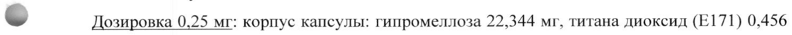
- стр. 3: «от 0,025 мг до 2 мг после ежедневного приема нескольких доз. После многократного» — низкая уверенность: «2» (20)  
  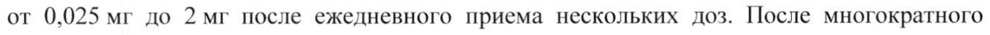
- стр. 3: «ежедневного приема 1мг талазопариба у пациентов среднее геометрическое [%» — низкая уверенность: «1мг» (72)  
  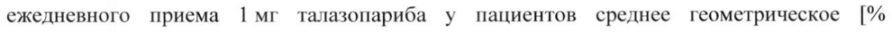
- стр. 4: «['4C] талазопариба перорально, в среднем 69 % (+ 8,6 %) и 20 % (+ 5,5) от всей введенной» — низкая уверенность: «['4C]» (55)  
  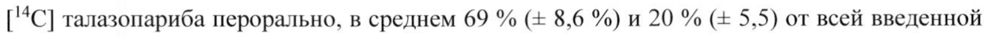
- стр. 8: «Рекомендуемая начальная 1 мг (одна капсула дозировкой 1 мг) один раз в сутки» — низкая уверенность: «1» (73)  
  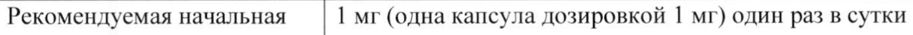
- стр. 8: «[4 Гемоглобин < 8 г/дл > 9г/дл» — низкая уверенность: «[4» (36), «9г/дл» (44); повторное чтение: «@ АЕ fle»  
  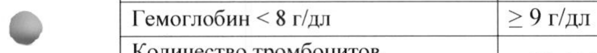
- стр. 9: «степени (30 мл/мин <КК < 60 мл/мин) рекомендуемая доза препарата Талценна» — низкая уверенность: «(30» (33), «60» (23)  
  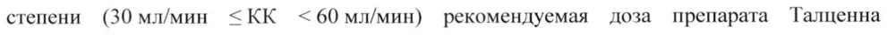
- стр. 9: «данных 494 пациентов, получавших талазопариб в дозе 1 мг в сутки в рамках клинических» — повторное чтение: «данных 494 пациентов, получавших талазопариб в дозе 1 мг в сутки в рамках клинических»  
  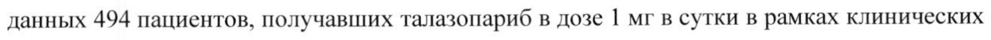
- стр. 10: «©. приводящими в коррекции дозы, являлись анемия (33,0 %), нейтропения (15,8 %) и» — повторное чтение: «© a в коррекции дозы, являлись анемия (33,0 %), нейтропения (158 %) и»  
  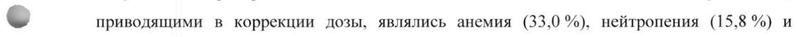
- стр. 11: «дозе 1 мг/сут. Явления 3 и 4 степени тяжести, связанные с миелосупрессией, были» — низкая уверенность: «1» (50)  
  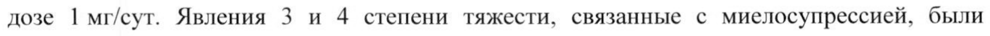
- стр. 13: «600 мг и однократного приема талазопариба в дозе 1мг (пациенты принимали» — низкая уверенность: «1мг» (70)  
  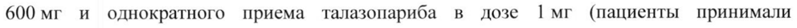
