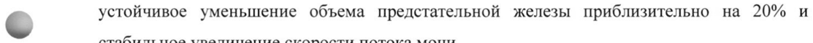
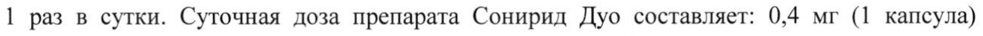
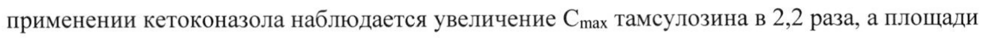
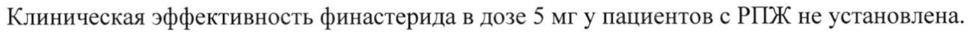
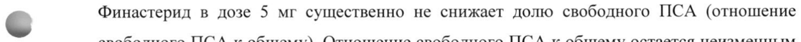

# Тамсулозина гидрохлорид и Финастерид — внутрь

- Препарат: Сонирид Дуо (таблеток и капсул набор;)
- АТХ: G04CA02
- Источник: ГРЛС, инструкция по медицинскому применению, РУ ЛП-001488, файл от 2021-04-15 (https://grls.rosminzdrav.ru/Grls_View_v2.aspx?routingGuid=db9ee171-3fe7-466d-ac9f-57eda1a17a4f)
- Распознано автоматически (OCR): 15 из 15 стр.
- Инструкция к другому РУ того же препарата: ЛП-001488 (срок действия истёк, решение от 30.08.2019). Текст может быть старше действующего
- Сомнительных строк после OCR: 5 (см. раздел «Проверка распознавания»)

## Общие сведения

—_—_—_—— | МИНЗДРАВ РОССИ ‚ A-OOL7ES-_ 300813
МИНИСТЕРСТВО ЗДРАВООХРАНЕНИЯ россииской ФЕДЕРА
СОГЛАСОВАНО ИНСТРУКЦИЯ ПО МЕДИЦИНСКОМУ ПРИМЕНЕНИЮ ЛЕКАРСТВЕННОГО
ПРЕПАРАТА Сонирид Дуо Регистрационный номер: ЛП-001488
Торговое наименование: Сонирид Дуо <. Группировочное наименование: тамсулозин + финастерид [набор]

## 3. Лекарственная форма

таблеток и капсул набор / в наборе: тамсулозин (капсулы с модифицированным высвобождением, 0,4 мг), финастерид (таблетки, покрытые пленочной оболочкой, 5 мг)
таблеток и капсул набор / в наборе: тамсулозин (капсулы с модифицированным высвобождением, 0,4 мг), финастерид (таблетки, покрытые пленочной оболочкой, 5 мг)

## 2. Состав

Тамсулозин 1 капсула содержит:
Тамсулозин 1 капсула содержит:
Действующее вещество: тамсулозина гидрохлорид - 0,4 мг.
Вспомогательные вещества: кальция стеарат; триэтилцитрат; тальк; сополимер метакриловой кислоты и этилакрилата (1:1), содержащий также полисорбат 80, натрия
- лаурилсульфат; целлюлоза микрокристаллическая (тип 101).
Состав твердой желатиновой капсулы:
Крышечка: краситель железа оксид желтый; титана диоксид; краситель железа оксид черный; краситель железа оксид красный; желатин.
Корпус: краситель железа оксид красный; краситель железа оксид черный; краситель железа оксид желтый; титана диоксид; желатин.
Финастерид 1 таблетка содержит:
Действующее вещество: финастерид - 5,0 мг.
Вспомогательные вещества: магния стеарат; тальк; карбоксиметилкрахмал натрия (тип A);
крахмал прежелатинизированный; целлюлоза микрокристаллическая (тип 101); лактозы моногидрат.
Состав оболочки: титана диоксид; лактозы моногидрат; макрогол 6000; гипролоза;

гипромеллоза.

Описание

Тамсулозин

Твердые желатиновые капсулы, размер №2; крышечка: непрозрачная, коричневого цвета;

корпус: непрозрачный, коричнево-желтого цвета.

Содержимое капсулы — пеллеты белого или почти белого цвета.

Финастерид

Белые или почти белые, слегка двояковыпуклые таблетки, покрытые пленочной оболочкой,

формы закругленного треугольника, почти без запаха. На одной стороне таблеток —
© гравировка «RG».

Фармакотерапевтическая группа: препараты для лечения доброкачественной

гипертрофии предстательной железы: альфа-1-адреноблокатор (тамсулозин) и 5-альфа-

редуктазы ингибитор (финастерид).

Код ATX: С04САО2 (тамсулозин), GO4CBO1 (финастерид).

Фармакологические свойства

## 5.1. Фармакодинамика

Тамсулозин

Тамсулозин избирательно и конкурентно блокирует постсинаптические альфа-1-
© адренорецепторы, находящиеся в гладкой мускулатуре предстательной железы, шейки

мочевого пузыря и простатической части уретры (подтип альфа-1А). Тамсулозин снижает

тонус гладкой мускулатуры уретры и предстательной железы, благодаря чему происходит

увеличение максимальной скорости потока мочи; при этом наблюдается облегчение

мочеиспускания и уменьшение симптомов, связанных с обструкцией и опорожнением

мочевого пузыря. Тамсулозин также значительно облегчает симптомы, связанные с

наполнением мочевого пузыря, обусловленные его нестабильностью.

Влияние на выраженность симптомов наполнения и опорожнения мочевого пузыря

сохраняется во время длительной терапии. Необходимость в оперативном вмешательстве

или катетеризации значительно уменьшается.

Альфа-1-адреноблокаторы могут снижать артериальное давление за счет уменьшения

периферического сосудистого сопротивления. Снижения артериального давления на фоне

применения тамсулозина не наблюдалось.

Финастерид Финастерид является конкурентным ингибитором 5-альфа-редуктазы II] типа — внутриклеточного фермента, который преобразует тестостерон в более активный андроген, дигидротестостерон (ДГТ). При доброкачественной гиперплазии предстательной железы
(ДГИЖ) ее увеличение зависит от превращения тестостерона в ДГТ в простате. Финастерид эффективно снижает концентрацию ДГТ как в сыворотке крови, так и в ткани предстательной железы. Финастерид не обладает сродством к рецепторам андрогенов.
При применении финастерида снижается частота развития острой задержки мочеиспускания у пациентов с умеренно или значительно выраженными симптомами
ДГИЖ, с увеличением предстательной железы (по данным пальцевого ректального исследования) и с низким объемом остаточной мочи мочевого пузыря. Наблюдалось
© устойчивое уменьшение объема предстательной железы приблизительно на 20% и стабильное увеличение скорости потока мочи.
Комбинированная терапия Препарат Сонирид Дуо предназначен для применения только при значительном увеличении предстательной железы (объем более 40 мл).
При таком увеличении предстательной железы комбинированная терапия эффективнее уменьшает симптомы ДГПЖ и замедляет клиническое прогрессирование заболевания, чем монотерапия финастеридом или альфа-1-адреноблокатором.

## 5.2. Фармакокинетика

Тамсулозин Всасывание © Тамсулозин всасывается в тонком кишечнике, биодоступность натощак практически полная. При приеме тамсулозина с пищей абсорбция его снижается. Для достижения одинакового всасывания препарат следует принимать ежедневно в дозе, указанной в инструкции, после завтрака. Кинетика линейная.
Тамсулозин Всасывание © Тамсулозин всасывается в тонком кишечнике, биодоступность натощак практически полная. При приеме тамсулозина с пищей абсорбция его снижается. Для достижения одинакового всасывания препарат следует принимать ежедневно в дозе, указанной в инструкции, после завтрака. Кинетика линейная.
Максимальная концентрация тамсулозина (Cmax) достигается приблизительно через 6 часов после приема внутрь после еды. После многократного приема равновесное состояние достигается к пятому дню, а Cmax B плазме крови приблизительно на 2/3 превышает Cmax после однократного приема. Несмотря на то, что эти данные получены у пациентов пожилого возраста, у молодых людей ожидаются сходные значения.
Межиндивидуальные различия концентрации тамсулозина в плазме крови возможны и при однократном, и при многократном приеме.
Распределение У мужчин приблизительно 99% тамсулозина связывается с белками плазмы; объем распределения небольшой (около 0,2 л/кг).
Метаболизм Тамсулозин метаболизируется медленно, эффект «первого прохождения» незначительный.
Большая часть тамсулозина представлена в плазме крови в неизмененном виде. Препарат метаболизируется в печени. Результаты исследований in vitro позволяют предположить, что в метаболизме тамсулозина участвуют изоферменты системы цитохрома Р450 — СУРЗА4, а также CYP2D6. У крыс выявлена способность тамсулозина незначительно индуцировать активность микросомальных ферментов печени.
Ни один из метаболитов не проявляет большей активности, чем тамсулозин.

| Выведение Тамсулозин и его метаболиты преимущественно выводятся почками, примерно 9% от принятой дозы препарата — в неизмененном виде. После однократного приема в дозе 0,4 мг, во время еды и в равновесном состоянии, период полувыведения из плазмы крови составляет от 10 до 13 часов.
Фармакокинетика у особых групп пациентов
При заболеваниях почек коррекция дозы не требуется.
Финастерид Всасывание Быстро всасывается из желудочно-кишечного тракта. Cmax в плазме крови достигается приблизительно через 2 часа после приема внутрь и в течение 6-8 часов всасывание

© полностью завершается. Биодоступность при приеме внутрь составляет приблизительно 80% от внутривенной референсной дозы и не зависит от приема пищи.
Распределение Связывание с белками плазмы крови — приблизительно 93%. Плазменный клиренс финастерида составляет 165 мл/мин, объем распределения — 76 л. Выявлено, что финастерид проникает через гематоэнцефалический барьер. В небольших количествах финастерид обнаруживается в семенной жидкости пациентов.
Метаболизм Известны два метаболита финастерида, обладающие слабой активностью в отношении 5-альфа-редуктазы П типа.
Выведение У мужчин после однократного приема внутрь финастерида, меченного С, 39% принятой дозы выводится почками в виде метаболитов (неизмененный финастерид практически не

выводится почками), 57% всей дозы выводится через кишечник. 2 известных метаболита финастерида обладают незначительным ингибирующим действием в отношении 5-альфаредуктазы П типа.
Фармакокинетика у особых групп пациентов
У пожилых пациентов финастерид выводится немного медленнее. У мужчин старше 70 лет
Ti2 удлиняется до 8 часов, тогда как у мужчин в возрасте от 18 до 60 лет период Ti?
составляет приблизительно 6 часов. Уменьшения дозы не требуется, так как данное различие не является клинически значимым.
У пациентов с хронической почечной недостаточностью (клиренс креатинина от 9 до 55 мл/мин) распределение меченного С финастерида при однократном приеме не отличалось от такового у здоровых добровольцев. Связывание с белками у пациентов с
© нарушением функции почек также не отличалось. Часть метаболитов, которые обычно выводятся почками, выводились через кишечник. Таким образом, при уменьшении выведения метаболитов почками наблюдается пропорциональное увеличение экскреции через кишечник. У пациентов с нарушением функции почек, не находящихся на гемодиализе, коррекции дозы не требуется.
Отсутствуют данные о применении препарата у пациентов с печеночной недостаточностью.

## 4.1. Показания к применению

Лечение и контроль симптомов доброкачественной гиперплазии предстательной железы.
Лечение и контроль симптомов доброкачественной гиперплазии предстательной железы.

## 4.3. Противопоказания

© - Гиперчувствительность к действующим или вспомогательным веществам в составе препарата, в том числе возникновение ангионевротического отека на фоне приема препарата.
© - Гиперчувствительность к действующим или вспомогательным веществам в составе препарата, в том числе возникновение ангионевротического отека на фоне приема препарата.
- Применение у женщин.
- Наличие ортостатической гипотензии в анамнезе.
- Печеночная недостаточность тяжелой степени.
- Возраст до 18 лет (в связи с отсутствием данных по эффективности и безопасности применения препарата в данной популяции).
- Непереносимость лактозы, дефицит лактазы или синдром глюкозо-галактозной мальабсорбции.

## 4.3. С осторожностью

- У пациентов с терминальной стадией почечной недостаточности (клиренс креатинина <10 мл/мин).
- У пациентов с терминальной стадией почечной недостаточности (клиренс креатинина <10 мл/мин).
- У пожилых пациентов.
- У пациентов с печеночной недостаточностью легкой и средней степени тяжести.
- При планируемом оперативном лечении катаракты.

## 4.6. Применение при беременности и в период грудного вскармливания

Применение препарата Сонирид Дуо у женщин не показано. Беременным и женщинам репродуктивного возраста следует избегать контакта с измельченными или потерявшими целостность таблетками финастерида, а также следует избегать контакта с семенной жидкостью мужчины, принимающего финастерид (использовать презерватив).
© Способ применения и дозы Комбинированный препарат Сонирид Дуо содержит 2 препарата: капсулы тамсулозина в дозе 0,4 мг и таблетки финастерида в дозе 5,0 мг. Препараты следует принимать ежедневно, 1 раз в сутки. Суточная доза препарата Сонирид Дуо составляет: 0,4 мг (1 капсула)
препарата тамсулозина и 5,0 мг (1 таблетка) препарата финастерида.
Капсулу препарата тамсулозина необходимо принимать в одно и то же время суток, после завтрака или первого приема пищи. Капсулы следует глотать целиком, не разламывать и не разжевывать, так как это может нарушить замедленное высвобождение действующего вещества.
Таблетку финастерида принимают независимо от приема пищи. Таблетку следует проглатывать целиком, не разламывая.
© Для максимального терапевтического эффекта необходимо длительное применение препарата Сонирид Дуо. При появлении нежелательных реакций можно перевести пациента на монотерапию финастеридом, однако рекомендуется вернуться к комбинированному режиму при увеличении выраженности симптомов ДГИЖ.
Особые группы пациентов Пациенты с почечной недостаточностью
У пациентов с почечной недостаточностью коррекции дозы не требуется, однако следует соблюдать особую осторожность при лечении пациентов с терминальной стадией почечной недостаточности (клиренс креатинина <10 мл/мин), так как клинических данных о применении препарата у данной категории пациентов недостаточно.
Пациенты с печеночной недостаточностью У пациентов с печеночной недостаточностью легкой и средней степени тяжести коррекции дозы не требуется. При тяжелой печеночной недостаточности применение данного препарата противопоказано.
Пациенты пожилого возраста (старше 65 лет)
Коррекции дозы не требуется.

## 4.8. Побочное действие

Нежелательные реакции (НР) распределены по системно-органным классам в соответствии с Мед ОКА с указанием частоты их возникновения согласно рекомендациям ВОЗ:
Нежелательные реакции (НР) распределены по системно-органным классам в соответствии с Мед ОКА с указанием частоты их возникновения согласно рекомендациям ВОЗ:
Очень часто: 21/10 Часто: от 21/100 до <1/10
Нечасто: от 21/1000 до <1/100 Редко: от 21/10000 до <1/1000

© Очень редко: <1/10000 Частота неизвестна: недостаточно данных для оценки частоты развития.
При монотерапии препаратами тамсулозина и финастерида зарегистрированы следующие
НР:
Тамсулозин Нарушения со стороны нервной системы
Часто: головокружение.
Нечасто: головная боль.
Редко: обморок.
Нарушения со стороны органа зрения Частота неизвестна: нечеткость зрения, нарушения зрения.

© Нарушения со стороны сердца Нечасто: «ощущение сердцебиения».
Нарушения со стороны сосудов Нечасто: ортостатическая гипотензия.
Нарушения со стороны дыхательной системы, органов грудной клетки и средостения
Нечасто: ринит.
Частота неизвестна: носовое кровотечение.
Нарушения со стороны желудочно-кишечного тракта
Нечасто: запор, диарея, тошнота, рвота.
Частота неизвестна: сухость во рту.
Нарушения со стороны кожи и подкожных тканей
Нечасто: кожная сыпь, кожный зуд, крапивница.
Редко: ангионевротический отек.

Очень редко: синдром Стивенса-Джонсона.
Частота неизвестна: многоформная эритема, эксфолиативный дерматит.
Нарушения со стороны половых органов и молочной железы
Часто: нарушения эякуляции.
Очень редко: приапизм.
Частота неизвестна: ретроградная эякуляция, невозможность эякуляции.
Общие расстройства и нарушения в месте введения
Нечасто: астения.
Описаны случаи интраоперационной нестабильности радужной оболочки глаза (синдром узкого зрачка) при операции по поводу катаракты и глаукомы у пациентов, принимавших тамсулозин.

© Применение препарата в пострегистрационном периоде наблюдения: в дополнение к HP, описанным выше, при использовании тамсулозина наблюдались фибрилляция предсердий, аритмия, тахикардия и одышка. В связи с тем, что данные были получены методом спонтанных сообщений в период после регистрации, определение частоты и причинноследственной связи этих явлений с приемом тамсулозина представляется затруднительным.
Финастерид Среди нежелательных реакций наиболее часто наблюдались импотенция и снижение либидо. Данные НР возникают в начале терапии и исчезают в процессе лечения у большинства пациентов.
Частота нежелательных реакций, зарегистрированных во время пострегистрационного применения, не может быть определена, так как информация получена из спонтанных

© сообщений.
Нарушения со стороны иммунной системы Частота неизвестна: реакции гиперчувствительности, ангионевротический отек, включая отек губ, языка, гортани и лица.
Нарушения психики Часто: снижение либидо.
Частота неизвестна: депрессия, снижение либидо, которое может сохраняться после прекращения лечения.
Нарушения со стороны сердца Частота неизвестна: ощущение сердцебиения.
Нарушения со стороны печени и желчевыводящих путей
Частота неизвестна: повышение активности «печеночных» трансаминаз.

Нарушения со стороны кожи и подкожных тканей
Нечасто: кожная сыпь.
Частота неизвестна: зуд, крапивница.
Нарушения со стороны половых органов и молочной железы
Часто: импотенция.
Нечасто: нарушение эякуляции, увеличение грудных желез, болезненность грудных желез.
Частота неизвестна: болезненность яичек, сексуальная дисфункция (эректильная дисфункция и нарушения эякуляции), иногда сохраняющаяся после прекращения терапии, мужское бесплодие и/или снижение качества семенной жидкости. После отмены финастерида качество семенной жидкости нормализовалось или улучшалось.
Лабораторные и инструментальные данные

© Часто: уменьшение объема эякулята.
Кроме того, в ходе клинических исследований и во время пострегистрационного применения сообщалось о случаях возникновения рака грудной железы у мужчин.
При оценке концентрации простат-специфического антигена (ПСА) в сыворотке крови следует принимать во внимание снижение его концентрации у пациентов, принимающих финастерид.
НР при комбинированной терапии У пациентов, получающих комбинированное лечение (финастерид и альфа-1адреноблокатор), описаны такие же НР, возникающие с той же частотой, как при монотерапии финастеридом и альфа-1-адреноблокатором. Тем не менее, выявлены следующие исключения: эректильная дисфункция и нарушение эякуляции выявлялись

© чаще при комбинированном лечении, тогда как прогрессирование заболевания (включая усиление симптомов ДГИЖ или необходимость хирургического лечения) отмечались чаще при монотерапии.
Если любые из указанных в инструкции НР усугубляются, или Вы заметили любые другие НР, не указанные в инструкции, сообщите 06 этом лечащему врачу.

## 4.9. Передозировка

Случаи одновременной передозировки финастеридом и тамсулозином не описаны.
Случаи одновременной передозировки финастеридом и тамсулозином не описаны.
Передозировка тамсулозина может привести к развитию артериальной гипотензии, которая может привести к сердечно-сосудистым нарушениям. Для восстановления артериального давления и сердечного ритма пациента необходимо уложить на спину, при необходимости следует применить плазмозамещающие препараты и, в зависимости от состояния пациента,

вазопрессорные препараты. Рекомендуется контролировать функцию почек. Не показано

проведение диализа вследствие значительного связывания тамсулозина с белками плазмы.

Для уменьшения абсорбции препарата целесообразно вызвать рвоту. Промывание желудка

после приема большого количества препарата следует проводить вместе с назначением

активированного угля и осмотического слабительного (например, сульфата натрия).

Передозировка финастеридом: однократный прием 400 мг финастерида и многократный

прием в дозе до 80 мг/сут в течение 3 месяцев не выявили нежелательных реакций. При

передозировке специфического лечения не требуется.

## 4.5. Взаимодействие с другими лекарственными средствами

Тамсулозин не вступает в фармакокинетическое взаимодействие с финастеридом во время
© метаболизма в печени.

Взаимодействие тамсулозина с другими лекарственными средствами и другие виды

взаимодействия

Не обнаружено взаимодействия при одновременном применении тамсулозина и атенолола,

эналаприла, нифедипина или теофиллина. Совместное применение с циметидином может

вызвать повышение концентрации тамсулозина в плазме крови, в то время как фуросемид

вызывает ее снижение. Тем не менее, изменять дозу препарата не требуется, так как

концентрация тамсулозина остается в пределах нормы.

т vitro диазепам, пропранолол, трихлорметиазид, хлормадинон, амитриптилин,

диклофенак, глибенкламид, симвастатин и варфарин не изменяют содержание свободной

фракции тамсулозина в плазме человека. Также тамсулозин не изменяет содержание
© свободной фракции диазепама, пропранолола, трихлорметиазида и хлормадинона.

Диклофенак и варфарин могут повысить скорость выведения тамсулозина.

Тамсулозин следует применять с осторожностью в комбинации с умеренными

ингибиторами изофермента СУРЗА4 (например, эритромицин).

Тамсулозин не следует применять в комбинации с мощными ингибиторами изофермента

СУРЗА4 (например, кетоконазол) у медленных метаболизаторов CYP2D6.

При одновременном применении тамсулозина и мощных ингибиторов изофермента

СУРЗА4 может наблюдаться повышение экспозиции тамсулозина. При одновременном

применении кетоконазола наблюдается увеличение Cmax тамсулозина в 2,2 раза, а площади

под фармакокинетической кривой «концентрация-время» (AUC) - в 2,8 раз.

При одновременном применении тамсулозина и пароксетина — мощного ингибитора

изофермента CYP2D6 — наблюдается увеличение Cmax и AUC тамсулозина в 1,3 и 1,6 раз

соответственно; однако данное увеличение не является клинически значимым.

Существует вероятность развития артериальной гипотензии при одновременном применении тамсулозина с другими альфа-1-адреноблокаторами.
Взаимодействие финастерида с другими лекарственными средствами и другие виды взаимодействия
Клинически значимого лекарственного взаимодействия не выявлено. Финастерид метаболизируется преимущественно с участием изофермента СУРЗА4 системы цитохрома
Р450, не оказывая значимого влияния на функцию этой системы. Хотя риск влияния финастерида на фармакокинетику других лекарственных средств оценивается как невысокий, существует вероятность того, что ингибиторы или индукторы изофермента
СУРЗА4 будут оказывать воздействие на концентрацию финастерида в плазме крови.
Однако с учетом имеющихся данных по безопасности маловероятно, что повышение
© концентрации финастерида, возникающее при одновременном применении таких ингибиторов, будет иметь клиническое значение.
В ходе исследований применения финастерида с пропранололом, дигоксином, глибенкламидом, варфарином, теофиллином и феназоном, клинически значимого взаимодействия выявлено не было.

## 4.4. Особые указания

Перед началом терапии с применением препарата Сонирид Дуо необходимо обследовать пациента для исключения других заболеваний, для которых характерны симптомы, напоминающие проявления ДГИЖ. Перед началом лечения и регулярно во время терапии необходимо проводить пальцевое ректальное обследование предстательной железы, при
Перед началом терапии с применением препарата Сонирид Дуо необходимо обследовать пациента для исключения других заболеваний, для которых характерны симптомы, напоминающие проявления ДГИЖ. Перед началом лечения и регулярно во время терапии необходимо проводить пальцевое ректальное обследование предстательной железы, при
© необходимости — определение ПСА.
Меры предосторожности при применении тамсулозина:
Как и при применении других блокаторов альфа-1-адренорецепторов, во время лечения тамсулозином может снижаться артериальное давление, что в редких случаях приводит к обмороку. При первых признаках ортостатической гипотензии (например, головокружение, слабость) следует усадить или уложить пациента до полного исчезновения симптомов.
При лечении пациентов с терминальной стадией почечной недостаточности (клиренс креатинина менее 10 мл/мин) следует соблюдать особую осторожность, так как применение тамсулозина у данной популяции пациентов не изучалось.
Во время проведения оперативного вмешательства по поводу катаракты или глаукомы у некоторых пациентов, принимавших тамсулозин (на момент операции или ранее), развивался интраоперационный синдром нестабильности радужной оболочки глаза
(разновидность синдрома узкого зрачка). При возникновении этого синдрома возрастает риск осложнений во время оперативного вмешательства и в послеоперационном периоде.
Не рекомендуется назначать тамсулозин пациентам, которым планируется оперативное вмешательство по поводу катаракты или глаукомы. Целесообразно отменить тамсулозин за 1-2 недели до оперативного вмешательства; однако польза и продолжительность отмены лечения тамсулозином перед операцией по поводу катаракты не определена. Известны случаи развития интраоперационного синдрома нестабильности радужной оболочки глаза у пациентов при отмене тамсулозина в более ранние сроки перед операцией. Во время предоперационного обследования оперирующий хирург и члены офтальмологической бригады должны учитывать, принимает ли пациент тамсулозин (или принимал ранее). Это необходимо для подготовки к возможному возникновению синдрома в ходе операции.
Тамсулозин следует использовать с осторожностью в комбинации с сильными и
© умеренными ингибиторами изофермента СУРЗА4.
Тамсулозин и активные ингибиторы изофермента СУРЗА4 (например, кетоконазол) не следует применять у медленных метаболизаторов изофермента CYP2D6.
Меры предосторожности при применении финастерида:
Общие Во избежание обструктивных осложнений необходимо тщательно наблюдать пациентов с большим объемом остаточной мочи и при резком снижении скорости потока мочи.
Необходимо оценить возможность оперативного вмешательства.
Влияние финастерида на ПСА и диагностику рака предстательной железы (РИЖ)
Клиническая эффективность финастерида в дозе 5 мг у пациентов с РПЖ не установлена.
Перед началом лечения финастеридом, а также во время последующей терапии,
© необходимо регулярно выполнять пальцевое ректальное обследование предстательной железы и другие тесты для исключения PIDK. Для диагностики РПЖ также используется определение ПСА в сыворотке крови. Как правило, при исходных значениях ПСА выше 10 нг/мл показано дальнейшее обследование и выполнение биопсии; если исходные значения ПСА составляют от 4 до 10 нг/мл, рекомендуется дополнительное обследование.
У мужчин значения ПСА могут варьировать в широком диапазоне, независимо от наличия
РПЖ. Таким образом, нормальные значения ПСА не позволяют исключить РПЖ у мужчин с ДГПЖ, независимо от лечения финастеридом в дозе 5 мг. При исходном значении ПСА ниже 4 нг/мл также нельзя исключить РИЖ.
У пациентов с ДГИЖ на фоне применения финастерида в дозе 5 мг концентрация ПСА в сыворотке крови снижается приблизительно на 50%, даже при наличии РПЖ. Данный факт необходимо учитывать при оценке показателя ПСА у пациентов с ДГИЖ, получающих лечение финастеридом, так как снижение концентрации ПСА не является основанием для исключения сопутствующего РПЖ. Снижение концентрации ПСА ожидаемо при любом диапазоне значений, однако существуют индивидуальные особенности. У пациентов, получающих финастерид в дозе 5 мг в течение 6 месяцев и дольше, полученное значение
ПСА необходимо удвоить, и только затем сравнивать его с нормальными показателями.
Использование данной коррекции позволяет сохранить чувствительность и специфичность исследования ПСА, и учитывать результат при диагностике PIDK.
При стойком увеличении концентрации ПСА у пациентов, получающих финастерид в дозе 5 мг, следует провести обследование. При этом нельзя исключать возможное нарушение пациентом режима терапии.
Влияние на результаты лабораторных исследований
Влияние на ПСА

© Концентрация ПСА в сыворотке крови коррелирует с возрастом пациента и с объемом предстательной железы, а объем предстательной железы коррелирует с возрастом пациента. При интерпретации результата лабораторного исследования ПСА необходимо учитывать, что у пациентов, получающих финастерид в дозе 5 мг, наблюдается снижение уровня ПСА. У большинства пациентов наблюдается быстрое снижение уровня ПСА в течение первых месяцев после начала лечения, затем его концентрация стабилизируется на новом уровне. Значение показателя ПСА после лечения приблизительно равно половине значения, которое было получено до начала терапии. Таким образом, у пациентов, получающих финастерид в дозе 5 мг в течение шести месяцев и дольше, полученное значение ПСА необходимо удвоить, и только затем сравнивать его с нормальными показателями.

© Финастерид в дозе 5 мг существенно не снижает долю свободного ПСА (отношение свободного ПСА к общему). Отношение свободного ПСА к общему остается неизменным даже на фоне приема финастерида в дозе 5 мг. При определении доли свободного ПСА для диагностики РПЖ коррекции значений не требуется.
Рак грудной железы у мужчин Во время клинических исследований и в пострегистрационном периоде были зарегистрированы случаи рака грудной железы у мужчин, принимающих финастерид в дозе 5 мг. Специалист должен предупредить пациента о необходимости немедленно сообщать о любых изменениях в грудных железах (уплотнение, боль, гинекомастия или выделения из соска).
Изменения настроения Изменения настроения, включая депрессию и суицидальные намерения, наблюдались у пациентов, принимающих финастерид в дозе 5 мг. Необходимо мониторировать появление

психопатологической симптоматики, при ее появлении следует направить пациента на консультацию к специалисту.
Печеночная недостаточность Исследования изменения фармакокинетики финастерида при печеночной недостаточности не проводились.

## 4.7. Влияние на способность управлять транспортными средствами, механизмами

Данные о влиянии финастерида на способность к управлению транспортными средствами и работу с механизмами отсутствуют.
О влиянии тамсулозина на способность управлять транспортными средствами и работать с механизмами не сообщалось. Однако пациенты должны учитывать, что при приеме
( препарата возможно появление головокружения.

## 6.5. Форма выпуска

Таблеток и капсул набор / в наборе: тамсулозин (капсулы с модифицированным высвобождением, 0,4 мг), финастерид (таблетки, покрытые пленочной оболочкой, 5 мг).
Таблеток и капсул набор / в наборе: тамсулозин (капсулы с модифицированным высвобождением, 0,4 мг), финастерид (таблетки, покрытые пленочной оболочкой, 5 мг).
По 5 таблеток, покрытых пленочной оболочкой, (финастерид) и 5 капсул с модифицированным высвобождением (тамсулозин) в блистер из IIBX/TIBJIX/AI.
По 6 блистеров в картонную пачку вместе с инструкцией по медицинскому применению.

## 6.4. Условия хранения

При температуре от 15 до 30 °С.
При температуре от 15 до 30 °С.
< Хранить в недоступном для детей месте.

## 6.3. Срок годности

3 года.
3 года.
Не применять по истечении срока годности, указанного на упаковке.
Условия отпуска Отпускают по рецепту.
Юридическое лицо, на имя которого выдано регистрационное удостоверение
ОАО «Гедеон Рихтер»
1103 Будапешт, ул. Дёмрёи, 19-21, Венгрия

Производитель Финастерид: ОАО «Гедеон Рихтер»
1103 Будапешт, ул. Дёмрёи, 19-21, Венгрия
Тамсулозин: Гедеон Рихтер Румыния A.O., 540306, Тыргу-Муреш, ул. Куза Водэ 99-105, Румыния
Упаковано / Выпускающий контроль качества:
ОАО «Гедеон Рихтер»
1103 Будапешт, ул. Дёмрёи, 19-21, Венгрия
Организация, принимающая претензии от потребителей:
Московское Представительство ОАО «Гедеон Рихтер»
119049 г. Москва, 4-й Добрынинский пер., дом 8
° Электронный адрес: drugsafety@g-richter.ru
Телефон: (495) 363-39-50 И .
РА _ м ON f = 7 Заместитель Директора Предстанительства = \: \ /
ОАО «Гедеон Рихтер» (Венгрия) P. Москва» é) Волович Н.В.
QO iS
## Проверка распознавания

Страницы-сканы распознаны автоматически. В 5 строках с дозировками цифры могли распознаться с ошибкой — сверьте с вырезкой из оригинала:

- стр. 3: «© устойчивое уменьшение объема предстательной железы приблизительно на 20% и» — повторное чтение: «4 LASERS SMES РЕКЕ рота oe anne moe»  
  
- стр. 6: «1 раз в сутки. Суточная доза препарата Сонирид Дуо составляет: 0,4 мг (1 капсула)» — низкая уверенность: «1» (80)  
  
- стр. 10: «применении кетоконазола наблюдается увеличение Cmax тамсулозина в 2,2 раза, а площади» — повторное чтение: «применении кетоконазола наблюдается увеличение Стах тамсулозина в 22 раза, а площади»  
  
- стр. 12: «Клиническая эффективность финастерида в дозе 5 мг у пациентов с РПЖ не установлена.» — повторное чтение: «Клиническая эффективность финастерида в дозе 5 мгу пациентов с РИЖ не установлена.»  
  
- стр. 13: «© Финастерид в дозе 5 мг существенно не снижает долю свободного ПСА (отношение» — повторное чтение: «Фо РИ в ло 3 мг существенно не снижает лолю свободного ПСА (отношение»  
  
