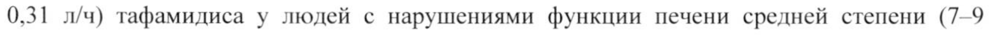

# Тафамидис меглюмин — внутрь

- Препарат: Виндакель (капсулы;)
- АТХ: N07XX08
- Источник: ГРЛС, инструкция по медицинскому применению, РУ ЛП-004181, файл от 2022-04-07 (https://grls.rosminzdrav.ru/Grls_View_v2.aspx?routingGuid=8cc2f37a-80f6-4819-b9ad-3edac02c7cc4)
- Распознано автоматически (OCR): 9 из 9 стр.
- Инструкция к другому РУ того же препарата: ЛП-004181 (срок действия истёк, решение от 11.03.2022). Текст может быть старше действующего
- Сомнительных строк после OCR: 1 (см. раздел «Проверка распознавания»)

## Общие сведения

| МИНИСТЕРСТВО ЗДРАВООХРАНЕНИЯ РОССИЙСКОЙ bE JEP ALL
AN- 004181 - 150317 OT TACOBAHO ИНСТРУКЦИЯ
По медицинскому применению лекарственного препарата
ВИНДАКЕЛЬ Регистрационный номер:
Торговое наименование: Виндакель Международное (непатентованное) наименование (МНН): тафамидис |
| Лекарственная форма: капсулы | Состав на 1 капсулу:
| действующее вещество:
тафамидис меглюмин 20,0 мг.
вспомогательные вещества:
| макрогол 400 481,0 мг, полисорбат 80 66,0 мг, сорбитана олеат 33,0 мг
| Состав желатиновой капсулы:
| L3DXHBAHR Желатин Прозрачный 366,6 мг (желатин (195 AH 8) 216,6 mr, сорбитола | специальная глицериновая смесь 150,0 мг), краситель железа оксид желтый 1,0 мг, титана диоксид 2,1 мг
Состав чернил «Opacode® (WB) NSP-78-10015»:
Этанол денатурированный 31,89%, аммиака раствор 28 % 1,00 %, изопропанол 9,40%, вода очищенная 11,60% , макрогол 400 2,70%, поливинилацетата фталат 13,31%, пропиленгликоль 25,90 %, кармин 4,15%, краситель бриллиантовый голубой 0,05%
| Описание Продолговатые, непрозрачные, желтые мягкие желатиновые капсулы с надписью красного цвета «VYN 20».
Содержимое капсулы -— от белого до розового цвета суспензия.
Фармакотерапевтическая группа: другие препараты для лечения заболеваний нервной системы
Код ATX: NO7XX08 i! 997565 Crp. | 439 АА АА АА п |
Фармакологические свойства МИНЗДРАВ РОССИИ

## 5.1. Фармакодинамика

ЛП- 004181 - 150317 Тафамидис является принципиально новым селективным стабилизатором, хранстиретина
ЛП- 004181 - 150317 Тафамидис является принципиально новым селективным стабилизатором, хранстиретина
(ТТ). Тафамидие с отрицательной кооперативностью связывается с ДВУМЯ _ тироксинсвязывающими участками ТТ в нативной (тетрамерной) форме, что предотвращает диссоциацию комплекса на мономеры и замедляет амилоидогенез.
Ингибирование диссоциации тетрамерных форм ТТ обосновывает целесообразность

| применения тафамидиса для замедления прогрессирования транстиретинового

амилоидоза — главным образом, семейной транстиретиновой амилоидной полинейропатии (ТТ-СТАП).

Анализ стабилизации ТТ использовался в качестве фармакодинамического маркера для оценки стабильности тетрамера ТТ в условиях денатурации.
Тафамидис стабилизировал как немутантный тип ТТ-тетрамера, так и тетрамеры 10 вариантов ТТ, в рамках клинических исследований, после ежедневного однократного применения тафамидиса в дозе 20 мг. Также тафамидис стабилизировал дополнительные 25 вариантов ТТ-тетрамера в исследованиях ex VIVO, в совокупности демонстрируя стабилизацию 36 амилоидогенных генотипов ТТ.
Было установлено, что такие параметры, как возраст, пол, расовая принадлежность, модифицируемый индекс массы тела, вариация гена ТТ, тяжесть и длительность заболевания не влияют на фармакодинамику тафамидиса.

Безопасность и эффективность тафамидиса в дозе 20 мг ежедневно оценивалась в ходе мультицентрового, рандомизированного, двойного слепого, плацебо контролируемого исследования с общим количеством пациентов 128. Через 18 месяцев лечения, группа | пациентов, принимавших тафамидис, продемонстрировала отсутствие прогрессии заболевания по сравнению с группой пациентов, принимавших плацебо. Также, в первой группе пациентов наблюдалось меньшее снижение общего качества жизни по сравнению с группой плацебо

## 5.2. Фармакокинетика

| Всасывание При однократном приеме тафамидиса в дозе 20 мг натощак максимальная концентрация в плазме крови (Cmax) достигалась спустя 1,75 4 (tmax — медиана времени достижения максимальной концентрации). Одновременный прием пищи снижал скорость, но не степень всасывания. Полученные результаты подтвердили возможность приема тафамидиса как совместно с пищей, так и независимо от приема пищи.
| Всасывание При однократном приеме тафамидиса в дозе 20 мг натощак максимальная концентрация в плазме крови (Cmax) достигалась спустя 1,75 4 (tmax — медиана времени достижения максимальной концентрации). Одновременный прием пищи снижал скорость, но не степень всасывания. Полученные результаты подтвердили возможность приема тафамидиса как совместно с пищей, так и независимо от приема пищи.

ay 99765 Стр. 2 u3 9 Г р = МИНЗДРАВ РОССИИ

Распределение ЛП- 004181 - 150317 Тафамидис очень хорошо связывается с белками (99,9 %) плазмы крови Цаблюдаемый равновесный объем распределения составляет 25,7 литра. УД
Активность связывания тафамидиса с белками плазмы крови была оценена в исследованиях с плазмой животных и человека. Сродство тафамидиса к ТТ в 1000 раз выше, чем к альбумину. Таким образом тафамидис преимущественно связывается с ТТ, несмотря на то, что концентрация альбумина в плазме крови (600 мкМ) значительно превышает концентрацию ТТ (3,6 мкМ).
Метаболизм и выведение Однозначные подтверждения того, что тафамидис выводится у человека с желчью, отсутствуют, однако на основании результатов доклинических исследований предполагается, что метаболизм тафамидиса протекает путем глюкуронирования с последующим выведением с желчью. Этот путь метаболизма и экскреции наиболее вероятен для человека, так как примерно 59 % от всей принятой дозы выводится через кишечник преимущественно в неизмененном виде и примерно 22 % выводится через почки, в основном в виде метаболита, образованного при глюкуронировании. При приеме тафамидиса в дозе 20 мг один раз в сутки в течение 14 дней, средний период полувыведения в равновесном состоянии у здоровых людей составлял 59 4, средний общий клиренс составлял 0,42 л/ч.
Линейность зависимости временных точек от дозы При применении тафамидиса в дозах 15, 30 или 60 мг 1 р/сут в течение 14 дней значения Cay и площади под кривой
«концентрация-время» (AUC) возрастали пропорционально дозе в диапазоне доз от 15 до 30 мги возрастали менее интенсивно, чем возрастала доза, в диапазоне доз от 30 до 60 мг.
После многократного приема тафамидиса в дозе 20 мг средний период полувыведения и клиренс при пероральном приеме были аналогичны показателям, зарегистрированным при однократном приеме, что свидетельствует об отсутствии индукции или ингибирования метаболизма тафамидиса .
Достижение равновесного состояния (5$) наблюдалось к 14 дню приема тафамидиса в дозе 20 мг 1 р/сут в течение 14 дней. Значения Сшах($$) и Сши($$) составляли 2,7 и 1,6 мкг/мл соответственно.
Применение в особых популяциях Пациенты пожилого возраста

a: 99265 Стр. 3 из9 ОВ МИНЗДРАВ РОССИИ По результатам популяционного фармакокинетического ane в дациентов, ыы 60 лет расчетный клиренс препарата в равновесном состоянии был в Sai Ha 19%
COT UAC | ниже, чем у пациентов младше 60 лет. Однако предполагается, что_чакое—озяичие-— клиренса не является клинически значимым и не способно вызывать клинически существенные отклонения концентрации тафамидиса в равновесном состоянии в сравнении с концентрацией у более молодых людей.
Пациенты с нарушением функции печени У пациентов с нарушением функции печени легкой или средней степени коррекция дозы препарата не требуется. Фармакокинетические данные указывали на снижение системной экспозиции (примерно на 40 %) и повышение общего клиренса (0,52 л/ч по сравнению с 0,31 л/ч) тафамидиса у людей с нарушениями функции печени средней степени (7-9
(включительно) баллов по шкале Чайлд-Пью) по сравнению со здоровыми людьми.
Поскольку концентрации ТТ у пациентов с нарушениями функции печени средней степени тяжести снижены по сравнению со здоровыми людьми, экспозиция тафамидиса, релевантная концентрации ТТ, будет достаточной для стабилизации тетрамера ТТ в этой группе пациентов. Экспозиция тафамидиса у пациентов с нарушениями функции печени легкой степени была аналогична экспозиции у здоровых людей.
Информация об экспозиции тафамидиса у пациентов с нарушениями функции печени тяжелой степени отсутствует.
|

Пациенты с нарушением функции почек Применение тафамидиса у пациентов с нарушениями функции почек специально не изучалось. Тафамидис преимущественно метаболизируется путем глюкуронирования и предположительно выводится по гепатобилиарному пути. Влияние клиренса креатинина
(КК) на фармакокинетику (ФК) тафамидиса было изучено в популяционном фармакокинетическом анализе у пациентов с КК > 30 мл/мин. При вычислении фармакокинетических показателей не было выявлено никаких различий клиренса тафамидиса в равновесном состоянии между пациентами с КК < 80 мл/мин и пациентами с КК > 80 мл/мин. У пациентов с нарушениями функции почек легкой или средней степени коррекция дозы препарата не требуется. Данные о применении препарата у пациентов с тяжелыми нарушениями функции почек (КК < 30 мл/мин) отсутствуют.

‘le 99265 Crp. 4 03 9 | a О a a ae ae a ee ee a a ee ee п МИНЗДРАВ РОССИИ оказания к применению
Виндакель показан для лечения транстиретинового амилоидоз с ИИ веки выраженной полинейропатией с целью задержки развития нарушенйй № пЕВифЕрических _
| HepBax.

## 4.3. Противопоказания

- гиперчувствительность к тафамидису или к любому вспомогательному веществу, входящему в состав препарата:
- гиперчувствительность к тафамидису или к любому вспомогательному веществу, входящему в состав препарата:
- беременность, период грудного вскармливания:
- врожденная непереносимость фруктозы;
- детский возраст до 18 лет.

## 4.3. С осторожностью

| Препарат Виндакель следует применять с осторожностью у пациентов с нарушением | функции печени тяжелой степени.
| Препарат Виндакель следует применять с осторожностью у пациентов с нарушением | функции печени тяжелой степени.

## 4.6. Применение при беременности и в период грудного вскармливания

Беременность Не рекомендуется применение тафамидиса в период беременности, а также у женщин с сохраненным детородным потенциалом, не использующих контрацептивы.
Женщины с сохраненным детородным потенциалом должны использовать надежные методы контрацепции в период лечения, а также в течение одного месяца после завершения лечения тафамидисом.
Информация об опыте применения тафамидиса в период беременности отсутствует.
Исследования на животных выявили репродуктивную токсичность препарата.
Потенциальный риск для человека неизвестен.
Период грудного вскармливания Влияние тафамидиса на детей, находящихся на грудном вскармливании у матерей, получающих терапию тафамидисом, не изучалось. Однако в доклинических исследованиях было установлено, что тафамидис проникает в молоко кормящих крыс. Не получено никаких клинических данных, которые бы свидетельствовали о проникновении | тафамидиса в женское грудное молоко. Поскольку многие лекарственные средства проникают в грудное молоко, нельзя исключить потенциальный риск для ребенка, находящегося на грудном вскармливании. Женщины, получающие тафамидис, не должны кормить грудью и давать грудное молоко детям.
LE 99765 Стр. 5 из 9 МИНЗДРАВ РОССИИ Фертильность AN- 004181 - 150317
Согласно результатам доклинических исследований, тафамйДИбА С А Н Фказывал
| отрицательного влияния на репродуктивную функцию и фертильность. И
| Способ применения и дозы Рекомендуемая доза препарата Виндакель составляет 20 мг, внутрь, 1 раз в сутки, независимо от приема пищи.
Капсулу следует принимать целиком. Не следует разжевывать, разламывть или разрезать капсулу.
| В случае пропуска дозы препарата, пациент должен принять пропущенную дозу сразу же после того, как вспомнит о пропуске. Однако если наступило время приема следующей дозы, принимать пропущенную дозу не следует; пациент должен принять следующую
1 дозу согласно обычному графику приема. He следует принимать двойную дозу.
Применение у детей Виндакель не должен применяться у детей, поскольку транстиретиновая амилоидная полинейропатия не встречается в этой группе пациентов.
Применение у пациентов пожилого возраста
Данные о применении препарата у пациентов пожилого возраста крайне ограничены. |
У пациентов пожилого возраста (в возрасте > 65 лет) коррекции дозы препарата не требуется.
Применение у пациентов с нарушением функции почек или печени
У пациентов с нарушениями функции почек или с нарушением функции печени легкой или средней степени коррекции дозы препарата не требуется.
Тафамидис не исследовался у пациентов с тяжелыми нарушениями функции печени, поэтому его следует применять с осторожностью в этой группе пациентов.

## 4.8. Побочное действие

ТТ-СТАП - это редкое заболевание.
ТТ-СТАП - это редкое заболевание.
Частота нежелательных реакций представлена по следующей классификации:
i 99765 Crp. 6 43 9 МИНЗДРАВ PQ } ЛИ - 004181 -
ОГЛАСОВАНО Со стороны пищеварительной системы: очень частые - диарея, боль в верхних отделах живота.
Инфекционные и паразитарные заболевания: очень частые — инфекция мочевыводящих путей, вагинальная инфекция.
| Передозировка Данные о случаях передозировки тафамидисом отсутствуют.
В клинических исследованиях у здоровых добровольцев максимальная доза тафамидиса составляла 480 мг однократно и 60 мг 1 р/сут ежедневно в течение двух недель. При применении препарата в указанных дозах не было зарегистрировано ни одной нежелательной реакции.

## 4.5. Взаимодействие с другими лекарственными средствами

В ходе клинического исследования среди здоровых добровольцев тафамидис не индуцировал и не ингибировал изофермент СУРЗА4. Исследования т vitro также показали, что тафамидис не оказывает значительного индуцирующего или ингибирующего воздействия на изоферменты CYPIA2, CYP3A4, CYP3A5, CYP2B6,
CYP2C8, CYP2C9, СУР2С19 и CYP2D6.
Согласно результатам исследований in vilro, маловероятно лекарственное взаимодействие тафамидиса в клинически значимых дозах с субстратами уридин-5-дифосфат глюкуронилтрансферазы (УДФ-ГТ), переносчиков Р-гликопротеина, переносчиков органических анионов (ОАТ] и ОАТЗ) или полипептидных переносчиков органических анионов (ОАТР1В] и ОАТР1ВЗ).
Тем не менее, в исследованиях т vitro тафамидис ингибирует эффлюксный переносчик белка резистентности рака молочной железы (ВСКР) и может увеличивать системную экспозицию субстратов этого переносчика (например, метотрексата, розувастатина и иматиниба).
Аналогичным образом тафамидис ингибирует активность переносчиков захвата ОАТ] и
ОАТЗ (переносчики органических анионов). При нахождении в организме в клинически значимых концентрациях он может взаимодействовать с субстратами этих переносчиков be 99265 Стр. 7 43 9
МИНЗДРАВ РОССИИ (например, с нестероидными противовоспалительными премаратами, с руотанидом, фуросемидом, — ламивудином, — метотрексатом, OCOTETEMERADOH, 7 тснофовиром,
| ганцикловиром, адефовиром, цидофовиром, зидовудином и зальцитабином). ня]
Исследования влияния других лекарственных препаратов на тафамидис не проводились.
При однократном приеме мидазолама (субстрата изофермента СУРЗА4) в дозе 7,5 мг до и после 14-дневного курса приема тафамидиса в дозе 20 мг | р/сут значительного влияния на фармакокинетику мидазолама или на образование его активного метаболита (1гидроксимидазолама) не наблюдалось. Общая системная экспозиция (AUCO-%) и общий клиренс (CL/F) мидазолама были эквивалентны до и после приема исследуемого препарата. Кроме того, тафамидис не индуцировал активность изофермента СУРЗА4 ни у мужчин, ни у женщин. |
| Особые указания Клинических исследований о применении тафамидиса у пациентов, перенесших трансплантацию печени, не проводилось. Эффективность и безопасность препарата
Виндакель у пациентов, перенесших трансплантацию печени, не установлена.
Влияние лекарственного препарата для медицинского применения на способность управлять транспортными средствами, механизмами
Исследований о влиянии тафамидиса на способность управлять автотранспортом не проводилось.

## 6.5. Форма выпуска

Капсулы 20 мг.
Капсулы 20 мг.
По 15 капсул в блистере ПВХ/ИХТФЭЛ1В Х/алюминиевой фольги.
2 соединенных вместе блистера по 15 капсул помещают в картонную пачку вместе с инструкцией по применению.
| Условия хранения | Хранить при температуре не выше 25 °С. |
Хранить в недоступном для детей месте.

## 6.3. Срок годности

18 месяцев.
18 месяцев.
Не применять препарат по истечении срока годности, указанного на упаковке.
he 99265 Crp. 8 из9 | НЕ МИНЗДРАВ РОССИИ 11 - 004181 - 150317
Условия отпуска СОГЛАСОВАНО

По рецепту. sonsuetistanteiemntiooera Юридическое лицо, на имя которого выдано регистрационное удостоверение
Пфайзер Инк., США 235 Ист 42-ая Стрит, Нью-Йорк, штат Нью-Йорк, 10017, США
Производитель Каталент Фарма Солюшиз ЭлЭлСи, США 2725, Шерер Драйв, Санкт-Петербург, 33716-1016, США
Выпускающий контроль качества Пенн Фармасьютикал Сервисез Лимитед, Соединенное Королевство
Блоки 23-24, Тафарнобак Индастриал Истейт, Тафарнобак, Тредегер, Гвент NP22 3AA,
Соединенное Королевство Претензии потребителей направлять по адресу ООО «Пфайзер»
123317 Москва, Пресненская наб., д. 10, БЦ «Башня на Набережной» (Блок С)
Телефон: + 7 (495) 287-5000 Факс: +7 (495) 287-5300/287-5067 В

H А Руководитель отдела регистрации |: САЙ Я | С.А.Осипова

\— ИЕ)

XY иг а er OA

[~ apo рии |>,[ ЭКСПЕРТНЫЙ отчет | & | У = —- ДЛЯ ДАННОЙ! cb |
| 7 васиндокументА | | | 0000000007 р in Al — Я 99765 Стр. 9 из9
## Проверка распознавания

Страницы-сканы распознаны автоматически. В 1 строках с дозировками цифры могли распознаться с ошибкой — сверьте с вырезкой из оригинала:

- стр. 4: «0,31 л/ч) тафамидиса у людей с нарушениями функции печени средней степени (7-9» — низкая уверенность: «0,31» (69)  
  
