# Тедизолида фосфат — парентерально

- Препарат: Тедизолид (лиофилизат для приготовления концентрата для приготовления раствора для инфузий;)
- АТХ: J01XX11
- Источник: ГРЛС, инструкция по медицинскому применению, РУ ЛП-008869, файл от 2025-01-23 (https://grls.rosminzdrav.ru/Grls_View_v2.aspx?routingGuid=179399e7-8e13-4307-b026-45d52db5558d)
- Распознано автоматически (OCR): 18 из 18 стр.
- Инструкция к другому РУ того же препарата: ЛП-008869 (национальное РУ, переоформленное по правилам ЕАЭС, решение от 15.01.2025). Текст может быть старше действующего
- Сомнительных строк после OCR: 12 (см. раздел «Проверка распознавания»)

## Общие сведения

МИНЗДРАВ РОССИИ | | ЛП -008869-15012 | _ СОТЛАСОВАНО | оо ОИ
МИНИСТЕРСТВО ЗДРАВООХРАНЕНИЯ РОССИЙСКОЙ ФЕДЕРАЦИИ
ИНСТРУЧЦИЯ | НО МЕДИПИНСКОМУ ПРИМЕНЕНИЮ ЛЕКАРСТВЕННОГО ПРЕНАРАТА
ТЕДИЗОЛИД Регистрационный номер:
Торговое наименование препарата: Гедизолид. |
Международное непатентованное или груинировочиое нанмепование;: гедизолид. .

## 3. Лекарственная форма

лиофилизат для приготовления концентрата для приготовления раствора для инфузий.
лиофилизат для приготовления концентрата для приготовления раствора для инфузий.

## 2. Состав

| Состав на один флакон:
| Состав на один флакон:
Активное вещество: тедизолила фосфат 200 мг.
= Вспомогательные geijecmea: маннитол 105,0 мг, натрия гидроксида раствор 5 М (до
‘= pH7,4-8,1), хлористоводородной кислоты раствор 0,1 М(до рЫ7,4-8,1).
ОПИСАНИЕ Цельная или раскрошенная масса от белого до почти белого цвета.
ФАРМАКОТЕРАПЕВТИЧЕСКАЯ ГРУППА Антибактериальные средства системного действия; другие антибактериальные средства.
Код ATX: ОТХХИ.
ФАРМАКОЛОГИЧЕСКИЕ СВОЙСТВА Фармакодинамика
Механизм действия Тедизолид (активный метаболит тедизолида фосфата) представляет собой антибиотик
Го класса оксазолидинонов с активностью преимущественно в отношении грамлоложительных микроорганизмов. В исследованиях СизИло показано бактериостатическсе действие тедизолида против таких видов микроорганизмов, как
Enterococcus spp., Staphylococcus spp. и Streptococcus spp. Антибактериальное действие тедизолида обусловлено связыванием с субъединицей 50S бактериальной рибосомы, что приводит к ингибированию синтеза белка. Тедизолид ингибирует синтез белка бактерий через механизм действия, отличный от такового для антибиотиков, не относящихся к классу оксазолидинонов, следовательно, перекрестная резистентность между тедизолидом и другими классами антибактериальных препаратов (пенициллины,
SBR a BE WE a I meer цефалоспорины, аминогликозиды, гликопептиды, липопептиды, стрептограмины, хинолоны, макоолилы и тетраичклини) изляется маловерсятной.
Механизм резистентности | Организмы, устойчивые к оксазолидинонам за счет мутаций генов хромосом,
' кодирующих 238 рибосомную РИХ или рибосомальные белки (L3 и L4), обычно имеют
| перекрестную резистентность к тедизолиду. Известно также, что появление тена
| хлорамфеникол-флорфениколовой резистентности (cfr-ren) формирует резистентность стафиллококков и энтерококков к оксазолидинонам, фениколам, линкозамидам,
| плевромутилинам, стрептограмину A, 16-членным макролидам. У ограниченного
| количества протестированных штаммов „Мариосоасив ameus наличие сЁ-гена не приводило к резистентности к тедизолиду в отсутствие хромосомных мутаций. Это
| связано © наличием гидроксильтой груптты в молскуле тедизолида на позиции C5.
| Спонтанные мутации, обусловливающие сниженную чувствительность к тедизолиду, - |
| возникают Invitro’ частотой приблизительно 107".
Результаты масштабного исследования 36573 клинических изолятов & ее, | протестированных в течение пятилетнего периода с 2015 по 2019 годы, | продемонстрировали отсутствие чувствительности к оксазолидинонам только у одного клинического изолята MRSA (метициллин-резистентный штамм). У данного изолята
& aureus было выявлено изменение G2576T во всех 6 аллелях 23$ рРНК, влияющее на связывание оксазолидинона и обуславливающее повышенные значения минимальных ингибирующих концентраций (МИК), наблюдаемые для тедизолида (8 мг/л) и линезолида (32 мг/л). Никаких новых механизмов резистентности в данном масштабном исследовании He наблюдалось. Все остальные изоляты SS ашеих ингибировались тедизолидом при значениях МИК < 0,5 мг/л.
Спектр антибактериальной активности Ниже перечислены патогенные микроорганизмы, чувствительные к тедизолиду й7уйго, в отношении которых в клинических исследованиях была показана эффективность тедизолида: |
- Аэробные и факультативные грамположительные бактерии | |
- Staphlococasavcs (включая метициллинрезистентные (MRSA) и | метициллинчувствительные (MSSA) штаммы);
— Streptococcus pyogenes (группа А бета-гемолитические стрептококки); |
ПИ | — Streptococcus agalactiae (группа В бета-гемолитические стрептококки); группа
Strortecoocius ЗИОЙЛОбЫб, BAAR SE HOCHOCHS CFOS,
Streptococcus thterrredius и Streptococcus corstellatus, |
— Dstevcoccus faecalis.
Клиническая эффективность тедизолида в отношении перечисленных ниже патогенных | микроорганизмов не была установлена, однако результаты исслелований Му | позполяют предполагать, что оии чувствительны к тедизолиду в отсутствие | приобретенных механизмов резистентности: |
Аэробные и факультативно анаэробные грамположительные бактерии: |
— Staplplococcus epidarnicis (включая метициллинрезистентные и метициллинчувствительные штаммы);
— Staplyiococas heemolyticus, fos — Staphylococcus ligchiensis,
- — E¥terococcus faecium
Тедизолид, как правило, неактивен в отношении грамотрицательных бактерий.
Граница чувствительности | Минимальная ингибирующая концентрация определена Европейским комитетом по определению чувствительности к антибиотикам (EUCAST) и приведена в таблице:
р:
Микроорганизмы бета-гемолитические <0,5 >0,5 стрептококки (А, В, С, G re группы)
Ги группа <0,25 >0,5 SREHOCOCCUS GOTHOSUS
Связь фармакокинетики и фармакодинамики На модели инфекции у животных было показано, что отношение значения площади под фармакокинетической кривой «концентрация-время» (AUC) к МИК коррелирует с активностью тедизолида.
БЕН ЕСЕНИН ИСИ ЕВЕ ВИНЕ ИЕ ИДЕИ же лис Фармакокинетика
Тедизолида фосфат авлястся искодным веществом, которое при помощи фосфатаз после внутривенного введения преобразуется в тедизолид, микробиологически активное вещество. Далее рассматривается только фармакокинетический профиль тедизолида, поскольку после внутривенного введения системиое воздействие тедизолида фосфата ничтожно мало. После многократного внутривенного применения один раз в сутки равновесные концентрации достигаются приблизительно в течение 3 дней при накоплении примерно 30 % тедизолида (период полувыведения тедизолида примерно 12 часов). Фармакокинетические параметры тедизолида после внутривенного применения 200 мг тедизолида фосфата один раз в сутки представлены в таблице:

; Однократный прием Равновесное состояние параметры тедизолнида"

| * С„« — максимальная концентрация; Tr — время достижения Cong AUC — площадь под фармакокинетической кривой «концентрация-время»; Ч —системный клиренс; CL/F —кажущийся общий клиренс 1 медиана (диапазон)
+ AUC представляет собой AUCo..(AUC от момента 0 до бесконечности) для однократного применения и
AUCo-24 (AUC от момента 0 до 24 часов) для многократного применения
Всасывание Максимальная концентрация тедизолида в плазме крови достигается в конце первого ae часа внутривенной инфузии тедизолида фосфата. |
Распределение Связь с белками крови составляет приблизительно от 70 % до 90 %а
Средний равновесный объем распределения тедизолида у здорового взрослого человека после однократного внутривенного введения 200 мг тедизолида фосфата варьировал от 67 до 80 л (приблизительно вдвое больше общего количества воды в организме). Тедизолид проникает в межклеточную жидкость жировой ткани и скелетных мыши, при этом его воздействие аналогично воздействию свободного препарата в плазме крови.

mh SSS DE SE PY STEN PS OSS ИНСТЕНОН ET MT
Метаболизм Тедизонила фосфат преобразуется я микробиологически активное ветиество телизолид с помощью эндогенных плазматических и тканевых фосфатаз. У человека He | обнаруживается других значимых циркулирующих метаболитов, кроме тедизолида, на долю которого приходится приблизительно 95% от общей AUC радиоактивного углерода в плазме после однократного перорального приема тедизолида, меченого радиоактивным изотопом углерола С14.
Не было отмечено распада тедизолида в микросомах печени человека, что указывает на то, что тедизолид с малой вероятиостью является субстратом для печеночных изоферментов цитохрома СУР450. Несколько сульфотрансфераз (SULT: SULTIAI,
SULTIA2 и SULT2A1) вовлечепы в биотрансформацию тедизолида.
Выведение | р После однократного перорального применения ‘тедизолида фосфата натощак
.. выведение в основном осуществлялось через печень, при этом 82 % дозы выводится | через кишечник, а 18 % почками, преимущественно в виде нециркулирующего и микробиологически неактивного конъюгата с сульфатом. Большая часть тедизолида
| (более 85 %) выводится в течение 96 часов. Менее 3 % введенной дозы тедизолида фосфата выводится почками и через кишечник в виде неизмененного тедизолида. |
Фармакокинетика у различных групп пациентов |
Исходя из популяционного фармакокинетического анализа, отсутствуют клинически | значимые демографические или клинические факторы (включающие возраст, пол, расу, этническую принадлежность, массу тела, индекс массы тела и оценку функции почек или печени), которые влияют на фармакокинетику тедизолида.
| Пациенты с нарушением функции печени Г | После однократного приема внутрь 200 mr тедизолида не наблюдалось клинически значимых изменений средних величин Cre и AUCo.2 для тедизолида у пациентов с умеренной (n=8) или тяжелой (@1=8) печеночной недостаточностью (класс Ви Спо | классификации Чайлд-Пью) в сравнении с 8 здоровыми испытуемыми из группы контроля. У пациентов с печеночной недостаточностью коррекции дозы не требуется.
Пациенты с нарушением функции почек | После однократного внутривенного введения 200 мг тедизолида 8 пациентам с | тяжелой почечной недостаточностью при расчетной скорости клубочковой | фильтрации (рСКФ) менее 30 мл/мин/1,73 м², Grex существенно не изменялась, а |
AUCo.m снижалась менее чем на 10% в сравнении с 8 здоровыми испытуемыми из |
ООН группы контроля. Гемодиализ не приводит к значимому удалению тедизолида из системного кровоточа, как было очечено у пациентов с терминальной стадией почечной недостаточности (при pCK® менее 15 мл/мин/1,73 м²). У пациентов с почечной недостаточностыо или находящихся па гемодиализе коррекции дозы не требуется.

Пациенты помсилого возраста | Фармакокинетика тедизолида оценивалась в клиническом исследовании фазы Г,
| проводимом у здоровых пожилых добровольцев (в возрасте 65 лет и старше, при этом, по меньшей мере, 5 пациентов были в возрасте 75 лет; п=14) в сравнении с более | молодыми пациентами из группы контроля (от 25 до 45 лет; п=14) после однократного приема внутрь тедизолида 200 мг. Не отмечалось клинически значимых различий Силк и AUCoo ANA телизолида у пожилых пациентов в сравнении с более молодыми пациентами из груплы контроля. У пожилых пациентов коррекции дозы тедизолида ке „=.
требуется.
Пол Влияние пола на фармакокинетику тедизолида оценивалось в клинических исследованиях с участием здоровых мужчин и женщин, а также в популяционном фармакокинетическом анализе. Фармакокинетика тедизолида была схожей у мужчин и женщин. Не требуется коррекции дозы тедизолида в зависимости от пола.
Дети Безопасность и эффективность у детей в возрасте до 18 лет не установлена.
Поскольку доступные данные о применении препарата Тедизолид у детей отсутствуют, препарат противопоказан пациентам до 18лег (см. раздел
«Противопоказания»).
| ПОКАЗАНИЯ К ПРИМЕНЕНИЮ a | Осложненные инфекции кожи и мягких тканей, вызванные чувствительными
| микроорганизмами:
° Staphylococcus aureus (включая метициллин-резистентный [MRSA] и метициллин-чувствительный [MSSA] штаммы),
° Streptococcus pyogenes (группа A бета-гемолитические стрептококки),
. ‘Streptococcus agalactiae (группа В бета-гемолитические стрептококки),
. группа Strg@atococcus anginosus, включая ле Хососси$ AMINOSUS,
Streptococcus irtermedius и Streptococcus corstellatus, , ь Етегососси$ faecalis.
el и. ыыы[ыл[ а ——ыы ыы“ A | Необходимо принимать во впимание действующие официальные руководства о правилах применения энтибак гериаленых средств
ПРОТИБОНОКАЗАИИЯ Повышейиая чурстрительпость к тедизолилу или вспомогательным соществам препарата.
Детский позраст до 18 ser (безопасиост, и эффективность не установлены), сосгорожиостьо
| Повышенная чувствигельность к другим оксизолидинонам в анамисяе,

## 4.6. Применение при беременности и в период грудного вскармливания

ВСКАРМЛИВАНИЯ Беремепиость | Данные о применении препарата Телизолил у беременных женщии отсутствуют.
Исследования на моделях крые и мышей показали влияние на развигие плода. В целях предосторожности предпочтительно исключить применение препарата Тедизолид во время беременности.
Период грудного вскармливания | Нет данных о применении препарата Тедизолид в период грудного вскармливания.
| Доклинические исследования показали, что тедизолид выделяется в грудное молоко
| крыс. Решение о прекращении грудного вскармливания или отмене и/или воздержании от приема препарата должно приниматься с учетом оценки соотношения риск-польза.
Фертильность Действие тедизолида фосфата на фертильность человека не изучено. Исследования тедизолида фосфата на животных неё выявили негативного воздействия на фертильность.

## 4.2. Способ применения и дозы

Препарат предназначен для внутривенного инфузионного введения (см.
Препарат предназначен для внутривенного инфузионного введения (см.
«Приготовление и введение раствора»).
Рекомендуемый режим дозирования у пациентов в возрасте 18 лет и старше:
. при осложненных инфекциях кожи и мягких тканей 200 мг | раз в сутки в гечение 6 дией. продолжительность инфузии — 69 мин.
В случае пропуска времени инфузии пропушенная инфузня должна быть введена как можно скорее в любое время, но не позднее, чем за 8 часов до следующей плановой инфузии. Если до следующей плановой иифузни остается менсе 8 часов, рекомендуется дождаться времени планового введения препарата,
| === Приготовление и введение инфузнонного раствора
| Препарат Тедизоляд прелставляет собой пиофилизат для приготовления концеитоата
| для приготовления раствора для инфузий во флаконе, содержащий 200 мг активного вещества (1 доза). Лиофилизат должен быть восстановлен во флаконе стерильной водой для инъекций, а впоследствии дополнительно разведен 0,9 % раствором натрия хлорида для инъекций.
| Флаксиы препарата Тедизонид не содержат антимикробных консервантов и
| предназначены только для одноразового применения.
Приготовление препарата | Содержимое флакона должно быть восстановлено с соблюдением правил асептики следующим образом:
: Примечание: для минимизации пенообразования избегайте энергичного перемешивания или встряхивания флакона во время или после восстановления. ran
1. С помощью шприца объемом 5 мл добавьте 4 мл стерильной воды для инъекций к | содержимому флакона препарата Тедизолид, затем извлеките шприц.
2. Осторожно вращайте содержимое и оставьте флакон в вертикальном положении, до тех пор, пока лиофилизированная масса полностью не растворится, а пена не осядет.
3. Рассмотрите флакон, чтобы убедиться, что раствор не содержит никаких взвешенных частиц, и что лиофилизированная масса не прилипла к стенкам флакона.
При необходимости переверните флакон, чтобы растворить оставшуюся массу, и осторожно вращайте, чтобы предотвратить вспенивание. Получают восстановленный концентрированный раствор для последующего разведения. Восстановленный раствор прозрачен и имеет цвет от бесцветного до бледно-желтого. Общее время хранения восстановленного концентрированного раствора не должно превышать 24 часа при комнатной температуре или при хранении в холодильнике при температуре от 2 °C до * 7 8°С.
4. Наберите 4 мл восстановленного концентрированного раствора с помощью шприца объемом 5 мл и стандартной инъекционной иглы.
5. Восстановленный концентрированный раствор далее должен быть разведен в 250 мл
0,9% раствора натрия хлорида для инъекций: медленио введите 4мл восстановленного раствора в контейнер объемом 250 мл, содержащий 0,9 % раствор
| натрия хлорида для инъекций. Осторожно переверните контейнер для того, чтобы
| содержимое перемешанось. Не встряхивайте пакет, так как это может привести к вспениванию.
опа ` | | | Введение препарата р Препарат Тедизолид взодитсл эпутризетио 2 виде инфузии. Не следует взолить препарат струйно или болюсно, а также смепгивать с другими препаратами при введении. Препарат ‘едизолид не предназиачен для внутриартериального, внутримышечного, интратекального, интраперитонеального или подкожного введения.
Контейнер, содержащий приготовленный раствор дяя внутривензиого введения, должен быть тщательно исследован перед введением на предмет содержания взвешенных частиц. При наличии взвешенных частиц раствор должен быть утилизирован.
Итоговый раствор должен быть прозрачным и бесцветным или прозрачным и бледножелтого цвета.
ot После восстановления и разведения препарат Тедизолид должен вводиться в виде
Ne внутривенной инфузии общей продолжительностью | час.
| Общее время от восстановления до введения не должно превышать 24 часа при
' комнатной температуре или при хранении в холодильнике (при температуре от 2 °С до 8°С).
Препарат Тедизолид совместим с 0,9 % раствором натрия хлорида.
Препарат Тедизолид несовместим с любыми растворами, содержащими двухвалентные катионы (например, Са?*, МР?*), включая раствор Рингера лактат и раствор Хартмана.
Особые группы пациентов Пациенты с нарушением функции печени
У пациентов с печеночной недостаточностью коррекции дозы не требуется.
. 3 Пациенты с нарушением функции почек У пациентов с почечной недостаточностью или находящихся на гемодиализе коррекции дозы не требуется.
Дети | Безопасность и эффективность препарата Тедизолид у детей до 18 лет не установлекы.
Пациенты поэкилого возраста У пожилых пациентов коррекции дозы тедизолида не требуется. Клинические исследования с применением препарата тедизолида не включали достаточное количество пациентов в возрасте 75 лет и старше для определения того, отличается ли их ответ на лечение от ответа более молодых пациентов. В целом не наблюдалось различий в фармакокинетике между пожилыми и более молодыми пациентами
| (см. Tatoxe раздел «Фармакслогические cooficrsc}.
ПОБОЧНОЕ ЛЕЙСТВИЕ | Наиболее частыми нежслательными реакциями, развившимися у пациеитов, | получавших препарат тедизолида фосфата в объединенном анализе данных
| клинических исследований фазы ПТ, были тоитнота, головная боль, диарея, рвота.
| Цежелательные реакции, представленные ниже, перечислены по системам органов ив
| соответствии с частотой встречаемости. Частота встречаемости определяется следующим образом: очень часто 1/10 или >10 %), часто (1/100 и < 1/10 или > %
| и <10 %), нечасто (21/1900 и <1/100 или 20,1 % и <I %), редко 1/10 000 и <1/1000
| или 20,01 % и <0,1 %), очень редко (<1/10 000 или <0,01 %). Категории частоты были сформированы на основании даиных, полученных в клинических исследованиях препарата. as
‚ Инфекционные и паразитарные заболевания
| Нечасто: вульвовагинальная грибковая инфекция, грибковые инфекции, вульвовагинальный кандидоз, абсцесс, колит (вызванный СФозиййвноЙйсйе, ‘ дерматофитоз, кандидоз слизистой оболочки полости рта, инфекции дыхательных
| путей.
Нарушения со стороны крови и лимфатической системы
Нечасто: лимфаденопатия, анемия.
Нарушения со стороны иммунной системы Нечасто: гиперчувствительность.
Нарушения со стороны обмена веществ и питания
Нечасто: дегидратация, неадекватный контроль сахарного диабета, гиперкалиемия.
Нарушения психики - Нечасто: бессонница, нарушения сна, тревожность, кошмарные сновидения.
Нарушения со стороны нервной системы Часто: головная боль, головокружение.
Нечасто;: сонливость, нарушение вкуса (дисгевзия), тремор, парестезия, гипестезия.
Нарушения co стороны органа зрения Нечасто: нечеткость зрения, плавающие помутнения стекловидного тела
Нарушения со стороны сердца Нечасто: брадикардия.
Е __ аз наннния Нарушения со стороны сосудов
| Нечасто: гиперемия, «приливых.

Нарушения со стороны дыхательной системы, органов грудной клетки и средостения

Нечасто: кашель, сухость слизистой оболочки полости поса, застой крови в легких.

Нарушения со стороны желудочно-кишечного тракта ЖКТ)

| Часто: тоишота, диарея, рвота. |

| Нечасто: боль в животе, запор, дискомфорт в животе, сухость слизистой оболочки полости рта, диспепсия, боли в верхней части живота, метеоризм, гастроэзофагеальная рефлюксная болезнь, гематохезия, позывы к рвоте.

Нарушения со стороны кожси и подкожных тканей |

Часто: генерализованный зуд.

Нечасто: гипергилроз, зуд, сыпь, крапивница, алопеция, эритематозная сыпь, eo генерализованная сыпь, акне, зуд аллергического генеза, макуло-папулезная сыпь, |
= папулезная сыпь, зудящая сыпь. |

Нарущения со стороны скелетно-мышечной и соединительной ткани

Нечасто: артралгия, мышечные спазмы, боли в спине, дискомфорт в конечностях, боли

в шее,

Нарушения со стороны почек и мочевыводящих путей

Незчасто: изменение запаха мочи.

Нарушения со стороны половых органов и молочных желез

Нечасто: вульвовагинальный зуд.

Общие расстройства и нарушения в месте введения

Часто: общее недомогание.

Нечасто: озноб, боль в месте введения, флебит в месте введения, раздражительность,

<) лихорадка, реакция на инфузию, периферический отек.

Лабораторные и инструментальные данные

Нечасто: уменьшение силы сжатия кисти, повышение активности трансаминаз

(повышение активности аланинаминотрансферазы, повышение активности

аспартатаминотрансферазы), повышение активности гамма-глутамилтрансферазы,

уменьшение количества лейкоцитов.

Следующая нежелательная лекарственная реакция, не перечисленная выше,

зарегистрирована в ходе всемирного постмаркетингового опыта применения:

Нарушения со стороны крови и лимфатической системы: тромбоцитопения.

ни лана А

|

| ПЕРЕДОЗИРОВКА Симтомы В киинических исследованиях применялась максимальная разовая доза 1200 мг. Все - нежелательные реакции в данном случае были легкой или умеренной степени тяжести.
Лечение В случае передозировки следует прекратить введение препарата и начать проводить общую поддерживающую терапию.
Гемодиализ не приводит кзначимому выведению тедизолида из системного кровотока.

## 4.5. Взаимодействие с другими лекарственными средствами

Взаимодействие с другими антимикробными препаратами
В исследованиях in уйто не выявлено ни одного из видов взаимодействия (синергизм или антагонизм) комбинации тедизолида со следующими противомикробными препаратами: амфотерицином В, азтреонамом, цефтазидимом, цефтриаксоном, и, ципрофлоксацином, клиндамицином, колистином, даптомицином, гентамицином, | имипенемом, кетоконазолом, миноциклином, пиперациллином, рифампицином, тербинафином, триметопримом/сульфаметоксазолом, ванкомицином.
Фармацевтическая несовместимость препарата
Данные по совместимости препарата Тедизолид с другими растворителями и препаратами для внутривенного введения ограничены, поэтому не следует добавлять во флаконы препарата Тедизолид любые другие растворители или лекарственные препараты, не описанные в разделе «Способ применения и дозы» или вводить их одновременно с препаратом Тедизолид. Необходимо промывать систему для инфузии

| в случае последовательного введения с другими лекарственными препаратами.
Фармакокинетические взаимодействия Ферменты, метаболизирующие лекарственные препараты : | |
Ни тедизолила фосфат, ни тедизолид явно не вызывали ингибирование или индукцию метаболизма отдельных субстратов СУР ферментов. Эти резульгаты указывают на маловероятность межлекарственных взаимодействий в результате окислительного метаболизма.
Сравнительное клиническое исследование фармакокинетики разовой дозы (2 мг)
мидазолама (субстрата СУРЗА4) в виде монотерапии или в сочетании с препаратом тедизолида фосфата (при приеме внутрь в течение 10 дней в дозе 200 мг один раз в сутки) не показало клинически значимых изменений величин Cm и AUC для мидазолама.
| НИ Мембранные переносчики Способность тедизолила и тедизолида фосфата ингибировать транспортировку маркерных субстратов значимых лекарственных переносчиков (OATI, ОАТЗ,
OATP1B1, OATP1B3, OCT1 и OCT2) и эффлюксных переносчиков (P-gp и BCRP
(белок резистентности рака молочной железы)) была протестирована #7 vitro.
Клинически значимые взаимодействия с указанпыми транспортерами, за исключением
BCRP, не ожидаются.

‚ Сравнительное клиническое исследование фармакокинетики разовой дозы (10 мг)
розувастатина (субстрата ВСКР) в виде монотерапии или в сочетании с препаратом тедизолида фосфата показало увеличение величин AUC и Crnx для розувастатина на 70% и 55%, соответственно, в случае одновременного приема с препаратом тедизолила фосфата. Препарат Тедизолид при приеме внутрь может призести к

„= ингибированию BCRP на уровне желудочно-кишечного тракта, увеличивая
‘ae концентрацию субстратов BCRP в плазме крови, и риску возникновения нежелательных реакций. При наличии возможности следует рассмотреть вопрос о прекращении одновременного приема лекарственных препаратов, являющихся субстратами BCRP, в течение 6 дней проведения терапии препаратом Тедизолид, особенно в случае субстратов ВСКР с узким терапевтическим индексом (например, метотрексат или топотекан) или розувастатина. При невозможности избежать одновременного применения тедизолида и субстратов BCRP, следует контролировать нежелательные реакции, связанные с совместным применением субстратов BCRP, включая розувастатин.
Ингибиторы моноаминоксидазы Тедизолид является обратимым ингибитором моноаминоксидазы (MAO) in vitro.
LS Взаимодействие с ингибиторами МАО не могло быть оценено в клинических исследованиях фазы П и Ш поскольку пациенты, принимавшие такие препараты, не включались в исследования.
Адренергические вещества Два плацебо-контролируемых перекрестных клинических исследования были проведены для оценки возможности препарата тедизолида фосфата (в дозе 200 мг при приеме внутрь) в PaBHOBCCHOM состоянии усиливать прессорный ответ на псевдоэфедрин и тирамин у здоровых лиц. При применении псевдоэфедрина не наблюдалось значимых изменений артериального давления или частоты сердечных сокращений. Медиана дозы тирамина, требуемая для повышения систолического кк киевские SY ИСИ артериального давления на 230 мм рт.ст. от исходного до приема, составляла 325 мг пря примевснич © ирепарагом гедизолида фосфата в срависиии © 425 м! при применении с плацебо. Об учашенном сердцебиении сообщалось у 21/29 (72,4%) у пациентов, получавших препарат тедизолида фосфата в сравиении с 13/28 (46,4 %)
получавших плацебо в исследовании с провокацией тирамином.
Я - Серотоиинергические вещества

Серотонинергические эффекты при дозах тедизопида фосфата, до 30 раз

| превышающих эквивалентную дозу для человека, не отличались от контроля на модели у мышей, предсказывавшей серотонинергическую активность. В клинические исследования фазы Ш пациенты, принимавшие серотонинергические вещества, включая антидепрессанты, такие как селективные ингибиторы обратного захвата серотонина, трициклические антидепрессанты и агонисты рецептора серотонин5-гидрокситриптамина (5-HT1) (триптаны), меперидин или буспирон, не были 2 включены. ``

## 4.4. Особые указания

Пациенты с нейпропенией Нет достаточных данных для адекватной оценки безопасности и эффективности , тедизолида у пациентов с нейтропенией (число нейтрофилов <1000 клеток/мм?). В модели инфекции у животных антибактериальная активность препарата тедизолида фосфата была снижена при отсутствии гранулоцитов. Следуег рассмотреть альтернативный метод лечения пациентов с нейтропенией и осложненной инфекцией кожи и мягких тканей (см. раздел «Фармакологические свойства»).
Пациенты с нейпропенией Нет достаточных данных для адекватной оценки безопасности и эффективности , тедизолида у пациентов с нейтропенией (число нейтрофилов <1000 клеток/мм?). В модели инфекции у животных антибактериальная активность препарата тедизолида фосфата была снижена при отсутствии гранулоцитов. Следуег рассмотреть альтернативный метод лечения пациентов с нейтропенией и осложненной инфекцией кожи и мягких тканей (см. раздел «Фармакологические свойства»).
Митохондриальная дисфункция Тедизолид ингибирует синтез митохондриальных белков. В результате данного процесса могут появиться нежелательные явления, такие как лактат-ацидоз, анемия и - нейропатия (зрительного нерва и периферическая).
Подобные случаи наблюдались у другого препарата класса оксазолидинонов при применении втечение более продолжительного срока по сравнению с рекомендованным для препарата Тедизолид.
Миелосупрессия , Во время лечения тедизолида фосфатом у нескольких пациснтов наблюдалось пониженное содержание тромбоцитов, гемоглобина и нейтрофилов. При отмене препарата нарушенные гематологические параметры возвращались к исходному (до лечения) уровню. Миелосупрессия (включая анемию, лейкопению, панцитопению и

La НЕЕ НЕС тромбоцитопению) наблюдалась у пациентов, проходивших терапию другим препаратом класса оксазолилинонов, и риск планных автений оаомсеп oT продолжительности лечения. Тромбоцитопения была зафиксирована у пациентов, получающих терапию тедизолида фосфатом в постмаркстинговом периоде применения. Большинство случаев тромбоцитопении возникало при
| продолжительности лечения, превъипаюощей рекомендуемую.
| Периферическая нейропатия и нейропатия зрительного перва
| Периферическая нейропатия так же, как и нейропатия зрительного нерва, иногда прогрессирует до потери зрения, что было зафиксировано у пациентов, проходящих терапию другим препаратом класса оксазолидинонов с продолжительностью лечения, превышающей рекомендуемую для препарата тедизолида фосфата. Пейропатия
(периферическая и зрительного нерва) не была зафиксирована у пациентов, a проходящих терапию тедизолида фосфатом в течение рекомендуемого б-дневного i : периода лечения. Всем пациентам следует рекомендовать сообщать о симитомах нарушения зрения, таких как изменение остроты зрения, нечеткость зрения, изменение цветового восприятия, дефект полей зрения. В таких случаях рекомендована немедленная оценка состояния и, при необходимости, обращение к офтальмологу.
Лактат-ацидоз Сообщалось о случаях лактат-ацидоза при применении другого препарата класса оксазолидинонов. О случаях лактат-ацидоза у пациентов, проходящих лечение тедизолида фосфатом в течение рекомендуемого 6-дневного периода, не сообщалось.
Электрофизиология сердца В рандомизированном перекрестном клиническом исследовании с положительным контролем и контролем плацебо с детальным изучением интервала QTc 48 пациентов
() получали тедизолид однократно внутрь в терапевтической дозе 200 мг, тедизолид в сверхтерапевтической дозе 1200 mr, плацебо и положительный контроль; не было выявлено существенного влияния тедизолида на частоту сердечных сокращений, морфологию электрокардиограммы, PR, QRS или интервал ОТ. Следовательно, тедизолид не влияет на сердечную реполяризацию.
Диарея, ассоциированная с Clastridium difficile
О диарее, ассоциированной с Clastridiwndifjicile, сообщалось почти для всех системных антибактериальных препаратов, включая препарат тедизолида фосфата, при этом ее тяжесть варьировала от легкой диареи до фатального колита. Лечение антибактериальными препаратами может нарушить нормальную микрофлору толстой кишки и, таким образом, спровоцировать избыточный рост Clastricitmdificie, |
| У всех пациентов в случае развития диарси после применения антибиотиков следуег
Z рассмотреть вероятность диареи, ассоциированной с Clostridiundifficile. Необходим тщательный сбор анамнеза, поскольку сообщалось о развитии диареи через 2 и более .
| месяисв после применения ачтибактерчаля ниях препаратов.
При подозрении или подтверждении лиареи, ассоциированной с Clastridhun difficile, необходимо отменить, если возможно, прием тедизолида фосфата и других антибактериальных препаратов, не направленных против Clastidiundifficile В этом случае немедленно должна быть назначена соответствующая терапия. Препараты, тормозящие перистальтику кишечника, противопоказаны.
Развитие резистентности Применение препарата Тедизолид в отсутствие доказанной или предполагаемой - бактериальной инфекции или его применение в профилактических целях с малой :
вероятностью принесет пользу пациенту, и при этом увеличит риск развития устойчивых к препарату бактерий.
Особенности контрацепции у женщин с детородным потенциалом
Женщины с детородным потенциалом должны использовать надежные средства контрацепции при приеме тедизолида фосфата. В настоящее время неизвестно, может ли тедизолид фосфат понижать эффективность гормональных контрацептивов, следовательно, женщины, принимающие гормональные контрацептивы, должны использовать дополнительные методы контрацепции.
Ограничение клинических данных Безопасность и эффективность тедизолида фосфата при продолжительности приема более 6 дней не установлена. 7
Осложненные инфекции кожи и мягких ткансй ограничивались только целлюлитом/рожистым воспалением, обширным кожным абсцессом и раневой инфекцией. Другие виды инфекций кожи не были изучены.
Имеется ограниченный опыт применения тедизолида фосфата в лечении пациентов с сопутствующими ссложненными инфекциями кожи и мягких ткансй и вторичной бактериемией. Опыт в лечении пациентов с осложненными инфекциями кожи и мягких тканей с острым сепсисом или септическим шоком отсутствует. Контролируемые клинические исследования не включают пациентов с нейтропенией (количество
ЕП БЕГЕ КС Е a nS nt a нейтрофилов <1000 клеток/мм?) или пациентов со значимо ослабленным =~ иммунитетом.

## 4.7. Влияние на способность управлять транспортными средствами, механизмами

СРЕДСТВАМИ, МЕХАНИЗМАМИ Препарат Тедизолид может вызывать головокружения, тошноту и в редких случаях сонливость, поэтому может оказывать влияние на способность управления
| транспортными средствами и механизмами.
| ФОРМА ВЫПУСКА Лиофилизат для приготовления концентрата для приготовления раствора для инфузий, 200 mr,
Лиофилизат, содержащий 200 мг тедизолида фосфата, во флакон из прозрачного бесиветного стекла I гидролитического класса вместимостью 13,5 мл, укупоренный ых пробкой и обкатанный алюминиевым колпачком с пластиковой крышкой типа «флилLA офф». Ha каждый флакон наклеивают этикетку.
По 1 или 6 флаконов вместе с инструкцией по медицинскому применению лекарственного препарата помещают в картонную пачку с разделителями или без разделителей.
На картонную пачку может быть нанесена этикетка контроля первого вскрытия.

## 6.4. Условия хранения

При температуре не выше 25 °С в оригинальной упаковке (флакон в пачке) для защиты от света.
При температуре не выше 25 °С в оригинальной упаковке (флакон в пачке) для защиты от света.
После восстановления концентрированный раствор хранят при температуре не выше 25 °С или при температуре 2-8°С (в холодильнике) в защищенном от света месте не
| более 24 часов.
| 1) Хранить в недоступном для детей месте.

## 6.3. Срок годности

| 1 год. Не применять по истечении срока годности.
| 1 год. Не применять по истечении срока годности.
УСЛОВИЯ ОТПУСКА Отпускают по рецепту.
ВЛАДЕЛЕЦ РЕГИСТРАЦИОННОГО УДОСТОВЕРЕНИЯ Российская Федерация
ООО «Рус Биофарм»
664009, Иркутская область, г. Иркутск, ул. Ширямова, д. 36, офис 204
Телефон: 8 (499) 400 16 99; 8 (496) 218 19 19
| . 17 en Электронная почта: office] @rusbiopharm.ru |
ПРОИЗВОДИТЕЛЬ И ОФГАНИЗАЦИЯ, ИРИНИМАЮЩАЯ ПРЕТЕНЗИИ |
ПОТРЕБИТЕЛЕЙ | Производитель Российская Федерация
ООО «ПСК Фарма» | 141983, Московская обл., г.о. Дубна, г. Дубна, ул. Программистов, д, 5, стр. | |
Телефон: 8 (499) 400 16 99; 8 (496) 218 19 19
| Электронная почта: о се] @rusbiopharm.ru
| Организация, принимающая претензии от потребителей
Российская Федерация ООО «ПСК Фарма»
141983, Московская область, г.о. Дубна, г. Дубна, ул. Программистов, д. 5, стр. 1 ‘
Телефон: 8 (800) 234 16 99 Электронная почта: py@rusbiopharm.ru
Степанова denn, в Екатерина Алексеевна Алексеевна ono
ВИ
## Проверка распознавания

Страницы-сканы распознаны автоматически. В 12 строках с дозировками цифры могли распознаться с ошибкой — сверьте с вырезкой из оригинала:

- стр. 2: «ингибирующих концентраций (МИК), наблюдаемые для тедизолида (8 мг/л) и» — низкая уверенность: «(8» (31)  
  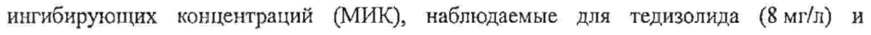
- стр. 4: «человека после однократного внутривенного введения 200 мг тедизолида фосфата» — низкая уверенность: «200» (72)  
  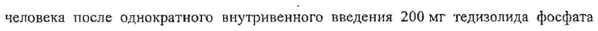
- стр. 4: «варьировал от 67 до 80 л (приблизительно вдвое больше общего количества воды в» — низкая уверенность: «80» (68)  
  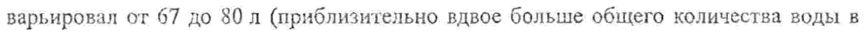
- стр. 5: «.. выведение в основном осуществлялось через печень, при этом 82 % дозы выводится |» — повторное чтение: «C3 ведение восновном осуществлялось через newer, при том в % лозы выводится |»  
  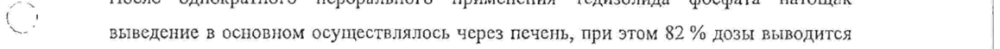
- стр. 5: «После однократного внутривенного введения 200 мг тедизолида 8 пациентам с |» — низкая уверенность: «200» (45)  
  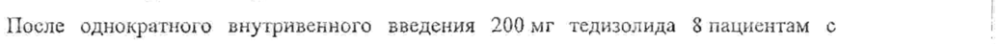
- стр. 7: «гечение 6 дией. продолжительность инфузии — 69 мин.» — низкая уверенность: «69» (79)  
  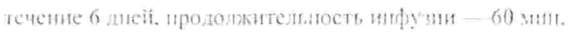
- стр. 8: «4. Наберите 4 мл восстановленного концентрированного раствора с помощью шприца» — повторное чтение: «4. Наберите 4 mit восстановленного концентрированного раствора с помощью шприца»  
  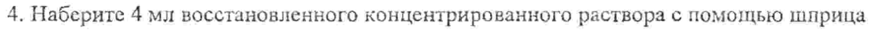
- стр. 8: «0,9% раствора натрия хлорида для инъекций: медленио введите 4мл» — низкая уверенность: «0,9%» (63)  
  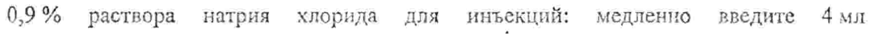
- стр. 10: «следующим образом: очень часто 1/10 или >10 %), часто (1/100 и < 1/10 или > %» — низкая уверенность: «1/10» (66), «(1/100» (65)  
  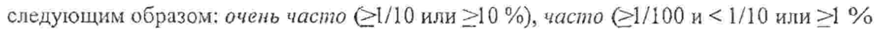
- стр. 10: «| и <10 %), нечасто (21/1900 и <1/100 или 20,1 % и <I %), редко 1/10 000 и <1/1000» — низкая уверенность: «<10» (66), «(21/1900» (79), «1/10» (22)  
  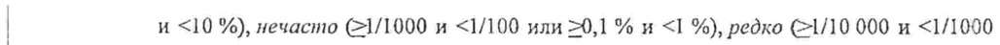
- стр. 10: «| или 20,01 % и <0,1 %), очень редко (<1/10 000 или <0,01 %). Категории частоты были» — повторное чтение: «| или 50.01 %и <0,1 %), очень редко (<! 10 000 или <0,01 %) Категории частоты были»  
  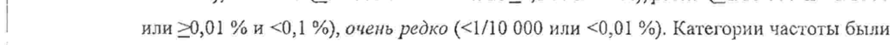
- стр. 17: «Лиофилизат, содержащий 200 мг тедизолида фосфата, во флакон из прозрачного» — низкая уверенность: «200» (45)  
  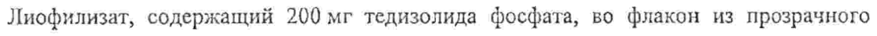
