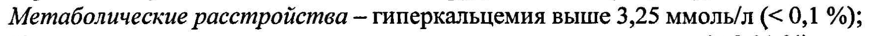

# Терипаратид — парентерально

- Препарат: Форстео® (раствор для подкожного введения;)
- АТХ: H05AA02
- Источник: ГРЛС, инструкция по медицинскому применению, РУ П N015927/01, файл от 2023-11-02 (https://grls.rosminzdrav.ru/Grls_View_v2.aspx?routingGuid=921191f4-95ff-4316-95ad-f921f12f25c6)
- Распознано автоматически (OCR): 13 из 13 стр.
- Инструкция к другому РУ того же препарата: П N015927/01 (национальное РУ, переоформленное по правилам ЕАЭС, решение от 26.10.2023). Текст может быть старше действующего
- Сомнительных строк после OCR: 1 (см. раздел «Проверка распознавания»)

## Общие сведения

TI N015927/01-120511 | МИНИСТЕРСТВО ЗДРАВООХРАНЕНИЯ И СОЦИАЛЬНОГО РАЗВИТИЯ
РОССИИСКОЙ ФЕДЕРАЦИИ ИНСТРУКЦИЯ . по применению лекарственного препарата для медицинского применения
ФОРСТЕО® . Регистрационный номер Торговое название препарата: ФОРСТЕО®
Международное (непатентованное) название: Терипаратид

## 3. Лекарственная форма

* Раствор для подкожного введения.
* Раствор для подкожного введения.

## 2. Состав

| 1 мл раствора содержит:
| 1 мл раствора содержит:
| активное вещество - терипаратид 250 мкг;
| вспомогательные вещества - уксусная кислота ледяная 0,41 мг, натрия ацетат (безводный)
| 0,10 мг, маннитол 45,4 мг, метакрезол 3,0 мг, вода для инъекций 4.5. до 1 мл,
; хлористоводородная кислота и/или натрия гидроксид (для установления рН) 4.5.
| ' |“ Описание Бесцветный прозрачный раствор.
| Фармакотерапевтическая группа | Паратиреоидного гормона аналог.
Код ATX [HOSAA02].
$ Фармакологические свойства Фармакодинамика
Форстео® - рекомбинантный человеческий паратиреоидный гормон, получаемый с использованием штамма Escherichia coli (с помощью технологии рекомбинирования
ДНК). Эндогенный паратиреоидный гормон (IIIT), представляющий собой последовательность из 84 аминокислотных остатков, является основным регулятором кальциевого и фосфорного метаболизма в костях и почках. Форстео® (рекомбинантный человеческий ПТГ (1-34)) является активным фрагментом эндогенного человеческого
ПТГ. Физиологическое действие ПТГ заключается в стимуляции формирования костной ткани посредством прямого влияния на остеобласты. ПТГ опосредованно увеличивает
| кишечную абсорбцию и канальцевую реабсорбцию кальция, а также экскрецию фосфатов почками.
Биологическое действие ПТГ осуществляется за счет связывания со специфическими
ПТГ-рецепторами на поверхности клеток. Терипаратид связывается с теми же рецепторами и оказывает такое же действие на кости и почки, как и ПТГ.
Ежедневное однократное введение терипаратида стимулирует образование новой костной ткани на трабекулярной и кортикальной (периостальной и/или эндостальной)
поверхностях костей с преимущественной стимуляцией активности остеобластов по 1 |
| | | р | Se 8 воззыя eee | ИОВА ee о“ | Г MEL S92 701 120811 |
` отношению к активности остеокластов. Это подтверждается повышением орка маркеров образования костной ткани в сыворотке крови: костно-специфической щелочной фосфатазы и проколлагена-| карбокситерминального пропептида (PICP).
Повышение содержания маркеров образования костной ткани сопровождается вторичным повышением уровня маркеров костной резорбции в моче: М-телопептида (МТХ) и деоксипиридинолина (DPD), что отражает физиологическое взаимодействие процессов формирования и резорбции костной ткани в ремоделировании скелета.
Через 2 часа после введения терипаратида наблюдается кратковременное повышение концентрации сывороточного кальция, которое достигает максимальных значений через
| 4-6 часов и возвращается к исходным показателям в течение 16-24 часов. Кроме того, может наблюдаться транзиторная фосфатурия и незначительное кратковременное снижение содержания фосфора в сыворотке крови.
На фоне лечения терипаратидом увеличивается минеральная плотность костной ткани
(МПКТ) всего тела на 5-10 % (в том числе в поясничном отделе позвоночника, шейке бедренной кости и бедренной кости).
Процессы минерализации происходят без признаков токсического действия на клетки костной ткани, а сформированная под воздействием терипаратида костная ткань имеет
@ нормальное строение (без образования ретикулофиброзной костной ткани и фиброза костного мозга).
Терипаратид снижает риск развития переломов независимо от возраста, исходных
| показателей костного метаболизма или величины МПКТ (относительное снижение риска
| возникновения новых переломов составляет 65 %).

## 5.2. Фармакокинетика

, Терипаратид хорошо всасывается при подкожном введении. Абсолютная биодоступность
, Терипаратид хорошо всасывается при подкожном введении. Абсолютная биодоступность
| препарата составляет приблизительно 95 %. Объем распределения приблизительно равен
| 1.7 л/кг. Максимальная концентрация терипаратида достигается через 30 минут после подкожного введения 20 мкг препарата и превышает в 4-5 раз верхнюю границу нормального уровня ПТГ, с последующим снижением концентрации до неопределяемых величин в течение 3 часов. Период полувыведения терипаратида при подкожном введении составляет около 1 часа, что отражает время, требуемое на абсорбцию. Периферический метаболизм ПТГ происходит преимущественно в печени посредством неспецифических ферментативных механизмов с последующей экскрецией через почки.
* Подобно эндогенному ПТГ терипаратид не накапливается в костях или других тканях.
Влияния возраста (возрастная группа от 31 до 85 лет) на фармакокинетику терипаратида не отмечено.
У пациентов с почечной недостаточностью легкой или умеренной степени тяжести
(клиренс креатинина от 30 до 72 мл/мин) фармакокинетика препарата не изменяется.
‚ Особые группы пациентов Действие терипаратида у пациентов с гиперкальциемией не изучалось, поэтом не следует назначать таким пациентам терипаратид из-за возможности обострения гиперкальцемии. |
Перед началом лечения с применением терипаратида следует исключить | гиперкальциемию, однако, регулярное наблюдение за концентрацией кальция в | сыворотке крови He требуется. |
Действие терипаратида у пациентов детского возраста не изучалось. Терипаратид не |
‚1 слудет применять у пациентов детского возраста или молодых людей с открытыми эпифизарными зонами роста.
Действие терипаратида у пациентов с активным течением мочекаменной болезни не изучалось. У пациентов с мочекаменной болезнью (острое течение или недавнее
TE И | А -_ П №015927/01-120511 | | обострение) He следует применять терипаратид по причине риска обострения данного заболевания. |

## 4.1. Показания к применению

Лечение остеопороза у женщин в постменопаузальном периоде.
Лечение остеопороза у женщин в постменопаузальном периоде.
Лечение первичного остеопороза или остеопороза, обусловленного гипогонадизмом, у мужчин.
| Противопоказания e Повышенная чувствительность к терипаратиду или вспомогательным веществам препарата.
| ® Предшествующая гиперкальциемия.
| ° Тяжелая почечная недостаточность.
| e Метаболические заболевания костей, за исключением первичного остеопороза
(включая гиперпаратиреоз и болезнь Педжета).
e Повышение активности щелочной фосфатазы неясного генеза.
e Предшествующая лучевая терапия костей скелета.
@ e Метастазы в кости или опухоли костей в анамнезе.
° Беременность и лактация.
$ Возраст до 18 лет.
С осторожностью e У больных в стадии обострения мочекаменной болезни или недавно ее перенесших, из-за возможного ухудшения состояния. При этом следует контролировать экскрецию кальция с мочой;
° У больных с умеренными нарушениями функции почек;
® Гиповитаминоз О, клинически значимая гипокальциемия.
Применение во время беременности и лактации
Влияние лечения терипаратидом на развитие плода у человека не изучалось. Не следует назначать препарат беременным женщинам.
Клинических исследований, направленных на выяснение, выделяется ли терипаратид с
@ грудным молоком, не проводилось. Терипаратид не следует назначать кормящим матерям.

## 4.2. Способ применения и дозы

Рекомендованная доза Форстео® составляет 20 мкг, вводится 1 раз в день подкожно в область бедра или живота.
Рекомендованная доза Форстео® составляет 20 мкг, вводится 1 раз в день подкожно в область бедра или живота.
Максимальная продолжительность лечения Форстео® составляет 18 месяцев. В случае перерыва в лечении препаратом Форстео®, пациенты могут продолжать лечение другими препаратами.
Рекомендуется дополнительное назначение кальция и витамина О, если они поступают с пищей в недостаточном количестве.
Дети: действие Форстео® у детей не изучалось. Форстео® не должен применяться у детей или подростков.
Взрослые: дозировка не зависит от возраста пациента.
Пациент должен быть обучен технике введения препарата (см. «Руководство по | использованию шприц-ручки»). :
| . . ` П №015927/01-120511 Инструкция по использованию шприц-ручки
Форстео"М представляет собой раствор в шприц-ручке, предназначенной для индивидуального использования. Для каждой инъекции требуется новая стерильная игла.
Каждая упаковка Форстеотм содержит Руководство для пациентов, подробно описывающее правила обращения с шприц-ручкой. Иглы для инъекций в комплект не входят. Шприц-ручка может использоваться с иглами для инсулиновых шприц-ручек
(Becton Dickinson). Препарат должен вводиться сразу после того, как шприц-ручка вынута из холодильника. После каждой инъекции шприц-ручка должна быть помещена в
ХОЛОДИЛЬНИК.

## 4.8. Побочное действие

Наиболее частые побочные эффекты (210%):
Наиболее частые побочные эффекты (210%):
Костно-мышечная система - боли в конечностях.
| Часто встречаемые побочные эффекты (21%, <10%):
Кровеносная и лимфатическая системы — анемия;
Метаболические расстройства — гиперхолестеринемия, гиперурикемия;
® Психические расстройства — депрессия;
| Нервная система - головная боль, головокружение, ишиас;
Сердечно-сосудистая система — ощущение сердцебиения;
| Система органов дыхания - одышка, диспноэ;
о Система органов пищеварения- тошнота, рвота;
Кожа - повышенное потоотделение;
Костно-мышечная система — спазм мышц нижних конечностей или спины (иногда вскоре после введения первой дозы);
Расстройства общего характера — слабость, боли в грудной клетке, астения.
Редко встречаемые побочные эффекты ( 20,1 %, <1%):
Сердечно-сосудистая система — тахикардия, снижение артериального давления;
Система органов дыхания — эмфизема;
Почки и мочевыделительная система — недержание мочи, полиурия, болезненные позывы к мочеиспусканию; |
Метаболические расстройства — гиперкальцемия выше 2,76 ммоль/л (< 1 %);
@ Расстройства местного характера - эритема в месте инъекции, реакция в месте инъекции.
Очень редко встречаемые побочные эффекты:
Аллергические реакции — вскоре после инъекции — острая одышка, отек ротовой полости/лица, генерализованная сыпь (< 0,1 %);
Сердечно-сосудистая система — боли в грудной клетке (< 0,1 %);
Метаболические расстройства — гиперкальцемия выше 3,25 ммолы/Л (< 0,1 %);
Костно-мышечная система — выраженные спазмы мышц спины (< 0,01 %).

## 4.9. Передозировка

Симптомы:
Симптомы:
Передозировка может проявляться продолжительной гиперкальциемией и развитием ортостатического коллапса. Также возможны тошнота, рвота, головокружение, головная боль.
| | | | П №015927/01-120511 в é § | Лечение: Специального антидота не существует. При подозрении на передозировку
, рекомендуется отмена препарата Форстео®, контроль содержания сывороточного кальция и проведение симптоматической терапии. `

## 4.5. Взаимодействие с другими лекарственными средствами

: Клинически значимых взаимодействий с гидрохлортиазидом, фуросемидом, дигоксином, атенололом, а также с препаратами с замедленным высвобождением — дилтиаземом, нифидипином, фелодипином, нисолдипином не отмечалось.
Совместное назначение терипаратида с ралоксифеном или гормонозамещающей терапией не влияет на содержание кальция в сыворотке крови и в моче. .
Однократное введение терипаратида не оказывает влияния на фармакодинамику дигоксина. Гиперкальциемия является предрасполагающим фактором к развитию интоксикации препаратами дигиталиса, поэтому терипаратид должен с осторожностью применяться у пациентов, принимающих препараты дигиталиса.

## 4.4. Особые указания

Забор крови для определения содержания кальция в крови следует производить не ранее,
Забор крови для определения содержания кальция в крови следует производить не ранее,
J чем через 16 часов после последнего введения Форстео®, так как может наблюдаться
| кратковременное повышение содержания кальция в сыворотке крови после инъекции
| терипаратида. Постоянное наблюдение за концентрацией кальция во время лечения не
| требуется.
| При приеме препарата Форстео® могут наблюдаться редкие эпизоды кратковременной
| ортостатической гипотензии, которые возникают в течение 4 часов после введения препарата и проходят самостоятельно в течение от нескольких минут до нескольких часов
| при укладывании пациента в положение лежа на спине и не являются противопоказанием
| к дальнейшему лечению.
Ввиду недостаточности клинических данных при длительном лечении терипаратидом, рекомендуемые сроки лечения не должны превышать 18 месяцев.
Форстео® не подлежит использованию, если раствор в шприц-ручке мутный, окрашен или
| содержит инородные частицы.

## 6.5. Форма выпуска

Раствор для подкожного введения 250 мкг/мл в шприц-ручке по 3 мл. и 2,4 мл. По одной e шприц-ручке вместе с инструкцией по применению препарата и Руководством по использованию шприц-ручки в пачке картонной.
Раствор для подкожного введения 250 мкг/мл в шприц-ручке по 3 мл. и 2,4 мл. По одной e шприц-ручке вместе с инструкцией по применению препарата и Руководством по использованию шприц-ручки в пачке картонной.

## 6.4. Условия хранения

В холодильнике при температуре 2-8 °С. Не замораживать.
В холодильнике при температуре 2-8 °С. Не замораживать.
Препарат, находящийся в употреблении, следует хранить в холодильнике при температуре 2-8 °С.
Хранить в недоступном для детей месте.

## 6.3. Срок годности

2 года. - ` Не использовать по истечении срока годности, указанного на упаковке.
2 года. - ` Не использовать по истечении срока годности, указанного на упаковке.
Находящийся в употреблении препарат следует хранить не более 28 дней.
, Условия отпуска из аптек По рецепту.
TI №015927/01-120511 Название и адрес производителя
«Лилли Франс», Франция |
2 Рю дю Колонель Лилли, 67640 Фегершайм, Франция |
«Lilly France», 2 Rue du Colonel Lilly, 67640 Fegersheim, France nthe
Руководитель отдела регистрации о ор | представительства «Эли Лилли Восток С.А.» в P, fas и W *\Яблокова Ю.Е. | ы С. р |
BY, > < Ake им | | < $ < \ док И* | . MocK® р
| ' @ | | | | | | | | | _ © | | | | | a,
ОЕ ССОО ия $ Оо о TI N015927/01-120511 Kontep™ |
Инъекция терипаратида Руководство по применению |
Перед использованием новой шприц-ручки Колтер"", пожалуйста,

: полностью ознакомьтесь с данным Руководством по применению (на обеих сторонах). Во время использования шприц-ручки Kontep™ четко следуйте инструкциям.

Никому не передавайте свою шприц-ручку и свои иглы, так как это может привести к передаче инфекции.
Шприц-ручка Kontep™ содержит дозу лекарственного препарата на 28 дней.
| Детали* шприц-ручки Kontep™ | | | Ф Желтый стержень sae
Черная кнопка | : > fr Aggie 4 , Красная полоса Синий корпус Картридж для лекарства Белый колпачок
Бумажный язычок Игла Внешний защитный колпачок | |
R @- ~ - * Иглы не входят в комплект.
° Внутренний защитный колпачок * Для работы с данным устройством могут быть ‚| у использованы иглы Becton,
| Dickinson and Company (BD)
29-31 калибра. у Перед каждой инъекцией необходимо вымыть руки. Подготовьте место
® инъекции в соответствии с указаниями лечащего врача.
1 > = | Снимите i aa белый 7 колпачо K 2 | № ы ди. a) > sau 8
Прикрепите ',67.Р Sy - “Sr Г ye :
новую иглу г “= . .
Сорвите Вставьте иглу Плотно прикрутите Снимите бумажный непосредственно в иглу. внешний -
Язычок. картридж для защитный лекарственного колпачок
| . препарата. и отложите в сторону, не выбрасывая.
. д | т . . .
an, ; П N015927/01-120511 , 3 | ay Красная ho nonoca
Уста- у AS 4 Внутренний { новите Ще - защитный С
* re колпачок 1 дозу - i ¥ Оттяните черную Убедитесь, Снимите пусковую кнопку до что видна внутренний упора. красная защитный колпачок полоса. и выбросите его.
Если оттянуть черную * пусковую кнопку не удается, обратитесь к разделу «Устранение неисправностей»,
Проблема Д, на оборотной стороне.
| ©@ | А - ` / Be \ :
Введите (= ] < 7 дозу &. ы - Ss Аккуратно оттяните участок кожи на Нажмите черную пусковую кнопку до бедре или животе и введите иглу упора. Удерживая, медленно ° >:
; подкожно. сосчитайте до 5. Затем извлеките иглу.
и eens ВНИМАНИЕ ООО А 5 - После . я Вы НЕ должны видеть
‘ инъекции: Key желтый стержень. Если ох Проверьте После ees желтый стержень виден
: дозу иавиечения >> \ после проведения де) =” убедитесь, что aA инъекции, не проводите черная повторную инъекцию в тот пусковая кнопка же день. Вы ДОЛЖНЫ вдавлена до установить шприц-ручку
Ф упора. Если Kontep™ в исходное желтый : положение (смотрите
; CIS PeRen ME раздел «Устранение : иивекция Guna неисправностей», у . проведена Проблема А, на оборотной
: правильно. стороне).
7” 6 one, Ку .: р ro. - Фо 1 колпачок a 5
Удалите и BRI: (po es am CX.
иглу Fox ee ~ i. , Наденьте Полностью Снимите иглу и Снова наденьте | внешний открутите иглу, 3-5 — утилизируйте в белый колпачок. |
' защитный раз повернув соответствии с Поместите |
| колпачок на иглу. внешний защитный рекомендациями шприц-ручку колпачок. лечащего врача. Kontep™
- ; в холодильник сразу же после а использования.
. я | = 2 “ ‘ ach Ps О ииИРи///////////////ир/р/р/р//рр/р//ллл////////лрл////лллллллллллллллллллллуйлщ[щ[щ[щ[щ"щищищ2щ2щщ2—щ[ А
| TI №015927/01-120511

Если у Вас есть вопросы или Вы хотели бы получить дополнительную информацию, пожалуйста, переверните страницу.

|

|

|

|

о

| . 7 мо 4 ‘ ; . р aye . Г | ms : | п М015927/01-120511 ные. инъекция терипаратида .

т ay fae
4 И УСТРАНЕНИЕ НЕИСПРАВНОСТЕЙ ЗИ
Проблема Решение . А. Желтый стержень ‘me Чтобы вернуть шприц-ручку Kontep™ в исходное по-прежнему виден, положение, следуйте нижеприведенным указаниям.
хотя я нажал черную Ae 1) Если вы уже произвели инъекцию, HE
:. производите повторную инъекцию в тот пусковую кнопку. Как ER) een у мне вернуть шприц- a cae 2) Удалите иглу. ,
: ручку Kontep™ в 3) Прикрепите новую иглу, снимите внешний исходное положение? защитный колпачок и отложите в сторону, не выбрасывая.
4) Оттяните черную пусковую кнопку до упора.
Убедитесь, что видна красная полоса.
5) Снимите и выбросите внутренний защитный колпачок. | eS 6) Направьте иглу в пустую емкость. Вдавите
| ; . черную пусковую кнопку до упора. Удерживая, медленно досчитайте до 5. Вы можете увидеть вытекающую жидкость или капли os ; | В жидкости. По окончании процедуры,
'. , черная пусковая кнопка должна быть | р . вжата до упора. ° mo ‘ 7) Если желтый стержень по-прежнему виден,
; пожалуйста, свяжитесь с Компанией или | _ ; Вашим лечащим врачом.
11 , 8) Наденьте внешний защитный колпачок на i иглу. Полностью открутите иглу, 3-5 раз
° ` повернув внешний защитный колпачок.
; - Снимите и утилизируйте иглу в соответствии
. . ; с рекомендациями Вашего лечащего врача.
‘ Снова наденьте белый колпачок и поместите
, ; | шприц-ручку Kontep™ в холодильник.
: у Данную проблему можно предотвратить, используя+
, НОВУЮ иглу для каждой инъекции, а также
* . вдавливая черную пусковую кнопку до ynopa. и.
i медленно считая до 5. НЫ sites Б. Как мно убедиться, b> ор робота sO Кл
Konrep™ работает? a использовании в соответствии с Руководством по у применению. Когда черная пусковая кнопка вдавлена до упора, Вы можете быть уверены, что ввели` полную дозу препарата с помощью шприц-ручки
Колтер"".' ' : | . Чтобы шприц-ручка работала надлежащим образом, не забывайте каждый раз использовать новую иглу.
, В. я вижу воздушный = Небольшой воздушный пузырь не повлияет Ha дозу пузырь в шприц-ручке. препарата и не повредит Вам. Вы можете | продолжать введение дозы в обычном порядке.
rons Г. Я не могу удалить > 1) — внешний защитный колпачок Ha т ИВ» 2) Используйте внешний защитный колпачок для
^' , откручивания иглы. .
10 ~ ts ` EEE EEE EEE EEE EEE EE EEE EEE BY
П N015927/01-120511 3) Полностью открутите иглу, 3-5 раз повернув внешний защитный колпачок.
4) Если игла по-прежнему не удаляется, обратитесь к кому-либо за помощью.
Д. Что делать, если я = Используйте новую шприц-ручку Kontep™ для не могу отжать черную введения дозы, соответствующей рекомендациям пусковую кнопку? ашего лечащего врача.
Это показывает, что Вы использовали все возможное количество препарата, даже в том случае, если в картридже для лекарства еще остается некоторое его
| количество.
| ° о II №015927/01-120511 | `; р г | , Е os |
| (Mist isc) 1)}XpatCH Vic Rann Мытье шприц-ручки Kontep™ i |
} e Протирайте влажной тканью с внешней стороны. Е e Не помещайте шприц-ручку Kontep™ в воду, не мойте и не чистите с помощью каких-либо ^
‘ - жидкостей. - : | Хранение шприц-ручки Kontep™ | 7 e Поместите шприц-ручку Kontep™ в холодильник сразу же после использования. ‘
Ознакомьтесь с условиями хранения в Инструкции по применению лекарственного препарата и следуйте им.
. e Не храните шприц-ручку Kontep™ с прикрепленной иглой, поскольку это может привести к образованию воздушных пузырей в картридже с лекарством.
i | e Храните шприц-ручку Kontep™ с надетым белым колпачком.
| : e Никогда не храните шприц-ручку Kontep™ в морозильной камере.
| e Если лекарственный препарат замерз, выбросите устройство и используйте новую шприц-
, ручку Kontep™, e Если вы забыли поместить шприц-ручку Kontep™ в холодильник, He выбрасывайте шприц-
| р „Поместите шприц-ручку в холодильник и свяжитесь с Производителем.
_.@ - _ a И Утилизацияиглшприца"ручкиГи/устройства № о Утилизация игл шприца-ручки и устройства шприц-ручки Колтер7" .’° ,
| 7 ® Перед утилизацией шприц-ручки Kontep™ убедитесь, что игла шприца-ручки удалена.
| oo e Утилизируйте шприц-ручку Kontep™ и использованные иглы в соответствии с указаниями
| . Вашего лечащего врача, в соответствии с локальными требованиями и порядком, | -
: i ‘ установленным в Вашем медицинском учреждении. . р
= = ®_ Утилизируйте устройство в течение 28 дней после первого использования. :
| a * . i * | НИИ другая]важнаяинформация ВИЙ
| а. e . Шприц-ручка Kontep™ содержит дозу лекарственного препарата на 28 дней.
|» e Не переносите лекарственный препарат в шприц. : .
[О » Отметьте в календаре дату первой инъекции. .:.^ : .
? . ® Ознакомьтесь с Инструкцией по применению лекарственного препарата и следуйте ей.:
- › Ознакомьтесь с этикеткой шприц-ручки Kontep™ и убедитесь, что Вы собираетесь ’ использовать правильный препарат, и срок его годности не истек. о
, e Свяжитесь с Компанией в случае, если вы заметили что-то из нижеперечисленного:
- _ На шприц-ручке Kontep™ заметны повреждения uo |
@ - (_ Лекарственное вещество НЕ является прозрачным, бесцветным, имеются примеси |
® Для проведния инъекции всегда используйте новую иглу. , | e Вовремя инъекции Вы можете услышать один или несколько щелчков — это нормальное |
_* явление при работе устройства. . .
' e Никому He передавайте свой лекарственный препарат. . |
«о e Шприц-ручка Kontep™ не рекомендована к использованию пациентам, страдающим г) слепотой или нарушениями зрения без помощи лиц, обученных правильному обращению с
) устройством. , ‚а .
‚ e Берегите шприц-р Kontep™ от детей. | .
2 , . ‘ - Boe, 4 4 ‘ My a ia ——————_————__———__ ЕЕК |
II N015927/01-120511 Контактная Информация
Если у Вас есть вопросы, а также если Вам необходима помощь в работе с
Вашей шприц-ручкой Kontrep™, свяжитесь с Компанией или с Вашим лечащим врачом.
Произведено Лилли Франс, Е-67640 Фегершейм, Франция, для Эли Лилли энд Кампани.
Шприц-ручка Kontep™ является торговой маркой, принадлежащей Эли Лилли энд
Кампани.
: ® Зарегистрированные торговые марки, принадлежащие Эли Лилли энд Кампани;
используется по лицензии.
ТМ Торговые марки Эли Лилли энд Кампани; используется по лицензии.
Копирайт © 2007, 2010, Эли Лилли энд Кампани. Все права защищены.
@ Дата обновления документации:
| | _ ..
| ee и. я On Руководитель отдела регистрации ‘> р 4 on представительства «Эли Лилли Восток C.A.» BP conn «Яблокова Ю.Е.
| > 5 ‘ а | < vores :
о $ $ ая док * * mat и 7 | | в
## Проверка распознавания

Страницы-сканы распознаны автоматически. В 1 строках с дозировками цифры могли распознаться с ошибкой — сверьте с вырезкой из оригинала:

- стр. 4: «Метаболические расстройства — гиперкальцемия выше 3,25 ммолы/Л (< 0,1 %);» — повторное чтение: «Метаболические расстройства — гиперкальцемия выше 3,25 ммоль/л (< 0,1 %);»  
  
