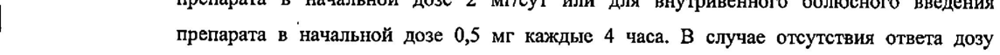
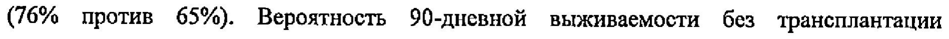

# Терлипрессин — парентерально

- Препарат: Реместип® (раствор для внутривенного введения;)
- АТХ: H01BA04
- Источник: ГРЛС, инструкция по медицинскому применению, РУ П N013886/01, файл от 2024-01-12 (https://grls.rosminzdrav.ru/Grls_View_v2.aspx?routingGuid=4bd924cd-bb65-4965-be6b-bdde5cd0ce81)
- Распознано автоматически (OCR): 13 из 13 стр.
- Сомнительных строк после OCR: 2 (см. раздел «Проверка распознавания»)

## Общие сведения

от 07.09.2023 № 17368 (Входящий МЗ №4241126}
МИНИСТЕРСТВО ЗДРАВООХРАНЕНИЯ РОССИЙСКОЙ ФЕДЕРАЦИИ |
ИНСТРУКЦИЯ ПО МЕДИЦИНСКОМУ ПРИМЕНЕНИЮ ЛЕКАРСТВЕННОГО |
ПРЕПАРАТА | Е Реместип® Регистрационный номер: IT NO13886/01
() Торговое наименование препарата: Реместип®
Международное непатентованное наименование: терлипрессин
| Лекарственная форма: раствор для внутривенного введения | ; `

## 2. Состав

| 1 мл раствора содержит:
| 1 мл раствора содержит:
| действующее вещество: терлипрессин 0,1 мг;
| вспомогательные вещества: натрия хлорид 9,0 мг, уксусная кислота ледяная 1,08 мг, натрия ацетата тригидрат 0,27 мг, вода для инъекций до 1,0 мл. |
Описание | Прозрачный, бесцветный раствор. |
Фармакотерапевтическая группа: задней доли гипофиза гормон
‚ Код ATX: НО1ВА04 ФАРМАКОЛОГИЧЕСКИЕ СВОЙСТВА -

## 5.1. Фармакодинамика

Терлипрессин (М-триглицил-8-лизинвазопрессин) — синтетический полипептид — аналог вазопрессина, гормона задней доли гипофиза. В молекулу природного вазопрессина было
. | внесено 2 изменения: аргинин в 8 положении заменен лизином, а к аминогруппе конечного цистеина присоедикено 3 глициновых остатка.
Фармакологическое действие терлипрессина реализуется как сумма фармакологических эффектов его активных метаболитов.
Терлипрессин обладает выраженным сосудосуживающим и кровоостанавливающим действием. . |
EEE EES OO 1 aaa aac acamcammmmaacmcamammmmcmmmmmammammmmcaceacccceceecmcmmmccecccc—————______________________
СООТВЕТСТВУЕТ ЭКСПЕРТНОМУ ОТЧЕТУ | от 07.09.2023 № 17368 |
(Входящий МЗ №4241126 Основным действием терлипрессина является сокращение артериол, вен и венул висцеральных органов, что приводит к уменьшению кровотока через печень и снижению давления в портальной системе.
Терлипрессин за счет сокращения артериол, вен и венул стимулирует сокращение гладкой мускулатуры пищевода, повышает тонус и усиливает перистальтику кишечника.
Усиливая тонус гладкой мускулатуры сосудов, терлипрессин также воздействует на гладкую мускулатуру матки, усиливая сократительную активность миометрия независимо от наличия беременности.
Согласно результатам доклинических и клинических исследований, терлипрессин преимущественно воздействует на гладкую мускулатуру внутренних органов, а также на
| кожу. | го Сведения о наличии у терлипрессина антидиуретического действия отсутствуют. |
`: Клиническая эффективность и безопасность
Непрерывная внутривенная инфузия препарата в сравнении с внутривенным болюсным введением при лечении гепаторенального синдрома I типа у пациентов с циррозом печени
Безопасность непрерывной внутривенной инфузии терлипрессина сравнивалась с внутривенным болюсным введением в открытом рандомизированном контролируемом многоцентровом исследовании. Семьдесят восемь пациентов с гепаторенальным синдромом I типа были рандомизированы для непрерывной внутривенной инфузии препарата в начальной дозе 2 мг/сут или для внутривенного болюсного введения
| препарата в начальной дозе 0,5 мг каждые 4 часа. В случае отсутствия ответа дозу постепенно увеличивали до конечной дозы 12 мг/сут в обеих группах. Альбумин ‚|
. применяли в одинаковой дозе в обеих группах. Первичная конечная точка была
__ определена как распространенность связанных с терапией нежелательных реакций (НР)
; между двумя группами. Как общая частота связанных с терапией HP, так и частота | тяжелых НР, связанных с терапией, были ниже в группе с непрерывной внутривенной инфузией, чем в группе с внутривенным болюсным введением (все НР, связанные с терапией: 12/34 пациентов (35%) по сравнению с 23/37 пациентами (62%), p<0,025.
Тяжелые НР, связанные с терапией: 7/34 пациентов (21%) против 16/37 пациентов (43%);
p<0,05). Скорость ответа на терлипрессин ‘статистически значимо не отличалась между | группами с непрерывной внутривенной инфузией и внутривенным болюсным введением |
(76% против 65%). Вероятность 90-дневной выживаемости без трансплантации
| существенно не отличалась между группой, получавшей препарат в виде непрерывной внутривенной инфузии, и группой, попучавщей препарат в виде внутривенного
; болюсного введения (53% против 69%).
от 07.09.2023 № 17368 | (Входящий МЗ №4241126}

## 5.2. Фармакокинетика

| Терлипрессин в неизмененном виде не оказывает действия Ha гладкую мускулатуру внутренних органов, при метаболизме образуются активные метаболиты, реализующие фармакологическое действие препарата Реместип®. В отличие от лизин-вазопрессина, для терлипрессина характерно более длительное развитие и большая продолжительность фармакологического эффекта. Лизин-вазопрессин метаболизируется в печени, почках и в других тканях.
При внутривенном введении фармакокинетический профиль может быть представлен в
| виде двухкомпонентной модели. Период полувыведения составляет около 40 минут, клиренс — около 9 мл/кг/мин, объем распределения — около 0,5 л/кг. Концентрация лизинвазопрессина определяется в плазме крови через 30 минут после введения и достигает
| С) максимума через 60 — 120 минут.
| Показания к применению - | ® Кровотечения из желудочно-кишечного тракта и половых органов у взрослых: при | варикозном расширении вен пищевода, язвенной болезни желудка и двенадцатиперстной кишки; маточных кровотечениях (дисфункциональных, в родах и при прерывании беременности);
» Местное введение (в ходе гинекологических операций на шейке матки);
© Кровотечения во время хирургического вмешательства на органах брюшной полости и малого таза; ‘ | e .Гепаторенальный синдром I типа. .
Е )
и Противопоказания e Повышенная чувствительность к терлипрессину и вспомогательным веществам - препарата; ` | e Беременность;
| ® Период грудного вскармливания; | | © Септический шок с низким сердечным выбросом; |
® Возраст до 18 лет.

## 4.3. С осторожностью

С особой осторожностью следует назначать препарат Реместип® пациентам пожилого
С особой осторожностью следует назначать препарат Реместип® пациентам пожилого
| возраста (старще 70 лет), с ишемической болезнью сердца, с нестабильной стенокардией и eee
| СООТВЕТСТВУЕТ ЭКСПЕРТНОМУ ОТЧЕТУ от 07.09.2023 № 17368
(Входящий МЗ №4241126 недавним острым инфарктом миокарда, выраженной артериальной гипертензией, с эпилепсией или судорожными приступами в анамнезе, дыхательной недостаточностью, заболеваниями сосудов головного мозга, коронарных или периферических сосудов
(например, при распространенном атеросклерозе), с хронической почечной недостаточностью, с сахарным диабетом и ожирением, при септическом шоке (с нормальным или повышенным сердечным выбросом), при нарушениях ритма сердца, бронхиальной астме, при одновременном применении препарата Реместип® с препаратами, удлиняющими интервал ОТ, при применении препарата с человеческим альбумином.
При терапии терлипрессином по показанию гепаторенальный синдром I типа следует , дополнительно соблюдать осторожность при применении препарата у пациентов с | м прогрессируещей почечной недостаточностью и тяжелым нарушением функции печени, в aod случае если было принято решение о назначении препарата (когда ожидаемая польза ы превышает возможный риск). - ”

## 4.6. Применение при беременности и в период грудного вскармливания

Применение препарата Реместип® при беременности противопоказано. Известно, что на ранних сроках беременности применение терлипрессина стимулирует сократительную
. активность матки и повышение давления в матке, что приводит к снижению маточного кровотока. Препарат Реместип® может оказывать негативное влияние на течение беременности и развитие плода.
Согласно результатам доклинического исследования при приеме терлипрессина 1 развивались спонтанные аборты, также обнаружены внутриутробные пороки развития, i \ Неизвестно, проникает ли терлипрессин в грудное молоко. Применение препарата в и
| период грудного вскармливания противопоказано. Учитывая, что нельзя исключить вероятность проникновения терлипрессина в грудное молоко и негативного воздействия на ребенка, при необходимости применения препарата Реместип® грудное вскармливание необходимо прекратить.

## 4.2. Способ применения и дозы

Прёпарат Реместип® предназначен для внутривенного введения в виде болюсных инъекций или кратковременной инфузии, а также для пара- и/или интрацервикального введения при местном введении (в ходе гинекологических операций на шейке матки).
Прёпарат Реместип® предназначен для внутривенного введения в виде болюсных инъекций или кратковременной инфузии, а также для пара- и/или интрацервикального введения при местном введении (в ходе гинекологических операций на шейке матки).
В качестве альтернативы болюсной инъекции терлипрессин можно вводить в виде.
| непрерывной внутривенной инфузии с начальной дозой 20 мл (2,0 мг) в течение 24 чис ;
ПО СООТВЕТСТВУЕТ ЭКСПЕРТНОМУ ОТЧЕТУ от 07.09.2023 № 17368
(Входящий МЗ №4241126} увеличением до максимальной дозы — 120 мл (12,0 мг) / 24 ч. В клинических исследованиях было показано, что введение терлипрессина в виде непрерывной внутривенной инфузии ассоциировано с более низкой частотой развития тяжелых нежелательных реакций, чем при внутривенном болюсном введении.
Кровотечения при варикозном расширении вен пищевода: 10 мл (1,0 мг) с интервалом 4-6 ч до остановки кровотечения и последующие 3-5 дней. Для предотвращения повторных кровотечений препарат отменяют только после полного отсутствия кровотечения в течение 24-48 ч. |
Кровотечения из желудочно-кишечного тракта другой локализации: 10 мл (1,0 мг) с интервалом 4-6 ч. Препарат применяется при оказании первой медицинской помощи вне хирургического стационара при подозрении на кровотечение из верхней части ЖКТ.
г Маточные кровотечения (дисфункциональные, в родах и при прерывании беременности): |
| — внутривенно струйно или капельно от 2 мл (0,2 мг) до 10 мл (1,0 мг) каждые 4-6 чв зависимости от активности тканевых эндопептидаз. : ;
Местное введение (8 ходе гинекологических операций на шейке матки):
4 мл (0,4 мг) добавляется к 6 мл 0,9% раствора натрия хлорида и вводится пара- и/или интрацервикально. Время наступления эффекта — 5-10 минут. При необходимости доза может быть увеличена или введена повторно. |
Кровотечение во время хирургического вмешательства на органах брюшной полости и
. малого таза: внутривенно струйно или капельно от 2 мл (0,2 мг) до 10 мл (1,0 мг) каждые 4-6 ч в зависимости от активности-тканевых эндопептидаз.
Гепаторенальный синдром 1 типа: по 10 мл (1 мг) 3-4 раза в сутки. Лечение должно
. продолжаться до тех пор, пока не нормализуется концентрация креатинина в плазме крови a, (менее 130 мкмоль/л), в среднем, 10 дней. Если концентрация креатинина не снижается более чем на 30% в течение 3 дней, дальнейшее введение препарата нецелесообразно.
Особые группы пациентов `Пациенты с гепаторенальным синдромом Гтипа
| Нарушение функции почек - - Следует избегать применения препарата у пациентов с прогрессирующей почечной недостаточностью, то есть с исходным уровнем креатинина сыворотки крови > 442 мкмоль/л (5,0 мг/дл), за исключением случаев, когда ожидаемая польза превышает возможный риск (см. раздел «Особые указания»).
Нарушения функции печени | | | СООТВЕТСТВУЕТ ЭКСПЕРТНОМУ ОТЧЕТУ от 07.09.2023 № 17368
[Входящий МЗ №42411265)}

Следует избегать применения препарата у пациентов с тяжелым нарушением функции

| печени, определяемым как острая хроническая печеночная недостаточность (ОХПН) 3 степени и/или при показателе по шкале MELD (модель для оценки терминальной стадии заболеваний печени) > 39, за исключением случаев, когда ожидаемая польза превышает возможный риск (см. раздел «Особые указания»). |

| Побочное действие

| В ходе клинических исследований было выявлено, что наиболее часто встречались следующие нежелательные реакции (частота 1 - 10%): бледность кожных покровов лица, гипертензия, боль в животе, тошнота, диарея, головная боль.

Частота нежелательных реакций: очень часто (> 1/10), часто (> 1/100 до <1/19), нечасто (> ыы _ 11/1000 до <1/100), редко © 1/10000 до <1/1000), очень редко (<1/10000), частота не sa установлена (в настоящее время данные о распространенности побочных реакций

отсутствуют). - .
Некоторые из нежелательных реакций встречаются в таблице дважды, так как частота различается в зависимости от показаний к применению.
Системно- Очень часто Часто Нечасто Редко
РОБ ПИ И ИИ Инфекции и Сепсис/ инвазии септический шок***
| . Нарушения co Гипонатриемия . | . стороны обмена (при отсутствии
> 7 веществ контроля количества, | потребляемой
| жидкости)
Нарушения со Головная боль стороны | нервной системы
Нарушения со Брадикардия Фибрилляция | стороны сердца предсердий,
| желудочковая ООО | | | СООТВЕТСТВУЕТ ЭКСПЕРТНОМУ ОТЧЕТУ от 07.09.2023 № 17368
[Входящий МЗ N=4241126)
экстрасистолия, тахикардия, стенокардия, инфаркт миокарда, желудочковая тахикардия типа
«пируэт», - сердечная недостаточность, гиперволемия с
_— развитием отека a, легких Нарушения со Периферическая Ишемия стороны вазоконстрик- кишечника, сосудов ция, ищемия | периферический периферических цианоз, = тканей, приливы жара бледность кожных покровов лица, ‘
; артериальная | ;
_ гипертензия io Нарущения co Дыхательная Отек легких**, | Респираторный Одышка*** ` стороны недоста- респираторный дистресс дыхательной точность**, дистресс- синдром***, системы, одышка** синдром** дыхательная | органов грудной недоста- | клетки и точность***, | средостения отек легких***.
Нарушения со Преходящие Преходящая стороны спазматические тошнота, желудочно- боли в животе, преходящая
‚ | кишечного преходящая рвота СООТВЕТСТВУЕТ ЭКСПЕРТНОМУ ОТЧЕТУ от 07.09.2023 № 17368 rece О Е ООО ООО
Нарушения со Некроз кожи стороны кожи и подкожных | тканей |
Беременность, Спазм мышц послеродовые и матки, перинатальные снижение состояния кровотока в матке
Общие Некроз в месте . расстройства и введения 7 нарущения в
` месте введения * см. раздел «Особые указания»
** при гепаторенальном синдроме | типа, частота рассчитана на основе объединенной выборки для оценки безопасности в клинических исследованиях ОТ-0401, REVERSE и CONFIRM
| *** при иных одобренных показаниях, отличных OT гепаторенального синдрома | типа
| Описание отдельных нежелательных реакций
Основываясь на результатах специализированного рандомизированного контролируемого многоцентрового исследования, введение терлипрессина в виде непрерывной
| внутривенной инфузии может быть ассоциировано с более низкой частотой развития
- тяжелых нежелательных реакций, чем при внутривенном болюсном введении (см. раздел
«Способ применения и дозы» и «Фармакологические свойства»).
Если любые из указанных побочных эффектов усугубляются, или вы заметили любые другие побочные эффекты, не указанные в инструкции, сообщите об этом врачу.

## 4.9. Передозировка

Симптомы: доза свыше 20 мл (2 мг) в течение 4 часов повышает риск развития выраженных нарушений показателей гемодинамики — повышение АД и брадикардию.
Симптомы: доза свыше 20 мл (2 мг) в течение 4 часов повышает риск развития выраженных нарушений показателей гемодинамики — повышение АД и брадикардию.
| Лечение: при повышении артериального давления следует назначать клонидин, 150 мкг внутривенно; при развитии брадикардии рекомендуется вводить атропин.
ПСО ООО СООТВЕТСТВУЕТ ЭКСПЕРТНОМУ ОТЧЕТУ от 07.09.2023 № 17368
(Входящий МЗ №4241126} Взаимодействие с другими лекарственными средствами
| Не допускается смешивание препарата Pemecmun® с другими лекарственными средствами в одном ширице!
He использовать раствор декстрозы (глюкозы) для разведения препарата!
Введение препарата Реместип® совместно с окситоцином или метилэргометрином усиливает сосудосуживающее и утеротоническое действие.
Реместип® усиливает антигипертензивный эффект неселективных В-адреноблокаторов при портальной гипертензии.
Одновременное применение препарата Реместип® с препаратами, замедляющими частоту сердечных сокращений (пропофол, суфентанил), может вызвать выраженную брадикардию и снижение сердечного выброса. Утгнетение сердечной деятельности г вызвано влиянием блуждающего нерва, опосредованного повышением артериального | у | |
= давления. | Терлипрессин может вызывать желудочковую тахикардию типа «пируэт» (см. разделы |
«Побочное действие» и «Особые указания»). Необходимо соблюдать осторожность при применении препарата Реместип® совместно с препаратами, удлиняющими интервал ОТ, такими как антиаритмические препараты IA и Ш класса, эритромицин, ряд
| антигистаминных препаратов и трициклических антидепрессантов или препараты,
| приводящие к развитию гипокалиемии или гипомагниемии (например, некоторые
| диуретики). ‘ | Особые указания | . Особые указания при гепаторенальном синдроме [ типа
| - До начала терапии препаратом Реместип® по показанию гепаторенальный синдром [ типа
_ следует исключить другие виды острой почечной недостаточности.
Нарушение функции почек При терапии терлипрессином по показанию гепаторенальный синдром I типа следует избегать применения препарата y пациентов с прогрессирующей почечной
° недостаточностью, то есть с исходным уровнем креатинина сыворотки крови > 442 мкмоль/л (5,0 мг/дл), за исключением случаев, когда ожидаемая польза превышает.
возможный риск. В клинических исследованиях у данной группы пациентов наблюдались сниженная эффективность в купировании гепаторенального синдрома, повышенный риск развития нежелательных реакций и повышенная смертность.
| Нарушение функции печени ООО СООТВЕТСТВУЕТ ЭКСПЕРТНОМУ ОТЧЕТУ от 07.09.2023 № 17368
(Входящий МЗ №4241126} При терапии терлипрессином по показанию гепаторенальный синдром I типа следует избегать применения препарата у пациентов с тяжелым нарушением функции печени, определяемым как острая хроническая печеночная недостаточность (ОХПН) 3 степени и/или при показателе по шкале MELD (модель для оценки терминальной стадии заболеваний печени) > 39, за исключением случаев, когда ожидаемая польза превышает возможный риск. В клинических исследованиях у данной группы пациентов наблюдались сниженная эффективность в купировании гепаторенального синдрома, повышенный риск развития дыхательной недостаточности и повышенная смертность.
Респираторные события | Сообщалось о летальных случаях на фоне дыхательной недостаточности, включая дыхательную недостаточность из-за перегрузки жидкостью, у пациентов, получавших ie терлипрессин по показанию гепаторенальный синдром [ типа. Состояние пациентов с a впервые выявленными случаями затрудненного дыхания или на фоне усугубляющегося
- респираторного заболевания следует стабилизировать до начала терапии терлипрессином.
Следует соблюдать осторожность при применении терлипрессина вместе с человеческим альбумином в рамках стандартной терапии гепаторенального синдрома | типа. В случае появления признаков или симптомов дыхательной недостаточности или перегрузки
| жидкостью следует рассмотреть вопрос о снижении дозы человеческого альбумина. Если респираторные симптомы приобретают тяжелый характер или не проходят, терапию терлипрессином следует прекратить.
Сепсис/септический шок - - Сообщалось о случаях развития сепсиса/септического шока, в том числе с летальным | исходом, у пациентов, получавших терлипрессин по показанию гепаторенальный синдром и Г типа, при отсутствии установленной причинно-следственной связи с применением терлипрессина. Следует проводить ежедневный мониторинг пациентов на наличие любых .
признаков или симптомов, указывающих на развитие инфекции.
Общие указания Препарат Pemecrun® не заменяет ‘мероприятий по восстановлению объема циркулирующей крови при применении препарата у пациентов с кровотечением.
. Мониторинг пациентов в ходе терапии Во время терапии препаратом Реместип® необходим регулярный мониторинг | артериального давления, ЭКГ или ЧСС, сатурации кислородом, водно-электролитного баланса.
| ООО СООТВЕТСТВУЕТ ЭКСПЕРТНОМУ ОТЧЕТУ от 07.09.2023 № 17368
| | Особую осторожность следует соблюдать при применении препарата Реместип® у | пациентов с сердечно-сосудистыми или легочными заболеваниями, поскольку
| терлипрессин может вызывать ишемию и застой в легочных сосудах.
Осторожность также следует соблюдать при применении препарата Реместип® у |
| пациентов с артериальной гипертензией.
Пациенты с септическим шоком Не следует использовать препарат Реместип® у пациентов с септическим шоком с низким сердечным выбросом.
Реакции в месте введения Во избежание развития локального некроза в месте введения препарат следует вводить внутривенно.
Некроз кожи | В ходе пострегистрационного применения терлипрессина было зарегистрировано несколько случаев ишемии кожи и некроза, не связанного с местом инъекции (см. раздел
«Побочное действие»). Пациенты с сахарным диабетом и ожирением вероятно имеют большую склонность к развитию такой реакции. Поэтому следует соблюдать | осторожность при назначении терлипрессина данной категории пациентов.
Желудочковая тахикардия типа «пируэт»
В ходе клинических исследований и при пострегистрационном применении препарата
Реместип® были зарегистрированы случаи удлинения интервала ОТ и развития желудочковой аритмии, включая желудочковую тахикардию типа «пируэт» (см. раздел
«Побочное действие»). В большинстве случаев отмечалось наличие в анамнезе пациентов | предрасполагающих факторов, таких как базальное удлинение интервала ОТ, нарушение водно-электролитного баланса (гипокалиемия, гипомагниемия) или применение препаратов, удлиняющих интервал ОТ. Препарат Реместип® следует применять с осторожностью у пациентов с удлинением интервала ОТ в анамнезе, нарушениями водноэлектролитного баланса или принимающих лекарственные препараты, удлиняющие
| интервал ОТ (см. раздел «Взаимодействие с другими лекарственными средствами»).
Пациенты пожилого возраста Следует соблюдать особую осторожность при применении препарата Реместип® у пациентов пожилого возраста, так как опыт применения в этой группе ограничен.
Вспомогательные вещества Препарат Реместип® содержит натрий (менее 1 ммоль (23 мг) на дозу).
| Влияние на способность управлять транспортными средствами, механизмами от 07.09.2023 № 17368
(Входящий МЗ №4241126)
Исследования влияния препарата Pemectun” на способность управлять транспортными средствами и механизмами не проводились.

## 6.5. Форма выпуска

Раствор для внутривенного введения 0,1 мг/мл.
Раствор для внутривенного введения 0,1 мг/мл.
По 2 мл или 10 мл в ампуле бесцветного стекла типа | с возможным цветным кодированием в виде цветной точки и/или одного или нескольких колец.
По 5 ампул в ячейковой упаковке в картонной пачке с инструкцией по применению. |
Допускается наличие контроля первого вскрытия.

## 6.3. Срок годности

2 года.
2 года.
Не применять по истечении срока годности, указанного на упаковке.

## 6.4. Условия хранения

При температуре 2-8 °С во вторичной упаковке (пачке картонной). Не замораживать.
При температуре 2-8 °С во вторичной упаковке (пачке картонной). Не замораживать.
Хранить в недоступном для детей месте.
Условия отпуска Отпускают по рецепту.
Держатель (владелец) регистрационного удостоверения
Ферринг-Лечива, a.c.
К Рубнику 475, 252 42 Есенице у Прагу, Чешская Республика.
(К Rybniku 475, 252 42 Jesenice и Prahy)
Производитель Производитель готовой лекарственной формы / Фасовщик (первичная упаковка) /
Упаковщик (вторичная (потребительская) упаковка):
Зентива, к.с.
У кабеловни 130, 102 37, Прага 10 — Долни Мехолупы, Чешская Республика.
(U kabelovny 130, 102 37 Praha 10 — Рош! Mecholupy, Czech Republic)
Организация, осуществляющая выпускающий контроль качества:
Ферринг-Лечива, а.с.
К Рубнику 475, 252 42 Есенице у Прагу, Чешская Республика.
(К Куб Ки 475, 252 42 Jesenice и Prahy, Czech Republic)
Наименование и адрес организации, уполномоченной держателем или владельцем р О НЕОН ЕО ПИ ЕЕ ВЕ ЕЕ Е ЕЕ el от 07.09.2023 № 17368
(Входящий МЗ №4241126)
регистрационного удостоверения лекарственного препарата на принятие претензий от потребителя
ООО «Ферринг Фармасетикалз»
115054, г. Москва, Космодамианская наб., д.52, стр.4.
Тел.: +7 (495) 287-0343.
Факс: +7 (495) 287-0342.
Директор по регуляторным вопросам S / i Up My
OOO «Ферринг Фармасетикалз» ¢ И =} Швецова А.С.
| Г ye 3 | a
## Проверка распознавания

Страницы-сканы распознаны автоматически. В 2 строках с дозировками цифры могли распознаться с ошибкой — сверьте с вырезкой из оригинала:

- стр. 2: «| препарата в начальной дозе 0,5 мг каждые 4 часа. В случае отсутствия ответа дозу» — повторное чтение: «| препарати ь  ачашьной mee 05 каж se 1 ая. В сле  омукавия ответа дозу»  
  
- стр. 2: «(76% против 65%). Вероятность 90-дневной выживаемости без трансплантации» — низкая уверенность: «90-дневной» (67)  
  
