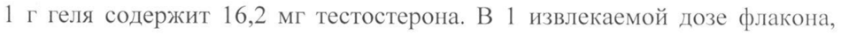
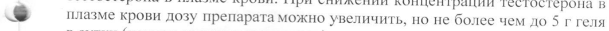
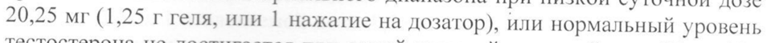
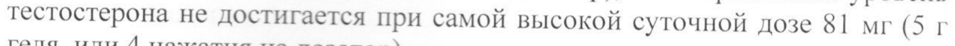
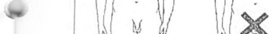
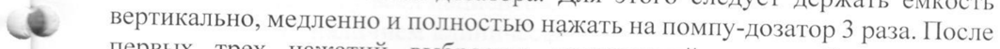
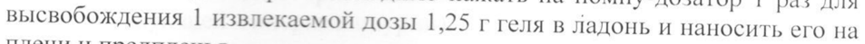
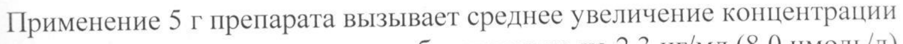
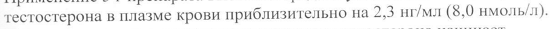

# Тестостерон — наружно

- Препарат: Андрогель® (гель для наружного применения)
- АТХ: G03BA03
- Источник: ОХЛП, Единый реестр ЛС ЕАЭС, запись 66bb360f30dcf85cade642db, документ от 2026-05-04
- Распознано автоматически (OCR): 19 из 19 стр.
- Сомнительных строк после OCR: 9 (см. раздел «Проверка распознавания»)

## Общие сведения

EEE NN-Ne(014388)-(Pl-RU) от 10.04.2026 СООТВЕТСТВУЕТ ЭКСПЕРТНОМУ ОТЧЕТУ oT 03.04.2026 № 6902
({ПОСЛЕДОВАТЕЛЬНОСТЬ 0008)
ОБЩАЯ ХАРАКТЕРИСТИКА ЛЕКАРСТВЕННОГО ПРЕПАРАТА

## 1. Наименование лекарственного препарата

АНДРОГЕЛЬ, 16,2 мг/г, гель для наружного применения

## 2. Качественный и количественный состав

Действующее вещество: тестостерон | г геля содержит 16,2 мг тестостерона. В 1 извлекаемой дозе флакона, содержащей 1,25 г геля содержится 20,25 мг тестостерона
Вспомогательные вещества, наличие которых надо учитывать: каждая доза 1,25 г геля содержит 0,9 г этанола.
i Полный перечень вспомогательных веществ приведен в разделе 6.1.

## 3. Лекарственная форма

Гель для наружного применения.
Прозрачный или немного мутный бесцветный гель с запахом спирта.

## 4. Клинические данные

## 4.1. Показания к применению

Андрогель назначается взрослым в качестве заместительной терапии тестостероном при гипогонадизме у мужчин, когда дефицит тестостерона подтвержден клиническими симптомами и лабораторными тестами (см. п.
| & 4.4 Специальные предупреждения и меры предосторожности).
|

## 4.2. Режим дозирования и способ применения

4.2. Режим дозирования "
Дозировка | Взрослые и пожилые люди Рекомендуемая дозировка - два нажатия на дозатор 2,5 г геля (т. е. 40,5 мг тестостерона) один раз в день, примерно в одно и то же время, желательно утром. Индивидуальная суточная доза может корректироваться врачом в зависимости от клинических или лабораторных показателей у пациентов, но не должна превышать 5 г геля (четыре нажатия на дозатор) или 81 мг
CO Срани! 13 18 и ь ——————ы——о—Щ Eee СООТВЕТСТВУЕТ ЭКСПЕРТНОМУ ОТЧЕТУ от 03.04.2026 № 6902
(ПОСЛЕДОВАТЕЛЬНОСТЬ 0008)
тестостерона в день. Коррекцию дозы тестостерона следует проводить поэтапно по 1,25 г геля в сутки.
Для получения предписанной суточной дозы следует совершить необходимое количество нажатий (см. таблицу):
| Количество нажатий Количество геля (г) Количество тестостерона
| наносимого на кожу | (мг)
| 20,25 a 3 3.75 60,75 | 81.0 | Постоянная концентрация тестостерона в плазме крови достигается примерно на 2-й день применения препарата. Для коррекции дозы препарата необходимо определять концентрацию тестостерона в плазме крови утром, до нанесения геля на кожу, с 3-го дня после начала лечения.
Уровень тестостерона в плазме крови необходимо периодически оценивать.
Дозу препарата можно уменьшить при повышении концентрации тестостерона в плазме крови. При снижении концентрации тестостерона в x плазме крови дозу препарата можно увеличить, но He более чем до 5 г геля в сутки (четыре нажатия на дозатор).
Лечение должно быть прекращено, если уровень тестостерона в плазме крови постоянно выше нормального диапазона при низкой суточной дозе 20,25 мг (1,25 г геля, или 1 нажатие на дозатор), или нормальный уровень тестостерона не достигается при самой высокой суточной дозе 81 мг Or геля, или 4 нажатия Ha дозатор).
Особые группы пациентов Пациенты с тяжелой почечной или печеночной недостаточностью
Пожалуйста, обратитесь к разделу 4.4 Особые: указания и меры предосторожности при применении.
Дети о ——д——=—м—— ЕЕ] _ [и ——— Страница 2 из 18 и ымыЫы—ыЫ—ыЫ—ЫЫ—АА—А—А——————ы—ы—ы——ПШ—ыоыПыП68605к_к__—_—_—к—д0д0о0ододооооо—д—д_д_д_о_о_о___—ккддддддкдкд
СООТВЕТСТВУЕТ ЭВСПЕРТНОМУ ОТЧЕТУ от 03.04.2026 № 6902
{ПОСЛЕДОВАТЕЛЬНОСТЬ 0008)
| Безопасность и эффективность Андрогеля у мальчиков в возрасте до 18 лет не установлены.
Данные отсутствуют.
Способ применения п Аппликация геля проводится самим пациентом на чистую, сухую, неповрежденную кожу плеча или предплечий.
Gat at Qn | fs |: ( | > Ih 15%.
M4 я ( \ 4 РЯ | Гель наносится аккуратно тонким слоем. Не нужно втирать гель в кожу.
Следует дать гелю высохнуть в течение 3—5 минут перед одеванием.
После нанесения геля на кожу вымойте руки с мылом. Вымойте места нанесения геля с мылом до любой ситуации, когда ожидается контакт с кожей другого человека. Не следует наносить гель на область наружных половых органов, так как высокое содержание этилового спирта в препарате может вызвать местное раздражение.
Для получения полноценной первой извлекаемой дозы необходимо заполнить емкость помпы-дозатора. Для этого следует держать емкость
= вертикально, медленно и полностью нажать на помпу-дозатор 3 раза. После первых трех нажатий выбросить полученный гель, соблюдая меры предосторожности. Заполнять емкость помпы-дозатора необходимо только перед получением первой извлекаемой дозы. После процедуры заполнения емкости помпы-дозатора необходимо нажать на помпу-дозатор | раз для высвобождения | извлекаемой дозы 1,25 г геля в ладонь и наносить его на плечи и предплечья.

## 4.3. Противопоказания

® гиперчувствительность к действующему веществу или к любому из вспомогательных веществ, перечисленных в разделе 6.1;
® диагностированный рак предстательной железы (или подозрение на него);
У УДО ОИ СООТВЕТСТВУЕТ ЭКСПЕРТНОМУ ОТЧЕТУ oT 03.04.2026 № 6902
® диагностированный рак грудной железьгсили подозрение на него).

## 4.4. Особые указания и меры предосторожности при применении

Андрогель применяется только в случае подтвержденного гипогонадизма
(гипер- и гипогонадотропного) и после исключения других причины, лежащих в основе возникновения клинических симптомов.
Недостаточность тестостерона должна четко коррелировать с клиническими проявлениями, такими как: недоразвитие или регрессия вторичных половых признаков, изменение строения тела, астения, снижение либидо, эректильная дисфункция и т. д. и подтверждаться результатами двух независимых обследований по определению концентрации тестостерона.
> Вследствие вариабельности лабораторных значений определение концентрации тестостерона следует проводить в одной и той же лаборатории.
До начала терапии тестостероном все пациенты должны пройти тщательное обследование для исключения наличия субклинического рака предстательной железы.
Андрогены могут ускорять прогрессирование субклинического рака предстательной железы и доброкачественной гиперплазии предстательной железы. Во время терапии тестостероном должно проводиться тщательный и регулярный мониторинг состояния предстательной железы (пальцевое ректальное исследование предстательной железы и определение простатспецифического антигена (ПСА) в плазме крови) и грудных желез —
| не реже | раза в год у всех пациентов; у пожилых пациентов и пациентов из
& группы риска (с наличием клинических или семейных факторов) — He реже 2 раза в год.
Препараты тестостерона следует применять с осторожностью пациентам со злокачественными новообразованиями из-за опасности гиперкальциемии
(и сопутствующей гиперкальциурии), вследствие метастазов в кости. У этих пациентов рекомендуется контролировать концентрацию кальция в сыворотке крови.
У пациентов с печеночной, хронической почечной и сердечной недостаточностью тяжелой степени, ишемической болезнью сердца применение тестостерона может вызывать задержку натрия и воды в организме и привести к тяжелым осложнениям. В случае развития у таких пациентов серьезных осложнений, характеризующихся периферическими
| | Страница 4 из 18 _ 7 | | ние СООТВЕТСТВУЕТ ЭКСПЕРТНОМУ ОТЧЕТУ oT 03.04.2026 № 6902 отеками при наличии или отсутствии хронической сердечной недостаточности, требуется прекращение терапии тестостероном.
Тестостерон может вызывать повышение артериального давления, поэтому этот препарат следует применять с осторожностью у мужчин с артериальной гипертензией.
Тестостерон следует применять с осторожностью у пациентов с наличием наследственной или приобретенной предрасположенности к тромбозам и тромбоэмболиям или факторам риска развития венозной тромбоэмболии
(ВТЭ), так как на фоне терапии тестостероном у таких пациентов регистрировались случаи тромбоэмболических и тромботических осложнений (таких как тромбоз глубоких вен, тромбоэмболия легочной артерии, тромбоз сосудов глаза). У пациентов с тромбофилическими состояниями были зарегистрированы случаи ВТЭ даже на фоне ay антикоагулянтной терапии, поэтому после первого тромботического события или тромботического осложнения следует провести тщательную оценку целесообразности проведения дальнейшей терапии тестостероном.
В случае продолжения лечения необходимо предпринять дальнейшие меры для минимизации индивидуального риска развития ВТЭ.
Определение концентрации тестостерона в крови необходимо проводить перед началом лечения и через регулярные промежутки времени в процессе лечения. Врач должен контролировать дозу препарата у каждого конкретного пациента, чтобы гарантировать, что уровень тестостерона поддерживается в границах нормальных значений.
У пациентов, получающих лечение андрогенами в течение длительного времени, помимо определения концентрации тестостерона в крови, следует
> периодически контролировать в плазме крови содержание гемоглобина,
| в гематокрита (для выявления полицитемии), липидный профиль и
| . показатели функциональных проб печени.
Имеющиеся данные по эффективности и безопасности применения этого препарата у пациентов старше 65 лет ограничены. В настоящее время нет единого мнения относительно четких возрастных норм концентрации тестостерона. Однако, следует принять во внимание, что физиологические концентрации тестостерона в плазме крови снижаются у мужчин с
| возрастом. | | Препарат следует применять с осторожностью у пациентов с эпилепсией и
| мигренью, так как на фоне лечения тестостероном их состояние может
| ухудшиться.
| н М—ж—ыыыы ды одоЬоЬоЬоЬокооЬоЬШШШ СООТВЕТСТВУЕТ ЭКСПЕРТНОМУ ОТЧЕТУ oT 03.04.2026 № 6902
({ПОСЛЕДОВАТЕЛЬНОСТЬ 0008)
В научной литературе имеются данные об увеличении риска развития апноэ во сне у пациентов с гипогонадизмом, получающих лечение сложными эфирами тестостерона, особенно У тех, у которых имелись факторы риска, такие как ожирение и хронические респираторные заболевания.
У пациентов с сахарным диабетом, получающих андрогены, при достижении нормальной концентрации тестостерона в плазме крови может наблюдаться повышение чувствительности к инсулину, что может потребовать снижения дозы гипогликемических препаратов (см. Раздел 4.5). Пациентам, получающих лечение андрогенами, рекомендуется следить за уровнем глюкозы и НБА! С.
Некоторые клинические симптомы: раздражительность, нервозность, увеличение массы тела, длительные или частые эрекции могут указывать на слишком сильное фармакологическое действие андрогена, требующее
>= коррекции дозы тестостерона.
Если на месте применения препарата у пациента развивается тяжелая местная реакция, лечение должно быть пересмотрено и, в случае необходимости, прекращено.
| При больших дозах экзогенных андрогенов сперматогенез может быть
| подавлен посредством обратной связи от фолликулостимулирующего гормона гипофиза (ФСГ), что может привести к неблагоприятным воздействиям на параметры спермы, включая количество сперматозоидов.
Гинекомастия иногда может развиваться и сохраняться у пациентов, получающих лечение андрогенами от гипогонадизма.
Спортсмены должны быть информированы о том, что в качестве
| alc действующего вещества препарат содержит тестостерон, который может давать положительный результат при допинге-контроле.
| Женщины не должны применять этот препарат из-за возможного вирилизирующего эффекта. |
Потенциальная передача тестостерона При отсутствии мер предосторожности, передача тестостерона другому
| лицу после применения препарата может произойти в момент тесного контакта кожи с областью нанесения геля, что приводит к увеличению концентрации тестостерона и, в случае повторного контакта (случайной андрогенизации), к возможному возникновению нежелательных реакций
| (увеличению роста волос Ha лице и/или теле, понижению тембра голоса,
] 4 нарушению менструального цикла у женщин).
| о | Страница 6 из 18 |e СООТВЕТСТВУЕТ ЭКСПЕРТНОМУ ОТЧЕТУ oT 03.04.2026 № 6902
({ПОСЛЕДОВАТЕЛЬНОСТЬ 0008)
При назначении препарата врачу необходимо информировать пациента о риске переноса тестостерона, например, при контакте между лицами, включая детей, а также о мерах безопасности.
При назначении лечащий врач должен уделить особое внимание разделу
ОХЛИ «Потенциальная передача тестостерона» у пациентов где наблюдается высокий риск несоблюдения ими этих инструкций.
Рекомендуется соблюдать следующие меры предосторожности:
® для пациента:
- вымыть руки с мылом после нанесения геля;
- закрыть область нанесения геля одеждой после того, как гель высохнет;
. - принять душ перед контактом с партнером.
| © для лиц, не применяющих препарат:
| - в случае контакта с областью нанесения геля, предварительно не вымытой водой, необходимо как можно скорее промыть водой с мылом участок кожи, на который мог попасть тестостерон;
- необходимо сообщить врачу о появлении и развитии таких признаков гиперандрогенизации, как акне или изменение обычного роста волос.
Пациентам следует подождать не менее | часа перед принятием душа или ванны после применения этого препарата.
В случае беременности партнерши пациенту необходимо внимательнее dis относиться к соблюдению мер предосторожности. Беременные женщины должны избегать любого контакта препарата с кожей. В случае контакта с 4 препаратом женщине необходимо как можно быстрее промыть контактировавшее место водой с мылом.

## 4.5. Взаимодействие с другими лекарственными препаратами и другие виды взаимодействия

| виды взаимодействия.
Пероральные антикоагулянты Изменение антикоагулянтной активности (возможно усиление действия перорального антикоагулянта путем модификации синтеза печеночного фактора коагуляции и конкурентного ингибирования связывания с белками плазмы крови). Следует проводить тщательный мониторинг протромбинового времени и МНО (международное нормализованное
— Страница 7 из 18 = —Ф—=— СООТВЕТСТВУЕТ ЭКСПЕРТНОМУ ОТЧЕТУ от 03.04.2026 № 6902
(ПОСЛЕДОВАТЕЛЬНОСТЬ 0008)
отношение) у пациента, особенно в начале и/или в конце курса терапии тестостероном.
Глюкокортикостероиды (ГКС)
Одновременное применение тестостерона с АКТГ или ГКС может увеличить риск появления отеков.
Влияние на лабораторные данные Андрогены могут снижать концентрацию тироксинсвязывающего глобулина, приводя к снижению концентраций Ty в сыворотке крови и к увеличению чувствительности к T3 и Ty. Концентрации свободных гормонов щитовидной железы, однако, остаются неизменными, и при этом нет никаких клинических проявлений гипотиреоза.
| Влияние на гликемический контроль | $ На фоне терапии андрогенами были зарегистрированы изменения
| чувствительности к инсулину и толерантности к глюкозе, гликемического контроля, концентрации глюкозы и содержания гликированного гемоглобина в крови (HbAIC). У пациентов с сахарным диабетом может
| потребовать снижения дозы гипогликемических препаратов (см. Раздел 4.4).
Применение солнцезащитного крема или лосьона не оказывает влияния на эффективность препарата.

## 4.6. Фертильность, беременность и лактация

Этот препарат предназначен для применения только у мужчин.
Беременность Беременные женщины должны избегать любого контакта с препаратом и местами нанесения геля, вследствие возможного неблагоприятного
© вирилизирующего действия тестостерона на плод женского пола (см.
| Раздел 4.4). В случае попадания геля на кожу необходимо, как можно скорее, промыть место контакта с мылом и водой.
Лактация Этот препарат не показан женщинам, кормящим грудью.
Фертильность Сперматогенез может быть обратимо подавлен этим препаратом.
4.7. Влияние на способность уп авлять транспортными средствами и p работать с механизмами.
Страница 8 из 18 _ A пни СООТВЕТСТВУЕТ ЭКСПЕРТНОМУ ОТЧЕТУ от 03.04.2026 № 6902
({ПОСЛЕДОВАТЕЛЬНОСТЬ 0008)
Андрогель не оказывает или оказывает несущественное влияние на способность управлять транспортными средствами и механизмами.

## 4.8. Нежелательные реакции

Краткое описание профиля безопасности Наиболее часто встречающимися нежелательными реакциями (НР) при применении тестостерона в рекомендуемой суточной дозе были:
психические расстройства и кожные реакции на месте нанесения.
Табличный список нежелательных реакций Данные клинических исследований
В приведенной ниже таблице приведены нежелательные реакции, зарегистрированные в 182-дневном двойном слепом клинического
| ‹ исследования фазы Ш препарата и чаще в группе, получавшей тестостерон
(п = 234), чем в группе, получавшей плацебо (п = 40).
НР были распределены по частоте возникновения в соответствии со
| следующей градацией: очень часто (>1/10); часто (>1/100; <1/10); нечасто
(21/1000; <1/100); редко (>1/10 000; <1/1000); очень редко (<1/10 000);
частота не известна (не может быть оценена по имеющимся данным).
Частота НР при клиническом исследовании фазы Ш препарата
Нежелательные реакции | Системно- органные
Го a Я <i у < Г.
у классы Часто (>1/100; <1/10) Нечасто (>1/1000; <1/100)
| Нарушения со Эмоциональные стороны психики симптомы * |
| ay (перепады настроения, | аффективное расстройство, гнев,
| агрессия, бессонница, необычные - | сновиденения, | повышенное либидо
| Нарушения со | Злокачественная | стороны сосудов артериальная
| | гипертензия, гиперемия, флебит | ee 8 ee
—————ы» дд | СООТВЕТСТВУЕТ ЭКСПЕРТНОМУ ОТЧЕТУ
|1 от 03.04.2026 № 6902 | Системно- органные
| (>1/1000; <1/100) | | Нарушения co Диарея, вздутие стороны желудочно- живота, боль в кишечного тракта ротовой полости
Нарушения со Кожные реакции * стороны кожи и (акне, алопеция, сухость | подкожных тканей кожи, повреждения кожи, контактный дерматит, изменение цвета волос, сыпь,
| повышенная чувствительность на ¥ месте нанесения, зуд Ha месте нанесения
Нарушения со Гинекомастия, стороны половых болезненность органов и грудной сосков, боль в железы яичках, усиление эрекции |
Общие расстройства и Мягкий отек нарушения в месте введения
Лабораторные и Повышенный уровень инструментальные ПСА, повышение данные | содержания гематокрита и гемоглобина _
$ * НР объединенные в группы | | Из-за содержащегося в препарате спирта частое нанесение на кожу может вызвать раздражение и сухость кожных покровов. -
Опыт пострегистрационного применения | НР, выявленные в пострегистрационном периоде применения препарата, в дополнение к другим известным НР, о которых сообщается в литературе после пероральной, инъекционной или трансдермальной терапии тестостероном представлены в таблице ниже.
НР распределены по частоте возникновения в соответствии со следующей градацией: очень часто (>1/10); часто (21/100; <1/10); нечасто (>1/1000:
<1/100); редко (>1/10 000: <1/1000); очень редко (<1/10 000); частота не известна (не может быть оценена по имеющимся данным).
Страница 10 из 18 И СООТВЕТСТВУЕТ ЭКСПЕРТНОМУ ОТЧЕТУ от 03.04.2026 № 6902
‘ (ПОСЛЕДОВАТЕЛЬНОСТЬ 0008)
fl a Нежелательные реакции Часто (>1/100 | Редко Очень Частота и <1/10) (>1/10000 и | редко неизвестна
| Системно-органные <1/1000) (<1/10000) | (невозможно классы оценить на у основании имеющихся данных)
Доброкачественные, Новообразов Рак | ( злокачественные и ание печени предстательной неуточненные железы (данные о новообразования (в риске заболевания том числе кисты и раком полипы) предстательной железы в связи с терапией тестостероном не бедительны
Нарушения со Нервозность, стороны психики депрессия, враждебность
Нарушения со Апноэ во сне стороны дыхательной системы, органов 6 грудной клетки и
| средостения Нарушения со Желтуха стороны печени и желчевыводящих путей |
Нарушения со Акне, себорея, | стороны кожи и облысение подкожных тканей
Нарушения со Мышечные стороны скелетной судороги мускулатуры и соединительной ткани
Страница 11 из 18 СООТВЕТСТВУЕТ ЭКСПЕРТНОМУ ОТЧЕТУ от 03.04.2026 № 6902
(ПОСЛЕДОВАТЕЛЬНОСТЬ 0008)
Нарушения со Задержка мочи мочевыводящих путей |
Нарушения со Приапизм | стороны половых | органов и грудной |
| железы | | | | | | | | | | | | | Общие расстройства и Астения, отеки,
| нарушения в месте недомогание. Из- | | введения за содержащегося
B препарате | спирта частое | нанесение на кожу может вызвать раздражение и
| сухость кожи.
Лабораторные и | Повышение Нарушения | Увеличение инструментальные содержания функции массы тела, 8 данные гематокрита и печени повышенный
| гемоглобина, уровень ПСА.
увеличение Повышение количества содержания
| | эритроцитов гематокрита и гемоглобина
| Сообщение о подозреваемых нежелательных реакциях
Важно сообщать о подозреваемых нежелательных реакциях после регистрации препарата с целью обеспечения непрерывного мониторинга соотношения «польза - риск» лекарственного препарата. Медицинским работникам рекомендуется сообщать о любых подозреваемых нежелательных реакциях лекарственного препарата через национальные
Страница 12 из 18 СООТВЕТСТВУЕТ ЭКСПЕРТНОМУ ОТЧЕТУ oT 03.04.2026 № 6902
({ПОСЛЕДОВАТЕЛЬНОСТЬ 0008)

системы сообщения о нежелательных реакциях государств — членов
Евразийского экономического союза.
Республика Казахстан PITT на ПХВ «Национальный центр экспертизы лекарственных средств и медицинских изделий» Комитета медицинского и фармацевтического контроля Министерства здравоохранения Республики Казахстан 010000, г. Астана, ул. А. Иманова, 13 (4 этаж)
Телефон: 8 (7172) 235-135 Адрес электронной почты: pdle@dari.kz
Сайт в информационно-телекоммуникационной сети «Интернет»:
http://www.ndda.kz

р ¥ Российская Федерация Федеральная служба по надзору в сфере здравоохранения (Росздравнадзор)
109012, г. Москва, Славянская площадь, д.4, стр.1
Телефон: +7 800 550 99 03 Адрес электронной почты: pharm@roszdravnadzor.gov.ru
Сайт в информационно-телекоммуникационной сети «Интернет»: http:// roszdravnadzor.gov.ru
Республика Беларусь РУП «Центр экспертиз и испытаний в здравоохранении» Министерства здравоохранения Республики Беларусь .

Г 220037, г. Минск, Товарищеский пер. 2а
Телефон: +375 (17) 242-00-29 Адрес электронной почты: repl|@rceth.by
Сайт в информационно-телекоммуникационной сети «Интернет»:
www.rceth.by Медицинские работники также могут сообщать о нежелательных реакциях держателю регистрационного удостоверения или представителю держателя регистрационного удостоверения по контактам, указанным в разделе 7.1.

## 4.9. Передозировка

Страница 13 из 18 - | СООТВЕТСТВУЕТ ЭКСПЕРТНОМУ ОТЧЕТУ oT 03.04.2026 № 6902
({ПОСЛЕДОВАТЕЛЬНОСТЬ 0008)
Симитомы Концентрацию тестостерона в плазме крови следует определять при наличии клинических признаков и симптомов, свидетельствующих о чрезмерном воздействии андрогенов.
При передозировке препарата сообщалось о случаях высыпаний на месте нанесения геля.
Лечение Следует немедленно промыть место нанесения геля и прекратить терапию по рекомендации лечащего врача.

## 5. Фармакологические свойства

СВОИСТВА

## 5.1. Фармакодинамические свойства

Фармакотерапевтическая группа: Половые гормоны и модуляторы половой системы. Андрогены. Производные 3 оксандростена. Тестестерон Код
ATX: G03BA03 Механизм действия Эндогенные андрогены, в основном тестостерон, секретируемые яичками, и их основной метаболит дигидротестостерон ответственны за развитие наружных и внутренних половых органов и за развитие и сохранение вторичных половых признаков (стимулирование роста волос, огрубление голоса), либидо; за общее влияние на анаболизм протеинов; за развитие скелетной мускулатуры и распределение подкожной жировой клетчатки; за уменьшение экскреции с мочой азота, натрия, калия, хлоридов, фосфатов и воды. Тестостерон не вызывает развития тестикул: он уменьшает 6 гипофизарную секрецию гонадотропинов.
Фармакодинамические эффекты Эффекты тестостерона на некоторые органы-мишени проявляются после периферического преобразования тестостерона в эстрадиол, который затем связывается с эстрогеновыми рецепторами в ядрах клеток органов-мишеней
(таких как гипофиз, жировая ткань, мозг, кости и т.д.).
Клиническая эффективность и безопасность
В двойном слепом исследовании фазы Ш в конце 112-дневного периода лечения, в течение которого дозу данного препарата можно было титровать на основе общих концентраций тестостерона, 81,6 % (ДИ 75,1-87,0 %)
мужчин имели общий уровень тестостерона в пределах нормального
Страница 14 из 18 СООТВЕТСТВУЕТ ЭКСПЕРТНОМУ ОТЧЕТУ от 03.04.2026 № 6902
({ПОСЛЕДОВАТЕЛЬНОСТЬ 0008)
диапазона для эугонадальных молодых мужчин (300-1000 нг / дл). У пациентов, получавших суточную дозу данного препарата, средняя (+ SD)
дневная концентрация тестостерона на 112 день (Cay) составляла 561 (+ 259)
HY / дл, средняя Cmax составляла 845 (+ 480) xr / дл. и средняя Cin был 334
(+ 155) ur / дл. Соответствующие концентрации на 182 день (двойной слепой период) составляли Cay 536 (+ 236) нг / дл, средняя Стах 810 (+ 497)
нг / дл и средняя Cin 330 (+ 147) нг / дл.
В открытом исследовании фазы Ш в конце 264-дневного периода лечения, в течение которого дозу данного препарата можно было титровать на основе общих концентраций тестостерона, 77% (ДИ 69,8-83,2 %) мужчин имели общий уровень тестостерона в пределах нормального диапазона для эугонадальных молодых мужчин (300-1000 ur / дл).
У пациентов, получавших суточную дозу данного препарата, средняя (+ SD)
} дневная концентрация тестостерона на 266-й день (Cay) составляла 459 (+
218) нг/ дл, средняя Cmax составляла 689 (+ 414) нг/ дл и средняя Си был 305 (4 121) ur / дл. Соответствующие концентрации на 364 день
(расширенный открытый период) составляли Cay 454 (+ 193) нг/ дл, средняя
Cmax 698 (+ 382) нг / дл и средняя Си 302 (+ 126) нг / дл.
Дети Андрогель не применяют у детей и мужчин младше 18 лет, безопасность и эффективность препарата не установлены. Данные отсутствуют.

## 5.2. Фармакокинетические свойства

Абсорбция
6 Степень абсорбции тестостерона через кожу при нанесении препарата варьирует в пределах от 1% до 8,5%.
После всасывания через кожу тестостерон поступает в системный кровоток в относительно постоянных концентрациях в течение 24-х часов.
Распределение | Концентрация тестостерона в плазме крови возрастает с первого часа после применения препарата, достигая постоянного значения со 2-го дня терапии.
Суточные колебания концентраций тестостерона имеют такую же амплитуду, как и наблюдаемые в циркадных ритмах изменения концентрации эндогенного тестостерона. При наружном пути введения препарата отсутствуют супрафизиологические пики концентрации
Страница 15 из 18 о СООТВЕТСТВУЕТ ЭКСПЕРТНОМУ ОТЧЕТУ oT 03.04.2026 № 6902

({ПОСЛЕДОВАТЕЛЬНОСТЬ 0008)
тестостерона в крови, возникающие при ИНЪЕКПиОнНОм обприменения.
В противоположность пероральной терапии андрогенами, наружное применение препарата не вызывает повышения концентраций половых гормонов в печени выше физиологических норм.
Применение 5 г препарата вызывает среднее увеличение концентрации тестостерона в плазме крови приблизительно на 2,3 нг/мл (8,0 нмоль/л).
После прекращения лечения концентрация тестостерона начинает снижаться примерно через 24 часа после последнего приема.

Концентрация возвращается к исходному уровню примерно через 72-96

часов после применения последней дозы.

Биотрансформация

Основными активными метаболитами тестостерона являются

дигидротестостерон и эстрадиол.

Элиминация

Препарат выводится, в основном, почками и через кишечник в виде

конъюгированных метаболитов тестостерона.

5.3. Данные доклинической безопасности

Установлено in vitro, что тестостерон не является мутагенным ©

использованием модели обратной мутации (тест Эймса) или клеток

яичников китайского хомячка. В исследованиях на лабораторных

животных была обнаружена связь между лечением андрогенами и

некоторыми видами рака. Экспериментальные данные на крысах показали
= увеличение случаев рака предстательной железы после лечения

тестостероном.

Половые гормоны, как известно, способствуют развитию некоторых
| опухолей, вызванных известными канцерогенами. Важность этих выводов
| и фактический риск для человека не выяснены.

Сообщалось, что введение тестостерона подавляет сперматогенез у крыс,

| собак и обезьян, данный эффект является обратимым после прекращения

| лечения.

## 6. Фармацевтические свойства

СВОИСТВА

|

6.1. Перечень вспомогательных веществ

Карбомер 980 ООО сни

Страница 16 из 18 СООТВЕТСТВУЕТ ЭКСПЕРТНОМУ ОТЧЕТУ от 03.04.2026 № 6902
({ПОСЛЕДОВАТЕЛЬНОСТЬ 0008)

Изопропилмиристат

Этанол 96%

Натрия гидроксид

Вода очищенная

## 6.2. Несовместимость

Неприменимо.

## 6.3. Срок годности (срок хранения)

3 года

6.4. Особые меры предосторожности при хранении

Храните препарат в оригинальной упаковке.

Хранить при температуре не выше 25°С.

6.5. Характер и содержание первичной упаковки

По 88 г препарата во флаконе из полипропилена с помпой-дозатором и

полипропиленовой крышкой. По 1 флакону вместе с листком-вкладышем

помещают в картонную пачку.

6.6.Особые меры предосторожности при уничтожении
| использованного лекарственного препарата или отходов, полученных
| после применения лекарственного препарата и другие манипуляции ©
| препаратом | Весь оставшийся лекарственный препарат и отходы следует уничтожить в
| соответствии с установленными национальным законодательством

требованиями.

## 7. Держатель регистрационного удостоверения

Бельгия

Безен Хелскеа СА

Рю Вашингтон 80, 1050 Икселлес

Адрес электронной почты: Www.besins-healthcare.com

Сайт в информационно-телекоммуникационной сети «Интернет»:

| https://www.besins-healthcare.com

7.1. Представитель держателя регистрационного удостоверения:

Республика Казахстан

Представительство компании «Безен Хелскеа Чехия с.р.о» в Казахстане,

г. Алматы, ул. Кастеева, 35

ООО НИЕ

Страница 17 из 18 ты — А СООТВЕТСТВУЕТ ЭКСПЕРТНОМУ ОТЧЕТУ от 03.04.2026 № 6902
({ПОСЛЕДОВАТЕЛЬНОСТЬ 0008)
т Телефон: +7 (727) 344 -12- 60; +7 (777) 950 43 50
E-mail: INFO.KZ@besins-healthcare.com | Российская Федерация
| ООО «Безен Хелскеа РУС»
123100, г. Москва, 2-я Звенигородская улица, д. 12, строение 1
Тел: +7 (495) 980 10 67;
Факс: +7 (495) 980 10 68

## 8. Номер регистрационного удостоверения

|

## 9. Дата первичной регистрации

(ПОДТВЕРЖДЕНИЯ

| РЕГИСТРАЦИИ, ПЕРЕРЕГИСТРАЦИИ)
10. ДАТА ПЕРЕСМОТРА ТЕКСТА
| Общая характеристика лекарственного препарата Андрогель доступна на
| информационном портале Евразийского экономического союза в
| информационно- коммуникационной сети «Интернет»
| http://eec.eaeunion.org/ ООО | Страница 18 из 18
+ СООТВЕТСТВУЕТ ЭКСПЕРТНОМУ ОТЧЕТУ | от 03.04.2026 № 6902
({ПОСЛЕДОВАТЕЛЬНОСТЬ 0008)
| —— | & Е:
Е = a = - =o El 2.8 a ree)
ЗЕЕВЗЯН fe EN 5 5 2 Y freer = = Е 5-5 | ic 2 3
= фе * |
## Проверка распознавания

Страницы-сканы распознаны автоматически. В 9 строках с дозировками цифры могли распознаться с ошибкой — сверьте с вырезкой из оригинала:

- стр. 1: «| г геля содержит 16,2 мг тестостерона. В 1 извлекаемой дозе флакона,» — низкая уверенность: «1» (73)  
  
- стр. 2: «x плазме крови дозу препарата можно увеличить, но He более чем до 5 г геля» — повторное чтение: «® плазме крови дозу препарата можно увеличить, но не более чем до $ г геля»  
  
- стр. 2: «20,25 мг (1,25 г геля, или 1 нажатие на дозатор), или нормальный уровень» — повторное чтение: «a8 war { 1,25 г геля, или 1 нажатие на дозатор), или нормальный уровень»  
  
- стр. 2: «тестостерона не достигается при самой высокой суточной дозе 81 мг Or» — повторное чтение: «тестостерона не достигается при самой высокой суточной дозе 81 мг (5 г»  
  
- стр. 3: «> Ih 15%.» — низкая уверенность: «15%.» (51); повторное чтение: «о И»  
  
- стр. 3: «= вертикально, медленно и полностью нажать на помпу-дозатор 3 раза. После» — повторное чтение: «we в ь рти ies a . “ M Sane whi полнос тью H ажать на и о мпу-доз ии а 3 а Tl ы с | :»  
  
- стр. 3: «высвобождения | извлекаемой дозы 1,25 г геля в ладонь и наносить его на» — повторное чтение: «высвобождения | извлекаемой дозы | 25 г геля в адонь  АЯНОбИТЬ ere НЕ»  
  
- стр. 16: «Применение 5 г препарата вызывает среднее увеличение концентрации» — повторное чтение: «Применение or препарата ВЫЗЫВАеТ среднее a КОТ ПРИЗ ЧЕ»  
  
- стр. 16: «тестостерона в плазме крови приблизительно на 2,3 нг/мл (8,0 нмоль/л).» — повторное чтение: «тестостерона в плазме крови приблизительно на 23 нг/мл (8,0 нмоль/л).»  
  
