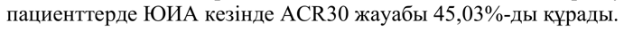
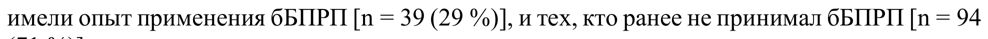

# Тофацитиниб — внутрь

- Препарат: Яквинус (таблетки, покрытые пленочной оболочкой)
- АТХ: L04AA29
- Источник: ОХЛП, Единый реестр ЛС ЕАЭС, запись 65094ec4fb44f13b9518f4c0, документ от 2026-04-02
- Распознано автоматически (OCR): 5 из 154 стр.
- Сомнительных строк после OCR: 2 (см. раздел «Проверка распознавания»)

## Общие сведения

ДӘРІЛІК ПРЕПАРАТТЫҢ ЖАЛПЫ СИПАТТАМАСЫ
1. ДӘРІЛІК ПРЕПАРАТТЫҢ АТАУЫ
Ксельжанс, 5 мг, үлбірлі қабықпен қапталған таблеткалар
Ксельжанс, 10 мг, үлбірлі қабықпен қапталған таблеткалар
2. САПАЛЫҚ ЖӘНЕ САНДЫҚ ҚҰРАМЫ
Әсер етуші зат: тофацитиниб Ксельжанс, 5 мг, үлбірлі қабықпен қапталған таблеткалар
Үлбірлі қабықпен қапталған әрбір таблетканың құрамында 8,078 мг тофацитиниб цитраты түрінде 5 мг тофацитиниб бар.
Дәрілік препарат құрамында бар екені ескерілу керек қосымша заттар: лактоза моногидраты 59,44 мг (4.3, 4.4 бөлімдерін қараңыз).
Қосымша заттардың толық тізімі 6.1 бөлімінде келтірілген.
Ксельжанс, 10 мг, үлбірлі қабықпен қапталған таблеткалар
Үлбірлі қабықпен қапталған әрбір таблетканың құрамында 16,155 мг тофацитиниб цитраты түрінде 10 мг тофацитиниб бар.
Дәрілік препарат құрамында бар екені ескерілу керек қосымша заттар: лактоза моногидраты 118,88 мг (4.3, 4.4 бөлімдерін қараңыз).
Қосымша заттардың толық тізімі 6.1 бөлімінде келтірілген.
3. ДӘРІЛІК ТҮРІ
Үлбірлі қабықпен қапталған таблеткалар.
Ксельжанс, 5 мг, үлбірлі қабықпен қапталған таблеткалар
Дөңгелек, екі жағы дөңес ақ түсті, бір жағында "Pfizer" және екінші жағында – "JKI 5" өрнегі бар үлбірлі қабықпен қапталған таблеткалар.
Ксельжанс, 10 мг, үлбірлі қабықпен қапталған таблеткалар
Дөңгелек, екі жағы дөңес көгілдір түсті, бір жағында "Pfizer" және екінші жағында – "JKI 10" өрнегі бар үлбірлі қабықпен қапталған таблеткалар.
4. КЛИНИКАЛЫҚ ДЕРЕКТЕРІ
4.1. Қолданылуы Ксельжанс препараты келесі көрсетілімдер бойынша қолдануға арналған:

Ревматоидты артрит Тофацитиниб қабынуға қарсы бір немесе бірнеше базистік препараттарға (ҚҚБП) жауабы талапқа сай емес немесе олардың жақпаушылығы болған орташа немесе ауыр белсенді ревматоидтық артриті (РА) бар ересек пациенттерді емдеу үшін метотрексатпен (МТ)
біріктірілімде қолдануға арналған (5.1 бөлімін қараңыз).
Тофацитинибті МТ жақпаушылығында немесе МТ-мен емдеу мақсатқа сай емес болған жағдайларда монотерапия түрінде қолдануға болады (4.4 және 4.5 бөлімдерін қараңыз).
Псориаздық артрит Тофацитиниб қабынуға қарсы бір немесе бірнеше базистік препараттарға (ҚҚБП) жауабы талапқа сай емес немесе олардың жақпаушылығы болған белсенді псориаздық артриті
(ПсА) бар ересек пациенттерді емдеу үшін метотрексатпен (МТ) біріктірілімде қолдануға арналған (5.1 бөлімін қараңыз).
Шорбуынданған спондилоартрит Тофацитиниб белсенді шорбуынданған спондилоартриті (ШС) бар дәстүрлі емге жауабы талапқа сай емес ересек пациенттерді емдеу үшін қолданылады.
Ойық жаралы колит Тофацитиниб орташа немесе ауыр белсенді ойық жаралы колиті (ОЖК) бар, стандартты емге немесе биологиялық дәрілерге жауабы талапқа сай емес, жауабы жоғалған немесе жақпаушылығы бар ересек пациенттерді емдеу үшін қолданылады (5.1 бөлімін қараңыз).
Ювенильді идиопатиялық артрит (пЮИА)
Тофацитиниб ҚҚБП алдыңғы еміне жауабы талапқа сай емес 2 жастағы және одан асқан пациенттерде белсенді полиартикулярлық ювенильді идиопатиялық артриттті (оң [RF+] немесе теріс [RF–] ревматоидтық факторымен полиартрит және таралған олигоартрит)
және ювенильді псориаздық артритті (ПсА) емдеу үшін қолданылады.
Тофацитинибті метотрексатпен (МТ) біріктірілімде немесе МТ жақпаушылық жағдайында немесе МТ қолданып емдеуді жалғастыру орынсыз болған жағдайларда монотерапия түрінде тағайындауға болады.
COVID-19 туындатқан жаңа коронавирустық инфекция
Ағымы жеңіл/орташа ағымдағы және өкпеде КТ1-2 сәйкес патологиялық өзгерістер болған кезде ауыр ағымның қауіп факторлары бар, бірақ инвазиялық немесе инвазиялық емес желдетуді немесе экстракорпоральді жарғақшалық оксигенацияны
(ЭКЖО)
қабылдамайтын ауруханаға жатқызылған ересек пациенттердегі COVID-19 туындатқан жаңа коронавирустық инфекция.
4.2. Дозалау режимі және қолдану тәсілі
Емдеуді тофацитинибті қолдану көрсетілген ауруларды диагностикалау және емдеу тәжірибесі бар дәрігер-мамандар тағайындауы және бақылауы тиіс.
Дозалау режимі

Ревматоидты артрит және псориаздық артрит
Ұсынылатын дозасы тәулігіне екі рет 5 мг; бұл дозадан асырмаған жөн.
МТ-мен біріктіріп қолданған кезде препараттың дозасын түзету талап етілмейді.
Үлбірлі қабықпен қапталған тофацитиниб таблеткаларын қолданудан босап шығуы модификацияланған тофацитиниб таблеткаларына ауысу туралы ақпаратты 1-кестеден қараңыз.
1-кесте.
Үлбірлі қабықпен қапталған тофацитиниб таблеткаларын қолданудан босап шығуы модификацияланған тофацитиниб таблеткаларына ауысу
Үлбірлі қабықпен қапталған тофацитиниб мг таблеткаларын қолданудан босап шығуы модификацияланған тофацитиниб мг таблеткаларына ауысу a
Үлбірлі қабықпен қапталған тофацитиниб таблеткаларын тәулігіне екі рет 5 мг-ден қабылдаудан босап шығуы модификацияланған тофацитиниб таблеткаларын тәулігіне бір рет мг-ден қабылдауға немесе кері ауысу таблеткалардың кез келгенінің соңғы дозасын қабылдағаннан кейін келесі күні мүмкін болады а Босап шығуы модификацияланған дәрілік түрдің және үлбірлі қабықпен қапталған дәрілік түрдің фармакокинетикасын салыстыру үшін 5.2 бөлімін қараңыз.
Шорбуынданған спондилоартрит Тофацитинибтің ұсынылатын дозасы тәулігіне екі рет 5 мг құрайды.
Ойық жаралы колит Индукциялық ем Препараттың 8 апта бойы индукциялық ем үшін ұсынылатын дозасы тәулігіне екі рет пероральді 10 мг құрайды.
8-ші аптада жеткілікті емдік әсерге жетпеген пациенттер препаратты индукциялық режимде
(тәулігіне екі рет 10 мг) қабылдауды тағы 8 апта (яғни, барлығы 16 апта) жалғастыра алады, содан кейін препаратты демеуші ем ретінде тәулігіне екі рет 5 мг дозада қабылдауға ауысады. Тофацитинибпен индукциялық ем 16-аптаға қарай емдік жауап белгілері байқалмаған пациенттерде тоқтатылады.
Демеуші ем Демеуші ем үшін тофацитинибтің ұсынылатын дозасы пероральді тәулігіне екі рет 5 мг құрайды.
Веналық тромбоэмболияның (ВТЭ), негізгі жағымсыз жүрек-қантамырлық құбылыстардың
(НЖЖҚҚ) және қатерлі жаңа түзілімдердің белгілі қауіп факторларымен ОЖК бар пациенттерде, емдеудің лайықты баламалы әдістері болмаған жағдайларды қоспағанда, демеуші ем ретінде тәулігіне екі рет 10 мг дозада тофацитинибті қолдану ұсынылмайды
(4.4 және 4.8 бөлімдерін қараңыз).
Егер пациентте тәулігіне екі рет 5 мг дозадағы тофацитинибпен емге жауабының әлсіреуі және ісік некрозы факторының тежегіштерімен (ІНФ тежегіштері) емдеу сияқты ойық жаралы колитті емдеудің балама әдістеріне жауабы жоқ екені байқалса, ВТЭ, НЖЖҚҚ және қатерлі жаңа түзілімдердің қаупі жоғары емес ОЖК бар пациенттер үшін (4.4 бөлімін қараңыз) тофацитинибті тәулігіне екі рет 10 мг дозада пероральді қолдануды қарастыруға

болады. Тофацитинибті демеуші ем ретінде тәулігіне екі рет 10 мг дозада мүмкіндігінше қысқа уақыт мерзімі ішінде қолдану керек. Емдік жауапты сақтап тұру үшін қажетті ең төмен тиімді дозаны қолдану керек.
Тофацитинибпен емдеуге жауап берген пациенттерге дозаны азайтуға және (немесе)
стандартты емге сәйкес кортикостероидтарды қолдануды тоқтатуға болады.
ОЖК кезіндегі қайталап емдеу курсы Емдеуде үзіліс болған жағдайда тофацитинибпен емдеуді қайта бастау мүмкіндігін қарастыруға болады.
Жауап жоғалған жағдайда тәулігіне екі рет мг дозада тофацитинибпен индукциялық емді қайталау қарастырылуы мүмкін.
Клиникалық зерттеулерде емдеудің үзіліс кезеңі 1 жылға дейін созылды. Тиімділікті тәулігіне екі рет 10 мг дозада қолдану арқылы 8 апталық емнен кейін қалпына келтіруге болады (5.1 бөлімін қараңыз).
Полиартикулярлық ЮИА және ювенильді ПсА (2-ден 18 жасқа дейінгі балалар)
Тофацитинибті монотерапия түрінде немесе МТ біріктіріп қолдануға болады.
2 жастағы және одан асқан пациенттер үшін ұсынылатын доза келесі салмақ санаттарына негізделген:
2-кесте. Тофацитинибтің полиартикулярлық ювенильді идиопатиялық артриті және ювенильді ПсА бар 2 жастағы және одан асқан пациенттерді емдеу үшін ұсынылатын дозасы
Дене салмағы (кг)
Дозалау режимі 10 – < 20 3,2 мг (3,2 ішуге арналған ерітінді) тәулігіне екі рет 20 – < 40 4 мг (4 мл ішуге арналған ерітінді) тәулігіне екі рет
≥40 5 мг (5 мл ішуге арналған ерітінді немесе үлбірлі қабықпен қапталған таблетка, 5 мг) тәулігіне екі рет
Тәулігіне екі рет ішке қабылдауға арналған 5 мл ерітінді түріндегі тофацитиниб қабылдаған дене салмағы ≥40 кг пациенттерді тәулігіне екі рет 5 мг-ден үлбірлі қабықпен қапталған таблеткалар түріндегі тофацитинибке ауыстыруға болады. Дене салмағы < 40 кг пациенттерді ішке қабылдауға арналған ерітінді түріндегі тофацитинибтен басқа түріне ауыстыруға болмайды.
COVID-19 туындатқан жаңа коронавирустық инфекция
Ересек пациенттер үшін Ксельжанс препаратының ұсынылатын доза 14 күн бойы тәулігіне екі рет 10 мг құрайды. Тофацитиниб тек ауруханаға жатқызылған пациенттерде және осы ауруды емдеуде тәжірибесі бар маман-дәрігерлердің бақылауымен қолданылуы тиіс. Егер 14 күндік емдеу кезеңі аяқталмай тұрып стационардан шығарса, тофацитиниб қабылдауды тоқтату керек.
Ксельжанс 5 мг препаратының екі таблеткасы Ксельжанс 10 мг препаратының бір таблеткасына биобаламалы және Ксельжанс 10 мг препаратының бір таблеткасына балама ретінде пайдалануға болады.
Ересектер мен балаларда емді уақытша немесе толық тоқтату
Пациентте күрделі инфекция дамыған кезде тофацитинибпен емдеуді инфекцияға бақылау орнатылғанға дейін тоқтата тұрған жөн.

Лимфопенияны, нейтропенияны және анемияны қоса, зертханалық көрсеткіштердің дозаға тәуелді ауытқулары дамыған жағдайда емді уақытша тоқтату қажет болуы мүмкін. Төменде 3, 4 және 5-кестелерде келтірілген емді уақытша немесе толық тоқтату жөніндегі ұсынымдар зертханалық көрсеткіштердің нәтижелерінің қалыптан ауытқуының ауырлық дәрежесіне байланысты болады (4.4 бөлімін қараңыз).
Лимфоциттердің абсолюттік саны (ЛАС) 750 жасуша/мм3 аз пациенттерде препаратпен емді бастау ұсынылмайды.
3-кесте. Лимфоциттердің төмен абсолюттік саны
Лимфоциттердің төмен абсолюттік саны (ЛАС) (4.4 бөлімін қараңыз)
Зертханалық көрсеткіш (жасуша /мм3)
Ұсыным ЛАС 750-ден көп немесе тең Доза сақталуы тиіс.
ЛАС 500–750 Осы көрсеткіш тұрақты төмендеген кезде (дағдылы зертханалық зерттеу кезінде осы диапазонда қатарынан 2 мән) дозаны азайту немесе препаратты қабылдауды тоқтата тұру керек.
Ксельжанс препаратын тәулігіне екі рет 10 мг дозада қабылдайтын пациенттерге тофацитинибтің дозасын тәулігіне екі рет 5 мг дейін азайту керек.
Ксельжанс препаратын тәулігіне екі рет 5 мг дозада қабылдайтын пациенттерге препаратты қабылдауды тоқтата тұру керек.
ЛАС 750-ден жоғарылаған кезде, емді клиникалық көрсетілімдерге сәйкес қайта жаңғырту керек.
ЛАС 500-ден аз Егер зертханалық көрсеткіштің осындай мәні 7 күн ішінде қайта талдау кезінде расталса, препаратты қабылдауды тоқтату керек.
Нейтрофилдердің абсолюттік саны (НАС) 1000 жасуша/мм3 аз ересек пациенттерде препаратпен емдеуді бастау ұсынылмайды. Нейтрофилдердің абсолюттік саны (НАС)
1200 жасуша/мм3 аз балаларда препаратпен емдеуді бастау ұсынылмайды.
4-кесте. Нейтрофилдердің төмен абсолюттік саны
Нейтрофилдердің төмен абсолюттік саны (НАС) (4.4 бөлімін қараңыз)
Зертханалық көрсеткіш (жасуша /мм3)
Ұсыным НАС 1000-нан көбірек Өзгеріссіз қалады.
НАС 500–1000 Осы диапазонда тұрақты төмендеу кезінде
(стандартты зертханалық зерттеу кезінде осы диапазон шегіндегі қатарынан анықталған 2 мән) дозаны азайту немесе 1000-нан қабылдауды уақщытша тоқтату керек.

Ксельжанс препаратын тәулігіне екі рет 10 мг дозада қабылдайтын пациенттерге препараттың дозасын тәулігіне екі рет 5 мг дейін азайту керек.
Ксельжанс препаратын тәулігіне екі рет 5 мг дозада қабылдайтын пациенттерге препаратты қабылдауды уақытша тоқтата тұру керек.
НАС 1000-нан асқан кезде, Ксельжанс препаратын қабылдауды клиникалық көрсетілімдерге сәйкес қайта жаңғырту керек.
НАС 500-ден аз Егер зертханалық көрсеткіштің осындай мәні 7 күн ішінде қайта талдау кезінде расталса, препаратты қабылдауды тоқтату керек.
Гемоглобин деңгейі 9 г/дл аз ересек пациенттерде препаратпен емді бастау ұсынылмайды.
Гемоглобин деңгейі 10 г/дл аз балаларда препаратпен емді бастау ұсынылмайды. «COVID19 туындатқан жаңа коронавирустық инфекция» көрсетілімі үшін гемоглобин деңгейі 8 г/дл аз пациенттерде емді бастау ұсынылмайды.
5-кесте. Гемоглобиннің төмен мәні Гемоглобиннің төмен мәні (4.4 бөлімін қараңыз)
Зертханалық көрсеткіш (г/дл)
Ұсыным ≥9,0 г/дл және 2 г/дл-ге немесе одан аз төмендеуі
Өзгеріссіз қалады.
< 8,0 г/дл немесе 2 г/дл астамға төмендеуі
(қайталап талдау кезінде расталған)
Ксельжанс препаратын қолдануды гемоглобин мәні қалпына келгенге дейін уақытша тоқтата тұру керек.
Өзара әрекеттесулер P450 (CYP) 3A4 цитохромының күшті тежегіштерін (мысалы, кетоконазол), немесе
CYP3A4 изоферментінің орташа тежелуіне де, сондай-ақ CYP2C19 изоферментінің күшті тежелуіне де әкелетін (мысалы, флуконазол) (4.5 бөлімін қараңыз) бір немесе одан көбірек қатарлас препараттарды қабылдап жүрген пациенттерде тофацитинибтің жалпы тәуліктік дозасы төмендегідей екі есе азайтылуы тиіс:
 Тофацитинибтің тәулігіне екі рет 5 мг дозасын қабылдап жүрген пациенттерге оны тәулігіне бір рет 5 мг дейін төмендету керек (ересек пациенттер және балалар).
 Тофацитинибтің тәулігіне екі рет 10 мг дозасын қабылдап жүрген пациенттерге оны тәулігіне екі рет 5 мг дейін төмендету керек (ересек пациенттер).
Тек қана балалар үшін: Қолда бар деректер тофацитинибпен емдеу басталғаннан кейін 18 апта ішінде клиникалық жақсару байқалады деп болжауға мүмкіндік береді.
Егер пациентте осы уақыт кезеңі ішінде клиникалық жақсару байқалмаса, емді жалғастыру туралы мәселені мұқият қайта қарастыру керек.

ШС кезінде қабылдауды тоқтату Қолда бар деректер тофацитинибпен емдеу басталғаннан кейін 16 апта ішінде ШС кезінде клиникалық жақсару байқалады деп болжауға мүмкіндік береді. Егер пациентте осы уақыт кезеңі ішінде клиникалық жақсару байқалмаса, емді жалғастыру туралы мәселені мұқият қайта қарастыру керек.
Пациенттердің ерекше топтары Егде жастағы пациенттер 65 жастағы және одан асқан пациенттерде дозаны түзету талап етілмейді. Препаратты 75 жастағы және одан асқан пациенттерде қолдану туралы деректер шектеулі. 65 жастағы және одан асқан пациенттерде қолдану туралы 4.4 бөлімінен қараңыз.
Бауыр функциясының бұзылуы бар пациенттер 6-кесте. Бауыр функциясының бұзылуында дозаны түзету
Бауыр функциясының бұзылу дәрежесі Жіктелуі
Әсер ету күші әртүрлі таблеткалар үшін бауыр функциясының бұзылуында дозаны түзету
Жеңіл дәреже Чайлд — Пью жіктемесі бойынша А класы
Дозаны түзету қажет емес.
Орташа дәреже Чайлд — Пью жіктемесі бойынша В класы
Егер ұсынылатын доза бауыр функциясы қалыпты болған кезде тәулігіне екі рет 5 мг құраса, дозаны тәулігіне бір рет 5 мг дейін азайту керек.
Егер ұсынылатын доза бауыр функциясы қалыпты болған кезде тәулігіне екі рет 10 мг құраса, дозаны тәулігіне екі рет 5 мг дейін азайту керек (5.2 бөлімін қараңыз).
Ауыр дәреже Чайлд — Пью жіктемесі бойынша С класы
Тофацитинибті бауыр функциясының ауыр бұзылу бар пациенттерде қолдану ұсынылмайды
(4.3 бөлімін қараңыз).
Бүйрек функциясының бұзылуы бар пациенттер 7-кесте. Бүйрек функциясының бұзылуында дозаны түзету
Бүйрек функциясының бұзылу дәрежесі Креатинин клиренсі
Әсер ету күші әртүрлі таблеткалар үшін бүйрек функциясының бұзылуында дозаны түзету
Жеңіл дәреже 50 – 80 мл/мин Дозаны түзету қажет емес.
Орташа дәреже 30 – 49 мл/мин Дозаны түзету қажет емес.
Ауыр дәреже (гемодиализде < 30 мл/мин Егер ұсынылатын доза бүйрек функциясы қалыпты болған кезде тәулігіне екі рет 10 мг

Бүйрек функциясының бұзылу дәрежесі Креатинин клиренсі
Әсер ету күші әртүрлі таблеткалар үшін бүйрек функциясының бұзылуында дозаны түзету жүрген пациенттерді қоса)
құраса, дозаны тәулігіне екі рет 5 мг дейін азайту керек.
Егер ұсынылатын доза бүйрек функциясы қалыпты болған кезде тәулігіне екі рет 10 мг құраса, дозаны тәулігіне екі рет 5 мг дейін азайту керек.
Бүйрек функциясының ауыр бұзылуы бар пациенттер тіпті гемодиализден кейін де препаратты төмендетілген дозада қабылдауды жалғастыруы тиіс (5.2 бөлімін қараңыз).
COVID-19 туындатқан жаңа коронавирустық инфекция
Бүйрек функциясының орташа немесе ауыр дәрежедегі бұзылуы бар пациенттерде дозаны түзету қажет (төмендегі 8-кестені қараңыз). Бүйрек функциясының жеңіл дәрежедегі бұзылуы бар пациенттерде дозаны түзету қажет емес.
Бауыр функциясының ауыр бұзылулары бар пациенттерге Ксельжанс препаратын қабылдау ұсынылмайды. Бауыр функциясының жеңіл немесе орташа дәрежедегі бұзылуы бар пациенттерде препаратты дозалау жөніндегі ұсынымдар төмендегі 8-кестеде келтірілген.
8-кесте. Дозаны түзету/ Емдеуді уақытша тоқтату/ Емдеуді тоқтату критерийлеріa
Зертханалық көрсеткіш/Жайкүй/Өзара әрекеттесу
Мәні Ұсыным Зертханалық ауытқулар Лимфоциттердің абсолюттік саны
≥250 жасуша/мм3 Өзгеріссіз < 250 жасуша/мм3
Емдеуді тоқтату Нейтрофилдердің абсолюттік саны
≥500 жасуша/мм3 Өзгеріссіз < 500 жасуша/мм3
Емдеуді тоқтату Гемоглобин ≥8,0 г/дл Өзгеріссіз
< 8,0 г/дл Емдеуді тоқтату Трансаминазалар деңгейі
АЛТ немесе АСТ < 5 × ҚЖШ Өзгеріссіз АЛТ немесе АСТ ≥5 × ҚЖШ
Емдеуді уақытша тоқтату, тексеру жүргізу және тофацитинибті тоқтату мүмкіндігін қарастыру
Қанның ақ жасушалары ≥1000 жасуша/мм3 Өзгеріссіз
< 1000 жасуша/мм3 Емдеуді тоқтату Пациенттердің ерекше санаттары
Бауыр функциясының бұзылуы

Бауыр функциясының жеңіл дәрежеде бұзылуы
Өзгеріссіз Бауыр функциясының орташа дәрежеде бұзылуы
Тәулігіне екі рет 5 мг Бүйрек функциясының бұзылуы
Бүйрек функциясының жеңіл дәрежеде бұзылуы
(еШСЖ) ≥60 мл/мин/1,73 м2 және < 90 мл/мин/1,73 м2)
Өзгеріссіз Бүйрек функциясының ауыр дәрежеде бұзылуы (еШСЖ
< 30 мл/мин/1,73 м2) немесе орташа дәрежеде (еШСЖ < 60 мл/мин/1,73 м2)
Тәулігіне екі рет 5 мг Дәрілік өзара әрекеттесулер
CYP3A4 күшті тежегіштерімен, немесе CYP3A4 орташа тежегішінің және CYP2C19 күшті тежегішінің біріктірілімімен бір мезгілде қолдану
Тәулігіне екі рет 5 мг Қысқартулар: АЛТ - аланинаминотрансфераза, АСТ - аспартатаминотрансфераза, еШСЖ – есептік шумақтық сүзілу жылдамдығы, ҚЖШ – қалыптың жоғарғы шегі.
a Егер зертханалық ауытқудың негізгі аурумен байланыстылығы ықтимал болса, тофацитинибті сол немесе төмендетілген дозада қабылдауды жалғастырудың қаупі мен пайдасын қарастыру керек.
Балалар Ксельжанс препаратының полиартикулярлық ЮИА және ювенильді ПсА шалдыққан 2 жасқа дейінгі балаларда қауіпсіздігі мен тиімділігі анықталмаған. Деректер жоқ.
Басқа көрсетілімдері бар (мысалы, ойық жаралы колит) 18 жасқа дейінгі балаларда тофацитинибтің қауіпсіздігі мен тиімділігі анықталмаған. Деректер жоқ.
Қолдану тәсілі Тамақ ішуге байланыссыз ішке қабылдауға арналған.
Жұтуға қиналатын пациенттер тофацитиниб таблеткаларын сындырып, сумен ішуіне болады.
4.3. Қолдануға болмайтын жағдайлар Ксельжанс препаратын мынадай жағдайларда қолдануға болмайды:

 тофацитинибке немесе 6.1 бөлімінде атап көрсетілген қосымша заттардың кез келгеніне аса жоғары сезімталдықта;
 белсенді туберкулезде (БТ), сепсис сияқты ауыр инфекцияларда немесе оппортунистік инфекцияларда (4.4 бөлімін қараңыз);
 бауырдың функциясының ауыр бұзылуында (4.2 бөлімін қараңыз);
 жүктілік және лактация кезеңінде (4.6 бөлімін қараңыз).
4.4. Айрықша нұсқаулар және қолдану кезіндегі сақтандыру шаралары
Тофацитинибті қолайлы баламалы емдеу әдістері болмаған жағдайда ғана келесі пациенттерде қолдану керек:
- 65 жастағы және одан асқан;
- анамнезінде атеросклероздық жүрек-қантамыр аурулары немесе жүрек-қантамыр аурулары дамуының басқа қауіп факторлары бар (мысалы, қазіргі кезде немесе бұрыннан ұзақ уақыт бойы шылым шегетін пациенттер);
- қатерлі жаңа түзілімдердің (мысалы, қазіргі кезде немесе анамнезіндегі қатерлі ісік)
дамуының қауіп факторлары бар 65 жастағы және одан асқан пациенттерде қолдану 65 жастағы және одан асқан пациенттерде тофацитиниб қабылдаған кезде күрделі инфекциялар дамуының, миокард инфарктісі, қатерлі жаңа түзілімдердің және кез келген себептен болатын өлім қаупінің жоғарылауын ескере отырып, тофацитинибті емдеудің қолайлы баламалы әдістері болмаған кезде ғана қолдану керек (қосымша ақпаратты төмендегі 4.4 және 5.1 бөлімдерінен қараңыз).
Басқа препараттармен біріктіріп қолдану Тофацитинибті қолдану зерттелген жоқ, және оны ІНФа тежегіштері, интерлейкин (IL)-1R антагонистері,
IL-6R антагонистері, CD20-ға моноклональді антиденелер,
IL-17 антагонистері, IL-12/ IL-23 антагонистері, антиинтегриндер, ко-стимуляцияның селективті модуляторлары және белсенділігі жоғары иммунодепрессанттар
(азатиоприн, 6меркаптопурин, циклоспорин және такролимус)
сияқты биологиялық препараттармен біріктіруден аулақ болу керек, себебі иммуносупрессияның күшеюі ықтималдығынан одан әрі инфекцияның даму қаупінің артуы мүмкін.
РА клиникалық зерттеулерінде тофацитинибті МТ-мен біріктіріп қолдану аясында тофацитинибті монотерапия түрінде қолдануға қарағанда жағымсыз құбылыстардың туындауының жоғарырақ жиілігі байқалды.
Тофацитинибті типті фосфодиэстераза тежегіштерімен біріктіріп қолдану тофацитинибтің клиникалық зерттеулерінде зерттелген жоқ.
Веналық тромбоэмболия (ВТЭ)
Тофацитиниб қабылдаған пациенттерде кейбір жағдайларда өліммен аяқталған өкпе артериясының тромбоэмболиясын (ӨАТЭ), сондай-ақ терең веналардың тромбозын (ТВТ)
қоса алғанда, ВТЭ күрделі құбылыстары байқалды. Рандомизацияланған тіркеуден кейінгі қауіпсіздік зерттеуінде РА бар 50 жастағы немесе одан асқан, жүрек-қантамыр аурулары қаупінің кем дегенде бір қосымша факторы бар пациенттерде ІНФ тежегіштерін

қолданумен салыстырғанда тофацитинибті қолданғанда ВТЭ қаупінің дозаға тәуелді жоғарылауы байқалды (4.8 және 5.1 бөлімдерін қараңыз).
Осы зерттеу шеңберіндегі апостериорлық ізденіс талдауы нәтижелері бойынша ВТЭ қауіп факторлары белгілі пациенттерде кейінгі ВТЭ жағдайлары тофацитинибпен ем қабылдаған пациенттерде жиі байқалды, оларда 12 ай емдеуден кейін D-димер деңгейі < 2 × ҚЖШ болған пациенттерге қарағанда D-димер деңгейі ≥2 × ҚЖШ (қалыптың жоғары шегі)
құрады; бұл ІНФ тежегіштерімен емделген пациенттерде айқын болмады. Интерпретация
ВТЭ құбылыстарының саны аздығынан және D-димерге талдаудың қолжетімділігі аз болуынан шектеулі болды (талдау тек бастапқы сатыда, 12 айдан кейін және зерттеудің соңында жүргізілді). Зерттеу кезінде ВТЭ болмаған пациенттерде D-димердің орташа деңгейлері барлық емдеу топтарындағы бастапқы деңгейімен салыстырғанда 12 айдан кейін айтарлықтай төмендеді. Алайда, 12 айдан кейін D-димердің ≥2 × ҚЖШ деңгейлері
ВТЭ кейінгі құбылыстарынсыз пациенттердің шамамен 30%-да байқалды, бұл осы зерттеуде D-димерге талдаудың спецификалығы шектеулі екенін көрсетеді.
ВТЭ, НЖҚЖО және қатерлі жаңа түзілімдердің белгілі қауіп факторларымен ОЖК бар пациенттер үшін, емдеудің лайықты баламалы әдістері болмаған жағдайды қоспағанда, тофацитинибті тәулігіне екі рет 10 мг дозада демеуші ем ретінде қолдану ұсынылмайды
(4.2 бөлімін қараңыз).
Жүрек-қантамырлық аурулардың немесе қатерлі жаңа түзілімдердің дамуының қауіп факторлары бар пациенттерде (4.4 «Негізгі жүрек-қантамырлық жағымсыз құбылыстар
(миокард инфарктін қоса)» және «Қатерлі жаңа түзілімдер және лимфопролиферациялық аурулар» бөлімін де қараңыз) тофацитинибті қолайлы баламалы емдеу әдістері болмаған кезде ғана қолдану керек.
ВТЭ дамуының қауіп факторлары бар пациенттерде, НЖҚЖО немесе қатерлі жаңа түзілімдердің дамуының қауіп факторларын қоспағанда, тофацитинибті сақтықпен қолдану керек. ВТЭ қауіп факторлары, НЖҚЖО немесе қатерлі жаңа түзілімдердің қауіп факторын қоспағанда, мыналарды қамтиды: анамнезінде ВТЭ болуын, пациенттердегі ауқымды хирургиялық араласуды, иммобилизацияны, біріктірілген гормондық контрацептивтерді немесе гормондық орын басу емін қолдануды, қан ұюының тұқым қуалайтын бұзылысын.
Тофацитинибпен емдеу барысында ВТЭ қаупінің өзгерістерін талдау үшін пациенттердің жағдайын қайта бағалауды мезгіл-мезгіл жүргізген жөн.
Белгілі ВТЭ қауіп факторлары бар РА шалдыққан пациенттер үшін шамамен 12 ай емдеуден кейін D-димер деңгейлерін анықтау мүмкіндігін қарастыру керек. Егер D-димерге талдау нәтижесі ≥2 × ҚЖШ құраса, тофацитинибпен емдеуді жалғастыру туралы шешім қабылдағанға дейін клиникалық пайдасы қаупінен асып түсетініне көз жеткізу керек.
ВТЭ белгілері мен симптомдары бар пациенттерге дереу тексеріc жүргізу және дозасына немесе қолдану көрсетіліміне қарамастан, ВТЭ-ға күдік бар пациенттерде тофацитиниб қолдануды тоқтату қажет.
Тофацитиниб зерттелген жоқ, сондықтан оны анамнезінде тромбозы бар немесе қазіргі уақытта расталған тромбозы бар пациенттерде, сондай-ақ жеке немесе туыстықтың бірінші дәрежесіндегі отбасылық анамнезде қан ұюының бұзылуы бар пациенттерде қолданудан аулақ болу керек.
Тофацитинибті COVID-19 туындатқан жаңа коронавирустық инфекциясы бар, ВТЭ антикоагулянттық профилактикасын алатын ауруханаға жатқызылған ересек пациенттерде ғана қолдану керек. Құрамында эстроген бар контрацептивтерді емдеу басталғанға дейін

48 сағат ішінде немесе емдеу кезінде қолданбаған жөн. Терең веналар тромбозының/өкпе артериясының эмболиясының клиникалық белгілері пайда болған кезде тофацитиниб қабылдауды тоқтату керек, пациенттерді дереу тексеру және тиісті емдеу тағайындау қажет.
Көз торқабығы веналарының тромбозы Тофацитиниб қабылдаған пациенттерде көз торқабығы веналарының тромбозы (КТВТ)
жағдайлары туралы хабарланды (4.8 бөлімін қараңыз). Пациенттерге КТВТ бар екенін көрсететін симптомдар пайда болған жағдайда дереу медициналық көмекке жүгінуге кеңес беру керек.
Күрделі инфекциялар Тофацитиниб қабылдаған пациенттерде бактериялық, микобактериялық, зеңдік, вирустық немесе басқа оппортунистік қоздырғыштар туындатқан күрделі, ал кейде өліммен аяқталған инфекциялар байқалды (4.8 бөлімін қараңыз). Оппортунистік инфекциялардың пайда болу қаупі
Азия аймақтарында тұратын пациенттерде жоғары
(4.8 бөлімін қараңыз).
Глюкокортикостероидтарды қабылдайтын ревматоидтық артритке шалдыққан пациенттер инфекциялардың дамуына бейім болуы мүмкін.
Тофацитиниб зерттелмеген және оны иммуносупрессияның күшею және инфекция қаупінің жоғарылау мүмкіндігіне байланысты, иммунитеті әлсіреген, иммун тапшылығы жағдайы расталған пациенттерде немесе күшті әсер ететін иммунодепрессанттарды
(мысалы, азатиоприн, циклоспорин), басқа янус-киназа тежегіштерін немесе цитокиндерге,
В-жасушаларға немесе Т-жасушаларға бағытталған биологиялық препараттарды қабылдап жүрген пациенттерде қолданудан аулақ болған жөн.
COVID 19 туындатқан жаңа коронавирустық инфекцияны қоспағанда, Тофацитинибті күдік тудыратын немесе расталған белсенді жүйелі бактериялық, зеңдік немесе вирустық инфекциялары бар, соның ішінде, басқаларымен қатар, белдемелі герпестің белсенді инфекциясы; расталған белсенді туберкулез немесе бұрын талапқа сай емделмеген туберкулез; В гепатитінің (HBV), С гепатитінің (HCV) расталған инфекциялары немесе
АИТВ инфекциясы бар пациенттерде қолданбаған жөн.
Жергілікті инфекцияларды қоса, белсенді инфекциялары бар пациенттерде тофацитинибті қолдануды бастамау керек.
Тофацитинибті қолданар алдында мынадай пациенттерде емнің қауіп/пайда арақатынасын бағалау керек:
 COVID 19 туындатқан жаңа коронавирустық инфекциядан басқа, белсенді күрделі инфекциялары бар;
 қайталанған инфекциялары бар;
 анамнезінде күрделі немесе оппортунистік инфекциясы бар;
 микоздар бойынша эндемиялық аудандарда тұрған немесе жақында барып қайтқандар;
 инфекцияның дамуына бейім болуы мүмкін қатарлас патологиялық жай-күйлері бар.
Пациенттерді тофацитинибпен емдеу кезінде және одан кейін инфекция белгілері мен симптомдарының дамуына қатысты мұқият бақылау керек. Егер пациентте күрделі инфекция, оппортунистік инфекция немесе сепсис дамыса, емдеуді уақытша тоқтату керек.
Тофацитинибті қолдану аясында жаңа инфекция дамыған жағдайда пациентке иммунитеті әлсіреген пациентке сәйкес шұғыл әрі толық диагностикалық тексеру жүргізу, тиісті

бактерияға қарсы емді тағайындау және мұқият динамикалық бақылауды жүзеге асыру керек.
Егде жастағы пациенттерде және қант диабеті бар пациенттерде әдетте инфекция дамуының жиілігі жоғары болатындықтан, мұндай жағдайларда да сақтық танытқан жөн
(4.8 бөлімін қараңыз). 65 жастағы және одан асқан пациенттерді тофацитинибпен емдеуді қолайлы баламалы емдеу әдістері болмаған жағдайда ғана қарастыру керек (5.1 бөлімін қараңыз).
Инфекция қаупі лимфопенияның ауырлық дәрежесі жоғарылаған кезде артуы мүмкін, бұл жағдайда инфекция дамуының жеке қаупін бағалау кезінде лимфоциттер санын ескеру қажет. Препаратты тоқтату шарттары және лимфопенияны бақылау критерийлері 4.2 бөлімінде сипатталған.
Туберкулез Тофацитинибті қолданар алдында пациенттерде емнің қауіп/пайда арақатынасына баға беру керек:
 анамнезінде туберкулезі бар;
 туберкулез бойынша эндемиялық аудандарда тұрған немесе жақында барып қайтқандар.
Тофацитинибті қолданар алдында және онымен емдеу кезінде пациенттің жай-күйіне баға беру және жергілікті ұсынымдарға сәйкес жасырын немесе белсенді туберкулез инфекциясының белгілеріне тексеру жүргізу керек.
Жасырын туберкулезі бар пациенттерге тофацитинибпен емді бастар алдында стандартты антимикобактериялық ем жүргізу керек.
Тофацитинибпен емдеуді бастамас бұрын туберкулезге зерттеудің теріс нәтижесі бар, бірақ анамнезінде туберкулезге қарсы емнің талапқа сай курсы расталмаған жасырын немесе белсенді туберкулезбен ауыратын пациенттерде, сондай-ақ тест нәтижелері теріс, бірақ туберкулездік инфекцияның қауіп факторлары бар пациенттерде туберкулезге қарсы ем жүргізу мүмкіндігін қарастыру керек. Әрбір нақты пациентте туберкулезге қарсы ем жүргізу қажеттілігі туралы шешім қабылдаған кезде фтизиатрмен кеңесу ұсынылады.
Пациенттер емді бастар алдында жасырын туберкулезге тест нәтижесі теріс пациенттерді қоса, туберкулездің белгілері мен симптомдарының дамуына қатысты мұқият бақылауда болуы керек.
Вирустық инфекциялардың қайта белсенділенуі
Герпес вирусының (мысалы, белдемелі герпестің) қайта белсенділену жағдайларын қоса, вирустық инфекциялардың қайта белсенділену жағдайлары тофацитинибтің клиникалық зерттеулерінде сипатталған (4.8 бөлімін қараңыз).
Тофацитинибпен емдеген кезде белдемелі герпестің пайда болу жиілігі артуы мүмкін:
 жапон немесе кәріс ұлтынан шыққан пациенттерде;
 ЛАС 1000 жасуша/мм3 аз пациенттерде (4.2 бөлімін қараңыз);
бұрын екі немесе одан көп биологиялық ҚҚБП алған, анамнезінде ұзаққа созылған РА бар пациенттерде;

 препаратты тәулігіне екі рет 10 мг дозада алатын пациенттерде.
Тофацитинибтің созылмалы вирустық гепатиттің қайта белсенділенуіне әсері белгісіз.
Скрининг кезінде В және С гепатитіне тест нәтижелері оң болған пациенттер клиникалық зерттеулерден шығарып тасталды. Тофацитинибпен емдеуді бастар алдында клиникалық нұсқауларға сәйкес вирустық гепатиттің бар-жоқтығына скрининг жүргізу керек.
Тіркеуден кейінгі кезеңде тофацитиниб қабылдаған РА бар пациенттерде кем дегенде расталған бір үдемелі мультифокалдық лейкоэнцефалопатия (ҮМЛ) жағдайы тіркелген.
ҮМЛ өліммен аяқталуы мүмкін және мұны иммуносупрессиясы бар және жаңа неврологиялық симптомдар пайда болған немесе олар өршіген пациенттерде дифференциалды диагностикалау кезінде ескеру керек.
Негізгі жағымсыз жүрек-қантамырлық оқиғалар (миокард инфарктісін қоса)
Тофацитинибті қабылдаған пациенттерде негізгі жағымсыз жүрек-қантамырлық оқиғалар
(НЖЖҚО) байқалды.
Рандомизацияланған тіркеуден кейінгі қауіпсіздік зерттеуінде 50 жастағы және одан асқан, жүрек-қантамыр ауруларының кем дегенде бір қосымша факторымен РА бар пациенттерде тофацитинибті қолданған кезде ІНФ тежегіштерімен салыстырғанда миокард инфарктінің пайда болу жиілігінің ұлғаюы байқалды (4.8 және 5.1 бөлімдерін қараңыз). 65 жастағы және одан үлкен, шылым шегетін немесе бұрын ұзақ уақыт бойы шылым шеккен пациенттерде, және анамнезінде атеросклероздық жүрек-қантамырлық аурулары немесе жүрекқантамырлық аурулардың басқа да қауіп факторлары бар пациенттерде тофацитинибті емдеудің басқа қолайлы баламалы әдістері болмаған жағдайда ғана қолдану керек (5.1 бөлімін қараңыз).
Қатерлі жаңа түзілімдер және лимфопролиферациялық аурулар
Тофацитиниб организмнің қатерлі жаңа түзілімдерден қорғану механизмдеріне қолайсыз ықпал етуі мүмкін.
Рандомизацияланған тіркеуден кейінгі қауіпсіздік зерттеуінде 50 жастағы және одан асқан, жүрек-қантамыр ауруларының кем дегенде бір қосымша факторымен РА бар пациенттерде тофацитинибті қолданған кезде
ІНФ тежегіштерімен салыстырғанда қатерлі жаңа түзілімдердің, әсіресе меланомалық емес тері обырының (МЕТО), өкпе обырының немесе лимфоманың пайда болу жиілігінің ұлғаюы байқалды (4.8 және 5.1 бөлімдерін қараңыз).
Басқа клиникалық зерттеулерде және препаратты тіркеуден кейінгі қолдану кезеңінде де тофацитинибті қабылдаған пациенттерде МЕТО, өкпе обырының және лимфоманың даму жағдайлары байқалды.
Клиникалық зерттеулерде және тіркеуден кейінгі кезеңде сүт безінің обырын, меланоманы, қуық асты безінің обырын және ұйқы безінің обырын қоса, бірақ олармен шектелмей, басқа да қатерлі жаңа түзілімдердің даму жағдайлары тіркелді.

65 жастағы және одан үлкен, шылым шегетін немесе бұрын ұзақ уақыт бойы шылым шеккен пациенттерде, және қатерлі жаңа түзілімдердің басқа да қауіп факторлары бар пациенттерде (мысалы, емдеу сәтіндегі қатерлі жаңа түзілім немесе анамнездегі қатерлі жаңа түзілім, сәтті емделген МЕТО-дан басқа) тофацитинибті емдеудің басқа қолайлы баламалы әдістері болмаған жағдайда ғана қолдану керек (5.1 бөлімін қараңыз).
Меланомалық емес тері обыры (МЕТО)
Барлық пациенттерге, әсіресе тері обырының даму қаупі жоғары пациенттерге теріні мезгілмезгіл тексеріп отыру ұсынылады (4.8 бөлімінен 9-кестені қараңыз).
Өкпенің интерстициялық ауруы Сондай-ақ, анамнезінде өкпенің созылмалы ауруы бар пациенттерде сақтық таныту ұсынылады, себебі олар инфекцияларға анағұрлым бейім болуы мүмкін. Тофацитинибті
РА кезінде клиникалық зерттеулерде және тіркеуден кейінгі қолдану жағдайларында қабылдаған пациенттерде өкпенің интерстициялық ауру құбылыстары (олардың кейбіреуі
– өліммен аяқталған) тіркелді, дегенмен янус-киназа (JAK) тежелуінің бұл құбылыстардың дамуындағы рөлі белгісіз. Шығу тегі азиялық, РА бар пациенттер өкпенің интерстициялық ауруының даму қаупіне көбірек ұшырайтыны белгілі, сондықтан бұл пациенттерді емдеген кезде сақтық таныту керек.
АІЖ ағзаларының тесілу жағдайлары Клиникалық зерттеулерде асқазан-ішек жолы ағзаларының тесілу жағдайлары сипатталды, дегенмен бұл құбылыстарда JAK тежелуінің рөлі белгісіз. Тофацитинибті асқазан-ішек жолының тесілу қаупі жоғары пациенттерде (мысалы, анамнезінде дивертикулиті бар пациенттерде және кортикостероидтармен және/немесе қабынуға қарсы стероидты емес препараттармен қатарлас ем алатын пациенттерде) сақтықпен қолдану керек.
Құрсақ қуысы тарапынан жаңа симптомдары бар немесе бұрыннан бар симптомдары нашарлаған пациенттерді асқазан-ішек жолының тесілуін ерте анықтау үшін дереу тексеру керек.
Сынықтар Тофацитинибпен ем қабылдаған пациенттерде сынықтар тіркелген.
Тофацитинибті сыну қаупінің белгілі факторлары бар пациенттерде, мысалы, көрсетіліміне және дозалау режиміне қарамастан, егде жастағы пациенттерде, әйелдерде және кортикостероидтар алатын пациенттерде сақтықпен қолдану керек.
Бауыр ферменттері Тофацитинибпен емдеу кезінде кейбір пациенттерде бауыр ферменттері деңгейлерінің жоғарылау жиілігі артқаны байқалды (4.8 «Бауыр ферменттерінің деңгейлерін анықтауға арналған талдаулар»
бөлімін қараңыз).
Аланинаминотрансфераза (АЛТ)
немесе аспартатаминотрансфераза (АСТ) деңгейлері жоғары пациенттерде, әсіресе МТ сияқты әлеуетті гепатоуытты дәрілік препараттармен біріктіріп қолдануды бастаған кезде тофацитинибпен емдеуді бастау туралы мәселеге мән беріп қарау керек.
Емдеу басталғаннан кейін бауырдың дәрілік зақымдануының әлеуетті жағдайларын анықтау үшін бауыр функциясының биохимиялық көрсеткіштерін тұрақты негізде бақылауды жүзеге асыру және бауыр ферменттері деңгейлері жоғарылауының ықтимал себептерін жылдам

анықтау ұсынылады. Егер бауырдың дәрілік зақымдануына күдік туса, осы диагноз жоққа шығарылғанға дейін тофацитинибпен емдеуді тоқтата тұру керек.
Аса жоғары сезімталдық Тіркеуден кейінгі кезеңде тофацитинибті қолдану аясында аса жоғары сезімталдық реакцияларының жағдайлары байқалды. Аллергиялық реакциялар ангионевроздық ісінуді және есекжемді қамтыды; кейбір жағдайлар күрделі ретінде бағаланды.
Күрделі анафилаксиялық реакция немесе аса жоғары сезімталдық реакциялары туындаған жағдайда тофацитинибті қолдануды дереу тоқтату қажет.
Зертханалық көрсеткіштер Лимфоциттер Тофацитинибпен емдеген кезде плацебомен салыстырғанда лимфопенияның пайда болуының жоғарырақ жиілігі байқалды.
Лимфоциттер санының 750 жасуша/мм3 аз деңгейге дейін төмендеу жағдайлары күрделі инфекциялардың туындау жиілігінің артуымен байланысты болды.
Лимфоциттердің дәлелденген саны 750 жасуша/мм3 аз пациенттерде тофацитинибпен емді бастау немесе жалғастыру ұсынылмайды.
Лимфоциттердің санын бастапқы сатыда, содан соң әр 3 айда бақылау керек. Лимфоциттер санына байланысты дозаны өзгерту жөніндегі ұсынымдар 4.2 бөлімінде келтірілген.
Нейтрофилдер Тофацитинибпен емдеу плацебомен салыстырғанда нейтропенияның (2000 жасуша/мм3 аз)
даму жиілігінің жоғарылауымен қатар жүрді. Ересек пациенттерде НАС 1000 жасуша/мм3 аз болғанда және балаларда НАС 1200 жасуша/мм3 аз болғанда тофацитинибпен емдеуді бастау ұсынылмайды. НАС бастапқы сатыда, емдеудің 4–8 аптасынан кейін, содан соң әрбір 3 ай сайын бақылау керек. Дозаны НАС байланысты өзгерту жөніндегі ұсынымдар 4.2 бөлімінде келтірілген.
Гемоглобин Тофацитинибпен емдеу кезінде гемоглобин деңгейінің төмендеуі байқалды. Гемоглобин деңгейі 9 г/дл-ден кем болғанда ересек пациенттерде және гемоглобин деңгейі 10 г/дл-ден кем болғанда балаларда тофацитинибпен емді бастау ұсынылмайды. Гемоглобин деңгейін емнің бастапқы деңгейінде, емдеудің 4–8 аптасынан кейін, содан соң әр 3 ай сайын бақылау керек.
Гемоглобин деңгейіне байланысты дозаны өзгерту жөніндегі ұсынымдар 4.2 бөлімінде келтірілген.
Липидтер деңгейін мониторингтеу Тофацитинибпен емдеу қандағы липидтер деңгейінің – жалпы холестериннің, тығыздығы төмен липопротеиндер
(ТТЛП)
холестеринінің, сонда-ақ тығыздығы жоғары липопротеиндер (ТЖЛП) холестеринінің жоғарылауымен қатар жүреді. Ең жоғары әсер әдетте 6 аптаның ішінде байқалды. Липидтік параметрлерді бағалауды тофацитинибпен емдеу басталғаннан кейін 8 апта өткен соң орындау керек.
Пациенттерді емдеуді гиперлипидемияны емдеу жөніндегі клиникалық нұсқауларға сәйкес жүргізу қажет.
Тофацитинибпен емдеу аясында жалпы холестериннің және
ТТЛП холестериннің концентрациясы жоғары пациенттерде статиндерді қолдану бастапқы көрсеткіштерге жетуге мүмкіндік береді.
Диабетті емдеуге арналған препараттарды қабылдайтын пациенттердегі гипогликемия

Диабетті емдеуге арналған препараттарды қабылдаған пациенттерде тофацитинибпен емдеуді бастағаннан кейін гипогликемия жағдайлары туралы хабарланды. Гипогликемия дамыған жағдайда диабетке қарсы препараттың дозасын түзету қажет болуы мүмкін.
Вакцинациялар Тофацитинибті қолдану басталғанға дейін барлық пациенттерге, әсіресе полиартикулярлық ювенильді идиопатиялық артриті (пЮИА) және ювенильді псориаздық артриті (ЮПА) бар пациенттерге вакцинация жөніндегі заманауи нұсқауларға сәйкес барлық қажетті иммунизацияны орындау ұсынылады. Тофацитинибпен бір мезгілде тірі вакциналарды енгізу ұсынылмайды. Тофацитинибпен емдеуді бастағанға дейін тірі вакциналарды қолдану туралы шешім қабылдау кезінде нақты пациентте иммуносупрессияның болуын ескеру керек.
Белдемелі герпеске қарсы профилактикалық вакцинация жүргізуді вакцинация жөніндегі нұсқауларға сәйкес қарастыру керек. Бұрын екі немесе одан көп биологиялық ҚҚБП-мен емделген, ұзаққа созылған РА бар пациенттерге ерекше көңіл бөлу керек. Егер белдемелі герпеске (herpes zoster) арналған тірі вакцина енгізілсе, оны анамнезінде желшешекпен ауыру жағдайы құжатталған пациенттерге ғана немесе желшешек вирусына (ЖШВ)
қатысты серопозитивті пациенттерге ғана енгізу керек. Егер анамнезінде желшешектің болуы туралы мәліметтер күмәнді немесе сенімсіз болып есептелсе,
ЖШВ-ға антиденелердің бар-жоғына талдау жүргізу ұсынылады.
Тірі вакциналармен вакцинациялауды тофацитиниб сияқты иммуномодуляциялайтын дәрілермен ем басталғанға дейін кем дегенде 2 апта бұрын, бірақ дұрысы 4 апта бұрын жүргізу керек. Тофацитинибпен ем алатын пациенттерге тірі вакциналарды енгізу кезінде инфекцияның қайтадан берілуі туралы деректер жоқ.
Инвазиялық немесе инвазиялық емес желдетуді немесе экстракорпоральді жарғақшалық оксигенацияны (ЭКЖО) қажет ететін пациенттерде қолдану
Тофацитиниб инвазиялық емес желдету, инвазиялық механикалық желдету немесе ЭКЖО қажет болмаған ауруханаға жатқызылған ересек пациенттерде ғана зерттелді.
Тофацитиниб емдеудің басында инвазиялық емес желдету, инвазиялық механикалық желдету немесе ЭКЖО қажет болатын пациенттерде қолданылмауы тиіс.
Қосымша заттар Лактоза Бұл дәрілік препараттың құрамында лактоза бар. Сирек кездесетін тұқым қуалайтын галактоза жақпаушылығы, немесе глюкоза-галактоза мальабсорбциясы бар пациенттерге бұл дәрілік препаратты қабылдауға болмайды.
Натрий Бұл дәрілік препараттың құрамында бір таблеткаға 1 ммольден аз (23 мг) натрий бар, яғни құрамында натрий жоқ дерлік.
4.5. Басқа дәрілік препараттармен өзара әрекеттесуі және өзара әрекеттесудің басқа түрлері

Басқа дәрілік препараттардың тофацитинибтің фармакокинетикасына (ФК) ықпал ету мүмкіндігі
Тофацитиниб CYP3A4 изоферментінің әсерімен метаболизденетіндіктен, осы изоферментті тежейтін немесе индукциялайтын дәрілік препараттармен өзара әрекеттесуі әбден ықтимал.
CYP3A4 изоферментінің күшті тежегіштерімен (мысалы, кетоконазолмен) бір мезгілде қолданғанда, сондай-ақ
CYP3A4 изоферментінің бір немесе бірнеше орташа тежегіштерімен және
CYP2C19 изоферментінің күшті тежегіштерімен
(мысалы, флуконазолмен) бір мезгілде қолданғанда, тофацитинибтің экспозициясы жоғарылайды
(4.2 бөлімін қараңыз).
CYP изоферменттерінің күшті индукторларымен (мысалы, рифампицинмен) бір мезгілде қолданғанда тофацитинибтің экспозициясы азаяды.
CYP2C19 изоферментінің тежегіштерінің немесе Р-гликопротеиннің тофацитиниб фармакокинетикасына елеулі әсер ету ықтималдығы аз.
Кетоконазолды (CYP3A4 изоферментінің күшті тежегіші), флуконазолды (CYP3A4 изоферментінің орташа тежегіші және
CYP2C19 изоферментінің күшті тежегіші), такролимусты (CYP3A4 изоферментінің әлсіз тежегіші) және циклоспоринді (CYP3A4 изоферментінің орташа тежегіші)
бір мезгілде қолдану тофацитинибтің AUC жоғарылатады, ал оны рифампицинмен (CYP күшті индукторымен) бір мезгілде қолдану тофацитинибтің «концентрация-уақыт» қисығы астындағы ауданын (AUC) төмендетеді.
Тофацитинибті CYP күшті индукторларымен (мысалы, рифампицинмен) бір мезгілде қолдану емге клиникалық жауаптың жоғалуына немесе төмендеуіне әкелуі мүмкін (1суретті қараңыз). Тофацитинибті және CYP3A4 изоферментінің күшті индукторларын бір мезгілде қолдану ұсынылмайды.
Кетоконазолмен және флуконазолмен бір мезгілде қолданған кезде тофацитинибтің ең жоғары концентрациясының
(Cmax)
жоғарылауы байқалды, ал такролимуспен, циклоспоринмен және рифампицинмен бір мезгілде қолданған кезде оның Cmax төмендеуі байқалды. МТ-мен аптасына бір рет 15–25 мг дозада бір мезгілде қолдану РА бар пациенттерде тофацитинибтің фармакокинетикасына ықпалын тигізбейді
(1-суретті қараңыз).

1-сурет. Басқа дәрілік препараттардың тофацитиниб фармакокинетикасына ықпалы 0,5 1,5 2,5
Cmax AUC Cmax AUC Cmax AUC Cmax AUC Cmax
AUC Cmax AUC CYP3A тежеуіші Кетоконазол CYP3A және CYP2C19 тежеуіші Флуконазол
CYP индукторы Рифампицин Метотрексат Такролимус
Циклоспорин Тофацитинибтің дозасын азайту керека
Тофацитинибтің дозасын азайту керека Тиімділігі төмендеуі мүмкін
Дозаны түзету қажет емес Тофацитинибті такролимуспен бірге қолданудан аулақ болу керек
Тофацитинибті циклоспоринмен бірге қолданудан аулақ болу керек
Референттік топпен арақатынасы Бір мезгілде қабылданатын препарат
ФК Арақатынасы және 90% СА Ұсыным Ескертпе: референттік топ тофацитинибті монотерапия ретінде қабылдады.
а Препаратты тәулігіне екі рет 10 мг дозада қабылдайтын пациенттерде тофацитинибтің дозасын тәулігіне екі рет 5 мг дейін азайту керек. Препаратты тәулігіне екі рет 5 мг дозада қабылдайтын пациенттерде тофацитинибтің дозасын тәулігіне бір рет 5 мг дейін азайту керек (4.2 бөлімін қараңыз).
Тофацитинибтің басқа дәрілік препараттардың ФК ықпал ету мүмкіндігі
Дені сау ерікті әйелдерде тофацитинибпен бір мезгілде қолдану пероральді контрацептивтердің, левоноргестрелдің және этинилэстрадиолдың ФК ықпалын тигізген жоқ.
Тофацитинибті МТ-мен 15–25 мг дозада аптасына бір рет бір мезгілде қолдану РА бар пациенттерде МТ AUC және Cmax көрсеткіштерін сәйкесінше 10 % және 13 %-ға төмендетті.
Метотрексат фармакокинетикасының бұл өзгерістері дозаны түзетуді, немесе метотрексаттың дозасын әркімге жеке таңдауды қажет еткен жоқ.
Балалар Өзара әрекеттесуін зерттеулер ересектерде ғана жүргізілген.
4.6. Фертильділік, жүктілік және лактация
Бала тууға қабілетті әйелдер/ Ерлер мен әйелдердегі контрацепция
Ұрпақ өрбіту әлеуеті бар әйелдерге тофацитинибпен ем кезінде және препараттың соңғы дозасын қабылдаудан кейін кем дегенде 4 апта бойы контрацепцияның тиімді құралдарын пайдалануды ұсыну керек.
Жүктілік

Тофацитинибті жүкті әйелдерде қолдануға талапқа сай, жақсы бақыланатын зерттеулер жүргізілген жоқ. Тофацитинибтің тератогендік әсері және егеуқұйрықтар мен үй қояндарында тууға және перинаталдық және постнаталдық дамуға әсері анықталды (5.3 бөлімін қараңыз).
Сақтық шарасы ретінде тофацитинибті жүктілік кезінде қолдануға болмайды (4.3 бөлімін қараңыз).
Лактация Тофацитинибтің адамда емшек сүтіне өту қабілеті зерттелмеген. Емшек еміп жүрген бала үшін қауіптің болуын жоққа шығаруға болмайды. Тофацитиниб емізетін егеуқұйрықтардың сүтімен бөлініп шықты (5.3 бөлімін қараңыз). Сақтық шарасы ретінде тофацитинибті бала емізу кезеңінде қолдануға болмайды (4.3 бөлімін қараңыз).
Фертильділік Препараттың адамның ұрпақ өрбіту функциясына әлеуетті әсеріне ресми зерттеулер жүргізілген жоқ. Тофацитиниб ұрғашы егеуқұйрықтарда ұрпақ өрбіту функциясын бұзған, бірақ еркектерінде ұрпақ өрбіту функциясын бұзбады (5.3 бөлімін қараңыз).
4.7. Көлік құралдарын басқару және механизмдермен жұмыс істеу қабілетіне әсері
Тофацитиниб көлік құралдарын басқару және механизмдермен жұмыс істеу қабілетіне әсер етпейді немесе елеусіз әсерін тигізеді.
4.8. Жағымсыз реакциялар
Қауіпсіздік бейінінің түйіндемесі Ревматоидты артрит
Анағұрлым жиі күрделі жағымсыз реакциялар күрделі инфекциялар болды (4.4 бөлімін қараңыз).
Тофацитинибті қабылдаған барлық пациенттерді қамтитын ұзақ мерзімді қауіпсіздікке баға беруге арналған популяцияда анағұрлым жиі күрделі инфекциялар пневмония (1,7 %), құрсаулы герпес (0,6 %), несеп жолының инфекциясы (0,4 %), тері асты шелмайының қабынуы (0,4 %), дивертикулит (0,3 %) және аппендицит (0,2 %) болды.
Тофацитинибті қолдану кезінде тіркелген оппортунистік инфекцияларға туберкулез және басқа микобактериялық инфекциялар, криптококкоз, гистоплазмоз, өңеш кандидозы, мультидерматомды белдемелі герпес, цитомегаловирустық инфекция,
BK-вирустық инфекциялар және листериоз жатады.
Кейбір пациенттерде жергілікті инфекциялар емес, диссеминацияланған инфекциялар байқалған.
Сондай-ақ клиникалық зерттеулерде тіркелмеген басқа да күрделі инфекциялар (мысалы, кокцидиоидомикоз) туындауы мүмкін.
Бақылау ретінде плацебо немесе МТ қолданылған салыстырмалы жасырын клиникалық зерттеулердің алғашқы 3 айы ішінде ең жиі кездескен жағымсыз реакциялар бас ауыруын
(3,9 %), жоғарғы тыныс алу жолдарының инфекцияларын (3,8 %), жоғарғы тыныс алу жолдарының вирустық инфекцияларын (3,3 %), диареяны (2,9 %), жүрек айнуын (2,7 %)
және артериялық гипертензияны (2,2 %) қамтыды.
Салыстырмалы жасырын, плацебо-бақыланатын зерттеудің немесе бақылау препараты ретінде МТ бар зерттеудің барысында, кез келген жағымсыз реакцияға байланысты алғашқы 3 айдың ішінде емді тоқтату тофацитинибті қабылдаған пациенттер үшін 3,8 % жағдайларда қажет болды. Бақыланатын клиникалық зерттеулерде алғашқы 3 ай ішінде

емді тоқтатуға әкеліп соққан ең жиі инфекциялар белдемелі герпесті (0,19 %) және пневмонияны (0,15 %) қамтыды.
Псориаздық артрит Жалпы алғанда, тофацитиниб қабылдаған белсенді ПсА бар пациенттерде байқалатын қауіпсіздік бейіні РА бар тофацитиниб қабылдаған пациенттердегі қауіпсіздік бейініне сәйкес келеді.
Шорбуынданатын спондилоартрит Жалпы алғанда, тофацитиниб қабылдаған белсенді ШС бар пациенттерде байқалатын қауіпсіздік бейіні РА бар тофацитиниб қабылдаған пациенттердегі қауіпсіздік бейініне сәйкес келеді.
Ойық жаралы колит Индукциялық емнің зерттеулерінде тофацитинибті тәулігіне екі рет 10 мг дозада қабылдаған пациенттерде ең жиі тіркелген жағымсыз реакциялар бас ауруы, назофарингит, жүрек айнуы және артралгия болды.
Тофацитинибті және плацебоны қабылдайтын барлық емдеу топтарында индукциялық және демеуші емді зерттеулерде күрделі жағымсыз реакциялардың ең көп тараған санаттары асқазан-ішек жолы тарапынан бұзылулар мен инфекциялар болды, бұл ретте ең көп тараған күрделі жағымсыз реакция ОЖК нашарлауы болды.
Жалпы алғанда, тофацитинибті қабылдаған ОЖК бар пациенттерде байқалған қауіпсіздік бейіні РА көрсетілімі үшін тофацитинибті қабылдау кезіндегі қауіпсіздік бейініне сәйкес келеді.
Сепсисті, веналық тромбоэмболияны қоса, күрделі инфекциялар, сондай-ақ лимфопенияны және трансаминазалар деңгейінің жоғарылауын қоса, зертханалық ауытқулармен байланысты жағымсыз құбылыстар
COVID-19 туындатқан жаңа коронавирустық инфекциясы бар, тофацитинибті қабылдаған пациенттерде байқалды және тофацитинибтің белгілі жағымсыз дәрілік реакциялары болып табылады.
Жағымсыз реакциялардың кестедегі түйіндемесі
Кестеде РА, ПсА, ШС және ОЖК бар пациенттерде клиникалық зерттеулерде байқалған жағымсыз реакциялар жүйе-ағза кластары (ЖАК) және жиілігі бойынша бөлу арқылы келтірілген. Әрбір жиілік тобының ішінде жағымсыз реакциялар айқындығының кему ретімен орналасады. Даму жиіліктері былай анықталады: өте жиі (≥1/10), жиі (≥1/100, бірақ < 1/10), жиі емес (≥1/1 000, бірақ < 1/100), сирек (≥1/10 000, бірақ < 1/1 000), өте сирек
(< 1/10 000) және жиілігі белгісіз (қолда бар деректер негізінде баға беру мүмкін емес):
9-кесте. Жағымсыз реакциялар Жүйе - ағза класы
Жиі (≥1/100 бірақ <1/10)
Жиі емес (≥1/1000 бірақ <1/100)
Сирек (≥1/10 000 бірақ <1/1 000)
Өте сирек (<1/10 000)
Белгісіз (қолда бар деректерді ң негізінде анықтау мүмкін емес)
Инфекция лар мен инвазияла Пневмония Тұмау
Туберкулез Дивертикулит Пиелонефрит Сепсис
Уросепсис Орталық жүйке жүйесінің

Жүйе - ағза класы Жиі (≥1/100 бірақ <1/10)
Жиі емес (≥1/1000 бірақ <1/100)
Сирек (≥1/10 000 бірақ <1/1 000)
Өте сирек (<1/10 000)
Белгісіз (қолда бар деректерді ң негізінде анықтау мүмкін емес)
р Белдемелі герпес Несеп жолының инфекциясы
Синусит Бронхит Назофаринги т Фарингит Тері асты шелмайының қабынуы
Қарапайым герпес Вирустық гастроэнтерит Вирустық инфекция
Диссеминация ланған туберкулез Бактериемия
Pneumocystis jirovecii туғызған пневмония
Пневмококкты қ пневмония Бактериялық пневмония
Цитомегалови рустық инфекция Бактериялық артрит туберкулезі
Криптококк тық менингит Некроздауш ы фасциит
Энцефалит Стафилокок ктық бактериеми я Mycobacteri um avium кешені туындатқан инфекция
Атипиялық микобактер иялық инфекция Қатерсіз, қатерлі және анықталм аған жаңа түзілімде р
(кисталар мен полиптер ді қоса алғанда)
Өкпе обыры, Меланомалық емес тері обыры Лимфома
Қан және лимфа жүйесі тарапына н бұзылула р
Лимфопения Анемия Лейкопения Нейтропения
Иммунды қ жүйе тарапына н бұзылула р Дәрілік препаратқа аса жоғары сезімталды қ*
Ангионевр

Жүйе - ағза класы Жиі (≥1/100 бірақ <1/10)
Жиі емес (≥1/1000 бірақ <1/100)
Сирек (≥1/10 000 бірақ <1/1 000)
Өте сирек (<1/10 000)
Белгісіз (қолда бар деректерді ң негізінде анықтау мүмкін емес)
оздық ісіну* Есекжем * Метаболи зм мен тамақтану дың бұзылуы
Дислипидеми я Гиперлипиде мия Сусыздану Психикал ық бұзылула р
Ұйқысыздық Жүйке жүйесі тарапына н бұзылула р
Бас ауыру Парестезия Жүрек тарапына н бұзылула р
Миокард инфаркті Тамырлар тарапына н бұзылула р
Артериялық қысымның жоғарылауы Веналық тромбоэмбол ия**
Тыныс алу жүйесі, кеуде қуысы және көкірек ортасы ағзалары тарапына н бұзылула р
Жөтел Ентігу Мұрынның қосалқы қойнауларынд ағы іркілу құбылыстары
Асқазанішек бұзылула ры Іштің ауыруы Құсу
Диарея Жүрек айну

Жүйе - ағза класы Жиі (≥1/100 бірақ <1/10)
Жиі емес (≥1/1000 бірақ <1/100)
Сирек (≥1/10 000 бірақ <1/1 000)
Өте сирек (<1/10 000)
Белгісіз (қолда бар деректерді ң негізінде анықтау мүмкін емес)
Гастрит Диспепсия Бауыр және өт шығару жолдары тарапына н бұзылула р
Майлы гепатоз Бауыр ферменттері белсенділігінің жоғарылауы
Трансаминаза лар белсенділігінің жоғарылауы
Гаммаглутамилтранс фераза концентрацияс ының жоғарылауы
Бауырдың функциялық сынамаларын ың бұзылуы
Тері және тері асты тіндері тарапына н бұзылула р
Бөртпе Акне Эритема Тері қышынуы Бұлшықет
, қаңқа және дәнекер тін тарапына н бұзылула р
Артралгия Буындардың ісінуі Тендинит Бұлшықеттер мен сүйектердің ауыруы
Жалпы бұзылулар және енгізу орнындағ ы реакцияла р
Шеткері ісіну Қызба Шаршағышт ық Зертханал ық және аспаптық
Қандағы креатинфосфо киназа Қандағы креатинин концентрацияс

Жүйе - ағза класы Жиі (≥1/100 бірақ <1/10)
Жиі емес (≥1/1000 бірақ <1/100)
Сирек (≥1/10 000 бірақ <1/1 000)
Өте сирек (<1/10 000)
Белгісіз (қолда бар деректерді ң негізінде анықтау мүмкін емес)
деректер концентрация сының жоғарылауы ының жоғарылауы
Қандағы холестерин концентрацияс ының жоғарылауы
Тығыздығы төмен липопротеинд ер концентрацияс ының жоғарылауы
Дене салмағының жоғарылауы Жарақатт ар, уыттану және емшарала рдың асқынула ры
Байламдардың созылуы Бұлшықеттің созылуы
* Өздігінен келіп түскен хабарламалар деректері
** Веналық тромбоэмболия ӨАТЭ, ТВТ және көздің торқабығы веналарының тромбозын қамтиды.
Жекелеген жағымсыз реакциялардың сипаттамасы
Веналық тромбоэмболия Ревматоидты артрит 50 жастағы және одан үлкен, ревматоидтық артритке шалдыққан, жүрек-қантамырлық қауіптің кем дегенде бір қосымша факторы бар пациенттердегі қауіпсіздіктің тіркеуден кейінгі ірі
(N=4362)
рандомизацияланған бақылаушылық зерттеуі аясында
ІНФ тежеуіштерін қабылдаған пациенттермен салыстырғанда, тофацитиниб қабылдаған пациенттерде ВТЭ пайда болуының дозаға тәуелді жоғары жиілігі байқалды (5.1 бөлімін қараңыз). Бұл құбылыстардың көпшілігі күрделі болды, кейбіреулері өлімге әкеліп соқты.
5 мг тофацитинибтен тәулігіне екі рет, 10 мг тофацитинибтен тәулігіне екі рет және ІНФ тежеуіштерін қабылдаған топтарда ӨАТЭ туындау жағдайларының жиілігі (СА 95 %) 100 пациент-жылға шаққанда құбылыстары бар сәйкесінше 0,17 (0,08–0,33), 0,50 (0,32–0,74)
және 0,06 (0,01–0,17) пациентті құрады. ІНФ тежеуіштерімен салыстырғанда ӨАТЭ үшін қауіптер қатынасы (ҚҚ) тофацитинибті тәулігіне екі рет 10 мг дозада және тофацитинибті тәулігіне екі рет 5 мг дозада қолданған кезде сәйкесінше 2,93 (0,79–10,83) және 8,26 (2,49;

27,43) құрады (5.1 бөлімін қараңыз).
ӨАТЭ байқалған, тофацитиниб қабылдаған пациенттер арасында көпшілігінде (97 %) ВТЭ дамуының қаупі факторлары анықталды.
Шорбуынданған спондилоартрит 2 және 3-фазадағы біріктірілген рандомизацияланған бақыланатын клиникалық зерттеулер аясында 48 аптаға дейін тофацитиниб қабылдаған 420 пациентте (233 пациент-жыл бақылауы) ВТЭ құбылыстары байқалмады.
Ойық жаралы колит (ОЖК)
ОЖК жалғасу үстіндегі зерттеуінде ӨАТЭ және ТВТ жағдайлары тәулігіне екі рет 10 мг тофацитинибті қабылдаған ВТЭ қаупі факторлары бар пациенттерде байқалды.
Жалпы инфекциялар Ревматоидты артрит 3-фазадағы бақыланатын клиникалық зерттеулерде тәулігіне екі рет 5 мг дозада (барлығы 616 пациент) және тәулігіне екі рет 10 мг дозада (барлығы 642 пациент) тофацитинибпен монотерапия топтарында емдеудің алғашқы 3 айы ішінде инфекциялардың пайда болу жиілігі плацебо тобындағы (барлығы 122 пациент) 18,9% - бен (23 пациент) салыстырғанда тиісінше 16,2% - ды (100 пациент) және 17,9% - ды (115 пациент) құрады. 3-фазадағы бақыланатын клиникалық зерттеулерде ҚҚБП фондық емін алған пациенттерде тәулігіне екі рет 5 мг дозада (барлығы 973 пациент) және тәулігіне екі рет 10 мг дозада (барлығы 969 пациент) тофацитинибпен біріктіріп ҚҚБП қолдану топтарында алғашқы 3 ай ішінде инфекциялардың туындау жиілігі плацебо мен ҚҚБП біріктіріп қолдану тобындағы
(барлығы 559 пациент) 18,4 %-бен (103 пациент) салыстырғанда сәйкесінше 21,3 %-ды
(207 пациент) және 21,8 %-ды (211 пациент) құрады.
Анағұрлым жиі тіркелетін инфекциялар жоғарғы тыныс алу жолдарының инфекциялары және назофарингит (сәйкесінше 3,7 % және 3,2 %) болды).
Тофацитинибті қолдану кезінде инфекциялардың туындауының жалпы жиілігі ұзақ мерзімді қауіпсіздігін бағалаудың бүкіл популяциясында (барлығы 4867 пациент) 100 пациент-жылға шаққанда құбылыстары бар 46,1 пациентті құрады (сәйкесінше препаратты тәулігіне екі рет 5 мг және 10 мг дозаларда қабылдау кезінде құбылыстары бар 43,8 және 47,2 пациент). Монотерапия алған пациенттер үшін (барлығы 1750) инфекциялар жиілігі препаратты тәулігіне екі рет сәйкесінше 5 мг және 10 мг дозаларда қабылдаған кезде 100 пациентке шаққанда құбылыстары бар 48,9 және 41,9 пациентті құрады. ҚҚБП фондық емін қабылдаған пациенттер үшін (барлығы 3117) инфекциялар жиілігі препаратты тәулігіне екі рет сәйкесінше 5 мг және 10 мг дозаларда қабылдаған кезде 100 пациент-жылға шаққанда құбылыстары бар 41,0 және 50,3 пациентті құрады.
Шорбуынданған спондилоартрит 2 және 3-фазадағы біріктірілген клиникалық зерттеулер аясында 16 аптаға дейінгі плацебобақыланатын кезең бойы тәулігіне екі рет 5 мг тофацитиниб қабылдаған топта инфекциялардың туындау жиілігі (185 пациент) 27,6 %-ды, ал плацебо алған топта (187 пациент) жиілік 23,0 %-ды құрады. 2 және 3-фазадағы біріктірілген клиникалық зерттеулер аясында 48 аптаға дейін тәулігіне екі рет 5 мг тофацитиниб қабылдаған 316 пациентте инфекциялардың туындау жиілігі 35,1 %-ды құрады.
Ойық жаралы колит Индукциялық емнің 2/3 фазадағы рандомизацияланған апталық зерттеулерінде инфекциялары бар пациенттердің үлесі плацебо тобындағы 15,2 % (43 пациент) үлесімен

салыстырғанда тәулігіне екі рет 10 мг тофацитинибті қабылдаған топта 21,1 % (198 пациент) құрады. Демеуші емнің 3 фазадағы рандомизацияланған 52 апталық зерттеуінде инфекциялары бар пациенттердің үлесі плацебо тобындағы 24,2 % (48 пациент) үлесімен салыстырғанда тәулігіне екі рет 5 мг тофацитинибті қабылдаған топта 35,9 % (71 пациент)
және тәулігіне екі рет 10 мг тофацитинибті қабылдаған топта 39,8 % (78 пациент) құрады.
Тофацитинибпен емдеудің бүкіл тәжірибесі аясында ең жиі тіркелген инфекция пациенттердің 18,2%-ында (211 пациент) пайда болған назофарингит болды).
Тофацитинибпен емдеудің бүкіл тәжірибесі аясында инфекциялардың пайда болуының жалпы жиілігі 100 пациент-жылға 60,3 құбылысты құрады (пациенттердің 49,4%-ын қамтыды; барлығы 572 пациент).
Күрделі инфекциялар Ревматоидты артрит Ұзақтығы 6 ай және 24 ай болған бақыланатын клиникалық зерттеулерде тәулігіне екі рет 5 мг дозада тофацитинибпен монотерапия тобындағы күрделі инфекциялардың жиілігі 100 пациент-жылға шаққанда құбылыстары бар 1,7 пациентті құрады. Тәулігіне екі рет 10 мг дозада тофацитинибпен монотерапия тобында инфекциялардың туындау жиілігі 100 пациент-жылға шаққанда құбылыстары бар 1,6 пациентті, плацебо тобында — 100 пациентжылға шаққанда 0 құбылысты және МТ тобында – 100 пациент-жылға шаққанда құбылыстары бар 1,9 пациентті құрады.
Ұзақтығы 6, 12 немесе 24 айды құрайтын зерттеулерде тәулігіне екі рет 5 мг дозада және тәулігіне екі рет 10 мг дозада ҚҚБП-мен біріктірілімде тофацитиниб қабылдаған пациенттер тобында күрделі инфекциялардың жиілігі ҚҚБП-мен біріктірілген плацебо тобында 100 пациент-жылға шаққанда құбылыстары бар 1,7 пациентпен салыстырғанда тиісінше 100 пациент-жылға шаққанда құбылыстары бар 3,6 және 3,4 пациентті құрады.
Препаратты қабылдаған барлық пациенттерді қамтыған ұзақ мерзімді қауіпсіздікті бағалау популяциясында күрделі инфекциялардың жалпы жиілігі тофацитинибті сәйкесінше 5 мг және 10 мг дозада тәулігіне екі рет қабылдаған пациенттер топтарында 100 пациент-жылға шаққанда құбылыстары бар 2,4 және 3,0 пациентті құрады.
Анағұрлым жиі кездесетін күрделі инфекциялар пневмония, белдемелі герпес, несеп жолдарының инфекциясы, тері асты шелмайының қабынуы, гастроэнтерит және дивертикулит болды.
Оппортунистік инфекциялар тіркелген жағдайлар да болды (4.4 бөлімін қараңыз).
Жүрек-қантамыр ауруларының даму қаупінің кем дегенде бір қосымша қауіп факторы анықталған, 50 жастағы немесе одан үлкен РА бар пациенттер қатысқан қауіпсіздігін бағалауға арналған үлкен (N=4362) рандомизацияланған тіркеуден кейінгі зерттеу аясында тофацитинибті қолдану кезінде
ІНФ тежегіштерімен салыстырғанда күрделі инфекциялардың дозаға тәуелді даму жиілігі жоғарылағаны байқалды (4.4 бөлімін қараңыз).
Тофацитинибті тәулігіне екі рет 5 мг дозада, тофацитинибті тәулігіне екі рет 10 мг дозада және ІНФ тежегіштерін қолданған кезде күрделі инфекциялардың (95%-дық СА) даму жиілігі 100 пациент-жылға құбылыстары бар тиісінше 2,86 (2,41; 3,37), 3,64 (3,11; 4,23)
және 2,44 (2,02;
2,92)
пациентті құрады.
ІНФ тежегіштерімен салыстырғанда тофацитинибты тәулігіне екі рет 10 мг дозада және тофацитинибті тәулігіне екі рет 5 мг дозада қолданғанда тиісінше күрделі инфекциялар үшін қауіптер қатынасы (ҚҚ) 1,17 (0,92;
1,50) және 1,48 (1,17; 1,87) құрады.

Шорбуынданған спондилоартрит 2 және 3-фазадағы біріктірілген клиникалық зерттеулер шеңберінде 48 аптаға дейін тәулігіне екі рет 5 мг тофацитиниб қабылдаған 316 пациентте күрделі инфекцияның бір жағдайы (асептикалық менингит) тіркелді, бұл 100 пациент-жылға шаққанда құбылыстары бар 0,43 пациентті құрайды.
Ойық жаралы колит ОЖК клиникалық зерттеулеріндегі күрделі инфекциялардың туындау жиілігі мен түрлері, жалпы алғанда РА клиникалық зерттеулерінде тофацитиниб монотерапиясы топтарында тіркелген мәндерге ұқсас болды.
COVID-19 туындатқан жаңа коронавирустық инфекция
Сепсисті, веналық тромбоэмболияны қоса, күрделі инфекциялар, сондай-ақ лимфопенияны және трансаминазалар деңгейінің жоғарылауын қоса, зертханалық ауытқулармен байланысты жағымсыз құбылыстар
COVID-19 туындатқан жаңа коронавирустық инфекциясы бар, тофацитинибті қабылдаған пациенттерде байқалды және тофацитинибтің белгілі жағымсыз дәрілік реакциялары болып табылады.
Егде жастағы пациенттердегі күрделі инфекциялар
РА кезінде I–VI зерттеулерге енгізілген 4271 пациенттің (5.1 бөлімін қараңыз) жалпы алғанда РА бар 608 пациенті 65 жастан асқан болды, оның ішінде 75 және одан жоғары жастағы 85 пациент. 65 және одан жоғары жастағы тофацитиниб қабылдаған пациенттер арасында күрделі инфекциялардың жиілігі 65 жастан кіші пациенттерге қарағанда жоғары болды (сәйкесінше 100 пациент-жылға шаққанда 2,4-пен салыстырғанда 100 пациентжылға шаққанда 4,8).
Жүрек-қан тамырлары аурулары дамуының кем дегенде бір қосымша қауіп факторы байқалған, 50 жастағы және одан асқан, РА бар пациенттердің қатысуымен қауіпсіздікті бағалау үшін үлкен (N = 4362) рандомизацияланған тіркеуден кейінгі зерттеу аясында ІНФ тежегіштерімен және тәулігіне екі рет 5 мг дозада тофацитинибпен салыстырғанда, тофацитинибті 10 мг дозада тәулігіне екі рет қолданған кезде, 65 жастағы және одан асқан пациенттерде күрделі инфекциялардың даму жиілігі жоғарылағаны бақыланды (4.4 бөлімін қараңыз). Жас шамасы ≥65 жастағы пациенттерде күрделі инфекциялардың даму жиілігі
(95%-дық СА) 4,03 (3,02; 5,27), 5,85 (4,64; 7,30) және 3,73 (2,81; 4,85) тофацитинибті тәулігіне екі рет 5 мг дозада, тофацитинибті тәулігіне екі рет 10 мг дозада және тиісінше
ІНФ тежегіштерін қолданған кезде 100 пациент-жылға құбылыстары бар 4,03 (3,02; 5,27), 5,85 (4,64; 7,30) и 3,73 (2,81; 4,85) пациентті құрады.
ІНФ тежегіштерімен салыстырғанда ≥65 жастағы пациенттерде күрделі инфекциялар үшін қауіптер қатынасы (ҚҚ) тәулігіне екі рет 5 мг дозада тофацитиниб және тиісінше тәулігіне екі рет 10 мг дозада тофацитиниб қолданған кезде 1,08 (0,74; 1,58) және 1,55 (1,10; 2,19)
құрады.
Қауіпсіздіктің тіркеуден кейінгі интервенциялық емес зерттеу деректері бойынша күрделі инфекциялар
Тізілімдегі (US Corrona) РА бар пациенттерде тофацитинибке баға берілген қауіпсіздіктің тіркеуден кейінгі интервенциялық емес зерттеу деректері күрделі инфекциялардың сан жағынан неғұрлым жоғары жиілігі үлбірлі қабықпен қапталған 5 мг тофацитиниб таблеткаларын тәулігіне екі рет қабылдағандарға қарағанда, босап шығуы модификацияланған тофацитиниб 11 мг таблеткаларын тәулігіне бір рет қабылдаған пациенттерде байқалатынын көрсетті. Туындау жиілігінің жалпы көрсеткіштері (95%-дық

СА) (яғни, жасына немесе жынысына түзетілмеген) әрбір дәрілік түрдің қолжетімділігіне байланысты емдеу басталғаннан кейін 12 айдан соң босап шығуы модификацияланған тофацитиниб 11 мг таблеткаларын тәулігіне бір рет қабылдаған және үлбірлі қабықпен қапталған 5 мг тофацитиниб таблеткаларын тәулігіне екі рет қабылдаған пациенттер топтарында сәйкесінше 100 пациент-жылға шаққанда құбылыстары бар 3,45 (1,93; 5,69)
және 2,78 (1,74; 4,21), ал 36 айдан соң — 4,71 (3,08; 6,91) және 2,79 (2,01; 3,77) пациентті құрады. Түзетілмеген қауіптер қатынасы үлбірлі қабықпен қапталған 5 мг тофацитиниб таблеткасымен салыстырғанда босап шығуы модификацияланған тофацитиниб 11 мг таблеткасы үшін 12 айдан кейін 1,30 (95%-дық СА: 0,67; 2,50) және 36 айдан кейін 1,93
(95%-дық СА: 1,15; 3,24) құрады. Деректер салыстырмалы түрде үлкен сенімді арлықтармен және шектеулі бақылау уақытымен бақыланған құбылыстары бар пациенттердің аз санына негізделген.
Вирустық инфекциялардың қайта белсенділенуі
Тофацитинибпен ем қабылдайтын және жапон немесе кәріс ұлтының өкілі болып табылатын пациенттер, немесе бұрын екі немесе бірнеше биологиялық ҚҚБП-мен ем алған ұзақ ағымды РА шалдыққан пациенттер; ЛАС 1000 жасуша/мм3 кем пациенттер, немесе тәулігіне екі рет 10 мг дозада препаратты қабылдайтын пациенттерде белдемелі герпестің даму қаупі жоғары болуы мүмкін (4.4 бөлімін қараңыз).
Қауіпсіздігінің рандомизацияланған тіркеуден кейінгі үлкен (N = 4362) зерттеуінде жүрекқантамыр ауруларының кемінде бір қосымша қауіп факторы болған 50 жастағы және одан асқан РА бар пациенттерде ІНФ тежегіштерімен салыстырғанда тофацитиниб қолданғанда белдемелі герпестің жоғары туындау жиілігі байқалды. Тәулігіне екі рет 5 мг дозада тофацитинибті, тәулігіне екі рет 10 мг дозада тофацитинибті және ІНФ тежегіштерін қабылдаған пациенттерде белдемелі герпестің пайда болу жиілігі (95% СА) тиісінше 100 пациент-жылға шаққанда құбылыстары бар 3,75 (3,22–4,34), 3,94 (3,38–4,57) және 1,18
(0,90–1,52) пациентті құрады.
Зертханалық көрсеткіштер Лимфоциттер РА бақыланатын клиникалық зерттеулерде ЛАС 500 жасуша/мм3-тен аз деңгейге дейін расталған төмендеу жағдайлары пациенттердің 0,3%-да байқалды, ал ЛАС 500–750 жасуша/мм3 деңгейіне дейін төмендеу жағдайлары – препаратты 5 мг дозада тәулігіне екі рет және 10 мг дозада тәулігіне екі рет қабылдаған пациенттер жиынтығында 1,9% - да орын алды.
РА кезінде ұзақ мерзімді қауіпсіздікті бағалау популяциясында ЛАС 500 жасуша/мм3 төмен деңгейге дейін расталған төмендеу жағдайлары пациенттердің 1,3 %-ында байқалды, ал
ЛАС 500–750 жасуша/мм3 деңгейге дейін төмендеу жағдайлары – препаратты тәулігіне екі рет 5 мг және тәулігіне екі рет 10 мг дозада қабылдаған пациенттер жиынтығында 8,4 %-да орын алды.
ЛАС жасуша/мм3-ден төмен деңгейге дейін расталған төмендеуі күрделі инфекциялардың туындау жиілігінің жоғарылауымен байланысты болды (4.4 бөлімін қараңыз).
ОЖК кезіндегі клиникалық зерттеулерде тофацитинибпен емдеу кезінде байқалған НАС өзгерістері РА кезіндегі клиникалық зерттеулерде байқалған өзгерістерге ұқсас болды.

Нейтрофилдер РА бақыланатын клиникалық зерттеулерінде НАС 1000 жасуша/мм3 төмен деңгейге дейін расталған төмендеу жағдайлары препаратты 5 мг дозада тәулігіне екі рет және 10 мг дозада тәулігіне екі рет қабылдаған пациенттер жиынтығында 0,08 % - да орын алды. НАС 500 жасуша/мм3 төмен деңгейге дейін төмендеуінің расталған жағдайлары топтардың ешқайсысында тіркелген жоқ. Нейтропенияның дамуы мен күрделі инфекциялардың пайда болуы арасында нақты байланыс анықталған жоқ.
РА кезінде ұзақ мерзімді қауіпсіздікті бағалау популяциясында НАС-тың расталған төмендеу жағдайларының сипаты мен пайда болу жиілігі бақыланатын клиникалық зерттеулерде байқалған жағдайларға сәйкес болды (4.4 бөлімін қараңыз).
ОЖК кезіндегі клиникалық зерттеулерде тофацитинибпен емдеу кезінде байқалған НАС өзгерістері РА кезіндегі клиникалық зерттеулерде байқалған өзгерістерге ұқсас болды.
Тромбоциттер 3-фазадағы (РА, ПсА, ШС, ОЖК) бақыланатын клиникалық зерттеулер шеңберінде зерттеуге қосу үшін пациенттердегі тромбоциттер саны ≥100 000 жасуша/мм3 құрауы тиіс еді, осылайша, тофацитинибпен емдеу басталғанға дейін тромбоциттер саны < 100 000 жасуша/мм3 пациенттерге қатысты ақпарат жоқ.
Бауыр ферменттерінің деңгейлерін анықтауға арналған талдаулар
Бауыр ферменттері белсенділігінің қалыптың жоғарғы шегінен 3 еседен асатын (3× ҚЖШ)
расталған жоғарылауы РА шалдыққан пациенттер арасында жиі байқалмады.
Бауыр ферменттерінің белсенділігі жоғарылаған мұндай пациенттерде емдеу режимін өзгерту
(мысалы, қатарлас ҚҚБП дозасын төмендету, тофацитинибті тоқтату немесе дозасын төмендету) олардың төмендеуіне немесе қалыпқа келуіне әкелді.
РА кезінде 3 фазадағы монотерапия зерттеуінің бақыланатын бөлігінде (ұзақтығы 0–3 ай)
(I зерттеу, 5.1 бөлімін қараңыз) АЛТ деңгейінің ҚЖШ 3 еседен астам жоғарылауы тиісінше плацебоны, тәулігіне екі рет 5 мг дозада тофацитинибті және 10 мг дозада тофацитинибті қабылдаған пациенттердің 1,65%, 0,41% және 0%-да байқалды. Бұл зерттеуде АСТ деңгейінің ҚЖШ 3 еседен артық жоғарылауы тиісінше плацебоны, тәулігіне екі рет 5 мг дозада тофацитинибті және 10 мг дозада тофацитинибті қабылдаған пациенттердің 1,65%, 0,41% және 0%-да байқалды.
РА кезінде монотерапия жүргізумен (ұзақтығы 0–24 ай) 3 фазадағы зерттеуде (VI зерттеу, 5.1 бөлімін қараңыз) АЛТ деңгейінің ҚЖШ 3 еседен артық жоғарылауы сәйкесінше МТ, тәулігіне екі рет 5 мг дозада тофацитиниб және 10 мг дозада тофацитиниб қабылдаған 7,1 %, 3,0% және 3,0% пациенттерде байқалды. Бұл зерттеуде АСТ деңгейінің ҚЖШ 3 еседен артық жоғарылауы сәйкесінше МТ, тәулігіне екі рет 5 мг дозада тофацитиниб және 10 мг дозада тофацитиниб қабылдаған 3,3 %, 1,6 % және 1,5 % пациенттерде байқалды.
РА кезінде ҚҚБП фондық емімен (ұзақтығы 0–3 ай) 3 фазадағы зерттеудің бақыланатын бөлігінде (II–V зерттеу, 5.1 бөлімін қараңыз) АЛТ деңгейінің ҚЖШ 3 еседен артық жоғарылауы сәйкесінше плацебо, тәулігіне екі рет 5 мг дозада тофацитиниб және 10 мг дозада тофацитиниб қабылдаған 70,9 %, 1,24 % және 1,14 % пациенттерде байқалды. Бұл зерттеулерде АСТ деңгейінің ҚЖШ 3 еседен артық жоғарылауы сәйкесінше плацебо, тәулігіне екі рет 5 мг дозада тофацитиниб және 10 мг дозада тофацитиниб қабылдаған 0,72 %, 0,5 % және 0,31 % пациенттерде байқалды.

РА кезінде монотерапия жүргізе отырып ұзақ мерзімді ұзартылған зерттеулерде АЛТ деңгейінің ҚЖШ 3 еседен артық жоғарылауы тиісінше тәулігіне екі рет 5 мг дозада тофацитиниб және 10 мг дозада тофацитиниб қабылдаған пациенттердің 1,1 % және 1,4 %- да байқалды. АСТ деңгейінің ҚЖШ 3 еседен артық жоғарылауы тәулігіне екі рет 5 мг тофацитинибпен емдеу тобында да, 10 мг дозада тофацитинибпен емдеу тобында да пациенттердің 1,0 % -дан азында байқалды.
ҚҚБП фондық емімен РА кезіндегі ұзақ мерзімді ұзартылған зерттеулерде АЛТ деңгейінің
ҚЖШ 3 еседен артық жоғарылауы тиісінше тәулігіне екі рет 5 мг дозада тофацитиниб және 10 мг дозада тофацитиниб қабылдаған пациенттердің 1,8 % және 1,6 %-да байқалды. АСТ деңгейінің ҚЖШ 3 еседен артық жоғарылауы тәулігіне екі рет 5 мг тофацитинибпен емдеу тобында да, 10 мг дозада тофацитинибпен емдеу тобында да пациенттердің 1,0 % -дан азында байқалды.
Қауіпсіздігінің рандомизацияланған тіркеуден кейінгі үлкен (N = 4362) зерттеуінде жүрекқантамыр ауруларының кемінде бір қосымша қауіп факторы болған, РА бар 50 және одан жоғары жастағы пациенттерде АЛТ деңгейінің 3 × ҚЖШ-ға тең немесе одан асатын шамаға дейін жоғарылауы сәйкесінше тәулігіне екі рет 5 мг дозада тофацитиниб, тәулігіне екі рет 10 мг дозада тофацитиниб және ІНФ тежегіштерін қабылдаған 6,01 %, 6,54 % және 3,77 % пациенттерде байқалды. АСТ деңгейінің 3 × ҚЖШ-ға тең немесе одан асатын шамаларға дейін жоғарылауы тиісінше тәулігіне екі рет 5 мг дозада тофацитиниб, тәулігіне екі рет 10 мг дозада тофацитиниб және ІНФ тежегіштерін қабылдаған пациенттердің 3,21 %, 4,57 % және 2,38 %-да байқалды.
ОЖК кезіндегі клиникалық зерттеулерде тофацитинибпен емдеу кезінде байқалған бауыр ферменттері деңгейлерінің өзгерістері РА кезіндегі клиникалық зерттеулерде байқалған өзгерістерге ұқсас болды.
Липидтер РА бақыланатын салыстырмалы жасырын клиникалық зерттеулерінде липидтік алмасу көрсеткіштерінің
(жалпы холестерин, ТТЛП холестерині, ТЖЛП холестерині, триглицеридтер) жоғарылауы ең алдымен тофацитинибті қолдану басталғаннан кейін бір айдан соң бағаланды. Осы уақыт нүктесінде анықталған липидтер деңгейінің жоғарылауы одан әрі сақталды.
РА бақыланатын клиникалық зерттеулеріндегі бастапқы деңгейден бастап зерттеудің соңына дейінгі (6–24 ай) липидтік алмасу көрсеткіштерінің өзгерістері туралы жиынтық ақпарат төменде келтірілген:
 ТТЛП холестеринінің орташа мәні 12 айдан кейін тофацитинибті тәулігіне екі рет 5 мг дозада қабылдаған пациенттер тобында 15 %-ға, және тофацитинибті тәулігіне екі рет 10 мг дозада қабылдаған пациенттер тобында 20 %-ға артты. 24 айдан кейін бұл көрсеткіш тофацитинибті тәулігіне екі рет 5 мг дозада қабылдаған пациенттер тобында 16 %, және тофацитинибті тәулігіне екі рет 10 мг дозада қабылдаған пациенттер тобында 19 % құрады.
 ТЖЛП холестеринінің орташа мәні 12 айдан кейін тофацитинибті тәулігіне екі рет 5 мг дозада қабылдаған пациенттер тобында 17 %-ға, және тофацитинибті тәулігіне екі рет 10 мг дозада қабылдаған пациенттер тобында 18 %-ға артты, ал 24 айдан кейін бұл көрсеткіш тофацитинибті тәулігіне екі рет 5 мг дозада қабылдаған пациенттер тобында 19 %, және тофацитинибті тәулігіне екі рет 10 мг дозада қабылдаған пациенттер тобында 20 % құрады.

Тофацитинибпен емдеуді тоқтатқаннан кейін липидтердің деңгейі бастапқы көрсеткіштерге оралды.
ТТЛП/ТЖЛП холестеринінің орташа мәндерінің арақатынасы және аполипопротеин B
(ApoB)/ApoA1 арақатынасы тофацитинибті қабылдаған пациенттерде іс жүзінде өзгеріссіз болды.
РА бақыланатын клиникалық зерттеуінде ТТЛП холестерині мен ApoB жоғары деңгейлері статиндермен емге жауап ретінде бастапқы деңгейге дейін төмендеді.
РА кезінде ұзақ мерзімді қауіпсіздікті бағалау популяцияларында липидтік алмасуы көрсеткіштерінің жоғарылауы бақыланатын клиникалық зерттеулердегі осындайға сәйкес болды.
Жүрек-қантамыр ауруларының кемінде бір қосымша қауіп факторы болған 50 және одан жоғары жастағы РА бар пациенттерде қауіпсіздігінің рандомизацияланған тіркеуден кейінгі үлкен (N = 4362) зерттеуінде байқалған липидтік алмасу параметрлерінің 24 айды қоса алғанға дейінгі бастапқы деңгейге қатысты өзгерістері төменде жинақтап көрсетілген:
 12-ші айда ТТЛП холестеринінің орташа деңгейі тәулігіне екі рет 5 мг дозада тофацитиниб, тәулігіне екі рет 10 мг дозада тофацитиниб және ІНФ тежегіштерін қабылдаған пациенттерде тиісінше 13,80 % - ға, 17,04 % - ға және 5,50 % - ға артты. 24ші айда бұл ұлғаю сәйкесінше 12,71 %, 18,14 % және 3,64 % құрады.
 12-ші айда ТЖЛП холестеринінің орташа деңгейі тәулігіне екі рет 5 мг дозада тофацитиниб, тәулігіне екі рет 10 мг дозада тофацитиниб және ІНФ тежегіштерін қабылдаған пациенттерде тиісінше 11,71 % - ға, 13,63 % - ға және 2,82 % - ға артты. 24ші айда бұл ұлғаю сәйкесінше 11,58 %, 13,54 % және 1,42 % құрады.
ОЖК кезіндегі клиникалық зерттеулерде тофацитинибпен емдеу кезінде байқалған липидтер деңгейлерінің өзгерістері РА кезіндегі клиникалық зерттеулерде байқалған өзгерістерге ұқсас болды.
Миокард инфарктісі Ревматоидты артрит Үлкен (N = 4362) рандомизацияланған тіркеуден кейінгі қауіпсіздік зерттеуінде жүрекқантамыр аурулары қаупінің кемінде бір қосымша факторы бар 50 жастағы немесе одан асқан РА бар пациенттерде тофацитинибті тәулігіне екі рет 5 мг дозада, тофацитинибті тәулігіне екі рет 10 мг дозада және ІНФ тежегіштерін қолдану кезінде өлімге әкелмейтін миокард инфарктіcінің пайда болу жиілігі (95% СА) 100 пациент-жылға құбылыстары бар сәйкесінше 0,37 (0,22, 0,57), 0,33 (0,19, 0,53) және 0,16 (0,07, 0,31) пациентті құрады.
Өліммен аяқталған миокард инфаркті жағдайларының аздаған саны тіркелді, бұл ретте оның пайда болу жиілігі тофацитиниб қабылдаған пациенттерде және ІНФ тежегіштерін қабылдаған пациенттерде ұқсас болды (4.4 және 5.1 бөлімдерін қараңыз). Зерттеу талаптарына сәйкес кемінде 1500 пациент 3 жыл бойы бақылануы тиіс болды.
МЕТО қоспағанда, қатерлі жаңа түзілімдер
Ревматоидты артрит

Үлкен (N = 4362) рандомизацияланған тіркеуден кейінгі қауіпсіздік зерттеуінде жүрекқантамыр аурулары қаупінің кемінде бір қосымша факторы бар 50 жастағы немесе одан асқан РА бар пациенттерде тофацитинибті тәулігіне екі рет 5 мг дозада, тофацитинибті тәулігіне екі рет 10 мг дозада және ІНФ тежегіштерін қолдану кезінде өкпе обырының пайда болу жиілігі (95 % СА) 100 пациент-жылға құбылыстары бар сәйкесінше 0,23 (0,12, 0,40), 0,32 (0,18, 0,51) және 0,13 (0,05, 0,26) пациентті құрады (4.4 және 5.1 бөлімдерін қараңыз).
Зерттеу талаптарына сәйкес кемінде 1500 пациент 3 жыл бойы бақылануы тиіс болды.
Тофацитинибті тәулігіне екі рет 5 мг дозада, тофацитинибті тәулігіне екі рет 10 мг дозада және ІНФ тежегіштерін қолдану кезінде лимфоманың пайда болу жиілігі (95 % СА) 100 пациент-жылға құбылыстары бар сәйкесінше (0,07 (0,02, 0,18), 0,11 (0,04, 0,24) және 0,02
(0,00, 0,10) пациентті құрады (4.4 және 5.1 бөлімдерін қараңыз).
Балалар Полиартикулярлық ювенильді идиопатиялық артрит және ювенильді ПсА
Клиникалық әзірлеме бағдарламасына қатысқан
ЮИА шалдыққан пациенттердегі жағымсыз реакциялар типі мен жиілігі бойынша ЮИА шалдыққан балаларда жиі кездесетін кейбір инфекцияларды (тұмау, фарингит, синусит, вирустық инфекция) және асқазанішектік немесе жалпы бұзылыстарды (іштің ауыруы, жүрек айнуы, құсу, қызба, бас ауыруы, жөтел) қоспағанда, РА шалдыққан ересек пациенттердегі осындайларға сәйкес келді. МТ ссБҚҚП-ның ең жиі қатарлас препараты болды (1-күні ссҚҚБП қабылдаған 157 пациенттің 156-сы МТ қабылдады). Кез келген басқа ссҚҚБП-мен бір мезгілде қолданылатын тофацитинибтің қауіпсіздік бейіні туралы деректер жеткіліксіз.
Инфекциялар -фазадағы негізгі зерттеудің салыстырмалы жасырын бөлігінде (JIA-I зерттеуі) инфекция анағұрлым жиі жағымсыз реакция болды (44,3 %).
Инфекциялар, әдетте, жеңіл немесе орташа ауырлық дәрежесінде болды.
Қауіпсіздігін бағалаудың біріккен популяциясында 7 пациентте есепті кезең ішінде
(зерттелетін препараттың соңғы дозасынан кейін 28 күнге дейін) тофацитинибпен емдеу кезінде күрделі инфекциялар анықталды, бұл 100 пациент-жылға шаққандағы құбылыстары бар 1,92 пациентті құрайды:
пневмония, эпидуральді эмпиема (синуситпен және сүйекқапастылық абсцеспен), пилонидальді киста, аппендицит, ішек таяқшасы туындатқан пиелонефрит, аяқ-қол абсцессі және несеп жолының инфекциясы (НЖИ).
Қауіпсіздігін бағалаудың біріккен популяциясында 3 пациентте белдемелі герпестің (БГ)
күрделі емес құбылыстары болды; пайда болу жиілігі 100 пациент-жылға құбылыстары бар 0,82 пациентті құрады.
Тағы бір пациентте есептік кезеңнен тыс БГ күрделі жағдайы тіркелді.
Бауыр тарапынан реакциялар Зерттеуге қосылу үшін негізінен ЮИА зерттеуіне қатысқан пациенттерде АСТ және АЛТ деңгейлері қалыптың жоғарғы шегінен 1,5 еседен аз жоғарылауы тиіс. Қауіпсіздігін бағалаудың біріккен популяциясында 2 пациентте қатарынан 2 барып келу кезінде АЛТ қалыптың жоғарғы шегінен ≥3 есе жоғарылауы тіркелді. Құбылыстың бірде-біреуі Хай заңының критерийлеріне сәйкес келмеді. Екі пациент те МТ фондық емін алды және әрбір құбылыс МТ емін тоқтатқаннан кейін және тофацитинибпен емді толық тоқтатқаннан кейін басылды.

Зертханалық талдаулар Клиникалық әзірлеме бағдарламасында ЮИА шалдыққан пациенттердегі зертханалық талдаулар көрсеткіштерінің өзгерістері РА шалдыққан ересек пациенттерде байқалатын өзгерістерге сәйкес келді.
Негізгі зерттеуге қосу үшін ЮИА бар пациенттерде тромбоциттер саны ≥100 000 жасуша/мм3 құрауы тиіс болды, сондықтан тофацитинибпен емдеу басталғанға дейін тромбоциттер саны <100 000 жасуша/мм3 құрайтын ЮИА шалдыққан пациенттер туралы ақпарат жоқ.
Күмән тудырған жағымсыз реакциялар туралы хабарлау
Препараттың «пайда – қауіп» арақатынасын үздіксіз мониторингтеуді қамтамасыз ету мақсатында дәрілік препаратты тіркеуден кейін күмән тудыратын жағымсыз реакциялар туралы хабарлау маңызды. Медицина қызметкерлеріне Еуразиялық экономикалық одаққа мүше – мемлекеттердің жағымсыз реакциялар туралы ұлттық хабарландыру жүйелері арқылы дәрілік препараттың кез келген күмәнді жағымсыз реакциялары туралы мәлімдеуге кеңес беріледі.
Ресей Федерациясы Денсаулық сақтау саласындағы қадағалау жөніндегі Федералдық қызмет
Мекенжайы: 109012, Мәскеу қ., Славянская алаңы, 4 үй, 1 құр.
Teл.: +7 800 550 99 03 Электрондық пошта: pharm@roszdravnadzor.gov.ru
«Интернет»
ақпараттық-телекоммуникациялық желісіндегі сайты:
http://www.roszdravnadzor.gov.ru Қазақстан Республикасы
Қазақстан Республикасы Денсаулық сақтау министрлігі
Медициналық және фармацевтикалық бақылау комитеті «Дәрілік заттар мен медициналық бұйымдарды сараптау ұлттық орталығы» ШЖҚ РМК
Мекенжайы: 010000, Астана қ., Байқоңыр ауданы, А. Иманов көш., 13 («Нұрсәулет 2» БО)
Тел.: +7 (7172) 235-135 Электрондық пошта: farm@dari.kz
«Интернет» ақпараттық-телекоммуникациялық желісіндегі сайты: http://www.ndda.kz
4.9. Артық дозалану
Симптомдары Артық дозаланған жағдайда жағымсыз реакциялардың белгілері мен симптомдарын анықтау үшін пациенттің жай-күйін бақылау ұсынылады.
Емі Тофацитинибтің артық дозалануы кезіндегі спецификалық антидот жоқ. Симптоматикалық және демеуші емді қолдану керек.
Дені сау еріктілерді қоса алғанда 100 мг дейінгі дозада бір рет қабылдаған кезде препараттың фармакокинетикасы туралы деректер қабылданған дозаның 95 % - дан астамы 24 сағат ішінде шығарылатынын көрсетеді.
5. ФАРМАКОЛОГИЯЛЫҚ ҚАСИЕТТЕРІ

5.1. Фармакодинамикалық қасиеттері
Фармакотерапиялық тобы:
иммунодепрессанттар, Янус-астасқан киназалар
(JAK)
тежегіштері АТХ коды: L04AF01 Әсер ету механизмі
Тофацитиниб JAK тұқымдасының күшті селективті тежегіші болып табылады.
Ферментативтік талдауларда тофацитиниб JAK1, JAK2, JAK3 және аз дәрежеде TyK2
(тирозин-киназа-2) тежейді. Сонымен қатар, тофацитинибтің адам геномындағы басқа киназаларға қатысты жоғары селективтілігі бар. Тофацитиниб JAK2 жұбы арқылы сигналдарды беретін цитокиндердің рецепторларына қатысты функционалдық селективтілікпен адам жасушаларында JAK3 және (немесе) JAK1-мен байланысты цитокиндердің гетеродимерлік рецепторларының көмегімен сигналдардың берілуін көбірек тежейді. Тофацитинибтің JAK1 және JAK3 тежеуі интерлейкиндердің (IL-2, -4, -6, -7, -9, - 15, -21) және I типті және
II типті интерферондардың сигнал беруін әлсіретеді, бұл иммундық және қабыну жауаптарының модульденуіне әкеледі.
Фармакодинамикалық әсерлері РА шалдыққан пациенттерде 6 айға дейінгі кезең ішінде тофацитинибпен емдеу CD16/56+
(НК-жасушалар) айналымдағы табиғи киллерлер санының дозаға тәуелді төмендеуімен қатар жүрді, бұл ретте есептелген ең жоғарғы төмендеу ем басталғаннан кейін шамамен 8–10 аптадан кейін тіркелді. Бұл өзгерістер әдетте ем тоқтатылғаннан кейін 2–6 аптаның ішінде жойылды. Тофацитинибпен емдеу B-жасушалар санының дозаға тәуелді артуымен қатар жүрді. Айналымдағы Т-лимфоциттер санының және олардың субпопуляцияларының
(CD3+, CD4+ және CD8+) өзгеруі елеусіз және тұрақсыз болды.
Ұзақ уақыт емдеуден кейін (тофацитинибпен емдеудің медианалық ұзақтығы шамамен 5 жыл) CD4+ және CD8+ жасушалар санының медианалық төмендеуі бастапқы деңгеймен салыстырғанда сәйкесінше 28 және 27 % құрады. Препаратты қысқа мерзімді қолданғаннан кейін байқалған төмендеуден айырмашылығы CD16/56+ табиғи киллерлер саны бастапқы деңгейімен салыстырғанда 73% - ға медианалық артуды көрсетті. Тофацитинибпен ұзақ мерзімді емдеуден кейін CD19+ В-лимфоциттер санының одан әрі көбеюі байқалмады. Емді уақытша тоқтатқаннан кейін көрсетілген лимфоциттердің қосалқы топтарының деңгейлерінің бұл өзгерістері бастапқы деңгейіне оралды. Күрделі немесе оппортунистік инфекциялар немесе белдемелі герпес пен лимфоциттердің қосалқы топтарының деңгейі төмендеуі арасындағы байланыс туралы мәліметтер жоқ (лимфоциттердің абсолюттік санына мониторинг туралы ақпарат алу үшін 4.2 бөлімін қараңыз).
Қан сарысуындағы IgG, IgM және IgA жалпы деңгейлерінің РА-мен ауыратын пациенттерде тофацитинибті 6 ай бойы қолдану кезіндегі өзгерістері аз болды, дозаға тәуелді болмады және плацебо қабылдаған кезде байқалған өзгерістерге ұқсас болды, бұл гуморальді иммундық жауаптың жүйелі бәсеңдеуінің жоқтығын көрсетеді.
Тофацитинибпен емдегеннен кейін РА шалдыққан пациенттерде қан сарысуында
С-реактивті ақуыз (СРА) деңгейінің тез төмендегені байқалды, ол препаратты қабылдау кезеңінде сақталды. Тофацитинибпен емдеу барысында байқалған СРА деңгейінің өзгеруі препарат тоқтатылғаннан кейін 2 апта ішінде толық жойылмаған, бұл оның жартылай

шығарылу кезеңіне қатысты препараттың анағұрлым ұзақ фармакодинамикалық белсенділігін көрсетеді.
Вакциналардың зерттеулері Тәулігіне екі рет 10 мг дозада тофацитинибпен немесе плацебомен ем бастаған, РА шалдыққан пациенттерде бақыланатын клиникалық зерттеулерде тұмауға қарсы вакцинаға иммундық жауабы бар пациенттердің саны екі топта да салыстырымды болды: тофацитиниб
(57 %) және плацебо (62 %). Пневмококктық полисахаридті вакцинаны қолданған кезде вакцинаға иммундық жауабы бар пациенттердің саны мынадай болды: тофацитиниб және
МТ қабылдаған пациенттердің 32 %; монотерапия түрінде тофацитиниб қабылдаған пациенттердің 62 %; монотерапия түрінде МТ қабылдаған пациенттердің 62 %; плацебо қабылдаған пациенттердің 77 %. Бұл бақылаудың клиникалық маңыздылығы белгісіз, алайда ұқсас нәтижелер тәулігіне екі рет 10 мг дозада тофацитинибпен ұзақ мерзімді ем алған пациенттерде тұмауға қарсы вакциналарды және пневмококктық полисахаридті вакцинаны қолдану кезінде вакцинацияны жеке зерттеуде алынды.
Тофацитинибпен күніне екі рет 5 мг дозада немесе плацебомен емдеудің 12 апталық кезеңі басталғанға дейін 2–3 апта бұрын герпес вирусына қарсы тірі әлсіреген вакцинамен вакцинация жүргізілген, МТ фондық емін алған РА шалдыққан пациенттерде бақыланатын зерттеу жүргізілді. 6 аптадан кейін тофацитиниб қабылдаған пациенттерде де, плацебо қабылдаған пациенттерде де желшешек вирусына қарсы вакцинаға гуморалды және жасушалық иммундық жауаптардың белгілері анықталды. Бұл жауаптар 50 жастағы және одан асқан дені сау еріктілерде байқалғанға ұқсас болды. Анамнезінде желшешек вирусы инфекциясының белгісі жоқ және бастапқы сатыда желшешек вирусына антиденелері жоқ пациентте вакцинациядан 16 күн өткен соң желшешектің жайылған түрі дамыды.
Тофацитинибті қолдану тоқтатылды және пациент стандартты дозада вирусқа қарсы дәрілік затпен емделгеннен кейін сауықты. Кейіннен пациентте вакцинаға тұрақты, кешіеуілдеген болса да, гуморалды және жасушалық иммундық жауаптар дамыды (4.4 бөлімін қараңыз).
Клиникалық тиімділігі және қауіпсіздігі Ревматоидты артрит
Тофацитинибтің (үлбірлі қабықпен қапталған таблеткалар түріндегі) тиімділігі мен қауіпсіздігі Америкалық ревматологтар алқасының (American College of Rheumatology –
ACR) критерийлеріне сәйкес диагностикаланған белсенді РА шалдыққан 18 жастан асқан пациенттерге жүргізілген 6 рандомизацияланған салыстырмалы жасырын бақыланатын көп орталықты зерттеуде бағаланды.
10-кестеде зерттеу дизайны мен популяция сипаттамаларына қатысты ақпарат берілген.
10-кесте.
РА шалдыққан пациенттерде тәулігіне екі рет 5 мг және 10 мг дозаларда тофацитиниб қолданылған 3 фазадағы клиникалық зерттеулер
 Зерт теулер  I зерттеу  (OR AL  Solo
)
 II зерттеу  (OR AL  Sync )
 III зерттеу  (OR AL  Stan dard)
 IV зерттеу  (OR AL  Scan )
 V зерттеу  (OR AL  Step )
 VI зерттеу  (OR AL  Start )
 VII зерттеу  (OR AL  Strat egy)
Іріктелген пациентте р РҚБП-ТЖ РҚБП-ТЖ МТ-ТЖ
МТ-ТЖ ІНФт-ТЖ Бұрын МТ алмағанда рa МТ-ТЖ

 Зерт теулер  I зерттеу  (OR AL  Solo
)
 II зерттеу  (OR AL  Sync )
 III зерттеу  (OR AL  Stan dard)
 IV зерттеу  (OR AL  Scan )
 V зерттеу  (OR AL  Step )
 VI зерттеу  (OR AL  Start )
 VII зерттеу  (OR AL  Strat egy)
Бақылау Плацебо Плацебо Плацебо Плацебо Плацебо
МТ МТ ADA Фондық емдеу Жоқб ссРҚБП МТ МТ
МТ Жоқб 3 параллел ь топтар:
тофацитиниб пен монотер апия;
тофацит иниб + МТ;
АДА + МТ.
Негізгі сипаттама лары Монотера пия Әртүрлі ссРҚБП
Белсенді бақылау( АДА)
Рентгеног рафия ІНФт-ТЖ Монотера пия, белсенді салыстыр упрепарат ы
(МТ), рентгеног рафия М Т - м е н біріктірілі мдегі
АДА-мен салыстырғ анда МТмен біріктірілі мдегі немесе
М Т - с ы з тофацитин иб Ем қабылдаға н пациентте р саны 1146
Зерттеуді ң жалпы ұзақтығы 6 ай 1 жыл 1 жыл 2 жыл 6 ай 2 жыл 1 жыл
Тиімділігі н бағалауды ң құрама бастапқы ақырғы нүктелерів 3-ай:
ACR20 HAQ-DI DAS28-4 (ЭШЖ) < 2,6 6-ай:
ACR20 DAS28-4 (ЭШЖ) < 2,6 3-ай:
HAQ-DI 6-ай:
ACR20 DAS28-4 (ЭШЖ) < 2,6 3-ай:
HAQ-DI 6-ай:
ACR20 mTSS DAS28-4 (ЭШЖ) < 2,6 3-ай:
HAQ-DI 3-ай:
ACR20 HAQ-DI DAS28-4 (ЭШЖ) < 2,6 6-ай:
mTSS ACR70 6-ай:
ACR50 Плацебод ан тәулігіне екі рет 5 3-ай 6-ай
(плацебо қабылдаған, буындары пальпациялау кезінде ісінген және ауырсынғандар саны
< 20 % жақсарған пациенттер 33-ай ҚЕ ҚЕ

 Зерт теулер  I зерттеу  (OR AL  Solo
)
 II зерттеу  (OR AL  Sync )
 III зерттеу  (OR AL  Stan dard)
 IV зерттеу  (OR AL  Scan )
 V зерттеу  (OR AL  Step )
 VI зерттеу  (OR AL  Start )
 VII зерттеу  (OR AL  Strat egy)
немесе 10 мг дозада тофацити нибке міндетті өту уақыты ші айда тофацитинибпен емге ауыстырылды)
a апта сайын ≤3 үш доза (бұрын МТ қабылдамаған пациенттер).
б Безгекке қарсы дәрілерді қолдануға рұқсат етілді.
в Келесі құрама бастапқы ақырғы нүктелер қолданылды: бастапқы деңгейінен mTSS шкаласы бойынша баллдың орташа өзгеруі; ACR20 немесе ACR70 жауаптары бар пациенттердің пайызы, бастапқы деңгейінен HAQ-DI сауалнамасы бойынша баллдың орташа өзгеруі; DAS28-4 (ЭШЖ) шкаласы бойынша бағасы < 2,6 балл (ремиссия)
құрайтын пациенттердің үлесі.
mTSS — Шарп модификацияланған шкаласы бойынша балл (modified Total Sharp Score);
ACR20(70) — Америкалық ревматологтар алқасының критерийлері бойынша жақсарулар
≥20 % (≥70 %); DAS28 —28 буынды бағалау арқылы анықталған ауру белсенділігінің көрсеткіші (Disease Activity Score); ЭШЖ— эритроциттердің шөгу жылдамдығы; HAQ-DI — мүгедектік индексін айқындай отырып, денсаулық жағдайын бағалауға арналған сауалнама
(Health Assessment Questionnaire Disability Index); РҚБП—ревматизмге қарсы базистік препарат; ТЖ — талапқа сай емес жауап; ссРҚБП — стандартты синтетикалық РҚБП; ІНФт— ісік некрозы факторының тежегіші; ҚЕ — қатысты емес; АДА — адалимумаб; МТ — метотрексат.
Клиникалық жауап ACR критерийлері бойынша жауап
ORAL Solo, ORAL Sync, ORAL Standard, ORAL Scan, ORAL Step, ORAL Start және ORAL
Strategy зерттеулерінде ACR20, ACR50 және
ACR70 жауаптарына қол жеткізген тофацитиниб қабылдаған пациенттердің пайыздық үлесі 11-кестеде келтірілген. Тәулігіне екі рет 5 мг немесе 10 мг дозада тофацитиниб қабылдаған пациенттердегі барлық зерттеулерде плацебо қабылдаған пациенттермен салыстырғанда (немесе ORAL Start зерттеуінде МТ қабылдаған пациенттермен салыстырғанда) 3-ші айда және 6-шы айда
ACR20, ACR50 және ACR70 жауаптар жиілігінің статистикалық маңызды мәндері байқалды.
ORAL Strategy зерттеуі барысында тәулігіне екі рет МТ біріктірілімдегі тофацитиниб тобындағы жауап МТ біріктірілімдегі 40 мг адалимумаб тобындағы жауапқа сан жағынан ұқсас болды және екеуі де тәулігіне екі рет 5 мг тофацитиниб тобындағы жауапқа қарағанда сан жағынан жоғарырақ болды.
Пациенттерде емдеудің әсері ревматоидтық фактор, жасы, жынысы, нәсілдің тегі немесе аурудың ағымы бойынша статусына қарамастан ұқсас болды. Жауап пайда болғанға дейінгі уақыт қысқа болды (ORAL Solo, ORAL Sync және ORAL Step зерттеулерінде жауап 2аптада пайда болды) және емдеу кезінде жауаптың айқындылық дәрежесі жоғарылауын жалғастырды. Тәулігіне екі рет 5 немесе 10 мг дозада тофацитиниб қабылдаған

пациенттерде ACR критерийлері бойынша жалпы жауап сияқты, ACR критерийлері бойынша жауаптардың әрбір компоненті бастапқы деңгеймен салыстырғанда үздіксіз жақсарды, мыналарды қоса: барлық зерттеулерде МТ-мен немесе басқа да РҚБП-мен біріктірілімде плацебо қабылдаған пациенттермен салыстырғанда пальпация кезіндегі ауырсынатын және ісінген буындардың саны, дәрігер мен пациенттің жағдайды жалпы бағалауы, мүгедектік индексінің көрсеткіштері, ауырсыну айқындылығын бағалау және
СРА деңгейі.
11-кесте.
ACR критерийлері бойынша жауабы болған пациенттердің үлесі (%)
ORAL Solo: РҚБП-ға жауабы талапқа сай емес пациенттер
Ақырғы нүкте Уақыт Плацебо N = 122 Тәулігіне екі рет 5 мг дозада тофацитинибпен монотерапия
N = 241 Тәулігіне екі рет 10 мг дозада тофацитинибпен монотерапия
N = 243 ACR20 3-ай 60*** 65*** 6-ай ҚЕ ACR50 3-ай 31*** 37*** 6-ай
ҚЕ ACR70 3-ай 15* 20*** 6-ай ҚЕ ORAL Sync: РҚБП-ға жауабы талапқа сай емес пациенттер
Ақырғы нүкте Уақыт Плацебо + РҚБП N = 158 5 мг дозадағы тофацитиниб тәулігіне екі рет
РҚБП-мен біріктірілімде N = 312 10 мг дозадағы тофацитиниб тәулігіне екі рет
РҚБП-мен біріктірілімде N = 315 ACR20 3-ай 56*** 63*** 6-ай 53*** 57*** 12-ай
ҚЕ ACR50 3-ай 27*** 33*** 6-ай 34*** 36*** 12-ай
ҚЕ ACR70 3-ай 8** 14*** 6-ай 13*** 16*** 12-ай
ҚЕ ORAL Standard: МТ-ға жауабы талапқа сай емес пациенттер
Ақырғы нүкте Уақыт Плацебо Тофацитиниб тәулігіне екі рет + МТ
Адалимумаб 40 мг 1 р./2 апта + МТ ACR20 N = 105 5 мг
N = 198 10 мг N = 197 N = 199 3-ай 59*** 57*** 56*** 6-ай 51*** 51*** 46** 12-ай
ҚЕ ACR50 3-ай 33*** 27*** 24*** 6-ай 36*** 34*** 27** 12-ай
ҚЕ ACR70 3-ай 12** 15*** 9* 6-ай 19*** 21*** 9*

12-ай ҚЕ ORAL Scan: МТ-ға жауабы талапқа сай емес пациенттер
Ақырғы нүкте Уақыт Плацебо + МТ N = 156 Тәулігіне екі рет 5 мг дозада тофацитиниб
+ МТ N = 316 Тәулігіне екі рет 10 мг дозада тофацитиниб
+ МТ N = 309 ACR20 3-ай 55*** 66*** 6-ай 50*** 62*** 12-ай
ҚЕ 24-ай ҚЕ ACR50 3-ай 28*** 36*** 6-ай 32*** 44*** 12-ай
ҚЕ 24-ай ҚЕ ACR70 3-ай 10** 17*** 6-ай 14*** 22*** 12-ай
ҚЕ 24-ай ҚЕ ORAL Step: ІНФ тежегіштеріне жауабы талапқа сай емес пациенттер
Ақырғы нүкте Уақыт Плацебо + МТ N = 132 Тәулігіне екі рет 5 мг дозада тофацитиниб
+ МТ N = 133 Тәулігіне екі рет 10 мг дозада тофацитиниб
+ МТ N = 134 ACR20 3-ай 41* 48*** 6-ай ҚЕ
ACR50 3-ай 26*** 28*** 6-ай ҚЕ ACR70 3-ай 14*** 10* 6-ай
ҚЕ ORAL Start: бұрын МТ қабылдамаған пациенттер
Ақырғы нүкте Уақыт МТ N = 184 Тәулігіне екі рет 5 мг дозада тофацитинибпен монотерапия
N = 370 Тәулігіне екі рет 10 мг дозада тофацитиниб монотерапия
N = 394 ACR20 3-ай 69*** 77*** 6-ай 71*** 75*** 12-ай 67** 71*** 24-ай 63*** 64***
ACR50 3-ай 40*** 49*** 6-ай 46*** 56*** 12-ай 49** 55*** 24-ай 48*** 49***
ACR70 3-ай 20*** 26*** 6-ай 25*** 37*** 12-ай 28** 38*** 24-ай 34*** 37***
ORAL Strategy: MT-ға жауабы талапқа сай емес пациенттер
Ақырғы Уақыт Тәулігіне екі Тәулігіне екі рет 5 мг
Адалимумаб

нүкте рет 5 мг дозада тофацитиниб N = 384 дозада тофацитиниб
+ МТ N = 376 + МТ N = 386 ACR20 3-ай 62,50 70,48ǂ 69,17 6-ай 62,84 73,14ǂ 70,98 12-ай 61,72 70,21ǂ 67,62
ACR50 3-ай 31,51 40,96ǂ 37,31 6-ай 38,28 46,01ǂ 43,78 12-ай 39,31 47,61ǂ 45,85
ACR70 3-ай 13,54 19,41ǂ 14,51 6-ай 18,23 25,00ǂ 20,73 12-ай 21,09 28,99ǂ 25,91
* р < 0,05.
** р < 0,001.
*** p < 0,0001 плацебомен салыстырғанда (ORAL Start зерттеуі үшін МТ-мен салыстырғанда).
ǂ p < 0,05 — тофацитиниб 5 мг + МТ ORAL Strategy зерттеуі үшін 5 мг тофацитинибпен салыстырғанда
(бірнеше салыстыру әдісі бойынша түзетусіз номиналды p-мәндер).
1 р./2 апта — екі аптада бір рет; N—талдауға енгізілген пациенттер саны; ACR20/50/70 — Америкалық ревматологтар алқасының критерийлері бойынша ≥20, 50, 70 % жақсару; ҚЕ — қатысты емес; МТ — метотрексат.

DAS28-4 шкаласы бойынша жауап (ЭШЖ)
3-фазадағы зерттеулерде пациенттердегі ауру белсенділігінің орташа көрсеткіші (DAS284[ЭШЖ]) бастапқы сатыда 6,1–6,7 баллды құрады. 3-ші айда тәулігіне екі рет 5 мг және 10 мг дозада тофацитиниб қабылдаған пациенттерде плацебо қабылдаған пациенттермен салыстырғанда (0,7–1,1) бастапқы деңгейге қатысты (орташа жақсару) DAS28–4 (ЭШЖ)
көрсеткішінің сәйкесінше 1,8–2,0 және 1,9-2,2 баллға айтарлықтай төмендеуі байқалды.
ORAL Step, ORAL Sync және ORAL Standard зерттеулеріндегі DAS28 (DAS28-4(ЭШЖ) < 2,6) көрсеткіші бойынша клиникалық ремиссияға жеткен пациенттердің үлесі 12-кестеде көрсетілген.
12-кесте.
3-ші және 6-шы айларда DAS28-4(ЭШЖ) < 2,6 балл ретінде айқындалатын ремиссияға қол жеткізген пациенттердің саны (%)
Уақыт нүктесі N % ORAL Step: ІНФ тежегішіне жауабы талапқа сай емес пациенттер
Тәулігіне екі рет мг дозада тофацитиниб + МТ 3-ай
Тәулігіне екі рет мг дозада тофацитиниб + МТ 3-ай 8*
Плацебо + МТ 3-ай ORAL Sync: РҚБП-ға жауабы талапқа сай емес пациенттер
Тәулігіне екі рет мг дозада тофацитиниб 6-ай 8*
Тәулігіне екі рет мг дозада тофацитиниб 6-ай 11***
Плацебо 6-ай ORAL Standard: МТ-ға жауабы талапқа сай емес пациенттер
Тәулігіне екі рет мг дозада тофацитиниб + МТ 6-ай 6*
Тәулігіне екі рет мг дозада тофацитиниб + МТ 6-ай 11***
Адалимумаб 40 мг т/а 1 р./2 апта + МТ 6-ай 6*
Плацебо + МТ 6-ай * p < 0,05. *** p < 0,0001 плацебомен салыстырғанда. Т/а — тері астына; 1 р./2 апта — екі аптада бір рет; N — талдауға енгізілген пациенттер саны; DAS28 — 28 буынды бағалау арқылы анықталатын ауру белсенділігінің көрсеткіші; ЭШЖ— эритроциттердің шөгу жылдамдығы.
Жауапты рентгенологиялық растау ORAL Scan және ORAL Start зерттеулерінде буындардың құрылымдық зақымдануларының үдеуін ұстап тұру рентгенологиялық деректер бойынша бағаланды және mTSS шкаласы мен оның компоненттері бойынша бастапқы балл деңгейіне қатысты орташа өзгеріс, эрозияны баллдық бағалау және 6 және 12-айларда буын саңылауының тарылуын (БСТ)
баллдық бағалау ретінде көрсетілді.
ORAL Scan зерттеуінде МТ фондық еммен тәулігіне екі рет 10 мг дозада тофацитиниб қолдану 6 және 12-айларда бағалау кезінде МТ біріктірілімінде плацебомен салыстырғанда құрылымдық зақымданулардың үдеуін едәуір айқын тежеуге әкелді. Тәулігіне екі рет 5 мг дозалау режимінде тофацитиниб МТ-мен біріктірілімде құрылымдық зақымданулардың орташа үдеуіне ұқсас әсер етті (статистикалық маңызды емес). Эрозия мен БСТ баллдық бағалауды талдау нәтижелері жалпы нәтижелерге сәйкес келді.
МТ-мен біріктірілімінде плацебо тобында пациенттердің 78 %-ында тәулігіне екі рет (МТмен біріктірілімде) 5 немесе 10 мг дозада тофацитиниб қабылдаған пациенттердің 89 %-

ымен және 87 %-ымен салыстырғанда (екі нәтиже де плацебо және МТ біріктірілімімен салыстырғанда маңызды болды) 6-айда бағалау кезінде рентгенологиялық зерттеу деректері бойынша (mTSS шкаласы бойынша баллдың 0,5 немесе одан кем өзгеруі)
аурудың үдеуі байқалмады.
ORAL Start зерттеуінде тофацитинибпен монотерапия 13-кестеде көрсетілгендей, 6-шы айда және 12-ші айда бағалау кезінде
МТ-мен салыстырғанда құрылымдық зақымданулардың өршуін едәуір айқын тежеуге әкелді. Бұл әсер 24-ші айға дейін де сақталды.
Эрозия мен БСТ баллдық бағалауды талдау нәтижелері жалпы нәтижелерге сәйкес келді.

МТ тобында пациенттердің 70 %-ында сәйкесінше тәулігіне екі рет 5 немесе 10 мг дозада тофацитиниб қабылдаған пациенттердің 83 %-ымен және 90 %-ымен салыстырғанда 6-шы айда бағалау кезінде рентгенологиялық зерттеу нәтижелері бойынша аурудың үдеуі байқалмады. Екі нәтиже де МТ-мен салыстырғанда маңызды болды.
13-кесте.
6-шы және 12-ші айлардағы рентгенологиялық өзгерістер
ORAL Scan: MT-ға жауабы талапқа сай емес пациенттер
Плацеб о + МТ N=139 Орташ а мәні (СтА)а Тофацитини б, 5 мг тәулігіне екі рет +
МТ N = 277 Орташа мәні (СтА)а Тофацитиниб 5 мг тәулігіне екі рет +
МТ Плацебомен салыстырғанда орташа айырмашылы қб (СА)
Тофацитини б 10 мг тәулігіне екі рет + МТ
N = 290 Орташа мәні (СтА)а Тофацитиниб 10 мг тәулігіне екі рет +
МТ Плацебомен салыстырғанда орташа айырмашылы қб
(СА)
mTSSв Бастапқ ы деңгей 6-ай 12-ай 33 (42)
0,5 (2,0)
1,0 (3,9)
31 (48)
0,1 (1,7)
0,3 (3,0)
–
–0,3 (–0,7; 0,0)
–0,6 (–1,3; 0,0)
37 (54)
0,1 (2,0)
0,1 (2,9)
–
–0,4 (–0,8; 0,0)
–0,9 (–1,5; –0,2)
ORAL Start: бұрын МТ қабылдамаған пациенттер
МТ N=168 Орташ а мәні (СтА)а Тофацитини б 5 мг тәулігіне екі рет
N = 344 Орташа мәні (СтА)а Тофацитиниб 5 мг тәулігіне екі рет
М Т - м е н салыстырғанда орташа айырмашылы қг (СА)
Тофацитини б 10 мг тәулігіне екі рет N = 368
Орташа мәні (СтА)а Тофацитиниб 10 мг тәулігіне екі рет
М Т - м е н салыстырғанда орташа айырмашылы қг (СА)
mTSSв Бастапқ ы деңгей 6-ай 12-ай 16 (29)
0,9 (2,7)
1,3 (3,7)
20 (41)
0,2 (2,3)
0,4 (3,0)
–
–0,7 (–1,0; –0,3)
–0,9 (–1,4; –0,4)
19 (39)
0,0 (1,2)
0,0 (1,5)
–
–0,8 (–1,2; –0,4)
–1,3 (–1,8; –0,8)
a СтА— стандартты ауытқу.
б Ең кіші квадраттар әдісімен есептелген, тофацитиниб пен плацебо үшін орташа мәндер арасындағы айырмашылық (95% СА — 95%-дық сенімді аралық).
в 6-шы және 12-ші айлардағы деректер бастапқы деңгейге қатысты орташа өзгерісті білдіреді.
г Ең кіші квадраттар әдісі бойынша есептелген, тофацитиниб пен МТ үшін орташа мәндер арасындағы айырмашылық (95% СА — 95%-дық сенімді аралық).
Функционалдық статус тарапынан жауап және денсаулық жағдайына байланысты нәтижелер
Тофацитиниб монотерапия түрінде немесе МТ-мен біріктірілімде HAQ-DI сауалнамасы арқылы өлшенетін функционалдық жағдайды жақсартқаны көрсетілген. Тәулігіне екі рет 5 немесе 10 мг дозада тофацитиниб қабылдаған пациенттерде 3-ші айдағы (ORAL Solo,
ORAL Sync, ORAL Standard және ORAL Step зерттеулері) және 6-шы айдағы (ORAL Sync және ORAL Standard зерттеулері) плацебомен салыстырғанда бастапқы деңгейге қатысты

функционалдық жағдайдың айтарлықтай жақсарғаны көрсетілді. Тәулігіне екі рет 5 немесе 10 мг дозада тофацитиниб қабылдаған пациенттерде ORAL Solo және ORAL Sync зерттеулерінде плацебо қабылдаған пациенттермен салыстырғанда функционалдық статустың 2-аптадан бастап-ақ айтарлықтай айқын жақсаруы байқалды. ORAL Standard,
ORAL Step және ORAL Sync зерттеулеріндегі HAQ-DI индексінің бастапқы деңгейінен өзгеруі 14-кестеде келтірілген.
14-кесте.
ЕККӘ бойынша есептелген бастапқы деңгейге қатысты
HAQ-DI индексінің 3-ші айда орташа өзгеруі
Плацебо + МТ Тофацитиниб 5 мг тәулігіне екі рет
+ МТ Тофацитиниб 10 мг тәулігіне екі рет
+ МТ Адалимумаб мг р./2 апта + МТ ORAL Standard: MT-ға жауабы талапқа сай емес пациенттер
N = 96 N = 185 N = 183 N = 188 –0,24 –0,54***
–0,61***
–0,50***
ORAL Step:
ІНФ тежегіштеріне жауабы талапқа сай емес пациенттер
N = 118 N = 117 N = 125 ҚЕ –0,18 –0,43***
–0,46***
ҚЕ Плацебо + РҚБП Тофацитиниб 5 мг тәулігіне екі рет + РҚБП
Тофацитиниб 10 мг тәулігіне екі рет + РҚБП
ORAL Sync: РҚБП-ға жауабы талапқа сай емес пациенттер
N = 147 N = 292 N = 292 ҚЕ –0,21 –0,46***
–0,56***
ҚЕ *** p < 0,0001, плацебомен салыстырғанда тофацитиниб + МТ; ЕККӘ — ең кіші квадраттар әдісі; N — пациенттер саны; 1 р./2 апта — екі аптада бір рет; ҚЕ — қатысты емес; HAQ-DI — мүгедектік индексін айқындай отырып, денсаулық жағдайын бағалауға арналған сауалнама.
Пациенттердің денсаулығына байланысты өмір сүру сапасын бағалау Жалпы денсаулықты бағалаудың қысқаша сауалнамасы (SF-36) көмегімен жүргізілді. Тәулігіне екі рет 5 немесе 10 мг дозада тофацитиниб қабылдаған пациенттерде сауалнаманың барлық 8 бөлімі бойынша плацебомен салыстырғанда бастапқы деңгейге қатысты, сондай-ақ ORAL Solo, ORAL Scan және ORAL Step зерттеулерінде 3-ші айда физикалық компоненттің жиынтық балы және психикалық компоненттің жиынтық балы бойынша айтарлықтай айқын жақсару байқалды.
ORAL Scan зерттеуінде тофацитиниб қабылдаған пациенттерде SF-36 сауалнамасы бойынша орташа жақсару 12 айға дейін сақталды.
Барлық зерттеулерде 3-ші айда «Созылмалы аурулар емін функциялық бағалау: қатты шаршағыштық»
(FACIT-F)
шкаласы бойынша қатты шаршағыштық көрсеткішінің жақсаруы бағаланды. Тәулігіне екі рет 5 немесе 10 мг дозада тофацитиниб қабылдайтын пациенттерде барлық 5 зерттеуде плацебо қабылдағанға қарағанда бастапқы деңгеймен салыстырғанда қатты шаршағыштыққа қатысты неғұрлым қолайлы нәтижелер байқалды.
ORAL Standard және ORAL Scan зерттеулерінде тофацитиниб қабылдаған пациенттерде
FACIT-F сауалнамасы бойынша орташа жақсару 12 айға дейін сақталды.
Ұйқының жақсаруын бағалау барлық зерттеулерде 3-ші айда «Ұйқының медициналық нәтижелерін зерттеу» (MOS-Sleep) сауалнамасының «Ұйқының I және II бұзылу индексі»
қысқаша шкаласының көмегімен жүргізілді. Тәулігіне екі рет 5 немесе 10 мг дозада тофацитиниб қабылдаған пациенттерде ORAL Sync, ORAL Standard және ORAL Scan

зерттеулерінде плацебо қабылдаған пациенттермен салыстырғанда бастапқы деңгейге қатысты айтарлықтай айқын жақсару байқалды.
ORAL Standard және ORAL Scan зерттеулерінде тофацитиниб қабылдаған пациенттерде екі шкала бойынша орташа жақсару 12 айға дейін сақталды.
Клиникалық жауаптардың ұзақтығы Емдеу әсерінің ұзақтығы екі жылға дейінгі зерттеулердегі ACR20, ACR50, ACR70 жауаптарының жиілігі негізінде бағаланды. HAQ-DI сауалнамасы және DAS28-4 индексі
(ЭШЖ) бойынша баллдың орташа мәндерінің өзгерістері зерттеу аяқталғанға дейін тофацитинибпен емдеудің екі тобында да сақталды.
Сондай-ақ жүрек-қантамыр ауруларының кемінде бір қосымша қауіп факторы болған 50 жастағы және одан үлкен, РА бар пациенттерде қауіпсіздігінің рандомизацияланған тіркеуден кейінгі зерттеуінде алынған деректер негізінде, сондай-ақ ұзақтығы 8 жылға созылған кейінгі бақылаудың аяқталған ашық ұзақ мерзімді зерттеуінде 5 жылға дейінгі кезең ішінде тофацитинибпен емдеу тиімділігінің сақталуына дәлелдемелер ұсынылады.
Ұзақ мерзімді бақыланатын қауіпсіздік туралы деректер
ORAL Surveillance (A3921133) зерттеуі кем дегенде жүрек-қантамыр ауруларының бір қосымша факторы бар, 50 жастағы және одан асқан, ревматоидтық артритке шалдыққан пациенттердің қауіпсіздігін бақылау бойынша белсенді бақылаумен, ауқымды (N = 4362)
рандомизацияланған тіркеуден кейінгі зерттеу болды (ЖҚА қауіп факторлары: қазіргі уақытта шылым шегуші; диагностикаланған артериялық гипертензия; қант диабеті;
отбасылық анемнездегі жүректің ерте жаста болған ишемиялық ауруы; анамнезіндегі реваскуляризация емшарасының болуын қоса алғанда, анамнезіндегі жүректің ишемиялық ауруы, аортокоронарлық шунттау, миокард инфарктісі, жүректің тоқтап қалуы, тұрақсыз стенокардия, жедел коронарлық синдром; сондай-ақ РА байланысты буыннан тыс аурулардың, мысалы түйіндердің,
Шегрен синдромының, созылмалы аурулар анемиясының, өкпе көріністерінің болуы). Қазіргі уақытта немесе бұрын шылым шеккен, тофацитиниб қабылдаған пациенттердің көпшілігінде (90% - дан астамында) шылым шегу тәжірибесі сәйкесінше 35,0 және 39,0 жылдық медианамен 10 жылдан астам болды.
Пациенттер зерттеу басталар алдында метотрексаттың тұрақты дозасын қабылдауы тиіс болды; зерттеу кезінде дозаны түзетуге рұқсат етілді.
Тәулігіне екі рет 10 мг тофацитинибті, тәулігіне екі рет 5 мг тофацитинибті немесе 1 : 1 : 1 қатынасында ІНФ тежегішін (не аптасына бір рет 50 мг этанерцептті, не екі аптада бір рет 40 мг адалимумабты) ашық қолдану тобына пациенттерді рандомизациялау жүргізілді.
Құрамдас бастапқы ақырғы нүктелерге қатерлі жаңа түзілімдердің расталған жағдайлары
(МЕТО-дан басқа) және расталған негізгі жағымсыз жүрек-қантамырлық оқиғалар
(НЖЖҚО) кіреді; туындаудың жиынтық жиілігі және ақырғы нүктелердің статистикалық бағасы емдеу кодтарының бүркемеленуіне жататын деректер болып табылады.
Бұл зерттеуде жоспар құбылыстардың басталуына байланысты, сонымен қатар 3 жыл ішінде кем дегенде 1500 пациентті бақылау қажет болды. Зерттеуде тәулігіне екі рет 10 мг дозада тофацитинибпен емдеу тоқтатылды, ал пациенттер ВТЭ оқиғаларының дозаға тәуелді көрінуіне байланысты тәулігіне екі рет 5 мг дозаны қолдануға ауыстырылды. Тәулігіне екі рет 10 мг тофацитинибпен емдеу тобындағы пациенттер үшін дозаны ауыстырып қосуға дейін және кейін жиналған деректер олардың бастапқы рандомизацияланған емдеу тобында талданды.

Зерттеу тофацитиниб пен ІНФ тежегішінің біріктірілген дозаларын бастапқы салыстыру үшін тиімділігі кем еместігінің критерийіне сәйкес келмеді, өйткені, МЕТО қоспағанда, ҚҚ үшін СА-ның 95%-дық жоғарғы шегі белгіленген НЖЖҚО және анықталған қатерлі жаңа түзілімдер үшін 1,8 тиімділігі кем емес алдын ала көрсетілген критерийден асып түсті.
Төменде сараптамалық бағалаумен расталған
НЖЖҚО, сараптамалық бағалаумен расталған қатерлі жаңа түзілімдер және кейбір басқа таңдалған құбылыстар үшін, МЕТО қоспағанда, нәтижелер берілген.
НЖЖҚО (миокард инфарктісін қоса) және веналық тромбоэмболия (ВТЭ)
Тофацитиниб қабылдаған пациенттерде ІНФ тежегішімен салыстырғанда өліммен аяқталмайтын миокард инфарктісі санының артқаны байқалды. ІНФ тежегіштерін қабылдаған пациенттермен салыстырғанда, тофацитиниб қабылдаған пациенттерде ВТЭ құбылысының дозаға тәуелді даму жиілігі жоғары болғаны бақыланды.( 4.4 және 4.8 бөлімдерін қараңыз).
15-кесте.
НЖЖҚО, миокард инфарктісі және веналық тромбоэмболияның туындау жиіліктері және қауіптерінің қатынасы
Тофацитиниб тәулігіне екі рет 5 мг дозада
Тофацитиниб тәулігіне екі рет мг дозадаа
Тофацитинибтің барлық дозаларыб ІНФ тежегіштері
(ІНФт)
НЖЖҚО в ТЖ (95%-дық СА)
100 ПЖ-ға 0,91 (0,67; 1,21)
1,05 (0,78; 1,38)
0,98 (0,79; 1,19)
0,73 (0,52;
1,01)
ҚҚ (95%-дық СА)
ІНФт салыстырғанда 1,24 (0,81; 1,91)
1,43 (0,94; 2,18)
1,33 (0,91; 1,94)
Өліммен аяқталатын миокард инфарктів ТЖ (95%-дық
СА)
100 ПЖ-ға 0,00 (0,00; 0,07)
0,06 (0,01; 0,18)
0,03 (0,01; 0,09)
0,06 (0,01;
0,17)
ҚҚ (95%-дық СА)
ІНФт салыстырғанда 0,00 (0,00;
шек.)
1,03 (0,21; 5,11)
0,50 (0,10; 2,49)
Өліммен аяқталмайтын миокард инфарктів ТЖ
(95%-дық СА)
100 ПЖ-ға 0,37 (0,22; 0,57)
0,33 (0,19; 0,53)
0,35 (0,24; 0,48)
0,16 (0,07;
0,31)
ҚҚ (95%-дық СА)
ІНФт салыстырғанда 2,32 (1,02; 5,30)
2,08 (0,89; 4,86)
2,20 (1,02; 4,75)
ВТЭг ТЖ (95%-дық СА)
100 ПЖ-ға 0,33 (0,19; 0,53)
0,70 (0,49; 0,99)
0,51 (0,38; 0,67)
0,20 (0,10;
0,37)
ҚҚ (95%-дық СА)
ІНФт салыстырғанда 1,66 (0,76; 3,63)
3,52 (1,74; 7,12)
2,56 (1,30; 5,05)
ӨАТЭг

ТЖ (95%-дық СА)
100 ПЖ-ға 0,17 (0,08; 0,33)
0,50 (0,32; 0,74)
0,33 (0,23; 0,46)
0,06 (0,01;
0,17)
ҚҚ (95%-дық СА)
ІНФт салыстырғанда 2,93 (0,79;
10,83)
8,26 (2,49;
27,43)
5,53 (1,70; 18,02)
ТВТг ТЖ (95%-дық СА)
100 ПЖ-ға 0,21 (0,11; 0,38)
0,31 (0,17; 0,51)
0,26 (0,17; 0,38)
0,14 (0,06;
0,29)
ҚҚ (95%-дық СА)
ІНФт салыстырғанда 1,54 (0,60; 3,97)
2,21 (0,90; 5,43)
1,87 (0,81; 4,30)
a Тәулігіне екі рет 10 мг тофацитинибпен емдеу тобы зерттеудің модификациясы нәтижесінде тәулігіне екі рет 10 мг тофацитинибтен тәулігіне екі рет 5 мг тофацитинибке ауыстырылған пациенттердің деректерін қамтиды.
б Тофацитиниб тәулігіне екі рет 5 мг және тофацитиниб тәулігіне екі рет 10 мг біріктірілімде.
в Емдеу кезінде немесе ем тоқтатылғаннан кейін 60 күн ішінде болған оқиғалар негізінде.
г Емдеу кезінде немесе ем тоқтатылғаннан кейін 28 күн ішінде болған оқиғалар негізінде.
Қысқартулар:
НЖЖҚО — негізгі жағымсыз жүрек-қантамырлық оқиғалар;
МИ — миокард инфарктісі, ВТЭ — веналық тромбоэмболия;
ӨАТЭ — өкпе артериясының тромбоэмболиясы; ТВТ — терең веналар тромбозы; ІНФ— ісік некрозының факторы; ТЖ — туындау жиілігі; ҚҚ — қауіптер қатынасы; СА — сенімді аралық; ПЖ — пациент-жыл; шек. — шексіздік.
МИ (өлімге әкелетін және өлімге әкелмейтін) дамуы үшін келесі болжамды факторлар кері іріктеумен Кокс көп нұсқалы моделін пайдаланып анықталды: жасы ≥65 жас, ер адам, қазіргі уақытта шылым шегетін немесе бұрын шылым шеккен, анамнезіндегі диабет және жүректің ишемиялық ауруы (миокард инфарктісін, жүректің ишемиялық ауруын, тұрақты стенокардияны немесе коронарлық артерияға жасалған емшараны қамтиды) (4.4 және 4.8 бөлімдерін қараңыз).
Қатерлі жаңа түзілімдер Тофацитиниб қабылдаған пациенттерде ІНФ тежегішімен салыстырғанда қатерлі жаңа түзілімдердің, МЕТО қоспағанда, әсіресе өкпе обырының, лимфоманың даму жиілігі артқаны, және МЕТО даму жиілігінің артқаны байқалды.
16-кесте.
Қатерлі жаңа түзілімдердің туындау жиіліктері және қауіптерінің қатынасыa
Тофацитиниб тәулігіне екі рет 5 мг дозада
Тофацитиниб тәулігіне екі рет мг дозадаб
Тофацитинибтің барлық дозаларыв ІНФ тежегіштері
(ІНФт)
МЕТО қоспағанда, қатерлі жаңа түзілімдер
ТЖ (95%-дық СА)
100 ПЖ-ға 1,13 (0,87; 1,45)
1,13 (0,86; 1,45)
1,13 (0,94; 1,35)
0,77 (0,55;
1,04)
ҚҚ (95%-дық СА)
ІНФт салыстырғанда 1,47 (1,00; 2,18)
1,48 (1,00; 2,19)
1,48 (1,04; 2,09)
Өкпе обыры ТЖ (95%-дық СА)
0,23 (0,12; 0,40)
0,32 (0,18; 0,51)
0,28 (0,19; 0,39)
0,13 (0,05;
0,26)

100 ПЖ-ға ҚҚ (95%-дық СА)
ІНФт салыстырғанда 1,84 (0,74; 4,62)
2,50 (1,04; 6,02)
2,17 (0,95; 4,93)
Лимфома ТЖ (95%-дық СА)
100 ПЖ-ға 0,07 (0,02; 0,18)
0,11 (0,04; 0,24)
0,09 (0,04; 0,17)
0,02 (0,00;
0,10)
ҚҚ (95%-дық СА)
ІНФт салыстырғанда 3,99 (0,45;
35,70)
6,24 (0,75;
51,86)
5,09 (0,65; 39,78)
МЕТО ТЖ (95%-дық СА)
100 ПЖ-ға 0,61 (0,41; 0,86)
0,69 (0,47; 0,96)
0,64 (0,50; 0,82)
0,32 (0,18;
0,52)
ҚҚ (95%-дық СА)
ІНФт салыстырғанда 1,90 (1,04; 3,47)
2,16 (1,19; 3,92)
2,02 (1,17; 3,50)
a Қатерлі жаңа түзілімдер үшін, МЕТО, өкпе обыры және лимфоманы қоспағанда, емдеу кезінде немесе зерттеу аяқталғанға дейін емдеуді тоқтатқаннан кейін болған құбылыстарға негізделген. МЕТО үшін емдеу кезінде немесе емдеу тоқтатылғаннан кейін 28 күн ішінде туындайтын құбылыстар негізінде.
б Тәулігіне екі рет 10 мг тофацитинибпен емдеу тобы зерттеудің модификациясы нәтижесінде тәулігіне екі рет 10 мг тофацитинибтен тәулігіне екі рет 5 мг тофацитинибке ауыстырылған пациенттердің деректерін қамтиды.
в Тофацитиниб тәулігіне екі рет 5 мг және тофацитиниб тәулігіне екі рет 10 мг біріктірілімде.
Қысқартулар: МЕТО —меланомалық емес тері обыры; ІНФ — ісік некрозы факторы;
ТЖ — туындау жиілігі; ҚҚ — қауіптер қатынасы; СА — сенімді аралық; ПЖ — пациент-жыл.
Қатерлі жаңа түзілімдердің дамуының келесі болжамды факторлары, МЕТО қоспағанда, кері іріктеумен Кокс көп нұсқалы моделін пайдалану арқылы анықталды: жасы ≥65 жаста және қазіргі уақытта немесе бұрын шылым шегуі (4.4 және 4.8 бөлімдерін қараңыз).
Өлім жағдайлары ІНФ тежегіштерін қабылдаған пациенттермен салыстырғанда, тофацитиниб қабылдаған пациенттерде өлім жағдайы жоғарылағаны анықталды. Өлім жағдайы негізінен жүрекқантамырлық құбылыстарға, инфекцияларға және қатерлі жаңа түзілімдерге байланысты болды.
17-кесте. Өлім жағдайларының туындау жиілігі және қауіптер қатынасыа
Тофацитиниб 5 мг дозада тәулігіне екі рет
Тофацитиниб 10 мг дозада тәулігіне екі рет б
Тофацитинибтің барлық дозаларыв ІНФ тежеуіші
(ІНФт)
Өлім жағдайы (кез келген себептен)
ТЖ (95 % СА)
100 ПЖ-ға 0,50 (0,33; 0,74)
0,80 (0,57; 1,09)
0,65 (0,50; 0,82)
0,34 (0,20;
0,54)
ҚҚ (95 % СА) ІНФт салыстырғанда 1,49 (0,81; 2,74)
2,37 (1,34; 4,18)
1,91 (1,12; 3,27)
Өліммен аяқталатын инфекциялар ТЖ (95 % СА)
100 ПЖ-ға 0,08 (0,02; 0,20)
0,18 (0,08; 0,35)
0,13 (0,07; 0,22)
0,06 (0,01;
0,17)
ҚҚ (95 % СА) ІНФт салыстырғанда 1,30 (0,29; 5,79)
3,10 (0,84; 11,45)
2,17 (0,62; 7,62)

Тофацитиниб 5 мг дозада тәулігіне екі рет
Тофацитиниб 10 мг дозада тәулігіне екі рет б
Тофацитинибтің барлық дозаларыв ІНФ тежеуіші
(ІНФт)
Өліммен аяқталатын жүрек-қантамырлық құбылыстар
ТЖ (95 % СА)
100 ПЖ-ға 0,25 (0,13; 0,43)
0,41 (0,25; 0,63)
0,33 (0,23; 0,46)
0,20 (0,10;
0,36)
ҚҚ (95 % СА) ІНФт салыс-тырғанда 1,26 (0,55; 2,88)
2,05 (0,96; 4,39)
1,65 (0,81; 3,34)
Өліммен аяқталатын қатерлі жаңа түзілімдер
ТЖ (95 % СА)
100 ПЖ-ға 0,10 (0,03; 0,23)
0,00 (0,00; 0,08)
0,05 (0,02; 0,12)
0,02 (0,00;
0,11)
ҚҚ (95 % СА) ІНФт салыс-тырғанда 4,88 (0,57;
41,74)
0 (0,00; шек.)
2,53 (0,30; 21,64)
а Емдеу кезінде немесе емдеу тоқтатылғаннан кейін 28 күн ішінде туындаған құбылыстардың негізінде.
б Тәулігіне екі рет 10 мг тофацитинибпен емдеу тобы зерттеудің модификациясы нәтижесінде тәулігіне екі рет 10 мг тофацитинибтен тәулігіне екі рет 5 мг тофацитинибке ауыстырылған пациенттердің деректерін қамтиды.
в Тофацитиниб тәулігіне екі рет 5 мг және тофацитиниб тәулігіне екі рет 10 мг біріктірілімде.
Қысқартулар: ІНФ — ісік некрозының факторы; ТЖ — туындау жиілігі; ҚҚ — қауіптер қатынасы; СА — сенімді аралық; ПЖ — пациент-жыл, шек. — шексіздік.
Псориаздық артрит Тофацитинибтің тиімділігі мен қауіпсіздігі (үлбірлі қабықпен қапталған таблеткалар түрінде) белсенді ПсА (буындардың пальпация кезінде ≥3 ісінуі және ≥3 ауырсыну)
шалдыққан ересек пациенттерде 3 фазадағы рандомизацияланған салыстырмалы жасырын плацебо-бақыланатын 2 зерттеу барысында бағаланды. Скринингтік тексеруге келу кезінде пациенттерде белсенді түйіндақты псориаз болғаны талап етілді. Екі зерттеуде де бастапқы ақырғы нүктелер ACR20 жауап жиілігі және 3-ші айда бастапқы деңгейге қатысты HAQ-DI сауалнамасы бойынша бағалаудың өзгеруі болды.
ПсА-I (OPAL BROADEN) зерттеуінде бұрын ссРҚБП-ға (пациенттердің 92,7%-ы үшін бұл
МТ болды)
талапқа сай емес (тиімділігінің болмауына немесе жақпаушылығына байланысты)
жауабы байқалған пациентке бағалау жүргізілді;
бұл зерттеуде пациенттердің 32,7 %-да таргеттік синтетикалық РҚБП (тсРҚБП) біріктірілімде > 1 ссРҚБП немесе 1 ссРҚБП бұрын талапқа сай емес жауабы байқалды. OPAL BROADEN зерттеуінде
ІНФ тежегішімен алдыңғы емге жол берілмеді. Барлық пациенттер бір мезгілде 1 ссРҚБП қабылдағаны талап етілді; пациенттердің 83,9 %-ы бір мезгілде МТ, 9,5 % — сульфасалазин, ал 5,7% -ы – лефлуномид қабылдады. ПсА ауруының медианалық ұзақтығы 3,8 жылды құрады. Бастапқы сатыда 79,9 және 56,2 % пациентте сәйкесінше энтезит және дактилит байқалды. Тофацитиниб тобына рандомизацияланған пациенттер препаратты 12 ай бойы тәулігіне екі рет 5 мг немесе тәулігіне екі рет 10 мг дозада қабылдады. Плацебо тобына рандомизацияланған пациенттер 3-ші айда емдеу кодтарын бүркемелеп, тәулігіне екі рет 5 мг дозада немесе тәулігіне екі рет 10 мг дозада тофацитиниб қабылдауға ауыстырылды және 12 айға дейін ем алды.
Адалимумаб тобына (белсенді бақылау тобына)
рандомизацияланған пациенттер препаратты 2 аптада бір рет 12 ай бойы тері астына 40 мг дозада алды.
ПсА-II (OPAL BEYOND) зерттеуінде тиімділігінің болмауына немесе жақпаушылығына байланысты ІНФ тежегішін қолдануды тоқтатқан 394 пациентке бағалау жүргізілді;
36,0 %-да бұрын > 1 биологиялық РҚБП-ға талапқа сай емес жауап болған. Барлық пациенттер бір мезгілде 1 ссРҚБП қабылдағаны талап етілді; пациенттердің 71,6 %-ы бір

мезгілде МТ алды; 15,7 % пациенттер бір мезгілде сульфасалазин алды, ал 8,6 % пациенттер бір мезгілде лефлуномид қабылдады. ПсА ауруының медианалық ұзақтығы 7,5 жылды құрады. Бастапқы сатыда пациенттердің 80,7 және 49,2 %-ында сәйкесінше энтезит және дактилит байқалды. Тофацитиниб тобына рандомизацияланған пациенттер препаратты 6 ай бойы тәулігіне екі рет 5 мг немесе тәулігіне екі рет 10 мг дозада қабылдады. Плацебо тобына рандомизацияланған пациенттер 3-ші айда емдеу кодтарын бүркемелеп, тәулігіне екі рет 5 мг дозада немесе тәулігіне екі рет 10 мг дозада тофацитиниб қабылдауға ауыстырылды және 6 айға дейін ем алды.
Белгілері мен симптомдары Тофацитинибпен емдеу плацебомен салыстырғанда ACR20 жауап критерийлеріне сәйкес бағалау бойынша 3-ші айда ПсА кейбір белгілері мен симптомдарының айтарлықтай жақсаруына әкелді. Маңызды ақырғы нүктелер бойынша тиімділігін бағалау нәтижелері 18-кестеде келтірілген.
18-кесте.
OPAL BROADEN және OPAL BEYOND зерттеулеріндегі клиникалық жауапқа қол жеткізген ПсА шалдыққан пациенттердің үлесі және бастапқы деңгейге қатысты орташа өзгеріс (%)
ссРҚБП-ға жауабы талапқа сай емес пациенттера (ІНФт бұрын алмаған)
ІНФт -ге жауабы талапқа сай емес пациенттерб
OPAL BROADEN OPAL BEYONDв Емдеу тобы Плацебо
Тофацитиниб 5 мг дозада тәулігіне екі рет
Адалимумаб 40 мг т/а 1 р./2 апта Плацебо
Тофацитиниб 5 мг дозада тәулігіне екі рет
N ACR20 3-ай 6-ай 12-ай 33 % ҚЕ ҚЕ 50 %г, * 59 % 68 % 52 %* 64 % 60 % 24 %
ҚЕ – 50 %г, *** 60 % – ACR50 3-ай 6-ай 12-ай 10 %
ҚЕ ҚЕ 28 %д, ** 38 % 45 % 33 %*** 42 % 41 % 15 %
ҚЕ – 30 %д, * 38 % – ACR70 3-ай 6-ай 12-ай 5 %
ҚЕ ҚЕ 17 %д, * 18 % 23 % 19 %* 30 % 29 % 10 %
ҚЕ – 17 % 21 % – ∆LEIе 3-ай 6-ай 12-ай –0,4
ҚЕ ҚЕ –0,8 –1,3 –1,7 –1,1* –1,3 –1,6 –0,5
ҚЕ – –1,3* –1,5 – ∆DSSе 3-ай 6-ай 12-ай –2,0
ҚЕ ҚЕ –3,5 –5,2 –7,4 –4,0 –5,4 –6,1 –1,9
ҚЕ – –5,2* –6,0 – PASI75ж 3-ай 6-ай 12-ай 15 %
ҚЕ ҚЕ 43 %г, *** 46 % 56 % 39 %** 55 % 56 % 14 %
ҚЕ – 21 % 34 % – * Номиналды мәні p ≤0,05. **Номиналды мәні p < 0,001.
*** Плацебомен салыстырғанда 3-ші айда белсенді ем үшін номиналды мәні p < 0,0001.

Қысқартулар: ДБА — дене беткейінің ауданы; ∆LEI — энтезопатияның Лид индексіне (Leeds Enthesitis
Index) сәйкес бастапқы деңгейге қатысты өзгеріс; ∆DSS — дактилиттің ауырлық шкаласы бойынша бастапқы деңгейге қатысты өзгеріс (Dactylitis Severity Score); ACR20/50/70 — Америкалық ревматологтар алқасының критерийлері бойынша жақсару
≥20, 50, 70 %;
ссРҚБП — стандартты синтетикалық ревматизмге қарсы базистік препарат; N — рандомизацияланған және ем қабылдаған пациенттердің саны; ҚЕ — қатысты емес, себебі плацебо емі туралы деректер тәулігіне екі рет 5 мг дозада немесе тәулігіне екі рет 10 мг тофацитинибті қолдануға ауысуына байланысты 3 айдан кейін қол жетімді емес; т/а 1 р./2 апта. — 2 аптада бір рет тері астына; ІНФт — ісік некрозы факторының тежегіші; PASI — псориаздың таралу индексі және ауырлық дәрежесі (Psoriasis area and Severity Index);
PASI75 — PASI ≥75% көрсеткішінің жақсаруы.
а Жақпаушылыққа және/немесе тиімділігінің болмауына байланысты кем дегенде 1 ссРҚБП-ға талапқа сай емес жауап.
б Жақпаушылыққа және/немесе тиімділігінің болмауына байланысты кем дегенде 1 1 ІНФт-ке талапқа сай емес жауап.
в OPAL BEYOND зерттеуінің ұзақтығы 6 айды құрады.
г р ≤0,05 кезінде алдын ала белгіленген қадамдық тестілеу шарасына сәйкес бүкіл әлемде статистикалық мәнге қол жеткізілді.
д р ≤0,05 кезіндегі ACR (ACR50 және ACR70) көрсеткіштері тобында алдын ала белгіленген қадамдық тестілеу шарасына сәйкес статистикалық мәнге қол жеткізілді.
е Бастапқы деңгейде > 0 балл бағасы бар пациенттер үшін.
ж Бастапқы деңгейде ДБА ≥3 % және PASI > 0 пациенттер үшін.
3-ші айда ACR20 жауап көрсеткіштері бұрын
ІНФ тежегіштерін қабылдамаған пациенттерді, сондай-ақ ІНФ тежегішіне жауабы талапқа сай болмаған пациенттерді қоса, тәулігіне екі рет 5 мг дозада тофацитиниб қабылдаған пациенттерде плацебо қабылдаған пациенттермен салыстырғанда айтарлықтай жоғары болды. Жасына, жынысына, нәсілдік тегіне, аурудың бастапқы сатыдағы белсенділігіне және ПсА-ның қосалқы типіне талдау жүргізгенде тофацитинибке жауаптағы айырмашылықтар анықталмаған. Мутацияланатын артриті бар немесе осьтік қаңқасы зақымданған пациенттер саны негізді бағалауды жүргізу үшін тым аз болды. ACR20 жауабының статистикалық маңызды көрсеткіштері екі зерттеуде плацебо қолданумен салыстырғанда 2-ші аптада-ақ (бастапқы жағдайды бағалағаннан кейін алғашқы бағалау кезінде) тофацитинибті тәулігіне екі рет 5 мг дозада қолдану кезінде байқалды.
OPAL BROADEN зерттеуінде аурудың ең төменгі белсенділік көрсеткіші (Minimal Disease
Activity — MDA) бойынша жауапқа 3-ші айда сәйкесінше тәулігіне екі рет 5 мг дозада тофацитиниб, адалимумаб және плацебо (тәулігіне екі рет 5 мг дозада тофацитинибпен емдеу және плацебо арасындағы айырмашылық — 19,5 % [95 %-дық СА: 9,9; 29,1])
қабылдаған пациенттердің 26,2, 25,5 және 6,7 %-да қол жеткізілді. OPEL BEYOND зерттеуінде MDA көрсеткіші бойынша жауапқа сәйкесінше тәулігіне екі рет 5 мг дозада тофацитиниб және плацебо қабылдаған пациенттердің 22,9 %-ында және 14,5 %-ында қол жеткізілді; алайда, тәулігіне екі рет 5 мг дозада тофацитиниб үшін номиналды статистикалық мәнге қол жеткізілген жоқ (3-ші айда тофацитиниб пен плацебо емі арасындағы айырмашылық — 8,4 % [95 %-дық СА: –1,0; 17,8]).
Жауапты рентгенологиялық растау OPAL BROADEN зерттеуінде буындардың құрылымдық зақымдануының үдеуі Ван дер
Хейде (mTSS)
модификациясындағы Шарп шкаласын пайдалана отырып, рентгенологиялық деректер бойынша бағаланды. Рентгенологиялық зерттеу нәтижелері бойынша ауруы өршіген пациенттердің үлесін (бастапқы деңгейге қатысты mTSS бағасының 0,5 балдан артық артуы) 12-ші айда бағаланды. 12 айдан кейін тиісінше тәулігіне екі рет 5 мг дозада тофацитиниб және 40 мг дозада 2 аптада бір рет тері астына адалимумаб алған пациенттердің 96 және 98 %-ында рентгенологиялық үдеу байқалмады (бастапқы деңгейге қатысты mTSS бағасының 0,5 балдан аспайтын артуы).

Функционалдық статусы және денсаулыққа байланысты өмір сапасы
Функционалдық статусының жақсаруы HAQ-DI сауалнамасы арқылы бағаланды. 3-ші айда тәулігіне екі рет 5 мг дозада тофацитиниб қабылдаған пациенттерде плацебо қабылдаған пациенттермен салыстырғанда бастапқы деңгейге қатысты функционалдық статустың анағұрлым айқын жақсаруы (p ≤0,05) байқалды (19-кестені қараңыз).
19-кесте.
ПсА OPAL BROADEN және OPAL BEYOND зерттеулеріндегі бастапқы деңгейге қатысты HAQ-DI бойынша бағалаудың өзгеруі
Бастапқы сатыдағы мәнге қатысты ең кіші квадраттар әдісі бойынша есептелген HAQ-DI бойынша бағалаудың орташа өзгеруі
Стандартты синтетикалық РҚБП-ға жауабы талапқа сай емес пациенттера
(бұрын ІНФт алмаған)
ІНФт жауабы талапқа сай емес пациенттерб
OPAL BROADEN OPAL BEYOND Емдеу тобы Плацебо Тәулігіне екі рет 5 мг дозада тофацитиниб
Адалимумаб 40 мг т/а 1 р./2 апта Плацеб о
Тәулігіне екі рет 5 мг дозада тофацитиниб
N 3-ай –0,18 –0,35в, * –0,38* –0,14 –0,39в, *** 6-ай
ҚЕ –0,45 –0,43 ҚЕ –0,44 12-ай ҚЕ –0,54 –0,45
ҚЕ ҚЕ * Номиналды мәні p ≤0,05. ***3-ші айда плацебомен салыстырғанда белсенді ем үшін p < 0,0001 номиналды мәні.
Қысқартулар: РҚБП— ревматизмге қарсы базистік препарат; HAQ-DI — мүгедектік индексін анықтай отырып, денсаулық жағдайын бағалауға арналған сауалнама; N — статистикалық талдауға енгізілген пациенттердің жалпы саны; т/а 1 р./2 апта. — 2 аптада бір рет тері астына; ІНФт - ісік некрозы факторының тежегіші.
а Жақпаушылыққа және (немесе) тиімділігінің болмауына байланысты кем дегенде бір стандартты синтетикалық РҚБП-ға (ссРҚБП) талапқа сай емес жауап.
б Жақпаушылыққа және (немесе) тиімділігінің болмауына байланысты кем дегенде бір
ІНФ тежегішіне (ІНФт) талапқа сай емес жауап.
в р ≤0,05 кезінде алдын ала анықталған қадамдық тестілеу шарасына сәйкес бүкіл әлемде статистикалық маңыздылыққа қол жеткізілді.
HAQ-DI бойынша бағалауға сәйкес жауаптың жиілігі (жауап бастапқы деңгейге қатысты бағаның ≥0,35 баллға азаюы ретінде анықталады) 3-ші айда OPAL BROADEN және OPAL
BEYOND зерттеулерінде тәулігіне екі рет 5 мг дозада тофацитиниб қабылдаған пациенттерде сәйкесінше 53 және 50 %, плацебо қабылдаған пациенттерде сәйкесінше 31 және 28 %, және 2 аптада бір рет тері астына 40 мг дозада адалимумаб (тек OPAL
BROADEN зерттеуі) қабылдаған пациенттерде 53 % құрады.
Денсаулықпен байланысты пациенттердің өмір сүру сапасын SF-36v2 сауалнамасының көмегімен бағалады, ал қатты шаршағыштық FACIT-F шкаласы бойынша бағалады.
Тәулігіне екі рет 5 мг дозада тофацитинибті қабылдаған пациенттерде плацебо қабылдаған пациенттермен салыстырғанда SF-36v2 физикалық статусы бөлімінің көрсеткіштері, SF36v2 физикалық компонентінің жиынтық балы және OPAL BROADEN және OPAL
BEYOND зерттеулерінде 3-ші айда FACIT-F шкаласы бойынша балдар (p ≤0,05 номиналды мәні) бойынша бастапқы деңгейге қатысты анағұрлым айқын жақсару байқалды. SF-36v2 және FACIT-F көрсеткіштері бойынша бастапқы деңгейге қатысты жақсарулар 6-айға
(OPAL BROADEN және OPAL BEYOND) және 12-айды қоса алғанға дейін (OPAL
BROADEN) дейін сақталған.
OPAL BROADEN және OPAL BEYOND зерттеулерінде тофацитинибті тәулігіне екі рет 5 мг дозада қабылдаған пациенттерде 2-аптада (бастапқы жағдайды бағалағаннан кейін

алғашқы бағалау кезінде) және 3-айға дейін плацебо қабылдаған пациенттермен салыстырғанда бастапқы деңгейге қатысты артриттік ауырсынуды (0-ден 100-ге дейінгі визуалды аналогтық шкала бойынша өлшенетін) бағалаудың анағұрлым айқын жақсаруы байқалды (номиналды мәні p ≤0,05).
Шорбуынданған спондилит Тиімділігі мен қауіпсіздігін бағалау жөніндегі тофацитинибті клиникалық әзірлеу бағдарламасы бір плацебо-бақыланатын растаушы зерттеуді (AS-I зерттеуі) қамтыды. AS-I зерттеуі кемінде 2 ҚҚСП емдеуге талапқа сай емес жауабы (талапқа сай емес клиникалық жауап немесе жақпаушылық) байқалған 269 ересек пациенттің қатысуымен ұзақтығы 48 аптаны құрайтын рандомизацияланған салыстырмалы жасырын плацебо-бақыланатын клиникалық зерттеу болды. Пациенттерді тәулігіне екі рет 5 мг дозада тофацитиниб немесе плацебо алу үшін жасырын режимде емдеудің 16 аптасы ішінде рандомизациялады, содан кейін барлығын қосымша 32 апта бойы тәулігіне екі рет 5 мг дозада тофацитиниб алу тобына ауыстырды. Пациенттерде қабынуға қарсы стероидты емес препараттармен
(ҚҚСП), кортикостероидтармен немесе РҚБП-мен емдеуге қарамастан, шорбуынданатын спондилит (Bath Ankylosing Spondylitis Disease Activity Index, BASDAI) кезінде аурудың
Бат белсенділік индексі бойынша анықтамаға сәйкес аурудың белсенді сатысы және арқаның ауыруын 4-ке тең немесе одан жоғары бағалауы (BASDAI бойынша 2-сұрақ)
байқалды.
Шамамен 7 % және 21 % пациенттер метотрексатты немесе сульфасалазинді бастапқы деңгейден бастап 16-аптаға дейін тиісінше қатарлас ем ретінде қабылдады. Пациенттерге бастапқы деңгейден 48-аптаға дейін пероральді кортикостероидтардың (8,6 % қабылдады)
және/немесе ҚҚСП (81,8 % қабылдады) тұрақты төмен дозасын қабылдауға рұқсат етілді.
Пациенттердің жиырма екі пайызында ІНФ-ның 1 немесе 2 блокаторына талапқа сай емес жауап байқалды.
Бастапқы ақырғы нүкте 16-аптада ASAS20 жауабына жеткен пациенттердің үлесін бағалау болды.
Клиникалық жауап Тәулігіне екі рет 5 мг дозада тофацитиниб қабылдаған пациенттер плацебо қабылдаған топпен салыстырғанда 16-аптада ASAS20 және ASAS40 жауаптарының едәуір жақсаруына қол жеткізді (20-кесте). Тәулігіне екі рет 5 мг дозада тофацитиниб қабылдаған пациенттерде жауап 16-аптадан бастап 48-аптаға дейін сақталды.
20-кесте. 16-аптадағы ASAS20 және ASAS40 жауаптары, AS-I зерттеуі
Плацебо (N = 136)
Тофацитиниб 5 мг тәулігіне екі рет (N = 133)
Плацебодан айырмашылығы (95% СА)
ASAS20 жауабы*, % 27 (16, 38)** ASAS40 жауабы*, % 28 (18, 38)**
* бірінші түрдегі қатені бақылаумен.
** p < 0,0001.
Тофацитинибтің тиімділігі ревматизмге қарсы биологиялық базистік препаратпен (бРҚБП)
ем алмаған пациенттерде және ІНФ-ге жауабы талапқа сай емес
(ЖТСЕ)
пациенттерде/бРҚБП (ЖТС) қабылдаған пациенттерде көрсетілді (21-кесте).

21-кесте.
16-аптада емдеу анамнезі бойынша бөлінген ASAS20 және ASAS40 (%)
жауаптары, AS-I зерттеуі  Алдыңғ ы емдеу анамнезі
 Тиімділігінің ақырғы нүктесі  ASAS20 
ASAS40  П лацебо  N Тофацит иниб 5 мг тәулігіне екі рет
 N  Плаце бодан айырмашы лығы  (95 % СА)
 Пл ацебо  N  То фацити ниб 5 мг тәулігін е екі рет
 N  Плац ебодан айырмаш ылығы  (95 % СА)
бРҚБП алмағандар (15, 41)
(19, 43)
І Н Ф т - Ж Т С Е немесе бРҚБП алғандар (ЖТС)
(1, 44)
(2, 37)
ASAS20 — бастапқы деңгейден ≥20% - ға жақсару және 0-ден 10-ға дейінгі шкала бойынша кемінде 3 аймақта ≥1 бірлікке жоғарылау, сондай-ақ қалған аймақта ≥20% және ≥1 бірлікке нашарлаудың болмауы;
ASAS40 — бастапқы деңгейден кемінде ≥40% және 0-ден 10-ға дейінгі шкала бойынша кемінде 3 аймақта
≥2 бірлікке ≥2 бірлікке жақсару, сондай-ақ қалған аймақта нашарлаудың толық болмауы; бРҚБП — биологиялық ревматизмге қарсы базистік препарат; СА — сенімді аралық; ЖТС — жауабы талапқа сай;
ІНФт-ЖТСЕ — ісік некрозы факторының тежегіші, жауабы талапқа сай емес.
22-кестеде көрсетілгендей, плацебо қабылдаған топпен салыстырғанда 16-аптада тәулігіне екі рет 5 мг дозада тофацитиниб қабылдаған топта ASAS жауабы компоненттерінің және ауру белсенділігінің басқа параметрлерінің жақсаруы анағұрлым елеулі болды. Тәулігіне екі рет 5 мг дозада тофацитиниб қабылдаған пациенттерде жақсару 16-аптадан бастап 48аптаға дейін сақталды.
22-кесте. 16-аптадағы ASAS компоненттері және аурудың белсенділігінің басқа параметрлері, AS-I зерттеуі
Плацебо (N = 136)
Тәулігіне екі рет 5 мг дозада тофацитиниб
(N = 133)
Бастапқы деңгей (орташа)
16-апта (бастапқы деңгейден өзгеру, ЕККӘ)
Бастапқы деңгей (орташа)
16-апта (бастапқы деңгейден өзгеру, ЕККӘ)
Плацебодан айырмашы лығы (95% СА)
ASAS компоненттері  Пациенттің ауру белсенділігі н жалпы бағалауы
(0–10)а,* 7,0 −0,9 6,9 −2,5 −1,6 (−2,07,
−1,05)**  Арқаның ауыруын жалпы бағалау
(0–10)а,* 6,9 −1,0 6,9 −2,6 −1,6 (−2,10,
−1,14)**  BASFI (0–10)б,* 5,9 −0,8 5,8 −2,0
−1,2 (−1,66, −0,80)**

Плацебо (N = 136)
Тәулігіне екі рет 5 мг дозада тофацитиниб
(N = 133)
Бастапқы деңгей (орташа)
16-апта (бастапқы деңгейден өзгеру, ЕККӘ)
Бастапқы деңгей (орташа)
16-апта (бастапқы деңгейден өзгеру, ЕККӘ)
Плацебодан айырмашы лығы (95% СА)
 Қабыну (0–10)в,* 6,8 −1,0 6,6 −2,7 −1,7
(−2,18, −1,25)** BASDAI бойынша бағалау г 6,5
−1,1 6,4 −2,6 −1,4 (−1,88, −1,00)** BASMIд,* 4,4
−0,1 4,5 −0,6 −0,5 (−0,67, −0,37)** hsCRPе,* (мг/дл)
1,8 −0,1 1,6 −1,1 −1,0 (−1,20, −0,72)** ASDAScrpж,* 3,9
−0,4 3,8 −1,4 −1,0 (−1,16, −0,79)** * бірінші түрдегі қатені бақылаумен.
** p < 0,0001.
а Сандық бағалау шкаласы бойынша өлшенді, онда 0 — белсенді емес немесе ауырсыну жоқ, 10 — өте белсенді немесе ең қатты ауыру.
б Шорбуынданған спондилит кезіндегі функционалдық бұзылулардың Бат индексі сандық бағалау шкаласы бойынша өлшенді, мұнда 0 – жеңіл, ал 10 – мүмкін емес.
в Қабыну BASDAI шеңберінде пациенттер хабарлаған сіреспеліліктің екі тәуелсіз бағалауының орташа мәні болып табылады.
г Шорбуынданған спондилит кезіндегі аурудың белсенділігін Бат индексі бойынша жалпы бағалау.
д Шорбуынданған спондилиттің Бат метрологиялық индексі.
е Сезімталдығы жоғары C-реактивті ақуыз.
ж -реактивті ақуызды пайдалана отырып, шорбуынданған спондилиттің белсенділік индексі.
ЕККӘ — ең кіші квадраттар әдісі Денсаулық жағдайына байланысты басқа нәтижелер 16-аптада тәулігіне екі рет 5 мг дозада тофацитиниб қабылдаған пациенттер плацебо алған пациенттермен салыстырғанда шорбуынданған спондилит кезінде өмір сүру сапасын бағалауға (Ankylosing Spondylitis Quality of Life, ASQoL) (−2,0 қарсы −4,0) және созылмалы ауруды емдеу кезінде функционалдық жағдайды бағалауға арналған сауалнама бойынша жалпы бағалауға сәйкес — шаршау (Functional Assessment of Chronic Illness Therapy –
Fatigue, FACIT-F) (3,1 қарсы 6,5) бастапқы деңгейден едәуір елеулі жақсаруға қол жеткізді
(p < 0,001). 16-аптада тәулігіне екі рет 5 мг дозада тофацитиниб қабылдаған пациенттер плацебо алған пациенттермен салыстырғанда физикалық денсаулық индексі (Physical
Component Summary, PCS) саласында Денсаулық жағдайы туралы сауалнаманың қысқаша формасына (SF-36V2) сәйкес бастапқы деңгейден анағұрлым елеулі тұрақты жақсаруға қол жеткізді.
Ойық жаралы колит Орташа ауыр немесе ауыр дәрежедегі белсенді ОЖК бар (Мейо шкаласы бойынша бағалануы ≥2 бағасында шкаланың эндоскопиялық бөлігі бойынша 6-дан 12 баллға дейін және ректальді қан кету көрсеткіші бойынша ≥1) ересек пациенттерді емдеуге арналған тофацитинибтің (үлбірлі қабықпен қапталған таблетка түрінде) тиімділігі мен қауіпсіздігі 3 көп орталықты салыстырмалы жасырын рандомизацияланған плацебо-бақыланатын зерттеулер барысында бағаланды: индукциялық емнің 2 бірдей зерттеуі (OCTAVE Induction 1 және OCTAVE Induction 2), кейіннен демеуші емнің 1 зерттеуімен (OCTAVE Sustain).

Зерттеуге қосылған пациенттер кортикостероидтарды, иммуномодуляторларды және/немесе ІНФ тежегішін қолдануды қоса, кем дегенде 1 стандартты емдеу әдісіне жауап бермеді. Кортикостероидтардың дозасын демеуші емге қосылған сәттен бастап 15 апта ішінде емдеуді міндетті түрде тоқтатқанға дейін біртіндеп төмендете отырып, пероральді аминосалицилаттар мен кортикостероидтардың тұрақты дозаларын (преднизон немесе 25 мг-ден аспайтын тәуліктік дозадағы баламасы) бір мезгілде қабылдауға рұқсат етілді.
Тофацитиниб ОЖК емдеу үшін монотерапия түрінде (яғни, биологиялық препараттар мен иммунодепрессанттарды бір мезгілде қолданбай) қолданылды.
23-кестеде тиісті зерттеулердің дизаины және пациенттер популяциясының сипаттамалары туралы қосымша ақпарат берілген.
23-кесте.
ОЖК бар пациенттерде тофацитинибті тәулігіне екі рет 5 мг және 10 мг дозаларда қолданумен 3-фазадағы клиникалық зерттеулер
  OCTAVE Induction 1  OCTAVE Induction 2
 OCTAVE Sustain Емдеу топтары (рандомизациялау коэффициенті)
Тофацитиниб 10 мг тәулігіне екі рет Плацебо
(4 : 1)
Тофацитиниб 10 мг тәулігіне екі рет Плацебо
(4 : 1)
Тофацитиниб 5 мг тәулігіне екі рет Тофацитиниб 10 мг тәулігіне екі рет
Плацебо (1 : 1 : 1)
Қамтылған пациенттер саны Зерттеу ұзақтығы 8 апта 8 апта 52 апта
Тиімділігін бағалаудың бастапқы ақырғы нүктесі
Ремиссия Ремиссия Ремиссия Тиімділігін бағалаудың шешуші екінші ақырғы нүктелері
Эндоскопия кезіндегі шырыштың түрінің жақсаруы
Эндоскопия кезіндегі шырыштың түрінің жақсаруы
Эндоскопия кезіндегі шырыштың түрінің жақсаруы
Бастапқы деңгейде ремиссиясы бар пациенттердегі кортикостероидтар қолданылмаған тұрақты ремиссия
ІНФт алдыңғы тиімсіз болған емі 51,3 % 52,1 % 44,7 %
Кортикостероидтармен алдыңғы емнің тиімсіз болуы 74,9 % 71,3 % 75,0 %
Иммунодепрессанттармен алдыңғы емнің тиімсіз болуы 74,1 % 69,5 % 69,6 %
Кортикостероидтарды бастапқы деңгейде қолдану 45,5 % 46,8 % 50,3 %
Қысқартулар: ІНФт — ісік некрозы факторының тежегіштері; ОЖК — ойық жаралы колит.

Бұдан басқа, тофацитинибтің қауіпсіздігі мен тиімділігі ашық ұзақ мерзімді жалғастырылған зерттеу (OCTAVE Open) барысында бағаланды. Индукциялық емнің зерттеулерінің 1-еуін (OCTAVE Induction 1 немесе OCTAVE Induction 2) аяқтаған, бірақ клиникалық жауапқа жете алмаған пациенттер, немесе демеуші емнің зерттеуін (OCTAVE
Sustain) аяқтаған немесе емдеудің тиімсіздігі салдарынан одан мерзімінен бұрын шығып кеткен пациенттер OCTAVE Open зерттеуіне қатысу үшін жарамды болды. OCTAVE
Induction 1 немесе OCTAVE Induction 2 зерттеуіне қатысқан, OCTAVE Open зерттеуінің аясында 8 аптадан кейін клиникалық жауапқа қол жеткізе алмаған пациенттер OCTAVE
Open зерттеуінен шығарылды. Сондай-ақ OCTAVE Open зерттеуіне қосылу кезінде кортикостероидтардың дозасын бірте-бірте азайту талап етілді.
Индукция тиімділігі бойынша деректер (OCTAVE Induction 1 және OCTAVE Induction 2)
OCTAVE Induction 1 және OCTAVE Induction 2 зерттеулерінде бастапқы соңғы нүкте 8-ші аптада ремиссия сатысындағы пациенттердің үлесі болды, ал негізгі екінші соңғы нүкте 8ші аптада эндоскопиялық зерттеу кезінде шырышты қабықтың түрі жақсарған пациенттердің үлесі болды. Ремиссия клиникалық ремиссия (Мейо шкаласы бойынша жиынтық баға ≤2, мұнда ешбір жеке көрсеткіш >1 бола алмайды) және ректальді қан кету көрсеткіші 0 ретінде анықталды. Эндоскопиялық зерттеу кезінде шырышты қабықтың түрі жақсаруы шкаланың эндоскопиялық бөлігінің 0 немесе 1 көрсеткіші ретінде анықталды.
Екі зерттеудің барысында да тофацитинибті тәулігіне екі рет 10 мг дозада қабылдаған пациенттердің едәуір үлкен үлесі, 24-кестеде көрсетілгендей, плацебо қабылдаған пациенттермен салыстырғанда 8-ші аптада ремиссияға, эндоскопиялық зерттеу кезінде шырышты қабықтың түрі жақсаруына және клиникалық жауапқа қол жеткізді.
Зерттеу орталықтарында эндоскопия көрсетілімдеріне негізделген тиімділікті бағалау нәтижелері орталық эндоскопия көрсетілімдеріне негізделген нәтижелерге сәйкес болды.
24-кесте.
-аптада тиімділікті бағалаудың ақырғы нүктелеріне жеткен пациенттердің үлесі
(OCTAVE Induction 1 зерттеуі және OCTAVE Induction 2 зерттеуі)
OCTAVE Induction 1 зерттеуі Эндоскопия нәтижелерін орталықтандырылған талдау
Эндоскопия нәтижелерін жергілікті талдау
Ақырғы нүкте Плацебо Тофацитиниб 10 мг тәулігіне екі рет
Плацебо Тофацитиниб 10 мг тәулігіне екі рет
N = 122 N = 476 N = 122 N = 476 Ремиссияа 8,2 % 18,5 %‡ 11,5 % 24,8 %‡
Эндоскопия кезіндегі шырыштың түрінің жақсаруыб 15,6 % 31,3 %† 23,0 % 42,4 %*
Эндоскопия кезіндегі шырыштың түрінің қалыпқа келуів 1,6 % 6,7 %‡ 2,5 % 10,9 %‡
Клиникалық жауапг 32,8 % 59,9 %* 34,4 % 60,7 %*
OCTAVE Induction 2 зерттеуі Эндоскопия нәтижелерін орталықтандырылған талдау
Эндоскопия нәтижелерін жергілікті талдау
Ақырғы нүкте Плацебо Тофацитиниб Плацебо Тофацитиниб

10 мг тәулігіне екі рет 10 мг тәулігіне екі рет
N = 112 N = 429 N = 112 N = 429 Ремиссияа 3,6 % 16,6 %† 5,4 % 20,7 %†
Эндоскопия кезіндегі шырыштың түрінің жақсаруыб 11,6 % 28,4 %† 15,2 % 36,4 %*
Эндоскопия кезіндегі шырыштың түрінің қалыпқа келуів 1,8 % 7,0 %‡ 0,0 % 9,1 %‡
Клиникалық жауапг 28,6 % 55,0 %* 29,5 % 58,0 %*
* p < 0,0001. † p < 0,001. ‡ p < 0,05.
N — талданатын популяциядағы пациенттер саны.
a Бастапқы ақырғы нүкте: ремиссияны клиникалық ремиссия (Мейо шкаласы бойынша бағалау ≤2, бұл ретте ешқандай жеке-дара көрсеткіш > 1 болуы мүмкін емес) және ректальді қан кетулердің 0 көрсеткіші ретінде анықтаған.
б Шешуші екінші ақырғы нүкте: эндоскопиялық зерттеу кезінде шырышты қабықтың түрінің жақсаруы
Мейо шкаласының эндоскопиялық бөлігінің 0 (қалыпты немесе белсенді емес ауру) немесе 1 (эритема, тамырлар суретінің әлсіреуі) көрсеткіші ретінде анықталды.
в Эндоскопиялық зерттеу кезінде шырышты қабықтың түрінің қалыпқа келуі Мейо шкаласының эндоскопиялық бөлігінің 0 көрсеткіші ретінде анықталды.
г Клиникалық жауап Мейо шкаласы бойынша бастапқы деңгейге қатысты ≥3 баллға және ≥30 % - ға төмендеу ретінде анықталды, бұл ректальді қан кету көрсеткішінің ≥1 баллға төмендеуімен немесе 0 немесе 1 ректальді қан кетудің абсолютті көрсеткішімен бірге жүрді.
Бұрын ІНФ тежегішімен, сондай-ақ онсыз тиімсіз емделген пациенттердің екі қосалқы тобында да тәулігіне екі рет 10 мг тофацитинибті қабылдаған пациенттердің басым бөлігінде плацебо қабылдаған пациенттермен салыстырғанда 8-ші аптада ремиссия және эндоскопиялық зерттеу кезінде шырышты қабықтың түрі жақсаруы байқалды. Емдеу нұсқаларының арасындағы бұл айырмашылық екі қосалқы топ арасында бірдей болды (25кесте).
25-кесте.
ІНФ тежегішімен емдегі қосалқы топтар бойынша 8аптада тиімділікті бағалаудың бастапқы және шешуші екінші ақырғы нүктелеріне жеткен пациенттердің үлесі (OCTAVE
Induction 1 зерттеуі және OCTAVE Induction 2 зерттеуі, эндоскопия нәтижелерін орталықтандырылған талдау)
OCTAVE Induction 1 зерттеуі Ақырғы нүкте
Плацебо N = 122 Тофацитиниб 10 мг тәулігіне екі рет
N = 476 Ремиссияа ІНФ тежегіштерімен алдыңғы тиімсіз болған еммен 1,6 %
(1/64)
11,1 % (27/243)

ІНФ тежегіштерімен алдыңғы тиімсіз ем болмағандаб 15,5 %
(9/58)
26,2 % (61/233)
Эндоскопия кезіндегі шырыштың түрінің жақсаруыв
ІНФ тежегіштерімен алдыңғы тиімсіз болған еммен 6,3 %
(4/64)
22,6 % (55/243)
ІНФ тежегіштерімен алдыңғы тиімсіз ем болмағандаб 25,9 %
(15/58)
40,3 % (94/233)
OCTAVE Induction 2 зерттеуі Ақырғы нүкте
Плацебо N = 112 Тофацитиниб 10 мг тәулігіне екі рет
N = 429 Ремиссияа ІНФ тежегіштерімен алдыңғы тиімсіз болған еммен 0,0 %
(0/60)
11,7 % (26/222)
ІНФ тежегіштерімен алдыңғы тиімсіз ем болмағандаб 7,7 %
(4/52)
21,7 % (45/207)
Эндоскопия кезіндегі шырыштың түрінің жақсаруыв
ІНФ тежегіштерімен алдыңғы тиімсіз болған еммен 6,7 %
(4/60)
21,6 % (48/222)
ІНФ тежегіштерімен алдыңғы тиімсіз ем болмағандаб 17,3 %
(9/52)
35,7 % (74/207)

ІНФ — ісік некрозы факторы;
N — талданатын популяциядағы пациенттер саны.
а Ремиссияны клиникалық ремиссия (Мейо шкаласы бойынша бағалау ≤2, бұл ретте ешқандай жекедара көрсеткіш > 1 болуы мүмкін емес) және ректальді қан кетулердің көрсеткішін 0 ретінде анықтаған.
б Бұрын ІНФ тежегіштерімен ем алмаған пациенттер қосылған.
в Эндоскопиялық зерттеу кезінде шырышты қабықтың түрінің жақсаруы Мейо шкаласының эндоскопиялық бөлігінің 0-ге (қалыпты немесе белсенді емес ауру) немесе 1-ге тең (эритема, тамырлар суретінің әлсіреуі) көрсеткіші ретінде анықталды).
2-аптаның өзінде, зерттеудегі бірінші жоспарлы келу кезінде, сондай-ақ әрбір келесі келу кезінде тәулігіне екі рет 10 мг тофацитиниб қабылдаған пациенттер мен плацебо қабылдаған пациенттер арасында ректальді қан кету мен нәжіс жиілігі көрсеткіштерінің бастапқы деңгейге қатысты өзгеру шамасындағы, сонымен қатар Мейо ішінара шкаласы бойынша бағалаудағы елеулі айырмашылықтар байқалды.
Демеуші ем (OCTAVE Sustain)
Индукциялық емнің зерттеулерінің біреуінде 8 аптаны аяқтаған және клиникалық жауапқа жеткен пациенттер OCTAVE Sustain зерттеуіне қайтадан рандомизацияланды; OCTAVE
Sustain зерттеуіндегі бастапқы кезеңде 593 пациенттің 179-ы (30,2%) ремиссия сатысында болды.
OCTAVE Sustain зерттеуіндегі бастапқы соңғы нүкте 52-аптада ремиссия сатысындағы пациенттердің үлесі болды. 2 негізгі екінші соңғы соңғы нүктелер анықталды: 52-аптада эндоскопиялық зерттеу кезінде нәтижелері жақсарған пациенттердің үлесі және OCTAVE
Sustain зерттеуінде бастапқы кезеңде ремиссия сатысындағы пациенттерде кортикостероидтарды қолданусыз 24-аптада және 52-аптада тұрақты ремиссиядағы пациенттердің үлесі.
Тофацитинибпен тәулігіне екі рет 5 мг және тәулігіне екі рет 10 мг емдеу топтарындағы пациенттердің едәуір үлкен үлесі плацебо қабылдаған пациенттермен салыстырғанда 52аптада келесі соңғы нүктелерге қол жеткізді: ремиссия, эндоскопиялық зерттеу кезінде шырышты қабықтың түрі жақсаруы, эндоскопиялық зерттеу кезінде шырышты қабықтың түрі қалыпқа келуі, клиникалық жауаптың сақталуы, 26-кестеде көрсетілгендей, бастапқы кезеңде ремиссия сатысындағы пациенттердегі ремиссия және 24 және 52 апталарда бастапқы кезеңде ремиссия сатысындағы пациенттердегі кортикостероидтарды қолданусыз тұрақты ремиссия.
26-кесте.
52-аптада тиімділікті бағалаудың ақырғы нүктелеріне жеткен пациенттердің үлесі (OCTAVE Sustain зерттеуі)
Эндоскопия нәтижелерін орталықтандырылған талдау
Эндоскопия нәтижелерін жергілікті талдау
Ақырғы нүкте Плацеб о N = 198 Тофацитини б 5 мг тәулігіне екі рет
N = 198 Тофацитини б 10 мг тәулігіне екі рет
N = 197 Плацеб о N = 198 Тофацитини б 5 мг тәулігіне екі рет
N = 198 Тофацитини б 10 мг тәулігіне екі рет
N = 197

Ремиссияа 11,1 % 34,3 %* 40,6 %* 13,1 % 39,4 %* 47,7 %*
Эндоскопия кезіндегі шырыштың түрінің жақсаруыб 13,1 % 37,4 %* 45,7 %* 15,7 % 44,9 %* 53,8 %*
Эндоскопия кезіндегі шырыштың түрінің қалыпқа келуів 4,0 % 14,6 %** 16,8 %* 5,6 % 22,2 %* 29,4 %*
Клиникалық жауаптың сақталуыг 20,2 % 51,5 %* 61,9 %* 20,7 % 51,0 %* 61,4 %*
Ремиссия сатысындағы пациенттердегі ремиссия бастапқы кезеңдеа, е 10,2 % 46,2 %* 56,4 %* 11,9 % 50,8 %* 65,5 %*
Бастапқы кезеңде ремиссия сатысындағы пациенттерде 24 және 52 аптада кортикостероид тарды қабылдаусыз тұрақты ремиссия д, е 5,1 % 35,4 %* 47,3 %* 11,9 % 47,7 %* 58,2 %*
Кортикостероид тарды бастапқы кезеңде алған пациенттердегі кортикостероид тарды қабылдаусыз ремиссияа, ж 10,9 % 27,7 %† 27,6 %† 13,9 % 32,7 %† 31,0 %†
* р < 0,0001. ** p < 0,001. † p < 0,05 тофацитиниб үшін плацебомен салыстырғанда.
N — талданатын популяциядағы пациенттер саны.
а Ремиссияны клиникалық ремиссия (Мейо шкаласы бойынша бағалау ≤2, бұл ретте ешқандай жеке-дара көрсеткіш > 1 болуы мүмкін емес) және ректальді қан кетулердің 0 көрсеткіші ретінде анықтаған.
б Эндоскопиялық зерттеу кезінде шырышты қабықтың түрінің жақсаруы
Мейо шкаласының эндоскопиялық бөлігінің 0-ге (қалыпты немесе белсенді емес ауру) немесе 1-ге тең (эритема, тамырлар суретінің әлсіреуі) көрсеткіші ретінде анықталды.
в Эндоскопиялық зерттеу кезінде шырышты қабықтың түрінің қалыпқа келуі Мейо шкаласының эндоскопиялық бөлігінің 0-ге тең көрсеткіші ретінде анықталды.
г Клиникалық жауаптың сақталуы индукциялық емді зерттеулердегі (OCTAVE Induction 1, OCTAVE
Induction 2) бастапқы деңгейге қатысты бағалаудың Мейо шкаласы бойынша ≥3 баллға және ≥30 %-ға төмендеуі ретінде анықталды, бұл жеке ректальді қан кету көрсеткішінің ≥1 баллға төмендеуімен немесе 0 немесе 1-ге тең ректальді қан кету көрсеткішімен бірге жүреді. Пациенттерде OCTAVE Sustain демеуші емінің бастапқы зерттеу кезеңінде клиникалық жауап байқалуы тиіс болды.
д Кортикостероидтарды қабылдаусыз тұрақты ремиссия 24 және 52 аптада барғанға дейін ең кемі 4 апта

ішінде кортикостероидтарды қабылдамағандағы ремиссия ретінде анықталды.
е N = 59 плацебо үшін, N = 65 тәулігіне екі рет 5 мг дозадағы тофацитиниб үшін, N = 55 тәулігіне екі рет 10 мг дозадағы тофацитиниб үшін.
ж N = 101 плацебо үшін, N = 101 тәулігіне екі рет 5 мг дозадағы тофацитиниб үшін, N = 87 тәулігіне екі рет 10 мг дозадағы тофацитиниб үшін.
Бұрын ІНФ тежегішімен, сондай-ақ онсыз тиімсіз емделген пациенттердің екі қосалқы тобында да тофацитинибті тәулігіне екі рет 5 мг дозада қабылдаған, немесе тофацитинибті тәулігіне екі рет 10 мг дозада қабылдаған пациенттердің басым бөлігінде OCTAVE Sustain зерттеуінің 52-аптасында плацебо қабылдаған пациенттермен салыстырғанда келесі соңғы нүктелерге жетуі байқалды: ремиссия, эндоскопиялық зерттеу кезінде шырышты қабықтың түрі жақсаруы немесе бастапқы кеезңде ремиссия сатысындағы пациенттерде 24-аптада, сондай-ақ 52-аптада кортикостероидтарды қабылдаусыз тұрақты ремиссия (27-кесте).
Емдеу нәтижелеріндегі плацебомен салыстырғандағы бұл айырмашылықтар бұрын ІНФ тежегішімен тиімсіз емделмеген пациенттердің қосалқы тобында тофацитинибті тәулігіне екі рет 5 мг дозада қабылдаған және тофацитинибті тәулігіне екі рет 10 мг дозада қабылдаған топтар үшін ұқсас болды. Бұрын ІНФ тежегішімен тиімсіз емделген пациенттердің қосалқы тобында емдеу нәтижелерінде байқалған плацебомен салыстырғандағы айырмашылық тәулігіне екі рет 5 мг дозадағы тофацитиниб тобына қарағанда тәулігіне екі рет 10 мг дозадағы тофацитиниб үшін бастапқы және негізгі екінші ақырғы нүктелер бойынша сан жағынан 9,7–16,7 пайыздық тармаққа көбірек болды.
27-кесте.
ІНФ тежегішімен емдегі қосалқы топтар бойынша 52-аптада тиімділікті бағалаудың бастапқы және шешуші екінші ақырғы нүктелеріне жеткен пациенттердің үлесі
(OCTAVE Sustain зерттеуі, эндоскопия нәтижелерін орталықтандырылған талдау)
Ақырғы нүкте Плацебо N = 198 Тофацитиниб 5 мг тәулігіне екі рет
N = 198 Тофацитиниб 10 мг тәулігіне екі рет
N = 197 Ремиссияа ІНФ тежегіштерімен алдыңғы тиімсіз болған еммен 10/89
(11,2 %)
20/83 (24,1 %)
34/93 (36,6 %)
ІНФ тежегіштерімен алдыңғы тиімсіз ем болмағандаб 12/109
(11,0 %)
48/115 (41,7 %)
46/104 (44,2 %)
Эндоскопия кезіндегі шырыштың түрінің жақсаруыв
ІНФ тежегіштерімен алдыңғы тиімсіз болған еммен 11/89
(12,4 %)
25/83 (30,1 %)
37/93 (39,8 %)
ІНФ тежегіштерімен алдыңғы 15/109 (13,8 %)
49/115 (42,6 %)
53/104 (51,0 %)

тиімсіз ем болмағандаб Бастапқы кезеңде ремиссия сатысындағы пациенттерде 24 және 52 аптада кортикостероидтарды қабылдаусыз тұрақты ремиссияг
ІНФ тежегіштерімен алдыңғы тиімсіз болған еммен 1/21
(4,8 %)
4/18 (22,2 %)
7/18 (38,9 %)
ІНФ тежегіштерімен алдыңғы тиімсіз ем болмағандаб 2/38
(5,3 %)
19/47 (40,4 %)
19/37 (51,4 %)
ІНФ — ісік некрозы факторы; N — талданатын популяциядағы пациенттер саны.
а Ремиссияны клиникалық ремиссия (Мейо шкаласы бойынша бағалау
≤2, бұл ретте ешқандай жеке-дара көрсеткіш > 1 болуы мүмкін емес)
және ректальді қан кетулердің 0 көрсеткіші ретінде анықтаған.
б Бұрын ІНФ тежегіштерімен ем алмаған пациенттер қосылған.
в Эндоскопиялық зерттеу кезінде шырышты қабықтың түрінің жақсаруы
Мейо шкаласының эндоскопиялық бөлігінің 0-ге (норма немесе белсенді емес ауру) немесе 1-ге тең (эритема, тамырлар суретінің әлсіреуі)
көрсеткіші ретінде анықталды.
г Кортикостероидтарды қабылдаусыз тұрақты ремиссия 24 және 52аптада барғанға дейін ең кемі 4 апта ішінде кортикостероидтарды қабылдамағандағы ремиссия ретінде анықталды.
Емдеу тиімсіз болған тофацитинибпен емдеудің екі тобындағы пациенттердің үлесі 2суретте көрсетілгендей, емнің сәтсіздігі бағаланған бірінші уақыт нүктесі 8-ші аптадан бастап әрбір уақыт нүктесінде плацебо қабылдаған пациенттермен салыстырғанда төмен болды.

2-сурет.
OCTAVE Sustain демеуші емін зерттеуде емдеудің тиімсіздік фактісі анықталғанға дейінгі уақыт (Каплан – Мейер қисығы)
Тәулігіне екі рет 5 мг тофацитиниб үшін плацебомен салыстырғанда p <0,0001
Тәулігіне екі рет 10 мг тофацитиниб үшін плацебомен салыстырғанда p <0,0001.
2 р/тәул — тәулігіне екі рет.
Емдеудің тиімсіздігі демеуші емді зерттеуде Мейо шкаласы бойынша бағалаудың бастапқы деңгейге қатысты ≥3 баллға жоғарылауы ретінде анықталды, ол шкаланың эндоскопиялық бөлігінің ≥1 баллға артуымен бірге ректальді қан кетудің ≥1 балл жоғарылауымен қатар жүрген, соның нәтижесінде зерттеудегі емдеудің ең аз 8 апта ұзақтығынан кейін шкаланың эндоскопиялық бөлігінің абсолюттік көрсеткіші ≥2 балл мәніне жетті.
Денсаулық жағдайына және өмір сүру сапасына байланысты нәтижелер
Индукциялық емнің зерттеулерінде (OCTAVE
Induction 1, OCTAVE Induction 2)
тофацитинибті тәулігіне екі рет мг дозада қолданғанда плацебо қолданумен салыстырғанда физикалық компоненттің жиынтық баллы бойынша және психикалық компоненттің жиынтық баллы бойынша, сондай-ақ SF-36 сауалнамасының барлық 8 бөлімі бойынша бастапқы деңгейге қатысты біршама айқынырақ жақсару көрсетілді. Демеуші емнің зерттеуінде (OCTAVE Sustain) тофацитинибті тәулігіне екі рет 5 мг дозада немесе тофацитинибті тәулігіне екі рет мг дозада қолданғанда плацебо қолданумен салыстырғанда 24 аптада және 52 аптада физикалық компоненттің жиынтық баллы бойынша және психикалық компоненттің жиынтық баллы бойынша, сондай-ақ SF-36 сауалнамасының барлық 8 бөлімі бойынша жақсарудың неғұрлым тұрақты сақталуы көрсетілді.
Индукциялық емнің зерттеулерінде (OCTAVE
Induction 1, OCTAVE Induction 2)
тофацитинибті тәулігіне екі рет мг дозада қолданғанда плацебо қолданумен салыстырғанда ішектің қабыну аурулары бар пациенттер үшін (Inflammatory Bowel Disease
Questionnaire — IBDQ) (ішек тарапынан симптомдар, жүйелі функция, эмоционалдық функция және әлеуметтік функция) жиынтық бағалау және сауалнаманың барлық 4 бөлімінің баллдары бойынша 8-аптада бастапқы деңгейге қатысты біршама айқынырақ жақсару көрсетілді. Демеуші емнің зерттеуінде (OCTAVE Sustain) тофацитинибті тәулігіне 0,8 0,7 0,6 0,5 0,4 0,3 0,2 0,1 0,0
ҚҰБЫЛЫСТАРЫ БАР ПАЦИЕНТТЕР ҮЛЕСІ ЕМДЕУ СӘТСІЗДІГІНЕ ДЕЙІНГІ УАҚЫТ (АПТАЛАР)
ТОФАЦИТИНИБ 5 мг 2 р/тәу ТОФАЦИТИНИБ 10 мг 2 р/тәу
ПЛАЦЕБО ПЛАЦЕБО ТОФАЦИТИНИБ 5 мг 2 р/тәу
ТОФАЦИТИНИБ 10 мг 2 р/тәу

екі рет 5 мг дозада немесе тофацитинибті тәулігіне екі рет 10 мг дозада қолданғанда плацебо қолданумен салыстырғанда 24 аптада және 52 аптада жиынтық бағалау бойынша және
IBDQ сауалнамасының барлық 4 бөлімі бойынша жақсарудың неғұрлым тұрақты сақталуы көрсетілді.
Сондай-ақ индукциялық емнің де, демеуші емнің де зерттеулерінде 5 көрсеткіш бойынша өмір сүру сапасын бағалаудың еуропалық сауалнамасы (EuroQoL 5-Dimension — EQ-5D)
бойынша бағаның және «Ойық жаралы колитте еңбек ету қабілетінің және күнделікті ісәрекеттердің бұзылуы» (WPAI-UC) сауалнамасының әртүрлі бөлімдері бойынша бағаның плацебомен салыстырғанда жақсаруы байқалды.
Ашық жалғастырылған зерттеу (OCTAVE Open)
Индукциялық емді зерттеулердің біреуінде (OCTAVE Induction 1 немесе OCTAVE Induction
2) тофацитинибпен тәулігіне екі рет 10 мг дозада 8 апта емдеуден кейін клиникалық жауапқа жете алмаған пациенттерге ашық зерттеудің жалғасына (OCTAVE Open) қатысуға рұқсат етілді. Тофацитинибпен тәулігіне екі рет 10 мг дозада қосымша 8 апта емдеуден кейін OCTAVE Open зерттеуінде 53 % (154/293) пациентте клиникалық жауапқа қол жеткізілді, ал 14 % (42/293) пациент ремиссияға жетті.
OCTAVE Sustain зерттеуінде индукциялық емді зерттеулердің біреуінде (OCTAVE
Induction 1 немесе OCTAVE Induction 2) тофацитинибті тәулігіне екі рет 10 мг дозада қолданған кезде клиникалық жауапқа жеткен, бірақ тофацитинибтің дозасын тәулігіне екі рет 5 мг дейін азайтқаннан кейін немесе емдеуді тоқтата тұрғаннан кейін емнің тиімсіздігі байқалған пациенттер үшін (яғни, плацебо тобына рандомизациялаудан кейін) OCTAVE
Open зерттеуінде тофацитинибтің дозасы тәулігіне екі рет 10 мг дейін арттырылды.
OCTAVE Open зерттеуінде тофацитинибті тәулігіне екі рет 10 мг дозада 8 апта қолданудан кейін ремиссияға OCTAVE Sustain зерттеуінде тофацитинибті тәулігіне екі рет 5 мг дозада қабылдаған 35 % (20/58) пациентте, және OCTAVE Sustain зерттеуінде емдеуі тоқтап қалған 40 % (40/99) пациентте қол жеткізілді. OCTAVE Open зерттеуінде 12-ші айда ремиссияға осы пациенттердің сәйкесінше 52 %-да (25/48) және 45 %-да (37/83) қол жеткізілді.
Бұдан басқа, OCTAVE Open зерттеуінде 12-ші айда OCTAVE Sustain зерттеуінің аяғында тофацитинибті тәулігіне екі рет 5 мг дозада немесе тәулігіне екі рет 10 дозада қолданған кезде ремиссияға жеткен 74 % (48/65) пациентте ремиссия сатысы тофацитинибті тәулігіне екі рет 5 мг дозада қолданған кезде сақталды.
Балалар Дәрілік заттар жөніндегі еуропалық агенттік ювенильдік идиопатиялық артриттің және ойық жаралы колиттің неғұрлым сирек түрлерінде балалар жасындағы пациенттердің бір немесе бірнеше субпопуляцияларында тофацитиниб қолдануды зерттеу нәтижелерін ұсыну туралы міндеттемені орындауды кейінге қалдырды
(балаларда қолдану туралы мәліметтерді 4.2 бөлімінен қараңыз).
Полиартикулярлық ювенильді идиопатиялық артрит және ювенильді ПсА
ЮИА емдеу үшін тофацитинибті қолданған 3-фаза бағдарламасы 3-фазадағы бір аяқталған зерттеуден (JIA-I [A3921104] зерттеуі) және бір жалғаспалы зерттеудің ұзақ мерзімді жалғасынан (ЗҰЖ) (A3921145) тұрды. Бұл зерттеулерге ЮИА келесі қосалқы топтары кірді: RF+ немесе RF– полиартриті, таралған олигоартриті, белсенді артритпен және ағымдағы жүйелі симптомдары жоқ (пЮИА деректер жинағы деп аталатын) жүйелі ЮИА бар пациенттер және юПсА және энтезит-астасқан артриті (ЭАА) бар пациенттердің екі

бөлек қосалқы тобы. Алайда, пЮИА кезіндегі тиімділікке баға берілген популяцияға тек
RF+ немесе RF- полиартриті немесе таралған олигоартриті бар қосалқы топтар кіреді;
белсенді артрит бар және ағымдағы жүйелі симптомдары жоқ жүйелі ЭИА шалдыққан пациенттерінің қосалқы тобында алынған нәтижелер сенімсіз болды. Ювенильді ПсА шалдыққан пациенттер тиімділігін бағалаудың жеке қосалқы тобына енгізілген. ЭАА бар пациенттер тиімділігін талдауға қосылмайды.
JIA-I зерттеуіндегі барлық жарамды пациенттер ашық түрде 18 апта ішінде үлбірлі қабықпен қапталған 5 мг тофацитиниб таблеткаларын тәулігіне екі рет немесе дене салмағына шаққанда пероральді қабылдауға арналған тофацитиниб ерітіндісінің баламасын тәулігіне екі рет қабылдады (дайындық фазасы); ашық фазаның соңында ЮИА кезінде кем дегенде ACR30 жауабына қол жеткізген пациенттер үлбірлі қабықпен қапталған 5 мг белсенді тофацитиниб таблеткаларын, тофацитинибтің пероральді ерітіндісін немесе плацебоны қабылдау үшін 26 апталық салыстырмалы жасырын плацебо-бақыланатын фазада рандомизацияланды (1:1). Ашық дайындық фазасының соңында ЮИА кезінде
ACR30 жауабына қол жеткізбеген немесе кез келген уақытта ауру өршуінің бір эпизодын бастан өткерген пациенттер зерттеуден шығарылды. Ашық дайындық фазасына жалпы алғанда 225 пациент қосылды.
Оның ішінде 173 (76,9 %) пациент үлбірлі қабықпен қапталған белсенді 5 мг тофацитиниб таблеткаларын немесе тәулігіне екі рет дене салмағына шаққанда тофацитинибтің пероральді ерітіндісінің баламасын (n = 88) немесе плацебо (n = 85) қабылдауға арналған салыстырмалы жасырын фазаға рандомизациялау үшін сәйкес келді. Тофацитиниб тобындағы 58 (65,9 %) пациент және плацебо тобындағы 58 (68,2 %) пациент салыстырмалы жасырын фаза кезінде МТ қабылдады, бұған рұқсат етілді, бірақ хаттамаға сәйкес міндетті емес болды.
пЮИА (RF+ немесе RF - полиартрит және кең таралған олигоартрит) бар 133 пациент және ювенильді ПсА шалдыққан 15 пациент зерттеудің салыстырмалы жасырын фазасына рандомизацияланды және төменде келтірілген тиімділік талдауына енгізілді.
Белгілері мен симптомдары JIA-I зерттеуінде пЮИА бар, үлбірлі қабықпен қапталған 5 мг тофацитиниб таблеткаларын тәулігіне екі рет немесе дене салмағына шаққанда пеоральді тофацитиниб ерітіндісінің баламасын тәулігіне екі рет алған пациенттердің едәуір аз үлесі плацебо алған пациенттермен салыстырғанда 44-аптада өршіді.
44-аптада плацебо қабылдаған пациенттермен салыстырғанда, пЮИА бар, үлбірлі қабықпен қапталған 5 мг тофацитиниб таблеткаларын немесе пероральді тофацитиниб ерітіндісін алған пациенттердің едәуір үлкен үлесі ЮИА кезінде ACR30, 50 және 70 жауаптарына қол жеткізді (28-кесте).
Ауру өршуінің пайда болуы және ЮИА кезінде ACR30/50/70 нәтижелері RF+ полиартрит,
RF - полиартрит, кең таралған олигоартрит және ЮИА кезінде юПсА қосалқы типтері кезінде плацебомен салыстырғанда тәулігіне екі рет 5 мг дозада тофацитиниб үшін қолайлы болды және барлық зерттелетін популяция үшін осыған сәйкес келді.
Ауру өршуінің пайда болуы және ЮИА кезінде ACR30/50/70 нәтижелері 1-күні МТ бір мезгілде қабылдаумен [n = 101 (76 %)] тәулігіне екі рет 5 мг дозада тофацитиниб қабылдаған пЮИА шалдыққан пациенттер және тофацитинибпен монотерапия қабылдағандар [n = 32 (24 %)] үшін плацебомен салыстырғанда тәулігіне екі рет 5 мг дозада тофацитинибпен емдеу үшін қолайлы болды.
Бұдан басқа, аурудың өршу жиілігі және ЮИА кезіндегі ACR30/50/70 нәтижелері бұрын бРҚБП [n = 39 (29%)] қолдану тәжірибесі болған пЮИА шалдыққан пациенттер және бұрын бРҚБП қабылдамағандар үшін [n = 94
(71%)] плацебомен салыстырғанда тәулігіне екі рет 5 мг дозада тофацитиниб үшін қолайлы болды.

Ашык дайындык фазасынын 2-аптасында ЛА-[ зерттеунде пПЮИА шалдыккан пациенттерде ЮИА кез1нде ACR30 жауабы 45,03%-ды курады.
28-кесте.
44* аптадағы ЮИА-I зерттеуінде пЮИА шалдыққан пациенттерде тиімділігінің бастапқы және екінші ақырғы нүктелері (барлық мәндер p
<0,05)
 Бастапқы ақырғы нүкте (I түрдегі қатені бақылаумен)
 Емдеу тобы  Пайда болу жиілігі  Плацебо қабылдаумен салыстырғандағы айырмашылық
(95%-дық СА) (%)
Аурудың өршу жиілігі Тәулігіне екі рет 5 мг дозада тофацитиниб
(N = 67)
28 % –24,7 (–40,8; –8,5)
Плацебо (N = 66)
53 % Екінші ақырғы нүктелер (I түрдегі қатені бақылаумен)
Емдеу тобы Жауап жиілігі  Плацебо қабылдаумен салыстырғандағы айырмашылық
(95%-дық СА) (%)
ЮИА кезінде ACR30 Тәулігіне екі рет 5 мг дозада тофацитиниб 72 % 24,7 (8,50; 40,8)
Плацебо (N=66)
47 % ЮИА кезінде ACR50 Тәулігіне екі рет 5 мг дозада тофацитиниб
(N = 67)
67 % 20,2 (3,72; 36,7)
Плацебо (N = 66)
47 % ЮИА кезінде ACR70 Тәулігіне екі рет 5 мг дозада тофацитиниб
(N = 67)
55 % 17,4 (0,65; 34,0)
Плацебо (N = 66)
38 % Екінші ақырғы нүкте (I түрдегі қатені бақылаумен)
Емдеу тобы ЕККӘ есептелген орташа мәні (СОҚ)
Плацебо қабылдаумен салыстырғандағы айырмашылық (95%
СА)
Салыстырмалы жасырын фазаның бастапқы деңгейіне қатысты
CHAQ тіршілік қабілетінің бұзылу индексінің өзгеруі
Тәулігіне екі рет 5 мг дозада тофацитиниб
(N = 67; n = 46)
–0,11 (0,04)
–0,11 (–0,22; –0,01)
Плацебо (N = 66; n = 31)
0,00 (0,04)

ACR —Америкалық ревматология коллежді (American College of Rheumatology); CHAQ — балалардың денсаулығын бағалау сауалнамасы (childhood health assessment questionnaire); СА — сенімді аралық; ЕКК
— ең кіші квадраттар; n —келу кезінде бақыланған пациенттер саны; N —пациенттердің жалпы саны;
ЮИА — ювенильді идиопатиялық артрит; СОҚ — стандартты орташа қате.
* 26 аптаға созылған салыстырмалы жасырын фаза – бұл кезең рандомизация күнінен бастап, 18-аптадан 44-аптаны қоса алғанға дейін.
I түрдегі қателерді бақылайтын ақырғы нүктелер келесі ретпен талданды: аурудың өршуі, ЮИА ACR50,
ЮИА ACR30, ЮИА ACR70, CHAQ бойынша мүгедектік индексі.
Салыстырмалы жасырын фазада ЮИА кезіндегі ACR-жауап компоненттерінің әрқайсысы тофацитинибті күніне екі рет 5 мг дозада пероральді ерітінді түрінде немесе дене салмағына шаққанда тәулігіне екі рет алған пЮИА бар пациенттерде JIA-I зерттеуінде плацебо алған пациенттермен салыстырғанда 24-аптада және 44-аптада бастапқы ашық деңгеймен (1-күн)
салыстырғанда көбірек жақсаруды көрсетті.
Функционалдық статусы және денсаулыққа байланысты өмір сапасы
JIA-I зерттеуіндегі физикалық функциялардың өзгеруі CHAQ бойынша мүгедектік индексімен өлшенді. пЮИА шалдыққан пациенттерде CHAQ бойынша мүгедектік индексінің салыстырмалы жасырын бастапқы деңгейімен салыстырғанда орташа өзгерісі плацебомен салыстырғанда 44-аптадағы тәулігіне екі рет үлбірлі қабықпен қапталған 5 мг тофацитиниб таблеткалары үшін немесе дене салмағына шаққанда тәулігіне екі рет тофацитинибтің пероральді ерітіндісінің баламасы үшін айтарлықтай төмен болды (27кесте).
CHAQ бойынша мүгедектік индексі нәтижелерінің салыстырмалы жасырын бастапқы деңгейімен салыстырғанда орташа ауытқу RF+ полиартриттің, RF- полиартриттің қосалқы типтері, таралған олигоартрит ювенильді юПсА үшін ЮИА кезінде плацебоға қарағанда тәулігіне екі рет 5 мг дозада тофацитиниб үшін қолайлы болды және бүкіл зерттелген популяция үшін осыған сәйкес болды.
5.2. Фармакокинетикалық қасиеттері
Тофацитинибтің фармакокинетика бейіні тез сіңуімен
(плазмадағы ең жоғары концентрацияға 0,5–1 сағат ішінде жетеді), тез шығарылуымен (жартылай шығарылу кезеңі шамамен 3 сағат) және жүйелі экспозицияның дозаға пропорциялы артуымен сипатталады.
Препаратты тәулігіне екі рет қабылдаудан кейін тепе-теңдік концентрациясына 24–48 сағаттың ішінде елеусіз жинақталу арқылы жетеді.
Сіңірілуі және таралуы Тофацитиниб жақсы сіңеді, ішке қабылдау кезіндегі оның биожетімділігі 74 % құрайды.
Тофацитинибті құрамында май мөлшері көп тағаммен қолдану AUC өзгерістерімен қатар жүрмеді, ал қан плазмасындағы Cmax 32 %-ға төмендеді. Клиникалық зерттеулерде тофацитиниб тамақтануға байланыссыз қолданылды.
Вена ішіне енгізуден кейін препараттың таралу көлемі 87 литрді құрайды. Тофацитинибтің қан плазмасы ақуыздарымен байланысуы шамамен 40 % құрайды. Тофацитиниб негізінен альбуминмен байланысады және a1-қышқыл гликопротеинмен байланыспайды.
Тофацитиниб эритроциттер мен қан плазмасы арасында тең дәрежеде таралады.
Биотрансформациясы және элиминациясы Тофацитинибтің клиренсі шамамен 70 % бауырдағы метаболизмі арқылы және 30 % – өзгермеген тофацитиниб түрінде бүйрек арқылы экскрециямен жүзеге асады.
Тофацитинибтің метаболизмі негізінен CYP3A4 изоферменті арқылы және азырақ

дәрежеде CYP2C19 изоферменті арқылы жүреді. Радиоактивті изотоппен таңбаланған тофацитиниб зерттеуінде, жалпы айналымдағы радиоактивтіліктің 65 %-дан астамы өзгермеген тофацитинибке, ал қалған 35 % – 8 метаболитке (әрқайсысы – жалпы радиоактивтіліктің 8 %-дан азы)
тиесілі болды.
Жануарларда байқалатын барлық метаболиттер JAK1/3 ≤10% әлеуетті тежелуіне ықпал етеді деп болжанады. Адамда стереоконверсиялар анықталған жоқ. Фармакологиялық белсенділігі метаболизденбеген тофацитинибпен байланысты. In vitro зерттеу нәтижелері тофацитинибтің көптеген дәрілік төзімділік ақуызы (MDR1) үшін субстрат болып табылатынын айғақтайды, бірақ сүтбез обырына төзімділік ақуызына
(BCRP), органикалық аниондардың 1B1 және 1B3
(OATP1B1/1B3) полипептидтік тасымалдаушысына немесе органикалық катиондардың 1 және 2 типті тасымалдаушыларына (OCT1/2) субстрат емес.
Фармакокинетикалық-фармакодинамикалық тәуелділігі
Созылмалы қабынуға байланысты РА шалдыққан пациенттерде CYP тектес ферменттерінің белсенділігі төмендейді. РА шалдыққан пациенттерде тофацитиниб клиренсі пероральді қолдану кезінде уақыт өте келе өзгермейді. Бұл тофацитинибпен емдеу CYP тектес ферменттер белсенділігінің қалпына келуіне әкелмейтінін көрсетеді.
Популяциялық ФК-талдау көрсеткендей, РА бар пациенттерде ең төмен және ең жоғары дене салмағы кезінде
(40 кг, 140 кг)
тофацитинибтің AUC дене салмағы кг пациенттердегі осындайға ұқсас болып шықты
(5 % шегінде).
80 жастағы егде пациенттерде, бағалаулар бойынша, AUC көрсеткіші 55 жастағы пациенттермен салыстырғанда 5 %-дан азырақ жоғары болды. Әйелдерде тофацитиниб, бағалаулар бойынша, ерлермен салыстырғанда 7 %-ға төмен болды. Алынған деректер еуропалық, қара нәсілді және азиялық нәсілді пациенттерде тофацитинибтің
AUC елеулі айырмашылықтары жоқ екенін де көрсетті. Дене салмағы мен таралу көлемінің арасында дозаға тәуелді дерлік өзара байланыс байқалды, бұл дене салмағы аз пациенттерде қан плазмасындағы неғұрлым жоғары Cmax және неғұрлым төмен ең аз концентрацияға (Cmin)
жетуге әкеледі. Алайда бұл айырмашылық клиникалық маңызды деп қарастырылмайды.
AUC көрсеткішінің жекешеаралық ауытқушылығы
(% өзгергіштік коэффициенті)
тофацитиниб үшін 27 %-ға жуықты құрайды.
Белсенді ПсА, ауырлығы орташа және ауыр ОЖК немесе ШС бар пациенттердегі популяциялық фармакокинетикалық талдау нәтижелері
РА бар пациенттердегі нәтижелерге сәйкес келді.
COVID-19 туындатқан жаңа коронавирустық инфекциясы бар пациенттердегі фармакокинетикасы
COVID-19 туындатқан жаңа коронавирустық инфекциясы бар пациенттердегі фармакокинетикасы туралы деректер жоқ.
Бүйрек жеткіліксіздігі Бүйрек функциясының жеңіл (креатинин клиренсі 50–80 мл/мин), орташа (креатинин клиренсі 30–49 мл/мин) және ауыр (креатинин клиренсі < 30 мл/мин) бұзылулары бар пациенттерде
AUC көрсеткіштері бүйрек функциясы қалыпты пациенттермен салыстырғанда сәйкесінше 37 %-ға, 43 %-ға және 123 %-ға жоғары болды (4.2 бөлімін қараңыз).
Бүйрек жеткіліксіздігінің соңғы сатысындағы
(БЖСС)
пациенттерде тофацитинибтің жалпы клиренсіне диализдің үлесі салыстырмалы түрде аз болды.
Препаратты 10 мг дозада бір рет қабылдағаннан кейін диализді орындамаған күні өлшенген

концентрациялар негізінде БЖСС бар пациенттердегі AUC орташа көрсеткіші бүйрек функциясы қалыпты пациенттермен салыстырғанда шамамен 40 %-ға (90 % сенімді аралық:
1,5–95 %) жоғары болды.
Клиникалық зерттеулерде креатинин клиренсінің мәндері бастапқы сатыда 40 мл/мин кем (Кокрофт — Голт формуласы бойынша) пациенттерде тофацитинибтің қолданылуына баға берілген жоқ (4.2 бөлімін қараңыз).
Бауыр жеткіліксіздігі Бауыр функциясы жеңіл (Чайлд–Пью жіктемесі бойынша А класы) және орташа
(Чайлд–Пью жіктемесі бойынша В класы) дәрежеде бұзылған пациенттерде AUC көрсеткіштері бауыр функциясы қалыпты пациенттермен салыстырғанда осындай көрсеткіштерден 3 % - ға және 65 % - ға жоғары болды. Клиникалық зерттеулерде бауыр функциясының ауыр (Чайлд–Пью жіктемесі бойынша С класы) бұзылуы бар пациенттер
(4.2 және 4.4 бөлімдерін қараңыз) немесе скрининг кезінде HBV немесе HCV оң серологиялық сынамалары бар пациенттер зерттелген жоқ.
Өзара әрекеттесулер Тофацитиниб CYP (CYP1A2, CYP2B6, CYP2C8, CYP2C9, CYP2C19, CYP2D6 және
CYP3A4) ферменттерінің тежеуіші немесе индукторы болып табылмайды және UGT
(UGT1A1, UGT1A4, UGT1A6, UGT1A9 және UGT2B7) ферменттерінің тежеуіші болып табылмайды.
Тофацитиниб клиникалық маңызды концентрацияларда
MDR1, OATP1B1/1B3, OCT2, OAT1/3 немесе MRP тежеуіші болып табылмайды.
Босап шығуы модификацияланған таблеткалардың және үлбірлі қабықпен қапталған таблеткалардың ФК салыстыру
Үлбірлі қабықпен қапталған, босап шығуы модификацияланған 11 мг таблеткалардағы тофацитинибтің тәулігіне бір рет қолданған кездегі және үлбірлі қабықпен қапталған 5 мг таблеткалардағы тофацитинибтің тәулігіне екі рет қолданған кездегі ФК (AUC және Cmax мәндері бойынша) баламалы екені көрсетілді.
Балалар Кәмелетке жетпегендердегі идиопатиялық артриті бар бала жастағы пациенттердегі фармакокинетикасы
Үлбірлі қабықпен қапталған 5 мг таблеткалар түріндегі тофацитинибті тәулігіне екі рет және дене салмағы бойынша есептелген баламалы дозада ішуге арналған тофацитиниб ерітіндісін тәулігіне екі рет қолдану нәтижелеріне негізделген популяциялық фармакокинетикалық талдау барысында тофацитиниб клиренсі мен таралу көлемі ЮИА шалдыққан пациенттерде дене салмағының азаюымен бірге төмендегені анықталды. Қолда бар деректер жасына, нәсіліне, жынысына, пациенттің типіне немесе аурудың бастапқы сатыдағы ауырлық дәрежесіне байланысты тофацитинибтің әсер ету деңгейінде (AUC)
клиникалық маңызды айырмашылықтардың жоқтығын айғақтайды.
Бағалаулар бойынша AUC көрсеткішінің жекешеаралық ауытқушылығы (ауытқу коэффициенті %-бен) шамамен 24% құрайды.
5.3.
Клиникаға дейінгі қауіпсіздік деректері Клиникаға дейінгі зерттеулерде иммундық және қан өндіретін жүйелерге байқалған әсер тофацитинибтің фармакологиялық қасиеттерімен (JAK тежелуі) байланысты болды.
Иммуносупрессияның салдарлық әсерлері, мысалы, бактериялық және вирустық

инфекциялар мен лимфомалардың дамуы клиникалық маңызды дозаларды тағайындаған кезде байқалды. Лимфома тофацитинибтің клиникалық әсер ету деңгейінен 6 есе немесе 3 есе асатын әсер ету деңгейінде 8 ересек маймылдың 3-інде анықталған (тәулігіне екі рет 5 мг немесе 10 мг дозада байланыспаған препараттың AUC мәні), және тәулігіне екі рет 5 мг немесе 10 мг дозада клиникалық әсер ету деңгейінен 5 есе немесе 2,5 есе асатын әсер ету деңгейінде 14 жас маймыл арасында анықталған жоқ. Лимфомалар кезінде маймылдарда жағымсыз әсерлер байқалмайтын әсер ету деңгейі (NOAEL) тәулігіне екі рет 5 мг немесе 10 мг дозада клиникалық әсер ету деңгейінен шамамен 1 немесе 0,5 есе асады. Препаратты клиникалық дозалардан едәуір жоғары дозаларда қолданғанда байқалған басқа құбылыстардың ішінде бауырға және асқазан-ішек жолына әсер етуі болды.
In vitro және in vivo гендік мутациялар мен хромосомалық аберрацияларға жүргізілген бірқатар сынақтардың нәтижелеріне сүйене отырып, тофацитиниб мутагенді немесе гендік уытты болып табылмайды.
Тофацитинибтің канцерогендік әлеуеті трансгендік тышқандарға жүргізілген rasН2 желісіндегі канцерогендіктің 6 айлық зерттеуінде және егеуқұйрықтарға жүргізілген канцерогендіктің екі жылдық зерттеуінде бағаланды.
Тофацитинибтің препаратты тәулігіне екі рет 5 мг немесе 10 мг дозада қабылдаған кездегі клиникалық әсер ету деңгейінен 38 немесе 19 есе асатын әсер деңгейлерінде тышқандарда канцерогенді әсері болған жоқ. Егеуқұйрықтарда интерстициялық жасушалардан (Лейдиг жасушалары)
туындайтын аталық бездің қатерсіз ісіктері анықталды; бұл егеуқұйрықтардың ісіктері адамда Лейдиг жасушаларынан ісіктердің даму қаупімен байланысты емес.
Ұрғашы егеуқұйрықтарда препаратты тәулігіне екі рет 5 мг немесе 10 мг дозада қабылдаған кездегі клиникалық әсер ету деңгейінен 83 еседен кем емес немесе 41 есе асатын әсер ету деңгейі кезінде гиберномалар (қоңыр майлы тіннің қатерлі ісіктері) анықталды. Егеуқұйрықтардың ұрғашыларында препаратты тәулігіне екі рет 5 мг немесе 10 мг дозада қабылдаған кездегі клиникалық әсер ету деңгейінен 187 есе немесе 94 есе асатын әсер ету деңгейі кезінде қатерсіз тимомалар анықталды.
Тофацитинибтің егеуқұйрықтар мен үй қояндарында тератогенді әсері бар екені және ұрғашы егеуқұйрықтардың фертильділігіне әсер ететіні (жүктіліктің басталу жиілігінің төмендеуі, сары денелер, имплантация орындары мен тіршілікке қабілетті ұрықтар санының азаюы, сондай-ақ ерте резорбция санының артуы), сондай-ақ егеуқұйрықтардың туу мен пери-және постнаталдық дамуына әсер ететіні көрсетілді.
Тофацитиниб аталықтардың фертильділігіне, сперматозоидтардың қозғалғыштығына және олардың шәуһеттегі концентрациясына әсер етпеді. Тофацитиниб препаратты енгізгеннен кейін 1ден 8 сағатқа дейінгі кезеңде қан сарысуындағы концентрациядан шамамен 2 есе асатын концентрацияларда емізетін егеуқұйрықтардың сүтімен бөлінді. Жас егеуқұйрықтар мен маймылдарға жүргізілген зерттеулерде тофацитинибтің препаратты мақұлданған дозаларында қолданған кезде адамдардағыға ұқсас әсер ету деңгейінде еркектерінде немесе ұрғашыларында сүйектердің дамуына әсері анықталған жоқ.
Жас жануарларға тофацитинибті қолданып жүргізілген зерттеулерде ересек пациенттермен салыстырғанда бала жастағы пациенттер популяциясындағы біршама жоғары сезімталдықты көрсететін нәтижелер алынған жоқ. Жас егеуқұйрықтардың фертильділігін зерттеуде дамуға уыттылығы, жыныстық жетілуіне әсері және жыныстық жетілуден кейінгі ұрпақ өрбітуге (шағылысуға және фертильділікке) уыттылығы туралы ешқандай дәлелдер болған жоқ.
1 ай бойы жас егеуқұйрықтарға және 39 апта бойы жас маймылдарға жүргізілген зерттеулерде JAK1/3 және JAK2 тежелуіне сәйкес келетін иммундық және гематологиялық параметрлерге тофацитинибпен байланысты әсерлер байқалды.
Бұл

әсерлер қайтымды болды және ұқсас экспозиция кезінде ересек жануарларда да байқалатын әсерлерге сәйкес келді.
6. ФАРМАЦЕВТИКАЛЫҚ ҚАСИЕТТЕРІ
6.1. Қосымша заттар тізбесі Ксельжанс, 5 мг үлбірлі қабықпен қапталған таблеткалар
Микрокристалды целлюлоза (РН102)
Лактоза моногидраты Натрий кроскармеллозасы
Магний стеараты Үлбірлі қабық Опадрай Ақ
Гипромеллоза Титанның қостотығы Лактоза моногидраты
Макрогол Триацетин Ксельжанс, 10 мг үлбірлі қабықпен қапталған таблеткалар
Микрокристалды целлюлоза (РН102)
Лактоза моногидраты Натрий кроскармеллозасы
Магний стеараты Үлбірлі қабық Опадрай Көгілдір
Гипромеллоза Титанның қостотығы Лактоза моногидраты
Макрогол Триацетин Индигокармин негізіндегі алюминий лагы
Бриллиантты көк негізіндегі алюминий лагы 6.2. Үйлесімсіздігі
Қатысты емес
6.3. Жарамдылық мерзімі (сақтау мерзімі)
4 жыл.
6.4. Сақтау кезіндегі айрықша сақтандыру шаралары
30 °С-ден төмен температурада.
6.5. Бірінші қаптаманың сипаты мен ішіндегісі

14 таблеткадан алюминий фольгадан жасалған блистерде.
4 блистер қосымша парақпен бірге алғашқы ашылуы бақыланатын картон қорапшада.
6.6. Пайдаланылған дәрілік препаратты немесе дәрілік препаратты қолданудан немесе онымен жұмыс істеуден кейін алынған қалдықтарды жою кезіндегі айрықша сақтандыру шаралары
Қалған дәрілік препараттың бәрін және қалдықтарын белгіленген тәртіппен жою керек.
7. ТІРКЕУ КУӘЛІГІНІҢ ҰСТАУШЫСЫ
Америка Құрама Штаттары Пфайзер Инк.
66 Хадсон Бульвар Ист, Нью-Йорк, Нью-Йорк штаты 10001-2192, АҚШ
Тел.: +1 (212) 733-23-23 https://www.pfizer.com/contact/email
7.1. Тіркеу куәлігі ұстаушысының өкілі
Тұтынушылардың шағымдарын мына мекенжайға жіберу керек:
Ресей Федерациясы «Пфайзер Инновации» ЖШҚ
Мекенжайы: 123112, Мәскеу, Пресненская жағалауы, 10 үй, «Башня на Набережной» БО
(С блогы)
Тел.: +7 (495) 287-50-00 Факс: +7 (495) 287-53-00
Эл. пошта: Russia@pfizer.com Қазақстан Республикасы
Pfizer Export B.V.
(Пфайзер Экспорт Би.Ви.)
компаниясының Қазақстан Республикасындағы филиалы
Мекенжайы: 050000, Алматы қ., Медеу ауданы, Нұрсұлтан Назарбаев даңғылы, 100/4 үй
Тел.: +7 (727) 250 09 16 Факс: +7 (727) 250 42 09
Эл. пошта: PfizerKazakhstan@pfizer.com
8. ТІРКЕУ КУӘЛІГІНІҢ НӨМІРІ
ДП-№(004873)-(РГ-RU)
9. БАСТАПҚЫ ТІРКЕЛГЕН (ТІРКЕУ, ҚАЙТА ТІРКЕУ РАСТАЛҒАН) КҮН
Бірінші тіркеу күні: 15.03.2024
10. МӘТІН ҚАЙТА ҚАРАЛҒАН КҮН
Ксельжанс дәрілік препаратының жалпы сипаттамасын
«Интернет»
ақпараттықкоммуникациялық желісіндегі Еуразиялық экономикалық одақтың ақпараттық порталынан http://eec.eaeunion.org/ қарауға болады.

Ескертпе.
Препараттын ЕАЭО елдер!ндег саудалык атаулары:
Яквинус — Ресей Федерациясы Ксельжанс — Казакстан Республикасы
Sv’ co АКТАУ < ей АА А a SEECY WY a i ak BOSS НН
Ти ЕВЕ Ро = 4 5 №. aE ay, $, ae 45 aveyy р te] as г 3
Е] = roe * ЕЖЕ a ® ЕЕ: и:
ЕЕ АЕ:
= © Ec 5 < Boas [55 a> г Mem Ex Е о = ВС
[= << о РЕ & | fe | с = PE Е HS ве = | |
ОБЩАЯ ХАРАКТЕРИСТИКА ЛЕКАРСТВЕННОГО ПРЕПАРАТА

## 1. Наименование лекарственного препарата

Ксельжанс, 5 мг, таблетки, покрытые пленочной оболочкой
Ксельжанс, 10 мг, таблетки, покрытые пленочной оболочкой

## 2. Качественный и количественный состав

Действующее вещество: тофацитиниб Ксельжанс, 5 мг, таблетки, покрытые пленочной оболочкой
Каждая таблетка, покрытая пленочной оболочкой, содержит 5 мг тофацитиниба в виде тофацитиниба цитрат 8,078 мг.
Вспомогательные вещества, наличие которых надо учитывать в составе лекарственного препарата: лактозы моногидрат 59,44 мг (см. разделы 4.3, 4.4).
Полный перечень вспомогательных веществ приведен в разделе 6.1.
Ксельжанс, 10 мг, таблетки, покрытые пленочной оболочкой
Каждая таблетка, покрытая пленочной оболочкой, содержит 10 мг тофацитиниба в виде тофацитиниба цитрат 16,155 мг.
Вспомогательные вещества, наличие которых надо учитывать в составе лекарственного препарата: лактозы моногидрат 118,88 мг (см. разделы 4.3, 4.4).
Полный перечень вспомогательных веществ приведен в разделе 6.1.

## 3. Лекарственная форма

Таблетки, покрытые пленочной оболочкой.
Ксельжанс, 5 мг, таблетки, покрытые пленочной оболочкой
Белые круглые двояковыпуклые таблетки, покрытые пленочной оболочкой с гравировкой
"Pfizer" на одной стороне и "JKI 5" - на другой.
Ксельжанс, 10 мг, таблетки, покрытые пленочной оболочкой
Голубые круглые двояковыпуклые таблетки, покрытые пленочной оболочкой с гравировкой "Pfizer" на одной стороне и "JKI 10" - на другой.

## 4. Клинические данные

## 4.1. Показания к применению

Препарат Ксельжанс показан к применению по следующим показаниям:

Ревматоидный артрит Тофацитиниб в комбинации с метотрексатом (МТ) показан для лечения взрослых пациентов с умеренным или тяжелым активным ревматоидным артритом (РА) с неадекватным ответом на один или несколько базисных противовоспалительных препаратов (БПВП) или с их непереносимостью (см. раздел 5.1). Тофацитиниб можно применять в виде монотерапии в случае непереносимости МТ или в случаях, когда лечение
МТ нецелесообразно (см. разделы 4.4 и 4.5).
Псориатический артрит Тофацитиниб в комбинации с метотрексатом (МТ) показан для лечения взрослых пациентов с активным псориатическим артритом (ПсА) с неадекватным ответом на один или несколько базисных противовоспалительных препаратов
(БПВП)
или с их непереносимостью (см. раздел 5.1).
Анкилозирующий спондилоартрит Тофацитиниб показан для лечения взрослых пациентов с активным анкилозирующим спондилоартритом (АС) с неадекватным ответом на традиционную терапию.
Язвенный колит Тофацитиниб показан для лечения взрослых пациентов с умеренным или тяжелым активным язвенным колитом (ЯК) с неадекватным ответом, потерей ответа или непереносимостью стандартной терапии или биологических средств (см. раздел 5.1).
Ювенильный идиопатический артрит (пЮИА)
Тофацитиниб показан для лечения активного полиартикулярного ювенильного идиопатического артрита (полиартрит с положительным [RF+] или отрицательным [RF–] ревматоидным фактором и распространенный олигоартрит)
и ювенильного псориатического артрита (ПсА) у пациентов в возрасте 2 лет и старше с неадекватным ответом на предыдущую терапию БПРП.
Тофацитиниб может назначаться в комбинации с метотрексатом (МТ) или в виде монотерапии в случае непереносимости МТ или в тех случаях, когда продолжение лечения с применением МТ нецелесообразно.
Новая коронавирусная инфекция, вызванная COVID-19
Новая коронавирусная инфекция, вызванная COVID-19 у госпитализированных взрослых пациентов с легким/среднетяжелым течением и факторами риска тяжелого течения при наличии патологических изменений в легких, соответствующих КТ1-2, но не получающих инвазивную или неинвазивную вентиляцию или экстракорпоральную мембранную оксигенацию (ЭКМО).

## 4.2. Режим дозирования и способ применения

Лечение должно назначаться и контролироваться врачами-специалистами, имеющими опыт диагностики и лечения заболеваний, при которых показано применение тофацитиниба.

Режим дозирования Ревматоидный артрит и псориатический артрит
Рекомендуемая доза составляет 5 мг два раза в сутки; эту дозу не следует превышать.
При применении в комбинации с МТ коррекция дозы препарата не требуется.
Информацию о переходе с применения таблеток тофацитиниба, покрытых пленочной оболочкой, на тофацитиниб в таблетках с модифицированным высвобождением см. в таблице 1.
Таблица 1. Переход с применения тофацитиниба в таблетках, покрытых пленочной оболочкой, на тофацитиниб в таблетках с модифицированным высвобождением
Переход с применения тофацитиниба в таблетках, покрытых пленочной оболочкой, по 5 мг на тофацитиниб в таблетках с модифицированным высвобождением, по 11 мгa
Переходить с приема тофацитиниба в таблетках, покрытых пленочной оболочкой, по 5 мг два раза в сутки на прием тофацитиниба в таблетках с модифицированным высвобождением по 11 мг один раз в сутки и обратно можно на следующий день после приема последней дозы любой из таблеток а См.
раздел 5.2 для сравнения фармакокинетики лекарственной формы с модифицированным высвобождением и лекарственной формы, покрытой пленочной оболочкой.
Анкилозирующий спондилоартрит Рекомендуемая доза тофацитиниба составляет 5 мг два раза в сутки.
Язвенный колит Индукционная терапия Рекомендуемая доза препарата составляет 10 мг перорально два раза в сутки для индукционной терапии в течение 8 недель.
Пациенты, которые к неделе 8 не достигли достаточного терапевтического эффекта, могут продолжать прием препарата в индукционном режиме (10 мг два раза в сутки) еще 8 недель
(т. е. всего в течение 16 недель), после чего перейти на прием препарата в дозе 5 мг два раза в сутки в качестве поддерживающей терапии. Индукционную терапию тофацитинибом прекращают у пациентов, не достигших терапевтического эффекта к неделе 16.
Поддерживающая терапия Рекомендуемая доза тофацитиниба для поддерживающей терапии составляет 5 мг перорально два раза в сутки.
Применение тофацитиниба в дозе 10 мг два раза в сутки в качестве поддерживающей терапии не рекомендуется у пациентов с ЯК, у которых есть известные факторы риска венозной тромбоэмболии (ВТЭ), основных нежелательных сердечно-сосудистых событий
(ОНССС)
и злокачественных новообразований, за исключением случаев, когда отсутствуют подходящие альтернативные методы лечения (см. разделы 4.4 и 4.8).
Для пациентов с ЯК, у которых нет повышенного риска ВТЭ, ОНССС и злокачественных новообразований (см. раздел 4.4), может рассматриваться применение тофацитиниба в дозе

10 мг перорально два раза в сутки, если у пациента наблюдается ослабление ответа на терапию тофацитинибом в дозе 5 мг два раза в сутки и отсутствие ответа на альтернативные методы лечения язвенного колита, такие как терапия ингибиторами фактора некроза опухоли (ингибиторами ФНО). Тофацитиниб в дозе 10 мг два раза в сутки в качестве поддерживающей терапии следует применять в течение как можно более короткого периода времени. Следует применять наиболее низкую эффективную дозу, необходимую для поддержания терапевтического ответа.
Пациентам, ответившим на лечение тофацитинибом, можно уменьшить дозу и /или прекратить применение кортикостероидов в соответствии со стандартом терапии.
Повторный курс лечения при ЯК В случае перерыва в лечении можно рассмотреть возможность возобновления терапии тофацитинибом. В случае потери ответа можно рассмотреть возможность повторной индукционной терапии тофацитинибом в дозе 10 мг два раза в сутки. В клинических исследованиях период перерыва в лечении продолжался до 1 года. Эффективность может быть восстановлена после 8 недель терапии с применением дозы 10 мг два раза в сутки
(см. раздел 5.1).
Полиартикулярный ЮИА и ювенильный ПсА (дети в возрасте от 2 до 18 лет)
Тофацитиниб можно применять в виде монотерапии или в комбинации с МТ.
Рекомендуемая доза для пациентов в возрасте 2 лет и старше основана на следующих весовых категориях:
Таблица 2.
Доза тофацитиниба для лечения пациентов с полиартикулярным ювенильным идиопатическим артритом и ювенильным ПсА в возрасте 2 лет и старше
Масса тела (кг)
Режим дозирования 10 – < 20 3,2 мг (3,2 мл раствора для приема внутрь) два раза в сутки 20 – < 40 4 мг (4 мл раствора для приема внутрь) два раза в сутки
≥40 5 мг (5 мл раствора для приема внутрь или таблетка, покрытая пленочной оболочкой, 5 мг) два раза в сутки
Пациенты с массой тела 40 кг, получавшие тофацитиниб в форме раствора 5 мл для приема внутрь два раза в сутки, могут быть переведены на тофацитиниб в форме таблеток, покрытых пленочной оболочкой, по 5 мг два раза в сутки. Пациенты с массой тела < 40 кг не могут быть переведены с тофацитиниба в форме раствора для приема внутрь на другую форму.
Новая коронавирусная инфекция, вызванная COVID-19
Рекомендуемая доза препарата Ксельжанс для взрослых пациентов составляет 10 мг два раза в сутки в течение дней.
Тофацитиниб должен применяться только у госпитализированных пациентов и под наблюдением врачей-специалистов, имеющих опыт лечения данного заболевания. Если выписка из стационара происходит до завершения 14дневного периода лечения, прием тофацитиниба следует прекратить.
Две таблетки препарата Ксельжанс 5 мг биоэквивалентны одной таблетке препарата
Ксельжанс 10 мг и могут использоваться в качестве альтернативы одной таблетке препарата
Ксельжанс 10 мг.

Временное или полное прекращение терапии у взрослых и детей
При развитии у пациента серьезной инфекции лечение тофацитинибом следует приостановить до установления контроля над инфекцией.
Может потребоваться временное прекращение терапии в случае развития дозозависимых отклонений лабораторных показателей, включая лимфопению, нейтропению и анемию.
Рекомендации по временному или полному прекращению терапии, приведенные в таблицах 3, 4 и 5 ниже, зависят от степени тяжести отклонений от нормы результатов лабораторных показателей (см. раздел 4.4).
Не рекомендуется начинать терапию препаратом у пациентов с абсолютным числом лимфоцитов (АЧЛ) менее 750 клеток/мм3.
Таблица 3.
Низкое абсолютное число лимфоцитов Низкое абсолютное число лимфоцитов (АЧЛ) (см. раздел 4.4)
Лабораторный показатель (клеток/мм3)
Рекомендация АЧЛ больше или равно 750 Доза должна быть сохранена.
АЧЛ 500–750 При стойком снижении этого показателя (2 последовательных значения в этом диапазоне при рутинном лабораторном исследовании) необходимо уменьшить дозу или приостановить прием препарата.
Пациентам, получающим препарат Ксельжанс в дозе 10 мг два раза в сутки, следует уменьшить дозу тофацитиниба до 5 мг два раза в сутки.
Пациентам, получающим препарат Ксельжанс в дозе 5 мг два раза в сутки, следует приостановить применение препарата.
При повышении АЧЛ выше 750, терапию следует возобновить в соответствии с клиническими показаниями.
АЧЛ меньше 500 Если такое значение лабораторного показателя подтверждается при повторном анализе в течение 7 дней, прием препарата следует прекратить.
Не рекомендуется начинать терапию препаратом у взрослых пациентов с абсолютным числом нейтрофилов (АЧН) менее 1000 клеток/мм3. Не рекомендуется начинать терапию препаратом у детей с абсолютным числом нейтрофилов (АЧН) менее 1200 клеток/мм3.
Таблица 4.
Низкое абсолютное число нейтрофилов Низкое абсолютное число нейтрофилов (АЧН) (см. раздел 4.4)
Лабораторный показатель (клеток/мм3)
Рекомендация АЧН больше 1000 Без изменений.
АЧН 500–1000 При стойком снижении в этом диапазоне (2 определенных подряд значения в пределах этого диапазона при стандартном

лабораторном исследовании) следует снизить дозу или временно приостановить прием.
Для пациентов, получающих препарат Ксельжанс в дозе 10 мг два раза в сутки, уменьшить дозу препарата до 5 мг два раза в сутки.
Для пациентов, получающих препарат Ксельжанс в дозе 5 мг два раза в сутки, временно приостановить прием препарата.
При АЧН более 1000 возобновить прием препарата Ксельжанс в соответствии с клиническими показаниями..
АЧН меньше 500 Если такое значение лабораторного показателя подтверждается при повторном анализе в течение 7 дней, прием препарата следует прекратить.
Не рекомендуется начинать терапию препаратом у взрослых пациентов с уровнем гемоглобина менее 9 г/дл. Не рекомендуется начинать терапию препаратом у детей с уровнем гемоглобина менее 10 г/дл. Для показания «Новая коронавирусная инфекция, вызванная COVID-19» не рекомендуется начинать терапию у пациентов с уровнем гемоглобина менее 8 г/дл.
Таблица 5.
Низкое значение гемоглобина Низкое значение гемоглобина (см. раздел 4.4)
Лабораторный показатель (г/дл)
Рекомендация ≥9,0 г/дл и cнижение на 2 г/дл или менее
Без изменений.
< 8,0 г/дл или cнижение более чем на 2 г/дл
(подтверждено при повторной оценке)
Следует временно приостановить применение препарата
Ксельжанс до нормализации значений гемоглобина.
Взаимодействия Общая суточная доза тофацитиниба должна быть снижена вдвое у пациентов, получающих мощные ингибиторы цитохрома P450 (CYP) 3A4 (например, кетоконазол), или один или более сопутствующих препаратов, которые приводят как к умеренному ингибированию изофермента CYP3A4, так и к мощному ингибированию изофермента CYP2C19 (например, флуконазол) (см. раздел 4.5) следующим образом:
 Пациентам, получающим дозу тофацитиниба 5 мг два раза в сутки, следует снизить ее до 5 мг один раз в сутки (взрослые пациенты и дети).
 Пациентам, получающим дозу тофацитиниба 10 мг два раза в сутки, следует снизить ее до 5 мг два раза в сутки (взрослые пациенты).
Только для детей: имеющиеся данные позволяют предположить, что клиническое улучшение наблюдается в течение 18 недель после начала терапии тофацитинибом.
Следует тщательно пересмотреть вопрос о продолжении терапии, если у пациента не наблюдается клинического улучшения в течение этого периода времени.

Прекращение приема при АС Имеющиеся данные позволяют предположить, что клиническое улучшение при АС наблюдается в течение 16 недель после начала лечения тофацитинибом. Следует тщательно пересмотреть вопрос о продолжении лечения, если у пациента не наблюдается клинического улучшения в течение этого периода времени.
Особые группы пациентов Пациенты пожилого возраста
У пациентов в возрасте 65 лет и старше коррекция дозы не требуется. Данные о применении препарата у пациентов в возрасте 75 лет и старше ограничены. О применении у пациентов в возрасте 65 лет и старше см. в разделе 4.4.
Пациенты с нарушением функции печени Таблица 6.
Коррекция дозы при нарушении функции печени
Степень нарушения функции печени Классификация
Коррекция дозы при нарушении функции печени для таблеток различной силы действия
Легкая степень Класс A по классификации Чайлд — Пью
Коррекция дозы не требуется.
Умеренная степень Класс B по классификации
Чайлд — Пью Дозу следует уменьшить до 5 мг один раз в сутки, если рекомендуемая доза при нормальной функции печени составляет 5 мг два раза в сутки.
Дозу следует уменьшить до 5 мг два раза в сутки, если рекомендуемая доза при нормальной функции печени составляет 10 мг два раза в сутки
(см. раздел 5.2).
Тяжелая степень Класс C по классификации
Чайлд — Пью Тофацитиниб не рекомендуется применять у пациентов с тяжелым нарушением функции печени (см. раздел 4.3).
Пациенты с нарушением функции почек Таблица 7.
Коррекция дозы при нарушении функции почек
Степень нарушения функции почек Клиренс креатинина
Коррекция дозы при нарушении функции почек для таблеток различной силы действия
Легкая степень 50 – 80 мл/мин Коррекция дозы не требуется.
Умеренная степень 30 – 49 мл/мин Коррекция дозы не требуется.
Тяжелая степень (включая < 30 мл/мин Если рекомендуемая доза при нормальной функции почек составляет 5 мг два раза в сутки, следует уменьшить дозу до 5 мг один раз в сутки.

Степень нарушения функции почек Клиренс креатинина
Коррекция дозы при нарушении функции почек для таблеток различной силы действия пациентов на гемодиализе)
Если рекомендуемая доза при нормальной функции почек составляет 10 мг два раза в сутки, следует уменьшить дозу до 5 мг два раза в сутки.
Пациенты с тяжелым нарушением функции почек должны продолжать получать препарат в сниженной дозе даже после гемодиализа (см.
раздел 5.2).
Новая коронавирусная инфекция, вызванная COVID-19
У пациентов с нарушениями функции почек умеренной или тяжелой степени коррекция дозы необходима (см. таблицу 8 ниже). У пациентов с нарушениями функции почек легкой степени коррекция дозы препарата не требуется.
Препарат Ксельжанс не рекомендуется принимать пациентам с тяжелыми нарушениями функции печени. Рекомендации по дозировке препарата для пациентов с нарушениями функции печени легкой или средней степени представлены в таблице 8 ниже.
Таблица 8. Критерии коррекции дозы/Временного прекращения лечения/Прекращения леченияa
Лабораторный показатель/Состояние/Взаимодействие
Значение Рекомендация Лабораторные отклонения
Абсолютное число лимфоцитов ≥250 клеток/мм3
Без изменений < 250 клеток/мм3 Прекращение лечения
Абсолютное число нейтрофилов ≥500 клеток/мм3
Без изменений < 500 клеток/мм3 Прекращение лечения
Гемоглобин ≥8,0 г/дл Без изменений < 8,0 г/дл
Прекращение лечения Уровень трансаминаз АЛТ или АСТ < 5 × ВГН
Без изменений АЛТ или АСТ ≥5 × ВГН Временно прекратить лечение, провести обследование и рассмотреть возможность отмены тофацитиниба
Белые кровяные клетки ≥1000 клеток/мм3 Без изменений
< 1000 клеток/мм3 Прекращение лечения Особые категории пациентов
Нарушение функции печени Нарушение функции печени легкой степени
Без изменений

Нарушение функции печени средней степени 5 мг два раза в сутки
Нарушение функции почек Нарушение функции почек легкой степени
(рСКФ) ≥60 мл/мин/1,73 м2 и < 90 мл/мин/1,73 м2)
Без изменений Нарушение функции почек тяжелой степени
(рСКФ < 30 мл/мин/1,73 м2) или средней степени
(рСКФ < 60 мл/мин/1,73 м2)
5 мг два раза в сутки Лекарственные взаимодействия
Одновременное применение с мощными ингибиторами CYP3A4, или комбинацией умеренного ингибитора
CYP3A4 и мощного ингибитора CYP2C19 5 мг два раза в сутки
Сокращения: АЛТ - аланинаминотрансфераза, АСТ - аспартатаминотрансфераза, рСКФ - расчетная скорость клубочковой фильтрации, ВГН – верхняя граница нормы.
a Если лабораторное отклонение связано, вероятно, с основным заболеванием, следует рассмотреть риски и пользу продолжения приема тофацитиниба в той же или сниженной дозе.
Дети Безопасность и эффективность тофацитиниба у детей в возрасте младше 2 лет с полиартикулярным ЮИА и ювенильным ПсА не установлены. Данные отсутствуют.
Безопасность и эффективность тофацитиниба у детей младше 18 лет с другими показаниями (например, язвенный колит) не установлены. Данные отсутствуют.
Способ применения Для приема внутрь вне зависимости от приема пищи.
Пациентам, которым трудно глотать, таблетки тофацитиниба можно измельчать и запивать водой.

## 4.3. Противопоказания

Применение препарата Ксельжанс противопоказано при:

 гиперчувствительности к тофацитинибу или к любому из вспомогательных веществ, перечисленных в разделе 6.1;
 активном туберкулезе (ТБ), тяжелых инфекциях, таких как сепсис, или оппортунистических инфекциях (см. раздел 4.4);
 тяжелом нарушении функции печени (см. раздел 4.2);
 беременности и в период лактации (см. раздел 4.6).

## 4.4. Особые указания и меры предосторожности при применении

Тофацитиниб следует применять только при отсутствии подходящих альтернативных методов лечения у пациентов:
- в возрасте 65 лет и старше;
- с атеросклеротическими сердечно-сосудистыми заболеваниями в анамнезе или другими факторами риска развития сердечно-сосудистых заболеваний (например, пациентов-курильщиков в настоящее время или в прошлом в течение длительного периода);
- с факторами риска развития злокачественных новообразований
(например, злокачественная опухоль в настоящее время или в анамнезе)
Применение у пациентов в возрасте 65 лет и старше
Принимая во внимание повышенный риск развития серьезных инфекций, инфаркта миокарда, злокачественных новообразований и смерти по любой причине при приеме тофацитиниба у пациентов в возрасте 65 лет и старше, тофацитиниб следует применять только при отсутствии подходящих альтернативных методов лечения (см. дополнительную информацию ниже в разделах 4.4 и 5.1).
Применение в комбинации с другими препаратами
Применение тофацитиниба не изучалось, и его следует избегать в комбинации с биологическими препаратами, такими как ингибиторы ФНОа, антагонисты интерлейкина
(IL)-1R, антагонисты IL-6R, моноклональные антитела к CD20, антагонисты IL-17, антагонисты IL-12/IL-23, антиинтегрины, селективные модуляторы ко-стимуляции и высокоактивные иммунодепрессанты
(такие как азатиоприн, 6-меркаптопурин, циклоспорин и такролимус), из-за возможности усиления иммуносупрессии с последующим увеличением риска развития инфекции.
В клинических исследованиях РА при применении тофацитиниба в комбинации с МТ наблюдалась более высокая частота возникновения нежелательных явлений, чем при применении тофацитиниба в виде монотерапии.
Применение тофацитиниба в комбинации с ингибиторами фосфодиэстеразы 4 типа не изучалось в клинических исследованиях тофацитиниба.
Венозная тромбоэмболия (ВТЭ)
У пациентов, принимавших тофацитиниб, отмечались серьезные явления ВТЭ, включая тромбоэмболию легочной артерии (ТЭЛА), в некоторых случаях с летальным исходом, а также тромбоз глубоких вен
(ТГВ).
В рандомизированном пострегистрационном исследовании безопасности у пациентов с РА в возрасте 50 лет или старше по меньшей мере с одним дополнительным фактором риска сердечно-сосудистых заболеваний

наблюдалось дозозависимое повышение риска ВТЭ при применении тофацитиниба в сравнении с применением ингибиторов ФНО (см. разделы 4.8 и 5.1).
По результатам апостериорного поискового анализа в рамках данного исследования у пациентов с известными факторами риска ВТЭ случаи последующей ВТЭ наблюдались чаще у пациентов, получавших лечение тофацитинибом, у которых через 12 месяцев лечения уровень D-димера был ≥2 × ВГН (верхняя граница нормы), чем у пациентов, у которых уровень D-димера был < 2 × ВГН; это не было очевидно у пациентов, получавших лечение ингибиторами ФНО. Интерпретация ограничена малым числом явлений ВТЭ и ограниченной доступностью анализа на D-димер (анализ выполнялся только на начальном этапе, через 12 месяцев и в конце исследования). У пациентов, не имеющих ВТЭ во время исследования, средние уровни D-димера были значительно снижены через 12 месяцев по сравнению с исходным уровнем во всех группах лечения. Однако уровни D-димера
≥2 × ВГН через 12 месяцев наблюдались приблизительно у 30 % пациентов без последующих явлений ВТЭ, что указывает на ограниченную специфичность анализа на Dдимер в этом исследовании.
Применение тофацитиниба в дозе 10 мг два раза в сутки в качестве поддерживающей терапии не рекомендуется для пациентов с ЯК, у которых имеются известные факторы риска ВТЭ, ОНССС и злокачественных новообразований, за исключением случаев, когда отсутствуют подходящие альтернативные методы лечения (см. раздел 4.2).
У пациентов с факторами риска развития сердечно-сосудистых заболеваний или злокачественных новообразований (см. также раздел 4.4 «Основные нежелательные сердечно-сосудистые события
(включая инфаркт миокарда)»
и «Злокачественные новообразования и лимфопролиферативные заболевания»)
тофацитиниб следует применять только при отсутствии подходящих альтернативных методов лечения.
У пациентов с факторами риска развития ВТЭ, за исключением факторов риска развития
ОНССС или злокачественных новообразований, тофацитиниб следует применять с осторожностью. Факторы риска ВТЭ, за исключением факторов риска развития ОНССС или злокачественных новообразований, включают: наличие ВТЭ в анамнезе, обширное хирургическое вмешательство у пациентов, иммобилизацию, применение комбинированных гормональных контрацептивов или гормонозаместительной терапии, наследственное нарушение свертываемости крови. Во время лечения тофацитинибом следует периодически проводить повторную оценку пациентов для анализа изменения риска ВТЭ.
Для пациентов с РА с известными факторами риска ВТЭ следует рассмотреть возможность определения уровней D-димера после приблизительно 12 месяцев лечения. Если результат анализа на D-димер составляет ≥2 × ВГН, следует убедиться, что клиническая польза превышает риски до принятия решения о продолжении лечения тофацитинибом.
Необходимо немедленно провести оценку пациентов с признаками и симптомами ВТЭ и прекратить применение тофацитиниба у пациентов с подозрением на ВТЭ независимо от дозы или показания к применению.
Тофацитиниб не изучался, и его применения следует избегать у пациентов с тромбозом в анамнезе или подтвержденным тромбозом в настоящий момент времени, а также у пациентов с нарушением свертываемости крови в личном и семейном анамнезе первой степени родства.

Тофацитиниб следует применять только у взрослых госпитализированных пациентов с новой коронавирусной инфекцией, вызванной
COVID-19, которые получают антикоагулянтную профилактику ВТЭ. Не следует применять эстрогенсодержащие контрацептивы в течение 48 часов до начала лечения или во время лечения. При появлении клинических признаков тромбоза глубоких вен/эмболии легочной артерии прием тофацитиниба следует прекратить, пациентов следует незамедлительно обследовать и назначить соответствующее лечение.
Тромбоз вен сетчатки глаза О случаях тромбоза вен сетчатки глаза (ТВСГ) сообщалось у пациентов, получавших тофацитиниб
(см.
раздел 4.8).
Пациентам следует рекомендовать незамедлительно обратиться за медицинской помощью в случае появления симптомов, указывающих на
ТВСГ.
Серьезные инфекции У пациентов, получаюших тофацитиниб, отмечены серьезные, а иногда и смертельные инфекции, вызванные бактериальными, микобактериальными, грибковыми, вирусными или иными оппортунистическими возбудителями (см. раздел 4.8). Риск возникновения оппортунистических инфекций выше у пациентов, проживающих в регионах Азии
(см. раздел 4.8).
Пациенты с ревматоидным артритом, принимающие глюкокортикостероиды, могут иметь предрасположенность к развитию инфекций.
Тофацитиниб не изучался и его применения следует избегать у пациентов с ослабленным иммунитетом, с подтвержденными иммунодефицитными состояниями или у пациентов, принимающих сильнодействующие иммунодепрессанты
(например, азатиоприн, циклоспорин), другие ингибиторы янус-киназ или биологические препараты, направленные на цитокины, В-клетки или Т-клетки, из-за возможности усиления иммуносупрессии и повышения риска инфекции.
За исключением новой коронавирусной инфекции, вызванной COVID 19, Тофацитиниб не следует применять у пациентов с подозреваемыми или подтвержденными активными системными бактериальными, грибковыми или вирусными инфекциями, включая, помимо прочего, активную инфекцию опоясывающего герпеса;
подтвержденный активный туберкулез или историю неадекватно леченного туберкулеза; подтвержденные инфекции гепатита В (HBV), гепатита С (HCV) или ВИЧ инфекции.
Не следует начинать применение тофацитиниба у пациентов с активными инфекциями, включая местные инфекции.
Перед применением тофацитиниба следует оценить соотношение риск/польза от терапии у пациентов:
 с активными серьезными инфекциями, кроме новой коронавирусной инфекции, вызванной COVID 19;
 с рецидивирующими инфекциями;
 с наличием серьезной или оппортунистической инфекции в анамнезе;
 которые жили или недавно посетили эндемичные районы по микозам;
 с сопутствующими патологическими состояниями, которые могут предрасполагать к развитию инфекции.
Пациенты подлежат тщательному наблюдению на предмет развития признаков и симптомов инфекции во время и после терапии тофацитинибом. Лечение следует временно

приостановить, если у пациента развилась серьезная инфекция, оппортунистическая инфекция или сепсис. При развитии новой инфекции на фоне применения тофацитиниба пациент подлежит немедленному и полному диагностическому обследованию по аналогии с пациентом, страдающим иммунодефицитом, показано назначение соответствующей антибактериальной терапии, а также тщательное динамическое наблюдение.
Поскольку пожилые пациенты и пациенты с сахарным диабетом обычно характеризуются более высокой частотой развития инфекций, в подобных случаях также следует соблюдать осторожность (см. раздел 4.8). Лечение тофацитинибом пациентов в возрасте 65 лет и старше следует рассматривать только в случае отсутствия подходящих альтернативных методов терапии (см. раздел 5.1).
Риск инфекции может повышаться при увеличении степени тяжести лимфопении, в этом случае при оценке индивидуального риска развития инфекции следует принимать во внимание число лимфоцитов. Условия отмены препарата и критерии контроля лимфопении описаны в разделе 4.2.
Туберкулез Перед применением тофацитиниба следует оценить соотношение риск/польза от терапии у пациентов:
 с туберкулезом в анамнезе;
 которые жили или недавно посетили эндемичные районы по туберкулезу.
Перед применением и во время терапии тофацитинибом следует оценить состояние пациента и провести обследование на предмет признаков латентной или активной туберкулезной инфекции в соответствии с локальными рекомендациями.
Пациенты с латентным туберкулезом перед началом терапии тофацитинибом подлежат стандартной антимикобактериальной терапии.
Перед началом терапии тофацитинибом у пациентов с отрицательным результатом исследования на туберкулез, но с латентным или активным туберкулезом в анамнезе, при отсутствии подтверждения адекватного курса противотуберкулезной терапии, а также у пациентов с отрицательным результатом теста, но наличием факторов риска туберкулезной инфекции, следует рассмотреть необходимость проведения противотуберкулезной терапии.
При принятии решения относительно необходимости проведения противотуберкулезной терапии у каждого конкретного пациента рекомендуется проконсультироваться с фтизиатром. Пациенты подлежат тщательному наблюдению на предмет развития признаков и симптомов туберкулеза, включая пациентов с отрицательным результатом теста на латентный туберкулез до начала терапии.
Реактивация вирусных инфекций Случаи реактивации вирусных инфекций, включая случаи реактивации вируса герпеса
(например, опоясывающего герпеса), описаны в клинических исследованиях тофацитиниба
(см. раздел 4.8).
При лечении тофацитинибом частота появления опоясывающего герпеса может увеличиться:
 у пациентов японской или корейской национальностей;
 у пациентов с АЧЛ менее 1000 клеток/мм3 (см. раздел 4.2);

 у пациентов с длительным анамнезом РА, которые ранее получали два или более биологических БПВП;
 у пациентов, получающих препарат в дозе 10 мг два раза в сутки.
Влияние тофацитиниба на реактивацию хронического вирусного гепатита неизвестно.
Пациентов с положительным результатом тестирования на гепатиты B или C при скрининге исключали из клинических исследований. Перед началом терапии тофацитинибом следует провести скрининг на предмет наличия вирусного гепатита в соответствии с клиническими рекомендациями.
По крайней мере, один подтвержденный случай прогрессирующей мультифокальной лейкоэнцефалопатии (ПМЛ) был зарегистрирован у пациентов с РА, получавших тофацитиниб в пострегистрационном периоде. ПМЛ может привести к летальному исходу, и это следует учитывать при дифференциальной диагностике у пациентов с иммуносупрессией и появлением новых неврологических симптомов или их нарастанием.
Основные нежелательные сердечно-сосудистые события (включая инфаркт миокарда)
У пациентов, получавших тофацитиниб, наблюдались основные нежелательные сердечнососудистые события (ОНССС).
В рандомизированном пострегистрационном исследовании безопасности у пациентов с РА в возрасте 50 лет или старше по меньшей мере с одним дополнительным фактором риска сердечно-сосудистых заболеваний наблюдалось увеличение частоты возникновения инфаркта миокарда при применении тофацитиниба по сравнению с ингибиторами ФНО
(см. разделы 4.8 и 5.1). У пациентов в возрасте 65 лет и старше, у пациентов, которые курят или курили в прошлом в течение длительного периода, у пациентов с атеросклеротическими сердечно-сосудистыми заболеваниями в анамнезе или другими факторами риска сердечно-сосудистых заболеваний тофацитиниб следует применять только при отсутствии других подходящих альтернативных методов лечения (см. раздел 5.1).
Злокачественные новообразования и лимфопролиферативные заболевания
Тофацитиниб может неблагоприятно влиять на механизмы защиты организма от злокачественных новообразований.
В рандомизированном пострегистрационном исследовании безопасности у пациентов с РА в возрасте 50 лет или старше по меньшей мере с одним дополнительным фактором риска сердечно-сосудистых заболеваний наблюдалось повышение частоты возникновения злокачественных новообразований, особенно немеланомного рака кожи (НМРК) рака легкого и лимфомы, при применении тофацитиниба по сравнению с ингибиторами ФНО
(см. разделы 4.8 и 5.1).
В других клинических исследованиях и в пострегистрационном периоде применения препарата также наблюдались случаи развития НМРК, рака легкого и лимфомы у пациентов, получавших тофацитиниб.
В клинических исследованиях и в пострегистрационном периоде были зарегистрированы случаи развития других злокачественных новообразований, включая, но не ограничиваясь, рак молочной железы, меланома, рак предстательной железы и рак поджелудочной железы.

У пациентов в возрасте 65 лет и старше, у пациентов, которые курят или курили в прошлом в течение длительного периода, и у пациентов с другими факторами риска злокачественных новообразований (например, злокачественное новообразование на момент лечения или злокачественное новообразование в анамнезе, кроме успешно излеченного РКНМ)
тофацитиниб следует применять только при отсутствии подходящих альтернативных методов лечения (см. раздел 5.1).
Немеланомный рак кожи (НМРК)
Всем пациентам, особенно пациентам с повышенным риском возникновения рака кожи, рекомендуется периодически проводить обследование кожи (см. таблицу 9 в разделе 4.8).
Интерстициальная болезнь легких Также рекомендуется соблюдать осторожность у пациентов с наличием в анамнезе хронического заболевания легких, поскольку они могут быть более склонны к инфекциям.
У пациентов, получавших тофацитиниб в клинических исследованиях при РА и в условиях пострегистрационного применения, были зарегистрированы явления интерстициальной болезни легких (некоторые из них — с летальным исходом), хотя роль ингибирования янускиназы (JAK) в развитии этих явлений неизвестна. Известно, что пациенты азиатского происхождения с РА подвержены повышенному риску развития интерстициальной болезни легких, поэтому при лечении этих пациентов следует проявлять осторожность.
Случаи перфорации органов ЖКТ В клинических исследованиях описаны случаи перфорации органов желудочно-кишечного тракта, хотя роль ингибирования JAK при этих явлениях неизвестна. Тофацитиниб следует с осторожностью применять у пациентов с повышенным риском перфорации органов желудочно-кишечного тракта (например, у пациентов с дивертикулитом в анамнезе и пациентов, получающих сопутствующую терапию кортикостероидами и /или нестероидными противовоспалительными средствами). Пациенты с новыми симптомами или усугублением существующих симптомов со стороны брюшной полости, подлежат незамедлительному обследованию для раннего выявления перфорации органов желудочнокишечного тракта.
Переломы У пациентов, получавших лечение тофацитинибом, были зарегистрированы переломы.
Тофацитиниб следует применять с осторожностью у пациентов с известными факторами риска переломов, например у пожилых пациентов, женщин и пациентов, получающих кортикостероиды, независимо от показания и режима дозирования.
Ферменты печени При лечении тофацитинибом у некоторых пациентов наблюдалось увеличение частоты повышения уровней печеночных ферментов (см. раздел 4.8 «Анализы для определения уровней печеночных ферментов»). Следует с вниманием подходить к вопросу о начале лечения тофацитинибом у пациентов с повышенными уровнями аланинаминотрансферазы
(АЛТ) или аспартатаминотрансферазы (АСТ), особенно при начале применения препарата в комбинации с потенциально гепатотоксичными лекарственными препаратами, такими

как МТ. После начала лечения для выявления потенциальных случаев лекарственного поражения печени рекомендуется осуществлять на постоянной основе контроль биохимических показателей функции печени и быстро устанавливать возможные причины повышения уровней печеночных ферментов. Если подозревается лекарственное поражение печени, лечение тофацитинибом следует приостановить до исключения этого диагноза.
Гиперчувствительность В пострегистрационном периоде наблюдались случаи реакций гиперчувствительности на фоне применения тофацитиниба. Аллергические реакции включали ангионевротический отек и крапивницу; некоторые случаи оценивались как серьезные. В случае возникновения серьезной анафилактической реакции или реакции гиперчувствительности необходимо немедленно прекратить применение тофацитиниба.
Лабораторные показатели Лимфоциты При лечении тофацитинибом наблюдалась более высокая частота возникновения лимфопении по сравнению с плацебо. Случаи снижения числа лимфоцитов до уровня менее 750 клеток/мм3 были связаны с увеличением частоты возникновения серьезных инфекций.
Не рекомендуется начинать или продолжать терапию тофацитинибом у пациентов с подтвержденным числом лимфоцитов менее 750 клеток/мм3. Число лимфоцитов следует контролировать на начальном этапе, а затем каждые 3 месяца. Рекомендации по изменению дозы в зависимости от числа лимфоцитов представлены в разделе 4.2.
Нейтрофилы Лечение тофацитинибом сопровождалось увеличением частоты развития нейтропении
(менее 2000 клеток/мм3) по сравнению с плацебо. Начинать лечение тофацитинибом при
АЧН менее 1000 клеток/мм3 у взрослых пациентов и при АЧН менее 1200 клеток/мм3 у детей не рекомендуется. АЧН следует контролировать на начальном этапе, после 4–8 недель терапии, а затем каждые 3 месяца. Рекомендации по изменению дозы в зависимости от АЧН приведены в разделе 4.2.
Гемоглобин При лечении тофацитинибом наблюдалось снижение уровня гемоглобина.
Не рекомендуется начинать терапию тофацитинибом при уровне гемоглобина менее 9 г/дл у взрослых пациентов и менее 10 г/дл у детей. Уровень гемоглобина следует контролировать на начальном этапе терапии, после 4–8 недель лечения, а затем каждые 3 месяца.
Рекомендации по изменению дозы в зависимости от уровня гемоглобина приведены в разделе 4.2.
Мониторинг уровня липидов Лечение тофацитинибом сопровождается повышением уровня липидов крови – общего холестерина, холестерина липопротеинов низкой плотности (ЛПНП), а также холестерина липопротеинов высокой плотности (ЛПВП). Максимальный эффект обычно отмечался в течение 6 недель. Оценку липидных параметров следует выполнять по прошествии 8 недель после начала терапии тофацитинибом. Лечение пациентов необходимо проводить в соответствии с клиническими рекомендациями по лечению гиперлипидемии. Применение статинов у пациентов с повышенной концентрацией общего холестерина и холестерина
ЛПНП на фоне терапии тофацитинибом позволяет достичь исходных показателей.
Гипогликемия у пациентов, получающих препараты для лечения диабета

Сообщалось о случаях гипогликемии после начала терапии тофацитинибом у пациентов, получавших препараты для лечения диабета. В случае гипогликемии может потребоваться корректировка дозы противодиабетического препарата.
Вакцинации Рекомендуется, чтобы до начала применения тофацитиниба все пациенты, особенно с полиартикулярным ювенильным идиопатическим артритом (пЮИА) и ювенильным псориатическим артритом (ЮПсА), выполнили необходимую иммунизацию в соответствии с современными рекомендациями по вакцинации. Не рекомендуется вводить живые вакцины одновременно с тофацитинибом. При принятии решения о применении живых вакцин до начала лечения тофацитинибом следует учитывать наличие иммуносупрессии у соответствующего пациента.
Проведение профилактической вакцинации против опоясывающего герпеса следует рассматривать в соответствии с рекомендациями по вакцинации. Следует с особым вниманием относиться к пациентам с длительно текущим РА, которые ранее получали лечение двумя или более биологическими БПВП. Если вводится живая вакцина от опоясывающего герпеса
(herpes zoster), ее следует вводить только пациентам c документированным в анамнезе случаем заболевания ветряной оспой или пациентам, серопозитивным в отношении вируса ветряной оспы (ВВО). Если сведения о наличии ветряной оспы в анамнезе считаются сомнительными или ненадежными, рекомендуется провести анализ на наличие антител к ВВО.
Вакцинацию живыми вакцинами следует проводить по меньшей мере за 2 недели, но предпочтительно за 4 недели до начала терапии иммуномодулирующими средствами, такими как тофацитиниб. Данные о вторичной передаче инфекции при введении живых вакцин пациентам, получающим тофацитиниб, отсутствуют.
Применение у пациентов, которым требуется инвазивная или неинвазивная вентиляция или экстракорпоральная мембранная оксигенация (ЭКМО)
Тофацитиниб изучался только у госпитализированных взрослых пациентов, которым не требовалась неинвазивная вентиляция, инвазивная механическая вентиляция или ЭКМО.
Тофацитиниб не должен применяться у пациентов, которым в начале терапии требуется неинвазивная вентиляция, инвазивная механическая вентиляция или ЭКМО.
Вспомогательные вещества Лактоза Данный лекарственный препарат содержит лактозу. Пациентам с редко встречающейся наследственной непереносимостью галактозы, или глюкозо-галактозной мальабсорбцией, не следует принимать данный лекарственный препарат.
Натрий Данный препарат содержит менее 1 ммоль
(23 мг)
натрия на одну таблетку, то есть практически не содержит натрия.

## 4.5. Взаимодействие с другими лекарственными препаратами и другие виды взаимодействия

Возможное влияние других лекарственных препаратов на фармакокинетику
(ФК)
тофацитиниба Поскольку тофацитиниб метаболизируется под действием изофермента CYP3A4, весьма вероятно взаимодействие с лекарственными препаратами, которые ингибируют или индуцируют данный изофермент.
При одновременном применении с мощными ингибиторами изофермента
CYP3A4 (например, кетоконазолом), а также при одновременном применении с одним или несколькими умеренными ингибиторами изофермента CYP3A4 и мощными ингибиторами изофермента CYP2C19 (например, флуконазолом) экспозиция тофацитиниба увеличивается (см. раздел 4.2).
Экспозиция тофацитиниба уменьшается при его одновременном применении с мощными индукторами изоферментами CYP (например, рифампицином). Вероятность значительного влияния ингибиторов изофермента CYP2C19 или Р-гликопротеина на фармакокинетику тофацитиниба мала.
Одновременное применение кетоконазола (мощного ингибитора изофермента CYP3A4), флуконазола (умеренного ингибитора изофермента CYP3A4 и мощного ингибитора изофермента CYP2C19), такролимуса (слабого ингибитора изофермента CYP3A4) и циклоспорина
(умеренного ингибитора изофермента CYP3A4)
повышает AUC тофацитиниба, тогда как его одновременное применение с рифампицином (мощным индуктором
CYP)
снижает площадь под кривой «концентрация-время»
(AUC)
тофацитиниба. Одновременное применение тофацитиниба с мощными индукторами CYP
(например, рифампицином) может приводить к потере или снижению клинического ответа на терапию (см. рисунок 1). Одновременное применение тофацитиниба и мощных индукторов изофермента CYP3A4 не рекомендуется.
При одновременном применении с кетоконазолом и флуконазолом наблюдалось повышение максимальной концентрации
(Cmax)
тофацитиниба, тогда как при одновременном применении с такролимусом, циклоспорином и рифампицином наблюдалось снижение его Cmax. Одновременное применение с МТ в дозе 15–25 мг один раз в неделю не оказывает влияния на фармакокинетику тофацитиниба у пациентов с РА
(см. рисунок 1).

Рисунок 1.
Влияние других лекарственных препаратов на фармакокинетику тофацитиниба 0,5 1,5 2,5
Cmax AUC Cmax AUC Cmax AUC Cmax AUC Cmax
AUC Cmax AUC Ингибитор CYP3A Кетоконазол
Ингибитор CYP3A и CYP2C19 Флуконазол Индуктор CYP
Рифампицин Метотрексат Такролимус Циклоспорин
Следует уменьшить дозу тофацитинибаа Следует уменьшить дозу тофацитинибаа
Эффективность может быть снижена Коррекция дозы не требуется
Следует избегать совместного применения тофацитиниба с такролимусом
Следует избегать совместного применения тофацитиниба с циклоспорином
Соотношение с референтной группой Принимаемый одновременно препарат
ФК Соотношение и 90 % ДИ Рекомендация Примечание: референтная группа принимала тофацитиниб в виде монотерапии.
а У пациентов, получающих препарат в дозе 10 мг два раза в сутки, дозу тофацитиниба следует уменьшить до 5 мг два раза в сутки. У пациентов, получающих препарат в дозе 5 мг два раза в сутки, дозу тофацитиниба следует уменьшить до 5 мг один раз в сутки. (см. раздел 4.2).
Возможное влияние тофацитиниба на ФК других лекарственных препаратов
Одновременное применение с тофацитинибом не оказывало влияния на ФК пероральных контрацептивов, левоноргестрела и этинилэстрадиола у здоровых женщин-добровольцев.
Одновременное применение тофацитиниба с МТ в дозе 15–25 мг один раз в неделю снижало показатели AUC и Cmax МТ на 10 % и 13 % соответственно у пациентов с РА.
Данные изменения фармакокинетики метотрексата не требовали коррекции индивидуальных доз метотрексата.
Дети Исследования взаимодействия проведены только у взрослых.

## 4.6. Фертильность, беременность и лактация

Женщины с детородным потенциалом / Контрацепция у мужчин и женщин
Женщинам с репродуктивным потенциалом следует рекомендовать использование эффективных средств контрацепции во время терапии тофацитинибом и в течение по меньшей мере 4 недель после приема последней дозы препарата.
Беременность

Адекватные, хорошо контролируемые исследования применения тофацитиниба у беременных женщин не проводились. Было выявлено тератогенное действие тофацитиниба и воздействие на роды и перинатальное и постнатальное развитие у крыс и кроликов (см.
раздел 5.3).
В качестве меры предосторожности применение тофацитиниба во время беременности противопоказано (см. раздел 4.3).
Лактация Способность тофацитиниба проникать в грудное молоко у человека не изучена. Нельзя исключать наличия риска для ребенка, находящегося на грудном вскармливании.
Тофацитиниб выделялся с молоком кормящих крыс (см. раздел 5.3). В качестве меры предосторожности применение тофацитиниба в период кормления грудью противопоказано (см. раздел 4.3).
Фертильность Формальные исследования потенциального влияния препарата на репродуктивную функцию человека не проводились. Тофацитиниб нарушал репродуктивную функцию у самок крыс, но не нарушал репродуктивную функцию у самцов (см. раздел 5.3).
4.7. Влияние на способность управлять транспортными средствами и работать с механизмами
Тофацитиниб не оказывает влияния на способность управлять транспортными средствами и работать с механизмами или оказывает несущественное влияние.

## 4.8. Нежелательные реакции

Резюме профиля безопасности Ревматоидный артрит
Наиболее частыми серьезными нежелательными реакциями были серьезные инфекции (см.
раздел 4.4). Наиболее частыми серьезными инфекциями в популяции для оценки долгосрочной безопасности, включавшей всех пациентов, получавших тофацитиниб, были пневмония (1,7 %), опоясывающий герпес (0,6 %), инфекция мочевого тракта (0,4 %), воспаление подкожной жировой клетчатки (0,4 %), дивертикулит (0,3 %) и аппендицит
(0,2 %).
К оппортунистическим инфекциям, зарегистрированным при применении тофацитиниба, относились туберкулез и другие микобактериальные инфекции, криптококкоз, гистоплазмоз, кандидоз пищевода, мультидерматомный опоясывающий герпес, цитомегаловирусная инфекция, ВК-вирусные инфекции и листериоз. У некоторых пациентов наблюдались диссеминированные, а не местные инфекции. Также возможно возникновение других серьезных инфекций, которые не были зарегистрированы в клинических исследованиях (например, кокцидиоидомикоз).
Самые частые нежелательные реакции на протяжении первых 3 месяцев двойных слепых клинических исследований с применением плацебо или МТ в качестве контроля включали головную боль (3,9 %), инфекции верхних дыхательных путей (3,8 %), вирусные инфекции верхних дыхательных путей (3,3 %), диарею (2,9 %), тошноту (2,7 %) и артериальную гипертензию (2,2 %).
Отмена терапии в течение первых 3 месяцев в связи с любой нежелательной реакцией на протяжении двойных слепых, плацебо -контролируемых исследований или исследований

с МТ в качестве препарата контроля, потребовалась в 3,8 % случаев для пациентов, принимавших тофацитиниб. Самые частые инфекции, приводящие к отмене терапии в течение первых 3 месяцев в контролируемых клинических исследованиях, включали опоясывающий герпес (0,19 %) и пневмонию (0,15 %).
Псориатический артрит В целом, профиль безопасности, наблюдаемый у получавших тофацитиниб пациентов с активным ПсА, соответствует профилю безопасности у получавших тофацитиниб пациентов с РА.
Анкилозирующий спондилоартрит В целом, профиль безопасности, наблюдаемый у получавших тофацитиниб пациентов с активным АС, соответствует профилю безопасности у получавших тофацитиниб пациентов с РА.
Язвенный колит Наиболее часто регистрируемыми нежелательными реакциями у пациентов, получавших тофацитиниб в дозе 10 мг два раза в сутки в исследованиях индукционной терапии, были головная боль, назофарингит, тошнота и артралгия.
В исследованиях индукционной и поддерживающей терапии во всех группах терапии, получавших тофацитиниб и плацебо, наиболее распространенными категориями серьезных нежелательных реакций были нарушения со стороны желудочно-кишечного тракта и инфекции, причем наиболее распространенной серьезной нежелательной реакцией было усугубление ЯК.
В целом, профиль безопасности, наблюдаемый у пациентов с
ЯК, получавших тофацитиниб, соответствует профилю безопасности при применении тофацитиниба по показанию РА.
Серьезные инфекции, включая сепсис, венозную тромбоэмболию, а также нежелательные явления, связанные с лабораторными отклонениями, включая лимфопению и повышение уровня трансаминаз, наблюдались у пациентов с новой коронавирусной инфекцией, вызванной COVID-19, получавших тофацитиниб, и являются известными нежелательными лекарственными реакциями тофацитиниба.
Табличное резюме нежелательных реакций В таблице представлены нежелательные реакции, которые наблюдались в клинических исследованиях у пациентов с РА, ПсА, АС и ЯК с разделением по системно-органным классам (СОК) и частоте. Внутри каждой частотной группы нежелательные реакции располагаются в порядке убывания выраженности. Частота развития определяется как:
очень часто (≥1/10), часто (≥1/100, но < 1/10), нечасто (≥1/1 000, но < 1/100), редко (≥ 1/10 000, но < 1/1 000), очень редко (< 1/10 000) и частота неизвестна (на основании имеющихся данных оценить невозможно):

Таблица 9.
Нежелательные реакции Системноорганный класс
Часто (≥1/100 но < 1/10)
Нечасто (≥1/1 000 но < 1/100)
Редко (≥ 1/10 000 но < 1/1 000)
Очень редко (<1/10 000)
Неизвестно (на основании имеющихся данных оценить невозможно)
Инфекции и инвазии Пневмония Грипп Опоясываю щий герпес
Инфекция мочевого тракта Синусит Бронхит
Назофаринг ит Фарингит Туберкулез Дивертикули т
Пиелонефри т Воспаление подкожной жировой клетчатки
Простой герпес Вирусный гастроэнтери т Вирусная инфекция
Сепсис Уросепсис Диссеминир ованный туберкулез
Бактериемия Пневмония, вызванная Pneumocystis jirovecii
Пневмококк овая пневмония Бактериальн ая пневмония
Цитомегало вирусная инфекция Бактериальн ый артрит
Туберкулез центрально й нервной системы Криптокок ковый менингит
Некротизир ующий фасциит Энцефалит Стафилоко кковая бактериеми я
Инфекция, вызванная комплексо м Mycobacteri um avium
Атипичная микобактер иальная инфекция Доброкачес твенные, злокачестве нные и неуточненн ые новообразов ания
(включая кисты и полипы)
Рак легких Немеланомн ый рак кожи Лимфома
Нарушения со стороны крови и лимфатич еской системы
Лимфопения Анемия Лейкопения Нейтропения
Нарушения Гиперчувстви

Системноорганный класс Часто (≥1/100 но < 1/10)
Нечасто (≥1/1 000 но < 1/100)
Редко (≥ 1/10 000 но < 1/1 000)
Очень редко (<1/10 000)
Неизвестно (на основании имеющихся данных оценить невозможно)
со стороны иммунной системы тельность к лекарственно му препарату*
Ангионевроти ческий отек* Крапивница* Нарушения метаболизм а и питания
Дислипидем ия Гиперлипиде мия Дегидратаци я
Психически е нарушения Бессонница Нарушения со стороны нервной системы
Головная боль Парестезия Нарушения со стороны сердца
Инфаркт миокарда Нарушения со стороны сосудов
Повышение артериально го давления Венозная тромбоэмбол ия**
Нарушения со стороны дыхательно й системы, органов грудной клетки и средостения
Кашель Одышка Застойные явления в придаточных пазухах носа
Желудочнокишечные нарушения Боль в животе
Рвота Диарея Тошнота Гастрит Диспепсия Нарушения со стороны печени и желчевывод ящих путей
Жировой гепатоз Повышение активности ферментов печени
Нарушение функционал ьных проб печени

Системноорганный класс Часто (≥1/100 но < 1/10)
Нечасто (≥1/1 000 но < 1/100)
Редко (≥ 1/10 000 но < 1/1 000)
Очень редко (<1/10 000)
Неизвестно (на основании имеющихся данных оценить невозможно)
Повышение уровня трансаминаз Повышение концентраци и гаммаглутамилтра нсферазы
Нарушения со стороны кожи и подкожных тканей
Сыпь Акне Эритема Кожный зуд Нарушения со стороны мышечной, скелетной и соединитель ной ткани
Артралгия Отек суставов Тендинит Боль в мышцах и костях
Общие нарушения и реакции в месте введения
Перифериче ский отек Лихорадка Утомляемост ь
Лабораторн ые и инструмент альные данные
Повышение концентраци и креатинфосф окиназы крови
Повышение концентраци и креатинина в крови
Повышение концентраци и холестерина в крови
Повышение концентраци и липопротеин ов низкой плотности
Повышение массы тела Травмы, интоксикац ии и осложнения
Растяжение связок Растяжение мышц

Системноорганный класс Часто (≥1/100 но < 1/10)
Нечасто (≥1/1 000 но < 1/100)
Редко (≥ 1/10 000 но < 1/1 000)
Очень редко (<1/10 000)
Неизвестно (на основании имеющихся данных оценить невозможно)
процедур * Данные спонтанных сообщений ** Венозная тромбоэмболия включает в себя ТЭЛА, ТГВ и тромбоз вен сетчатки глаза.
Описание отдельных нежелательных реакций
Венозная тромбоэмболия Ревматоидный артрит
В рамках крупного (N = 4362)
рандомизированного пострегистрационного наблюдательного исследования безопасности у пациентов с ревматоидным артритом в возрасте 50 лет и старше, с хотя бы одним дополнительным фактором сердечнососудистого риска, наблюдалась повышенная дозозависимая частота возникновения ВТЭ у пациентов, получавших тофацитиниб, в сравнении с пациентами, получавшими ингибиторы ФНО (см. раздел 5.1). Большинство этих явлений были серьезными, некоторые привели к смерти. Частота возникновения ТЭЛА (95 % ДИ) в группах, получавших тофацитиниб по 5 мг два раза в сутки, тофацитиниб по 10 мг два раза в сутки, и ингибиторы
ФНО, составила 0,17 (0,08–0,33), 0,50 (0,32–0,74) и 0,06 (0,01–0,17) пациента с явлениями на 100 пациенто-лет соответственно. По сравнению с ингибиторами ФНО отношение рисков (ОР) для ТЭЛА составило 2,93 (0,79–10,83) и 8,26 (2,49; 27,43) при применении тофацитиниба в дозе 5 мг два раза в суткии тофацитиниба в дозе 10 мг два раза в суткисоответственно (см. раздел 5.1). Среди пациентов, получавших тофацитиниб, у которых наблюдалась ТЭЛА, у большинства (97 %) отмечались факторы риска развития
ВТЭ.
Анкилозирующий спондилоартрит В рамках комбинированных рандомизированных контролируемых клинических исследований фазы 2 и 3 у 420 пациентов (233 пациенто-года наблюдений), получавших тофацитиниб до 48 недель, не наблюдалось явлений ВТЭ.
Язвенный колит (ЯК)
В продолжающемся исследовании-продолжении при ЯК наблюдались случаи ТЭЛА и ТГВ у пациентов с факторами риска ВТЭ, получавших тофацитиниб в дозе 10 мг два раза в сутки.
Общие инфекции Ревматоидный артрит В контролируемых клинических исследованиях фазы 3 частота возникновения инфекций в течение первых 3 месяцев лечения в группах монотерапии тофацитинибом в дозе 5 мг два раза в сутки (всего 616 пациентов) и 10 мг два раза в сутки (всего 642 пациента) составляла 16,2 % (100 пациентов) и 17,9 % (115 пациентов) соответственно по сравнению с 18,9 %
(23 пациента) в группе плацебо (всего 122 пациента). В контролируемых клинических исследованиях фазы 3 у пациентов, получавших фоновую терапию БПВП, частота возникновения инфекций в течение первых 3 месяцев в группах применения БПВП в

комбинации с тофацитинибом в дозе 5 мг два раза в сутки (всего 973 пациента) и 10 мг два раза в сутки
(всего 969 пациентов)
составляла 21,3 % (207 пациентов)
и 21,8 % (211 пациентов)
соответственно по сравнению с 18,4 % (103 пациента)
в группе комбинированного применения плацебо и БПВП (всего 559 пациентов).
Наиболее часто регистрируемыми инфекциями были инфекции верхних дыхательных путей и назофарингит (3,7 % и 3,2 % соответственно).
Общая частота возникновения инфекций при применении тофацитиниба во всей популяции оценки долгосрочной безопасности
(всего 4867 пациентов), составила 46,1 пациента с явлениями на 100 пациенто-лет (43,8 и 47,2 пациента с явлениями при приеме препарата в дозах 5 мг и 10 мг два раза в сутки соответственно). Для пациентов
(всего 1750), получавших монотерапию, частота инфекций составила 48,9 и 41,9 пациента с явлениями на 100 пациенто-лет при приеме препарата в дозах 5 мг и 10 мг два раза в сутки соответственно. Для пациентов (всего 3117), получавших фоновую терапию БПВП, частота инфекции составила 41,0 и 50,3 пациента с явлениями на 100 пациенто-лет при приеме препарата в дозах 5 мг и 10 мг два раза в сутки соответственно.
Анкилозирующий спондилоартрит В рамках комбинированных клинических исследований фазы 2 и 3 на протяжении плацебоконтролируемого периода до 16 недель частота возникновения инфекций в группе, получавшей тофацитиниб 5 мг два раза в сутки (185 пациентов), составляла 27,6 %, а частота в группе, получавшей плацебо (187 пациентов), составляла 23,0 %. В рамках комбинированных клинических исследований фазы 2 и 3 у 316 пациентов, получавших тофацитиниб 5 мг два раза в сутки до 48 недель, частота возникновения инфекций составляла 35,1 %.
Язвенный колит В рандомизированных 8-недельных исследованиях индукционной терапии фазы 2/3 доля пациентов с инфекциями составила 21,1 % (198 пациентов) в группе, получавшей тофацитиниб 10 мг два раза в сутки, по сравнению с долей 15,2 % (43 пациента) в группе плацебо. В рандомизированном 52-недельном исследовании поддерживающей терапии фазы 3 доля пациентов с инфекциями составила 35,9 % (71 пациент) в группе применения тофацитиниба 5 мг два раза в сутки и 39,8 % (78 пациентов) в группе применения тофацитиниба 10 мг два раза в сутки по сравнению с долей 24,2 % (48 пациентов) в группе плацебо.
В рамках всего опыта лечения тофацитинибом наиболее часто регистрируемой инфекцией был назофарингит, возникший у 18,2 % пациентов (211 пациентов).
В рамках всего опыта лечения тофацитинибом общая частота возникновения инфекций составила 60,3 явления на 100 пациенто-лет (с вовлечением 49,4 % пациентов; всего 572 пациента).
Серьезные инфекции Ревматоидный артрит В контролируемых клинических исследованиях продолжительностью 6 месяцев и 24 месяца частота серьезных инфекций в группе монотерапии тофацитинибом в дозе 5 мг два раза в сутки составила 1,7 пациента с явлениями на 100 пациенто-лет. В группе монотерапии тофацитинибом в дозе 10 мг два раза в сутки частота возникновения инфекций составила 1,6 пациента с явлениями на 100 пациенто-лет, в группе плацебо —

0 явлений на 100 пациенто-лет и в группе МТ — 1,9 пациента с явлениями на 100 пациентолет.
В исследованиях продолжительностью 6, 12 или 24 месяца частота серьезных инфекций в группах пациентов, принимавших тофацитиниб в дозе 5 мг два раза в сутки и 10 мг два раза в сутки в комбинации с БПВП, составила 3,6 и 3,4 пациента с явлениями на 100 пациентолет соответственно, по сравнению с 1,7 пациента с явлениями на 100 пациенто-лет в группе плацебо в комбинации с БПВП.
В популяции для оценки долгосрочной безопасности, включавшей всех пациентов, получавших препарат, общая частота серьезных инфекций составила 2,4 и 3,0 пациента с явлениями на 100 пациенто-лет в группах пациентов, получавших тофацитиниб в дозе 5 мг и 10 мг два раза в сутки соответственно. Наиболее частыми серьезными инфекциями были пневмония, опоясывающий герпес, инфекция мочевого тракта, воспаление подкожной жировой клетчатки, гастроэнтерит и дивертикулит. Были зарегистрированы случаи оппортунистических инфекций (см. раздел 4.4).
В рамках большого (N = 4362) рандомизированного пострегистрационного исследования для оценки безопасности с участием пациентов с РА в возрасте 50 лет или старше, у которых отмечался как минимум один дополнительный фактор риска развития сердечнососудистых заболеваний, наблюдалась повышенная дозозависимая частота развития серьезных инфекций при применении тофацитиниба в сравнении с ингибиторами ФНО
(см. раздел 4.4).
Частота развития серьезных инфекций (95%-ный ДИ) при применении тофацитиниба в дозе 5 мг два раза в сутки, тофацитиниба в дозе 10 мг два раза в сутки и ингибиторов ФНО составила 2,86 (2,41; 3,37), 3,64 (3,11; 4,23) и 2,44 (2,02; 2,92) пациента с явлениями на 100 пациенто-лет соответственно. По сравнению с ингибиторами ФНО отношение рисков (ОР)
для серьезных инфекций составило 1,17 (0,92; 1,50) и 1,48 (1,17; 1,87) при применении тофацитиниба в дозе 10 мг два раза в сутки и тофацитиниба в дозе 5 мг два раза в сутки соответственно.
Анкилозирующий спондилоартрит В рамках комбинированных клинических исследований фазы 2 и 3 у 316 пациентов, получавших тофацитиниб 5 мг два раза в сутки до 48 недель, зарегистрирован один случай серьезной инфекции (асептический менингит), что составляет 0,43 пациента с явлениями на 100 пациенто-лет.
Язвенный колит Частота возникновения и типы серьезных инфекций в клинических исследованиях при ЯК были в целом сходны со значениями, зарегистрированными в клинических исследованиях при РА в группах монотерапии тофацитинибом.
Новая коронавирусная инфекция, вызванная COVID-19
Серьезные инфекции, включая сепсис, венозную тромбоэмболию, а также нежелательные явления, связанные с лабораторными отклонениями, включая лимфопению и повышение уровня трансаминаз, наблюдались у пациентов с новой коронавирусной инфекцией, вызванной COVID-19, получавших тофацитиниб, и являются известными нежелательными лекарственными реакциями тофацитиниба.

Серьезные инфекции у пожилых пациентов Из 4271 пациента, включенного в исследования I–VI при РА (см. раздел 5.1), в общей сложности 608 пациентов с РА были в возрасте от 65 лет, включая 85 пациентов в возрасте 75 лет и старше. Частота серьезных инфекций у пациентов в возрасте от 65 лет, получавших тофацитиниб, была выше, чем у пациентов младше 65 лет (4,8 на 100 пациенто-лет в сравнении с 2,4 на 100 пациенто-лет соответственно).
В рамках большого (N = 4362) рандомизированного пострегистрационного исследования для оценки безопасности с участием пациентов с РА в возрасте 50 лет или старше, у которых отмечался как минимум один дополнительный фактор риска развития сердечнососудистых заболеваний, наблюдалась повышенная частота развития серьезных инфекций у пациентов в возрасте 65 лет и старше при применении тофацитиниба в дозе 10 мг два раза в сутки в сравнении с ингибиторами ФНО и тофацитинибом в дозе 5 мг два раза в сутки
(см. раздел 4.4). Частота развития серьезных инфекций (95%-ный ДИ) у пациентов в возрасте ≥65 лет составила 4,03 (3,02; 5,27), 5,85 (4,64; 7,30) и 3,73 (2,81; 4,85) пациента с явлениями на 100 пациенто-лет при применении тофацитиниба в дозе 5 мг два раза в сутки, тофацитиниба в дозе 10 мг два раза в сутки и ингибиторов ФНО соответственно.
По сравнению с ингибиторами ФНО отношение рисков (ОР) для серьезных инфекций у пациентов в возрасте ≥65 лет составило 1,08 (0,74; 1,58) и 1,55 (1,10; 2,19) при применении тофацитиниба в дозе 5 мг два раза в сутки и тофацитиниба в дозе 10 мг два раза в сутки соответственно.
Серьезные инфекции по данным пострегистрационного неинтервенционного исследования безопасности
Данные пострегистрационного неинтервенционного исследования безопасности, в котором оценивали тофацитиниб у пациентов с РА из реестра (US Corrona), показали, что численно более высокая частота возникновения серьезных инфекций наблюдалась у пациентов, принимавших тофацитиниб в таблетках с модифицированным высвобождением 11 мг, один раз в сутки, чем у принимавших тофацитиниб в таблетках, 5 мг, покрытых пленочной оболочкой, два раза в сутки. Общие показатели частоты возникновения (95%-ный ДИ)
(т. е. без поправки на возраст или пол) в зависимости от доступности каждой лекарственной формы через 12 месяцев после начала лечения составляли 3,45 (1,93; 5,69) и 2,78 (1,74;
4,21), а через 36 месяцев — 4,71 (3,08; 6,91) и 2,79 (2,01; 3,77) пациентов с явлениями на 100 пациенто-лет в группах пациентов, принимавших таблетки с модифицированным высвобождением 11 мг один раз в сутки и таблетки 5 мг, покрытые пленочной оболочкой, два раза в сутки соответственно. Не скорректированное отношение рисков составило 1,30
(95%-ный ДИ: 0,67; 2,50) через 12 месяцев и 1,93 (95%-ный ДИ: 1,15; 3,24) через 36 месяцев для таблетки с модифицированным высвобождением, 11 мг, один раз в сутки по сравнению с таблеткой 5 мг, покрытой пленочной оболочкой, два раза в сутки. Данные основаны на небольшом количестве пациентов с явлениями, наблюдавшимися с относительно большими доверительными интервалами и ограниченным временем наблюдения.
Реактивация вирусных инфекций Пациенты, получающие лечение тофацитинибом и являющиеся лицами японской или корейской национальностей, или пациенты с длительно текущим РА, которые ранее получали лечение двумя или более биологическими БПВП; пациенты с АЧЛ менее 1000 клеток/мм3, или пациенты, получающие препарат в дозе 10 мг два раза в сутки, могут быть подвержены повышенному риску развития опоясывающего герпеса (см. раздел 4.4).

В большом (N = 4362)
рандомизированном пострегистрационном исследовании безопасности у пациентов с РА в возрасте 50 лет и старше, имевших не менее одного дополнительного фактора риска сердечно-сосудистых заболеваний, при применении тофацитиниба по сравнению с ингибиторами ФНО наблюдалась повышенная частота возникновения опоясывающего герпеса. Частота возникновения (95 % ДИ) опоясывающего герпеса у пациентов, получавших тофацитиниб 5 мг два раза в сутки, тофацитиниб 10 мг два раза в сутки и ингибиторы ФНО, составила 3,75 (3,22–4,34), 3,94 (3,38–4,57) и 1,18
(0,90–1,52) пациента с явлениями на 100 пациенто-лет соответственно.
Лабораторные показатели Лимфоциты В контролируемых клинических исследованиях РА подтвержденные случаи снижения
АЧЛ до уровня менее 500 клеток/мм3 наблюдались у 0,3 % пациентов, а случаи снижения
АЧЛ до уровня 500–750 клеток/мм3 — у 1,9 % пациентов, получавших препарат в дозе 5 мг два раза в сутки и 10 мг два раза в сутки в совокупности.
В популяции оценки долгосрочной безопасности при РА подтвержденные случаи снижения
АЧЛ до уровня ниже 500 клеток/мм3 наблюдались у 1,3 % пациентов, а случаи снижения
АЧЛ до уровня 500–750 клеток/мм3 — у 8,4 % пациентов, получавших препарат в дозе 5 мг два раза в сутки и 10 мг два раза в сутки в совокупности.
Подтвержденное снижение АЧЛ до уровня ниже 750 клеток/мм3 было связано с более высокой частотой возникновения серьезных инфекций (см. раздел 4.4).
В клинических исследованиях при ЯК изменения АЧЛ, наблюдавшиеся при терапии тофацитинибом, были сходны с изменениями, наблюдавшимися в клинических исследованиях при РА.
Нейтрофилы В контролируемых клинических исследованиях РА подтвержденные случаи снижения
АЧН до уровня менее 1000 клеток/мм3 наблюдались у 0,08 % пациентов, получавших препарат в дозе 5 мг два раза в сутки и 10 мг два раза в сутки в совокупности.
Подтвержденных случаев снижения АЧН до уровня менее 500 клеток/мм3 ни в одной из групп зарегистрировано не было.
Четкой зависимости между нейтропенией и возникновением серьезных инфекций выявлено не было.
В популяции оценки долгосрочной безопасности при РА характер и частота возникновения подтвержденных случаев снижения
АЧН соответствовали наблюдаемым в контролируемых клинических исследованиях (см. раздел 4.4).
В клинических исследованиях при ЯК изменения АЧН, наблюдавшиеся при терапии тофацитинибом, были сходны с изменениями, наблюдавшимися в клинических исследованиях при РА.
Тромбоциты В рамках контролируемых клинических исследований фазы 3 (РА, ПсА, АС, ЯК)
количество тромбоцитов у пациентов должно было составлять ≥100 000 клеток/мм3 для включения в исследование, таким образом, в отношении пациентов с количеством тромбоцитов
< 100 000 клеток/мм3 до начала лечения тофацитинибом информация отсутствует.

Анализы для определения уровней печеночных ферментов
Подтвержденное повышение активности ферментов печени, превышающее более чем в 3 раза верхнюю границу нормы (3 × ВГН), нечасто наблюдалось среди пациентов с РА. У таких пациентов с повышением активности ферментов печени изменение режима терапии
(например, снижение дозы сопутствующего БПВП, отмена или снижение дозы тофацитиниба) приводило к их снижению или нормализации.
В контролируемой части исследования монотерапии при РА фазы 3 (продолжительностью 0–3 месяца) (исследование I, см. раздел 5.1) повышение уровня АЛТ более чем в 3 раза выше ВГН наблюдалось у 1,65 %, 0,41 % и 0 % пациентов, получавших плацебо, тофацитиниб в дозе 5 мг и тофацитиниб в дозе 10 мг два раза в сутки соответственно. В этом исследовании повышение уровня АСТ более чем в 3 раза выше ВГН наблюдалось у 1,65 %, 0,41 % и 0 % пациентов, получавших плацебо, тофацитиниб в дозе 5 мг и тофацитиниб в дозе 10 мг два раза в сутки соответственно.
В исследовании фазы 3 с проведением монотерапии при РА (продолжительностью 0–24 месяца) (исследование VI, см. раздел 5.1) повышение уровня АЛТ более чем в 3 раза выше ВГН наблюдалось у 7,1 %, 3,0 % и 3,0 % пациентов, получавших МТ, тофацитиниб в дозе 5 мг и тофацитиниб в дозе 10 мг два раза в сутки соответственно. В этом исследовании повышение уровня АСТ более чем в 3 раза выше ВГН наблюдалось у 3,3 %, 1,6 % и 1,5 % пациентов, получавших МТ, тофацитиниб в дозе 5 мг и тофацитиниб в дозе 10 мг два раза в сутки соответственно.
В контролируемой части исследований фазы 3 с фоновой терапией БПВП при РА
(продолжительностью 0–3 месяца) (исследования II–V, см. раздел 5.1) повышение уровня
АЛТ более чем в 3 раза выше ВГН наблюдалось у 0,9 %, 1,24 % и 1,14 % пациентов, получавших плацебо, тофацитиниб в дозе 5 мг и тофацитиниб в дозе 10 мг два раза в сутки соответственно. В этих исследованиях повышение уровня АСТ более чем в 3 раза выше
ВГН наблюдалось у 0,72 %, 0,5 % и 0,31 % пациентов, получавших плацебо, тофацитиниб в дозе 5 мг и тофацитиниб в дозе 10 мг два раза в сутки соответственно.
В долгосрочных продленных исследованиях с проведением монотерапии при РА повышение уровня АЛТ более чем в 3 раза выше ВГН наблюдалось у 1,1 % и 1,4 % пациентов, получавших тофацитиниб в дозе 5 мг и тофацитиниб в дозе 10 мг два раза в сутки соответственно. Повышение уровня АСТ более чем в 3 раза выше ВГН наблюдалось менее чем у 1,0 % пациентов как в группе терапии тофацитинибом в дозе 5 мг, так и в группе терапии тофацитинибом в дозе 10 мг два раза в сутки.
В долгосрочных продленных исследованиях с фоновой терапией БПВП при РА повышение уровня АЛТ более чем в 3 раза выше ВГН наблюдалось у 1,8 % и 1,6 % пациентов, получавших тофацитиниб в дозе 5 мг и тофацитиниб в дозе 10 мг два раза в сутки соответственно. Повышение уровня АСТ более чем в 3 раза выше ВГН наблюдалось менее чем у 1,0 % пациентов как в группе терапии тофацитинибом в дозе 5 мг, так и в группе терапии тофацитинибом в дозе 10 мг два раза в сутки.
В большом (N = 4362)
рандомизированном пострегистрационном исследовании безопасности у пациентов с РА в возрасте 50 лет и старше, имевших не менее одного дополнительного фактора риска сердечно-сосудистых заболеваний, повышение уровня
АЛТ до величин, равных или превышающих 3 × ВГН, наблюдалось у 6,01 %, 6,54 % и 3,77 % пациентов, получавших тофацитиниб 5 мг два раза в сутки, тофацитиниб 10 мг два раза в сутки и ингибиторы ФНО соответственно. Повышение уровня АСТ до величин, равных или превышающих 3 × ВГН, наблюдалось у 3,21 %, 4,57 % и 2,38 % пациентов,

получавших тофацитиниб 5 мг два раза в сутки, тофацитиниб 10 мг два раза в сутки и ингибиторы ФНО соответственно.
В клинических исследованиях при ЯК изменения уровней печеночных ферментов, наблюдавшиеся при терапии тофацитинибом, были сходны с изменениями, наблюдавшимися в клинических исследованиях при РА.
Липиды В контролируемых двойных слепых клинических исследованиях
РА повышение показателей липидного обмена (общего холестерина, холестерина ЛПНП, холестерина
ЛПВП, триглицеридов) сначала оценивали через один месяц после начала применения тофацитиниба.
Выявленное в эту временную точку повышение уровня липидов сохранялось и далее.
Обобщенная информация об изменении показателей липидного обмена от исходного уровня и до конца контролируемых клинических исследований РА (6–24 месяца) приведена ниже:
 Среднее значение холестерина ЛПНП через 12 месяцев увеличилось на 15 % в группе пациентов, получавших тофацитиниб в дозе 5 мг два раза в сутки, и на 20 % в группе пациентов, получавших тофацитиниб в дозе 10 мг два раза в сутки. Через 24 месяца данный показатель составлял 16 % в группе пациентов, получавших тофацитиниб в дозе 5 мг два раза в сутки, и 19 % в группе пациентов, получавших тофацитиниб в дозе 10 мг два раза в сутки.
 Среднее значение холестерина ЛПВП через 12 месяцев увеличилось на 17 % в группе пациентов, получавших тофацитиниб в дозе 5 мг два раза в сутки, и на 18 % в группе пациентов, получавших тофацитиниб в дозе 10 мг два раза в сутки, а через 24 месяца данный показатель составлял 19 % в группе пациентов, получавших тофацитиниб в дозе 5 мг два раза в сутки, и 20 % в группе пациентов, получавших тофацитиниб в дозе 10 мг два раза в сутки.
После отмены терапии тофацитинибом уровни липидов возвращались к исходным показателям.
Соотношение средних значений холестерина
ЛПНП/ЛПВП и соотношения аполипопротеина B
(ApoB)/ApoA1 были практически неизменными у пациентов, получавших тофацитиниб.
В контролируемом клиническом исследовании РА повышенные уровни холестерина ЛПНП и ApoB снижались до исходного уровня в ответ на терапию статинами.
В популяциях оценки долгосрочной безопасности при РА повышение показателей липидного обмена соответствовало таковому в контролируемых клинических исследованиях.
Изменения параметров липидного обмена относительно исходного уровня до 24 месяцев включительно, наблюдавшиеся в большом
(N = 4362)
рандомизированном пострегистрационном исследовании безопасности у пациентов с РА в возрасте 50 лет и старше, имевших не менее одного дополнительного фактора риска сердечно-сосудистых заболеваний, обобщены ниже:

 на 12-м месяце средний уровень холестерина ЛПНП увеличился на 13,80 %, 17,04 % и 5,50 % у пациентов, получавших тофацитиниб в дозе 5 мг два раза в сутки, тофацитиниб в дозе 10 мг два раза в сутки и ингибиторы ФНО соответственно. В месяц 24 это увеличение составило 12,71 %, 18,14 % и 3,64 % соответственно.
 на 12-м месяце средний уровень холестерина ЛПВП увеличился на 11,71 %, 13,63 % и 2,82 % у пациентов, получавших тофацитиниб в дозе 5 мг два раза в сутки, тофацитиниб в дозе 10 мг два раза в сутки и ингибиторы ФНО соответственно. В месяц 24 это увеличение составило 11,58 %, 13,54 % и 1,42 % соответственно.
В клинических исследованиях у пациентов с
ЯК изменения уровней липидов, наблюдавшиеся при терапии тофацитинибом, были сходны с изменениями, наблюдавшимися в клинических исследованиях при РА.
Инфаркт миокарда Ревматоидный артрит В большом
(N = 4362)
рандомизированном пострегистрационном исследовании безопасности у пациентов с РА в возрасте 50 лет или старше по меньшей мере с одним дополнительным фактором риска сердечно-сосудистых заболеваний частота возникновения (95 % ДИ) нелетального инфаркта миокарда при применении тофацитиниба в дозе 5 мг два раза в сутки, тофацитиниба в дозе 10 мг два раза в сутки и ингибиторов ФНО составляла 0,37 (0,22, 0,57), 0,33 (0,19, 0,53) и 0,16 (0,07, 0,31) пациента с явлениями на 100 пациенто-лет соответственно. Было зарегистрировано небольшое количество случаев инфаркта миокарда с летальным исходом, при этом частота его возникновения была аналогичной у пациентов, получавших тофацитиниб, и у пациентов, получавших ингибиторы ФНО (см. разделы 4.4 и 5.1). Согласно требованиям исследования по меньшей мере 1500 пациентов должны были наблюдаться в течение 3 лет.
Злокачественные новообразования, кроме НМРК
Ревматоидный артрит В большом (N = 4362)
рандомизированном пострегистрационном исследовании безопасности у пациентов с РА в возрасте 50 лет или старше по меньшей мере с одним дополнительным фактором риска сердечно-сосудистых заболеваний частота возникновения (95 % ДИ) рака легкого при применении тофацитиниба в дозе 5 мг два раза в сутки, тофацитиниба в дозе 10 мг два раза в сутки и ингибиторов ФНО составляла 0,23
(0,12, 0,40), 0,32 (0,18, 0,51) и 0,13 (0,05, 0,26) пациента с явлениями на 100 пациенто-лет соответственно (см. разделы 4.4 и 5.1). Согласно требованиям исследования по меньшей мере 1500 пациентов должны были наблюдаться в течение 3 лет.
Частота возникновения лимфомы (95 % ДИ) при применении тофацитиниба в дозе 5 мг два раза в сутки, тофацитиниба в дозе 10 мг два раза в сутки и ингибиторов ФНО составляла 0,07 (0,02, 0,18), 0,11 (0,04, 0,24) и 0,02 (0,00, 0,10) пациента с явлениями на 100 пациентолет соответственно (см. разделы 4.4 и 5.1).
Дети Полиартикулярный ювенильный идиопатический артрит и ювенильный ПсА

Нежелательные реакции у пациентов с ЮИА, участвовавших в программе клинической разработки, по типу и частоте соответствовали таковым у взрослых пациентов с РА, за исключением некоторых инфекций (грипп, фарингит, синусит, вирусная инфекция) и желудочно-кишечных или общих расстройств (боль в животе, тошнота, рвота, лихорадка, головная боль, кашель), которые чаще встречались у детей с ЮИА. МТ был наиболее частым сопутствующим препаратом ссБПВП (в день 1 156 из 157 пациентов, получавших терапию ссБПВП, принимали МТ). Данных о профиле безопасности тофацитиниба, применяемого одновременно с любыми другими ссБПВП, недостаточно.
Инфекции В двойной слепой части основного исследования фазы 3 (исследование JIA-I) инфекция была наиболее частой нежелательной реакцией (44,3 %). Инфекции, как правило, были легкой или средней степени тяжести.
В объединенной популяции оценки безопасности у 7 пациентов были выявлены серьезные инфекции во время лечения тофацитинибом в течение отчетного периода (до 28 дней после последней дозы исследуемого препарата), что составляет частоту возникновения 1,92 пациента с явлениями на 100 пациенто-лет: пневмония, эпидуральная эмпиема (с синуситом и поднадкостничным абсцессом), пилонидальная киста, аппендицит, пиелонефрит, вызванный кишечной палочкой, абсцесс конечности и инфекция мочевого тракта (ИМТ).
В объединенной популяции оценки безопасности у 3 пациентов были выявлены несерьезные явления опоясывающего герпеса (ОГ); частота возникновения составила 0,82 пациента с явлениями на 100 пациенто-лет.
Еще у одного пациента был зарегистрирован серьезный случай ОГ за пределами отчетного периода.
Реакции со стороны печени Для включения в исследование, пациенты, участвовавшие в основном исследовании ЮИА, должны были иметь уровни АСТ и АЛТ менее чем в 1,5 раза выше верхнего предела нормы.
В объединенной популяции оценки безопасности у 2 пациентов зарегистрировано повышение уровня АЛТ в ≥3 раза выше ВГН при 2 визитах подряд. Ни одно из явлений не соответствовало критериям закона Хая. Оба пациента получали фоновую терапию МТ, и каждое явление разрешилось после прекращения терапии МТ и полного прекращения терапии тофацитинибом.
Лабораторные анализы Изменения показателей лабораторных анализов у пациентов с ЮИА в программе клинической разработки соответствовали изменениям, наблюдаемым у взрослых пациентов с РА. Для включения в основное исследование у пациентов с ЮИА число тромбоцитов должно было составлять ≥100 000 клеток/мм3, поэтому информация о пациентах с ЮИА, у которых число тромбоцитов до начала лечения тофацитинибом составляло < 100 000 клеток/мм3, отсутствует.

Сообщение о подозреваемых нежелательных реакциях
Важно сообщать о подозреваемых нежелательных реакциях после регистрации препарата с целью обеспечения непрерывного мониторинга соотношения «польза ─риск» лекарственного препарата. Медицинским работникам рекомендуется сообщать о любых подозреваемых нежелательных реакциях лекарственного препарата через национальные системы сообщения о нежелательных реакциях государств – членов Евразийского экономического союза.
Российская Федерация Федеральная служба по надзору в сфере здравоохранения
Адрес: 109012, г. Москва, Славянская площадь, д. 4, стр. 1
Teл.: +7 800 550 99 03 Электронная почта: pharm@roszdravnadzor.gov.ru
Сайт в информационно-телекоммуникационной сети
«Интернет»:
http://www.roszdravnadzor.gov.ru Республика Казахстан
РГП на ПХВ «Национальный центр экспертизы лекарственных средств и медицинских изделий»
Комитета медицинского и фармацевтического контроля
Министерства здравоохранения Республики Казахстан
Адрес: 010000, г. Астана, район Байконыр, ул. А. Иманова, 13 (БЦ "Нурсаулет 2")
Тел.: +7 (7172) 235-135 Электронная почта: farm@dari.kz
Сайт в информационно-телекоммуникационной сети «Интернет»: https://www.ndda.kz

## 4.9. Передозировка

Симптомы В случае передозировки рекомендуется контролировать состояние пациента для выявления признаков и симптомов нежелательных реакций.
Лечение Специфического антидота при передозировке тофацитиниба не существует. Следует применять симптоматическую и поддерживающую терапию.
Данные по фармакокинетике препарата при однократном приеме в дозе до 100 мг включительно у здоровых добровольцев указывают на то, что более 95 % принятой дозы выводится в течение 24 часов.

## 5. Фармакологические свойства

## 5.1. Фармакодинамические свойства

Фармакотерапевтическая группа: иммунодепрессанты, ингибиторы Янус-ассоциированной киназы (JAK)
Код АТХ: L04AF01 Механизм действия Тофацитиниб является мощным селективным ингибитором киназ семейства янус-киназ
(JAK). В ферментативных анализах тофацитиниб ингибирует JAK1, JAK2, JAK3 и в

меньшей степени TyK2 (тирозин-киназу-2). В то же время тофацитиниб обладает высокой степенью селективности в отношении других киназ в геноме человека. В клетках человека тофацитиниб предпочтительно ингибирует передачу сигналов с помощью гетеродимерных рецепторов цитокинов, связанных с JAK3 и (или) JAK1, с функциональной селективностью к рецепторам цитокинов, которые передают сигналы через пары JAK2. Ингибирование
JAK1 и JAK3 тофацитинибом ослабляет передачу сигнала интерлейкинами (IL-2, -4, -6, -7,
-9, -15, -21) и интерферонами типа I и типа II, что приводит к модуляции иммунного и воспалительного ответа.
Фармакодинамические эффекты У пациентов с РА лечение тофацитинибом в течение периода до 6 месяцев сопровождалось дозозависимым снижением количества циркулирующих натуральных киллеров CD16/56+
(НК-клеток), при этом расчетное максимальное снижение регистрировалось приблизительно через 8–10 недель после начала терапии. Эти изменения обычно исчезали в течение 2–6 недель после прекращения терапии. Терапия тофацитинибом сопровождалась дозозависимым увеличением количества B-клеток. Изменения количества циркулирующих
Т-лимфоцитов и субпопуляций Т-лимфоцитов
(CD3+, CD4+ и CD8+)
были незначительными и непостоянными.
После длительного лечения (медианная продолжительность терапии тофацитинибом около 5 лет) медианное снижение количества клеток CD4+ и CD8+ составило 28 и 27 % соответственно по сравнению с исходным уровнем. В отличие от наблюдавшегося снижения после кратковременного применения препарата количество натуральных киллеров CD16/56+ продемонстрировало медианное увеличение на 73 % по сравнению с исходным уровнем. Дальнейшего увеличения количества B-лимфоцитов CD19+ после длительного лечения тофацитинибом не наблюдалось. После временного прекращения терапии все эти изменения уровня подгрупп лимфоцитов возвращались к исходному уровню. Данные о связи между серьезными или оппортунистическими инфекциями либо опоясывающим герпесом и снижением уровня подгрупп лимфоцитов отсутствуют (для получения информации о мониторинге абсолютного количества лимфоцитов см.
раздел 4.2).
Изменения общего уровня IgG, IgM и IgA в сыворотке крови в течение 6-месячного применения тофацитиниба у пациентов с РА были небольшими, не зависели от дозы и были сходны с изменениями, наблюдавшимися при приеме плацебо, что указывает на отсутствие системного подавления гуморального иммунного ответа.
После терапии тофацитинибом у пациентов с РА наблюдалось быстрое снижение уровня
С-реактивного белка (СРБ) в сыворотке крови, которое сохранялось на протяжении периода приема препарата. Изменения уровня СРБ, наблюдавшиеся в ходе лечения тофацитинибом, полностью не исчезали в течение 2 недель после прекращения терапии, что свидетельствует о более длительной фармакодинамической активности препарата относительно его периода полувыведения.
Исследования вакцин В контролируемых клинических исследованиях у пациентов с РА, начинавших терапию тофацитинибом в дозе 10 мг два раза в сутки или плацебо, количество пациентов с иммунным ответом на вакцину против гриппа было сопоставимым в обеих группах:
тофацитиниба (57 %) и плацебо (62 %). При применении пневмококковой полисахаридной вакцины количество пациентов с иммунным ответом на вакцину было следующим: 32 %

пациентов, получавших тофацитиниб и МТ; 62 % пациентов, получавших тофацитиниб в виде монотерапии; 62 % пациентов, получавших МТ в виде монотерапии; 77 % пациентов, получавших плацебо. Клиническая значимость этого наблюдения неизвестна, однако сходные результаты были получены в отдельном исследовании вакцинации при применении вакцин против гриппа и пневмококковой полисахаридной вакцины у пациентов, получавших долгосрочную терапию тофацитинибом в дозе 10 мг два раза в сутки.
Было проведено контролируемое исследование у пациентов с РА, получавших фоновую терапию МТ, которым была проведена вакцинация живой ослабленной вакциной против вируса герпеса за 2–3 недели перед началом 12-недельного периода лечения тофацитинибом в дозе 5 мг два раза в сутки или плацебо. Через 6 недель были выявлены признаки гуморального и клеточного иммунных ответов на вакцину против вируса ветряной оспы как у пациентов, получавших тофацитиниб, так и у пациентов, получавших плацебо. Эти ответы были сходны с наблюдаемыми у здоровых добровольцев в возрасте от 50 лет и старше. У пациента без признаков инфекции вирусом ветряной оспы в анамнезе и отсутствием антител к вирусу ветряной оспы на начальном этапе развилась генерализованная форма ветряной оспы через 16 дней после вакцинации. Применение тофацитиниба было прекращено, и пациент выздоровел после лечения противовирусным лекарственным средством в стандартной дозе. В последующем у пациента развились устойчивые, хотя и отсроченные, гуморальный и клеточный иммунные ответы на вакцину
(см. раздел 4.4).
Клиническая эффективность и безопасность
Ревматоидный артрит Эффективность и безопасность тофацитиниба (в форме таблеток, покрытых пленочной оболочкой) оценивались в 6 рандомизированных двойных слепых контролируемых многоцентровых исследованиях у пациентов старше 18 лет с активным
РА, диагностированным в соответствии с критериями Американской коллегии ревматологов
(American College of Rheumatology — ACR). В таблице 10 представлена информация, касающаяся дизайна исследования и характеристик популяции.
Таблица 10. Клинические исследования фазы 3 с применением тофацитиниба в дозах 5 мг и 10 мг два раза в сутки у пациентов с РА
 Исс ледования  Исс ледование I  (OR AL
 Solo )
 Исс ледование II  (OR AL  Sync )
 Исс ледование III  (OR AL  Stan dard)
 Исс ледование IV  (OR AL  Scan )
 Исс ледование V  (OR AL  Step )
 Исс ледование VI  (OR AL  Start )
 Иссл едование VII  (OR AL  Strat egy)
Выборка пациентов БПРП-НО БПРП-НО МТ-НО МТ-НО иФНОНО
Ранее не получавш ие МТa МТ-НО Контроль Плацебо
Плацебо Плацебо Плацебо Плацебо МТ МТ ADA
Фоновое лечение Нетб ссБПРП МТ МТ МТ Нетб 3 параллел ь - н ы е группы:
монотер а - п и я тофа-

 Исс ледования  Исс ледование I  (OR AL
 Solo )
 Исс ледование II  (OR AL  Sync )
 Исс ледование III  (OR AL  Stan dard)
 Исс ледование IV  (OR AL  Scan )
 Исс ледование V  (OR AL  Step )
 Исс ледование VI  (OR AL  Start )
 Иссл едование VII  (OR AL  Strat egy)
цитиниб ом;
тофацитиниб + МТ;
АДА + МТ.
Ключевые характери стики Монотера пия Различны е ссБПРП
Активный контроль (АДА)
Рентгенография иФНОНО Монотера - п и я , активный препарат сравнения
(МТ), рентгенография Тофацити ниб в комбинаци и с МТ и без
МТ по сравнен ию с АДА в комбинации с МТ
Количеств о получавш их лечение пациентов 1146
Общая продолжи - тельность исследовани я 6 месяцев 1 год 1 год 2 года 6 месяцев 2 года 1 год
Составны е первичны е конечные точки оценки эффективностив
Месяц 3:
ACR20 HAQ-DI DAS28-4 (СОЭ) < 2 ,6 Месяц 6:
ACR20 DAS28-4 (СОЭ) < 2 ,6 Месяц 3:
HAQ-DI Месяц 6:
ACR20 DAS28-4 (СОЭ) < 2, Месяц 3:
HAQ-DI Месяц 6:
ACR20 mTSS DAS28-4 (СОЭ) < 2 ,6 Месяц 3:
HAQ-DI Месяц 3:
ACR20 HAQ-DI DAS28-4 (СОЭ) < 2, Месяц 6:
mTSS ACR70 Месяц 6:
ACR50 Время обязательного перехода с плацебо на тофаци
-тиниб в
Месяц 3 Месяц 6 (пациентов, получавших плацебо, с улучшением по количеству отекших и болезненных при пальпации суставов < 20 %, переводили на терапию тофацитинибом в месяц 3)
Месяц 3 НП НП

 Исс ледования  Исс ледование I  (OR AL
 Solo )
 Исс ледование II  (OR AL  Sync )
 Исс ледование III  (OR AL  Stan dard)
 Исс ледование IV  (OR AL  Scan )
 Исс ледование V  (OR AL  Step )
 Исс ледование VI  (OR AL  Start )
 Иссл едование VII  (OR AL  Strat egy)
дозе 5 или 10 мг два раза в сутки a ≤3 доз еженедельно (пациенты, ранее не получавшие МТ).
б Разрешалось применение противомалярийных средств.
в Использовались следующие составные первичные конечные точки: среднее изменение балла по шкале mTSS от исходного уровня; процент пациентов с ответами ACR20 или
ACR70, среднее изменение балла по опроснику HAQ-DI от исходного уровня; доля пациентов с оценкой по шкале DAS28-4(СОЭ) < 2,6 балла (ремиссия).
mTSS — балл по модифицированной шкале Шарпа (modified Total Sharp Score);
ACR20(70) — улучшение ≥20 % (≥70 %)
по критериям Американской коллегии ревматологов; DAS28 — показатель активности заболевания (Disease Activity Score), определяемый путем оценки 28 суставов; СОЭ — скорость оседания эритроцитов;
HAQ-DI — опросник для оценки состояния здоровья с определением индекса инвалидности (Health Assessment Questionnaire Disability Index); БПРП — базисный противоревматический препарат; НО — неадекватный ответ; ссБПРП — стандартный синтетический БПРП; иФНО — ингибитор фактора некроза опухоли; НП — неприменимо;
АДА — адалимумаб; МТ — метотрексат.
Клинический ответ Ответ по критериям ACR
Процентные доли пациентов, получавших тофацитиниб, у которых были достигнуты ответы ACR20, ACR50 и ACR70 в исследованиях ORAL Solo, ORAL Sync, ORAL Standard,
ORAL Scan, ORAL Step, ORAL Start и ORAL Strategy, указаны в таблице 11. Во всех исследованиях у пациентов, получавших тофацитиниб в дозе 5 или 10 мг два раза в сутки, наблюдались статистически значимые значения частоты ответов ACR20, ACR50 и ACR70 в месяц 3 и месяц 6 в сравнении с пациентами, получавшими плацебо (или в сравнении с пациентами, получавшими МТ, в исследовании ORAL Start).
В ходе исследования ORAL Strategy ответ в группе тофацитиниба 5 мг два раза в сутки в комбинации с МТ был численно схожим с ответом в группе адалимумаба 40 мг в комбинации с МТ, и оба они были численно выше, чем ответ в группе тофацитиниба 5 мг два раза в сутки.
Эффект лечения у пациентов был сходным вне зависимости от статуса по ревматоидному фактору, возраста, пола, расовой принадлежности или течения заболевания. Время до возникновения ответа было коротким (в исследованиях ORAL Solo, ORAL Sync и ORAL
Step ответ появлялся уже на неделе 2), и степень выраженности ответа продолжала повышаться во время лечения. Как и общий ответ по критериям ACR у пациентов, получавших тофацитиниб в дозе 5 или 10 мг два раза в сутки, каждый компонент ответов по критериям ACR непрерывно улучшался по сравнению с исходным уровнем, включая:
количество болезненных при пальпации и отечных суставов, общая оценка состояния врачом и пациентом, показатели индекса инвалидности, оценка выраженности боли и

уровень СРБ, в сравнении с пациентами, получавшими плацебо в комбинации с МТ или другие БПРП во всех исследованиях.
Таблица 11. Доля пациентов с ответом по критериям ACR (%)
ORAL Solo: пациенты с неадекватным ответом на БПРП
Конечна я точка Время Плацебо N = 122 Монотерапия тофацитинибом в дозе 5 мг два раза в сутки
N = 241 Монотерапия тофацитинибом в дозе 10 мг два раза в сутки
N = 243 ACR20 Месяц 3 60*** 65*** Месяц 6
НП ACR50 Месяц 3 31*** 37*** Месяц 6 НП ACR70
Месяц 3 15* 20*** Месяц 6 НП ORAL Sync: пациенты с неадекватным ответом на БПРП
Конечна я точка Время Плацебо + БПРП N = 158
Тофацитиниб в дозе 5 мг два раза в сутки в комбинации с БПРП
N = 312 Тофацитиниб в дозе 10 мг два раза в сутки в комбинации с БПРП
N = 315 ACR20 Месяц 3 56*** 63*** Месяц 6 53*** 57***
Месяц 1 НП ACR50 Месяц 3 27*** 33*** Месяц 6 34*** 36***
Месяц 1 НП ACR70 Месяц 3 8** 14*** Месяц 6 13*** 16***
Месяц 1 НП ORAL Standard: пациенты с неадекватным ответом на МТ
Конечна я точка Время Плацебо Тофацитиниб два раза в сутки + МТ
Адалимумаб 40 мг 1 р./2 нед. + МТ ACR20 N = 105 5 мг
N = 198 10 мг N = 197 N = 199 Месяц 3 59*** 57*** 56***
Месяц 6 51*** 51*** 46** Месяц 1 НП ACR50
Месяц 3 33*** 27*** 24*** Месяц 6 36*** 34*** 27**
Месяц 1 НП ACR70 Месяц 3 12** 15*** 9* Месяц 6 19*** 21*** 9*
Месяц 1 НП

ORAL Scan: пациенты с неадекватным ответом на МТ
Конечна я точка Время Плацебо + МТ N = 156
Тофацитиниб в дозе 5 мг два раза в сутки
+ МТ N = 316 Тофацитиниб в дозе 10 мг два раза в сутки + МТ
N = 309 ACR20 Месяц 3 55*** 66*** Месяц 6 50*** 62***
Месяц 1 НП Месяц 2 НП ACR50 Месяц 3 28*** 36***
Месяц 6 32*** 44*** Месяц 1 НП Месяц 2 НП
ACR70 Месяц 3 10** 17*** Месяц 6 14*** 22***
Месяц 1 НП Месяц 2 НП ORAL Step: пациенты с неадекватным ответом на ингибиторы ФНО
Конечна я точка Время Плацебо + МТ N = 132
Тофацитиниб в дозе 5 мг два раза в сутки
+ МТ N = 133 Тофацитиниб в дозе 10 мг два раза в сутки
+ МТ N = 134 ACR20 Месяц 3 41* 48*** Месяц 6
НП ACR50 Месяц 3 26*** 28*** Месяц 6 НП ACR70
Месяц 3 14*** 10* Месяц 6 НП ORAL Start: пациенты, ранее не получавшие МТ
Конечна я точка Время МТ N = 184 Монотерапия тофацитинибом в дозе 5 мг два раза в сутки
N = 370 Тофацитиниб в дозе 10 мг два раза в сутки монотерапия
N = 394 ACR20 Месяц 3 69*** 77*** Месяц 6 71*** 75***
Месяц 1 67** 71*** Месяц 2 63*** 64*** ACR50
Месяц 3 40*** 49*** Месяц 6 46*** 56*** Месяц 1 49** 55***

Месяц 2 48*** 49*** ACR70 Месяц 3 20*** 26***
Месяц 6 25*** 37*** Месяц 1 28** 38*** Месяц 2 34*** 37***
ORAL Strategy: пациенты с неадекватным ответом на МТ
Конечная точка Время Тофацитиниб в дозе 5 мг два раза в сутки
N = 384 Тофацитиниб в дозе 5 мг два раза в сутки
+ МТ N = 376 Адалимумаб + МТ N = 386 ACR20
Месяц 3 62,50 70,48ǂ 69,17 Месяц 6 62,84 73,14ǂ 70,98
Месяц 1 61,72 70,21ǂ 67,62 ACR50 Месяц 3 31,51 40,96ǂ 37,31
Месяц 6 38,28 46,01ǂ 43,78 Месяц 1 39,31 47,61ǂ 45,85
ACR70 Месяц 3 13,54 19,41ǂ 14,51 Месяц 6 18,23 25,00ǂ 20,73
Месяц 1 21,09 28,99ǂ 25,91 * р < 0,05.
** р < 0,001.
*** p < 0,0001 в сравнении с плацебо (в сравнении с МТ для исследования ORAL Start).
ǂ p < 0,05 — тофацитиниб 5 мг + МТ в сравнении с тофацитинибом 5 мг для исследования ORAL Strategy
(номинальные p-значения без поправки по методу множественных сравнений).
1 р./2 нед. — один раз в две недели; N — количество включенных в анализ пациентов; ACR20/50/70 — улучшение по критериям Американской коллегии ревматологов ≥20, 50, 70 %; НП — неприменимо;
МТ — метотрексат.

Ответ по шкале DAS28-4 (СОЭ)
В исследованиях фазы 3 средний показатель активности заболевания (DAS28-4[СОЭ])
у пациентов на начальном этапе составил 6,1–6,7 балла. В месяце 3 у пациентов, получавших тофацитиниб в дозе 5 и 10 мг два раза в сутки, наблюдалось существенное снижение показателя DAS28-4(СОЭ) относительно исходного уровня (среднее улучшение)
на 1,8–2,0 и 1,9–2,2 балла соответственно по сравнению с пациентами, получавшими плацебо (0,7–1,1). Доля пациентов, достигших клинической ремиссии по показателю
DAS28 (DAS28-4(СОЭ) < 2,6) в исследованиях ORAL Step, ORAL Sync и ORAL Standard, указана в таблице 12.
Таблица 12. Количество пациентов, у которых в месяцы 3 и 6 была достигнута ремиссия, определяемая как балл DAS28-4(СОЭ) < 2,6 (%)
Временная точка N % ORAL Step: пациенты с неадекватным ответом на ингибиторы ФНО
Тофацитиниб в дозе 5 мг два раза в сутки + МТ
Месяц 3 Тофацитиниб в дозе 10 мг два раза в сутки + МТ
Месяц 3 8* Плацебо + МТ Месяц 3 ORAL Sync: пациенты с неадекватным ответом на БПРП
Тофацитиниб в дозе 5 мг два раза в сутки
Месяц 6 8* Тофацитиниб в дозе 10 мг два раза в сутки
Месяц 6 11*** Плацебо Месяц 6 ORAL Standard: пациенты с неадекватным ответом на МТ
Тофацитиниб в дозе 5 мг два раза в сутки + МТ
Месяц 6 6* Тофацитиниб в дозе 10 мг два раза в сутки + МТ
Месяц 6 11*** Адалимумаб 40 мг п/к 1 р./2 нед. +
МТТ Месяц 6 6* Плацебо + МТ Месяц 6 * p < 0,05. *** p < 0,0001 в сравнении с плацебо. П/к — подкожно; 1 р./2 нед. — один раз в две недели; N — количество включенных в анализ пациентов; DAS28 — показатель активности заболевания, определяемый путем оценки 28 суставов; СОЭ — скорость оседания эритроцитов.
Рентгенологическое подтверждение ответа В исследованиях ORAL Scan и ORAL Start сдерживание прогрессирования структурных поражений суставов оценивали по рентгенологическим данным и выражали как среднее изменение относительно исходного уровня балла по шкале mTSS и ее компонентам, балльной оценки эрозии и балльной оценки сужения суставной щели (ССЩ) в месяцы 6 и 12.
В исследовании ORAL Scan применение тофацитиниба в дозе 10 мг два раза в сутки с фоновой терапией МТ в значительно большей степени сдерживало прогрессирование структурных повреждений по сравнению с плацебо в комбинации с МТ при оценке в месяцы 6 и 12. При режиме дозирования 5 мг два раза в сутки тофацитиниб в комбинации с МТ оказывал сходное влияние на среднее прогрессирование структурных поражений
(статистически не значимое). Результаты анализа балльной оценки эрозии и ССЩ соответствовали общим результатам.

В группе плацебо в комбинации с МТ у 78 % пациентов не отмечалось прогрессирования заболевания по данным рентгенологического исследования (изменения балла по шкале mTSS на 0,5 или менее) при оценке в месяц 6 по сравнению с 89 % и 87 % пациентов, получавших тофацитиниб в дозе 5 или 10 мг два раза в сутки (в комбинации с МТ)
соответственно (оба результата были значимыми в сравнении с комбинацией плацебо и
МТ).
В исследовании ORAL Start монотерапия тофацитинибом в значительно большей степени сдерживала прогрессирование структурных повреждений в сравнении с МТ при оценке в месяц 6 и месяц 12, как показано в таблице 13. Этот эффект также сохранялся к месяцу 24.
Результаты анализов балльной оценки эрозии и ССЩ соответствовали общим результатам.

В группе МТ у 70 % пациентов не отмечалось прогрессирования заболевания по результатам рентгенологического исследования при оценке в месяц 6 по сравнению с 83 % и 90 % пациентов, получавших тофацитиниб в дозе 5 или 10 мг два раза в сутки соответственно. Оба результата были значимыми в сравнении с МТ.
Таблица 13. Рентгенологические изменения в месяцы 6 и 12
ORAL Scan: пациенты с неадекватным ответом на МТ
Плацебо + МТ N = 139 Среднее значение (СО)a
Тофацитини б 5 мг два раза в сутки + МТ N = 277
Среднее значение (СО)a Тофацитини б 5 мг два раза в сутки + МТ
Средняя разница в сравнении с плацебоб (ДИ)
Тофацитини б 10 мг два раза в сутки + МТ
N = 290 Среднее значение (СО)a Тофацитини б 10 мг два раза в сутки + МТ
Средняя разница в сравнении с плацебоб (ДИ)
mTSSв Исходны й уровень Месяц 6 Месяц 12 33 (42)
0,5 (2,0)
1,0 (3,9)
31 (48)
0,1 (1,7)
0,3 (3,0)
–
–0,3 (–0,7; 0,0)
–0,6 (–1,3; 0,0)
37 (54)
0,1 (2,0)
0,1 (2,9)
–
–0,4 (–0,8; 0,0)
–0,9
(–1,5;
–0,2)
ORAL Start: пациенты, ранее не получавшие МТ
МТ N = 168 Среднее значение (СО)a Тофацитини б 5 мг два раза в сутки
N = 344 Среднее значение (СО)a Тофацитини б 5 мг два раза в сутки
Средняя разница в сравнении с МТг (ДИ)
Тофацитини б 10 мг два раза в сутки N = 368
Среднее значение (СО)a Тофацитини б 10 мг два раза в сутки
Средняя разница в сравнении с МТг (ДИ)
mTSSв Исходны й уровень Месяц 6 Месяц 12 16 (29)
0,9 (2,7)
1,3 (3,7)
20 (41)
0,2 (2,3)
0,4 (3,0)
–
–0,7
(–1,0;
–0,3)
–0,9
(–1,4;
–0,4)
19 (39)
0,0 (1,2)
0,0 (1,5)
–
–0,8
(–1,2;
–0,4)
–1,3
(–1,8;
–0,8)
a СО — стандартное отклонение.
б Разница между средними значениями для тофацитиниба и плацебо, рассчитанными по методу наименьших квадратов (95%-ный ДИ — 95%-ный доверительный интервал).
в Данные за месяцы 6 и 12 представляют собой среднее изменение относительно исходного уровня.
г Разница между средними значениями для тофацитиниба и МТ, рассчитанными по методу наименьших квадратов (95%-ный ДИ — 95%-ный доверительный интервал).
Ответ со стороны функционального статуса и результаты, связанные с состоянием здоровья
Было показано, что тофацитиниб в виде монотерапии или в комбинации с МТ улучшал функциональное состояние, измеряемое с помощью опросника HAQ-DI. У пациентов, получавших тофацитиниб в дозах 5 или 10 мг два раза в сутки, было продемонстрировано существенное улучшение функционального состояния относительно исходного уровня

по сравнению с плацебо в месяце 3 (исследования ORAL Solo, ORAL Sync, ORAL Standard и ORAL Step) и Месяце 6 (исследования ORAL Sync и ORAL Standard). В исследованиях
ORAL Solo и ORAL Sync у пациентов, получавших тофацитиниб в дозах 5 или 10 мг два раза в сутки, наблюдалось существенно более выраженное улучшение функционального статуса по сравнению с пациентами, получавшими плацебо, начиная уже с недели 2.
Изменения индекса HAQ-DI от исходного уровня в исследованиях ORAL Standard, ORAL
Step и ORAL Sync представлены в таблице 14.
Таблица 14. Среднее изменение индекса HAQ-DI относительно исходного уровня, рассчитанное по МНК, в месяц 3
Плацебо + МТ Тофацитиниб 5 мг два раза в сутки
+ МТ Тофацитиниб 10 мг два раза в сутки + МТ
Адалимумаб 40 мг 1 р./2 нед.
+ МТ ORAL Standard: пациенты с неадекватным ответом на МТ
N = 96 N = 185 N = 183 N = 188 –0,24 –0,54***
–0,61***
–0,50***
ORAL Step: пациенты с неадекватным ответом на ингибиторы
ФНО N = 118 N = 117 N = 125 НП –0,18 –0,43***
–0,46***
НП Плацебо + БПРП Тофацитиниб 5 мг два раза в сутки + БПРП
Тофацитиниб 10 мг два раза в сутки + БПРП
ORAL Sync: пациенты с неадекватным ответом на БПРП
N = 147 N = 292 N = 292 НП –0,21 –0,46***
–0,56***
НП *** p < 0,0001, тофацитиниб в сравнении с плацебо + МТ; МНК — метод наименьших квадратов; N — количество пациентов;
1 р./2 нед. — один раз в две недели;
НП — неприменимо;
HAQ-DI — опросник для оценки состояния здоровья с определением индекса инвалидности.
Оценка связанного со здоровьем качества жизни пациентов проводилась с помощью
Краткого опросника оценки общего состояния здоровья (SF-36). У пациентов, получавших тофацитиниб в дозе 5 или 10 мг два раза в сутки, отмечалось существенно более выраженное улучшение относительно исходного уровня по сравнению с плацебо по всем 8 разделам опросника, а также по суммарному баллу физического компонента и суммарному баллу психического компонента в месяце 3 в исследованиях ORAL Solo,
ORAL Scan и ORAL Step. В исследовании ORAL Scan среднее улучшение по опроснику
SF-36 у пациентов, получавших тофацитиниб, сохранялось до 12 месяцев.
Улучшение показателя повышенной утомляемости оценивали по шкале «Функциональная оценка терапии хронических заболеваний: повышенная утомляемость» (FACIT-F) в месяце 3 во всех исследованиях. Во всех 5 исследованиях у пациентов, получающих тофацитиниб в дозах 5 или 10 мг два раза в сутки, наблюдались более благоприятные результаты в отношении повышенной утомляемости по сравнению с исходным уровнем, чем при приеме плацебо. В исследованиях ORAL Standard и ORAL Scan среднее улучшение по опроснику FACIT-F у пациентов, получавших тофацитиниб, сохранялось до 12 месяцев.
Оценка улучшения сна проводилась с помощью кратких шкал «Индекс нарушений сна I и
II» опросника «Исследование медицинских результатов для сна» (MOS-Sleep) в месяце 3 во всех исследованиях. У пациентов, получавших тофацитиниб в дозах 5 или 10 мг два раза

в сутки, наблюдалось существенно более выраженное улучшение относительно исходного уровня по сравнению с пациентами, получавшими плацебо, в исследованиях ORAL Sync,
ORAL Standard и ORAL Scan. В исследованиях ORAL Standard и ORAL Scan среднее улучшение по обеим шкалам у пациентов, получавших тофацитиниб, сохранялось до 12 месяцев.
Продолжительность клинического ответа Продолжительность эффекта лечения оценивалась на основании частоты ответов ACR20,
ACR50, ACR70 в исследованиях длительностью до двух лет. Изменения средних значений балла по опроснику HAQ-DI и индекса DAS28-4(СОЭ) сохранялись в обеих группах лечения тофацитинибом до окончания исследований.
Также представляются доказательства сохранения эффективности лечения тофацитинибом в течение периода до 5 лет на основании данных, полученных в рандомизированном пострегистрационном исследовании безопасности у пациентов с РА в возрасте 50 лет и старше, имевших не менее одного дополнительного фактора риска сердечно-сосудистых заболеваний, а также в завершенном открытом долгосрочном исследовании последующего наблюдения длительностью до 8 лет.
Данные о долгосрочной контролируемой безопасности
Исследование ORAL Surveillance (A3921133) представляло собой большое (N = 4362)
пострегистрационное рандомизированное исследование с активным контролем по наблюдению за безопасностью пациентов с ревматоидным артритом в возрасте 50 лет и старше, имеющих как минимум один дополнительный фактор риска сердечно-сосудистых заболеваний
(факторы риска ССЗ:
курильщик сигарет в настоящее время;
диагностированная артериальная гипертензия;
сахарный диабет;
преждевременная ишемическая болезнь сердца в семейном анамнезе; ишемическая болезнь сердца в анамнезе, включая наличие в анамнезе процедуры реваскуляризации, аортокоронарного шунтирования, инфаркта миокарда, остановки сердца, нестабильной стенокардии, острого коронарного синдрома; а также наличие внесуставных заболеваний, связанных с РА, например узелков, синдрома Шегрена, анемии хронических заболеваний, легочных проявлений). У большинства (более 90 %) пациентов, получавших тофацитиниб, которые были курильщиками в настоящее время или в прошлом, стаж курения составлял более 10 лет с медианой 35,0 и 39,0 года курения соответственно. Пациенты должны были получать стабильную дозу метотрексата перед началом исследования; коррекция дозы во время исследования разрешалась.
Была проведена рандомизация пациентов в группы открытого применения тофацитиниба 10 мг два раза в сутки, тофацитиниба 5 мг два раза в сутки или ингибитора ФНО (либо этанерцепта 50 мг один раз в неделю, либо адалимумаба 40 мг один раз в две недели) в соотношении 1 : 1 : 1. Составные первичные конечные точки включают подтвержденные случаи злокачественных новообразований (кроме НМРК) и подтвержденные основные нежелательные сердечно-сосудистые события
(ОНССС);
совокупная частота возникновения и статистическая оценка конечных точек являются данными, подлежащими маскировке кодов лечения. В данном исследовании план зависел от наступления явлений, а также требовалось вести наблюдение как минимум за 1500 пациентов в течение 3 лет.
Терапия тофацитинибом в дозе 10 мг два раза в сутки в исследовании была прекращена, а пациентов перевели на применение дозы 5 мг два раза в сутки в связи с дозозависимым проявлением явлений ВТЭ. Для пациентов в группе лечения тофацитинибом 10 мг два раза

в сутки данные, собранные до и после переключения дозы, были проанализированы в их первоначально рандомизированной группе терапии.
Исследование не соответствовало критерию не меньшей эффективности для первичного сравнения комбинированных доз тофацитиниба и ингибитора ФНО, поскольку верхний предел 95%-ного ДИ для ОР превысил предварительно указанный критерий не меньшей эффективности, равный 1,8, для установленного ОНССС и выявленных злокачественных новообразований, за исключением НМРК.
Ниже представлены результаты для подтвержденного экспертной оценкой ОНССС, подтвержденных экспертной оценкой злокачественных новообразований, за исключением
НМРК, и других выборочных явлений.
ОНССС (включая инфаркт миокарда) и венозная тромбоэмболия (ВТЭ)
У пациентов, получавших тофацитиниб, наблюдалось увеличение числа нелетальных инфарктов миокарда по сравнению с ингибитором ФНО. У пациентов, получавших тофацитиниб, наблюдалась повышенная дозозависимая частота развития явлений ВТЭ по сравнению с пациентами, получавшими ингибиторы ФНО (см. разделы 4.4 и 4.8).
Таблица 15. Частота возникновения и соотношение рисков ОНССС, инфаркта миокарда и венозной тромбоэмболии
Тофацитиниб в дозе 5 мг два раза в сутки
Тофацитиниб в дозе 10 мг два раза в суткиа
Все дозы тофацитинибаб Ингибитор ФНО (иФНО)
ОНСССв ЧВ (95%-ный ДИ)
на 100 ПЛ 0,91 (0,67; 1,21)
1,05 (0,78; 1,38)
0,98 (0,79; 1,19)
0,73 (0,52;
1,01)
ОР (95%-ный ДИ)
по сравнению с иФНО 1,24 (0,81; 1,91)
1,43 (0,94; 2,18)
1,33 (0,91; 1,94)
Инфаркт миокарда с летальным исходомв ЧВ (95%-ный ДИ)
на 100 ПЛ 0,00 (0,00; 0,07)
0,06 (0,01; 0,18)
0,03 (0,01; 0,09)
0,06 (0,01;
0,17)
ОР (95%-ный ДИ)
по сравнению с иФНО 0,00 (0,00;
беск.)
1,03 (0,21; 5,11)
0,50 (0,10; 2,49)
Нелетальный инфаркт миокардав ЧВ (95%-ный ДИ)
на 100 ПЛ 0,37 (0,22; 0,57)
0,33 (0,19; 0,53)
0,35 (0,24; 0,48)
0,16 (0,07;
0,31)
ОР (95%-ный ДИ)
по сравнению с иФНО 2,32 (1,02; 5,30)
2,08 (0,89; 4,86)
2,20 (1,02; 4,75)
ВТЭг ЧВ (95%-ный ДИ)
на 100 ПЛ 0,33 (0,19; 0,53)
0,70 (0,49; 0,99)
0,51 (0,38; 0,67)
0,20 (0,10;
0,37)
ОР (95%-ный ДИ)
по сравнению с иФНО 1,66 (0,76; 3,63)
3,52 (1,74; 7,12)
2,56 (1,30; 5,05)

ТЭЛАг ЧВ (95%-ный ДИ)
на 100 ПЛ 0,17 (0,08; 0,33)
0,50 (0,32; 0,74)
0,33 (0,23; 0,46)
0,06 (0,01;
0,17)
ОР (95%-ный ДИ)
по сравнению с иФНО 2,93 (0,79;
10,83)
8,26 (2,49;
27,43)
5,53 (1,70;
18,02)
ТГВг ЧВ (95%-ный ДИ)
на 100 ПЛ 0,21 (0,11; 0,38)
0,31 (0,17; 0,51)
0,26 (0,17; 0,38)
0,14 (0,06;
0,29)
ОР (95%-ный ДИ)
по сравнению с иФНО 1,54 (0,60; 3,97)
2,21 (0,90; 5,43)
1,87 (0,81; 4,30)
a Группа лечения тофацитинибом 10 мг два раза в сутки включает данные пациентов, которые были переведены с тофацитиниба 10 мг два раза в сутки на тофацитиниб 5 мг два раза в сутки в результате модификации исследования.
б Комбинированный тофацитиниб 5 мг два раза в сутки и тофацитиниб 10 мг два раза в сутки.
в На основании явлений, возникших во время лечения или в течение 60 дней после прекращения терапии.
г На основании явлений, возникших во время лечения или в течение 28 дней после прекращения терапии.
Сокращения:
ОНССС — основные нежелательные сердечно-сосудистые события;
ИМ — инфаркт миокарда; ВТЭ — венозная тромбоэмболия; ТЭЛА — тромбоэмболия легочной артерии;
ТГВ — тромбоз глубоких вен; ФНО — фактор некроза опухоли; ЧВ — частота возникновения; ОР — отношение рисков; ДИ — доверительный интервал; ПЛ — пациенто-лет; беск. — бесконечность.
Следующие прогностические факторы для развития ИМ (летального и нелетального) были определены с использованием многовариантной модели Кокса с обратным отбором:
возраст ≥65 лет, мужчина, курение в настоящее время или в прошлом, наличие в анамнезе диабета и ишемической болезни сердца (включая инфаркт миокарда, ишемическую болезнь сердца, стабильную стенокардию или процедуры на коронарной артерии) (см. разделы 4.4 и 4.8).
Злокачественные новообразования У пациентов, получавших тофацитиниб, по сравнению с ингибитором ФНО наблюдалось повышение частоты злокачественных новообразований, за исключением НМРК, особенно рака легких, лимфомы, и повышение частоты развития НМРК.
Таблица 16. Частота возникновения и соотношение рисков злокачественных новообразованийa
Тофацитиниб в дозе 5 мг два раза в сутки
Тофацитиниб в дозе 10 мг два раза в суткиб
Все дозы тофацитинибав Ингибитор ФНО (иФНО)
Злокачественные новообразования, исключая НМРК
ЧВ (95%-ный ДИ)
на 100 ПЛ 1,13 (0,87; 1,45)
1,13 (0,86; 1,45)
1,13 (0,94; 1,35)
0,77 (0,55;
1,04)
ОР (95%-ный ДИ)
по сравнению с иФНО 1,47 (1,00; 2,18)
1,48 (1,00; 2,19)
1,48 (1,04; 2,09)
Рак легкого ЧВ (95%-ный ДИ)
0,23 (0,12; 0,40)
0,32 (0,18; 0,51)
0,28 (0,19; 0,39)
0,13 (0,05;
0,26)

на 100 ПЛ ОР (95%-ный ДИ)
по сравнению с иФНО 1,84 (0,74; 4,62)
2,50 (1,04; 6,02)
2,17 (0,95; 4,93)
Лимфома ЧВ (95%-ный ДИ)
на 100 ПЛ 0,07 (0,02; 0,18)
0,11 (0,04; 0,24)
0,09 (0,04; 0,17)
0,02 (0,00;
0,10)
ОР (95%-ный ДИ)
по сравнению с иФНО 3,99 (0,45;
35,70)
6,24 (0,75;
51,86)
5,09 (0,65;
39,78)
НМРК ЧВ (95%-ный ДИ)
на 100 ПЛ 0,61 (0,41; 0,86)
0,69 (0,47; 0,96)
0,64 (0,50; 0,82)
0,32 (0,18;
0,52)
ОР (95%-ный ДИ)
по сравнению с иФНО 1,90 (1,04; 3,47)
2,16 (1,19; 3,92)
2,02 (1,17; 3,50)
a Для злокачественных новообразований, за исключением НМРК, рака легких и лимфомы на основании явлений, возникших во время лечения или после прекращения терапии до конца исследования. Для НМРК на основании явлений, возникших во время лечения или в течение 28 дней после прекращения терапии.
б Группа лечения тофацитинибом 10 мг два раза в сутки включает данные пациентов, которые были переведены с тофацитиниба 10 мг два раза в сутки на тофацитиниб 5 мг два раза в сутки в результате модификации исследования.
в Комбинированный тофацитиниб 5 мг два раза в сутки и тофацитиниб 10 мг два раза в сутки.
Сокращения:
НМРК – немеланомный рак кожи;
ФНО — фактор некроза опухоли;
ЧВ — частота возникновения; ОР — отношение рисков; ДИ — доверительный интервал; ПЛ — пациентолет.
Следующие прогностические факторы для развития злокачественных новообразований, за исключением НМРК, были определены с использованием многовариантной модели
Кокса с обратным отбором: возраст ≥65 лет и курение в настоящее время или в прошлом
(см. разделы 4.4 и 4.8).
Смертность Отмечена повышенная смертность у пациентов, получавших тофацитиниб, по сравнению с пациентами, получавшими ингибиторы ФНО. Смертность была обусловлена в основном сердечно-сосудистыми явлениями, инфекциями и злокачественными новообразованиями.
Таблица 17. Частота возникновения и соотношение рисков смертностиа
Тофацитиниб в дозе 5 мг два раза в сутки
Тофацитиниб в дозе 10 мг два раза в суткиб
Все дозы тофацитинибав Ингибитор ФНО (иФНО)
Смертность (по любой причине)
ЧВ (95%-ный ДИ)
на 100 ПЛ 0,50 (0,33; 0,74)
0,80 (0,57; 1,09)
0,65 (0,50; 0,82)
0,34 (0,20;
0,54)
ОР (95%-ный ДИ)
по сравнению с иФНО 1,49 (0,81; 2,74)
2,37 (1,34; 4,18)
1,91 (1,12; 3,27)
Инфекции с летальным исходом

Тофацитиниб в дозе 5 мг два раза в сутки
Тофацитиниб в дозе 10 мг два раза в суткиб
Все дозы тофацитинибав Ингибитор ФНО (иФНО)
ЧВ (95%-ный ДИ)
на 100 ПЛ 0,08 (0,02; 0,20)
0,18 (0,08; 0,35)
0,13 (0,07; 0,22)
0,06 (0,01;
0,17)
ОР (95%-ный ДИ)
по сравнению с иФНО 1,30 (0,29; 5,79)
3,10 (0,84; 11,45)
2,17 (0,62; 7,62)
Сердечно-сосудистые явления с летальным исходом
ЧВ (95%-ный ДИ)
на 100 ПЛ 0,25 (0,13; 0,43)
0,41 (0,25; 0,63)
0,33 (0,23; 0,46)
0,20 (0,10;
0,36)
ОР (95%-ный ДИ)
по сравнению с иФНО 1,26 (0,55; 2,88)
2,05 (0,96; 4,39)
1,65 (0,81; 3,34)
Злокачественные новообразования с летальным исходом
ЧВ (95%-ный ДИ)
на 100 ПЛ 0,10 (0,03; 0,23)
0,00 (0,00; 0,08)
0,05 (0,02; 0,12)
0,02 (0,00;
0,11)
ОР (95%-ный ДИ)
по сравнению с иФНО 4,88 (0,57;
41,74)
0 (0,00; беск.)
2,53 (0,30; 21,64)
а На основании явлений, возникших во время лечения или в течение 28 дней после прекращения терапии.
б Группа лечения тофацитинибом 10 мг два раза в сутки включает данные пациентов, которые были переведены с тофацитиниба 10 мг два раза в сутки на тофацитиниб 5 мг два раза в сутки в результате модификации исследования.
в Комбинированный тофацитиниб 5 мг два раза в сутки и тофацитиниб 10 мг два раза в сутки.
Сокращения: ФНО — фактор некроза опухоли; ЧВ — частота возникновения; ОР — отношение рисков;
ДИ — доверительный интервал; ПЛ — пациенто-лет, беск. — бесконечность.
Псориатический артрит Эффективность и безопасность тофацитиниба (в форме таблеток, покрытых пленочной оболочкой)
оценивали в ходе 2 рандомизированных двойных слепых плацебоконтролируемых исследований фазы 3 у взрослых пациентов с активным ПсА (≥3 отечных и ≥3 болезненных при пальпации суставов). Требовалось, чтобы у пациентов на момент скринингового визита был активный бляшечный псориаз. В обоих исследованиях первичными конечными точками были частота ответа ACR20 и изменение оценки по опроснику HAQ-DI относительно исходного уровня в месяце 3.
В исследовании ПсА-I (OPAL BROADEN) была проведена оценка 422 пациентов, у которых ранее наблюдался неадекватный ответ (в связи с отсутствием эффективности или непереносимостью) на ссБПРП (для 92,7 % пациентов это был МТ); у 32,7 % пациентов в этом исследовании ранее наблюдался неадекватный ответ на > 1 ссБПРП или 1 ссБПРП в комбинации с таргетным синтетическим БПРП (тсБПРП). В исследовании OPAL
BROADEN не допускалась предыдущая терапия ингибитором ФНО. Требовалось, чтобы все пациенты одновременно принимали 1 ссБПРП; 83,9 % пациентов одновременно получали
МТ;
9,5 — сульфасалазин, а 5,7 % — лефлуномид.
Медианная продолжительность заболевания ПсА составляла 3,8 года. На начальном этапе у 79,9 и 56,2 % пациентов наблюдались энтезит и дактилит соответственно.
Пациенты, рандомизированные в группу тофацитиниба, получали препарат в дозе 5 мг два раза в сутки или 10 мг два раза в сутки в течение 12 месяцев. Пациенты, рандомизированные в группу плацебо, были переведены с маскировкой кодов лечения в месяце 3 на получение тофацитиниба либо в дозе 5 мг два раза в сутки, либо в дозе 10 мг два раза в сутки и получали лечение до месяца 12. Пациенты, рандомизированные в группу адалимумаба

(группу активного контроля), получали препарат в дозе 40 мг подкожно один раз в 2 недели в течение 12 месяцев.
В исследовании ПсА-II (OPAL BEYOND) была проведена оценка 394 пациентов, которые прекратили применение ингибитора ФНО в связи с отсутствием эффективности или непереносимостью; у 36,0 % ранее наблюдался неадекватный ответ на > 1 биологического
БПРП. Требовалось, чтобы все пациенты одновременно принимали 1 ссБПРП; 71,6 % пациентов одновременно получали МТ; 15,7 % пациентов одновременно получали сульфасалазин, а 8,6 % пациентов одновременно получали лефлуномид. Медианная продолжительность заболевания ПсА составляла 7,5 года. На начальном этапе у 80,7 и 49,2 % пациентов наблюдались энтезит и дактилит соответственно.
Пациенты, рандомизированные в группу тофацитиниба, получали препарат в дозе 5 мг два раза в сутки или 10 мг два раза в сутки в течение 6 месяцев. Пациенты, рандомизированные в группу плацебо, были переведены с маскировкой кодов лечения в месяце 3 на получение тофацитиниба либо в дозе 5 мг два раза в сутки, либо в дозе 10 мг два раза в сутки и получали лечение до месяца 6.
Признаки и симптомы Терапия тофацитинибом привела в месяце 3 к существенному улучшению некоторых признаков и симптомов ПсА по оценке согласно критериям ответа ACR20 в сравнении с плацебо. Результаты оценки эффективности по важным конечным точкам приведены в таблице 18.
Таблица 18. Доля пациентов с ПсА, у которых был достигнут клинический ответ и среднее изменение относительно исходного уровня, в исследованиях
OPAL BROADEN и OPAL BEYOND (%)
Пациенты с неадекватным ответом на ссБПРПа
(ранее не получавшие иФНО)
Пациенты с неадекватным ответом на иФНОб
OPAL BROADEN OPAL BEYONDв Группа лечения
Плацебо Тофацитиниб в дозе 5 мг два раза в сутки
Адалимумаб 40 мг п/к 1 р./2 нед.
Плацебо Тофацитиниб в дозе 5 мг два раза в сутки
N ACR20 Месяц 3 Месяц 6 Месяц 12 33 % НП
НП 50 %г, * 59 % 68 % 52 %* 64 % 60 % 24 %
НП – 50 %г, *** 60 % – ACR50 Месяц 3 Месяц 6
Месяц 12 10 % НП НП 28 %д, ** 38 % 45 % 33 %*** 42 % 41 % 15 %
НП – 30 %д, * 38 % – ACR70 Месяц 3 Месяц 6
Месяц 12 5 % НП НП 17 %д, * 18 % 23 % 19 %* 30 % 29 % 10 %
НП – 17 % 21 % – ∆LEIе Месяц 3 Месяц 6 Месяц 12
–0,4
НП НП –0,8 –1,3 –1,7 –1,1* –1,3 –1,6 –0,5
НП – –1,3* –1,5 – ∆DSSе Месяц 3 –2,0 –3,5
–4,0
–1,9
–5,2*

Месяц 6 Месяц 12 НП НП –5,2 –7,4 –5,4 –6,1
НП – –6,0 – PASI75ж Месяц 3 Месяц 6 Месяц 12 15 %
НП НП 43 %г, *** 46 % 56 % 39 %** 55 % 56 % 14 %
НП – 21 % 34 % – * Номинальное значение p ≤0,05. ** Номинальное значение p < 0,001. *** Номинальное значение p < 0,0001 для активной терапии в сравнении с плацебо в месяце 3.
Сокращения: ППТ — площадь поверхности тела; ∆LEI — изменение относительно исходного уровня согласно
Лидскому индексу энтезопатий (Leeds Enthesitis
Index);
∆DSS — изменение относительно исходного уровня по шкале тяжести дактилита (Dactylitis Severity Score);
ACR20/50/70 — улучшение по критериям Американской коллегии ревматологов ≥20, 50, 70 %; ссБПРП — стандартный синтетический базисный противоревматический препарат;
N — количество рандомизированных и получавших лечение пациентов; НП — неприменимо, поскольку данные о терапии плацебо недоступны после 3 месяцев в связи с переходом на применение тофацитиниба в дозе 5 мг два раза в сутки или 10 мг два раза в сутки; п/к 1 р/2 нед — подкожно один раз в 2 недели;
иФНО — ингибитор фактора некроза опухоли; PASI — индекс распространенности и степени тяжести псориаза
(Psoriasis Area and Severity Index);
PASI75 — улучшение показателя PASI ≥75 %.
а Неадекватный ответ по крайней мере на 1 ссБПРП из-за непереносимости и/или отсутствия эффективности.
б Неадекватный ответ по крайней мере на 1 иФНО из-за непереносимости и/или отсутствия эффективности.
в Продолжительность исследования OPAL BEYOND составляла 6 месяцев.
г Достигнута статистическая значимость во всем мире при p ≤0,05 согласно заранее определенной процедуре пошагового тестирования.
д Достигнута статистическая значимость в группе показателей ACR (ACR50 и ACR70) при p ≤0,05 согласно заранее определенной процедуре пошагового тестирования.
е Для пациентов с оценкой > 0 баллов на начальном этапе.
ж Для пациентов с ППТ ≥3 % и PASI > 0 на начальном этапе.
В месяце 3 показатели ответа ACR20 были существенно выше у пациентов, получавших тофацитиниб в дозе 5 мг два раза в сутки, включая как пациентов, ранее не получавших ингибиторы ФНО, так и пациентов с неадекватным ответом на ингибитор ФНО, по сравнению с пациентами, получавшими плацебо. При анализе возраста, пола, расовой принадлежности, активности заболевания на начальном этапе и подтипа ПсА различия в ответе на тофацитиниб не выявлены. Количество пациентов с мутилирующим артритом или поражением осевого скелета было слишком мало для проведения обоснованной оценки. Статистически значимые показатели ответа ACR20 наблюдались при применении тофацитиниба в дозе 5 мг два раза в сутки в обоих исследованиях уже на неделе 2 (при первой оценке после оценки исходного состояния) в сравнении с применением плацебо.
В исследовании OPAL BROADEN ответ по показателю минимальной активности заболевания (Minimal Disease Activity — MDA) был достигнут у 26,2; 25,5 и 6,7 % пациентов, получавших тофацитиниб в дозе 5 мг два раза в сутки, адалимумаб и плацебо соответственно (разница между терапией тофацитинибом в дозе 5 мг два раза в сутки и плацебо — 19,5 % [95%-ный ДИ: 9,9; 29,1]) в месяце 3. В исследовании OPAL BEYOND ответ по показателю MDA был достигнут у 22,9 и 14,5 % пациентов, получавших тофацитиниб в дозе 5 мг два раза в сутки и плацебо соответственно; однако для тофацитиниба в дозе 5 мг два раза в сутки не была достигнута номинальная статистическая значимость (разница между терапией тофацитинибом и плацебо — 8,4 % [95%-ный ДИ:
–1,0; 17,8] в месяце 3).
Рентгенологическое подтверждение ответа В исследовании OPAL BROADEN прогрессирование структурных поражений суставов оценивали по рентгенологическим данным, используя шкалу Шарпа в модификации Ван дер Хейде (mTSS). Долю пациентов с прогрессированием заболевания по результатам

рентгенологического исследования (увеличение оценки mTSS относительно исходного уровня более чем на 0,5 балла) оценивали в месяце 12. Через 12 месяцев у 96 и 98 % пациентов, получавших тофацитиниб в дозе 5 мг два раза в сутки и адалимумаб в дозе 40 мг подкожно один раз в 2 недели соответственно, не наблюдалось рентгенологического прогрессирования (увеличение оценки mTSS относительно исходного уровня не более чем на 0,5 балла).
Функциональный статус и связанное со здоровьем качество жизни
Улучшение функционального статуса оценивали с помощью опросника
HAQ-DI.
В месяце 3 у пациентов, получавших тофацитиниб в дозе 5 мг два раза в сутки, наблюдалось более выраженное улучшение
(p ≤0,05)
функционального статуса относительно исходного уровня по сравнению с пациентами, получавшими плацебо (см.
таблицу 19).
Таблица 19. Изменение оценки по HAQ-DI относительно исходного уровня в исследованиях ПсА OPAL BROADEN и OPAL BEYOND
Среднее изменение оценки по HAQ-DI, рассчитанное по методу наименьших квадратов, относительно значения на начальном этапе
Пациенты с неадекватным ответом на стандартный синтетический
БПРПа (ранее не получавшие иФНО)
Пациенты с неадекватным ответом на иФНОб
OPAL BROADEN OPAL BEYOND Группа лечения Плацебо Тофацитиниб в дозе 5 мг два раза в сутки
Адалимумаб 40 мг п/к 1 р./2 нед.
Плацеб о Тофацитиниб в дозе 5 мг два раза в сутки
N Месяц 3 –0,18 –0,35в, * –0,38* –0,14 –0,39в, ***
Месяц 6 НП –0,45 –0,43 НП –0,44 Месяц 12
НП –0,54 –0,45 НП НП * Номинальное значение p ≤0,05. *** Номинальное значение p < 0,0001 для активной терапии в сравнении с плацебо в месяце 3.
Сокращения: БПРП — базисный противоревматический препарат; HAQ-DI — опросник для оценки состояния здоровья с определением индекса инвалидности; N — общее количество пациентов, включенных в статистический анализ; п/к 1 р./2 нед. — подкожно один раз в 2 недели; иФНО — ингибитор фактора некроза опухоли.
а Неадекватный ответ по крайней мере на один стандартный синтетический БПРП (ссБПРП) из-за непереносимости и (или) отсутствия эффективности.
б Неадекватный ответ по крайней мере на один ингибитор ФНО (иФНО) из-за непереносимости и (или)
отсутствия эффективности.
в Достигнута статистическая значимость во всем мире при p ≤0,05 согласно заранее определенной процедуре пошагового тестирования.
Частота ответа согласно оценке по HAQ-DI (ответ определяется как уменьшение оценки относительно исходного уровня на ≥0,35 балла) в месяце 3 в исследованиях OPAL
BROADEN и OPAL BEYOND составила 53 и 50 % соответственно у пациентов, получавших тофацитиниб в дозе 5 мг два раза в сутки; 31 и 28 % соответственно у пациентов, получавших плацебо, и 53 % — у пациентов, получавших адалимумаб в дозе 40 мг подкожно один раз в 2 недели (только исследование OPAL BROADEN).
Связанное со здоровьем качество жизни пациентов оценивали с помощью опросника SF36v2, а повышенную утомляемость оценивали по шкале
FACIT-F.
У пациентов, получавших тофацитиниб в дозе 5 мг два раза в сутки, отмечено более выраженное улучшение относительно исходного уровня по сравнению с пациентами, получавшими

плацебо, по показателям раздела физического статуса SF-36v2, суммарному баллу физического компонента SF-36v2 и баллам по шкале FACIT-F в месяце 3 в исследованиях
OPAL BROADEN и OPAL BEYOND (номинальное значение p ≤0,05). Улучшения относительно исходного уровня по показателям SF-36v2 и FACIT-F сохранялись до месяца 6 (OPAL BROADEN и OPAL BEYOND) и месяца 12 включительно (OPAL
BROADEN).
У пациентов, получавших тофацитиниб в дозе 5 мг два раза в сутки, на неделе 2 (при первой оценке после оценки исходного состояния) и до месяца 3 отмечалось более выраженное улучшение оценки артритической боли (измеряемой по визуальной аналоговой шкале от 0 до 100) относительно исходного уровня по сравнению с пациентами, получавшими плацебо, в исследованиях OPAL BROADEN и OPAL BEYOND (номинальное значение p ≤0,05).
Анкилозирующий спондилит Программа клинической разработки тофацитиниба по оценке эффективности и безопасности включала одно плацебо-контролируемое подтверждающее исследование
(исследование AS-I). Исследование AS-I было рандомизированным двойным слепым плацебо-контролируемым клиническим исследованием продолжительностью 48 недель с участием 269 взрослых пациентов, у которых наблюдался неадекватный ответ
(неадекватный клинический ответ или непереносимость) на лечение как минимум 2 НПВП.
Пациентов рандомизировали для получения тофацитиниба в дозе 5 мг два раза в сутки или плацебо в течение 16 недель лечения в слепом режиме, а затем всех перевели в группу получения тофацитиниба в дозе 5 мг два раза в сутки на протяжении дополнительных 32 недель. У пациентов наблюдалась активная стадия заболевания согласно определению по Батскому индексу активности заболевания при анкилозирующем спондилите (Bath
Ankylosing Spondylitis Disease Activity Index, BASDAI) и оценка боли в спине (вопрос 2 по
BASDAI), равная или выше, несмотря на лечение нестероидными противовоспалительными препаратами (НПВП), кортикостероидами или БПРП.
Приблизительно 7 % и 21 % пациентов принимали метотрексат или сульфасалазин в качестве сопутствующего лечения соответственно, начиная с исходного уровня до недели 16. Пациентам разрешили принимать постоянную низкую дозу пероральных кортикостероидов (принимали 8,6 %) и/или НПВП (принимали 81,8 %), начиная с исходного уровня до недели 48. У двадцати двух процентов пациентов наблюдался неадекватный ответ на 1 или 2 блокатора ФНО. Первичной конечной точкой была оценка доли пациентов, достигших ответа ASAS20 на неделе 16.
Клинический ответ Пациенты, получавшие тофацитиниб в дозе 5 мг два раза в сутки, достигли более значительного улучшения ответа ASAS20 и ASAS40 в сравнении с группой, получавшей плацебо, на неделе 16 (таблица 20). Ответ у пациентов, получавших тофацитиниб в дозе 5 мг два раза в сутки, сохранялся, начиная с недели 16 до недели 48.
Таблица 20. Ответы ASAS20 и ASAS40 на неделе 16, исследование AS-I
Плацебо (N = 136)
Тофацитиниб 5 мг два раза в сутки (N = 133)
Отличие от плацебо (95 % ДИ)
Ответ ASAS20*, % 27 (16, 38)** Ответ ASAS40*, % 28 (18, 38)**

* с контролем по ошибке первого рода.
** p < 0,0001.
Эффективность тофацитиниба была продемонстрирована у пациентов, не получавших лечения биологический базисный противоревматический препарат (бБПРП), и пациентов с неадекватным ответом на
ФНО (НО)/пациентов, получавших бБПРП (не
НО)
(таблица 21).
Таблица 21. Ответы ASAS20 и ASAS40 (%) с распределением по анамнезу лечения на неделе 16, исследование AS-I
 Предшес твующий анамнез лечения  Конечная точка эффективности
 ASAS20  ASAS40  П лацебо  N  То фацитин иб 5 мг два раза в сутки
 N  Отлич ие от плацебо  (95 % ДИ)
 Пл ацебо  N  То фацити ниб 5 мг два раза в сутки
 N  Отли чие от плацебо  (95 % ДИ)
Не получавшие бБПРП (15, 41)
(19, 43)
иФНО-НО или получавшие бБПРП (не НО)
(1, 44)
(2, 37)
ASAS20 — улучшение от исходного уровня на ≥20 % и увеличение на ≥1 единицу как минимум в 3 областях по шкале от 0 до 10, а также отсутствие ухудшения на ≥20 % и ≥1 единицу в оставшейся области; ASAS40 — улучшение от исходного уровня на ≥40 % и ≥2 единицы как минимум в 3 областях по шкале от 0 до 10, а также полное отсутствие ухудшения в оставшейся области; бБПРП — биологический базисный противоревматический препарат; ДИ — доверительный интервал; Не НО — не неадекватный ответ; иФНО-НО — ингибитор фактора некроза опухоли, неадекватный ответ.
Улучшение компонентов ответа ASAS и других параметров активности заболевания было более значительным в группе, получавшей тофацитиниб в дозе 5 мг два раза в сутки, в сравнении с группой, получавшей плацебо, на неделе 16, как показано в таблице 22.
Улучшение у пациентов, получавших тофацитиниб в дозе 5 мг два раза в сутки, сохранялось, начиная с недели 16 до недели 48.
Таблица 22. Компоненты ASAS и другие параметры активности заболевания на неделе 16, исследование AS-I
Плацебо (N = 136)
Тофацитиниб в дозе 5 мг два раза в сутки
(N = 133)
Исходны й уровень (среднее)
Неделя 16 (изменени е от исходного уровня,
МНК)
Исходный уровень (среднее)
Неделя 16 (изменение от исходного уровня,
МНК)
Отличие от плацебо (95 % ДИ)
Компоненты ASAS  Общая оценка активности заболевания пациентом
(0–10)а,* 7,0 −0,9 6,9 −2,5 −1,6 (−2,07,
−1,05)**

Плацебо (N = 136)
Тофацитиниб в дозе 5 мг два раза в сутки
(N = 133)
Исходны й уровень (среднее)
Неделя 16 (изменени е от исходного уровня,
МНК)
Исходный уровень (среднее)
Неделя 16 (изменение от исходного уровня,
МНК)
Отличие от плацебо (95 % ДИ)
 Общая оценка боли в спине (0–10)а,* 6,9
−1,0 6,9 −2,6 −1,6 (−2,10, −1,14)**  BASFI
(0–10)б,* 5,9 −0,8 5,8 −2,0 −1,2 (−1,66,
−0,80)**  Воспаление (0–10)в,* 6,8 −1,0 6,6
−2,7 −1,7 (−2,18, −1,25)** Оценка по BASDAIг 6,5
−1,1 6,4 −2,6 −1,4 (−1,88, −1,00)** BASMIд,* 4,4
−0,1 4,5 −0,6 −0,5 (−0,67, −0,37)** hsCRPе,* (мг/дл)
1,8 −0,1 1,6 −1,1 −1,0 (−1,20, −0,72)** ASDAScrpж,* 3,9
−0,4 3,8 −1,4 −1,0 (−1,16, −0,79)** * с контролем по ошибке первого рода.
** p < 0,0001.
а Измерено по числовой оценочной шкале, где 0 — неактивно или нет боли, 10 — очень активно или самая сильная боль.
б Батский индекс функциональных нарушений при анкилозирующем спондилите измерен по числовой оценочной шкале, где 0 – легко, а 10 — невозможно.
в Воспаление представляет собой среднее значение по двум самостоятельным оценкам ригидности, сообщаемым пациентами в рамках BASDAI.
г Общая оценка по Батскому индексу активности заболевания при анкилозирующем спондилите.
д Батский метрологический индекс анкилозирующего спондилита.
е Высокочувствительный C-реактивный белок.
ж Индекс активности анкилозирующего спондилита с использованием C-реактивного белка.
МНК — метод наименьших квадратов Другие результаты, связанные с состоянием здоровья
Пациенты, получавшие тофацитиниб в дозе 5 мг два раза в сутки, достигли более значительного улучшения от исходного уровня согласно Оценке качества жизни при анкилозирующем спондилите (Ankylosing Spondylitis Quality of Life, ASQoL) (−4,0 против
−2,0) и общей оценке по Опроснику для оценки функционального состояния при лечении хронического заболевания — усталость (Functional Assessment of Chronic Illness Therapy –
Fatigue, FACIT-F) (6,5 против 3,1) в сравнении с пациентами, получавшими плацебо, на неделе 16 (p < 0,001). Пациенты, получавшие тофацитиниб в дозе 5 мг два раза в сутки, достигли более значительного стабильного улучшения от исходного уровня согласно
Краткой форме опросника о состоянии здоровья, версия 2 (SF-36v2), в области индекса физического здоровья (Physical Component Summary, PCS) в сравнении с пациентами, получавшими плацебо, на неделе 16.

Язвенный колит Эффективность и безопасность тофацитиниба (в форме таблеток, покрытых пленочной оболочкой) для лечения взрослых пациентов со среднетяжелым или тяжелым активным ЯК
(оценка по шкале Мейо от 6 до 12 баллов при оценке ≥2 по эндоскопической части шкалы и ≥1 по показателю ректального кровотечения) оценивали в ходе 3 многоцентровых двойных слепых рандомизированных плацебо-контролируемых исследований:
2 идентичных исследования индукционной терапии (OCTAVE Induction 1 и OCTAVE
Induction 2)
с 1 последующим исследованием поддерживающей терапии
(OCTAVE Sustain). Включенные в исследования пациенты не ответили как минимум на 1 стандартный метод терапии, включая применение кортикостероидов, иммуномодуляторов и/или ингибитора ФНО. Был разрешен одновременный прием стабильных доз пероральных аминосалицилатов и кортикостероидов (преднизона или эквивалента в суточной дозе не более 25 мг) с постепенным уменьшением дозы кортикостероидов до обязательного прекращения терапии в течение 15 недель с момента включения в исследование поддерживающей терапии. Тофацитиниб применяли в виде монотерапии (т. е. без одновременного применения биологических препаратов и иммунодепрессантов) для лечения ЯК.
В таблице 23 представлена дополнительная информация о дизайне соответствующих исследований и характеристиках популяций пациентов.
Таблица 23. Клинические исследования фазы 3 с применением тофацитиниба в дозах 5 мг и 10 мг два раза в сутки у пациентов с ЯК
  OCTAVE Induction 1  OCTAVE Induction 2
 OCTAVE Sustain Группы лечения (коэффициент рандомизации)
Тофацитиниб 10 мг два раза в сутки Плацебо
(4 : 1)
Тофацитиниб 10 мг два раза в сутки Плацебо
(4 : 1)
Тофацитиниб 5 мг два раза в сутки Тофацитиниб 10 мг два раза в сутки
Плацебо (1 : 1 : 1)
Количество включенных пациентов Продолжительность исследования 8 недель 8 недель 52 недели
Первичная конечная точка оценки эффективности
Ремиссия Ремиссия Ремиссия Ключевые вторичные конечные точки оценки эффективности
Улучшение вида слизистой при эндоскопии Улучшение вида слизистой при эндоскопии
Улучшение вида слизистой при эндоскопии Устойчивая ремиссия без применения кортикостероидов у пациентов с ремиссией на начальном этапе
Неэффективная предшествующая 51,3 % 52,1 % 44,7 %

  OCTAVE Induction 1  OCTAVE Induction 2
 OCTAVE Sustain терапия иФНО Неэффективность предшествующей терапии кортикостероидами 74,9 % 71,3 % 75,0 %
Неэффективность предшествующей терапии иммунодепрессантами 74,1 % 69,5 % 69,6 %
Применение кортикостероидов на начальном этапе 45,5 % 46,8 % 50,3 %
Сокращения: иФНО — ингибитор фактора некроза опухоли; ЯК — язвенный колит.
Кроме того, безопасность и эффективность тофацитиниба оценивали в ходе открытого долгосрочного исследования-продолжения
(OCTAVE Open).
Пациенты, которые завершили 1 из исследований индукционной терапии (OCTAVE Induction 1 или OCTAVE
Induction 2), но не достигли клинического ответа, или пациенты, которые завершили исследование поддерживающей терапии (OCTAVE Sustain) или досрочно вышли из него из-за неэффективности лечения, были пригодны для участия в исследовании OCTAVE
Open. Пациенты, участвовавшие в исследовании OCTAVE Induction 1 или OCTAVE
Induction 2, у которых не был достигнут клинический ответ через 8 недель в рамках исследования OCTAVE Open, исключались из исследования OCTAVE Open. Также при включении в исследование OCTAVE Open требовалось постепенное уменьшение дозы кортикостероидов.
Данные по эффективности индукции (OCTAVE Induction 1 и OCTAVE Induction 2)
Первичной конечной точкой в исследованиях OCTAVE Induction 1 и OCTAVE Induction 2 была доля пациентов в стадии ремиссии на неделе 8, а ключевой вторичной конечной точкой была доля пациентов с улучшением вида слизистой оболочки при эндоскопическом исследовании на неделе 8. Ремиссию определяли как клиническую ремиссию (суммарная оценка по шкале Мейо ≤2, причем ни один отдельный показатель не может быть > 1) и показатель ректального кровотечения 0. Улучшение вида слизистой оболочки при эндоскопическом исследовании определяли как показатель эндоскопической части шкалы 0 или 1.
В ходе обоих исследований существенно большая доля пациентов, получавших тофацитиниб в дозе 10 мг два раза в сутки, достигла ремиссии, улучшения вида слизистой оболочки при эндоскопическом исследовании и клинического ответа на неделе 8 по сравнению с пациентами, принимавшими плацебо, как показано в таблице 24.
Результаты оценки эффективности, основанные на показаниях эндоскопии в исследовательских центрах, соответствовали результатам, основанным на показаниях центральной эндоскопии.
Таблица 24.Доля пациентов, достигших конечных точек оценки эффективности, на неделе 8
(исследование OCTAVE Induction 1 и исследование
OCTAVE Induction 2)
Исследование OCTAVE Induction 1 Централизованный анализ Местный анализ

результатов эндоскопии результатов эндоскопии
Конечная точка Плацебо Тофацитиниб 10 мг два раза в сутки
Плацебо Тофацитиниб 10 мг два раза в сутки
N = 122 N = 476 N = 122 N = 476 Ремиссияа 8,2 % 18,5 %‡ 11,5 % 24,8 %‡
Улучшение вида слизистой при эндоскопииб 15,6 % 31,3 %† 23,0 % 42,4 %*
Нормализация вида слизистой при эндоскопиив 1,6 % 6,7 %‡ 2,5 % 10,9 %‡
Клинический ответг 32,8 % 59,9 %* 34,4 % 60,7 %*
Исследование OCTAVE Induction 2 Централизованный анализ результатов эндоскопии
Местный анализ результатов эндоскопии Конечная точка
Плацебо Тофацитиниб 10 мг два раза в сутки
Плацебо Тофацитиниб 10 мг два раза в сутки
N = 112 N = 429 N = 112 N = 429 Ремиссияа 3,6 % 16,6 %† 5,4 % 20,7 %†
Улучшение вида слизистой при эндоскопииб 11,6 % 28,4 %† 15,2 % 36,4 %*
Нормализация вида слизистой при эндоскопиив 1,8 % 7,0 %‡ 0,0 % 9,1 %‡
Клинический ответг 28,6 % 55,0 %* 29,5 % 58,0 %*
* p < 0,0001. † p < 0,001. ‡ p < 0,05.
N — количество пациентов в анализируемой популяции.
a Первичная конечная точка: ремиссию определяли как клиническую ремиссию (оценка по шкале Мейо
≤2, причем ни один отдельный показатель не может быть > 1) и показатель ректального кровотечения 0.
б Ключевая вторичная конечная точка: улучшение вида слизистой оболочки при эндоскопическом исследовании определяли как показатель эндоскопической части шкалы Мейо, равный 0 (норма или неактивное заболевание) или 1 (эритема, ослабление сосудистого рисунка).
в Нормализацию вида слизистой оболочки при эндоскопическом исследовании определяли как показатель эндоскопической части шкалы Мейо, равный 0.
г Клинический ответ определяли как снижение оценки по шкале Мейо относительно исходного уровня на ≥3 балла и ≥30 %, сопровождающееся снижением показателя ректального кровотечения на ≥1 балл или абсолютным показателем ректального кровотечения 0 или 1.
В обеих подгруппах пациентов, как с предшествующей неэффективной терапией ингибитором ФНО, так и без нее, у большей доли пациентов, принимавших тофацитиниб в дозе 10 мг два раза в сутки, отмечена ремиссия и улучшение вида слизистой оболочки при эндоскопическом исследовании на неделе 8 по сравнению с пациентами, принимавшими плацебо. Это различие между вариантами терапии было согласующимся между 2 подгруппами (таблица 25).
Таблица 25.Доля пациентов, достигших первичной и ключевой вторичной конечных точек оценки эффективности на неделе 8, по подгруппам терапии ингибитором
ФНО (исследование OCTAVE Induction 1 и исследование
OCTAVE Induction 2,

централизованный анализ результатов эндоскопии)
Исследование OCTAVE Induction 1 Конечная точка
Плацебо N = 122 Тофацитиниб 10 мг два раза в сутки
N = 476 Ремиссияа С предшествующей неэффективной терапией ингибитором
ФНО 1,6 % (1/64)
11,1 % (27/243)
Без предшествующей неэффективной терапии ингибитором
ФНОб 15,5 % (9/58)
26,2 % (61/233)
Улучшение вида слизистой при эндоскопиив
С предшествующей неэффективной терапией ингибитором
ФНО 6,3 % (4/64)
22,6 % (55/243)
Без предшествующей неэффективной терапии ингибитором
ФНОб 25,9 % (15/58)
40,3 % (94/233)
Исследование OCTAVE Induction 2 Конечная точка
Плацебо N = 112 Тофацитиниб 10 мг два раза в сутки
N = 429 Ремиссияа С предшествующей неэффективной терапией ингибитором
ФНО 0,0 % (0/60)
11,7 % (26/222)
Без предшествующей неэффективной терапии ингибитором 7,7 %
(4/52)
21,7 % (45/207)

ФНОб Улучшение вида слизистой при эндоскопиив
С предшествующей неэффективной терапией ингибитором
ФНО 6,7 % (4/60)
21,6 % (48/222)
Без предшествующей неэффективной терапии ингибитором
ФНОб 17,3 % (9/52)
35,7 % (74/207)
ФНО — фактор некроза опухоли; N — количество пациентов в анализируемой популяции.
а Ремиссию определяли как клиническую ремиссию
(оценка по шкале Мейо ≤2, причем ни один отдельный показатель не может быть
> 1)
и показатель ректального кровотечения 0.
б Включены пациенты, которые ранее не получали лечения ингибитором ФНО.
в Улучшение вида слизистой оболочки при эндоскопическом исследовании определяли как показатель эндоскопической части шкалы Мейо, равный 0 (норма или неактивное заболевание) или 1
(эритема, ослабление сосудистого рисунка).
Уже на неделе 2, во время первого планового визита в исследовании, а также на каждом последующем визите наблюдались существенные различия между пациентами, получавшими тофацитиниб 10 мг два раза в сутки, и пациентами, получавшими плацебо, в величине изменения относительно исходного уровня показателей ректального кровотечения и частоты стула, а также в оценке по частичной шкале Мейо.
Поддерживающая терапия (OCTAVE Sustain)
Пациенты, которые завершили 8 недель в одном из исследований индукционной терапии и достигли клинического ответа, были повторно рандомизированы в исследование
OCTAVE Sustain; 179 из 593 (30,2 %) пациентов находились в стадии ремиссии на начальном этапе в исследовании OCTAVE Sustain.
Первичной конечной точкой в исследовании OCTAVE Sustain была доля пациентов в стадии ремиссии на неделе 52. Были определены 2 ключевые вторичные конечные точки:
доля пациентов с улучшением результатов при эндоскопическом исследовании на неделе 52 и доля пациентов с устойчивой ремиссией без применения кортикостероидов на неделе 24 и на неделе 52 у пациентов в стадии ремиссии на начальном этапе исследования
OCTAVE Sustain.
Существенно большая доля пациентов в группах терапии тофацитинибом в дозе 5 мг два раза в сутки и 10 мг два раза в сутки достигала следующих конечных точек на неделе 52 по сравнению с пациентами, получавшими плацебо: ремиссия, улучшение вида слизистой оболочки при эндоскопическом исследовании, нормализация вида слизистой оболочки при эндоскопическом исследовании, сохранение клинического ответа, ремиссия у пациентов в стадии ремиссии на начальном этапе и устойчивая ремиссия без применения

кортикостероидов на неделях 24 и 52 у пациентов в стадии ремиссии на начальном этапе, как показано в таблице 26.
Таблица 26. Доля пациентов, достигших конечных точек оценки эффективности, на неделе 52 (исследование OCTAVE Sustain)
Централизованный анализ результатов эндоскопии
Местный анализ результатов эндоскопии Конечная точка
Плацеб о N = 198 Тофацитини б 5 мг два раза в сутки
N = 198 Тофацитини б 10 мг два раза в сутки
N = 197 Плацеб о N = 198 Тофацитини б 5 мг два раза в сутки
N = 198 Тофацитини б 10 мг два раза в сутки
N = 197 Ремиссияа 11,1 % 34,3 %* 40,6 %* 13,1 % 39,4 %* 47,7 %*
Улучшение вида слизистой при эндоскопииб 13,1 % 37,4 %* 45,7 %* 15,7 % 44,9 %* 53,8 %*
Нормализация вида слизистой при эндоскопиив 4,0 % 14,6 %** 16,8 %* 5,6 % 22,2 %* 29,4 %*
Сохранение клинического ответаг 20,2 % 51,5 %* 61,9 %* 20,7 % 51,0 %* 61,4 %*
Ремиссия у пациентов в стадии ремиссии на начальном этапеа, е 10,2 % 46,2 %* 56,4 %* 11,9 % 50,8 %* 65,5 %*
Устойчивая ремиссия без приема кортикостероид ов на неделях 24 и 52 у пациентов в стадии ремиссии на начальном этапед, е 5,1 % 35,4 %* 47,3 %* 11,9 % 47,7 %* 58,2 %*
Ремиссия без приема кортикостероид ов у пациентов, принимавших кортикостероид ы на начальном этапеа, ж 10,9 % 27,7 %† 27,6 %† 13,9 % 32,7 %† 31,0 %†
* р < 0,0001. ** p < 0,001. † p < 0,05 для тофацитиниба в сравнении с плацебо.
N — количество пациентов в анализируемой популяции.
а Ремиссию определяли как клиническую ремиссию (оценка по шкале Мейо ≤2, причем ни один отдельный

показатель не может быть > 1) и показатель ректального кровотечения 0.
б Улучшение вида слизистой оболочки при эндоскопическом исследовании определяли как показатель эндоскопической части шкалы Мейо, равный 0 (норма или неактивное заболевание) или 1 (эритема, ослабление сосудистого рисунка).
в Нормализацию вида слизистой оболочки при эндоскопическом исследовании определяли как показатель эндоскопической части шкалы Мейо, равный 0.
г Сохранение клинического ответа определяли как снижение оценки по шкале Мейо на ≥3 балла и ≥30 % относительно исходного уровня в исследовании индукционной терапии (OCTAVE Induction 1, OCTAVE
Induction 2), сопровождающееся снижением отдельного показателя ректального кровотечения на ≥1 балл или показателем ректального кровотечения, равным 0 или 1. У пациентов должен был наблюдаться клинический ответ на начальном этапе исследования поддерживающей терапии OCTAVE Sustain.
д Устойчивую ремиссию без приема кортикостероидов определяли как ремиссию без применения кортикостероидов в течение как минимум 4 недель до визита на неделях 24 и 52.
е N = 59 для плацебо, N = 65 для тофацитиниба в дозе 5 мг два раза в сутки, N = 55 для тофацитиниба в дозе 10 мг два раза в сутки.
ж N = 101 для плацебо, N = 101 для тофацитиниба в дозе 5 мг два раза в сутки, N = 87 для тофацитиниба в дозе 10 мг два раза в сутки.
В обеих подгруппах пациентов, как с предшествующей неэффективной терапией ингибитором ФНО, так и без нее, у большей доли пациентов, принимавших либо тофацитиниб в дозе 5 мг два раза в сутки, либо тофацитиниб в дозе 10 мг два раза в сутки, отмечено достижение следующих конечных точек на неделе 52 исследования OCTAVE
Sustain по сравнению с пациентами, получавшими плацебо: ремиссия, улучшение вида слизистой оболочки при эндоскопическом исследовании или устойчивая ремиссия без приема кортикостероидов как на неделе 24, так и на неделе 52 у пациентов в стадии ремиссии на начальном этапе (таблица 27). Это различие в результатах терапии по сравнению с плацебо было сходным для групп, получавших тофацитиниб в дозе 5 мг два раза в сутки и тофацитиниб в дозе 10 мг два раза в сутки в подгруппе пациентов без предшествующей неэффективной терапии ингибитором ФНО. В подгруппе пациентов с предшествующей неэффективной терапией ингибитором ФНО наблюдаемая разница в результатах терапии по сравнению с плацебо была численно больше для группы тофацитиниба в дозе 10 мг два раза в сутки, чем для группы тофацитиниба в дозе 5 мг два раза в сутки, на 9,7–16,7 процентных пункта по первичным и ключевым вторичным конечным точкам.
Таблица 27.Доля пациентов, достигших первичной и ключевой вторичной конечных точек оценки эффективности на неделе 52, по подгруппам терапии ингибитором
ФНО (исследование OCTAVE Sustain, централизованный анализ результатов эндоскопии)
Конечная точка Плацебо N = 198 Тофацитиниб 5 мг два раза в сутки
N = 198 Тофацитиниб 10 мг два раза в сутки
N = 197 Ремиссияа С предшествующей неэффективной терапией ингибитором
ФНО 10/89 (11,2 %)
20/83 (24,1 %)
34/93 (36,6 %)
Без предшествующей 12/109 (11,0 %)
48/115 (41,7 %)
46/104 (44,2 %)

неэффективной терапии ингибитором ФНОб Улучшение вида слизистой при эндоскопиив
С предшествующей неэффективной терапией ингибитором
ФНО 11/89 (12,4 %)
25/83 (30,1 %)
37/93 (39,8 %)
Без предшествующей неэффективной терапии ингибитором
ФНОб 15/109 (13,8 %)
49/115 (42,6 %)
53/104 (51,0 %)
Устойчивая ремиссия без приема кортикостероидов на неделях 24 и 52 у пациентов в стадии ремиссии на начальном этапег
С предшествующей неэффективной терапией ингибитором
ФНО 1/21 (4,8 %)
4/18 (22,2 %)
7/18 (38,9 %)
Без предшествующей неэффективной терапии ингибитором
ФНОб 2/38 (5,3 %)
19/47 (40,4 %)
19/37 (51,4 %)
ФНО — фактор некроза опухоли;
N — количество пациентов в анализируемой популяции.
а Ремиссию определяли как клиническую ремиссию (оценка по шкале Мейо
≤2, причем ни один отдельный показатель не может быть > 1) и показатель ректального кровотечения 0.
б Включены пациенты, которые ранее не получали лечения ингибитором
ФНО.
в Улучшение вида слизистой оболочки при эндоскопическом исследовании определяли как показатель эндоскопической части шкалы Мейо, равный 0
(норма или неактивное заболевание)
или (эритема, ослабление сосудистого рисунка).
г Устойчивую ремиссию без приема кортикостероидов определяли как ремиссию без применения кортикостероидов в течение как минимум 4 недель до визита на неделях 24 и 52.
Доля пациентов в обеих группах лечения тофацитинибом, у которых лечение было неэффективным, была ниже по сравнению с пациентами, принимавшими плацебо, в каждой временной точке начиная с недели 8, первой временной точки, когда оценивали неэффективность лечения, что показано на рисунке 2.

Рисунок 2. Время до констатации факта неэффективности лечения в исследовании поддерживающей терапии OCTAVE Sustain (кривые Каплана — Мейера)
p < 0,0001 для тофацитиниба в дозе 5 мг два раза в сутки в сравнении с плацебо.
p < 0,0001 для тофацитиниба в дозе 10 мг два раза в сутки в сравнении с плацебо.
2 р/сут — два раза в сутки.
Неэффективность лечения определяли как увеличение оценки по шкале Мейо на ≥3 балла относительно исходного уровня в исследовании поддерживающей терапии, сопровождающееся увеличением показателя ректального кровотечения на ≥1 балл и увеличением показателя эндоскопической части шкалы на ≥1 балл, в результате которого абсолютный показатель эндоскопической части шкалы достигал значения ≥2 баллов после минимальной длительности лечения в исследовании 8 недель.
Исходы, связанные с состоянием здоровья и качеством жизни
При применении тофацитиниба в дозе 10 мг два раза в сутки продемонстрировано более выраженное улучшение относительно исходного уровня по сравнению с применением плацебо по суммарному баллу физического компонента и суммарному баллу психического компонента, а также по всем 8 разделам опросника SF-36 в исследованиях индукционной терапии (OCTAVE Induction 1, OCTAVE Induction 2). В исследовании поддерживающей терапии (OCTAVE Sustain) при применении тофацитиниба в дозе 5 мг два раза в сутки или тофацитиниба в дозе 10 мг два раза в сутки продемонстрировано более стойкое сохранение улучшения по сравнению с применением плацебо по суммарному баллу физического компонента и суммарному баллу психического компонента, а также по всем 8 разделам опросника SF-36 на неделе 24 и неделе 52.
В исследованиях индукционной терапии (OCTAVE Induction 1, OCTAVE Induction 2) при применении тофацитиниба в дозе 10 мг два раза в сутки продемонстрировано более выраженное улучшение на неделе 8 относительно исходного уровня по сравнению с применением плацебо по суммарной оценке и баллам по всем 4 разделам опросника для пациентов с воспалительными заболеваниями кишечника (Inflammatory Bowel Disease
Questionnaire — IBDQ)
(симптомы со стороны кишечника, системная функция, эмоциональная функция и социальная функция). В исследовании поддерживающей терапии (OCTAVE Sustain) при применении тофацитиниба в дозе 5 мг два раза в сутки или 0,8 0,7 0,6 0,5 0,4 0,3 0,2 0,1 0,0
ДОЛЯ ПАЦИЕНТОВ С ЯВЛЕНИЯМИ ВРЕМЯ ДО НЕУДАЧИ ЛЕЧЕНИЯ (НЕДЕЛЬ)
ТОФАЦИТИНИБ 5 мг 2 р/сут ТОФАЦИТИНИБ 10 мг 2 р/сут
ПЛАЦЕБО ПЛАЦЕБО ТОФАЦИТИНИБ 5 мг 2 р/сут
ТОФАЦИТИНИБ 10 мг 2 р/сут

тофацитиниба в дозе 10 мг два раза в сутки продемонстрировано более стойкое сохранение улучшения по сравнению с применением плацебо по суммарной оценке и баллам по всем 4 разделам опросника IBDQ на неделе 24 и неделе 52.
Также в исследованиях как индукционной, так и поддерживающей терапии наблюдались улучшения оценки по европейскому опроснику оценки качества жизни по 5 показателям
(EuroQoL 5-Dimension — EQ-5D) и оценки по различным разделам опросника «Нарушение трудоспособности и повседневной деятельности при язвенном колите» (WPAI-UC)
по сравнению с плацебо.
Открытое исследование-продолжение (OCTAVE Open)
Пациентам, у которых не был достигнут клинический ответ в одном из исследований индукционной терапии (OCTAVE Induction 1 или OCTAVE Induction 2) после 8 недель терапии тофацитинибом в дозе 10 мг два раза в сутки, разрешалось принять участие в открытом исследовании-продолжении (OCTAVE Open). После дополнительных 8 недель терапии тофацитинибом в дозе 10 мг два раза в сутки в исследовании OCTAVE Open у 53 %
(154/293) пациентов был достигнут клинический ответ, а 14 % (42/293) пациентов достигли ремиссии.
Для пациентов, у которых был достигнут клинический ответ в одном из исследований индукционной терапии (OCTAVE Induction 1 или OCTAVE Induction 2) при применении тофацитиниба в дозе 10 мг два раза в сутки, но отмечена неэффективность лечения после уменьшения дозы тофацитиниба до 5 мг два раза в сутки или после прерывания терапии в исследовании OCTAVE Sustain (т. е. после рандомизации в группу плацебо), доза тофацитиниба была увеличена до 10 мг два раза в сутки в исследовании OCTAVE Open.
После 8 недель применения тофацитиниба в дозе 10 мг два раза в сутки в исследовании
OCTAVE Open ремиссия была достигнута у 35 % (20/58) пациентов, получавших тофацитиниб в дозе 5 мг два раза в сутки в исследовании OCTAVE Sustain, и у 40 % (40/99)
пациентов, у которых лечение прерывалось в исследовании OCTAVE Sustain. В месяце 12 в исследовании OCTAVE Open ремиссия была достигнута у 52 % (25/48) и 45 % (37/83)
этих пациентов соответственно.
Кроме того, в месяце 12 в исследовании OCTAVE Open у 74 % (48/65) пациентов, достигших ремиссии к окончанию исследования OCTAVE Sustain при применении тофацитиниба в дозе либо 5 мг два раза в сутки, либо 10 мг два раза в сутки, сохранялась стадия ремиссии при применении тофацитиниба в дозе 5 мг два раза в сутки.
Дети Европейское агентство по лекарственным средствам отсрочило выполнение обязательства о предоставлении результатов исследований применения тофацитиниба в одной или нескольких субпопуляциях пациентов детского возраста при других более редких типах ювенильного идиопатического артрита и язвенного колита (сведения о применении у детей см. в разделе 4.2).
Полиартикулярный ювенильный идиопатический артрит и ювенильный ПсА
Программа фазы 3 тофацитиниба для лечения ЮИА состояла из одного завершенного исследования фазы 3 (исследование JIA-I [A3921104]) и одного продолжающегося долгосрочного продолжения исследования (ДПИ) (A3921145). В эти исследования были включены следующие подгруппы ЮИА: пациенты с RF+ или RF– полиартритом, распространенным олигоартритом, системным ЮИА с активным артритом и отсутствием

текущих системных симптомов (так называемый набор данных пЮИА) и две отдельные подгруппы пациентов с ювенильным ПсА и энтезит-ассоциированным артритом (ЭАА).
Однако популяция, по которой оценивали эффективность при пЮИА, включает только подгруппы с
RF+ или RF– полиартритом или распространенным олигоартритом;
результаты, полученные в подгруппе пациентов с системным ЮИА с активным артритом и отсутствием текущих системных симптомов, были неубедительны.
Пациенты с ювенильным ПсА включены в отдельную подгруппу оценки эффективности. Пациенты с
ЭАА не включаются в анализ эффективности.
Все подходящие пациенты в исследовании JIA-I получали таблетки тофацитиниба 5 мг, покрытые пленочной оболочкой, в открытом доступе два раза в сутки или эквивалент раствора тофацитиниба для перорального приема в пересчете на массу два раза в сутки в течение 18 недель (подготовительная фаза); пациенты, у которых в конце открытой фазы был достигнут по крайней мере ответ ACR30 при ЮИА, были рандомизированы (1 : 1) для приема таблеток, покрытых пленочной оболочкой, по 5 мг активного тофацитиниба, перорального раствора тофацитиниба или плацебо в 26-недельной двойной слепой плацебо-контролируемой фазе. Пациенты, которые не достигли ответа ACR30 при ЮИА в конце открытой подготовительной фазы или испытали единичный эпизод обострения болезни в любое время, были исключены из исследования. В открытую подготовительную фазу были включены в общей сложности 225 пациентов. Из них 173 (76,9 %) пациента подходили для рандомизации в двойную слепую фазу для приема таблеток активного тофацитиниба 5 мг, покрытых пленочной оболочкой, или эквивалента перорального раствора тофацитиниба в пересчете на массу два раза в сутки (n = 88) или плацебо (n = 85).
58 (65,9 %) пациентов в группе тофацитиниба и 58 (68,2 %) пациентов в группе плацебо принимали МТ во время двойной слепой фазы, что было разрешено, но не обязательно согласно протоколу.
133 пациента с пЮИА [RF+ или RF– полиартрит и распространенный олигоартрит] и 15 пациентов с ювенильным ПсА были рандомизированы в двойную слепую фазу исследования и включены в анализ эффективности, представленный ниже.
Признаки и симптомы Значительно меньшая доля пациентов с пЮИА в исследовании JIA-I, получавших таблетки тофацитиниба 5 мг, покрытые пленочной оболочкой, два раза в сутки или эквивалент перорального раствора тофацитиниба в пересчете на массу два раза в сутки, обострилась на неделе 44 по сравнению с пациентами, получавшими плацебо. Значительно большая доля пациентов с пЮИА, получавших таблетки тофацитиниба, покрытые пленочной оболочкой, по 5 мг, или пероральный раствор тофацитиниба, достигла ответов ACR30, 50 и 70 при ЮИА по сравнению с пациентами, получавшими плацебо на неделе 44
(таблица 28).
Возникновение обострения заболевания и результаты ACR30/50/70 при ЮИА были благоприятными для тофацитиниба в дозе 5 мг два раза в сутки по сравнению с плацебо при подтипах RF+ полиартрита, RF–-полиартрита, распространенного олигоартрита и юПсА при ЮИА и соответствовали таковым для всей исследуемой популяции.
Возникновение обострения заболевания и результаты ACR30/50/70 при ЮИА были благоприятными для лечения тофацитинибом в дозе 5 мг два раза в сутки по сравнению с плацебо для пациентов с пЮИА, которые получали тофацитиниб в дозе 5 мг два раза в сутки с одновременным приемом МТ в день 1 [n = 101 (76 %)] и те, кто получал монотерапию тофацитинибом [n = 32 (24 %)]. Кроме того, частота обострения заболевания и результаты ACR30/50/70 при ЮИА также были благоприятными для тофацитиниба в дозе 5 мг два раза в сутки по сравнению с плацебо для пациентов с пЮИА, которые ранее

имели опыт применения OBIIPHI [п = 39 (29 %) |, и тех, кто ранее не принимал 6БПРП [п = 94
(71 %)].
В исследовании ЛА-[ на неделе 2 открытой подготовительной фазы ответ ACR30 при ЮИА у пациентов с пЮИА составил 45,03 %.

Таблица 28. Первичные и вторичные конечные точки оценки эффективности у пациентов с пЮИА на неделе 44* в исследовании
ЮИА-I (все значения p < 0,05)
 Первичная конечная точка (с контролем ошибки
I рода)
 Группа лечения  Частота возникновения
 Разница по сравнению с приемом плацебо
(95%-ный ДИ) (%)
Частота обострений заболевания Тофацитиниб в дозе 5 мг два раза в сутки
(N = 67)
28 % –24,7 (–40,8; –8,5)
Плацебо (N = 66)
53 % Вторичные конечные точки (с контролем ошибки I рода)
Группа лечения Частота ответа  Разница по сравнению с приемом плацебо
(95%-ный ДИ) (%)
ACR30 при ЮИА Тофацитиниб в дозе 5 мг два раза в сутки
(N = 67)
72 % 24,7 (8,50; 40,8)
Плацебо (N = 66)
47 % ACR50 при ЮИА Тофацитиниб в дозе 5 мг два раза в сутки
(N = 67)
67 % 20,2 (3,72; 36,7)
Плацебо (N = 66)
47 % ACR70 при ЮИА Тофацитиниб в дозе 5 мг два раза в сутки
(N = 67)
55 % 17,4 (0,65; 34,0)
Плацебо (N = 66)
38 % Вторичная конечная точка (с контролем ошибки I рода)
Группа лечения Среднее значение, рассчитанное
МНК (СОС)
 Разница по сравнению с приемом плацебо
(95%-ный ДИ)
Изменение индекса нарушения жизнедеятельности
CHAQ относительно исходного уровня двойной слепой фазы
Тофацитиниб в дозе 5 мг два раза в сутки
(N = 67; n = 46)
–0,11 (0,04)
–0,11 (–0,22; –0,01)
Плацебо (N = 66; n = 31)
0,00 (0,04)
ACR — Американский колледж ревматологии (American College of Rheumatology); CHAQ — опросник оценки здоровья детей (childhood health assessment questionnaire); ДИ — доверительный интервал; НК — наименьшие квадраты; n — количество пациентов с наблюдениями во время визита; N — общее количество пациентов; ЮИА — ювенильный идиопатический артрит; СОС — стандартная ошибка среднего.
* Двойная слепая фаза длительностью 26 недель — это период с недели 18 по неделю 44 включительно, начиная со дня рандомизации.
Конечные точки с контролем ошибки I рода анализировали в следующем порядке: обострение заболевания,
ЮИА ACR50, ЮИА ACR30, ЮИА ACR70, индекс инвалидизации по CHAQ.

В двойной слепой фазе каждый из компонентов ACR-ответа при ЮИА показал большее улучшение по сравнению с исходным открытым уровнем (день 1) на неделе 24 и неделе 44 у пациентов с пЮИА, получавших пероральный раствор тофацитиниба в дозе 5 мг два раза в сутки или в пересчете на массу тела два раза в сутки по сравнению с пациентами, получавшими плацебо в исследовании JIA-I.
Функциональный статус и связанное со здоровьем качество жизни
Изменения физических функций в исследовании JIA-I измерялись индексом инвалидизации по CHAQ. Среднее изменение по сравнению с двойным слепым исходным уровнем индекса инвалидизации по CHAQ у пациентов с пЮИА было значительно ниже для таблеток тофацитиниба 5 мг, покрытых пленочной оболочкой, два раза в сутки или эквивалента перорального раствора тофацитиниба в пересчете на массу два раза в сутки по сравнению с плацебо на неделе 44 (таблица 27). Среднее изменение по сравнению с двойным слепым исходным уровнем результатов индекса инвалидизации по CHAQ было благоприятным для тофацитиниба в дозе 5 мг два раза в сутки по сравнению с плацебо для подтипов RF+ полиартрита, RF– полиартрита, распространенного олигоартрита и юПсА при ЮИА и соответствовало таковым для всей исследуемой популяции.

## 5.2. Фармакокинетические свойства

Профиль фармакокинетики тофацитиниба характеризуется быстрым всасыванием
(максимальная плазменная концентрация достигается в течение 0,5–1 часа), быстрым выведением (период полувыведения около 3 часов) и пропорциональным дозе увеличением системной экспозиции. Равновесная концентрация достигается в течение 24–48 часов с незначительным накоплением после приема препарата два раза в сутки.
Абсорбция и распределение Тофацитиниб хорошо всасывается, его биодоступность при приеме внутрь составляет 74 %.
Применение тофацитиниба с пищей, богатой жирами, не сопровождалось изменениям
AUC, тогда как Cmax в плазме крови снижалась на 32 %. В клинических исследованиях тофацитиниб применяли вне зависимости от приема пищи.
После внутривенного введения объем распределения препарата составляет 87 литров.
Связывание тофацитиниба с белками плазмы крови составляет приблизительно 40 %.
Тофацитиниб преимущественно связывается с альбумином и не связывается с α1-кислым гликопротеином. Тофацитиниб в равной степени распределяется между эритроцитами и плазмой крови.
Биотрансформация и элиминация Клиренс тофацитиниба примерно на 70 % осуществляется посредством метаболизма в печени и на 30 % – экскрецией через почки в виде неизмененного тофацитиниба.
Метаболизм тофацитиниба преимущественно опосредуется изоферментом CYP3A4 и в меньшей степени изоферментом CYP2C19. В исследовании меченного радиоактивным изотопом тофацитиниба, более 65 % от общей циркулирующей радиоактивности приходилось на неизмененный тофацитиниб, а остальные 35 % – на 8 метаболитов (каждый
- менее 8 % от общей радиоактивности). Предполагается, что все метаболиты, которые наблюдаются у животных, оказывают ≤10% потенциальное ингибирование JAK1/3. У человека не обнаружено стереоконверсии. Фармакологическая активность связана с неметаболизированным тофацитинибом.
Результаты исследований in vitro свидетельствуют о том, что тофацитиниб является субстратом для белка множественной

лекарственной устойчивости 1 (MDR1), но не для белка устойчивости к раку молочной железы
(BCRP), полипептидного переносчика органических анионов 1B1 и 1B3
(OATP1B1/1B3) или переносчиков органических катионов 1 и 2 типа (OCT1/2).
Фармакокинетическая-фармакодинамическая зависимость
Активность ферментов семейства CYP снижена у пациентов с РА по причине хронического воспаления. У пациентов с РА клиренс тофацитиниба при пероральном применении не изменяется с течением времени. Это указывает на то, что терапия тофацитинибом не приводит к нормализации активности ферментов семейства CYP.
Популяционный ФК-анализ показал, что у пациентов с РА AUC тофацитиниба при минимальной и максимальной массе тела (40 кг, 140 кг) оказались сходными (в пределах 5 %) с таковым у пациентов массой тела 70 кг. У пожилых пациентов в возрасте 80 лет, согласно оценкам, показатель AUC оказался менее чем на 5 % выше по сравнению с пациентами в возрасте 55 лет. У женщин AUC тофацитиниба, по оценкам, было на 7 % ниже по сравнению с мужчинами. Полученные данные также показали отсутствие существенных различий AUC тофацитиниба у пациентов европеоидной, негроидной и азиатской расы. Отмечена почти линейная взаимосвязь между массой тела и объемом распределения, что приводит к достижению более высокой Cmax и более низкой минимальной концентрации (Cmin) в плазме крови у пациентов с меньшей массой тела.
Однако это различие не рассматривается как клинически значимое. Межиндивидуальная вариабельность (% коэффициент изменчивости) показателя AUC для тофацитиниба составляет около 27 %.
Результаты популяционного фармакокинетического анализа пациентов с активным ПсА, среднетяжелым и тяжелым ЯК или АС соответствовали результатам для пациентов с РА.
Фармакокинетика у пациентов с новой коронавирусной инфекцией, вызванной COVID-19
Данные о фармакокинетике у пациентов с новой коронавирусной инфекцией, вызванной
COVID-19, отсутствуют.
Почечная недостаточность У пациентов с легкой (клиренс креатинина 50–80 мл/мин), средней (клиренс креатинина 30–49 мл/мин) и тяжелой (клиренс креатинина < 30 мл/мин) степенью нарушения функции почек показатели AUC оказались выше на 37 %, 43 % и 123 % соответственно, по сравнению с пациентами с нормальной функцией почек (см. раздел 4.2). У пациентов с терминальной стадией почечной недостаточности (ТСПН) вклад диализа в общий клиренс тофацитиниба был относительно небольшим. После однократного приема препарата в дозе 10 мг средний показатель AUC у пациентов с ТСПН на основании концентраций, измеренных в день без выполнения диализа, был приблизительно на 40 % (90 % доверительный интервал: 1,5–95 %) выше, по сравнению с пациентами с нормальной функцией почек. В клинических исследованиях не выполнялась оценка применения тофацитиниба у пациентов со значениями клиренса креатинина (по формуле Кокрофта —
Голта) менее 40 мл/мин на начальном этапе (см. раздел 4.2).
Печеночная недостаточность У пациентов с легкой (класс A по классификации Чайлд — Пью) и средней (класс B по классификации Чайлд — Пью) степенью нарушения функции печени показатели AUC на 3 % и 65 % превышали аналогичные показатели по сравнению с пациентами с нормальной функцией печени. В клинических исследованиях пациенты с тяжелым (класс C по

классификации Чайлд — Пью) нарушением функции печени (см. разделы 4.2 и 4.4) или пациенты с положительными серологическими пробами HBV или HCV при скрининге не изучались.
Взаимодействия Тофацитиниб не является ингибитором или индуктором ферментов CYP (CYP1A2,
CYP2B6, CYP2C8, CYP2C9, CYP2C19, CYP2D6 и CYP3A4) и не является ингибитором ферментов UGT (UGT1A1, UGT1A4, UGT1A6, UGT1A9 и UGT2B7). Тофацитиниб не является ингибитором MDR1, OATP1B1/1B3, OCT2, OAT1/3 или MRP в клинически значимых концентрациях.
Сравнение ФК таблеток с модифицированным высвобождением и таблеток, покрытых пленочной оболочкой
Была продемонстрирована эквивалентность ФК (по значениям AUC и Cmax) тофацитиниба в таблетках с модифицированным высвобождением по 11 мг, покрытых пленочной оболочкой, при применении один раз в сутки и тофацитиниба в таблетках, покрытых пленочной оболочкой, по 5 мг при применении два раза в сутки.
Дети

Фармакокинетика у пациентов детского возраста с ювенильным идиопатическим артритом
В ходе популяционного фармакокинетического анализа, основанного на результатах применения тофацитиниба в дозе 5 мг в форме таблеток, покрытых пленочной оболочкой, два раза в сутки и раствора тофацитиниба для приема внутрь в эквивалентной дозе, рассчитанной по массе тела, два раза в сутки, было установлено, что клиренс и объем распределения тофацитиниба снижались с уменьшением массы тела у пациентов с ЮИА.
Имеющиеся данные свидетельствуют об отсутствии клинически значимых различий в уровне воздействия тофацитиниба (AUC) в зависимости от возраста, расы, пола, типа пациента или степени тяжести заболевания на начальном этапе.
По оценкам межиндивидуальная вариабельность (коэффициент вариации в %) показателя AUC составляет приблизительно 24 %.
5.3.

## 5.3. Данные доклинической безопасности

В доклинических исследованиях наблюдавшееся воздействие на иммунную и кроветворную системы было связано с фармакологическими свойствами тофацитиниба

(ингибирование JAK).
Вторичные эффекты иммуносупрессии, например развитие бактериальных и вирусных инфекций и лимфом, наблюдались при назначении клинически значимых доз. Лимфома была выявлена у 3 из 8 взрослых обезьян при уровне воздействия тофацитиниба, превышающем в 6 раз или 3 раза уровень клинического воздействия
(значение AUC несвязанного препарата у человека при дозе 5 мг или 10 мг два раза в сутки), и не была выявлена среди 14 молодых обезьян при уровне воздействия, превышающем в 5 раз или 2,5 раза уровень клинического воздействия при дозе 5 мг или 10 мг два раза в сутки. При лимфомах уровень воздействия у обезьян, при котором не наблюдаются нежелательные эффекты (NOAEL), приблизительно в 1 или 0,5 раза превышает уровень клинического воздействия при дозе 5 мг или 10 мг два раза в сутки. Среди других явлений, наблюдавшихся при применении препарата в дозах, значительно превышающих клинические, были воздействие на печень и желудочно-кишечный тракт.
Исходя из результатов ряда испытаний на генные мутации и хромосомные аберрации in vitro и in vivo, тофацитиниб не является мутагенным или генотоксичным.
Канцерогенный потенциал тофацитиниба оценивался в 6-месячном исследовании канцерогенности на трансгенных мышах линии rasH2 и в двухлетнем исследовании канцерогенности на крысах. Тофацитиниб не обладал канцерогенным действием у мышей при уровнях воздействия, превышающих в 38 или 19 раз уровень клинического воздействия при приеме препарата в дозе 5 мг или 10 мг два раза в сутки. У крыс были выявлены доброкачественные опухоли яичек, происходящие из интерстициальных клеток (клетки
Лейдига); эти опухоли у крыс не связаны с риском развития опухолей из клеток Лейдига у человека. У самок крыс были выявлены гиберномы (злокачественные опухоли бурой жировой ткани) при уровне воздействия, превышающем не меньше чем в 83 раза или 41 раз уровень клинического воздействия при приеме препарата в дозе 5 мг или 10 мг два раза в сутки. У самок крыс были выявлены доброкачественные тимомы при уровне воздействия, превышающем в 187 раз или 94 раза уровень клинического воздействия при приеме препарата в дозе 5 мг или 10 мг два раза в сутки.
Было показано, что тофацитиниб обладает тератогенным действием у крыс и кроликов и влияет на фертильность самок крыс (снижение частоты наступления беременности, снижение количества желтых тел, мест имплантаций и жизнеспособных зародышей, а также увеличение числа ранних резорбций), а также воздействует на роды и пери- и постнатальное развитие у крыс. Тофацитиниб не влиял на фертильность самцов,

подвижность сперматозоидов и их концентрацию в сперме. Тофацитиниб выделялся с молоком кормящих крыс в концентрациях, приблизительно 2-кратно превышающих концентрации в сыворотке крови, в период от 1 до 8 часов после введения препарата.
В исследованиях, проведенных на молодых крысах и обезьянах, не было выявлено влияния тофацитиниба на развитие костей у самцов или самок при уровнях воздействия, аналогичных таковым у людей при применении препарата в одобренных дозах.
В исследованиях с применением тофацитиниба у молодых животных не было получено результатов, указывающих на более высокую чувствительность популяций пациентов детского возраста по сравнению со взрослыми пациентами. В исследовании фертильности молодых крыс не было обнаружено никаких доказательств токсичности для развития, влияния на половое созревание и никаких доказательств репродуктивной токсичности
(спаривания и фертильности) после полового созревания. В исследованиях на молодых крысах в течение 1 месяца и молодых обезьянах в течение 39 недель наблюдались связанные с тофацитинибом эффекты на иммунные и гематологические параметры, соответствующие ингибированию JAK1/3 и JAK2. Эти эффекты были обратимыми и соответствовали тем, которые также наблюдались у взрослых животных при сходной экспозиции.

## 6. Фармацевтические свойства

6.1. Перечень вспомогательных веществ
Ксельжанс, 5 мг таблетки, покрытые пленочной оболочкой
Целлюлоза микрокристаллическая (РН102)
Лактозы моногидрат Кроскармеллоза натрия
Магния стеарат Пленочная оболочка Опадрай Белый
Гипромеллоза Титана диоксид Лактозы моногидрат
Макрогол Триацетин Ксельжанс, 10 мг таблетки, покрытые пленочной оболочкой
Целлюлоза микрокристаллическая (РН102)
Лактозы моногидрат Кроскармеллоза натрия
Магния стеарат Пленочная оболочка Опадрай Голубой
Гипромеллоза Титана диоксид Лактозы моногидрат
Макрогол Триацетин Алюминиевый лак на основе индигокармина
Алюминиевый лак на основе бриллиантового синего

## 6.2. Несовместимость

Не применимо

## 6.3. Срок годности (срок хранения)

4 года.
6.4. Особые меры предосторожности при хранении
При температуре ниже 30 °С.
6.5. Характер и содержание первичной упаковки
По 14 таблеток в блистере из алюминиевой фольги.
4 блистера вместе с листком-вкладышем в картонной пачке с контролем первого вскрытия.
6.6.

## 6.4. Особые меры предосторожности при хранении

Весь оставшийся лекарственный препарат и отходы следует уничтожить в установленном порядке.

## 7. Держатель регистрационного удостоверения

Соединенные Штаты Америки Пфайзер Инк.
66 Хадсон Бульвар Ист, Нью-Йорк, штат Нью-Йорк 10001-2192, США
Тел.: +1 (212) 733-23-23 https://www.pfizer.com/contact/email
7.1. Представитель держателя регистрационного удостоверения
Претензии потребителей направлять по адресу:
Российская Федерация ООО «Пфайзер Инновации»
Адрес: 123112, г. Москва, Пресненская наб., д. 10, БЦ «Башня на Набережной» (Блок С)
Тел.: +7 (495) 287-50-00 Факс: +7 (495) 287-53-00
Эл. почта: Russia@pfizer.com Республика Казахстан
Филиал компании Pfizer Export B.V. (Пфайзер Экспорт Би.Ви.) в Республике Казахстан
Адрес: 050000, г. Алматы, Медеуский район, проспект Нурсултана Назарбаева, д. 100/4
Тел.: +7 (727) 250 09 16 Факс: +7 (727) 250 42 09
Эл. почта: PfizerKazakhstan@pfizer.com

## 8. Номер регистрационного удостоверения

ЛП-№(004873)-(РГ-RU)

## 9. Дата первичной регистрации

(ПОДТВЕРЖДЕНИЯ РЕГИСТРАЦИИ,

ПЕРЕРЕГИСТРАЦИИ)
Дата первой регистрации: 15.03.2024
10. ДАТА ПЕРЕСМОТРА ТЕКСТА
Общая характеристика лекарственного препарата Ксельжанс доступна на информационном портале Евразийского экономического союза в информационно-коммуникационной сети
«Интернет» http://eec.eaeunion.org/.
Примечание.
Торговые наименования препарата в странах ЕАЭС:
Яквинус – Российская Федерация Ксельжанс – Республика Казахстан

Sv’ co АКТАУ < ей АА А a SEECY WY a i ak BOSS НН
Ти ЕВЕ Ро = 4 5 №. aE ay, $, ae 45 aveyy р te] as г 3
Е] = roe * ЕЖЕ a ® ЕЕ: и:
ЕЕ АЕ:
= © Ec 5 < Boas [55 a> г Mem Ex Е о = ВС
[= << о РЕ & | fe | с = PE Е HS ве = | |
## Проверка распознавания

Страницы-сканы распознаны автоматически. В 2 строках с дозировками цифры могли распознаться с ошибкой — сверьте с вырезкой из оригинала:

- стр. 68: «пациенттерде ЮИА кез1нде ACR30 жауабы 45,03%-ды курады.» — низкая уверенность: «кез1нде» (58)  
  
- стр. 145: «имели опыт применения OBIIPHI [п = 39 (29 %) |, и тех, кто ранее не принимал 6БПРП [п = 94» — низкая уверенность: «6БПРП» (49)  
  
