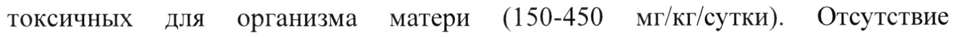

# Тразодон — внутрь

- Препарат: Триттико (таблетки с пролонгированным высвобождением;)
- АТХ: N06AX05
- Источник: ГРЛС, инструкция по медицинскому применению, РУ П N015703/01, файл от 2022-02-17 (https://grls.rosminzdrav.ru/Grls_View_v2.aspx?routingGuid=8d7c5192-4895-40a6-972e-46756d63a606)
- Распознано автоматически (OCR): 16 из 16 стр.
- Инструкция к другому РУ того же препарата: П N015703/01 (национальное РУ, переоформленное по правилам ЕАЭС, решение от 01.02.2022). Текст может быть старше действующего
- Сомнительных строк после OCR: 1 (см. раздел «Проверка распознавания»)

## Общие сведения

| МИНЗДРАВ РОССИИ | | и № МЫ. 04092)
| СОГЛАСОВАНО | МИНИСТЕРСТВО ЗДРАВООХРАНЕНИЯ РОССИЙСКОЙ ФЕДЕРАЦИИ
ИНСТРУКЦИЯ ПО МЕДИЦИНСКОМУ ПРИМЕНЕНИЮ ЛЕКАРСТВЕННОГО ПРЕПАРАТА
Триттико Регистрационный номер: П №015703/01
Торговое наименование: Триттико © | Международное непатентованное наименование: тразодон

## 3. Лекарственная форма

таблетки с пролонгированным высвобождением
таблетки с пролонгированным высвобождением

## 2. Состав

Одна таблетка с пролонгированным высвобождением содержит:

действующее вещество: тразодона гидрохлорид 150,0 мг;

вспомогательные вещества: сахароза (прессованный сахар), воск карнаубский,

повидон К25 (поливинилпирролидон), магния стеарат.

Описание

Двояковыпуклые таблетки белого или бело-желтоватого цвета овальной формы

© с двумя параллельными рисками на обеих сторонах.

Фармакотерапевтическая группа: антидепрессант

Код ATX: NO6AX05

Фармакологические свойства

## 5.1. Фармакодинамика

Тразодон является производным триазолопиридина, эффективным для лечения

депрессивных расстройств, включая депрессию, ассоциированную с тревогой и

расстройствами сна, и характеризующийся коротким латентным периодом

(около недели).

Тразодон является ингибитором обратного захвата серотонина и антагонистом 5HT2 рецепторов, активация которых главным образом связана с бессонницей, тревогой, психомоторным возбуждением и изменениями половой функции.
В отличие от других психотропных препаратов, тразодон не противопоказан при глаукоме, заболеваниях мочевыводящих путей, не оказывает экстрапирамидных эффектов, не потенцирует адренергическую передачу; благодаря отсутствию антихолинергической активности тразодон не имеет типичных эффектов трициклических антидепрессантов на сердечную деятельность.

## 5.2. Фармакокинетика

© После перорального приема разовой дозы 75 мг тразодона с пролонгированным высвобождением, Су, около 0,7 мкг/мл достигается через tmax равное 4 часам после приема, AUC (площадь под кривой «концентрация-время») составляет около 8 мкг/мл/ч. После перорального приема разовой дозы 150 мг тразодона с пролонгированным высвобождением C,,,,, около 1,2 мкг/мл достигается через tax равное 4 часам после приема, AUC составляет около 18 мкг/мл/ч. Период полувыведения составляет около 12 часов.
Исследование взаимодействия с пищей не выявило значительных изменений в
Crax И AUC при применении лекарственного препарата Триттико, таблетки с пролонгированным высвобождением 150 мг, до или после приема пищи.

© Исследования in vitro на микросомах печени человека показали, что тразодон, в основном, метаболизируется цитохромом Р4503А4 (СУРЗА4).

## 4.1. Показания к применению

Депрессивное расстройство с тревогой или без нее.
Депрессивное расстройство с тревогой или без нее.

## 4.3. Противопоказания

° известная повышенная чувствительность к тразодону или любому вспомогательному веществу;
° известная повышенная чувствительность к тразодону или любому вспомогательному веществу;
° алкогольная интоксикация и интоксикация снотворными препаратами;

* острый инфаркт миокарда;
. дефицит сахарозы/изомальтозы, непереносимость фруктозы, глюкозо-галактозная мальабсорбция, так как лекарственный препарат содержит сахарозу;
. возраст до 18 лет (безопасность не установлена).

## 4.3. С осторожностью

Рекомендуется осторожное дозирование и регулярное наблюдение пациентов со следующими состояниями:
Рекомендуется осторожное дозирование и регулярное наблюдение пациентов со следующими состояниями:

© - эпилепсия, особенно резкое увеличение или уменьшение дозы;
- пациенты с печеночной и/или почечной недостаточностью, особенно тяжелой степени;
- пациенты с заболеваниями сердца, такими как стенокардия, нарушения проводимости или атриовентрикулярная (AV) блокада различной степени, инфаркт миокарда (ранний восстановительный период);
- гипертиреоз;
- нарушения мочеиспускания, такие как гипертрофия предстательной железы, несмотря на незначительный антихолинергический эффект тразодона;
- острая закрытоугольная глаукома, повышенное внутриглазное давление, хотя

© из-за незначительного антихолинергического эффекта тразодона серьезных изменений не ожидается.

## 4.6. Применение при беременности и в период грудного вскармливания

Беременность Данные по ограниченному количеству беременных женщин, которые принимали препарат во время беременности (< 200), не выявили побочных эффектов тразодона в отношении беременности и здоровья плода/новорожденного. Иных доступных эпидемиологических данных нет.

Исследования на животных не выявили прямого или косвенного отрицательного воздействия на беременность, эмбриональное/фетальное развитие плода, родоразрешение или постнатальное развитие в терапевтических дозах.
Исследования тератогенности у крыс выявили усиление эмбриолетальности при использовании препарата только в дозах, токсичных для организма матери (300450 мг/кг/сутки). Эмбриолетальные эффекты и редкие случаи врожденных аномалий наблюдались у кроликов при использовании препарата только в дозах, токсичных для организма матери (150-450 мг/кг/сутки). Отсутствие непосредственного влияния на эмбрион подтверждается исследованиями
- проникновения тразодона через плацентарный барьер у крыс: только незначительные концентрации тразодона обнаруживались в тканях эмбрионов и в околоплодных водах.
Препарат должен назначаться беременным женщинам только в случае, если потенциальная польза для женщины оправдывает возможные риски для плода.
При применении до родоразрешения новорожденные должны наблюдаться на предмет проявления синдрома отмены.
Период грудного вскармливания Ограниченные данные показывают, что небольшое количество тразодона
| попадает в грудное молоко, но уровень активного метаболита неизвестен. В связи
~ с недостаточностью данных решение о продолжении/прекращении приема препарата или продолжении/прекращении грудного вскармливания должно приниматься, учитывая пользу кормления грудью для ребенка и пользу терапии для матери.

## 4.2. Способ применения и дозы

Таблетки следует принимать целиком, не разжевывая, и запивая достаточным количеством воды.
Таблетки следует принимать целиком, не разжевывая, и запивая достаточным количеством воды.
Терапию следует начинать с вечернего приема и постепенного увеличения дневных доз.
Препарат может приниматься независимо от приема пищи.
Препарат следует принимать циклами продолжительностью не менее одного месяца.
Взрослые 75-150 мг/сутки в виде разовой дозы вечером перед сном. Доза может быть увеличена до 300 мг/сутки, разделенных на два приема.
У госпитализированных пациентов доза может быть постепенно увеличена до 600 мг/сутки в повторных дозах.
© Пожилые пациенты Для пожилых или ослабленных пациентов рекомендуемая суточная доза должна быть снижена до 100 мг/сутки в виде дробных доз или в качестве разовой дозы в вечернее время перед сном. Данную дозу можно постепенно повышать под наблюдением врача в зависимости от эффективности и переносимости препарата.
В большинстве случаев для данных пациентов следует избегать назначения разовой дозы более 100 мг. Обычно не требуется доза, превышающая 300 мг/сутки.

## 4.8. Побочное действие

© Сообщалось о случаях суицидального мышления и суицидального поведения во время терапии тразодоном или в раннем периоде после завершения терапии.
© Сообщалось о случаях суицидального мышления и суицидального поведения во время терапии тразодоном или в раннем периоде после завершения терапии.
Следующие симптомы, некоторые из которых также были отмечены в случаях нелеченой депрессии, были зафиксированы у пациентов, принимающих тразодон.
Класс систем органов Частота неизвестна (частота не может быть
(MedDRA) определена по доступным данным)
Нарушения со стороны крови |Агранулоцитоз, тромбоцитопения, эозинофилия,
И лимфатической системы лейкопения, анемия
Нарушения со стороны Аллергические реакции иммунной системы
Нарушения со стороны Синдром неадекватной секреции антидиуретического эндокринной системы гормона (СНС АДГ)
Нарушения со стороны обмена | Гипонатриемия', потеря веса, анорексия, веществ и питания повышенный аппетит
Нарушения психики Суицидальные мысли или суицидальное поведение”, спутанность сознания, бессонница, дезориентация, мания, беспокойство, нервозность, возбуждение
© (очень редко обостряющееся до приступов бреда), делирий, агрессивная реакция, галлюцинации, ночные кошмары, снижение либидо, синдром отмены
Нарушения со стороны Серотониновый синдром, судороги, злокачественный нервной системы нейролептический синдром, головокружение, вертиго, головная боль, сонливостьз, беспокойство, снижение бдительности, тремор, нарушение зрения, нарушение памяти, миоклонические судороги, выраженная афазия, парестезия, дистония, изменение вкуса
Нарушения со стороны сердца |Сердечная аритмия’ (включая полиморфную
& желудочковую тахикардию), учащенное сердцебиение, преждевременное — желудочковое сокращение, два последовательных комплекса преждевременных желудочковых — сокращений, желудочковая тахикардия, брадикардия, тахикардия, удлинение интервала ОТ
Нарушения со стороны Ортостатическая гипотензия, артериальная сосудов гипертензия, обморок дыхательной системы, органов грудной клетки и средостения
Нарушения со стороны Тошнота, рвота, сухость во рту, запоры, диарея, желудочно-кишечного тракта |диспепсия, боль в животе, гастроэнтерит, повышенное — слюноотделение, — паралитическая кишечная непроходимость
Нарушения со стороны печени Нарушения функции печени (включая желтуху и и желчевыводящих путей повреждение клеток печени)’, внутрипеченочный холестаз
© Нарушения со стороны кожи и | Кожная сыпь, зуд, гипергидроз подкожных тканей
Нарушения со стороны Боль в конечностях, боль в спине, миалгия, скелетно-мышечной и артралгия соединительной ткани
Нарушения со стороны почек и | Расстройство мочеиспускания мочевыводящих путей
Нарушения со стороны Приапизме половых органов и молочной железы
Общие расстройства и Слабость, отек, гриппоподобные симптомы,
& нарушения в месте введения |усталость, боль в груди, лихорадка
Лабораторные и Повышенный уровень ферментов печени инструментальные данные ly пациентов с наличием симптомов следует контролировать содержание жидкостей и электролитов.
> Смотрите раздел «Особые указания».
3 Тразодон — это антидепрессант с седативными свойствами, и иногда наблюдается вялость в первые дни терапии, которая обычно впоследствии исчезает.
4 Исследования на животных показали, что тразодон менее кардиотоксичен, чем трициклические антидепрессанты, и клинические исследования предполагают, что препарат обладает НИЗКОЙ способностью вызывать сердечную аритмию у человека. Клинические исследования у пациентов с сердечными заболеваниями в анамнезе показали, что тразодон может быть аритмогенным у некоторых пациентов в популяции.
5 В редких случаях сообщалось о нежелательном воздействии на функцию печени.

© Смотрите раздел «Особые указания».

## 4.9. Передозировка

Симптомы: сонливость, головокружение, тошнота, рвота. В более тяжелых

случаях сообщалось о возникновении комы, тахикардии, гипотензии,

гипонатриемии, судорогах и остановке дыхания. В отношении сердечной

деятельности это могут быть брадикардия, удлинение интервала ОТ и

полиморфная желудочковая тахикардия.

Симптомы могут проявляться в течение 24 часов или позднее после w передозировки. Передозировка тразодоном в сочетании с другими

антидепрессантами может вызывать серотониновый синдром.

Лечение: специфического антидота тразодона не существует. Активированный

уголь может быть использован взрослыми, принявшими более 1 г тразодона или

детьми, принявшими более 150 мг тразодона в течение 1 часа после появления

симптомов. В качестве альтернативной терапии взрослым может быть проведено

промывание желудка в течение 1 часа после приема потенциально угрожающей

жизни дозы.

Необходимо наблюдение как минимум в течение 12 часов после приема

препарата, а также контроль уровня артериального давления, пульса и
& показателей шкалы комы Глазго. Если показатели шкалы комы Глазго снижены,

контролируют насыщение крови кислородом. Контроль сердечной функции

необходим у пациентов с наличием соответствующих симптомов.

Единичные короткие судороги не требуют терапии. Частые или длительные

судороги корректируют введением диазепама внутривенно (0,1-0,3 мг/кг веса

тела) или лоразепама (4 мг взрослым или 0,05 мг/кг веса тела детям).

Если данные меры не позволяют контролировать судороги, может быть

рекомендовано внутривенное введение фенитоина. Для коррекции кислотно-

щелочного баланса и нарушения метаболизма необходимо использовать

кислород ингаляционно.

В случае гипотензии и чрезмерного седативного эффекта должна быть проведена

симптоматическая и поддерживающая терапия. При сохранении тяжелой

гипотензии следует рассмотреть применение допамина или добутамина.

## 4.5. Взаимодействие с другими лекарственными средствами

Общее

Седативный эффект — антипсихотических, снотворных, — седативных,

анксиолитических и антигистаминных препаратов может усиливаться; в таких
© случаях рекомендуется снижение дозы.

Метаболизм антидепрессантов ускоряется в связи с гепатическими эффектами

оральных контрацептивов, фенитоина, карбамазепина и барбитуратов.

Метаболизм антидепрессантов ингибируется циметидином и некоторыми

другими антипсихотическими препаратами.

CYP3A4 ингибиторы

Исследования метаболизма препарата in vitro показывают, что существует

потенциал для лекарственного взаимодействия, когда тразодон назначается с

ингибиторами цитохрома Р4503А4 (CYP3A4), такими как эритромицин,

кетоконазол, итраконазол, ритонавир, индинавир и нефазодон. Если тразодон
© применяют с мощным ингибитором CYP3A4, необходима более низкая доза

тразодона.

Применения СУРЗА4 ингибиторов следует по возможности избегать.

Карбамазепин

Результаты совместного применения выражаются в снижении концентрации

тразодона в плазме. Одновременный прием карбамазепина в суточной дозе

400 мг привел к снижению концентрации тразодона в плазме крови и его

активного метаболита м-хлорфенилпиперазина до 76% и 60%, соответственно.

По этой причине пациенты, принимающие тразодон в комбинации с

карбамазепином, должны постоянно наблюдаться на предмет необходимости повышения дозировки тразодона.
Трициклические антидепрессанты Одновременного приема с тразодоном следует избегать из-за риска взаимодействия. Следует опасаться серотонинового синдрома и побочных эффектов для сердечной деятельности.
Флуоксетин Сообщалось о редких случаях повышенного содержания тразодона в плазме и побочных эффектах, когда тразодон комбинировался с флуоксетином,

bd ингибитором CYP1A2/2D6. Механизм их фармакокинетического взаимодействия не изучен. Нельзя исключать фармакодинамическое взаимодействие (серотониновый синдром).
Ингибиторы МАО Сообщалось о возможном взаимодействии с ингибиторами моноаминоксидазы
(МАО). Несмотря на то, что некоторые врачи назначают два препарата одновременно, применение тразодона одновременно с ингибиторами МАО или в течение двух недель после завершения приема ингибиторов МАО не рекомендуется. Применение ингибиторов МАО в течение одной недели после терапии тразодоном также не рекомендуется.

- Фенотиазины
Были отмечены случаи серьезной ортостатической гипотензии в случае одновременного применения с фенотиазинами, например, с хлорпромазином, флуфеназином, перфеназином.
Анестетики/ миорелаксанты Тразодона гидрохлорид может усиливать эффекты миорелаксантов и летучих анестетиков, применять необходимо с осторожностью.
Алкоголь Тразодон усиливает седативный эффект алкоголя. Следует избегать

употребления алкоголя во время терапии тразодоном.
Леводопа Антидепрессанты могут ускорять метаболизм леводопы.
Другое Одновременный прием тразодона с препаратами, которые удлиняют интервал
ОТ, может повышать риск желудочковой аритмии, включая полиморфную желудочковую тахикардию. Необходима осторожность при их совместном применении с тразодоном.
Поскольку тразодон является слабым ингибитором обратного захвата
© норадреналина и не изменяет реакцию артериального давления на тирамин, влияние на гипотензивное действие соединений по типу гуанетидина маловероятно. Тем не менее, исследования на животных предполагают, что тразодон может ингибировать большую часть острого эффекта клонидина. В отношении других антигипертензивных препаратов возможность потенцирования должна учитываться, хотя клинически взаимодействие не доказано.
Побочные эффекты могут проявляться чаще при одновременном применении тразодона с препаратами, содержащими зверобой продырявленный (Hypericum
| Perforatum).
® Сообщалось о случаях изменения протромбинового времени у пациентов, принимавших одновременно тразодон и варфарин.
Одновременное применение дигоксина или фенитоина с тразодоном может приводить к повышению уровня дигоксина и фенитоина в сыворотке крови.
Следует контролировать уровень дигоксина и фенитоина в сыворотке у таких пациентов.
И Особые указания Применение у детей и подростков (д0 18 лет)
Тразодон не должен применяться у детей и подростков до 18 лет.
Суицид/суицидальные мысли или ухудшение клинических симптомов
При депрессивных состояниях повышен риск проявлений суицидальных мыслей, нанесения себе вреда или суицида. Данный риск сохраняется до возникновения выраженной ремиссии. Поскольку улучшение может не наступить в течение первых нескольких недель лечения или больше, пациенты должны находиться под строгим контролем до наступления улучшения. Согласно общему 6 клиническому опыту, риск суицида может повышаться на ранних стадиях выздоровления.
Известно, что пациенты с суицидальными событиями в анамнезе, или пациенты, которые проявляют значительную степень суицидального мышления еще до начала лечения, имеют более высокий риск возникновения суицидальных мыслей или попыток самоубийства, и должны находиться под тщательным наблюдением в течение лечения. Результаты метаанализа плацебоконтролируемых клинических исследований антидепрессантов, которые используются у взрослых с психическими расстройствами, показали повышенный риск развития суицидального поведения у пациентов моложе 25 лет
- на фоне приема антидепрессантов в сравнении с плацебо.
Тщательное наблюдение за пациентами, особенно имеющими высокий риск, должно сопровождать лекарственную терапию, особенно на ранних ее стадиях и после изменений дозы. Необходимо предупредить пациентов (и осуществляющих уход за ними) о необходимости отслеживать любое клиническое ухудшение состояния, суицидальное поведение или суицидальные мысли, необычные изменения поведения, и немедленно обращаться за консультацией к специалисту при появлении таких симптомов. Для минимизации потенциального риска попыток суицида, особенно в начале лечения, в каждом конкретном случае должна назначаться минимально необходимая доза.
При развитии желтухи терапия тразодоном должна быть прекращена.
Применение антидепрессантов у пациентов с шизофренией или другими психическими расстройствами может привести к возможному ухудшению психических симптомов. Параноидальные мысли могут усиливаться. При лечении тразодоном депрессивные приступы могут варьироваться OT маниакально-депрессивных до маниакального психоза. В этом случае тразодон ww должен быть отменен.
При применении тразодона одновременно с препаратами, обладающими серотонинергической активностью, такими как другие антидепрессанты
(например, трициклические антидепрессанты, селективные ингибиторы обратного захвата серотонина, селективные ингибиторы обратного захвата серотонина и норадреналина и МАО-ингибиторы) и нейролептики, были описаны взаимодействия с развитием серотонинового синдрома или злокачественного нейролептического синдрома. Злокачественный нейролептический синдром с летальным исходом был зарегистрирован в случаях совместного применения с нейролептиками, для которых этот синдром являлся w известной возможной нежелательной лекарственной реакцией.

Так как агранулоцитоз может проявляться как гриппоподобный синдром, боль в горле и лихорадка, при появлении данных симптомов рекомендуется контролировать картину крови.
Сообщалось о случаях гипотензии, включая ортостатическую гипотензию и синкопальное состояние у пациентов, принимающих тразодон. Одновременное применение с антигипертензивными препаратами может потребовать снижения дозы антигипертензивного препарата.

Пожилые пациенты Пожилые пациенты часто более восприимчивы к антидепрессантам, в частности, чаще сообщается о случаях ортостатической гипотензии, сонливости и других антихолинергических эффектах тразодона.
Особое внимание нужно уделить потенциальным аддитивным эффектам в связи с одновременным применением других психотропных или антигипертензивных препаратов или при наличии факторов риска, таких как сопутствующие заболевания, которые могут усугублять данные реакции.
Рекомендуется, чтобы пациент или ухаживающее лицо, были ad проинформированы о возможном возникновении таких эффектов. Необходимо тщательно контролировать их проявление у пациента после начала терапии, до и после титрования в возрастающей дозе.
При длительной терапии тразодоном рекомендуется постепенное снижение дозы перед отменой препарата для минимизации симптомов отмены, таких как тошнота, головная боль, недомогание.
Нет никаких доказательств того, что тразодона гидрохлорид обладает какимилибо вызывающими привыкание свойствами.
Как и в случае с другими антидепрессантами, о случаях удлинения интервала ОТ с тразодоном сообщалось очень редко. Следует соблюдать осторожность при назначении тразодона с лекарственными препаратами, которые удлиняют интервал ОТ.
Тразодон следует применять с осторожностью у пациентов с известными сердечно-сосудистыми заболеваниями, в том числе с удлинением интервала ОТ.
Сильные ингибиторы СУРЗА4 могут привести к повышению уровня тразодона в сыворотке крови.
Как и в случае других препаратов с альфа-адренолитической активностью, тразодон очень редко ассоциируется с приапизмом. Это можно скорректировать

с помощью внутрикавернозной инъекции альфа-адренергического средства,

такого как адреналин или метараминол. Тем не менее, есть сообщения о

вызванном тразодоном приапизме, которые потребовали хирургического

вмешательства или привели к постоянной сексуальной дисфункции. Пациенты, у

которых развивается эта предполагаемая побочная реакция, должны немедленно

прекратить прием тразодона.

Влияние на результаты анализа мочи

При использовании иммунотестов для контроля наркотических веществ в моче,
© реактивность метаболита тразодона мета-хлорфенилпиперазина (M-XIIIT),

который структурно похож на метилендиоксиметамфетамин (МДМА, экстази),

может вызывать ложноположительную реакцию на амфетамин. В данных

случаях рекомендуется проводить подтверждающий анализ с помощью метода

масс-спектрометрии.

## 4.7. Влияние на способность управлять транспортными средствами, механизмами

механизмами

Тразодон оказывает незначительное или небольшое влияние на способность

управлять транспортными средствами или механизмами. Пациент должен быть
© предупрежден о риске при управлении транспортными средствами или при

работе с механизмами, пока он не будет уверен, что не испытывает сонливость,

вялость, головокружение, спутанность сознания или нечеткость зрения.

## 6.5. Форма выпуска

Таблетки с пролонгированным высвобождением, 150 мг.

По 10 таблеток в блистер из ПВХ / алюминиевой фольги.

По 2 или по 6 блистеров вместе с инструкцией по применению в картонную

пачку.

## 6.4. Условия хранения

При температуре не выше 25 °С. Хранить в месте, недоступном для детей!
При температуре не выше 25 °С. Хранить в месте, недоступном для детей!

## 6.3. Срок годности

3 года.
3 года.
Не применять по истечении срока годности.
Условия отпуска Отпускают по рецепту.
Держатель (владелец) регистрационного удостоверения
- Азиенде Кимике Риуните Анжелини Франческо А.К.Р.А.Ф. С.п.А., Италия/
Aziende Chimiche Riunite Angelini Francesco A.C.R.A.F. S.p.A.
Viale Amelia 70, 00181, Rome, Italy Производитель
Азиенде Кимике Риуните Анжелини Франческо А.К.Р.А.Ф. С.п.А., Италия/
Aziende Chimiche Riunite Angelini Francesco A.C.R.A.F. S.p.A.
Via Vecchia del Pinocchio 22, 60100, Ancona, Italy
Организация, принимающая претензии потребителей и информацию о нежелательных реакциях в России:
© ООО «Анджелини Фарма Рус»
Россия, 123001, г. Москва, Трехпрудный пер., д.9, стр.2 тел.: +7 (495) 933 3950 факс: +7 (495) 933 3951
Специалист по регистрации eee Королева П.Ф.
## Проверка распознавания

Страницы-сканы распознаны автоматически. В 1 строках с дозировками цифры могли распознаться с ошибкой — сверьте с вырезкой из оригинала:

- стр. 4: «токсичных для организма матери (150-450  мг/кг/сутки). Отсутствие» — низкая уверенность: «(150-450» (78)  
  
