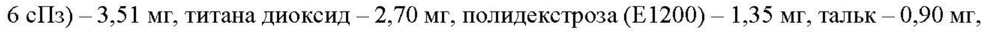
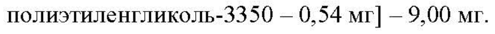

# Транексамовая кислота — внутрь

- Препарат: Циклогемал® (таблетки, покрытые пленочной оболочкой)
- АТХ: B02AA02
- Источник: ГРЛС, инструкция по медицинскому применению, РУ ЛП-№002292-(РГ-RU), файл от 2023-05-23 (https://grls.rosminzdrav.ru/Grls_View_v2.aspx?routingGuid=3d6ac60b-f823-4e53-882f-c11c0856ead4)
- Распознано автоматически (OCR): 10 из 10 стр.
- Сомнительных строк после OCR: 2 (см. раздел «Проверка распознавания»)

## Общие сведения

СООТВЕТСТВУЕТ ЭКСПЕРТНОМУ ОТЧЕТУ от 28.04.2023 № 8181
ВИ ПО МЕДИЦИНСКОМУ ПРИМЕНЕНИЮ ЛЕКАРСТВЕННОГО ПРЕПАРАТА
Циклогемал®

Регистрационный номер:
Торговое наименование: Циклогемал® Международное непатентованное или группировочное наименование:
транексамовая кислота Лекарственная форма: таблетки, покрытые пленочной оболочкой
Состав на одну таблетку:
Действующее вещество: транексамовая кислота — 250 мг.
Вспомогательные вещества: Целлюлоза микрокристаллическая — 45,05 мг, прежелатинизированный крахмал — 4,85 мг, карбоксиметилкрахмал натрия — 6,20 мг, тальк
— 7,99 мг, кремния диоксид коллоидный — 6,01 мг, стеарилфумарат натрия — 9,90 мг.
Оболочка: VIVACOAT® РА-1Р-000 [гипромеллоза 6 сПз (гидроксипропилметилцеллюлоза 6 сз) — 3,51 мг, титана диоксид — 2,70 мг, полидекстроза (Е 1200) — 1,35 мг, тальк — 0,90 мг, полиэтиленгликоль-3350 — 0,54 mr] — 9,00 мг.
Описание:
Таблетки, покрытые пленочной оболочкой белого или почти белого цвета, круглые, двояковыпуклые. На срезе белого или почти белого цвета.
Фармакотерапевтическая группа: гемостатические средства; антифибринолитические средства; аминокислоты.
Код ATX: BO2ZAA02 Фармакологические свойства

## 5.1. Фармакодинамика

Антифибринолитическое средство. Транексамовая кислота специфически ингибирует активацию профибринолизина (плазминогена) и его превращение в фибринолизин
Антифибринолитическое средство. Транексамовая кислота специфически ингибирует активацию профибринолизина (плазминогена) и его превращение в фибринолизин
(плазмин). Антифибринолитическая активность транексамовой кислоты примерно в 10 раз выше, чем активность эпсилон-аминокапроновой кислоты.
Транексамовая кислота обладает местным и системным гемостатическим действием при кровотечениях, связанных с повышением фибринолиза. Кроме того, транексамовая кислота

СООТВЕТСТВУЕТ ЭКСПЕРТНОМУ ОТЧЕТУ обладает анальгезирующим, противоаллергИческим (И профивовоиалителиным-ейСВием за счет подавления образования кининов и других активных пептидов, участвующих в аллергических и воспалительных реакциях.

## 5.2. Фармакокинетика

Абсорбция при пероральном приеме доз в диапазоне 0,5-2 г составляет 30-50 %. Время достижения максимальной концентрации при приеме внутрь 0,5; 1 и 2 г транексамовой кислоты составляет 3 4, максимальная концентрация - 5, 8 и 15 мкг/мл соответственно.
Абсорбция при пероральном приеме доз в диапазоне 0,5-2 г составляет 30-50 %. Время достижения максимальной концентрации при приеме внутрь 0,5; 1 и 2 г транексамовой кислоты составляет 3 4, максимальная концентрация - 5, 8 и 15 мкг/мл соответственно.
Прием пищи не влияет на абсорбцию транексамовой кислоты в желудочно-кишечном тракте.
Связь с белками плазмы (профибринолизином) — менее 3 %. Транексамовая кислота не связывается с альбумином. Терапевтическая концентрация транексамовой кислоты в плазме крови — 5-10 мг/л.
Распределяется в тканях относительно равномерно (исключение составляет спинномозговая жидкость, где концентрация составляет 1/10 от плазменной); проникает через плацентарный барьер, в грудное молоко (около 1 % от концентрации в плазме матери), через гематоэнцефалический барьер, во внутрисуставную жидкость и синовиальные — мембраны. Начальный объем распределения — 9-12 Л.
Антифибринолитическая концентрация в различных тканях сохраняется в течение 17 ч, в плазме — до 7-8 4.
Метаболизируется в незначительной степени. Фармакокинетическая кривая имеет трехфазную форму с периодом полувыведения в конечной фазе — 3 ч. Общий почечный клиренс равен плазменному (7 л/ч). Выводится почками (основной путь — гломерулярная фильтрация) — более 95 % в неизмененном виде в течение первых 12 4.
Идентифицировано 2 метаболита транексамовой кислоты: М-ацетилированное и дезаминированное производное.
После приема транексамовой кислоты внутрь в дозе 10-15 мг/кг в течение первого часа,
Зч, 24 чи 48 ч выводится соответственно | %, 7 %, 39 % и 79 % принятой дозы.
При нарушении функции почек существует риск кумуляции транексамовой кислоты.

## 4.1. Показания к применению

Краткосрочное лечение кровотечений, связанных с повышенным фибринолизом, при следующих патологических состояниях:
Краткосрочное лечение кровотечений, связанных с повышенным фибринолизом, при следующих патологических состояниях:
. Простатэктомия; оперативные вмешательства на мочевом пузыре;
. Меноррагия;
. Носовое кровотечение;

СООТВЕТСТВУЕТ ЭКСПЕРТНОМУ ОТЧЕТУ от 28.04.2023 № 8181
° Конизация шейки матки;

. Травматическая гифема (кровоизлияние в переднюю камеру глаза).
Профилактика и лечение кровотечений у пациентов с гемофилией, которые подвергаются малому оперативному вмешательству (в т.ч. экстракция зуба).
Наследственный ангионевротический отек (профилактика обострений заболевания).
Кровотечения при беременности.

## 4.3. Противопоказания

Гиперчувствительность к транексамовой кислоте или другим компонентам препарата;
Гиперчувствительность к транексамовой кислоте или другим компонентам препарата;
. Хроническая почечная недостаточность тяжелой степени (скорость клубочковой фильтрации [СКФ] менее 30 мл/мин/1,73 м²) в связи с риском кумуляции;
. Венозный или артериальный тромбоз в настоящее время или в анамнезе (тромбоз глубоких вен ног, тромбоэмболия легочной артерии, тромбоз внутричерепных сосудов и др.) при невозможности одновременной терапии антикоагулянтами;
° Фибринолиз вследствие коагулопатии потребления (гипокоагуляционная стадия синдрома диссеминированного внутрисосудистого свертывания [ДВС-синдром]);
. Судороги в анамнезе;
. Приобретенное нарушение цветового зрения,
. Субарахноидальное кровоизлияние (в связи с риском развития отека мозга, ишемии и инфаркта головного мозга);
. Детский возраст до 3 лет (твердая лекарственная форма).

## 4.3. С осторожностью

Транексамовую кислоту следует применять с осторожностью в следующих ситуациях:
Транексамовую кислоту следует применять с осторожностью в следующих ситуациях:
. Гематурия, вызванная заболеваниями паренхимы почек, и кровотечения из верхних отделов мочевыводящих путей (риск вторичной механической обструкции мочевыводящих путей сгустком крови с развитием анурии) (См. раздел «Особые указания»);
. Пациенты с высоким риском развития тромбоза (тромбоэмболические события в анамнезе или семейный анамнез тромбоэмболических заболеваний, верифицированный диагноз тромбофилии);
. Синдром диссеминированного внутрисосудистого свертывания [ДВС-синдром];
. Наличие крови в полостях, например, в плевральной полости, полостях суставов и мочевыводящих путях;
° Пациенты, получающие терапию антикоагулянтами (опыт применения ограничен);
. Одновременное применение препаратов факторов свертывания крови II, УП, [ХиХв

СООТВЕТСТВУЕТ ЭКСПЕРТНОМУ ОТЧЕТУ комбинации [протромбинового комплексй или( ПАнтииниибиорнов Оковвуля И ного комплекса (См. раздел «Взаимодействие с другими лекарственными средствами»);

. Лечение меноррагий у пациенток в возрасте младше 15 лет (опыт применения ограничен);
. Пациентки, принимающие комбинированные пероральные контрацептивы (в связи с повышенным риском венозных тромбоэмболических осложнений и артериальных тромбозов) (См. раздел «Взаимодействие с другими лекарственными средствами»).

## 4.6. Применение при беременности и в период грудного вскармливания

В доклинических исследованиях транексамовая кислота не оказывала тератогенного воздействия. Адекватные и строго контролируемые исследования эффективности и безопасности применения препаратов транексамовой кислоты у беременных не проводились. Транексамовая кислота проникает через плаценту и может содержаться в пуповинной крови в концентрации, близкой к материнской.
Поскольку исследования репродуктивной функции у животных не всегда позволяют предсказать реакции у человека, транексамовую кислоту следует применять во время беременности только в случае крайней необходимости.
Транексамовая кислота проникает в грудное молоко (концентрация препарата в молоке составляет около 1% от концентрации в плазме крови матери). Развитие антифибринолитического эффекта у младенца маловероятно. Тем не менее, следует соблюдать осторожность при применении транексамовой кислоты у кормящих матерей.

## 4.2. Способ применения и дозы

Внутрь, независимо от приема пищи.
Внутрь, независимо от приема пищи.
Краткосрочное лечение кровотечений, обусловленных повышенным фибринолизом:
рекомендуемая стандартная доза транексамовой кислоты составляет 15-25 мг/кг массы тела, в среднем 1000-1500 мг 2-3 раза в сутки.
. При простатэктомии и оперативных вмешательствах на мочевом пузыре:
1000 мг за 6 ч до операции, затем по 1000 мг 3-4 раза в сутки до исчезновения макрогематурии. Не рекомендуется применение препарата более 2 недель после оперативного вмешательства.
. При меноррагии: рекомендуемая суточная доза составляет 1000 мг 3 раза в сутки до прекращения меноррагии, но не более 4 суток. При профузном кровотечении доза препарата может быть увеличена, при этом общая суточная доза не должна превышать 4000 мг. Лечение транексамовой кислотой не следует начинать до возникновения
СООТВЕТСТВУЕТ ЭКСПЕРТНОМУ ОТЧЕТУ менструального кровотечения. В клинических nce Hoban PPaneKcaMOpas вис He применялась более трех менструальных циклов подряд.

. При рецидивирующих носовых кровотечениях: по 1000 мг 3 раза в сутки в течение 7 дней.
. После операции конизации шейки матки: по 1500 mr 3 раза в сутки в течение 12 дней после операции.
. При травматической гифеме: по 1000-1500 мг 3 раза в сутки (целевая доза 25 мг/кг массы тела) в течение 7 дней.
Пациенты с гемофилией: препарат назначают внутрь в дозе 25 мг/кг массы тела за 2 ч до экстракции зуба, и затем по 1000-1500 мг 3 раза в сутки в течение 6-8 дней. Следует одновременно назначить препараты факторов свертывания крови У Ш или IX.
При наследственном ангионевротическом отеке: по 1000-1500 мг 2-3 раза в день. Если пациент может предвидеть обострение заболевания, препарат можно принимать с перерывами в зависимости от наличия продромальных симптомов. В остальных случаях препарат следует принимать постоянно.
Кровотечения при беременности: 250-500 мг 3-4 раза в сутки до полной остановки кровотечения. Средняя продолжительность курса лечения — 7 дней.
Применение препарата у особых групп пациентов
Нарушение функции почек У пациентов с легким и умеренным нарушением выделительной функции почек необходима коррекция дозы и кратности приема транексамовой кислоты:
Концентрация Скорость Доза Кратность креатинина в клубочковой транексамовой приема сыворотке крови фильтрации (СКФ) кислоты

120-249 мкмоль/л 60-89 15 мг/кг 2 раза в

(1,36-2,82 мг/дл) мл/мин/1,73 м² массы тела сутки

250-500 мкмоль/л 30-59 15 мг/кг 1 раз в

(2,83-5,66 мг/дл) мл/мин/1,73 м² массы тела сутки
Нарушение функции печени У пациентов с нарушением функции печени коррекция дозы не требуется.
Пожилой возраст У пожилых пациентов при отсутствии почечной недостаточности коррекция дозы не требуется.
Детский возраст Данные в отношении эффективности и безопасности применения препаратов

СООТВЕТСТВУЕТ ЭКСПЕРТНОМУ ОТЧЕТУ

транексамовой кислоты у детей ограничены. (ПОСЛЕДОВАТЕЛЬНОСТЬ 0001)
Y детей транексамовая кислота назначается из расчета 25 мг/кг массы тела 2-3 раза в сутки.
Действия при пропуске приема очередной дозы
При пропуске приема одной дозы необходимо принять следующую дозу препарата в установленное время. Не следует принимать удвоенную дозу препарата после пропуска приема очередной дозы.

## 4.8. Побочное действие

Частота возникновения нежелательных лекарственных реакций определена в соответствии с классификацией ВОЗ: очень часто (> 1/10), часто (> 1/100, < 1/10), нечасто (> 1/1000,
Частота возникновения нежелательных лекарственных реакций определена в соответствии с классификацией ВОЗ: очень часто (> 1/10), часто (> 1/100, < 1/10), нечасто (> 1/1000,
< 1/100), редко (> 1/10000, < 1/1000), очень редко (менее 1/10000), частота неизвестна (не может быть установлена по имеющимся данным).
Нарушения со стороны желудочно-кишечного тракта: часто — тошнота, рвота, диарея
(симптомы проходят при снижении дозы).
Нарушения со стороны кожи и подкожных тканей: редко — кожные аллергические реакции, в т.ч. аллергический дерматит.
Нарушения со стороны органа зрения: редко — нарушения зрения, в т.ч. нарушение цветового восприятия, тромбоз сосудов сетчатки.
Нарушения со стороны сосудов: редко — тромбоэмболические осложнения, выраженное снижение АД (обычно вследствие чрезмерно быстрого внутривенного введения, в исключительных случаях — после приема внутрь); очень редко — артериальные и венозные тромбозы различной локализации; частота неизвестна — острый инфаркт миокарда, тромбоз церебральных артерий, тромбоз сонных артерий, инсульт, тромбоз глубоких вен ног, тромбоэмболия легочной артерии, тромбоз почечной артерии с развитием кортикального некроза и острой почечной недостаточности, окклюзия аорто-коронарного шунта, тромбоз центральной артерии и вены сетчатки.
Нарушения со стороны иммунной системы: очень редко — реакции гиперчувствительности, в т.ч. анафилактический шок.
Нарушения со стороны нервной системы: редко — головокружение; судороги (обычно при внутривенном введении).

## 4.9. Передозировка

Имеются ограниченные данные о случаях передозировки. Сообщается об одном случае передозировки (прием 37 г транексамовой кислоты).
Имеются ограниченные данные о случаях передозировки. Сообщается об одном случае передозировки (прием 37 г транексамовой кислоты).

СООТВЕТСТВУЕТ ЭКСПЕРТНОМУ ОТЧЕТУ

Симптомы: головокружение, головная боль, тошно" PBora “Mapes: UproctarndeeKne симптомы (в т.ч. головокружение при переходе из горизонтального в вертикальное положение), ортостатическая артериальная гипотензия. У предрасположенных пациентов повышается риск тромбозов.
Лечение: антидот неизвестен. При подозрении на передозировку транексамовой кислоты необходима госпитализация. При оказании помощи следует вызвать рвоту, затем провести промывание желудка. Активированный уголь снижает абсорбцию транексамовой кислоты при приеме внутрь в течение первых 1-2 ч после передозировки. Если пациент находится в бессознательном состоянии или при нарушении глотания активированный уголь может быть введен через назогастральный зонд. Рекомендуется прием внутрь или парентеральное введение большого количества жидкости для усиления почечной экскреции, форсированный диурез, контроль количества выделяемой мочи. В некоторых случаях может быть оправданным применение антикоагулянтов.

## 4.5. Взаимодействие с другими лекарственными средствами

Специальные клинические исследования, посвященные изучению взаимодействий транексамовой кислоты с другими лекарственными средствами, не проводились.
Транексамовая кислота препятствует развитию фармакологического эффекта фибринолитических (тромболитических) препаратов.
Комбинированные пероральные контрацептивы увеличивают риск венозных тромбоэмболических осложнений и артериальных тромбозов (в частности, ишемического инсульта и инфаркта миокарда). Опыт применения транексамовой кислоты у женщин, принимающих комбинированные пероральные контрацептивы, отсутствует. Поскольку транексамовая кислота обладает антифибринолитическим эффектом, одновременное применение с комбинированными пероральными контрацептивами может привести к дополнительному повышению риска тромботических осложнений.
Одновременное применение транексамовой кислоты с препаратами факторов свертывания крови II, УП, IX иХ в комбинации [протромбиновым комплексом] или антиингибиторным коагулянтным комплексом повышает риск развития тромбоза.
Возможно повышение риска тромботических осложнений (в частности, инфаркта миокарда) при одновременном применении транексамовой кислоты с гидрохлоротиазидом, десмопрессином, ампициллином-сульбактамом, ранитидином и нитроглицерином.
При сочетанном применении с гемостатическими препаратами возможна активация тромбообразования.
Одновременный прием транексамовой кислоты с антикоагулянтами должен проводиться

Е.
СООТВЕТСТВУЕТ ЭКСПЕРТНОМУ ОТЧЕТУ

под строгим контролем врача (опыт применения огр ННЕДОВАТЕЛЬНОСТЬ 0001)

## 4.4. Особые указания

У пациентов с наследственным ангионевротическим отеком перед началом лечения необходима консультация офтальмолога (определение остроты зрения, цветного зрения, состояния глазного дна). В процессе лечения необходимо регулярное офтальмологическое обследование (включающее оценку остроты зрения и цветовосприятия, осмотр глазного дна щелевой лампой, измерение внутриглазного давления, оценку полей зрения). При возникновении нарушений зрения на фоне лечения транексамовой кислотой, препарат необходимо отменить.
У пациентов с наследственным ангионевротическим отеком перед началом лечения необходима консультация офтальмолога (определение остроты зрения, цветного зрения, состояния глазного дна). В процессе лечения необходимо регулярное офтальмологическое обследование (включающее оценку остроты зрения и цветовосприятия, осмотр глазного дна щелевой лампой, измерение внутриглазного давления, оценку полей зрения). При возникновении нарушений зрения на фоне лечения транексамовой кислотой, препарат необходимо отменить.
У пациентов с наследственным ангионевротическим отеком, длительное время получающих препараты транексамовой кислоты, необходим регулярный лабораторный контроль функции печени.
Препараты транексамовой кислоты следует применять с осторожностью при гематурии, вызванной заболеваниями паренхимы почек, поскольку в этих условиях часто наблюдается внутрисосудистое осаждение фибрина, что может усугубить поражение почек. Кроме того, в случаях массивного кровотечения любой этиологии из верхних мочевыводящих путей, антифибринолитическая терапия повышает риск образования сгустков крови в почечной лоханке и/или мочеточнике и, соответственно, вторичной механической обструкции мочевыводящих путей и развития анурии.
Хотя проведенные клинические исследования не выявили значительного повышения частоты развития тромбозов, однако риск тромботических осложнений не может быть полностью исключен. Описаны случаи развития венозных и артериальных тромбозов и тромбоэмболии у пациентов, получавших транексамовую кислоту. Кроме того, сообщалось о случаях окклюзии центральной артерии сетчатки и центральной вены сетчатки. У нескольких пациентов развился внутричерепной тромбоз на фоне лечения транексамовой кислотой. Соответственно, у пациентов с высоким риском развития тромбоза
(тромбоэмболические осложнения в анамнезе, случаи тромбоэмболии у родственников, верифицированный диагноз тромбофилии) следует применять транексамовую кислоту только в случае крайней необходимости и под строгим врачебным контролем. Перед применением транексамовой кислоты следует провести обследование, направленное на выявление факторов риска тромбоэмболических осложнений.
Наличие крови в полостях, например, в плевральной полости, полостях суставов и мочевыводящих путях (в т.ч. в почечных лоханках и в мочевом пузыре) может приводить к образованию в них «нерастворимого сгустка» вследствие внесосудистого свертывания крови, который может быть устойчив к физиологическому фибринолизу.

СООТВЕТСТВУЕТ ЭКСПЕРТНОМУ ОТЧЕТУ

Пациенткам с нерегулярным менструальным кровотечением” “ne! Glaivet ВИА Нать транексамовую кислоту до установления причины дисменореи. Если объем менструального кровотечения неадекватно снижается на фоне лечения транексамовой кислотой, необходимо рассмотреть возможность альтернативного лечения.
Эффективность и безопасность препаратов транексамовой кислоты при лечении меноррагии у пациенток младше 16 лет не установлены.
Следует с осторожностью применять транексамовую кислоту у женщин, одновременно принимающих комбинированные пероральные контрацептивы, в связи с повышенным риском развития тромбозов (См. раздел «Взаимодействие с другими лекарственными средствами»).
У пациентов с ДВС-синдромом, которые нуждаются в лечении транексамовой кислотой, терапия должна осуществляться под тщательным контролем врача, имеющего опыт лечения данного заболевания.
В связи с отсутствием адекватных клинических исследований, одновременное применение транексамовой кислоты с антикоагулянтами должно осуществляться под тщательным наблюдением специалиста, имеющего опыт лечения нарушений свертывания крови.
Если на фоне приема транексамовой кислоты отмечается нарушение зрения, необходимо прекратить прием препарата и обратиться к врачу.

## 4.7. Влияние на способность управлять транспортными средствами, механизмами

Способность транексамовой кислоты влиять на скорость психомоторных реакций и на способность управлять транспортными или другими механическими средствами не изучалась. Транексамовая кислота может вызывать головокружение и нарушения зрения, и, соответственно, может влиять на способность заниматься потенциально опасными видами деятельности, требующими повышенной концентрации внимания и быстроты психомоторных реакций.

## 6.5. Форма выпуска

Таблетки, покрытые пленочной оболочкой, 250 мг.
Таблетки, покрытые пленочной оболочкой, 250 мг.
По 10 таблеток в контурную ячейковую упаковку из пленки поливинилхлоридной и фольги алюминиевой.
1, 2, 3, 5 или 6 контурных ячейковых упаковок вместе с инструкцией по применению помещают в пачку из картона.

## 6.4. Условия хранения

от 28.04.2023 № 8181 При температуре не выше 25 °С. (ПОСЛЕДОВАТЕЛЬНОСТЬ 0001)
Хранить в недоступном для детей месте.

## 6.3. Срок годности

2 года.
2 года.
Не применять по истечении срока годности, указанного на упаковке.
Условия отпуска Отпускают по рецепту.
Владелец регистрационного удостоверения/организация, принимающая претензии потребителей
Акционерное общество "Отисифарм" (AO "Отисифарм"), Россия, 123112, г. Москва, ул. Тестовская, д. 10, эт. 12, пом. II, ком. 29, тел.: +7 (800) 775-98-19, факс: +7 (495) 221-18-02, www.otcpharm.ru
Производитель Открытое акционерное общество «Фармстандарт-УфаВИТА» (ОАО «ФармстандартУфаВИТА»), Россия
Республика Башкортостан, г. Уфа, ул. Худайбердина, д. 28, тел./факс: (347) 272 92 85, www.pharmstd.ru
## Проверка распознавания

Страницы-сканы распознаны автоматически. В 2 строках с дозировками цифры могли распознаться с ошибкой — сверьте с вырезкой из оригинала:

- стр. 1: «6 сз) — 3,51 мг, титана диоксид — 2,70 мг, полидекстроза (Е 1200) — 1,35 мг, тальк — 0,90 мг,» — низкая уверенность: «1200)» (21)  
  
- стр. 1: «полиэтиленгликоль-3350 — 0,54 mr] — 9,00 мг.» — повторное чтение: «полиэтиленгликоль-3350 — 0,54 мг] — 9,00 мг.»  
  