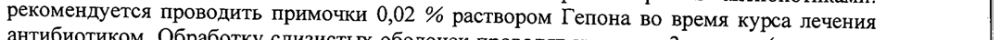
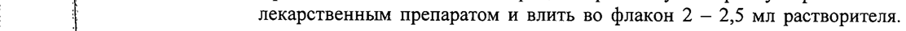
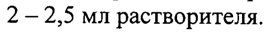

# Треонил-глутамил-лизил-лизил-аргинил-аргинил-глутамил-треонил-валил-глутамил-аргинил-глутамил-лизил-глутамат — парентерально

- Препарат: Гепон (лиофилизат для приготовления раствора для местного и наружного применения; лиофилизат для приготовления раствора для приема внутрь;)
- АТХ: L03
- Источник: ГРЛС, инструкция по медицинскому применению, РУ Р N000015/01, файл от 2025-01-16 (https://grls.rosminzdrav.ru/Grls_View_v2.aspx?routingGuid=4e13fe45-9af9-48c9-8f82-7bf1b8c695d8)
- Распознано автоматически (OCR): 9 из 9 стр.
- Инструкция к другому РУ того же препарата: Р N000015/01 (национальное РУ, переоформленное по правилам ЕАЭС, решение от 26.12.2024). Текст может быть старше действующего
- Сомнительных строк после OCR: 3 (см. раздел «Проверка распознавания»)

## Общие сведения

| :
| МИНИСТЕРСТВО ЗДРАВООХРАНЕНИЯ РОССИЙСКОЙ ФЕДЕРАЦИИ | о МИНЗДРАВ РОССИИ
Poooct- ogog14 COT AACOBAHO ИНСТРУКЦИЯ по применению лекарственного препарата для медицинского применения
ГЕПОН | Регистрационный номер:
® Торговое название препарата: Гепон Химическое название: треонил-глутамил-лизил-лизил-аргинил-аргинил-глутамилтреонил-валил-глутамил-аргинил-глутамил-лизил-глутамат

## 3. Лекарственная форма

лиофилизат для приготовления раствора для местного и наружного применения.
лиофилизат для приготовления раствора для местного и наружного применения.
Г. Состав р Действующее вещество:
i Треонил-глутамил-лизил-лизил-аргиниларгинил-глутамил-треонил-валил-
| глутамил-аргинил-глутамил-лизилглутамат (Гепон) 1 мг, 2 мг | i Описание
@ Лиофилизированный порошок белого цвета, без запаха. |
Фармакотерапевтическая группа: иммуномодулирующее средство
Код ATX: [.03 | Фармакологические свойства

## 5.1. Фармакодинамика

Гепон оказывает иммуномодулирующее и противовирусное действие:
Гепон оказывает иммуномодулирующее и противовирусное действие:
— вызывает продукцию альфа- и бета- интерферонов;
— мобилизует и активирует макрофаги;
— ограничивает выработку провоспалительных цитокинов (интерлейкины-1, 6, 8 и ^ фактор некроза опухоли); .
— стимулирует продукцию антител к различным антигенам инфекционной природы;
— увеличивает содержание CD4* Т клеток и МК клеток; |
— повышает функциональную активность нейтрофилов и CD8* T клеток,
| 2 являющихся ключевыми звеньями защиты организма от бактерий, вирусов и ,
| грибов;
| — подавляет репликацию вирусов. .
г > | Благодаря указанным фармакологическим свойствам, enon повышает
| резистентность организма в отношении инфекций, вызванных вирусами, бактериями
| | и грибами. Гепон оказывает противовоспалительный эффект в течение 1-2 дней
| после применения.
| Фармакокинетика препарата He изучалась в связи с его пептидной природой.
| Показания к применению ;
| В составе комбинированной терапии: лечение инфекций слизистых оболочек и кожи,
| | вызванных грибами Candida; снижения интенсивности воспаления (покраснение, отек, зуд, жжение, боль) слизистых оболочек и кожи, сухости слизистых оболочек.
| Профилактика кандидоза слизистых оболочек и кожи Ha фоне терапии антибиотиками.
С @ Противопоказания Индивидуальная гиперчувствительность к Гепону. Детский возраст до 12 лет.
‚ Применение при беременности и в период грудного вскармливания
Применение возможно только, если потенциальная польза для матери превышает
| | возможный вред для плода. Гепон не рекомендуется для применения в период грудного вскармливания. При необходимости применения препарата грудное вскармливание следует прекратить.
| Способ применения и дозы Применяют местно, наружно. ,
| Перед применением препарат растворяют в воде для инъекций (при наружном
| применении препарата, т.е. для обработки кожи) или в 0,9 % растворе натрия хлорида
(при местном применении препарата, т.е. для обработки слизистых оболочек).
| Способ приготовления препарата перед применением:
| 1. Удалить защитную часть алюминиевого колпачка с резиновой пробки
. флакона с лекарственным препаратом. Если лекарственный препарат в ампуле, вскрыть ампулу.
| 2. Вскрыть ампулу с растворителем (вода для инъекций). В качестве
| растворителя также может использоваться 0,9 % раствор натрия хлорида.
3. Надеть иглу на одноразовый шприц (объемом 5/10 мл - см. табл. 1)
| 4. Набрать в шприц растворитель (объем растворителя указан в табл. 1).
| 5. Проколоть иглой co шприцем резиновую пробку флакона с
| ] лекарственным препаратом и влить во флакон 2 — 2,5 мл растворителя. Если
| | лекарственный препарат в ампуле, влить во вскрытую ампулу также 2 —
| р 2,5 мл растворителя.
6. Не извлекая иглу, легкими колебательными движениями в течение | примерно 1 минуты, полностью растворить содержимое флакона (ампулы).
| | | 7. Набрать полученный раствор в шприц с остатком растворителя. |
| | Конечный объем раствора в шприце должен соответствовать объему |
| } указанному в Таблице 1.
| 3 * 8. Извлечь шприц с иглой из флакона (ампулы), легкими колебательными 1
| движениями в течение примерно | минуты, полностью перемешать раствор в | шприце. |
9. Снять иглу со шприца. + .
. *
10. Использовать шприц в качестве дозирующего устройства для | инстилляций, нанесения на кожу и слизистые оболочки или смачивания марлевых салфеток.
tt | Таблица 1 Способ Гепон 0,02 % раство Гепон 0,04 % раствор
| Вода для наружно 2,5 5 A инъекций, мл | 0,9 % раствор местно 5 10 хлорида натрия, мл
Рекомендуемая доза для взрослых и детей 12 лет и старше составляет 1-2 мг в виде 0,02 % раствора для местной обработки слизистых оболочек один раз в день.
| Рекомендуемая доза для взрослых и детей 12 лети старше составляет 1-2 мг в виде 0,04 %
| раствора для обработки кожи один раз в день.
Для лечения инфекций слизистых оболочек, вызванных грибами Candida, рекомендуется местное применение Гепона путем нанесения на пораженные участки слизистых оболочек (вульвы, влагалища, уретры) 0,02 % раствором, курсом в 3 применения (один раз в сутки) с интервалом 1-3 дня между нанесениями.
@ Для лечения инфекций кожи, вызванных грибами Candida, рекомендуется наружное
| применение Гепона путем нанесения на пораженные участки кожи 0,04 % раствором, курсом в 3 применения (один раз в сутки) с интервалом 1-3 дня между нанесениями.
| При вульвовагините, уретрите у женщин применяют обработку 0,02 % раствором Гепона слизистой вульвы, влагалища, а также примочки на пораженные участки кожи, прилегающие ко входу во влагалище 0,04 % раствором Гепона.
При уретрите и баланопостите у мужчин применяют инстилляции 0,02 % раствором
Гепона в уретру и примочки на пораженные участки кожи 0,04 % раствором Гепона.
Обработку слизистых оболочек и кожи проводят курсом в 3 приема (один раз в сутки) с интервалом 1-3 дня.
Профилактика кандидоза слизистых оболочек на фоне терапии антибиотиками:
рекомендуется проводить примочки 0,02 % раствором Гепона во время курса лечения |
| антибиотиком. Обработку слизистых оболочек проводят курсом в 3 приема (один раз в |
|} сутки) с интервалом 1-3 дня.
| .
| | | - 4 | | | Профилактика кандидоза кожи на фоне терапии антибиотиками: рекомендуется | проводить примочки 0,04 % раствором Гепона во время курса лечения антибиотиком. :
Обработку кожи проводят курсом в 3 приема (один раз в сутки) с интервалом 1-3 дня. i
- |
| Для снижения интенсивности воспаления и сухости слизистые оболочки следует
| обрабатывать 0,02 % раствором Гепона. Обработку слизистых оболочек проводят |
; курсом в 3 приема (один раз в сутки) с интервалом 1-3 дня. |
| Для снижения интенсивности воспаления кожи: накладывать марлевые салфетки, |
| смоченные 0,04 % раствором Гепона. Обработку кожи проводят курсом в 3 приема (один | у раз в сутки) с интервалом 1-3 дня. |
ВЯ . | | >. | Побочное действие | } | | Не обнаружено. Возможны аллергические реакции. Если любые из указанных в инструкции побочных эффектов усугубляются, или Вы заметили любые другие побочные эффекты, не |
| указанные в инструкции, сообщите об этом врачу. |
| | и, Передозировка | <® | Симптомы передозировки He описаны. |
> | | Взаимодействие с другими лекарственными препаратами
| _ Не описано. | Сведения © возможном влиянии на способность управлять транспортными |
| средствами, механизмами | | | Препарат не влияет на способность управлять транспортными средствами, |
| | движущимися механизмами и заниматься другими потенциально опасными видами
| деятельности, требующими повышенной концентрации внимания и быстроты
| психомоторных реакций.
| Форма выпуска | Лиофилизат для приготовления раствора для местного и наружного применения, | мг,
| 2 мг.
р По 1 мг, 2 мг препарата во флаконы.
По 1 мг, 2 мг препарата в ампулы.
| 1, 2, 3 флакона или ампулы с инструкцией по применению в пачку; |
| 1 флакон или ампулу с препаратом, 1 ампулу с водой для инъекций 5 мл с инструкцией по применению в пачку (Комплект);
1 флакон или ампулу с препаратом, 1 ампулу с водой для инъекций 5 мл, 1 шприц одноразовый стерильный с инструкцией по применению в пачку (Комплект); |

## 6.4. Условия хранения

| | Хранить в защищенном от света месте при температуре не выше 25 °С.
| | Хранить в защищенном от света месте при температуре не выше 25 °С.
Хранить в местах, недоступных для детей. |
| Срок годности .
4 года. Не использовать по истечении срока годности. |
Условия отпуска Отпускают без рецепта.
| | | Наименбвание, адрес производителя лекарственного препарата и адрес места
| производства лекарственного препарата Производитель (владелец регистрационного удостоверения):
ООО «AMMA®APMA», 123098, Москва, ул. Гамалеи, д. 18.
| Телефон/факс многоканальный (495) 4119006
| Адрес производства/адрес для претензий:
ООО «AMMA®APMA», 123098, Москва, ул. Гамалеи, д. 18, стр 11. |
| Телефон/факс: многоканальный (495) 4119006, e-mail: headreception@gepon.ru
; и . Зам. генерального директора / yo a ООО «ИММАФА KEES, А. М. Дудченко
| | 5| "ИММАФАРМА" |)
2 Re } |
© 7 | < / x. Y |
3 ЧосхвА 2
@ - i)
| | | fo МИНИСТЕРСТВО ЗДРАВООХРАНЕНИЯ РОССИЙСКОЙ ФЕДЕРАЦИИ |
| , МИНЗДРАВ РОССИИ
1 Poooosy- 080914)
COTAACOBAHO | ИНСТРУКЦИЯ | по применению лекарственного препарата для медицинского применения
ГЕПОН Регистрационный номер:
@ Торговое название препарата: Гепон Химическое название: треонил-глутамил-лизил-лизил-аргинил-аргинил-глутамил-
‚ треонил-валил-глутамил-аргинил-глутамил-лизил-глутамат
| Лекарственная форма: лиофилизат для приготовления раствора для приема внутрь.

## 2. Состав

| Действующее вещество: | Г. | Треонил-глутамил-лизил-лизил-аргинил-
| Действующее вещество: | Г. | Треонил-глутамил-лизил-лизил-аргинил-
| аргинил-глутамил-треонил-валил- | глутамил-аргинил-глутамил-лизил- | глутамат (Гепон) 10 мг
Описание
5 Лиофилизированный порошок белого цвета, без запаха.
Фармакотерапевтическая группа: иммуномодулирующее средство
Код ATX: L03 Фармакологические свойства Фармакодинамика
Гепон оказывает иммуномодулирующее и противовирусное действие:
— вызывает продукцию альфа- и бета- интерферонов;
— мобилизует и активирует макрофаги;
— ограничивает выработку провоспалительных цитокинов (интерлейкины-1, 6, 8 и фактор некроза опухоли);
— стимулирует продукцию антител к различным антигенам инфекционной природы;
— подавляет репликацию вирусов.
` ° Благодаря указанным фармакологическим свойствам, Гепон повышает резистентность организма в отношении инфекций, вызванных вирусами, бактериями
| | 2 у | и грибами. Гепон оказывает противовоспалительный эффект в течение 1-2 дней после применения.
У пациентов, инфицированных ВИЧ, Гепон снижает концентрацию ВИЧ в клетках крови и в плазме, одновременноеактивирует иммунные реакции, специфичные в
| отношении ВИЧ:
| — увеличивает содержание СО4* Т клеток и МК клеток;
| в + | — повышает функциональную активность нейтрофилов и CD8 Т клеток,
| являющихся ключевыми звеньями защиты организма от бактерий, вирусов и грибов;
| — усиливает выработку антител, специфичных к ‘антигенам ВИЧ, а также к антигенам возбудителей оппортунистических инфекций, актуальных для данного
| больного;
| | — предупреждает рецидивы оппортунистических инфекций в течение 3-6 месяцев.
@ Фармакокинетика препарата не изучалась в связи с его пептидной природой.
| Показания к применению | В составе комбинированной терапии:
— лечение ВИЧ-инфекции;
— лечение и профилактика оппортунистических инфекций, вызванных бактериями,
| вирусами или грибами;

## 4.3. Противопоказания

Индивидуальная гиперчувствительность к Гепону. Детский возраст до 12 лет.
Индивидуальная гиперчувствительность к Гепону. Детский возраст до 12 лет.

## 4.6. Применение при беременности и в период грудного вскармливания

Применение возможно только, если потенциальная польза для матери превышает возможный вред для плода. Гепон не рекомендуется для приема в период грудного
| вскармливания. При необходимости применения препарата грудное вскармливание
| следует прекратить.
| Способ применения и дозы Применяют внутрь.
| Перед применением препарат растворяют в воде для инъекций или в 0,9 % растворе
| натрия хлорида.
| Способ приготовления препарата перед применением:
| 1. Удалить защитную часть алюминиевого колпачка с резиновой пробки флакона с лекарственным препаратом. Если лекарственный препарат в ампуле, вскрыть ампулу.
| 2. Вскрыть ампулу с растворителем (вода для инъекций либо 0,9 % раствор натрия хлорида).
3. Надеть иглу на одноразовый шприц.
| 4. Набрать в шприц 5 мл растворителя.
| | 5. Проколоть иглой co шприцем резиновую пробку флакона с
| {1 лекарственным препаратом и влить во флакон 2 — 2,5 мл растворителя.
в | 3 Если лекарственный препарат в ампуле, влить во вскрытую ампулу также .
2 —2,5 мл растворителя.
6. Не извлекая иглу, легкими колебательными движениями в течение
| примерно 1 минуты, полностью растворить содержимое флакона
(ампулы). .
7. Набрать полученный раствор в шприц, в котором оставалось 2,5 - 3 мл растворителя. |
| 8. Подождать 1 минуту до полного перемешивания раствора в питрице.
| 9. Снять иглу со шприца.
10. Влить содержимое шприца в стакан, содержащий 100 — 150 мл питьевой
| воды.
| 11. Полученный раствор использовать для приема внутрь.
Рекомендуемая доза для взрослых и детей 12 лет и старше составляет 10 мг внутрь (per os)
@ один раз в день.
Для лечения ВИЧ-инфекции рекомендуется проведение курса лечения с ежедневным
| приемом Гепона по 10 мг внутрь в течение 1-3 месяцев.
| Для лечения оппортунистических инфекций, вызванных бактериями, вирусами или | грибами, рекомендуется проведение курса лечения с ежедневным приемом Гепона по 10 мг внутрь в течение 1-3 месяцев.
© Для профилактики оппортунистических инфекций, вызванных бактериями, вирусами или
| “ грибами, рекомендуется проведение курса лечения с ежедневным приемом Гепона по 10 мг внутрь в течение 1-3 недель.
| Побочное действие | Не обнаружено. Возможны аллергические реакции.
| Передозировка Симптомы передозировки не описаны.
@ Взаимодействие с другими лекарственными препаратами
Не описано.
| Сведения 0 возможном влиянии на способность управлять транспортными
| средствами, механизмами | Препарат не влияет на способность управлять транспортными средствами, движущимися механизмами и заниматься другими потенциально опасными видами |
> | деятельности, требующими повышенной концентрации внимания и быстроты | психомоторных реакций. |
| Форма выпуска Лиофилизат для приготовления раствора для приема внутрь 10 мг.
По 10 мг препарата во флаконы. ..
По 10 мг препарата в ампулы.
| 1, 2, 3 флакона или ампулы с инструкцией по применению в пачку;
| | 1 флакон или ампулу с препаратом, 1 ампулу с водой для инъекций 5 мл с инструкцией
| по применению в пачку (Комплект);
. | | ЗОВИ q | | | 4 1 флакон или ампулу с препаратом, 1 ампулу с водой для инъекций 5 мл, 1 шприц одноразовый стерильный с инструкцией по применению в пачку (Комплект); | .
| 30 флаконов или ампул с 10-ю инструкциями по применению в пачку (Для стационаров); ,
| Условия хранения | | Хранить в защищенном OT света месте при температуре не выше 25 °С.
Хранить в местах, недоступных для детей.

## 6.3. Срок годности

, | 4 года. Не использовать по истечении срока годности.
, | 4 года. Не использовать по истечении срока годности.
| Условия отпуска Отпускают по рецепту.
| Наименование, адрес производителя лекарственного препарата и адрес места
( производства лекарственного препарата .
Производитель (владелец регистрационного удостоверения):
| OOO «ИММАФАРМА», 123098, Москва, ул. Г амалеи, д. 18.
| Телефон/факс многоканальный (495) 4119006
Адрес производства/адрес для претензий:
| 000 «ИММАФАРМА», 123098, Москва, ул. Гамалеи, д. 18, стр 11.
| Телефон/факс: многоканальный (495) 4119006, e-mail: headreception@gepon.ru |
| р | :
| Зам. генерального директор SEA . р | 000 ИР А. М. Дудченко |
| { 5 aN | . = n\oh | | у 5 олени \> <“,
| ных oy | | | | | |
## Проверка распознавания

Страницы-сканы распознаны автоматически. В 3 строках с дозировками цифры могли распознаться с ошибкой — сверьте с вырезкой из оригинала:

- стр. 3: «рекомендуется проводить примочки 0,02 % раствором Гепона во время курса лечения |» — повторное чтение: «рекомендуется проводить примочки 0,02 9% раствором Гепона во время курса лечения»  
  
- стр. 7: «| {1 лекарственным препаратом и влить во флакон 2 — 2,5 мл растворителя.» — низкая уверенность: «{1» (40); повторное чтение: «| | лекарственным препаратом и влить во флакон 2- 2,5 мл растворителя.»  
  
- стр. 8: «2 —2,5 мл растворителя.» — низкая уверенность: «2» (53), «—2,5» (53)  
  
