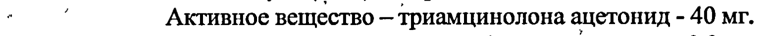
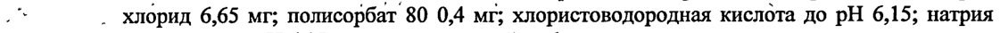
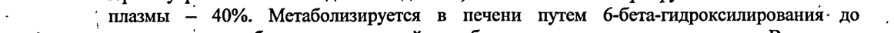
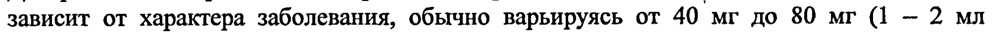
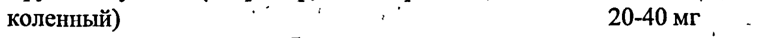
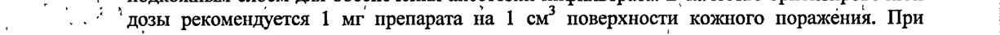
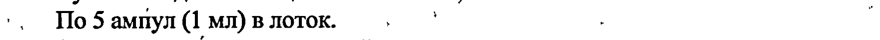

# Триамцинолон — парентерально

- Препарат: Кеналог® (суспензия для инъекций;)
- АТХ: H02AB08
- Источник: ГРЛС, инструкция по медицинскому применению, РУ П N015871/01, файл от  (https://grls.rosminzdrav.ru/Grls_View_v2.aspx?routingGuid=02dc240d-4d75-4671-a1b2-3ac0bacfb1bb)
- Распознано автоматически (OCR): 9 из 9 стр.
- Инструкция к другому РУ того же препарата: П N015871/01 (исключено из реестра, решение от 16.09.2020). Текст может быть старше действующего
- Сомнительных строк после OCR: 7 (см. раздел «Проверка распознавания»)

## Общие сведения

, i . ‘ , , 5 у “. , . ‚ . + ‘, “ a .
о os II N015871/01-140211 | ` ae „ +: > te й ’ ; + й . `
‚ , г“ , ' an , . . И . + .
_ ‚ Внимательно прочитайте эту Инструкцию перед тем как начать прием этого |
| лекарства.
® Сохраните Инструкцию, она может потребоваться вновь. у e Ecauy Вас возникли вопросы, обратитесь к врачу.
®‚ Это лекарство назначено лично Вам, и его не следует передавать другим лицам, поскольку оно может причинить им вред даже при наличии тех же симптомов, что UY
Вас. | . | Инструкция | | К: по медицинскому применению препарата‘ * ro, Se
Se _ КЕНАЛОГ® . a | a ® РЕГИСТРАЦИОННЫЙ НОМЕР: eo, Oo, |
.
‚ ‚ ТОРГОВОЕ НАЗВАНИЕ: Кеналог® , ‚, `’ МНИ: Триамцинолон :; ` 7
| ’ ‘+ ЛЕКАРСТВЕННАЯ ФОРМА: Суспензия для инъекций : ; 7
| СОСТАВ: . |. . т | ., - ’ Однаампула (1 мл) содержит: `, И:
° ‘ Активное вещество — триамцинолона ацетонид - 40 мг.
`' Вспомогательные вещества: бензиловый спирт 9,9 мг; кармеллоза натрия 6,3 мг; натрия
.“ . хлорид 6,65 мг; полисорбат 80 0,4 мг; хлористоводородная кислота до pH 6,15; натрия
‚ _. Гидроксид до pH 6,15; вода для инъекций до 1 мл. И и ОПИСАНИЕ: Суспензия белого цвета со слабым запахом бензилового спирта.
; ‘ 1 ,.
`` `` ФАРМАКОТЕРАПЕВТИЧЕСКАЯ ГРУППА:
ЗИ Глюкокортикостероид . ., ;
, о. ‘’ КОД АТХ: HO2ZABO8 ° `` | | ФАРМАКОЛОГИЧЕСКОЕ ДЕЙСТВИЕ: . |
` Глюкокортикостероид (ГКС), тормозит высвобождение интерлейкина-1,2,гамма- | интерферона` из лимфоцитов и макрофагов. Оказывает противовоспалительное, ;
противоаллергическое, десенсибилизирующее, противошоковое, антитоксическое и иммунодепрессивное действие.
Подавляет ‹ высвобождение гипофизом адренокортикотропного гормона и беталипотропина, но не снижает уровень циркулирующего бета-эндорфина. Угнетает секрецию тиреотропного гормона и фолликулостимулирующего гормона.
Повышает возбудимость центральной нервной системы, снижает количество лимфоцитов .
и эозинофилов, увеличивает число эритроцитов (3a счет усиления. выработки эритропоэтинов). р | .
. Взаимодействует со специфическими IHTONNa3MaTH4eCKHMH: рецепторами, образуя wo комплекс, проникающий в ядро клетки. Синтезированная мРНК индуцирует образование ›
` ‚ белков (в тч.липокортина), опосредующих клеточные эффекты. Липокортин угнетает
. ‚ фосфолипазу A2, подавляет высвобождение арахидоновой кислоты и ингибирует синтез
` эндоперекисей, простагландинов, лейкотриенов, способствующих процессу воспаления.
, . . , 1 .. . „` 8 . oo ty 4 co 4 . ы ey . * ` . . x 2 -
‘ . 1 . ы , И о oo П N015871/01-140211 |
, ry . , , a * 4 i. й . , ‘ ; ‘ ' . * , , , . , `
Белковый обмен: : уменьшает ‘количество белка в плазме (за счет глобулинов) с повышением коэффициента альбумин/глобулин, повышает синтез альбуминов в печени и почках; усиливает катаболизм белка в мышечной ткани.
Липидный обмен: повышает синтез полиненасыщенных жирных кислот и триглицеридов, | перераспределяет жир (накопление жира преимущественно в области плечевого, пояса, лица, живота), приводит к развитию гиперхолестеринемии. |
Углеводный обмен: увеличивает абсорбцию углеводов из желудочно-кишечного тракта;
повышает активность глюкозо-6-фосфатазы, что приводит к повышению поступления | глюкозы из печени в кровь; повышает активность фосфоэнолпируваткарбоксилазы. и , синтез аминотрансфераз, приводящих к активации глюконеогенеза. |
Водно-электролитный обмен: задерживает ионы натрия и воду в организме, стимулирует выведение ионов калия (минералокортикостероидная активность), снижает абсорбцию
``. Ионов кальция из желудочно-кишечного тракта`повышает их почечную экскрецию. = = 7?” 7”
. Противовоспалительный эффект связан с угнетением высвобождения эозинофилами | 7 медиаторов воспаления; индуцированием образования липокортинов‘ и уменьшения
` количества тучных клеток, вырабатывающих гиалуроновую кислоту; с уменьшением |
‚ проницаемости капилляров; стабилизацией клеточных мембран` и мембран органелл
_ © (особенно лизосомальных). , | | Противоаллергический эффект развивается в результате подавления синтеза и секреции
| , медиаторов аллергии, торможения высвобождения из сенсибилизированных тучных клеток и базофилов гистамина и др. биологически активных веществ, уменьшения числа
-. циркулирующих базофилов, подавления развития лимфоидной и соединительной ткани, | о . снижения количества Т- и В-лимфоцитов, тучных клеток, снижения‘‹чувствительности
В эффекторных клеток к медиаторам аллергии, угнетения антителообразования. ``.
При обструктивных заболеваниях дыхательных путей действие основывается, главным
| образом, на. торможении воспалительных процессов, угнетении эозинофильной
| os, . ° инфильтрации подслизистого слоя эпителия бронхов и отложения в слизистой бронхов | циркулирующих . иммунных комплексов, а также торможении эрозирования и | десквамации * слизистой. Повышает чувствительность бета-адренорецепторов бронхов мелкого и среднего калибра к эндогенным . катехоламинам ‹и экзогенным |
, ‘симпатомиметикам, снижает вязкость слизи за счет угнетения или’ сокращения ee |
О продукции. my о” | vO Противошоковое и антитоксическое действие 'связано с повышением артериального
® `° давления (за счет увеличения концентрации циркулирующих катехоламинов и восстановлением чувствительности к ним адренорецепторов, а также вазоконстрикции), |
. снижением проницаемости сосудистой стенки,’ мембранопротективными свойствами, | активацией ферментов печени, участвующих в метаболизме эндо- и ксенобиотиков. |
Иммунодепрессивный эффект обусловлен ‘торможением высвобождения цитокинов
| (интерлейкинов-1,2; гамма-интерферона) из лимфоцитов и макрофагов. , |
Тормозит соединительнотканные реакции в ходе воспалительного процесса и снижает | возможность образования рубцовой ткани.
По противовоспалительной активности триамцинолон близок к гидрокортизону, триамцинолона ацетонид.в 6 раз активнее. Минералокортикостероидная активность

## 5.2. Фармакокинетика

, При внутримышечном введении медленно, но полностью абсорбируется. Связь с белками`
, При внутримышечном введении медленно, но полностью абсорбируется. Связь с белками`
- ’ плазмы — 40%. Метаболизируется в печени путем 6-бета-гидроксилирования: до .
(т неактивных метаболитов; частичный метаболизм осуществляется в почках. Выводится
‚ почками в форме неактивных продуктов превращения.
a 2 , р me . ok п. . ‘ . ‘ : ` № v | ae о. TEN015871/01-140211 и . , . 1 } ry р ‚. a . ‘ . г. |
После внутримышечного ‘введения максимум эффекта наблюдается ‘спустя 24-48 uy `` 7 продолжительность действия при внутримышечном введении — ,1-6 ‘недель, в полость сустава — несколько недель. ‘ ;

## 4.1. Показания к применению

Системное лечение .
Системное лечение .
`- В качестве кратковременной дополнительной терапии пост-травматического | остеоартрита,. синовита, . остеоартрита, ревматоидного артрита, острого и подсотрого
, бурсита, эпикондилита, острого неспецифическогог теносиновита, острых приступов , подагры, псориатического артрита,.. анкилозирующего спондилита, ювенильного | |
| ревматоидного артрита; ; ° | | - При обострениях или в качестве поддерживающей терапии системной красной т. 7 "~~ волчанки, острого ревматоидного кардита; = = | ae - Пемфигоид, тяжелая мультиформная эритема (синдром Стивенса-Джонса),
- . ° Эксфолиативный дерматит, тяжелый псориаз . у п“ - Выраженные аллергические заболевания: аллергический ринит, бронхиальная ..
п астма, отек Квинке, контактный дерматит, атопический дерматит, аллергические реакции |
‚“ @. на лекарственные средства и сыворотки, укусы насекомых; `’’
‘ - ` Тяжелые хронические аллергические и воспалительные заболевания , органов
, зрения: герпес, ирит, иридоциклит, хориоретинит, диффузный. задний’ увеит, неврит
| , глазного нерва, симпатическая офтальмия, воспаление переднего сегмента; ..
; '. - + Заболевания дыхательных органов: симптоматический “саркоидоз, | бериллиоз,
‚. аспирационная пневмония; ‘ у .
rte ‚ Гематологические заболевания: приобретенная аутоиммунная анемия;
- Онкологические заболевания: паллиативное лечение лейкемии и лейкоза у
, взрослых; острая лейкемия у детей; . an so
| - ‚ При отеках: для усиления `диуреза и лечения протеинурии при нефротическом о идиопатическом синдроме без ‘уремии. или нефротическом синдроме, обусловленном
‚‚ ‘5. системной красной волчанкой. ` a . ‘ | ° ‘ o* ° | |
Местное лечение | | , :
so, Внутрисуставное или_околосуставное введение и введение во влагалище сухожилия в о качестве дополнительной кратковременной ‘терапии при синовите, остеоартрите,
@. ревматоидном артрите,’ остром и подостром бурсите, острых приступах подагры,
‚' эпикондилите, остром неспецифическом теносиновите, — посттравматическом
`. остеоартрите.. oe ПРОТИВОПОКАЗАНИЯ.
- Гиперчувствительность к любому компоненту препарата; .
- - острые вирусные, бактериальные, грибковые системные инфекции;
- при внутримышечном применении — идиопатическая тромбоцитопеническая | пурпура; - .
- ‚ детский возраст до 6 лет (внутримышечное введение) |
‚ С осторожностью: хроническая почечная недостаточность, острый гломерулонефрит;.. . .
ss хронический ‘нефрит; тромбофлебит; тромбоэмболия; остеопороз;’ экзантема; Г“ 7 . метастазирующая карцинома; миастения гравис; цирроз печени; хроническая печеночная "о mo, ` недостаточность, гипотиреоз, тиреотоксикоз, болезнь Иценко-Кушинга, сахарный диабет, us _
| | эзофагит, , гастрит, язвенная ‘болезнь желудка .(активная ‘или латентная фазы); |
. неспецифический язвенный колит с угрозой перфорации или абсцедирования, бессонница, |
; р ” : . й ‘ 2 , , . . й + о “ о : -.` a т ‹’ JTIN015871/01-140211
` . ° , .' , me, ; - . й ы 7 .
- депрессия, эйфория, психоз или психоневроз, иммунодефицитные состояния (в тм. СПИД или ВИЧ инфицирование), проявления герпеса на слизистой оболочке глаз; ‘абсцесс, дивертикулит, недавно перенесенная операция по созданию анастомоза кишечника; | недавно перенесенный инфаркт миокарда), декомпенсированная хроническая сердечная недостаточность, артериальная гипертензия, гиперлипидемия); беременность, период. | кормления грудью; пожилой возраст. .’

## 4.6. Применение при беременности и в период грудного вскармливания

| Данные по безопасности применения` препарата Кеналог беременными женщинами
‚ отсутствуют. При длительном применении препарата Кеналог беременной женщиной. | нельзя исключить нарушение внутриутробного развития плода. ‘При применении
_ ______ препарата в конце беременности существует опасность развития атрофии надпочечников' плода. ee nee rr ae
; При применении препарата во время беременности (а также женщинами детородного возраста вне беременности) следует в каждом. конкретном случае сопоставить
.. предполагаемую пользу для женщины и возможный риск для ребенка. ,
ГКС при системном применении проникают в материнское молоко, поэтому следует в
@: каждом конкретном случае сопоставить предполагаемую пользу для женщины и возможный риск для ребенка. | т й oo СПОСОБ ПРИМЕНЕНИЯ И ДОЗЫ. | ‘
| os Препарат не предназначен для внутривенного, внутрикожного, внутриглазного, эпидурального и интратекального применения. Следует соблюдать осторожность также в отношении непреднамеренного внутрисосудистого введения, прежде всего в область левой стороны лица, кожи головы, а также в ягодицу. ‹ № ie |
Перед применением содержимое ампулы встряхнуть и убедиться в отсутствии частиц или конгломератов. ° ‘ К -.
При длительном применении отмену препарата следует проводить постепенно. |
Системное лечение (внутримышечное введение) ‘.'’ ,
Дозировка для взрослых и подростков старше 12 лет определяется индивидуально и | зависит от характера заболевания, обычно варьируясь от 40 мг до 80 мг (1 — 2 мл препарата). to, ot
® Препарат вводят путем медленной глубокой внутримышечной инъекции в область | ягодицы, используя иглу длиной не менее 3,8 см. После инъекции следует на 1-2 минуты | плотно прижать стерильную салфетку к месту введения препарата. Для лечения сенной |
| , лихорадки и других сезонных аллергических заболеваний обычно достаточно одной и инъекции препарата (40 -100 мг) во время сезона цветения. |
При необходимости нескольких инъекций следует соблюдать интервал между введениями
‚ не менее 4 недель. , :
Детям 6-12 лет: начальная доза - 40 мг, с повторением инъекции через 4 недели по мере необходимости.
Местное лечение а) При внутрисуставном введении доза определяется размерами сустава и тяжестью
, ‚„’ симптомов. Обычно для взрослых и детей старше 12 лет (cm. Противопоказания)
’ используются следующие дозы препарата: . а. .
| | Мелкие суставы (например, фаланги пальцев , р _
`` рук и ног) | - Jo “ yol0mr* - °° ;
7 ` Суставы среднего размера (например; , | mo | плечевой, локтевой) , 20мг - `
| т о ' t _ _ 1 , ’ Sey Е: № = a п №015871/01-140211 .
vo ` , , . “ a , . | , a , ` ee 7 , , 7 р . ae mt ` о, 7 в ° Крупные суставы (например, тазобедренный, я | коленный) и ‚’ 20-40 мг ._
При поражении нескольких суставов общая доза препарата может составлять до 80 мг.
При избыточном количестве синовиальной жидкости часть ее следует удалить при помощи шприца, чтобы избежать разбавления препарата. Для обеспечения более быстрого купирования симптомов препарат можно вводить в комбинации с местным анестетиком
(не содержащим сосудосуживающего препарата). Инъекции следует проводить так, чтобы избежать создания депо препарата в подкожной жировой ткани. При инъекциях следует соблюдать условия строжайшей асептики. Перед проведением внутрисуставной инъекции ‘ участок кожи подготавливают, как перед проведением хирургических операций.
Повторно применять препарат следует не ранее, чем через 2 недели. |
6) При внутриочаговом введении при малых очагах поражения: воспалениях суставной |
~ Г” сумки (бурситах), периоститах взрослым и детям в возрасте старше 12`лет в зависимости ~~ ^^
‚ от величины и локализации подвергаемых лечению поражений вводят до 10 мг препарата |
. и при поражениях большого размера — oT 10 до 40. мг препарата. разбавляют о
; физиологическим раствором натрия хлорида и веерообразно вводят в область, |
., . характеризующуюся наибольшей болезненностью. Следует избегать создания больших a
.. ©® | депо препарата: Кеналог можно также смешивать с местным ‘анестетиком. Повторно |
‚ ‚ применять препарат следует не ранее, чем через две недели. | pes |
‘* в) При:введении в область кожных поражений.1 мл препарата в концентрации 40 мг/мл
(г ( разбавляют ‚ местным’ анестетиком, не содержащим сосудосуживающего вещества, и
‚ перемешивают в шприце. Инъекцию проводят горизонтально в область между кожей и |
* 5, Подкожным слоем для обеспечения анестезии инфильтрата. В качестве ориентировочной |
, ..7 ' дозы рекомендуется 1 мг препарата на 1 см’ поверхности кожного поражения. При |
’ ‚ лечении нескольких очагов поражения в один прием суточная доза препарата взрослым не |
. + Должна превышать 30 мг, а детям (см. Противопоказания) — 10 мг. При келоидных рубцах |
| .^ препарат можно без разбавления непосредственно вводить в ткань рубца; не вводить :
к ° подкожно. Повторно применять препарат следует не ранее, чем через 2 недели.. |
: | , ПОБОЧНОЕ ДЕЙСТВИЕ о , № |
7 Частота развития и выраженность побочных эффектов зависит от. длительности | применения, величины используемой дозы и возможности соблюдения циркадного ритма о” назначения. . ‘ | . us
®. Со_стороны ' эндокринной _системы: нарушения’ менструального цикла: (дисменорея,
| | аменорея), снижение толерантности к глюкозе, глюкозурия, стероидный сахарный диабет
` или манифестация латентного сахарного диабета, повышение потребности в инсулине или пероральных сахароснижающих препаратах при'наличии диабета, угнетение функции о, надпочечников и гипофиза, синдром Иценко-Кушинга (лунообразное лицо, ожирение | у , гипофизарного типа, гирсутизм, повышение АД, мышечная слабость, стрии), задержка
| полового развития у детей.
Со стороны _пищеварительной _ системы: `панкреатит, эрозивный эзофагит, язва с возможными кровотечениями и перфорацией, метеоризм,
Со стороны сердечно-сосудистой системы: аритмии, брадикардии (вплоть до остановки к сердца); развитие (у предрасположенных пациентов) или усиление выраженности сердечной недостаточности, изменения на ЭКГ, характерные для гипокалиемии, повышение . АД, некротизирующий ангиит, гиперкоагуляция, тромбоэмболия, ,
‚ тромбофлебит. | о, 7 Со стороны нервной системы: повышение внутричерепного давления, псевдоопухоль
.. мозга, судороги, головокружение, головная боль, бессонница, парестезия, ухудшение |
` ‘течения психиатрических заболеваний, депрессия (иногда тяжелая), эйфория, перепады ,
, настроения, психозы, изменение личности. ‘ у , ‚
* ‘ { ‘ oe ` . ° т Пе (и. ` TI №015871/01-140211

_— pr о ’. и ЖК my т, ., . . ; a , ` ; .
Со стороны органов чувств: внезапная потеря зрения (возможно отложение кристаллов

`, препарата в камерах глаза), задняя субкапсулярная катаракта, глаукома, повышение

внутриглазного давления с возможным повреждением зрительного нерва, склонность к 1 развитию вторичных бактериальных, грибковых или вирусных инфекций глаз,

трофические изменения роговицы, экзофтальм.

. Со стороны обмена веществ: гипокальциемия, повышение массы тела, отрицательный азотистый баланс, задержка жидкости и натрия (периферические отеки), гипернатриемия, гипокалиемия. ' - ‘ .
Со стороны опорно-двигательного аппарата: замедление роста и процессов окостенения у детей, остеопороз (очень редко — патологические переломы костей, асептический некроз | головки плечевой и бедренной кости), разрыв. сухожилий мышц, стероидная миопатия, | снижение мышечной массы (атрофия). ‘ os

Co “Co_CTOPOHE! кожных MOKPOBOB _и ‘слизистых ‘оболочек: `петехии,` 9KXHMO3bI, гипер-`или ^^^” \
. гипопигментация, склонность к развитию пиодермии и кандидозов, гирсутизм, - замедленное заживление ран, истончение кожи, стероидные угри, стрии, эритема в
. . области лица, повышенное потоотделение, волчанко-подобные повреждения кожи.
., Аллергические реакции: генерализованные (кожная`сыпь, зуд, анафилактический шок), |
®. ‚ местные аллергические реакции. ‘ , ‘
. -’ Общие: развитие или обострение инфекций, лейкоцитурия, синдром‘ «отмены» после |
: ." ' резкого прекращения использования препарата. ‘ ‚ ^ ОК
, ° B месте введения: жжение, онеменение, боль, покалывание, инфекции (стерильный
| абсцесс), некроз окружающих тканей, образование рубцов в месте инъекции, атрофия
| ^ кожи и подкожной . клетчатки при в/м введении (особенно опасно введение в | дельтовидную мышцу). `. , 2.
ПЕРЕДОЗИРОВКА oo | | ‚ | Симптомы: спутанность сознания, тошнота, рвота, расстройства .сна, эйфория, возбуждение, депрессия, желудочно-кишечные кровотечения, ‘носовые кровотечения,
, лунообразное лицо, артериальная гипертензия. При длительном применении и быстрой отмене препарата — угнетение функции коры надпочечников, синдром Кушинга.
’‘ В случаях передозировки необходимо снижать дозу до постепенной отмены препарата и
| ‚‘ проводить симптоматическое лечение. Специфического антидота нет. Эффекты pe 4 передозировки могут сохраняться несколько недель.
. @: > у ВЗАИМОДЕЙСТВИЕ С ДРУГИМИ ЛЕКАРСТВЕННЫМИ ПРЕПАРАТАМИ |
=" Сочетанное применение с нестероидными противовоспалительными средствами повышает риск возникновения желудочно-кишечных кровотечений и образования язв. `.
Кеналог может повышать почечный клиренс салицилатов, поэтому на их фоне |
| концентрация салицилатов в сыворотке крови может снижаться. С другой стороны, отмена терапии препаратом Кеналог на фоне приема высоких доз салицилатов может | привести к токсическому действию последних. Следует соблюдать особую осторожность при одновременном назначении ГКС и ацетилсалициловой кислоты пациентам с гипопротромбинемией.
При совместном применении ГКС и кетоконазола клиренс ГКС снижается, что приводит к усилению их эффекта.
Сывороточная концентрация изониазида может снижаться при его применении вместе с
‚о Одновременное применение циклоспорина и ГКС приводит к усилению эффекта одих
` ‚ препаратов. `` Lo, ; т — ‘’Трициклические антидепресанты могут усиливать выраженность депрессии, вызванной .,
‚ ' 7°) приемом ГКС, поэтому они не показаны для терапии данных побочных эффектов. ;
у ‚ . - | Dy . | - . ot. ; - я Бы“ и ИКИ о
.` В и 0№0158701-44027 .
При одновременном приеме с пероральными контрацептивами период полувыведения
ГКС может удлиняться, их эффект усиливаться, а частота побочных эффектов возрастать.
Эффективность препарата Кеналог может снизиться, если он вводится одновременно с индукторами печеночных ферментов (рифампицин, барбитураты, ‘фенитоин, карбамазепин, примидон, эфедрин и аминоглутетимид). .
ГКС снижают терапевтический эффект противодиабетических средств, усиливают или .
ослабляют действие антикоагулянтов.
При одновременном назначении. амфотерицина В и средств, вымывающих калий из
‘ организма, ГКС могут усиливать гипокалиемию. , '
Ингибиторы ацетилхолинэстеразы и ГКС проявляют антагонизм при совместном — применении. . И , | о. Комбинированное применение ГКС и препаратов наперстянки может приводить к
`_ усилению токсичности последних: SSS en
Действие гормона роста может ослабляться под действием ГКС. :
Эффект недеполяризующих миорелаксантов может усиливаться или ослабляться под |
‚ | действием ГКС. ` ; mo ' При одновременном применении ГКС с живыми противовирусными вакцинами и на фоне |
@: других видов иммунизаций увеличивается риск активации вирусов и развития инфекций. |
При терапии ГКС могут наблюдаться ложно-отрицательные результаты тестов на наличие |
. у бактериальной инфекции. | : , | ОСОБЫЕ УКАЗАНИЯ о И ‚:
Препарат не предназначен для внутривенного, внутрикожного, внутриглазного, | о“ эпидурального и интратекального применения. Серьезные нежелательные явления были | т отмечены при эпидуральном и интратекальном способах введения. | a co Для предупреждения атрофии тканей в месте внутримышечной инъекции следует водить | препарат глубоко в ягодичную мыщцу.: р , |
. Препарат оказывает терапевтический эффект в течение длительного периода времени
|. после введения, однако, он не предназначен для применения в экстренных ситуациях.
. , | , При местном применении ' препарата необходимо оценить ‘ero совместимость с |
, ` одновременно вводимыми местными анестетиками: |
‚ Допускается смешивание с равным объемом растворов местных анестетиков (1% раствор
® прокаина или 1% раствор лидокаина) в шприце, но не в ампуле. |
До начала и во время ГКС терапии необходимо контролировать общий анализ крови, | гликемию, содержание электролитов в плазме крови. ' |
При длительном применении ГКС возрастает риск развития субкапсульной катаракты и | глаукомы, иногда с повреждением глазного нерва. Может также увеличиться частота вторичных инфекций глаз.
Необходимо исследование синовиальной жидкости в каждом суставе для исключения септического процесса. Значительное усиление болей, сопровождающееся местным отеком, дальнейшим ограничением подвижности сустава, лихорадкой и недомоганием, дает основание предположить развитие септического артрита. Если сепсис подтверждается, необходимо проведение соответствующей антимикробной терапии. При терапии во время интеркуррентных инфекций, септических состояний, туберкулезе — одновременно проводят лечение антибиотиками. ..
° Не следует вводить в «нестабильные» суставы, в область ахиллова сухожилия. (риск
. . разрыва). у , .
i Вакцинация живыми BUPYCHEIMH вакцинами противопоказана в течение терапии ГКС. °.
so Иммунизация убитыми вирусными или бактериальными вакцинами Ha фоне применения .
ГКС не обеспечивает ожидаемый рост количества антител и не дает ожидаемый защитный .
. 7 . , , , . 7 т" т Lo _ ot П N015871/01-140211
. . , : "4 .
: ran | | ‘ 2 , | + | у ~ эффект. Поэтому подобные препараты не следует назначать за 8 недель до и в течение 2 недель после вакцинации. ‘
У больных, He болевших ветряной оспой и получающих лечение ГКС, возрастает риск :
заболевания ветряной оспой или герпетической инфекцией при случайном контакте с инфицированными лицами. В таких случаях рекомендуется пассивная иммунизация.
Осторожность необходима у больных после операций и переломов костей, поскольку
- ‚ ` глюкокортикостероиды могут замедлять заживление ран и переломов в связи с усилением | выведения кальция из организма. |
Действие ГКС усиливается у больных с циррозом печени или гипотиреозом.
Применение ; препарата Кеналог может изменять ‘показатели тестов на гиперчувствительность. ° .
ГКС могут маскировать некоторые признаки имеющихся инфекционных заболеваний, а
~~ > `` также’ появление `инфекции` в` процессе ` лечения. `При`их` приеме могут ` отмечаться ^^ ^:
, снижение иммунитета и ослабление процесса локализации инфекции.
Применение ГКС может спровоцировать ухудшение состояния и усиление миграции |
-_ личинок ,y больных стронгилоидозом, что может привести тяжелому энтероколиту и летальному исходу вследствие грам-негативной септицемии. |
@ ’ При применении ГКС (особенно высоких и средних доз гидрокортизона HM, кортизола)
‚| ' могут наблюдаться повышение артериального давления, задержка жидкости и солей,
| ‚о усиленное выведение калия. Хотя эти явления, менее выражены при назначении , |
, + * синтетических ГКС (таких ‘как препарат Кеналог), однако, могут потребоваться. :
о ограничение соли в пище и дополнительный прием препаратов калия. При длительном , |
, применении препарата следует обеспечить достаточное потребление белковой пищи, о
‚‘ р необходимой для поддержания азотного баланса организма. , ' о При наличии у пациента язвенной болезни желудка ее обострение на фоне лечения ГКС | о. может быть бессимптомным до момента прободения язвы или начала кровотечения.
Учитывая также тот факт, что ГКС при длительном применении вызывают повышенную |
Г. кислотность желудочного сока, что может привести к образованию язвы желудка, следует , назначить соответствующую схему лечения язвенной болезни. oo
У детей в период роста ГКС должны применяться только по абсолютным показниям и под |
| - особо тщательным наблюдением лечащего врача.
При лечении ГКС могут наблюдаться нарушения менструального цикла.
В связи с риском развития тяжелых аллергических реакции (вплоть до анафилактического
, ® шока) на фоне парентерального введения ГКС, следует соблюдать особую осторожность при лечении пациентов с аллергиями в анамнезе. у |
Препарат содержит бензиловый спирт, способный вызывать серьезные побочные реакции
(в том числе с летальным исходом), особенно у детей. Это следует учитывать при назначении пациентам (особенно детям) высоких доз препарата Кеналог и длительных курсов лечения. о |

## 4.7. Влияние на способность управлять транспортными средствами, механизмами

В период лечения необходимо воздерживаться от вождения автотранспорта и занятий потенциально опасными видами деятельности, требующими повышенной концентрации | внимания и быстроты психомоторных реакций.
р | | . ФОРМА ВЫПУСКА . ;
| Суспензия для инъекций 40 мг/мл. , р ’, По 5 ампул (1 мл) в лоток. . ° | 1 лоток вместе с инструкцией по применению помещен в картонную пачку. ‹ ` a
. , , ‘ ? О II №015871/01-140211 СРОК ГОДНОСТИ | 3 года.
Не использовать препарат после истечения срока годности, указанного на упаковке.
ХРАНЕНИЕ При температуре от 15 до 25°С в защищенном от света месте. |
Хранить в недоступном для детей месте.
Список Б.
УСЛОВИЯ ОТПУСКА ИЗ АПТЕК | По рецепту.
® ВЛАДЕЛЕЦ РЕГИСТРАЦИОННОГО УДОСТОВЕРЕНИЯ
| Бристол-Майерс Сквибб Компани, США 345, Парк-авеню, г. Нью-Йорк, штат Нью-Йорк, США
Bristol-Myers Squibb Company, USA | 345, Park Avenue, New York, New York, USA
ПРОИЗВОДИТЕЛЬ, ФАСОВЩИК, УПАКОВЩИК, ВЫПУСКАЮЩИЙ |
КОНТРОЛЬ КАЧЕСТВА . Бристол-Майерс Сквибб С.р.Л., Италия
Локалита Фонтана дель Черазо, 03012, Ананьи (ФР), Италия
©® Bristol-Myers Squibb S.r.L., Italy | Localita Fontana del Ceraso, 03012, Anagni (FR), Italy
Претензии потребителей направлять по адресу
` ООО «Бристол-Майерс Сквибб», | 105064, Москва, Земляной вал, д.9. |
Тел. (495) 755-92-67, факс (495) 755-92-62, | ой ВЕСЬ
Менеджер департамента нормативного Loops £e oN
</о А обеспечения & 4 отдел № ol | регистра *
OOO «Бристол-Майерс Сквибб» ®\+\ икачес № v Н.Ю. Семенова
© y= а 77555 es * MOCKBA *
## Проверка распознавания

Страницы-сканы распознаны автоматически. В 7 строках с дозировками цифры могли распознаться с ошибкой — сверьте с вырезкой из оригинала:

- стр. 1: «° ‘ Активное вещество — триамцинолона ацетонид - 40 мг.» — повторное чтение: «- | Активное вещество — триамцинолона ацетонид - 40 Mr.»  
  
- стр. 1: «.“ . хлорид 6,65 мг; полисорбат 80 0,4 мг; хлористоводородная кислота до pH 6,15; натрия» — повторное чтение: «.* . хлорид 6,65 Mr; полисорбат 80 0,4 мг; хлористоводородная кислота до РН 6,15; натрия»  
  
- стр. 2: «- ’ плазмы — 40%. Метаболизируется в печени путем 6-бета-гидроксилирования: до .» — низкая уверенность: «6-бета-гидроксилирования:» (69)  
  
- стр. 4: «зависит от характера заболевания, обычно варьируясь от 40 мг до 80 мг (1 — 2 мл» — повторное чтение: «зависит от характера заболевания, обычно варьируясь от 40 мг до 80 mr (1 — 2 мл»  
  
- стр. 5: «коленный) и ‚’ 20-40 мг ._» — низкая уверенность: «20-40» (69)  
  
- стр. 5: «, ..7 ' дозы рекомендуется 1 мг препарата на 1 см’ поверхности кожного поражения. При |» — низкая уверенность: «..7» (0)  
  
- стр. 8: «’, По 5 ампул (1 мл) в лоток. . ° |» — низкая уверенность: «5» (0)  
  
